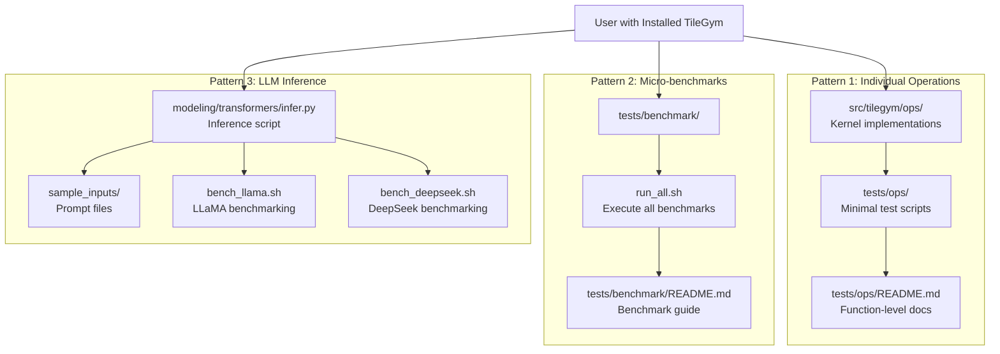
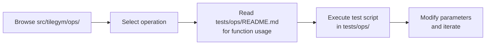
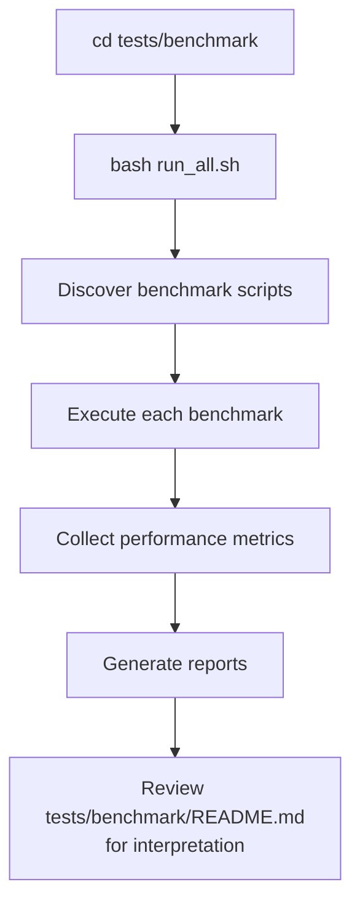
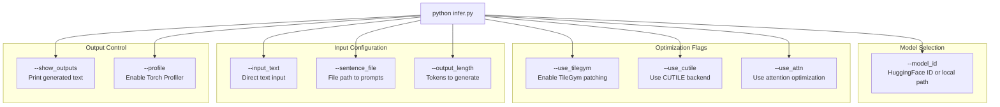
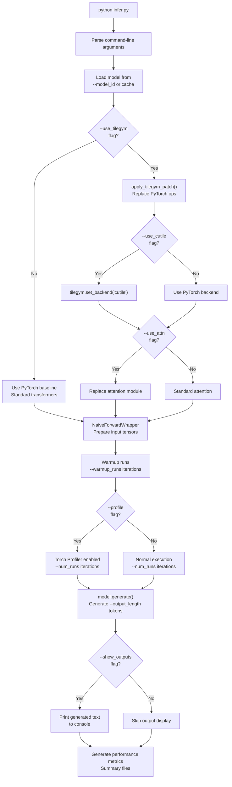

<!-- source: DeepWiki mcp.deepwiki.com · repo NVIDIA/TileGym · page 2.2 Quick Start Guide · fetched 2026-10-26 -->

# Quick Start Guide

<details>
<summary>Relevant source files</summary>

The following files were used as context for generating this wiki page:

- [README.md](README.md)
- [modeling/transformers/README.md](modeling/transformers/README.md)

</details>


This guide provides a step-by-step walkthrough for running your first TileGym examples and understanding the basic usage patterns. It assumes you have completed the installation steps covered in [Prerequisites and Installation](#2.1). For detailed transformer inference configuration, see [Running Inference](#4.2). For comprehensive benchmarking methodologies, see [Benchmarking Performance](#4.3).

## Usage Patterns Overview

TileGym supports three primary usage patterns, each serving different development and evaluation needs. The table below summarizes these patterns and their typical use cases:

| Pattern | Primary Purpose | Entry Point | Typical Users |
|---------|----------------|-------------|---------------|
| **Individual Operations** | Test and explore kernel implementations | `src/tilegym/ops/` | Kernel developers, researchers |
| **Micro-benchmarks** | Evaluate kernel performance in isolation | `tests/benchmark/run_all.sh` | Performance engineers |
| **LLM Inference** | End-to-end transformer model acceleration | `modeling/transformers/infer.py` | ML engineers, practitioners |

Sources: [README.md:64-99]()

## TileGym Usage Workflow

The following diagram illustrates how the three usage patterns relate to the TileGym codebase structure and typical user workflows:



Sources: [README.md:64-99](), [modeling/transformers/README.md:1-196]()

## Pattern 1: Exploring Individual Operations

### Overview

The `src/tilegym/ops/` directory contains all kernel implementations. Each operation can be tested independently using minimal scripts located in `tests/ops/`. This pattern is ideal for understanding individual kernel behavior and developing new operations.

### Basic Workflow



### Example: Testing an Operation

1. **Browse available operations** in `src/tilegym/ops/`
2. **Consult the operation documentation** at `tests/ops/README.md` for function-level usage examples
3. **Run minimal test scripts** to validate operation behavior

The documentation provides function signatures, parameter descriptions, and minimal usage examples for each operation in TileGym's kernel library.

Sources: [README.md:66-69]()

## Pattern 2: Running Micro-benchmarks

### Overview

Micro-benchmarks evaluate individual kernel performance in controlled conditions. The benchmarking infrastructure is located in `tests/benchmark/` and provides automated execution of all performance tests.

### Quick Start

Execute all benchmarks using the unified script:

```bash
cd tests/benchmark
bash run_all.sh
```

This command runs the complete benchmark suite and generates performance metrics for all implemented kernels. Detailed benchmark configuration and result interpretation are available in `tests/benchmark/README.md`.

Sources: [README.md:70-79]()

### Benchmark Execution Flow



Sources: [README.md:70-79]()

## Pattern 3: Running LLM Transformer Inference

### Overview

The transformer inference pattern demonstrates TileGym's kernel integration in end-to-end LLM scenarios. The primary entry point is `modeling/transformers/infer.py`, which supports models like LLaMA 3.1 and DeepSeek V2.

### Supported Models

| Model | Model ID | Compatible GPUs |
|-------|----------|-----------------|
| LLaMA-3.1-8B | `meta-llama/Meta-Llama-3.1-8B` | B200, RTX 5080, RTX 5090 |
| DeepSeek-V2-Lite-Chat | `deepseek-ai/DeepSeek-V2-Lite-Chat` | B200 only (high memory) |

Sources: [modeling/transformers/README.md:9-18]()

### Installation Prerequisites

Before running transformer inference, install the additional dependency:

```bash
pip install accelerate --no-deps
```

Sources: [README.md:85-89]()

### Basic Inference Examples

The following diagram shows the command structure and key flags for `infer.py`:



Sources: [modeling/transformers/README.md:146-163]()

#### Example 1: Baseline PyTorch Inference

Run standard transformer inference without TileGym optimizations:

```bash
python infer.py --model_id meta-llama/Meta-Llama-3.1-8B --show_outputs
```

This command executes inference using the baseline PyTorch implementation. The `--show_outputs` flag prints the generated text to the console.

Sources: [modeling/transformers/README.md:44-45]()

#### Example 2: TileGym-Optimized Inference

Enable TileGym's CUTILE-optimized kernels and attention optimizations:

```bash
python infer.py \
    --model_id meta-llama/Meta-Llama-3.1-8B \
    --use_tilegym \
    --use_cutile \
    --use_attn \
    --show_outputs
```

The optimization flags activate TileGym's kernel replacement mechanism:
- `--use_tilegym`: Enables the patching system that intercepts PyTorch operations
- `--use_cutile`: Activates the CUTILE backend for tile-based optimizations
- `--use_attn`: Replaces standard attention with TileGym's optimized implementation

Sources: [modeling/transformers/README.md:47-49]()

#### Example 3: Custom Input from File

Use pre-defined prompt files from the `sample_inputs/` directory:

```bash
python infer.py \
    --model_id meta-llama/Meta-Llama-3.1-8B \
    --use_tilegym \
    --use_cutile \
    --use_attn \
    --sentence_file sample_inputs/input_prompt_32K.txt \
    --output_length 100
```

Available sample input files:
- `sample_inputs/input_prompt_small.txt`: Quick testing
- `sample_inputs/input_prompt_32K.txt`: Standard 32K context
- `sample_inputs/input_prompt_256K.txt`: Long-context testing (256K tokens)

The `--output_length` parameter controls the number of tokens to generate.

Sources: [modeling/transformers/README.md:54-61](), [modeling/transformers/README.md:131-133]()

#### Example 4: Custom Text Input

Provide input text directly via command line:

```bash
python infer.py \
    --model_id meta-llama/Meta-Llama-3.1-8B \
    --use_tilegym \
    --use_cutile \
    --use_attn \
    --input_text "Explain machine learning" \
    --show_outputs
```

Sources: [modeling/transformers/README.md:63-70]()

#### Example 5: Performance Profiling

Enable Torch Profiler to collect detailed performance metrics:

```bash
python infer.py \
    --model_id meta-llama/Meta-Llama-3.1-8B \
    --sentence_file sample_inputs/input_prompt_32K.txt \
    --use_tilegym \
    --use_cutile \
    --use_attn \
    --profile \
    --num_runs 5
```

The `--profile` flag activates PyTorch's profiler, which generates:
- Throughput measurements (tokens/second)
- Generation latency metrics
- CUDA kernel execution times
- Chrome trace files for visualization

The `--num_runs` parameter specifies how many benchmark iterations to execute.

Sources: [modeling/transformers/README.md:74-84]()

### Quick Benchmarking Scripts

TileGym provides automated benchmark scripts that compare PyTorch baseline against TileGym-optimized implementations:

```bash
# Benchmark LLaMA-3.1-8B
./bench_llama.sh

# Benchmark DeepSeek-V2-Lite
./bench_deepseek.sh
```

These scripts execute both baseline and optimized inference runs with profiling enabled, generating comprehensive performance comparisons.

Sources: [modeling/transformers/README.md:90-100]()

### Inference Execution Flow

The following diagram illustrates the execution path through `infer.py` with key code entities:



Sources: [modeling/transformers/README.md:39-84](), [modeling/transformers/README.md:146-163]()

## Docker-Based Quick Start

For reproducible environments, use the containerized setup:

```bash
# Build the container
docker build -t tilegym-transformers -f modeling/transformers/Dockerfile .

# Run interactive session
docker run --gpus all -it tilegym-transformers bash

# Inside container, run inference
python infer.py \
    --model_id meta-llama/Meta-Llama-3.1-8B \
    --use_tilegym \
    --use_cutile \
    --use_attn \
    --show_outputs
```

Alternatively, execute inference directly without entering the container:

```bash
docker run --gpus all -it tilegym-transformers \
    python infer.py \
        --model_id deepseek-ai/DeepSeek-V2-Lite-Chat \
        --use_tilegym \
        --use_cutile \
        --use_attn \
        --show_outputs
```

The Docker image includes all dependencies pre-configured with CUDA 13.1, PyTorch, and TileGym. See [Docker Deployment](#5) for detailed container management.

Sources: [README.md:91-98](), [modeling/transformers/README.md:22-37]()

## Common Command-Line Flags Summary

The following table summarizes the most frequently used flags across TileGym's inference tools:

| Flag | Type | Purpose | Default Value |
|------|------|---------|---------------|
| `--model_id` | string | HuggingFace model ID or local path | `meta-llama/Meta-Llama-3.1-8B` |
| `--use_tilegym` | boolean | Enable TileGym kernel patching | `False` |
| `--use_cutile` | boolean | Activate CUTILE backend | `False` |
| `--use_attn` | boolean | Use optimized attention implementation | `False` |
| `--input_text` | string | Direct text input for inference | None |
| `--sentence_file` | string | Path to input prompt file | None |
| `--output_length` | integer | Number of tokens to generate | `100` |
| `--batch_size` | integer | Batch size for inference | `1` |
| `--precision` | string | `bfloat16` or `float32` | `bfloat16` |
| `--num_runs` | integer | Number of benchmark iterations | `5` |
| `--warmup_runs` | integer | Number of warmup iterations | `2` |
| `--profile` | boolean | Enable Torch Profiler | `False` |
| `--show_outputs` | boolean | Print generated text to console | `False` |

Sources: [modeling/transformers/README.md:146-163]()

## Next Steps

After completing this quick start guide:

- **Explore operations in detail**: Review [tests/ops/README.md]() for comprehensive operation documentation
- **Understand benchmarking methodology**: See [Benchmarking Performance](#4.3) for detailed performance analysis techniques
- **Configure custom inference**: Consult [Running Inference](#4.2) for advanced configuration options
- **Deploy in production**: Review [Docker Deployment](#5) for containerized deployment strategies
- **Contribute kernels**: See [Development Guide](#6) for extending TileGym with custom operations

---

