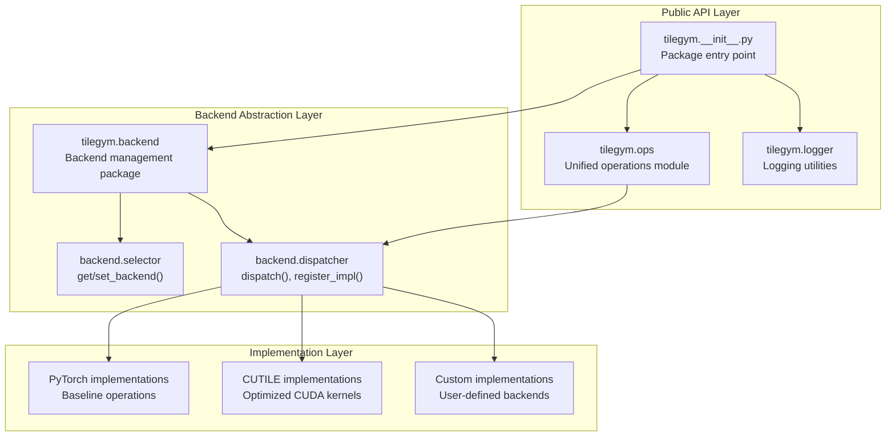
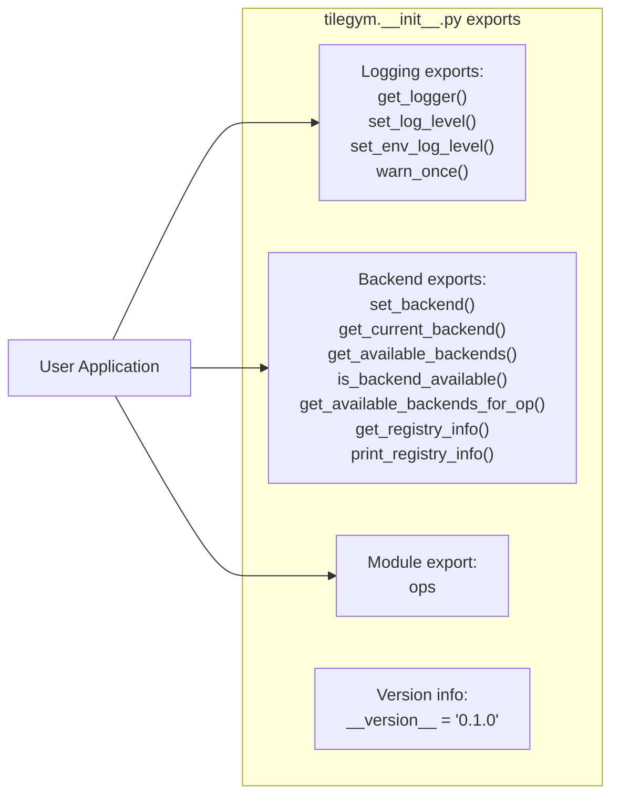
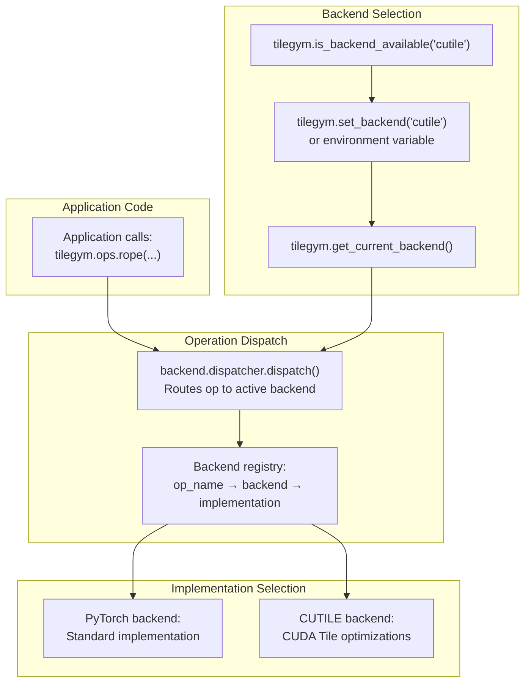
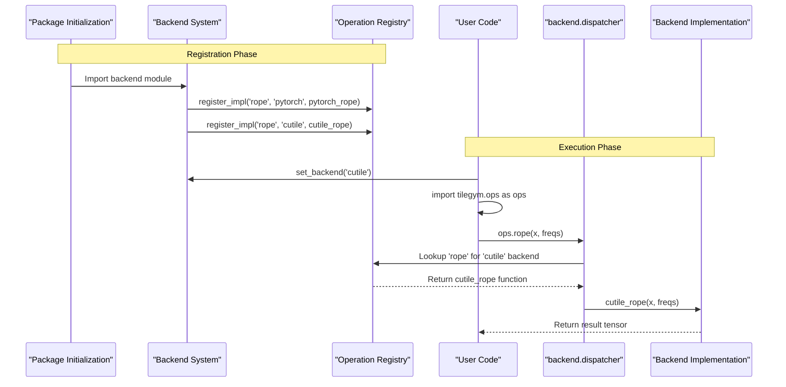
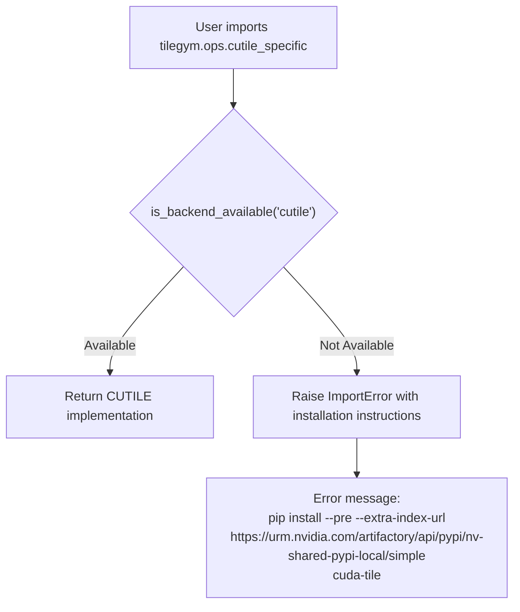
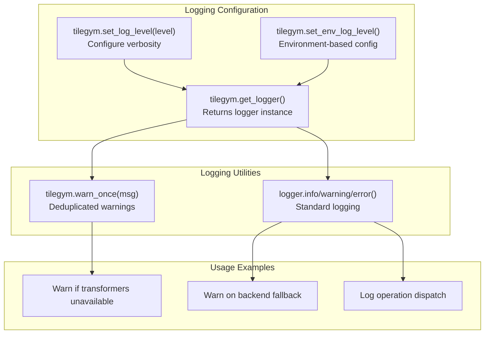

<!-- source: DeepWiki mcp.deepwiki.com · repo NVIDIA/TileGym · page 3 Core Library · fetched 2026-10-26 -->

# Core Library

<details>
<summary>Relevant source files</summary>

The following files were used as context for generating this wiki page:

- [src/tilegym/__init__.py](src/tilegym/__init__.py)
- [src/tilegym/backend/__init__.py](src/tilegym/backend/__init__.py)

</details>


## Purpose and Scope

The Core Library constitutes the foundational layer of TileGym, providing a unified, backend-agnostic interface for GPU kernel operations. This document covers the architecture of the `tilegym` Python package and its backend abstraction system.

For detailed information about the package organization and module structure, see [Package Architecture](#3.1). For information about backend selection, operation dispatch, and implementation registration, see [Backend Management System](#3.2).

**Sources:** Diagram 2 from provided context, [src/tilegym/__init__.py:1-53]()

---

## High-Level Architecture

The Core Library implements a three-layer architecture that separates user-facing APIs from hardware-specific implementations:



**Package Layer Responsibilities:**

| Layer | Module | Primary Functions | Purpose |
|-------|--------|------------------|---------|
| Public API | `tilegym.__init__.py` | `set_backend()`, `get_current_backend()`, `ops` | User-facing interface, exports core functionality |
| Public API | `tilegym.ops` | Operation implementations | Unified operations API (RoPE, attention, etc.) |
| Public API | `tilegym.logger` | `get_logger()`, `set_log_level()`, `warn_once()` | Logging and diagnostic utilities |
| Backend Abstraction | `tilegym.backend.selector` | `set_backend()`, `get_available_backends()` | Backend selection and availability checks |
| Backend Abstraction | `tilegym.backend.dispatcher` | `dispatch()`, `register_impl()` | Operation routing and implementation registry |
| Implementation | Backend-specific modules | Actual kernel implementations | Hardware-optimized operations |

**Sources:** [src/tilegym/__init__.py:1-53](), [src/tilegym/backend/__init__.py:1-67](), Diagram 2 from provided context

---

## Package Entry Point

The `tilegym` package exposes its functionality through `__init__.py`, which serves as the primary integration point for applications:



**Core Exports:**

The package initialization follows a specific import order to avoid circular dependencies:

1. **Logging utilities** ([src/tilegym/__init__.py:5-11]()): Imported first to enable diagnostics during subsequent imports
2. **Backend management** ([src/tilegym/__init__.py:14-20]()): Initialized before operations to ensure backend selector is ready
3. **Operations module** ([src/tilegym/__init__.py:23]()): Imported after backend system is available
4. **Optional dependencies** ([src/tilegym/__init__.py:25-28]()): Transformers library with graceful fallback

**Sources:** [src/tilegym/__init__.py:1-53]()

---

## Backend Abstraction System

The backend abstraction system decouples operation semantics from hardware-specific implementations, enabling runtime backend selection without code changes:



**Key Backend Functions:**

| Function | Module | Purpose | Returns |
|----------|--------|---------|---------|
| `set_backend(name)` | `backend.selector` | Set active backend | None |
| `get_current_backend()` | `backend.selector` | Query active backend | str (backend name) |
| `get_available_backends()` | `backend.selector` | List all available backends | list[str] |
| `is_backend_available(name)` | `backend.selector` | Check backend availability | bool |
| `dispatch(op_name, *args, **kwargs)` | `backend.dispatcher` | Route operation to backend | Operation result |
| `register_impl(op_name, backend, impl)` | `backend.dispatcher` | Register implementation | None |
| `get_available_backends_for_op(op_name)` | `backend.dispatcher` | Backends supporting operation | list[str] |
| `get_registry_info()` | `backend.dispatcher` | Diagnostic information | dict |

**Sources:** [src/tilegym/__init__.py:14-20](), [src/tilegym/backend/__init__.py:9-23]()

---

## Backend Registration and Dispatch Flow

The following diagram illustrates how operations are registered and dispatched to backend implementations:



**Dispatch Mechanism:**

The dispatcher provides a centralized routing system that:

1. **Looks up** the current backend via `get_current_backend()`
2. **Queries** the registry for `(op_name, backend)` → `implementation`
3. **Invokes** the implementation with provided arguments
4. **Falls back** to alternative backends if primary is unavailable
5. **Raises** informative errors if no implementation exists

**Sources:** [src/tilegym/backend/__init__.py:17-23]()

---

## CUTILE Backend Availability Handling

The package provides graceful degradation when the CUTILE backend is unavailable:



**Implementation Details:**

The `make_missing_backend_handler()` function ([src/tilegym/backend/__init__.py:25-48]()) generates a custom `__getattr__` that:

1. Intercepts attribute access on backend-specific modules
2. Checks if CUTILE backend is available via `is_backend_available("cutile")`
3. Provides installation instructions if unavailable
4. Raises `AttributeError` for truly missing attributes

This pattern ensures users receive actionable error messages rather than cryptic import failures.

**Sources:** [src/tilegym/backend/__init__.py:25-48]()

---

## Logging Infrastructure

TileGym includes a centralized logging system for diagnostics and debugging:



**Logger Functions:**

| Function | Purpose | Example Use Case |
|----------|---------|-----------------|
| `get_logger()` | Retrieve package logger | Access logging in any module |
| `set_log_level(level)` | Set verbosity (DEBUG, INFO, WARNING) | Control diagnostic output |
| `set_env_log_level()` | Configure via environment variable | Production deployment |
| `warn_once(msg)` | Emit warning once per message | Avoid log spam for repeated issues |

The logger is initialized early ([src/tilegym/__init__.py:6-11]()) and used throughout the package, including for optional dependency warnings ([src/tilegym/__init__.py:25-28]()).

**Sources:** [src/tilegym/__init__.py:5-11](), [src/tilegym/__init__.py:25-28]()

---

## Version Management

The package exposes version information through the `__version__` attribute:

```python
# Current version
tilegym.__version__  # Returns: '0.1.0'
```

This enables version checking in dependent packages and compatibility validation.

**Sources:** [src/tilegym/__init__.py:48]()

---

## Relationship to Child Components

The Core Library serves as the foundation for specialized subsystems:

| Component | Page | Relationship |
|-----------|------|--------------|
| Package Architecture | [3.1](#3.1) | Detailed structure of modules, file organization, and ops module design |
| Backend Management System | [3.2](#3.2) | In-depth coverage of selector, dispatcher, registry, and backend implementations |
| Transformer Inference | [4](#4) | Consumer of Core Library APIs for LLM optimization |
| Operations Library | Covered in 3.1 | Specific operation implementations (RoPE, attention, etc.) |

The architecture ensures that higher-level systems like transformer inference can remain agnostic to backend details while still benefiting from hardware-specific optimizations.

**Sources:** Diagram 1 and Diagram 2 from provided context

---

