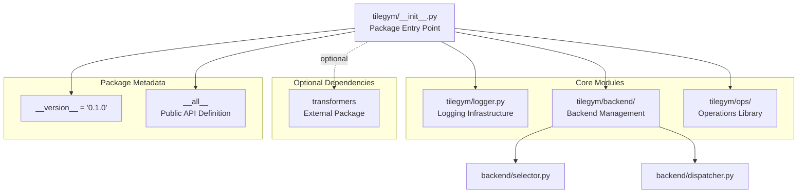
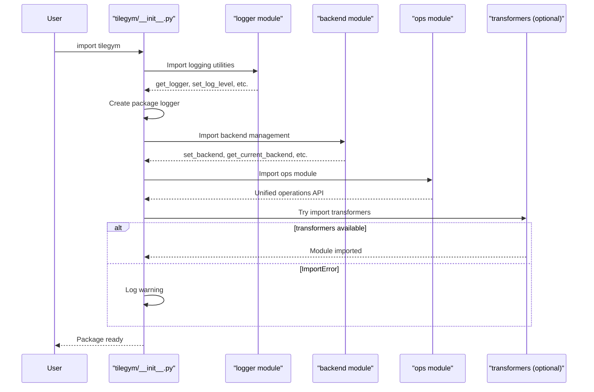
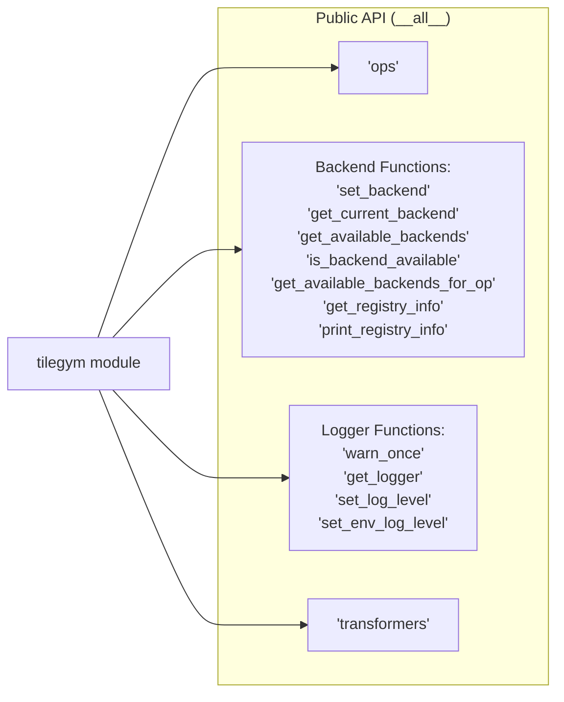
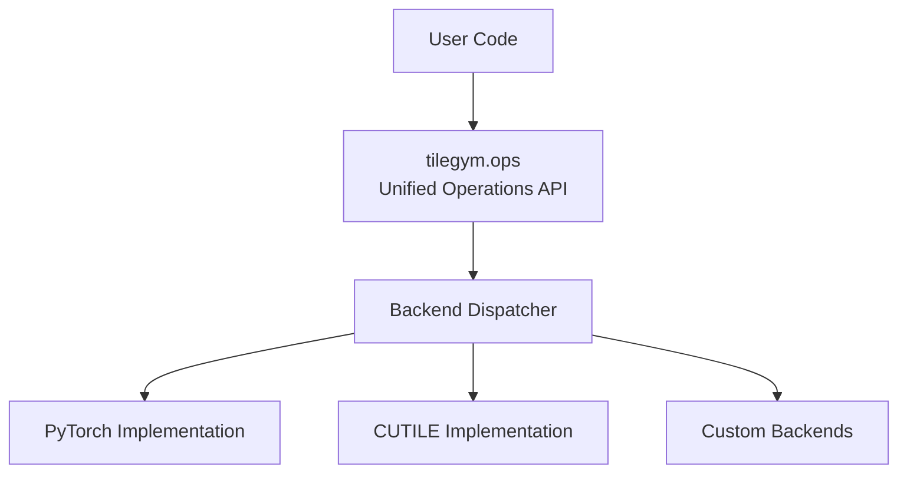
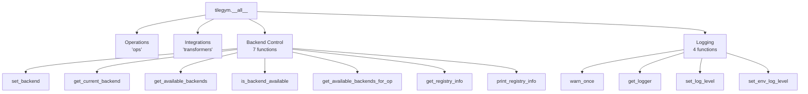
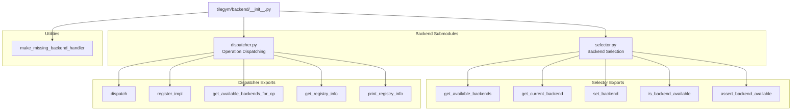
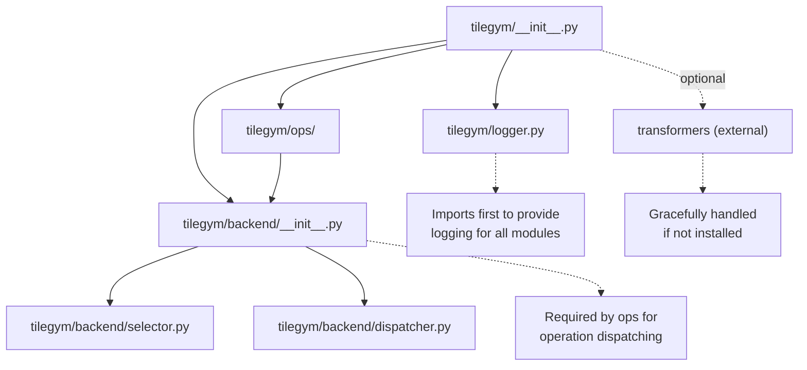

<!-- source: DeepWiki mcp.deepwiki.com · repo NVIDIA/TileGym · page 3.1 Package Architecture · fetched 2026-10-26 -->

# Package Architecture

<details>
<summary>Relevant source files</summary>

The following files were used as context for generating this wiki page:

- [src/tilegym/__init__.py](src/tilegym/__init__.py)
- [src/tilegym/backend/__init__.py](src/tilegym/backend/__init__.py)

</details>


## Purpose and Scope

This document describes the overall structure and organization of the `tilegym` Python package, including its core modules, public API surface, logging infrastructure, and version management. It provides a high-level view of how the package is organized and how its components fit together.

For detailed information about the backend management system and operation dispatching, see [Backend Management System](#3.2). For information about specific operations and their implementations, those will be covered in subsequent sections.

## Package Structure Overview

The TileGym package follows a modular architecture where the root `__init__.py` file serves as the primary entry point, exposing a carefully designed public API while organizing internal functionality into focused submodules.



**Directory Structure:**
```
src/tilegym/
├── __init__.py              # Package entry point
├── logger.py                # Logging utilities
├── backend/                 # Backend management system
│   ├── __init__.py
│   ├── selector.py          # Backend selection
│   └── dispatcher.py        # Operation dispatching
└── ops/                     # Operations module
    └── ...                  # Operation implementations
```

**Sources:** [src/tilegym/__init__.py:1-53](), [src/tilegym/backend/__init__.py:1-67]()

## Initialization Sequence

The package initialization follows a specific order to avoid import dependency issues. The initialization process is critical for establishing the runtime environment correctly.



**Initialization Order Rationale:**

| Step | Module | Reason |
|------|--------|--------|
| 1 | Logger | Must be available before any other imports to capture initialization logs |
| 2 | Backend | Required by ops module for operation dispatching |
| 3 | Ops | Depends on backend system being initialized |
| 4 | Transformers | Optional dependency, checked with try/except |

**Sources:** [src/tilegym/__init__.py:5-28]()

## Core Components

### Package Entry Point

The `tilegym/__init__.py` file serves as the package's public interface, exposing selected functionality while hiding internal implementation details.

**Key Responsibilities:**
- Define public API via `__all__` list
- Import and re-export core functionality
- Initialize package-level logger
- Manage version information
- Handle optional dependencies gracefully



**Sources:** [src/tilegym/__init__.py:30-45]()

### Logging Infrastructure

The logging system provides structured logging capabilities with level control and one-time warning functionality.

**Exported Logging Functions:**

| Function | Purpose | Defined In |
|----------|---------|------------|
| `get_logger()` | Retrieve package logger instance | `tilegym.logger` |
| `set_log_level()` | Set logging level programmatically | `tilegym.logger` |
| `set_env_log_level()` | Set logging level from environment variables | `tilegym.logger` |
| `warn_once()` | Emit a warning only once during execution | `tilegym.logger` |

**Usage Pattern:**
```python
import tilegym

# Get package logger
logger = tilegym.get_logger()

# Set log level
tilegym.set_log_level('DEBUG')

# Use one-time warning for deprecations
tilegym.warn_once("This feature is deprecated")
```

**Package Logger Instantiation:**
The package creates its own logger at import time [src/tilegym/__init__.py:11](), making it available for all internal modules.

**Sources:** [src/tilegym/__init__.py:5-11](), [src/tilegym/__init__.py:40-44]()

### Backend Management System

The backend system enables pluggable implementations for operations. While detailed coverage is provided in [Backend Management System](#3.2), the key integration points at the package level are:

**Exposed Backend Functions:**

| Function | Purpose | Return Type |
|----------|---------|-------------|
| `set_backend(name)` | Switch active backend | `None` |
| `get_current_backend()` | Query active backend | `str` |
| `get_available_backends()` | List all available backends | `list[str]` |
| `is_backend_available(name)` | Check backend availability | `bool` |
| `get_available_backends_for_op(op_name)` | List backends supporting specific operation | `list[str]` |
| `get_registry_info()` | Get operation-backend mappings | `dict` |
| `print_registry_info()` | Display registry in human-readable format | `None` |

**Import Order Consideration:**
The backend system is imported immediately after logging [src/tilegym/__init__.py:14-20]() to ensure it is available before the ops module, which depends on it for dispatching.

**Sources:** [src/tilegym/__init__.py:14-20](), [src/tilegym/__init__.py:33-39](), [src/tilegym/backend/__init__.py:9-23]()

### Operations Module

The `ops` module provides a unified interface for GPU operations, abstracting backend-specific implementations.

**Module Organization:**


The ops module is imported as a namespace [src/tilegym/__init__.py:23]() and exposed in the public API [src/tilegym/__init__.py:31](). This allows users to access operations via `tilegym.ops.operation_name()`.

**Sources:** [src/tilegym/__init__.py:23](), [src/tilegym/__init__.py:31]()

### Optional Transformers Integration

TileGym optionally integrates with HuggingFace Transformers for LLM inference optimization. The integration is handled gracefully if the dependency is not available.

**Import Handling:**
```python
try:
    import transformers
except ImportError:
    logger.warning("transformers is not available")
```

This pattern [src/tilegym/__init__.py:25-28]() ensures:
1. The package can be imported without transformers installed
2. Users are warned if transformers-dependent features are unavailable
3. The package logger captures the warning for diagnostics

The `transformers` module is included in `__all__` [src/tilegym/__init__.py:32]() to re-export it when available, allowing `import tilegym.transformers` as a convenience.

**Sources:** [src/tilegym/__init__.py:25-28](), [src/tilegym/__init__.py:32]()

### Version Management

Package version information is defined as a module-level constant:

```python
__version__ = '0.1.0'
```

This follows Python packaging conventions and enables:
- Programmatic version checking: `tilegym.__version__`
- Build system integration (setup.py, pyproject.toml)
- Dependency resolution in other packages

**Sources:** [src/tilegym/__init__.py:48]()

## Public API Surface

The `__all__` list explicitly defines the package's public interface, controlling what is exposed during wildcard imports (`from tilegym import *`) and signaling the intended API to users.

**API Categories:**



**Complete API Reference:**

| Category | Symbol | Type | Purpose |
|----------|--------|------|---------|
| Operations | `ops` | Module | Unified operations interface |
| Integration | `transformers` | Module | HuggingFace transformers (optional) |
| Backend | `set_backend` | Function | Switch active backend |
| Backend | `get_current_backend` | Function | Query active backend |
| Backend | `get_available_backends` | Function | List available backends |
| Backend | `is_backend_available` | Function | Check backend availability |
| Backend | `get_available_backends_for_op` | Function | List backends for operation |
| Backend | `get_registry_info` | Function | Get operation registry |
| Backend | `print_registry_info` | Function | Display registry |
| Logging | `warn_once` | Function | One-time warning |
| Logging | `get_logger` | Function | Get package logger |
| Logging | `set_log_level` | Function | Set log level |
| Logging | `set_env_log_level` | Function | Set log level from environment |

**Sources:** [src/tilegym/__init__.py:30-45]()

## Backend Module Organization

The backend system is organized into submodules that separate concerns between backend selection and operation dispatching.



**Backend Module Responsibilities:**

| Module | Purpose | Key Functions |
|--------|---------|---------------|
| `selector.py` | Manage active backend state | `set_backend()`, `get_current_backend()`, `is_backend_available()` |
| `dispatcher.py` | Route operations to backends | `dispatch()`, `register_impl()`, `get_registry_info()` |
| `__init__.py` | Coordinate and re-export | `make_missing_backend_handler()` |

**Missing Backend Handler:**

The backend package provides a utility function `make_missing_backend_handler()` [src/tilegym/backend/__init__.py:25-48]() that generates helpful error messages when operations requiring specific backends are accessed without those backends installed. This is used by backend-specific subpackages (e.g., `tilegym.ops.cutile`).

**Sources:** [src/tilegym/backend/__init__.py:1-67]()

## Module Dependency Graph

The following diagram shows how package modules depend on each other, clarifying the initialization order and import relationships:



**Import Order Rules:**

1. **Logger First:** The logger module must be imported before other components to capture initialization logs
2. **Backend Before Ops:** The backend system must be initialized before the ops module since operations depend on dispatching
3. **Transformers Last:** Optional integrations are imported last with error handling

**Sources:** [src/tilegym/__init__.py:5-28]()

## Design Principles

The package architecture follows several key design principles:

| Principle | Implementation | Benefit |
|-----------|----------------|---------|
| **Explicit Public API** | `__all__` list defines exports | Clear contract for users, prevents namespace pollution |
| **Lazy Module Loading** | Modules imported only when needed | Faster import times, reduced memory footprint |
| **Graceful Degradation** | Optional dependencies handled with try/except | Package usable even without all features |
| **Separation of Concerns** | Backend, ops, logger in separate modules | Maintainable, testable, modular code |
| **Centralized Entry Point** | Single `__init__.py` orchestrates imports | Predictable initialization, easier debugging |

These principles ensure TileGym is both easy to use for common cases and flexible for advanced scenarios.

**Sources:** [src/tilegym/__init__.py:1-53](), [src/tilegym/backend/__init__.py:1-67]()

---

