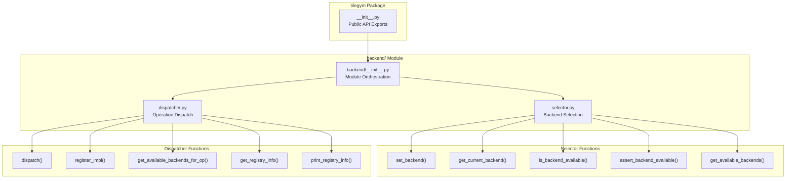
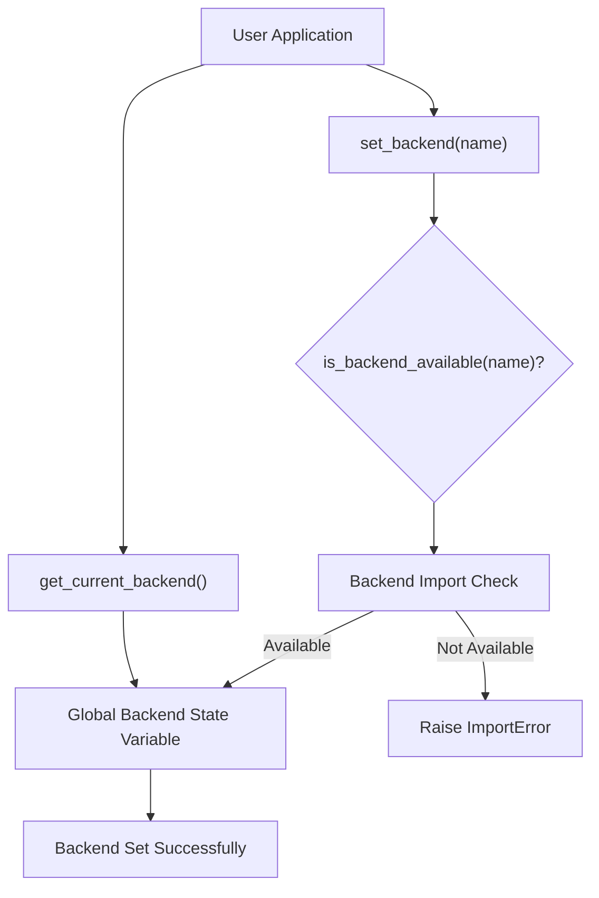
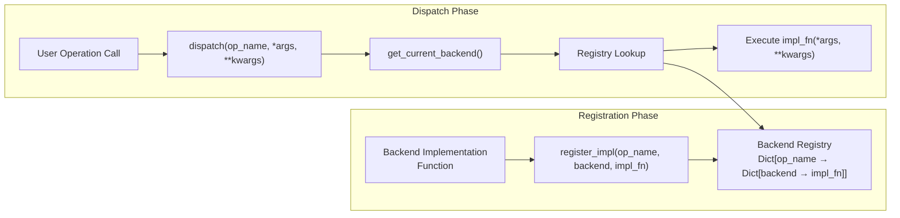
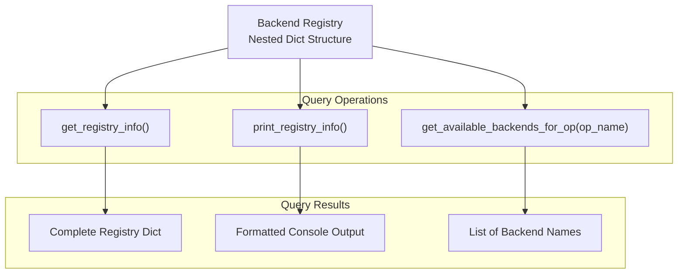
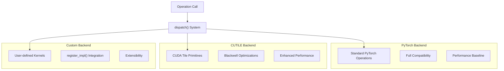
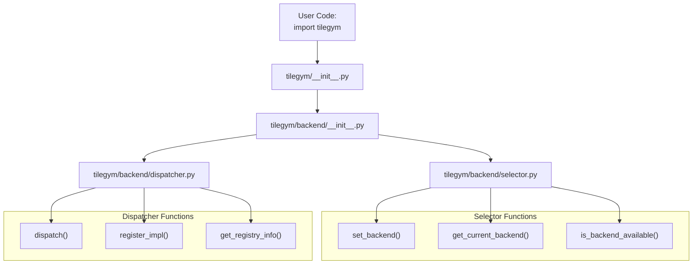

<!-- source: DeepWiki mcp.deepwiki.com · repo NVIDIA/TileGym · page 3.2 Backend Management System · fetched 2026-10-26 -->

# Backend Management System

<details>
<summary>Relevant source files</summary>

The following files were used as context for generating this wiki page:

- [src/tilegym/__init__.py](src/tilegym/__init__.py)
- [src/tilegym/backend/__init__.py](src/tilegym/backend/__init__.py)

</details>


## Purpose and Scope

This document describes the Backend Management System, which provides TileGym's pluggable architecture for switching between different backend implementations (PyTorch, CUTILE, custom) without changing application code. The system consists of three core components: the Backend Selector for managing which backend is active, the Operation Dispatcher for routing function calls to backend-specific implementations, and the Backend Registry for maintaining operation-to-backend mappings.

For information about the operations that use this backend system, see [Operations Library](#4). For package-level architecture, see [Package Architecture](#3.1).

**Sources:** [src/tilegym/backend/__init__.py:1-67](), [README.md (from context)]()

---

## System Architecture

The Backend Management System is organized into three layers within the `src/tilegym/backend/` module:

| Component | Module | Primary Functions | Purpose |
|-----------|--------|------------------|---------|
| Backend Selector | `selector.py` | `set_backend()`, `get_current_backend()`, `is_backend_available()` | Manages active backend state |
| Operation Dispatcher | `dispatcher.py` | `dispatch()`, `register_impl()` | Routes operations to backend implementations |
| Backend Registry | `dispatcher.py` | `get_registry_info()`, `print_registry_info()` | Stores operation mappings |

### Backend Management Module Structure



**Diagram: Backend Management Module Organization**

The module structure follows a clear separation of concerns: the `selector` module maintains backend state, the `dispatcher` module handles operation routing, and the `backend/__init__.py` orchestrates both by exporting a unified API.

**Sources:** [src/tilegym/__init__.py:14-20](), [src/tilegym/backend/__init__.py:9-23]()

---

## Backend Selector

The Backend Selector manages which backend implementation is currently active. It provides functions for setting the backend, querying the current backend, and checking backend availability.

### Core Selector Functions

| Function | Return Type | Description |
|----------|-------------|-------------|
| `set_backend(name: str)` | None | Sets the active backend to the specified name |
| `get_current_backend()` | str | Returns the name of the currently active backend |
| `is_backend_available(name: str)` | bool | Checks if a backend is available for use |
| `assert_backend_available(name: str)` | None | Raises error if backend is unavailable |
| `get_available_backends()` | List[str] | Returns list of all available backends |

### Backend Selection Flow



**Diagram: Backend Selection Process**

The selector maintains a global state variable that tracks the currently active backend. When `set_backend()` is called, it first verifies backend availability by attempting to import required modules, then updates the global state if successful.

**Sources:** [src/tilegym/backend/__init__.py:9-15]()

### Backend Availability

The system determines backend availability through dynamic import checks:

- **PyTorch Backend**: Always available (required dependency)
- **CUTILE Backend**: Available if `cuda-tile` package is installed
- **Custom Backends**: Available if registered and dependencies met

The `is_backend_available()` function performs these checks without side effects, while `assert_backend_available()` raises an exception if the backend is unavailable, providing installation instructions.

**Sources:** [src/tilegym/backend/__init__.py:14](), [src/tilegym/backend/__init__.py:39-46]()

---

## Operation Dispatcher

The Operation Dispatcher provides the core routing mechanism that directs operation calls to the appropriate backend implementation. It maintains a registry of operation-to-backend mappings and provides both registration and dispatch functions.

### Dispatcher API



**Diagram: Operation Registration and Dispatch Flow**

**Sources:** [src/tilegym/backend/__init__.py:17-22]()

### Core Dispatcher Functions

| Function | Parameters | Return Type | Description |
|----------|-----------|-------------|-------------|
| `dispatch(op_name, *args, **kwargs)` | Operation name, arguments | Any | Executes operation using current backend |
| `register_impl(op_name, backend, impl_fn)` | Operation name, backend name, implementation function | None | Registers backend implementation |
| `get_available_backends_for_op(op_name)` | Operation name | List[str] | Returns backends supporting the operation |
| `get_registry_info()` | None | Dict | Returns complete registry as dictionary |
| `print_registry_info()` | None | None | Prints formatted registry to console |

### Dispatch Resolution

When `dispatch()` is called, the system follows this resolution order:

1. Query current backend using `get_current_backend()`
2. Look up operation name in registry
3. Check if current backend has implementation for the operation
4. If found, execute the implementation with provided arguments
5. If not found, raise `NotImplementedError` with available backends

This design allows graceful degradation and clear error messages when backend implementations are missing.

**Sources:** [src/tilegym/backend/__init__.py:18-19]()

---

## Backend Registry

The Backend Registry stores the mapping between operation names and their backend-specific implementations. It is implemented as a nested dictionary structure within the `dispatcher` module.

### Registry Structure

The registry follows this schema:

```
Registry: Dict[str, Dict[str, Callable]]
    ├── operation_name_1: Dict[str, Callable]
    │   ├── "pytorch": implementation_function
    │   ├── "cutile": implementation_function
    │   └── "custom_backend": implementation_function
    ├── operation_name_2: Dict[str, Callable]
    │   ├── "pytorch": implementation_function
    │   └── "cutile": implementation_function
    └── ...
```

### Registry Query Functions



**Diagram: Registry Query Interface**

The `get_registry_info()` function returns the complete registry as a dictionary, useful for programmatic inspection. The `print_registry_info()` function provides human-readable output for debugging. The `get_available_backends_for_op()` function returns only the backends that implement a specific operation.

**Sources:** [src/tilegym/backend/__init__.py:20-22]()

---

## Backend Implementations

TileGym supports multiple backend implementations, each providing different optimization strategies for GPU operations.

### Supported Backends

| Backend | Identifier | Availability | Purpose |
|---------|-----------|--------------|---------|
| PyTorch | `"pytorch"` | Always | Baseline reference implementation |
| CUTILE | `"cutile"` | Requires `cuda-tile` | CUDA Tile optimized kernels for Blackwell |
| Custom | User-defined | User-registered | Extensible for custom implementations |

### Backend Capabilities



**Diagram: Backend Implementation Capabilities**

**Sources:** [src/tilegym/__init__.py:14-20](), [High-level Diagram 2]()

### Missing Backend Handling

The system provides helpful error messages when attempting to use unavailable backends. The `make_missing_backend_handler()` function creates custom `__getattr__` handlers for packages that require specific backends:

```python
make_missing_backend_handler(package_name, available_items)
```

When a user attempts to import an item that requires an unavailable backend (e.g., CUTILE), the handler raises an `ImportError` with installation instructions.

**Sources:** [src/tilegym/backend/__init__.py:25-48]()

---

## Usage Patterns

### Setting a Backend

```python
import tilegym

# Set backend to CUTILE
tilegym.set_backend("cutile")

# Check current backend
current = tilegym.get_current_backend()
print(f"Current backend: {current}")
```

### Checking Backend Availability

```python
import tilegym

# Check if CUTILE is available
if tilegym.is_backend_available("cutile"):
    tilegym.set_backend("cutile")
else:
    print("CUTILE backend not available, using PyTorch")
    tilegym.set_backend("pytorch")
```

### Inspecting Registry

```python
import tilegym

# Print all registered operations and backends
tilegym.print_registry_info()

# Get available backends for specific operation
backends = tilegym.get_available_backends_for_op("some_operation")
print(f"Available backends: {backends}")

# Get complete registry as dictionary
registry = tilegym.get_registry_info()
```

### Registering Custom Implementation

```python
from tilegym.backend import register_impl

def custom_operation_impl(*args, **kwargs):
    # Custom implementation
    pass

# Register implementation for custom backend
register_impl("my_operation", "custom_backend", custom_operation_impl)
```

**Sources:** [src/tilegym/__init__.py:30-45](), [src/tilegym/backend/__init__.py:9-23]()

---

## Backend Management API Reference

### Exported Functions

The following functions are exported from the `tilegym` package for backend management:

| Function | Module | Line Reference | Description |
|----------|--------|----------------|-------------|
| `set_backend` | `selector` | [src/tilegym/__init__.py:20]() | Set active backend |
| `get_current_backend` | `selector` | [src/tilegym/__init__.py:16]() | Get current backend name |
| `get_available_backends` | `selector` | [src/tilegym/__init__.py:14]() | List all available backends |
| `is_backend_available` | `selector` | [src/tilegym/__init__.py:18]() | Check backend availability |
| `get_available_backends_for_op` | `dispatcher` | [src/tilegym/__init__.py:15]() | List backends for operation |
| `get_registry_info` | `dispatcher` | [src/tilegym/__init__.py:17]() | Get registry as dict |
| `print_registry_info` | `dispatcher` | [src/tilegym/__init__.py:19]() | Print registry to console |

### Import Hierarchy



**Diagram: Backend Management Import Structure**

All backend management functions are accessible through the top-level `tilegym` module, which re-exports them from the `backend` submodule for convenience.

**Sources:** [src/tilegym/__init__.py:13-20](), [src/tilegym/backend/__init__.py:1-67]()

---

## Design Principles

The Backend Management System follows these design principles:

1. **Zero-Cost Abstraction**: Backend switching incurs minimal overhead through direct function calls
2. **Explicit State**: Backend selection is explicit through `set_backend()` calls
3. **Graceful Degradation**: Missing backend implementations provide clear error messages
4. **Extensibility**: Custom backends can be registered without modifying core code
5. **Introspection**: Registry inspection functions enable debugging and validation

These principles ensure that the backend system provides flexibility without sacrificing performance or developer experience.

**Sources:** [High-level Diagram 2](), [src/tilegym/backend/__init__.py:25-48]()

---

