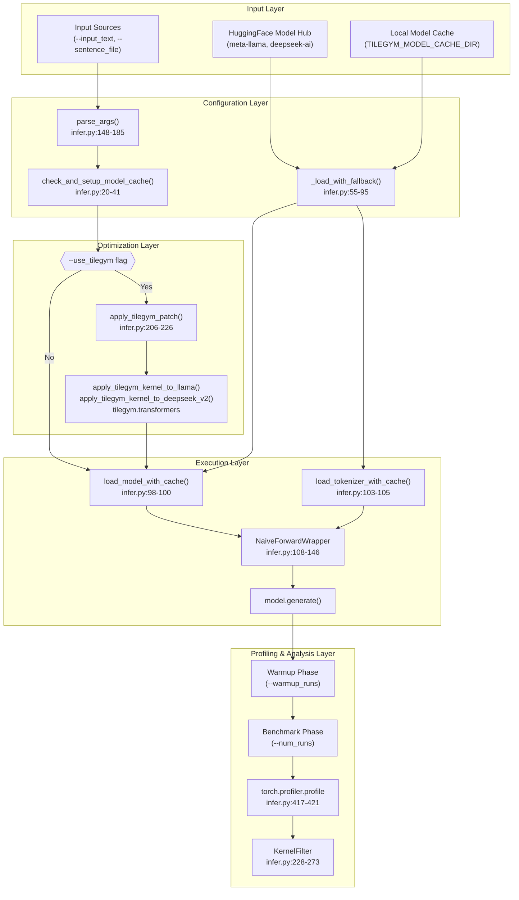
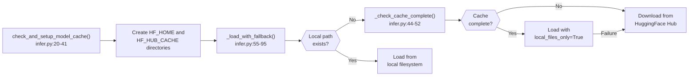
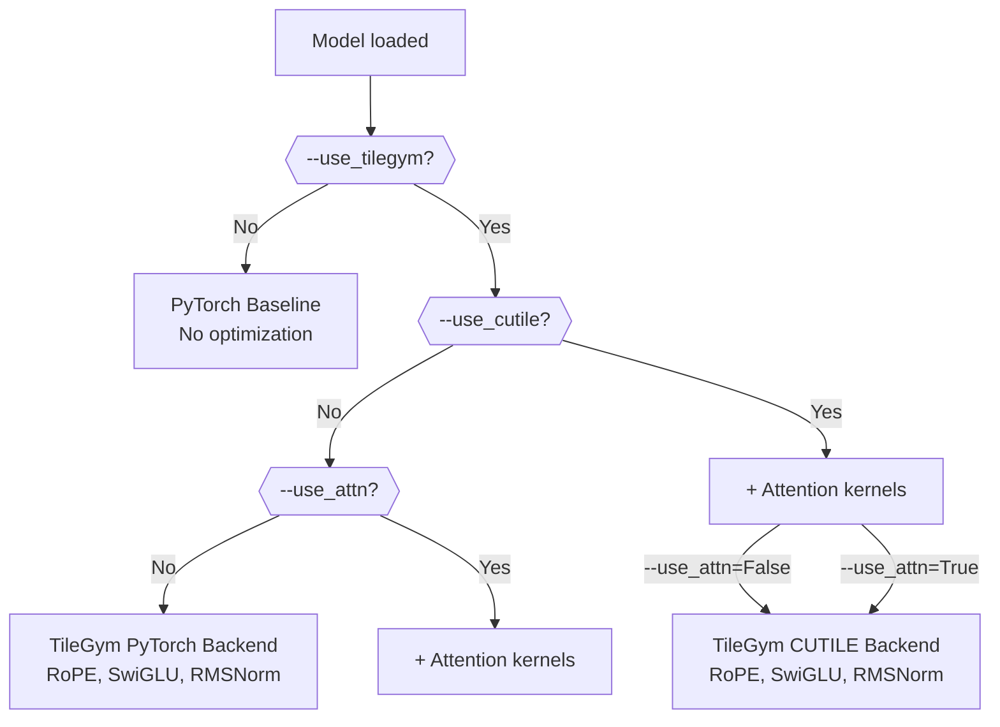
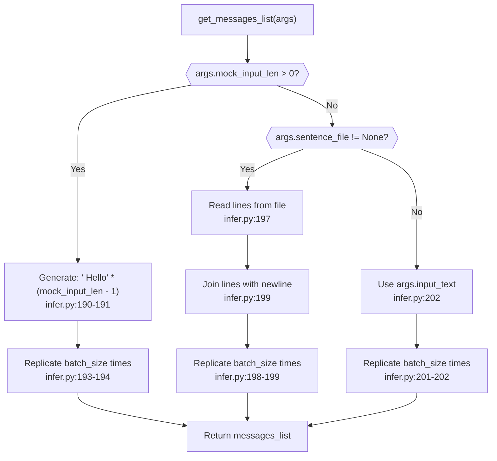

<!-- source: DeepWiki mcp.deepwiki.com · repo NVIDIA/TileGym · page 4 Transformer Inference · fetched 2026-10-26 -->

# Transformer Inference

<details>
<summary>Relevant source files</summary>

The following files were used as context for generating this wiki page:

- [modeling/transformers/README.md](modeling/transformers/README.md)
- [modeling/transformers/infer.py](modeling/transformers/infer.py)

</details>


## Purpose and Scope

This document describes the transformer model inference layer in TileGym, which provides an end-to-end system for running large language model (LLM) inference with optional TileGym kernel optimizations. The system demonstrates how TileGym's backend-agnostic operations integrate with HuggingFace transformer models to accelerate inference on NVIDIA Blackwell GPUs.

The transformer inference system is located in `modeling/transformers/` and includes model loading, input preprocessing, optimization patching, execution, and performance profiling capabilities. For details on the underlying TileGym core library and backend system, see [Core Library](#3). For Docker containerization of this inference system, see [Docker Deployment](#5). For development and testing workflows, see [Development Guide](#6).

**Sources:** [modeling/transformers/README.md:1-196](), [modeling/transformers/infer.py:1-540]()

---

## System Architecture

The transformer inference system consists of five major layers that process requests from model selection through result generation:



**Architecture Layers:**

| Layer | Purpose | Key Components |
|-------|---------|----------------|
| Input Layer | Model and prompt acquisition | HuggingFace Hub, local cache, prompt files |
| Configuration Layer | Command-line parsing and setup | `parse_args()`, cache directory configuration |
| Optimization Layer | Selective TileGym kernel injection | `apply_tilegym_patch()`, kernel replacement functions |
| Execution Layer | Model loading and inference | `NaiveForwardWrapper`, `model.generate()` |
| Profiling Layer | Performance measurement | `torch.profiler`, warmup/benchmark runs, kernel filtering |

**Sources:** [modeling/transformers/infer.py:148-540](), [modeling/transformers/README.md:5-163]()

---

## Supported Models

The system supports two transformer model families with specific optimizations for each architecture:

| Model | HuggingFace ID | Optimized Operations | Memory Requirements |
|-------|----------------|---------------------|---------------------|
| LLaMA 3.1-8B | `meta-llama/Meta-Llama-3.1-8B` | RoPE, SwiGLU, RMSNorm, Attention, Flash Decoding | Compatible with RTX 5090 |
| DeepSeek V2-Lite-Chat | `deepseek-ai/DeepSeek-V2-Lite-Chat` | RoPE, SwiGLU, RMSNorm, MoE, MLADecoding, Attention | Requires B200 (high memory) |

The model-specific optimizations are applied through `apply_tilegym_patch()` [infer.py:206-226](), which detects the model type from the `--model_id` parameter and calls the appropriate kernel replacement function:

- **LLaMA models**: `apply_tilegym_kernel_to_llama(rope=True, swiglu=True, rms_norm=True, attn=use_attn, use_cutile=use_cutile)` [infer.py:209-215]()
- **DeepSeek models**: `apply_tilegym_kernel_to_deepseek_v2(rope=True, rms_norm=True, swiglu=True, attn=use_attn, moe=True, use_cutile=use_cutile)` [infer.py:217-224]()

**Sources:** [modeling/transformers/README.md:9-18](), [modeling/transformers/infer.py:206-226]()

---

## Key Components

### Model Cache Management

The caching system checks for locally cached models before downloading from HuggingFace Hub, reducing network dependency and improving load times:



The cache directory is configured via the `TILEGYM_MODEL_CACHE_DIR` environment variable [infer.py:26-27]() and defaults to `~/.cache/huggingface/hub`. The system creates subdirectories named `models--{org}--{model}` with snapshot storage [infer.py:48-49]().

**Sources:** [modeling/transformers/infer.py:20-105]()

### NaiveForwardWrapper

The `NaiveForwardWrapper` class [infer.py:108-146]() encapsulates model execution with standardized input preprocessing and parameter management:

| Method | Purpose | Key Operations |
|--------|---------|----------------|
| `__init__(model, tokenizer, messages_list, args, device, **default_kwargs)` | Initialize wrapper with model and inputs | Tokenize inputs, move to device, configure generation parameters [infer.py:109-133]() |
| `get_input_seq_len()` | Return input sequence length | Access `self.input_seq_len` [infer.py:135-136]() |
| `update_params(**kwargs)` | Update generation parameters | Merge with `self.default_kwargs` [infer.py:138-139]() |
| `forward()` | Execute generation | Call `model.generate(**self.default_kwargs)` [infer.py:141-142]() |
| `post_process(outputs)` | Process generation results | Identity function for extensibility [infer.py:144-145]() |

The wrapper enforces exact token generation by setting both `max_new_tokens` and `min_new_tokens` to `args.output_length` [infer.py:130-132](), ensuring consistent benchmarking results.

**Sources:** [modeling/transformers/infer.py:108-146]()

### KernelFilter

The `KernelFilter` class [infer.py:228-273]() identifies TileGym-optimized kernels in profiling output by maintaining a list of kernel name prefixes:

```python
# Example kernel prefixes (from infer.py:230-263)
kernel_names_prefix = [
    "rope", "tile_rope_kernel",                    # RoPE operations
    "prefill_fmha", "fmha_kernel", "attention_decode_kernel",  # Attention
    "moe", "fused_moe_kernel",                     # Mixture of Experts
    "silu_and_mul", "swiglu_forward",              # Activation functions
    "tile_", "cutile",                             # General TileGym kernels
    "rms_norm_kernel",                             # Normalization
    "naive_absorb_mla", "_mla_decoding",           # Multi-head latent attention
    "static_persistent_gemm_kernel", "matmul"      # Linear algebra
]
```

The `contains(key)` method [infer.py:269-273]() filters profiler results, excluding blacklisted operations like `aten::matmul` [infer.py:264-266]() to prevent false positives.

**Sources:** [modeling/transformers/infer.py:228-273]()

---

## Inference Execution Pipeline

The main execution flow in `infer.py:main()` [infer.py:275-536]() follows this sequence:

```mermaid
flowchart TD
    Start["main() entry<br/>infer.py:275"]
    ParseArgs["args = parse_args()<br/>infer.py:276"]
    CheckGPU["device = 'cuda' or 'cpu'<br/>infer.py:279"]
    
    LoadTokenizer["tokenizer = load_tokenizer_with_cache()<br/>infer.py:287"]
    CheckTileGym{{"args.use_tilegym?"}}
    ApplyPatch["apply_tilegym_patch(model_id, use_attn, use_cutile)<br/>infer.py:295"]
    
    LoadModel["model = load_model_with_cache()<br/>infer.py:306"]
    ConfigSample{{"args.show_outputs or<br/>args.profile?"}}
    SetSample["do_sample = True"]
    UnsetSample["do_sample = False<br/>warmup_runs = 1"]
    
    CreateWrapper["forward_wrapper = NaiveForwardWrapper()<br/>infer.py:316-324"]
    
    WarmupLoop["for i in range(args.warmup_runs):<br/>infer.py:328-331"]
    BenchLoop["for run in range(args.num_runs):<br/>infer.py:337-365"]
    
    RecordStart["start_event.record()<br/>infer.py:346"]
    Execute["outputs = forward_wrapper.forward()<br/>infer.py:348"]
    RecordEnd["end_event.record()<br/>infer.py:349"]
    
    CalcMetrics["Calculate tokens/sec, latency<br/>infer.py:354-364"]
    PrintResults["Print benchmark results<br/>infer.py:372-382"]
    
    ShowOutputsCheck{{"args.show_outputs?"}}
    PrintOutputs["Decode and print outputs<br/>infer.py:385-392"]
    
    ProfileCheck{{"args.profile?"}}
    RunProfiler["torch.profiler.profile()<br/>infer.py:417-421"]
    FilterResults["Filter with KernelFilter<br/>infer.py:425-428"]
    SaveCSV["Save results to CSV<br/>infer.py:466-484"]
    ExportTrace["Export Chrome trace (zipped)<br/>infer.py:485-493"]
    
    Start --> ParseArgs
    ParseArgs --> CheckGPU
    CheckGPU --> LoadTokenizer
    LoadTokenizer --> CheckTileGym
    
    CheckTileGym -->|"Yes"| ApplyPatch
    CheckTileGym -->|"No"| LoadModel
    ApplyPatch --> LoadModel
    
    LoadModel --> ConfigSample
    ConfigSample -->|"Yes"| UnsetSample
    ConfigSample -->|"No"| SetSample
    UnsetSample --> CreateWrapper
    SetSample --> CreateWrapper
    
    CreateWrapper --> WarmupLoop
    WarmupLoop --> BenchLoop
    
    BenchLoop --> RecordStart
    RecordStart --> Execute
    Execute --> RecordEnd
    RecordEnd --> CalcMetrics
    
    CalcMetrics --> PrintResults
    PrintResults --> ShowOutputsCheck
    
    ShowOutputsCheck -->|"Yes"| PrintOutputs
    ShowOutputsCheck -->|"No"| ProfileCheck
    PrintOutputs --> ProfileCheck
    
    ProfileCheck -->|"Yes"| RunProfiler
    ProfileCheck -->|"No"| End["End"]
    
    RunProfiler --> FilterResults
    FilterResults --> SaveCSV
    SaveCSV --> ExportTrace
    ExportTrace --> End
```



**Key Pipeline Stages:**

1. **Initialization** [infer.py:276-287](): Parse arguments, check GPU availability, load tokenizer
2. **Optimization** [infer.py:289-295](): Conditionally apply TileGym patches based on `--use_tilegym` flag
3. **Model Loading** [infer.py:298-306](): Load model with cache support and specified precision (`bfloat16` or `float32`)
4. **Wrapper Setup** [infer.py:308-324](): Create `NaiveForwardWrapper` with tokenized inputs and generation parameters
5. **Warmup** [infer.py:327-331](): Execute `args.warmup_runs` iterations to stabilize GPU state
6. **Benchmark** [infer.py:337-365](): Run `args.num_runs` iterations with CUDA event timing
7. **Reporting** [infer.py:372-392](): Calculate and display throughput, latency, and optionally generated text
8. **Profiling** [infer.py:415-535](): Generate detailed kernel-level performance data with torch profiler

**Sources:** [modeling/transformers/infer.py:275-540]()

---

## Optimization Configuration

The system provides three command-line flags that control optimization layers:

| Flag | Effect | Applied Kernels |
|------|--------|----------------|
| `--use_tilegym` | Enable TileGym kernel replacement | RoPE, SwiGLU, RMSNorm (always); Attention and MoE (model-dependent) |
| `--use_cutile` | Use CUTILE backend instead of PyTorch baseline | All TileGym kernels execute via cuda-tile optimized implementations |
| `--use_attn` | Enable TileGym attention kernels | Flash attention (LLaMA), MLA decoding (DeepSeek) |

**Optimization Path Selection:**



The backend selection is stored in the `backend` variable [infer.py:288-295](), which defaults to `"base"` and changes to `"cutile"` when `--use_cutile` is specified.

**Sources:** [modeling/transformers/infer.py:150-162](), [modeling/transformers/infer.py:288-295](), [modeling/transformers/README.md:13-16]()

---

## Performance Profiling System

The profiling system captures three levels of performance metrics:

### 1. Throughput and Latency Metrics

Measured using CUDA events [infer.py:339-364]():

```python
# Timing code structure (infer.py:339-364)
start_event = torch.cuda.Event(enable_timing=True)
end_event = torch.cuda.Event(enable_timing=True)

start_event.record()
outputs = forward_wrapper.forward()
end_event.record()

torch.cuda.synchronize()
elapsed_time = start_event.elapsed_time(end_event) / 1000.0  # Convert to seconds
tokens_per_second = total_tokens / elapsed_time
```

Results are aggregated across `args.num_runs` iterations [infer.py:368-382]() to compute mean and standard deviation.

### 2. Kernel-Level Profiling

Enabled with `--profile` flag [infer.py:415-497](). The torch profiler captures:

- **CPU time total/average**: Host-side execution time
- **CUDA time total/average**: Device-side kernel execution time  
- **Self time**: Time excluding child operations
- **Call count**: Number of kernel invocations

Profiler configuration [infer.py:417-421]():
```python
with profile(activities=[ProfilerActivity.CPU, ProfilerActivity.CUDA], 
             with_stack=False, 
             record_shapes=False) as prof:
    with record_function("model_inference"):
        _ = forward_wrapper.forward()
```

### 3. Output Artifacts

| Artifact | Format | Content | Location |
|----------|--------|---------|----------|
| Console output | Text | Real-time metrics, filtered profiler table | stdout |
| CSV file | CSV | All operations sorted by device time | `{log_dir}/profiler_results_{case_id}_{timestamp}.csv` [infer.py:466]() |
| Chrome trace | JSON (zipped) | Timeline visualization | `{log_dir}/trace_{case_id}_{timestamp}.zip` [infer.py:489]() |
| Summary file | Text | Per-case throughput, latency, CUDA kernel time | Specified by `--summary_file` [infer.py:398-413](), [infer.py:500-535]() |

The CSV file includes all profiler operations with columns: `Name`, `CPU_time_total_us`, `CPU_time_avg_us`, `CUDA_time_total_us`, `CUDA_time_avg_us`, `Self_CPU_time_total_us`, `Self_CUDA_time_total_us`, `Count`, `Filtered`, `DeviceType` [infer.py:470-471]().

**Sources:** [modeling/transformers/infer.py:336-365](), [modeling/transformers/infer.py:415-535]()

---

## Command-Line Interface

The `parse_args()` function [infer.py:148-185]() defines the complete CLI:

### Model and Backend Configuration

| Argument | Type | Default | Description |
|----------|------|---------|-------------|
| `--model_id` | str | `meta-llama/Meta-Llama-3.1-8B` | HuggingFace model ID or local path [infer.py:151]() |
| `--use_tilegym` | flag | False | Enable TileGym optimization [infer.py:150]() |
| `--use_cutile` | flag | False | Use CUTILE backend [infer.py:161]() |
| `--use_attn` | flag | False | Enable attention optimization [infer.py:159]() |
| `--precision` | str | `bfloat16` | `bfloat16` or `float32` [infer.py:166]() |

### Input Configuration

| Argument | Type | Default | Description |
|----------|------|---------|-------------|
| `--input_text` | str | `"What is the capital of France?"` | Input prompt text [infer.py:153]() |
| `--sentence_file` | str | None | Path to input file [infer.py:167-171]() |
| `--output_length` | int | 100 | Number of tokens to generate [infer.py:173-178]() |
| `--batch_size` | int | 1 | Batch size for inference [infer.py:152]() |
| `--mock_input_len` | int | 0 | Mock input length for benchmarking [infer.py:182-184]() |

### Performance Configuration

| Argument | Type | Default | Description |
|----------|------|---------|-------------|
| `--num_runs` | int | 5 | Number of benchmark iterations [infer.py:154]() |
| `--warmup_runs` | int | 2 | Number of warmup iterations [infer.py:155]() |
| `--profile` | flag | False | Enable profiling [infer.py:163]() |
| `--show_outputs` | flag | False | Print generated text [infer.py:156]() |
| `--summary_file` | str | None | File to append summary lines [infer.py:157]() |
| `--log_dir` | str | `/logs` | Directory for profiler logs [infer.py:164]() |

**Sources:** [modeling/transformers/infer.py:148-185](), [modeling/transformers/README.md:146-163]()

---

## Input Processing

The `get_messages_list()` function [infer.py:187-204]() constructs input prompts based on the configuration:



**Input Source Priority:**
1. **Mock input** (`--mock_input_len > 0`): Generates repeated "Hello" tokens for controlled benchmarking [infer.py:189-194]()
2. **File input** (`--sentence_file`): Reads and joins all lines from specified file [infer.py:195-199]()
3. **CLI input** (default): Uses `--input_text` argument [infer.py:201-203]()

All inputs are replicated `args.batch_size` times to create the batch [infer.py:193-194, 198-199, 201-202]().

**Sources:** [modeling/transformers/infer.py:187-204]()

---

