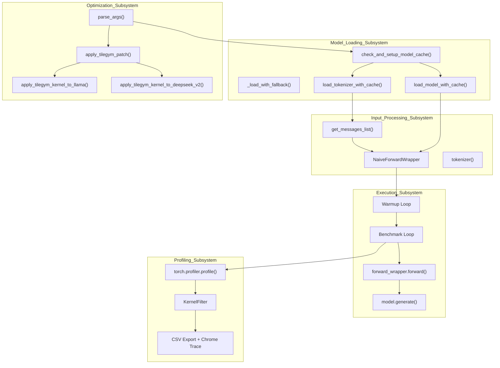
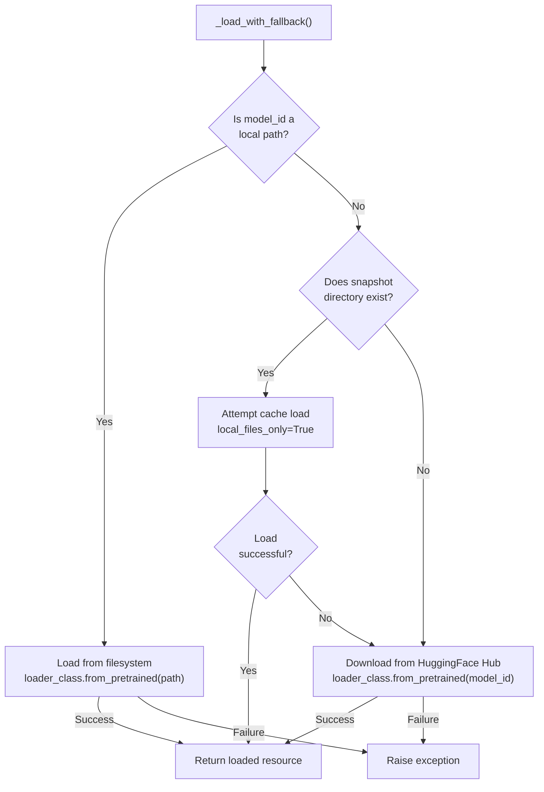
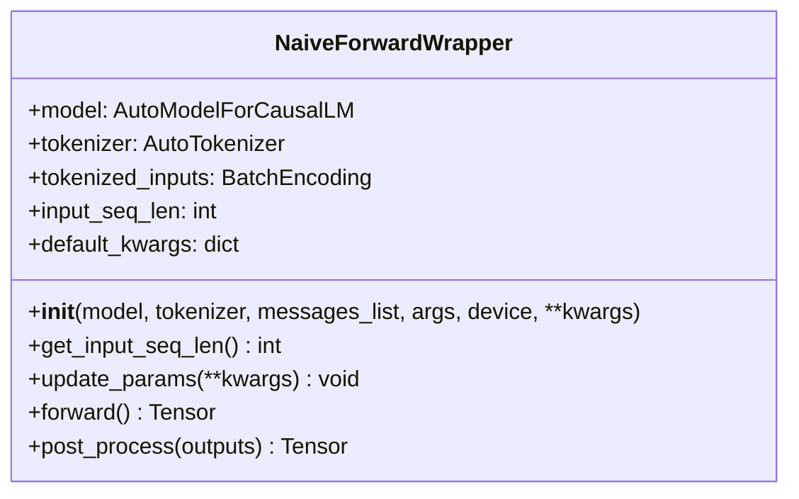
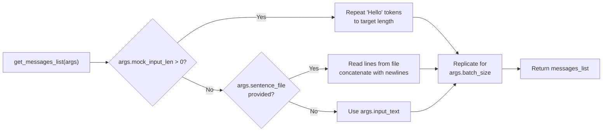
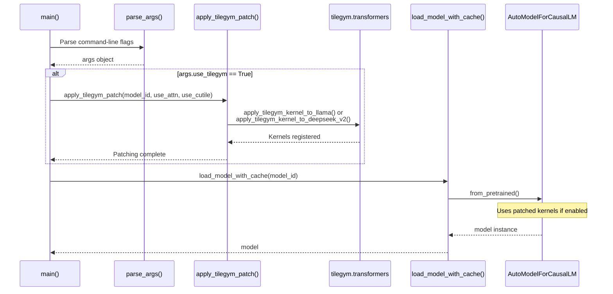
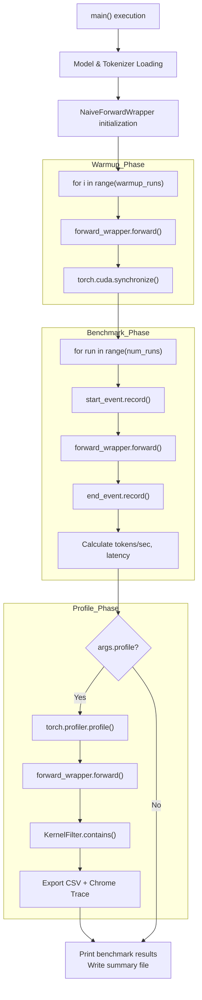
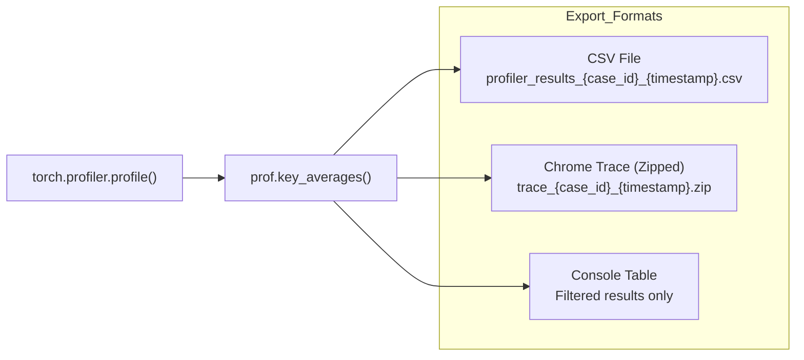

<!-- source: DeepWiki mcp.deepwiki.com · repo NVIDIA/TileGym · page 4.1 Inference System Overview · fetched 2026-10-26 -->

# Inference System Overview

<details>
<summary>Relevant source files</summary>

The following files were used as context for generating this wiki page:

- [modeling/transformers/README.md](modeling/transformers/README.md)
- [modeling/transformers/infer.py](modeling/transformers/infer.py)

</details>


## Purpose and Scope

This page documents the architecture of the TileGym transformer inference system, which provides end-to-end inference capabilities for large language models with optional TileGym kernel optimizations. The system handles model loading, input processing, generation, and performance profiling.

The inference system is implemented primarily in [modeling/transformers/infer.py](). For instructions on running inference and using command-line options, see [Running Inference](#4.2). For benchmarking methodology and performance comparison, see [Benchmarking Performance](#4.3).

**Sources:** [modeling/transformers/infer.py:1-540](), [modeling/transformers/README.md:1-196]()

---

## System Architecture

The inference system consists of five major subsystems that work together to execute transformer model inference with optional optimizations:



**Sources:** [modeling/transformers/infer.py:20-227](), [modeling/transformers/infer.py:275-540]()

---

## Model Loading System

The model loading system provides robust model acquisition with automatic cache management and fallback strategies. It supports both HuggingFace Hub models and local filesystem paths.

### Cache Management

The system manages model caching through environment variables and directory structure:

| Environment Variable | Purpose | Default Value |
|---------------------|---------|---------------|
| `TILEGYM_MODEL_CACHE_DIR` | Base cache directory | `~/.cache` |
| `HF_HOME` | HuggingFace home directory | `{CACHE_DIR}/huggingface` |
| `HF_HUB_CACHE` | Model repository cache | `{HF_HOME}/hub` |

The `check_and_setup_model_cache()` function [modeling/transformers/infer.py:20-41]() initializes these directories and sets environment variables. Model files are cached at `{HF_HUB_CACHE}/models--{org}--{model}/snapshots/`.

### Loading Strategy

The loading process follows a three-tier fallback strategy:



The `_load_with_fallback()` function [modeling/transformers/infer.py:55-95]() implements this strategy and is used by:
- `load_model_with_cache()` [modeling/transformers/infer.py:98-100]() - Loads `AutoModelForCausalLM`
- `load_tokenizer_with_cache()` [modeling/transformers/infer.py:103-105]() - Loads `AutoTokenizer`

**Sources:** [modeling/transformers/infer.py:20-105]()

---

## Input Processing and Generation

The `NaiveForwardWrapper` class [modeling/transformers/infer.py:108-146]() encapsulates input processing and generation logic, providing a consistent interface for model execution.

### Class Structure



### Initialization and Tokenization

The wrapper initializes by tokenizing input messages and preparing generation parameters:

| Parameter | Source | Purpose |
|-----------|--------|---------|
| `input_ids` | `tokenizer(messages_list)` | Token sequence input |
| `attention_mask` | `tokenizer(messages_list)` | Valid token positions |
| `max_new_tokens` | `args.output_length` | Maximum tokens to generate |
| `min_new_tokens` | `args.output_length` | Minimum tokens to generate |
| `pad_token_id` | `tokenizer.eos_token_id` | Padding token identifier |
| `do_sample` | Conditional | Sampling vs greedy decoding |
| `early_stopping` | `False` | Stop generation early |

The initialization occurs in [modeling/transformers/infer.py:109-133](). Setting `min_new_tokens` equal to `max_new_tokens` forces deterministic output length.

### Message List Construction

The `get_messages_list()` function [modeling/transformers/infer.py:187-204]() constructs input messages from three possible sources:



**Sources:** [modeling/transformers/infer.py:108-204](), [modeling/transformers/infer.py:316-324]()

---

## TileGym Patching Mechanism

The patching system dynamically replaces standard transformer operations with TileGym-optimized kernels before model loading. This allows seamless integration without modifying model architecture code.

### Patching Entry Point

The `apply_tilegym_patch()` function [modeling/transformers/infer.py:206-226]() serves as the patching dispatcher:

```python
# Key logic from modeling/transformers/infer.py:206-226
def apply_tilegym_patch(model_id, use_attn=False, use_cutile=False):
    model_name = model_id.lower()
    if "llama" in model_name:
        apply_tilegym_kernel_to_llama(
            rope=True, swiglu=True, rms_norm=True,
            attn=use_attn, use_cutile=use_cutile
        )
    elif "deepseek" in model_name:
        apply_tilegym_kernel_to_deepseek_v2(
            rope=True, rms_norm=True, swiglu=True,
            attn=use_attn, moe=True, use_cutile=use_cutile
        )
```

### Model-Specific Patches

The system provides dedicated patching functions for each supported model architecture:

| Model Family | Patch Function | Optimized Operations |
|--------------|----------------|----------------------|
| LLaMA 3.1 | `apply_tilegym_kernel_to_llama()` | RoPE, SwiGLU, RMSNorm, Attention, Flash Decoding |
| DeepSeek V2 | `apply_tilegym_kernel_to_deepseek_v2()` | RoPE, SwiGLU, RMSNorm, MoE, MLADecoding, Attention |

### Patch Application Flow



The patching occurs at [modeling/transformers/infer.py:289-295]() before model instantiation at [modeling/transformers/infer.py:306]().

**Sources:** [modeling/transformers/infer.py:18-19](), [modeling/transformers/infer.py:206-226](), [modeling/transformers/infer.py:289-306]()

---

## Supported Models

The inference system supports two transformer architectures with different feature sets:

### Model Compatibility Matrix

| Model | Model ID | RoPE | SwiGLU | RMSNorm | Attention | Flash Decoding | MoE | MLADecoding | GPU Requirements |
|-------|----------|------|--------|---------|-----------|----------------|-----|-------------|------------------|
| LLaMA 3.1-8B | `meta-llama/Meta-Llama-3.1-8B` | ✓ | ✓ | ✓ | ✓* | ✓* | - | - | B200, RTX 5080/5090 |
| DeepSeek V2-Lite-Chat | `deepseek-ai/DeepSeek-V2-Lite-Chat` | ✓ | ✓ | ✓ | ✓* | - | ✓ | ✓* | B200 only |

\* Optional: Enable with `--use_attn` flag

### Hardware Constraints

- **NVIDIA B200**: Supports all models
- **RTX 5080/5090**: LLaMA 3.1-8B only (memory constraints prevent DeepSeek V2)

The model identification logic uses case-insensitive substring matching on the model ID [modeling/transformers/infer.py:207-222](). Models not matching "llama" or "deepseek" patterns will load without TileGym optimizations.

**Sources:** [modeling/transformers/README.md:9-18](), [modeling/transformers/infer.py:206-226]()

---

## Execution Pipeline

The inference execution follows a three-phase pipeline: warmup, benchmark, and optional profiling. This structure ensures stable performance measurements.

### Pipeline Overview



### Warmup Phase

The warmup phase [modeling/transformers/infer.py:327-331]() executes model generation `--warmup_runs` times (default: 2) to:
- Initialize CUDA kernels and memory allocators
- Populate GPU caches
- Stabilize GPU frequency scaling

Generation results are discarded during warmup.

### Benchmark Phase

The benchmark phase [modeling/transformers/infer.py:333-365]() performs timed inference runs:

```python
# Timing logic from modeling/transformers/infer.py:336-361
start_event = torch.cuda.Event(enable_timing=True)
end_event = torch.cuda.Event(enable_timing=True)

start_event.record()
with torch.no_grad():
    outputs = forward_wrapper.forward()
end_event.record()

torch.cuda.synchronize()
elapsed_time = start_event.elapsed_time(end_event) / 1000.0  # ms to seconds
```

Key metrics collected per run:
- `elapsed_time`: Total generation time in seconds
- `generated_tokens`: Number of new tokens produced
- `tokens_per_second`: Throughput metric (tokens / elapsed_time)

Results are aggregated to compute mean and standard deviation across all runs [modeling/transformers/infer.py:368-382]().

### Profile Phase

When `--profile` is enabled, the system executes an additional generation pass with PyTorch profiler [modeling/transformers/infer.py:415-535](). The profiler captures:
- CPU and CUDA time per operation
- Kernel launch counts
- Self-time (excluding child operations)
- Device type (CPU vs CUDA)

**Sources:** [modeling/transformers/infer.py:327-382](), [modeling/transformers/infer.py:415-535]()

---

## Performance Monitoring

The profiling subsystem provides detailed kernel-level performance analysis through filtering and export mechanisms.

### Kernel Filtering

The `KernelFilter` class [modeling/transformers/infer.py:228-273]() identifies TileGym-relevant kernels by prefix matching:

| Kernel Category | Prefixes | Operations |
|-----------------|----------|------------|
| RoPE | `rope`, `tile_rope_kernel` | Rotary position embeddings |
| Attention | `prefill_fmha`, `prefill_mla`, `fmha_kernel`, `attention_decode_kernel` | Attention mechanisms |
| MoE | `moe`, `fused_moe_kernel`, `moe_align_block_size` | Mixture of Experts |
| Activation | `silu_and_mul`, `_silu_and_mul_kernel`, `swiglu_forward` | SwiGLU activations |
| Normalization | `rms_norm_kernel` | RMS normalization |
| MLA | `naive_absorb_mla`, `_mla_decoding` | Multi-head latent attention |
| GEMM | `static_persistent_gemm_kernel`, `matmul`, `gemm_kernel` | Matrix multiplication |
| General TileGym | `tile_`, `cutile` | All tile-based kernels |

The `contains()` method [modeling/transformers/infer.py:269-273]() checks if an operation name matches any prefix while excluding blacklisted patterns.

### Output Formats

Profiling results are exported in three formats:



#### CSV Format

The CSV export [modeling/transformers/infer.py:463-484]() includes all operations with columns:
- `Name`: Operation identifier
- `CPU_time_total_us`, `CPU_time_avg_us`: CPU timings
- `CUDA_time_total_us`, `CUDA_time_avg_us`: CUDA timings
- `Self_CPU_time_total_us`, `Self_CUDA_time_total_us`: Self-time metrics
- `Count`: Number of invocations
- `Filtered`: Boolean indicating if operation matches kernel filter
- `DeviceType`: `DeviceType.CUDA` or `DeviceType.CPU`

Results are sorted by `device_time_total` in descending order [modeling/transformers/infer.py:458-460]().

#### Chrome Trace

The Chrome trace [modeling/transformers/infer.py:485-493]() provides timeline visualization for chrome://tracing. Files are automatically zipped to reduce disk usage.

#### Summary File

When `--summary_file` is specified, a summary line is appended [modeling/transformers/infer.py:397-413]() with format:

```
{case_id:<40} | {throughput:>10.2f} | {latency:>9.4f} | {cuda_kernel_time_ms:>10.1f}
```

The CUDA kernel time is calculated by summing `self_device_time_total` for all `DeviceType.CUDA` operations [modeling/transformers/infer.py:500-535]().

**Sources:** [modeling/transformers/infer.py:228-273](), [modeling/transformers/infer.py:415-535]()

---

## Execution Context

The inference system executes within the main entry point at [modeling/transformers/infer.py:275-539](). The complete flow integrates all subsystems:

1. **Configuration**: Parse arguments [modeling/transformers/infer.py:276]()
2. **Device Setup**: Check CUDA availability [modeling/transformers/infer.py:279-283]()
3. **Optional Patching**: Apply TileGym kernels [modeling/transformers/infer.py:289-295]()
4. **Model Loading**: Load model and tokenizer with cache [modeling/transformers/infer.py:287-306]()
5. **Input Preparation**: Create NaiveForwardWrapper [modeling/transformers/infer.py:316-324]()
6. **Warmup Execution**: Stabilize GPU state [modeling/transformers/infer.py:327-331]()
7. **Benchmark Execution**: Collect performance metrics [modeling/transformers/infer.py:333-382]()
8. **Optional Display**: Show generated outputs [modeling/transformers/infer.py:385-392]()
9. **Optional Profiling**: Detailed kernel analysis [modeling/transformers/infer.py:415-535]()

The system maintains separation between execution modes through conditional logic based on command-line flags (`--use_tilegym`, `--use_cutile`, `--use_attn`, `--profile`, `--show_outputs`).

**Sources:** [modeling/transformers/infer.py:275-539]()

---

