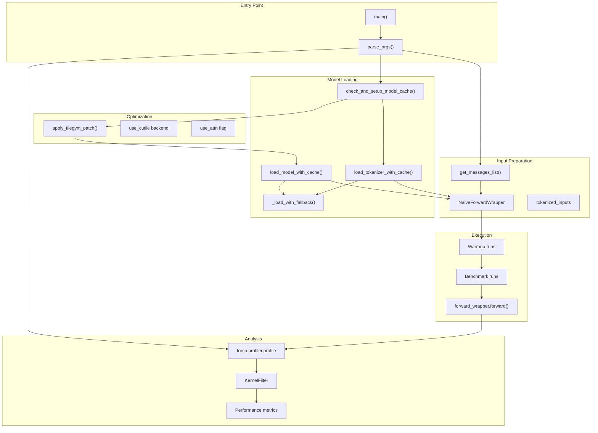
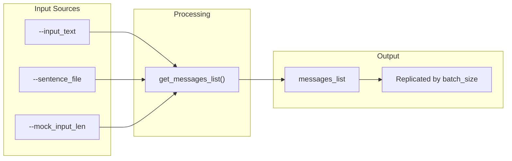
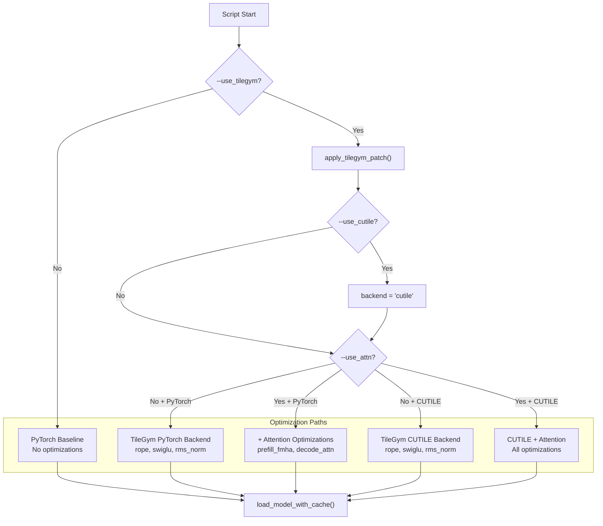
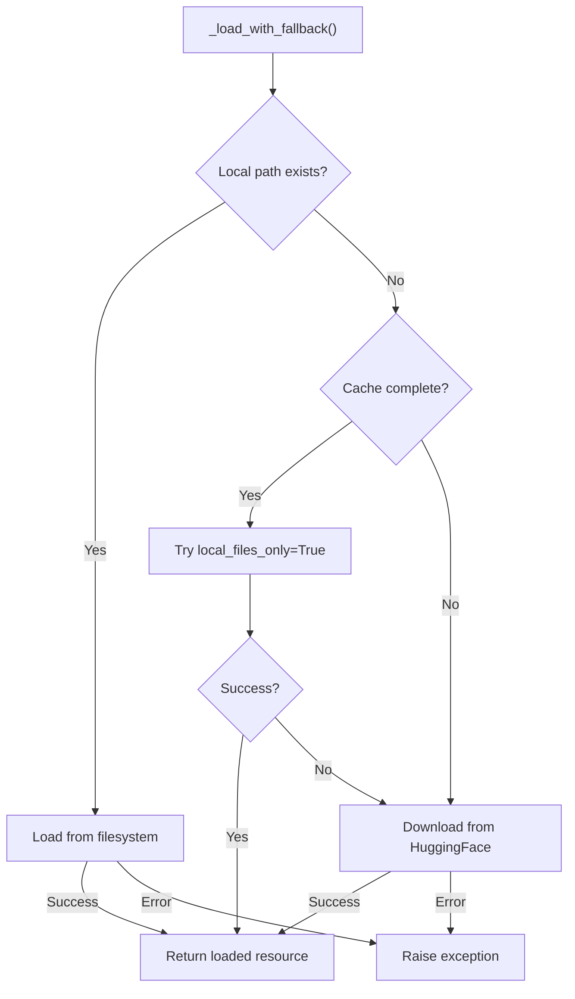
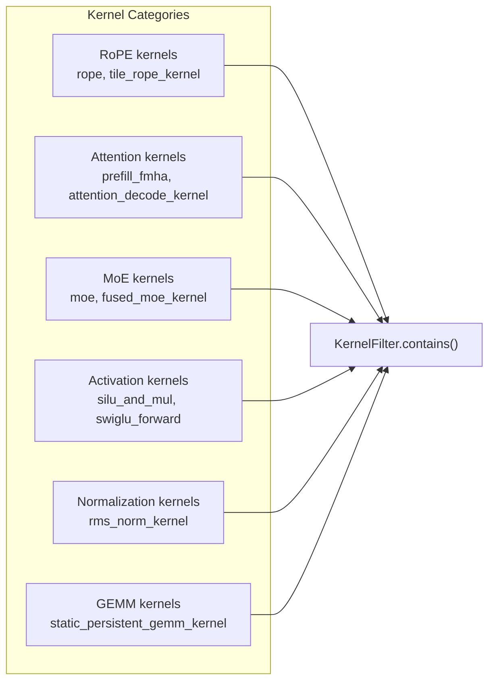

<!-- source: DeepWiki mcp.deepwiki.com · repo NVIDIA/TileGym · page 4.2 Running Inference · fetched 2026-10-26 -->

# Running Inference

<details>
<summary>Relevant source files</summary>

The following files were used as context for generating this wiki page:

- [modeling/transformers/README.md](modeling/transformers/README.md)
- [modeling/transformers/infer.py](modeling/transformers/infer.py)

</details>


This page provides detailed instructions for executing transformer model inference using the `infer.py` script. It covers all command-line options, input configuration methods, optimization flags for TileGym/CUTILE backends, profiling capabilities, and output handling.

For information about the overall inference system architecture and model loading mechanisms, see [Inference System Overview](#4.1). For automated performance comparison workflows, see [Benchmarking Performance](#4.3). For details about sample input files and their purposes, see [Sample Input Data](#4.4).

---

## The infer.py Script

The `infer.py` script located at [modeling/transformers/infer.py]() serves as the primary entry point for running transformer inference with optional TileGym optimizations. The script orchestrates model loading, tokenization, generation, and optional profiling in a single execution flow.

### Core Components



**Sources:** [modeling/transformers/infer.py:1-540]()

---

## Command-Line Arguments

The script accepts comprehensive command-line arguments to configure model selection, optimization modes, input sources, profiling, and output behavior. All arguments are parsed by the `parse_args()` function defined at [modeling/transformers/infer.py:148-185]().

### Argument Reference Table

| Argument | Type | Default | Description |
|----------|------|---------|-------------|
| `--model_id` | str | `meta-llama/Meta-Llama-3.1-8B` | HuggingFace model ID or local filesystem path |
| `--use_tilegym` | flag | False | Enable TileGym kernel optimizations |
| `--use_cutile` | flag | False | Use CUTILE backend (requires `--use_tilegym`) |
| `--use_attn` | flag | False | Enable attention optimizations (requires `--use_tilegym`) |
| `--input_text` | str | `"What is the capital of France?"` | Direct text input for generation |
| `--sentence_file` | str | None | Path to input file containing prompt text |
| `--output_length` | int | 100 | Number of tokens to generate |
| `--batch_size` | int | 1 | Batch size for inference |
| `--precision` | str | `bfloat16` | Tensor precision (`bfloat16` or `float32`) |
| `--num_runs` | int | 5 | Number of benchmark iterations |
| `--warmup_runs` | int | 2 | Number of warmup iterations before benchmarking |
| `--profile` | flag | False | Enable torch profiler for kernel-level analysis |
| `--log_dir` | str | `/logs` | Directory for profiler output files |
| `--show_outputs` | flag | False | Display generated text to console |
| `--summary_file` | str | None | File path to append performance summary |
| `--mock_input_len` | int | 0 | Override input length for benchmarking (used internally) |

**Sources:** [modeling/transformers/infer.py:148-185](), [modeling/transformers/README.md:147-162]()

---

## Input Configuration

The script supports three methods for providing input prompts, processed by the `get_messages_list()` function at [modeling/transformers/infer.py:187-204]().

### Input Methods



### Direct Text Input

Provide prompt text directly via command line:

```bash
python infer.py \
    --model_id meta-llama/Meta-Llama-3.1-8B \
    --input_text "Explain quantum computing in simple terms"
```

The text is replicated `batch_size` times to create the batch.

### File-Based Input

Read prompt from a text file:

```bash
python infer.py \
    --model_id meta-llama/Meta-Llama-3.1-8B \
    --sentence_file sample_inputs/input_prompt_32K.txt \
    --output_length 100
```

The file contents are read using [modeling/transformers/infer.py:196-199](), with all lines concatenated and replicated for batching.

### Mock Input Length

For controlled benchmarking with specific input lengths without actual prompt text:

```bash
python infer.py \
    --model_id meta-llama/Meta-Llama-3.1-8B \
    --mock_input_len 32768
```

This creates a repeated "Hello" pattern to achieve the target token count, implemented in [modeling/transformers/infer.py:189-194]().

**Sources:** [modeling/transformers/infer.py:187-204](), [modeling/transformers/README.md:52-70]()

---

## Optimization Modes

TileGym provides multiple optimization levels controlled by three flags: `--use_tilegym`, `--use_cutile`, and `--use_attn`. These flags determine which kernels are replaced with optimized implementations.

### Optimization Flag Interaction



### Patch Application

The `apply_tilegym_patch()` function at [modeling/transformers/infer.py:206-226]() determines which model-specific kernel replacements to apply:

| Model Type | Patched Kernels |
|------------|----------------|
| LLaMA (detected via `"llama"` in model_id) | `rope`, `swiglu`, `rms_norm`, optionally `attn` |
| DeepSeek (detected via `"deepseek"` in model_id) | `rope`, `rms_norm`, `swiglu`, `moe`, optionally `attn` |

The actual patching is performed by `apply_tilegym_kernel_to_llama()` and `apply_tilegym_kernel_to_deepseek_v2()` imported from the TileGym transformers module.

### Usage Examples

**PyTorch baseline (no optimizations):**
```bash
python infer.py --model_id meta-llama/Meta-Llama-3.1-8B
```

**TileGym with PyTorch backend:**
```bash
python infer.py --model_id meta-llama/Meta-Llama-3.1-8B --use_tilegym
```

**TileGym with CUTILE backend:**
```bash
python infer.py --model_id meta-llama/Meta-Llama-3.1-8B --use_tilegym --use_cutile
```

**Full optimizations (CUTILE + attention):**
```bash
python infer.py --model_id meta-llama/Meta-Llama-3.1-8B --use_tilegym --use_cutile --use_attn
```

**Sources:** [modeling/transformers/infer.py:206-226](), [modeling/transformers/infer.py:289-295](), [modeling/transformers/README.md:40-49]()

---

## Model Loading and Caching

The inference script implements a sophisticated model loading system with automatic cache management and fallback mechanisms.

### Cache Directory Setup

The `check_and_setup_model_cache()` function at [modeling/transformers/infer.py:20-41]() configures HuggingFace cache locations:

1. Reads `TILEGYM_MODEL_CACHE_DIR` environment variable or defaults to `~/.cache`
2. Sets up `HF_HOME` and `HF_HUB_CACHE` environment variables
3. Creates cache directories if they don't exist

### Fallback Loading Strategy

The `_load_with_fallback()` function at [modeling/transformers/infer.py:55-95]() implements a three-tier loading strategy:



This strategy ensures:
- Local filesystem paths are tried first
- Cached models are used when available
- Downloads occur only when necessary
- Clear error messages for failures

### Model and Tokenizer Loading

Two wrapper functions provide typed interfaces:

- `load_model_with_cache()` at [modeling/transformers/infer.py:98-100]() loads the `AutoModelForCausalLM`
- `load_tokenizer_with_cache()` at [modeling/transformers/infer.py:103-105]() loads the `AutoTokenizer`

Both use the fallback strategy and are called in the main execution flow at [modeling/transformers/infer.py:287-306]().

**Sources:** [modeling/transformers/infer.py:20-106](), [modeling/transformers/README.md:165-177]()

---

## Generation Wrapper

The `NaiveForwardWrapper` class at [modeling/transformers/infer.py:108-145]() encapsulates model generation logic and input management.

### Class Structure

| Method | Purpose |
|--------|---------|
| `__init__()` | Tokenizes input, stores model/tokenizer, configures generation parameters |
| `get_input_seq_len()` | Returns tokenized input sequence length |
| `update_params()` | Updates generation kwargs dynamically |
| `forward()` | Executes `model.generate()` with configured parameters |
| `post_process()` | Applies any post-generation transformations |

### Initialization

The wrapper is instantiated at [modeling/transformers/infer.py:316-324]() with:

```python
forward_wrapper = NaiveForwardWrapper(
    model,
    tokenizer=tokenizer,
    messages_list=get_messages_list(args),
    args=args,
    pad_token_id=tokenizer.eos_token_id,
    do_sample=do_sample,
    early_stopping=False,
)
```

Key behaviors:
- Tokenizes `messages_list` to GPU tensors immediately
- Calculates input sequence length for metrics
- Configures `max_new_tokens` and `min_new_tokens` to enforce exact output length
- Stores both model reference and generation kwargs

**Sources:** [modeling/transformers/infer.py:108-145](), [modeling/transformers/infer.py:316-324]()

---

## Execution Flow

The main execution follows a structured warmup-benchmark-profile pattern.

### Complete Execution Pipeline

```mermaid
graph TD
    ARGS["parse_args()"]
    DEVICE["Check CUDA availability"]
    CACHE["check_and_setup_model_cache()"]
    TOKENIZER["load_tokenizer_with_cache()"]
    PATCH_CHECK{"args.use_tilegym?"}
    PATCH_APPLY["apply_tilegym_patch()"]
    MODEL["load_model_with_cache()"]
    WRAPPER["NaiveForwardWrapper()"]
    
    subgraph "Warmup Phase"
        WARMUP_LOOP["for i in warmup_runs"]
        WARMUP_FWD["forward_wrapper.forward()"]
    end
    
    subgraph "Benchmark Phase"
        BENCH_LOOP["for i in num_runs"]
        CUDA_EVENTS["CUDA timing events"]
        BENCH_FWD["forward_wrapper.forward()"]
        CALC_METRICS["Calculate tokens/sec"]
    end
    
    PROFILE_CHECK{"args.profile?"}
    
    subgraph "Profiling Phase"
        PROF_CTX["torch.profiler.profile"]
        PROF_FWD["forward_wrapper.forward()"]
        FILTER["KernelFilter.contains()"]
        EXPORT["Export CSV and trace.zip"]
    end
    
    OUTPUT_CHECK{"args.show_outputs?"}
    DECODE["tokenizer.decode()"]
    SUMMARY_CHECK{"args.summary_file?"}
    WRITE_SUMMARY["Append to summary file"]
    
    ARGS --> DEVICE
    DEVICE --> CACHE
    CACHE --> TOKENIZER
    TOKENIZER --> PATCH_CHECK
    PATCH_CHECK -->|Yes| PATCH_APPLY
    PATCH_CHECK -->|No| MODEL
    PATCH_APPLY --> MODEL
    MODEL --> WRAPPER
    
    WRAPPER --> WARMUP_LOOP
    WARMUP_LOOP --> WARMUP_FWD
    WARMUP_FWD --> BENCH_LOOP
    
    BENCH_LOOP --> CUDA_EVENTS
    CUDA_EVENTS --> BENCH_FWD
    BENCH_FWD --> CALC_METRICS
    
    CALC_METRICS --> PROFILE_CHECK
    PROFILE_CHECK -->|Yes| PROF_CTX
    PROFILE_CHECK -->|No| OUTPUT_CHECK
    
    PROF_CTX --> PROF_FWD
    PROF_FWD --> FILTER
    FILTER --> EXPORT
    EXPORT --> OUTPUT_CHECK
    
    OUTPUT_CHECK -->|Yes| DECODE
    OUTPUT_CHECK -->|No| SUMMARY_CHECK
    DECODE --> SUMMARY_CHECK
    
    SUMMARY_CHECK -->|Yes| WRITE_SUMMARY
    SUMMARY_CHECK -->|No| END["Exit"]
    WRITE_SUMMARY --> END
```



### Warmup Phase

Warmup runs at [modeling/transformers/infer.py:326-331]() stabilize GPU state before measurements:

```python
for i in range(args.warmup_runs):
    with torch.no_grad():
        _ = forward_wrapper.forward()
```

Default: 2 warmup runs (configurable via `--warmup_runs`)

### Benchmark Phase

The benchmark loop at [modeling/transformers/infer.py:333-365]() uses CUDA events for precise timing:

1. **Synchronize:** `torch.cuda.synchronize()` ensures clean start
2. **Create events:** `torch.cuda.Event(enable_timing=True)`
3. **Record start:** `start_event.record()`
4. **Generate:** `forward_wrapper.forward()` with `torch.no_grad()`
5. **Record end:** `end_event.record()`
6. **Calculate metrics:** `elapsed_time = start_event.elapsed_time(end_event) / 1000.0`

Metrics collected:
- Generation time per run (seconds)
- Tokens per second (throughput)
- Generated token count (excluding input)

**Sources:** [modeling/transformers/infer.py:275-392](), [modeling/transformers/infer.py:326-365]()

---

## Profiling and Performance Analysis

The `--profile` flag enables detailed kernel-level performance analysis using PyTorch's profiler.

### Profiler Configuration

Profiling is executed at [modeling/transformers/infer.py:415-421]() with:

```python
with profile(activities=[ProfilerActivity.CPU, ProfilerActivity.CUDA], 
             with_stack=False, 
             record_shapes=False) as prof:
    with record_function("model_inference"):
        with torch.no_grad():
            _ = forward_wrapper.forward()
```

### Kernel Filtering

The `KernelFilter` class at [modeling/transformers/infer.py:228-273]() identifies TileGym and optimization-relevant kernels:



The filter uses a prefix-based matching strategy defined in `kernel_names_prefix` at [modeling/transformers/infer.py:230-263]() and a blacklist at [modeling/transformers/infer.py:264-266]() to exclude false positives like `aten::matmul`.

### Profiler Outputs

Three output files are generated with timestamps:

| File Type | Naming Pattern | Content |
|-----------|----------------|---------|
| CSV | `profiler_results_{case_id}_{timestamp}.csv` | All operations with CPU/CUDA times, self-times, counts, filter status |
| ZIP | `trace_{case_id}_{timestamp}.zip` | Chrome trace JSON (compressed) |
| Console | - | Filtered kernel table with times and counts |

CSV structure (from [modeling/transformers/infer.py:469-484]()):
```
Name,CPU_time_total_us,CPU_time_avg_us,CUDA_time_total_us,CUDA_time_avg_us,Self_CPU_time_total_us,Self_CUDA_time_total_us,Count,Filtered,DeviceType
```

### CUDA Kernel Time Calculation

For summary file updates, the script calculates total CUDA kernel time at [modeling/transformers/infer.py:499-535]() by:

1. Summing `self_device_time_total` for all `DeviceType.CUDA` operations
2. Excluding the `model_inference` wrapper operation
3. Converting microseconds to milliseconds
4. Appending to the summary line

**Sources:** [modeling/transformers/infer.py:228-273](), [modeling/transformers/infer.py:415-535](), [modeling/transformers/README.md:72-84]()

---

## Output Options

The script provides multiple output modes for different use cases.

### Console Output Modes

**Default (benchmark mode):** Displays per-run metrics and final summary:
```
Run 1: Generated 100 tokens in 1.2345s (81.00 tokens/sec)
===== BENCHMARK RESULTS =====
Average throughput: 80.50 ± 1.20 tokens/sec
```

**Show outputs mode (`--show_outputs`):** Displays generated text at [modeling/transformers/infer.py:385-392]():
```bash
python infer.py --model_id meta-llama/Meta-Llama-3.1-8B --show_outputs
```
Output includes decoded text for each batch element with separators.

### Summary File Format

When `--summary_file` is specified, a formatted line is appended at [modeling/transformers/infer.py:398-413]():

```
{case_id:<40} | {avg_tokens_per_sec:>10.2f} | {avg_time:>9.4f}
```

Case ID format includes:
- Model name (e.g., `Meta-Llama-3.1-8B`)
- Backend suffix (`_cutile` if CUTILE enabled)
- Attention suffix (`_attn` if attention enabled)
- Fallback suffix (`_naive` if no TileGym)
- Precision suffix (`_bfloat16` or `_float32`)

If profiling is enabled, CUDA kernel time is appended at [modeling/transformers/infer.py:518-535]():
```
{case_id:<40} | {avg_tokens_per_sec:>10.2f} | {avg_time:>9.4f} | {cuda_kernel_time_ms:>10.1f}
```

### Profiler Log Directory

Profiler outputs are saved to the directory specified by `--log_dir` (default: `/logs`), created automatically at [modeling/transformers/infer.py:465]().

**Sources:** [modeling/transformers/infer.py:367-392](), [modeling/transformers/infer.py:398-535](), [modeling/transformers/README.md:162]()

---

## Complete Usage Examples

### Basic Inference Examples

**Minimal command (PyTorch baseline):**
```bash
python infer.py
```

**Custom model and input:**
```bash
python infer.py \
    --model_id deepseek-ai/DeepSeek-V2-Lite-Chat \
    --input_text "Explain the transformer architecture" \
    --output_length 200
```

**File-based input with optimizations:**
```bash
python infer.py \
    --model_id meta-llama/Meta-Llama-3.1-8B \
    --sentence_file sample_inputs/input_prompt_32K.txt \
    --use_tilegym \
    --use_cutile \
    --use_attn \
    --output_length 100
```

### Profiling Examples

**Profile with all optimizations:**
```bash
python infer.py \
    --model_id meta-llama/Meta-Llama-3.1-8B \
    --sentence_file sample_inputs/input_prompt_32K.txt \
    --use_tilegym \
    --use_cutile \
    --use_attn \
    --profile \
    --log_dir ./profiler_results \
    --num_runs 5
```

**Profile baseline for comparison:**
```bash
python infer.py \
    --model_id meta-llama/Meta-Llama-3.1-8B \
    --sentence_file sample_inputs/input_prompt_32K.txt \
    --profile \
    --log_dir ./profiler_results \
    --num_runs 5
```

### Batch Processing

```bash
python infer.py \
    --model_id meta-llama/Meta-Llama-3.1-8B \
    --input_text "Hello world" \
    --batch_size 4 \
    --use_tilegym \
    --use_cutile
```

### Local Model Path

```bash
python infer.py \
    --model_id /path/to/local/Meta-Llama-3.1-8B \
    --use_tilegym \
    --use_attn \
    --show_outputs
```

**Sources:** [modeling/transformers/README.md:40-70](), [modeling/transformers/README.md:72-84](), [modeling/transformers/README.md:165-177]()

---

