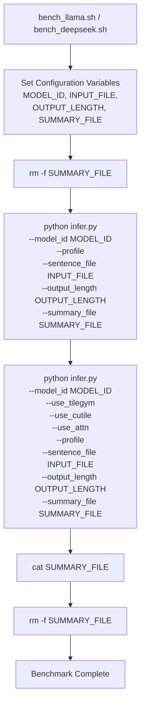
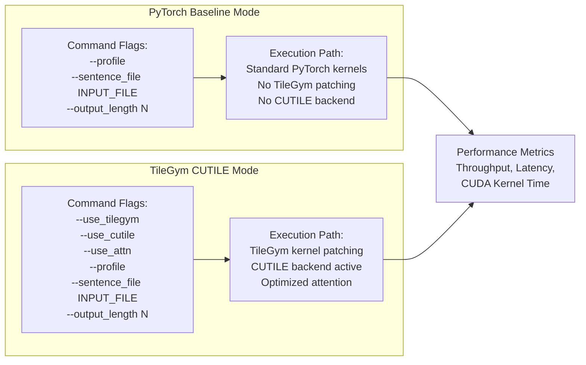
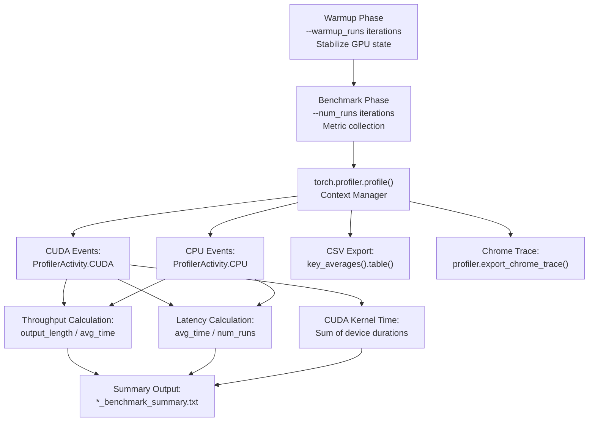

<!-- source: DeepWiki mcp.deepwiki.com · repo NVIDIA/TileGym · page 4.3 Benchmarking Performance · fetched 2026-10-26 -->

# Benchmarking Performance

<details>
<summary>Relevant source files</summary>

The following files were used as context for generating this wiki page:

- [modeling/transformers/README.md](modeling/transformers/README.md)
- [modeling/transformers/bench_deepseek.sh](modeling/transformers/bench_deepseek.sh)
- [modeling/transformers/bench_llama.sh](modeling/transformers/bench_llama.sh)

</details>


This document explains how to use TileGym's benchmarking infrastructure to quantify the performance improvements of CUTILE-optimized kernels compared to PyTorch baseline implementations. It covers the automated benchmark scripts, manual benchmarking procedures, metric interpretation, and result analysis.

For detailed information about the `infer.py` command-line interface, see [Running Inference](#4.2). For information about the inference system architecture, see [Inference System Overview](#4.1).

## Overview

TileGym provides automated benchmarking scripts that implement controlled A/B testing methodology to compare execution performance between two modes:

1. **PyTorch Baseline Mode**: Standard transformer implementation without optimizations
2. **TileGym CUTILE Mode**: Optimized implementation using TileGym kernels with CUTILE backend

The benchmarking system executes both modes with identical configurations, collects performance metrics through PyTorch Profiler, and generates comparative summary reports. This approach enables precise quantification of optimization benefits across different model architectures and context lengths.

Sources: [modeling/transformers/README.md:86-144]()

## Benchmark Scripts

TileGym provides two pre-configured benchmark scripts that automate the comparison process:

| Script | Model | Input File | Output Length | Summary File |
|--------|-------|------------|---------------|--------------|
| `bench_llama.sh` | `meta-llama/Meta-Llama-3.1-8B` | `input_prompt_32K.txt` | 50 tokens | `llama_benchmark_summary.txt` |
| `bench_deepseek.sh` | `deepseek-ai/DeepSeek-V2-Lite-Chat` | `input_prompt_small.txt` | 100 tokens | `deepseek_benchmark_summary.txt` |

Each script follows a standard execution pattern:

1. Clean previous benchmark results
2. Execute PyTorch baseline with `--profile` flag
3. Execute TileGym CUTILE backend with `--use_tilegym --use_cutile --use_attn --profile` flags
4. Display aggregated results from summary file
5. Clean up temporary artifacts

**Benchmark Script Execution Flow**



Sources: [modeling/transformers/bench_llama.sh:1-58](), [modeling/transformers/bench_deepseek.sh:1-58]()

## Running Benchmarks

### Automated Benchmarking

The simplest approach uses the provided shell scripts, which handle all configuration automatically:

```bash
# Navigate to transformers directory
cd modeling/transformers

# Run LLaMA-3.1-8B benchmark
./bench_llama.sh

# Run DeepSeek-V2-Lite benchmark
./bench_deepseek.sh
```

Each script displays progress messages during execution and prints a formatted summary table upon completion. The benchmark executes warmup runs (default: 2) followed by measurement runs (default: 5) for each execution mode.

Sources: [modeling/transformers/README.md:90-100]()

### Manual Benchmarking

Manual benchmarking provides control over all configuration parameters. This approach is useful for testing custom configurations, different input files, or alternative model architectures.

**LLaMA-3.1-8B Manual Benchmark**

```bash
# PyTorch baseline
python infer.py \
    --model_id meta-llama/Meta-Llama-3.1-8B \
    --profile \
    --sentence_file sample_inputs/input_prompt_32K.txt \
    --output_length 100

# TileGym CUTILE backend
python infer.py \
    --model_id meta-llama/Meta-Llama-3.1-8B \
    --use_tilegym \
    --use_cutile \
    --use_attn \
    --profile \
    --sentence_file sample_inputs/input_prompt_32K.txt \
    --output_length 100
```

**DeepSeek-V2-Lite Manual Benchmark**

```bash
# PyTorch baseline
python infer.py \
    --model_id deepseek-ai/DeepSeek-V2-Lite-Chat \
    --profile \
    --sentence_file sample_inputs/input_prompt_small.txt \
    --output_length 100

# TileGym CUTILE backend
python infer.py \
    --model_id deepseek-ai/DeepSeek-V2-Lite-Chat \
    --use_tilegym \
    --use_cutile \
    --use_attn \
    --profile \
    --sentence_file sample_inputs/input_prompt_small.txt \
    --output_length 100
```

Manual benchmarking allows customization of all parameters documented in [Running Inference](#4.2), including batch size, precision, number of runs, and warmup iterations.

Sources: [modeling/transformers/README.md:102-144]()

## Execution Modes

The benchmarking system tests two distinct execution modes by varying command-line flags passed to `infer.py`:

**Execution Mode Configuration Comparison**



### PyTorch Baseline Mode

Executes inference using standard PyTorch operations without TileGym optimizations. This mode serves as the reference implementation for performance comparison. Configuration:

- No `--use_tilegym` flag
- Standard transformer implementation
- PyTorch's default kernel selection
- No CUTILE backend involvement

### TileGym CUTILE Mode

Executes inference with TileGym's optimized kernels. This mode demonstrates the performance improvements achievable through CUDA tile-based optimizations. Configuration requires three flags:

- `--use_tilegym`: Enables TileGym kernel patching via `apply_tilegym_patch`
- `--use_cutile`: Activates CUTILE backend for tile-optimized operations
- `--use_attn`: Enables attention-specific optimizations

Both modes execute with the `--profile` flag to enable PyTorch Profiler's performance measurement capabilities.

Sources: [modeling/transformers/README.md:86-144](), [modeling/transformers/bench_llama.sh:27-45]()

## Performance Metrics

The benchmarking system collects three primary performance metrics through PyTorch Profiler:

| Metric | Description | Calculation | Significance |
|--------|-------------|-------------|--------------|
| **Throughput** | Generation speed | Tokens / Total Time | Higher values indicate better performance |
| **Latency** | Time per generation | Total Time / Iterations | Lower values indicate better performance |
| **CUDA Kernel Time** | GPU execution time | Sum of CUDA kernel durations | Isolates GPU computational efficiency |

**Metrics Collection Pipeline**



### Throughput

Measured in tokens per second, throughput quantifies the generation speed. Calculated as:

```
Throughput = output_length / average_generation_time
```

Higher throughput indicates more efficient token generation.

### Latency

Measured in seconds per generation, latency quantifies the time cost per inference run. Calculated as:

```
Latency = average_generation_time / num_runs
```

Lower latency indicates faster individual generations.

### CUDA Kernel Time

Measured in seconds, this metric isolates GPU computational time by summing all CUDA kernel execution durations. This excludes CPU overhead, memory transfers, and synchronization, providing a pure measure of GPU computational efficiency.

Sources: [modeling/transformers/README.md:72-84]()

## Output Artifacts

The benchmarking system generates multiple output formats for different analysis needs:

### Summary File

The `--summary_file` parameter directs aggregate metrics to a text file. Both execution modes append to the same file, enabling side-by-side comparison. Format:

```
========================================
  PyTorch Baseline Results
========================================
Throughput: X.XX tokens/sec
Latency: X.XXX sec
CUDA Kernel Time: X.XXX sec

========================================
  TileGym CUTILE Results
========================================
Throughput: X.XX tokens/sec
Latency: X.XXX sec
CUDA Kernel Time: X.XXX sec
```

The benchmark scripts display this file contents via `cat SUMMARY_FILE` and then remove it with `rm -f SUMMARY_FILE`.

Sources: [modeling/transformers/bench_llama.sh:13-57](), [modeling/transformers/bench_deepseek.sh:13-57]()

### CSV Profiler Logs

PyTorch Profiler's `key_averages().table()` method exports detailed kernel-level statistics to CSV format, including:

- Kernel names and categories
- CPU and CUDA execution times
- Number of calls
- Average duration per call
- Memory operations

This format enables programmatic analysis and comparison of individual kernel performance.

### Chrome Trace

The `profiler.export_chrome_trace()` method generates JSON files compatible with Chrome's `chrome://tracing` viewer. These traces provide timeline visualization showing:

- Kernel execution order
- CPU-GPU synchronization points
- Memory transfer operations
- Parallelism and idle time

Chrome traces are particularly useful for identifying bottlenecks and understanding execution flow.

### Console Output

Real-time execution progress and final metrics print to stdout, providing immediate feedback during benchmark execution. This includes:

- Model loading status
- Generation progress
- Final performance metrics
- Error messages and warnings

Sources: [modeling/transformers/README.md:72-84]()

## Benchmark Configuration Parameters

Key parameters that affect benchmark behavior:

| Parameter | Default | Purpose |
|-----------|---------|---------|
| `--num_runs` | 5 | Number of benchmark iterations for averaging |
| `--warmup_runs` | 2 | Iterations to stabilize GPU state before measurement |
| `--output_length` | 100 | Tokens to generate per run |
| `--batch_size` | 1 | Inference batch size |
| `--precision` | `bfloat16` | Computation precision (`bfloat16` or `float32`) |

Benchmark scripts use fixed values for reproducibility. Manual benchmarking allows customization of these parameters. For example, increasing `--num_runs` improves statistical confidence at the cost of longer execution time.

Sources: [modeling/transformers/README.md:146-163]()

## Interpreting Results

When analyzing benchmark results, consider:

1. **Relative Improvement**: Compare throughput and latency ratios between modes rather than absolute values, as hardware capabilities vary
2. **Statistical Variance**: Multiple runs average out noise; low variance indicates consistent performance
3. **Context Length Impact**: Performance benefits typically increase with longer context windows (see sample inputs in [Sample Input Data](#4.4))
4. **Memory Constraints**: CUDA Out of Memory errors indicate the need for smaller batch sizes or reduced precision

Example interpretation:

```
PyTorch Baseline:    50 tokens/sec,  2.0 sec latency
TileGym CUTILE:      75 tokens/sec,  1.33 sec latency

Speedup: 75/50 = 1.5x throughput improvement
         2.0/1.33 = 1.5x latency reduction
```

Sources: [modeling/transformers/README.md:86-144]()

---

