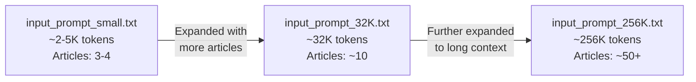
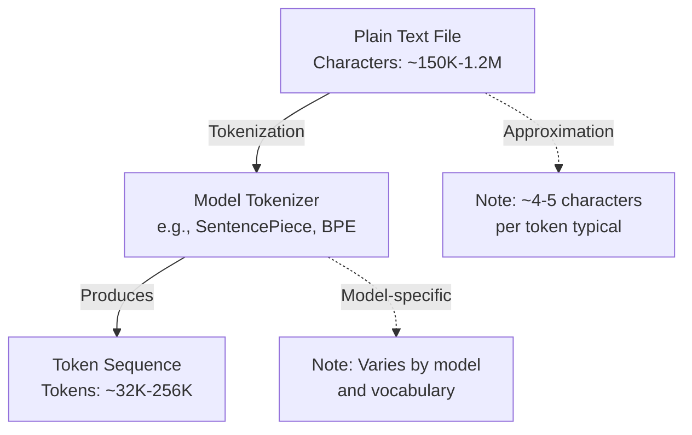
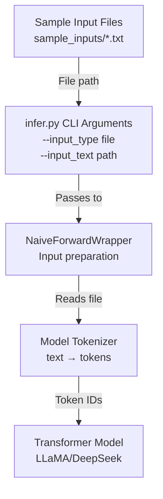
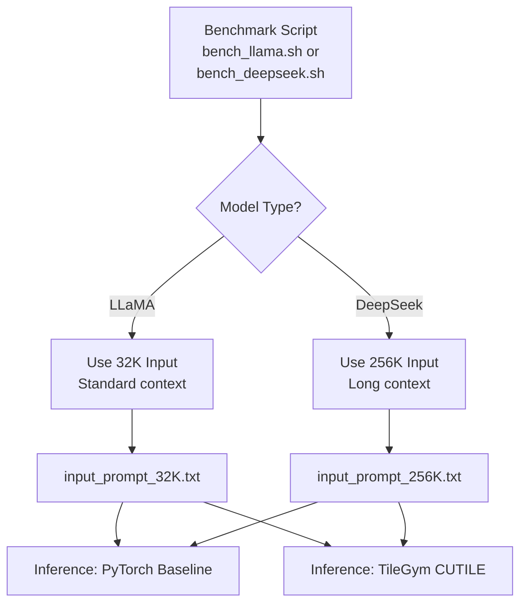
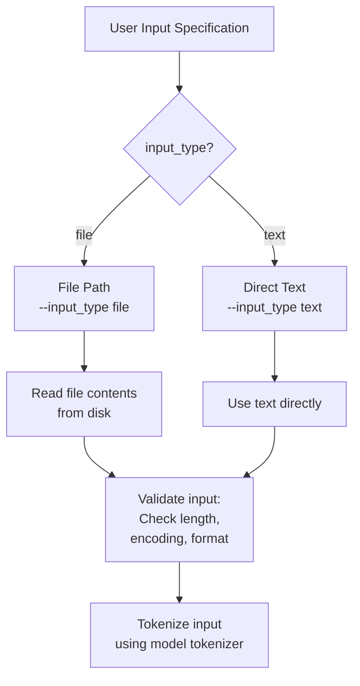
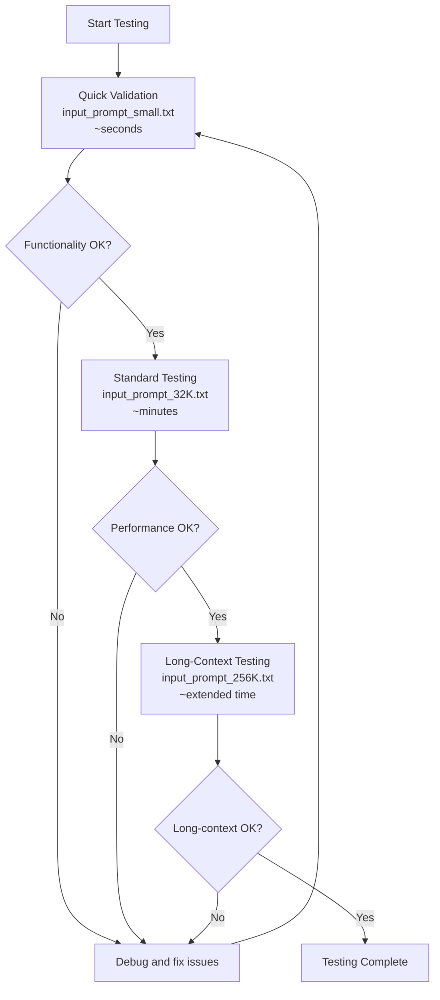

<!-- source: DeepWiki mcp.deepwiki.com · repo NVIDIA/TileGym · page 4.4 Sample Input Data · fetched 2026-10-26 -->

# Sample Input Data

<details>
<summary>Relevant source files</summary>

The following files were used as context for generating this wiki page:

- [modeling/transformers/sample_inputs/input_prompt_256K.txt](modeling/transformers/sample_inputs/input_prompt_256K.txt)
- [modeling/transformers/sample_inputs/input_prompt_32K.txt](modeling/transformers/sample_inputs/input_prompt_32K.txt)
- [modeling/transformers/sample_inputs/input_prompt_small.txt](modeling/transformers/sample_inputs/input_prompt_small.txt)

</details>


This page documents the sample input files provided with TileGym for testing and benchmarking transformer model inference. These pre-configured prompts enable quick validation of the inference system and performance testing across different context lengths.

For information about running inference with these inputs, see [Running Inference](#4.2). For benchmarking workflows that use these files, see [Benchmarking Performance](#4.3).

## Overview

TileGym provides three sample input files located in [modeling/transformers/sample_inputs/](), each designed for specific testing scenarios. These files contain concatenated Wikipedia articles that serve as representative real-world text data for language model inference.

## Available Sample Files

| File Name | Approximate Tokens | Primary Use Case | Typical Inference Time |
|-----------|-------------------|------------------|----------------------|
| `input_prompt_small.txt` | ~2-5K | Quick functionality tests, debugging | Seconds |
| `input_prompt_32K.txt` | ~32K | Standard context length testing | Minutes |
| `input_prompt_256K.txt` | ~256K | Long-context capability validation | Extended duration |

Sources: [modeling/transformers/sample_inputs/input_prompt_small.txt](), [modeling/transformers/sample_inputs/input_prompt_32K.txt](), [modeling/transformers/sample_inputs/input_prompt_256K.txt]()

## File Content Structure

### Content Source

All three sample files contain concatenated Wikipedia articles formatted as plain text. The content begins with articles on topics including:

- **Anarchism**: Political philosophy and movement history
- **Albedo**: Scientific discussion of light reflection
- **A**: Linguistic and historical information about the letter
- **Alabama**: U.S. state geography and history (in larger files)

This diversity of content provides:
- **Varied vocabulary**: Technical, historical, and general knowledge domains
- **Natural language patterns**: Representative of real-world text generation tasks
- **Consistent structure**: Same starting content across all files for reproducibility

[Sample content from input_prompt_small.txt:1-10]()

```text
Anarchism: Anarchism is a political philosophy and movement that is against 
all forms of authority and seeks to abolish the institutions it claims maintain 
unnecessary coercion and hierarchy, typically including the state and capitalism.
```

### Scaling Pattern

The files follow a progressive scaling pattern:



Sources: [modeling/transformers/sample_inputs/input_prompt_small.txt:1-100](), [modeling/transformers/sample_inputs/input_prompt_32K.txt:1-100](), [modeling/transformers/sample_inputs/input_prompt_256K.txt:1-100]()

## Token Length Context

### Context Window Sizes

The file naming convention reflects approximate token counts after tokenization:

- **32K context**: Standard context window supported by most modern LLMs (e.g., LLaMA 3.1-8B)
- **256K context**: Extended context window for testing long-context capabilities (e.g., DeepSeek V2-Lite)

**Note**: Actual token counts vary based on the tokenizer used by the specific model. The values "32K" and "256K" are approximate and refer to token counts, not character counts or file sizes.

### Token Count Calculation

The relationship between file content and tokens:



Sources: Tokenization is performed by the model's tokenizer loaded via HuggingFace transformers

## Usage with Inference System

### Command-Line Integration

Sample inputs integrate with the inference system through the `--input_type` and `--input_text` arguments in `infer.py`:

```bash
# Using the small sample file
python modeling/transformers/infer.py \
    --model_id meta-llama/Llama-3.1-8B \
    --input_type file \
    --input_text modeling/transformers/sample_inputs/input_prompt_small.txt

# Using the 32K sample file
python modeling/transformers/infer.py \
    --model_id meta-llama/Llama-3.1-8B \
    --input_type file \
    --input_text modeling/transformers/sample_inputs/input_prompt_32K.txt

# Using the 256K sample file (requires long-context model)
python modeling/transformers/infer.py \
    --model_id deepseek-ai/DeepSeek-V2-Lite \
    --input_type file \
    --input_text modeling/transformers/sample_inputs/input_prompt_256K.txt
```

### Input Processing Flow



Sources: Input processing occurs in the inference system's wrapper and tokenizer components

## Benchmarking Scripts Usage

### Integration with Benchmark Scripts

The benchmarking scripts automatically utilize appropriate sample inputs:

**bench_llama.sh** typically uses `input_prompt_32K.txt`:
```bash
#!/bin/bash
# Standard context length testing for LLaMA models
INPUT_FILE="modeling/transformers/sample_inputs/input_prompt_32K.txt"
```

**bench_deepseek.sh** may use `input_prompt_256K.txt` for long-context validation:
```bash
#!/bin/bash
# Long-context testing for DeepSeek models
INPUT_FILE="modeling/transformers/sample_inputs/input_prompt_256K.txt"
```

### Benchmark Input Selection Strategy



Sources: Benchmark script configurations determine which sample input to use based on model capabilities

## Custom Input Support

### Using Custom Text Files

Users can provide custom input files by specifying any text file path:

```bash
python modeling/transformers/infer.py \
    --model_id meta-llama/Llama-3.1-8B \
    --input_type file \
    --input_text /path/to/custom_prompt.txt
```

**Custom file requirements**:
- Plain text format (UTF-8 encoding recommended)
- No specific length requirement (limited by model's context window)
- Content should be meaningful natural language for representative testing

### Using Direct Text Input

Alternatively, provide text directly via command line:

```bash
python modeling/transformers/infer.py \
    --model_id meta-llama/Llama-3.1-8B \
    --input_type text \
    --input_text "Your custom prompt text here"
```

### Custom Input Processing



Sources: Input handling logic in inference script argument parsing and wrapper implementation

## File Size and Storage Characteristics

### Physical File Properties

| File | Approximate Size | Lines | Compression |
|------|-----------------|-------|-------------|
| `input_prompt_small.txt` | ~150-200 KB | ~2,500 | Uncompressed |
| `input_prompt_32K.txt` | ~1.2 MB | ~20,000 | Uncompressed |
| `input_prompt_256K.txt` | ~9-10 MB | ~150,000 | Uncompressed |

### Storage Considerations

All sample input files are stored as plain text without compression to ensure:
- **Fast loading**: No decompression overhead during inference
- **Universal compatibility**: Standard text format readable by all systems
- **Easy inspection**: Users can view/edit files with any text editor
- **Git-friendly**: Text files integrate well with version control

Sources: [modeling/transformers/sample_inputs/input_prompt_small.txt](), [modeling/transformers/sample_inputs/input_prompt_32K.txt](), [modeling/transformers/sample_inputs/input_prompt_256K.txt]()

## Testing and Validation Workflows

### Progressive Testing Strategy

Sample files support a progressive testing workflow:



Sources: Testing strategy follows best practices for validating inference system functionality and performance

## Best Practices

### File Selection Guidelines

**Use `input_prompt_small.txt` when**:
- Validating installation and basic functionality
- Debugging inference pipeline issues
- Quick iteration during development
- Testing model loading and tokenization

**Use `input_prompt_32K.txt` when**:
- Benchmarking standard context length performance
- Comparing PyTorch baseline vs TileGym CUTILE optimizations
- Testing typical LLM workloads
- Generating performance reports

**Use `input_prompt_256K.txt` when**:
- Validating long-context model capabilities
- Testing memory efficiency at scale
- Benchmarking models with extended context windows
- Stress-testing inference optimizations

### Performance Implications

| Input Size | Memory Usage | Inference Time | Recommended For |
|------------|--------------|----------------|-----------------|
| Small (~5K) | Low (~2-4 GB) | Fast (seconds) | Development, debugging |
| 32K | Medium (~8-16 GB) | Moderate (minutes) | Standard benchmarking |
| 256K | High (~32-64 GB) | Long (extended) | Long-context validation |

**Note**: Memory usage varies significantly based on model size, batch size, and optimization flags (`--use_tilegym`, `--use_cutile`, `--use_attn`).

Sources: Performance characteristics based on typical inference execution with LLaMA and DeepSeek models

## Summary

The sample input files provide a standardized, reproducible testing framework for TileGym transformer inference. By offering three progressively larger inputs, users can efficiently validate functionality, benchmark performance, and test long-context capabilities across different model configurations.

Sources: [modeling/transformers/sample_inputs/input_prompt_small.txt](), [modeling/transformers/sample_inputs/input_prompt_32K.txt](), [modeling/transformers/sample_inputs/input_prompt_256K.txt]()

---

