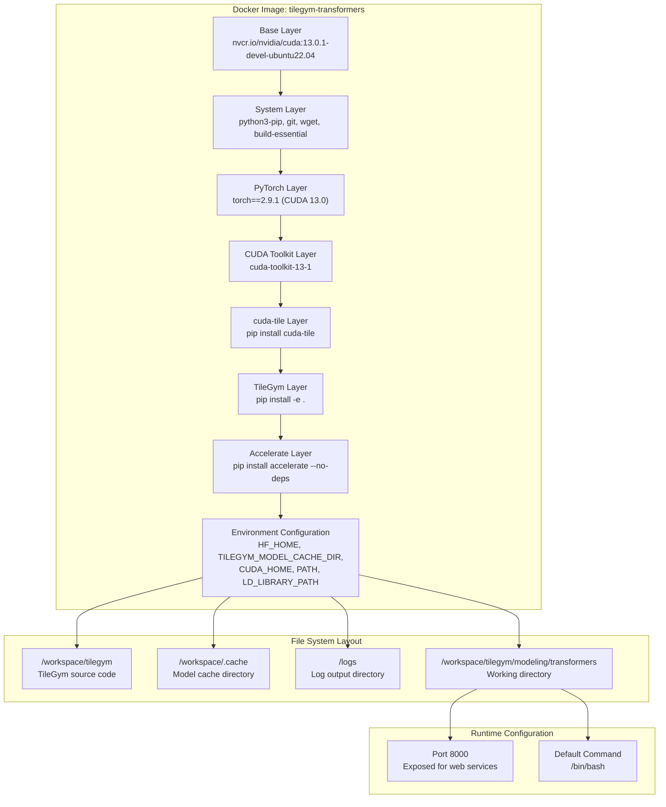
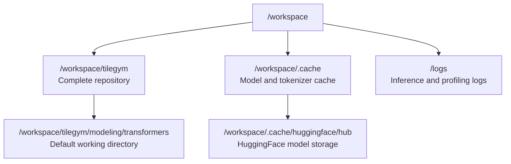
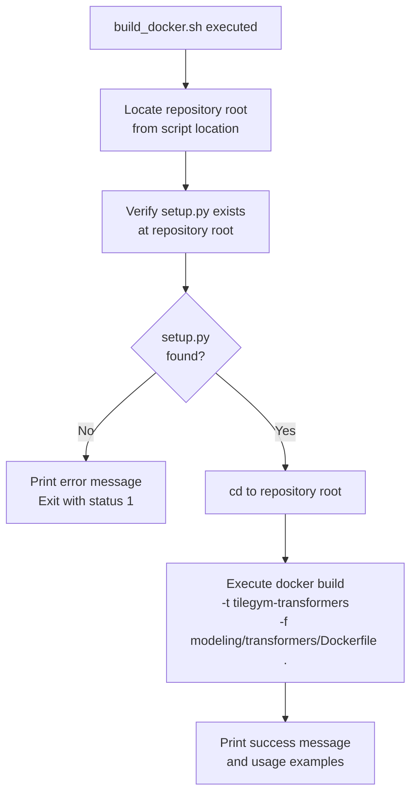

<!-- source: DeepWiki mcp.deepwiki.com · repo NVIDIA/TileGym · page 5 Docker Deployment · fetched 2026-10-26 -->

# Docker Deployment

<details>
<summary>Relevant source files</summary>

The following files were used as context for generating this wiki page:

- [modeling/transformers/Dockerfile](modeling/transformers/Dockerfile)
- [modeling/transformers/build_docker.sh](modeling/transformers/build_docker.sh)

</details>


This document covers the containerized deployment system for TileGym-accelerated transformer inference. It explains the Docker image structure, build process, and runtime configuration. For instructions on running inference within containers, see [Running in Docker](#5.2). For building the container image, see [Building the Container](#5.1).

## Purpose and Scope

The Docker deployment system provides a reproducible, self-contained environment for running TileGym-optimized transformer models. The container packages all dependencies—including CUDA Toolkit 13.1, PyTorch 2.9.1, cuda-tile, and TileGym itself—into a single image based on NVIDIA's official CUDA base image. This eliminates host system configuration complexity and ensures consistent behavior across different deployment environments.

## Container Architecture Overview

The TileGym transformer container is built as a multi-layer Docker image with each layer serving a specific purpose in the software stack:



**Sources:** [modeling/transformers/Dockerfile:1-84]()

## Image Configuration

The container is configured through build arguments, environment variables, and filesystem structure to support both development and production workflows.

### Build Arguments

| Argument | Default Value | Purpose |
|----------|---------------|---------|
| `BASE_IMAGE` | `nvcr.io/nvidia/cuda:13.0.1-devel-ubuntu22.04` | NVIDIA CUDA development base image |
| `TORCH_VERSION` | `2.9.1` | PyTorch version to install |

### Environment Variables

The Dockerfile configures multiple environment variables to ensure proper operation:

| Variable | Value | Purpose |
|----------|-------|---------|
| `PYTHONUNBUFFERED` | `1` | Enable real-time Python output |
| `CUDA_HOME` | `/usr/local/cuda-13.1` | CUDA Toolkit 13.1 installation path |
| `PATH` | `${CUDA_HOME}/bin:${PATH}` | Add CUDA binaries to system path |
| `LD_LIBRARY_PATH` | `${CUDA_HOME}/lib64:${LD_LIBRARY_PATH}` | Add CUDA libraries to linker path |
| `HF_HOME` | `/workspace/.cache/huggingface` | HuggingFace cache directory |
| `TILEGYM_MODEL_CACHE_DIR` | `/workspace/.cache` | TileGym model cache location |

**Sources:** [modeling/transformers/Dockerfile:16-69]()

### Filesystem Structure

The container creates the following directory hierarchy:



**Sources:** [modeling/transformers/Dockerfile:36-77]()

## Dockerfile Layer Breakdown

The Dockerfile constructs the image through a series of installation stages:

### System Dependencies Layer

The first layer installs Ubuntu system packages required for Python development and network operations:

```
python3-pip, python3-dev, python-is-python3
git, wget, curl
build-essential
```

This layer uses `--no-install-recommends` to minimize image size and removes apt cache files to reduce storage footprint [modeling/transformers/Dockerfile:19-27]().

### PyTorch Installation Layer

PyTorch 2.9.1 is installed from the PyTorch nightly repository with CUDA 13.0 support. The `--pre` flag enables pre-release package installation:

```bash
pip install --pre "torch==${TORCH_VERSION}" --index-url https://download.pytorch.org/whl/cu130
```

**Sources:** [modeling/transformers/Dockerfile:32-33]()

### CUDA Toolkit 13.1 Layer

The container installs CUDA Toolkit 13.1 using NVIDIA's official Debian package. This provides nvcc compiler, CUDA runtime libraries, and development headers. The installation sequence:

1. Download and install apt repository configuration
2. Download CUDA 13.1.0 local installer (.deb package)
3. Install package with dpkg
4. Copy GPG keyring for package verification
5. Update apt cache and install cuda-toolkit-13-1

The CUDA 13.1 environment is then configured as the default CUDA version through environment variables.

**Sources:** [modeling/transformers/Dockerfile:44-56]()

### CUDA Tile and TileGym Layers

The `cuda-tile` package is installed via pip, followed by TileGym in editable mode (`pip install -e .`). The editable installation allows the container to reflect source code changes during development without rebuilding the entire image. The Dockerfile includes a verification step that fails the build if `setup.py` is not present, ensuring the container is built from the repository root.

**Sources:** [modeling/transformers/Dockerfile:38-62]()

### Accelerate Layer

The HuggingFace `accelerate` library is installed with `--no-deps` to prevent dependency conflicts with the already-installed PyTorch and transformers versions. This library is used by TileGym's inference system for distributed model execution.

**Sources:** [modeling/transformers/Dockerfile:64-65]()

## Build Process

The `build_docker.sh` script automates the Docker build process and provides user-friendly output:



### Repository Root Detection

The script uses bash parameter expansion to determine the repository root:

```bash
SCRIPT_DIR="$(cd "$(dirname "${BASH_SOURCE[0]}")" && pwd)"
TILEGYM_ROOT="$(cd "${SCRIPT_DIR}/../.." && pwd)"
```

This navigation assumes the script is located at `modeling/transformers/build_docker.sh` and calculates the root as two directories up.

**Sources:** [modeling/transformers/build_docker.sh:17-18]()

### Build Command

The script changes to the repository root and executes the Docker build command:

```bash
docker build -t tilegym-transformers -f modeling/transformers/Dockerfile .
```

Key parameters:
- `-t tilegym-transformers`: Tags the image with a human-readable name
- `-f modeling/transformers/Dockerfile`: Specifies the Dockerfile path
- `.`: Sets the build context to the repository root, allowing the Dockerfile to access all source files

**Sources:** [modeling/transformers/build_docker.sh:36-37]()

### Error Handling

The script uses `set -e` to exit immediately on any command failure. It explicitly verifies the repository structure before attempting the build, providing a clear error message if executed from the wrong location.

**Sources:** [modeling/transformers/build_docker.sh:8-29]()

## Usage Patterns

After building the image, the script prints two usage examples:

**Interactive Mode:**
```bash
docker run --gpus all -it tilegym-transformers bash
```

**Direct Inference Execution:**
```bash
docker run --gpus all -it tilegym-transformers \
  python infer.py --model_id deepseek-ai/DeepSeek-V2-Lite-Chat --use_tilegym --use_cutile --show_outputs
```

The `--gpus all` flag is required to grant the container access to host GPU devices. Without this flag, CUDA operations will fail.

**Sources:** [modeling/transformers/build_docker.sh:42-47]()

## Port Exposure

The Dockerfile exposes port 8000 for potential web service integration, though no web server is configured by default. This allows future extensions to serve inference endpoints via HTTP APIs.

**Sources:** [modeling/transformers/Dockerfile:79-80]()

## Default Command

The container's default command is `/bin/bash`, providing an interactive shell. This enables manual exploration, debugging, and ad-hoc inference execution. Users can override this command at runtime to execute specific scripts or applications.

**Sources:** [modeling/transformers/Dockerfile:82-83]()

---

