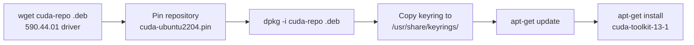
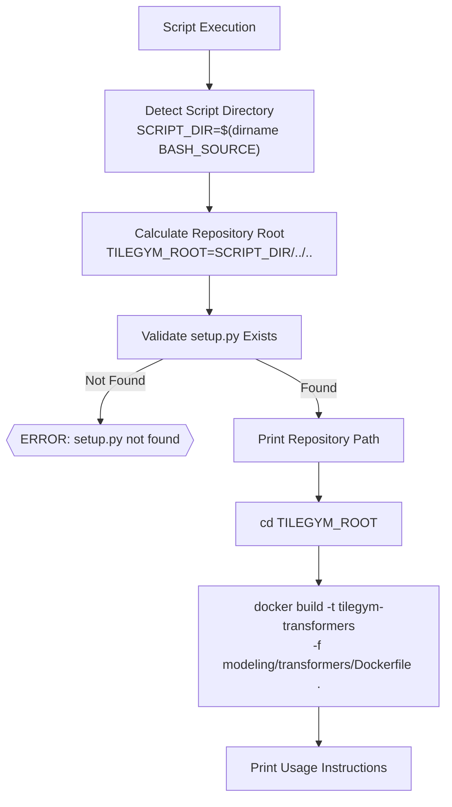

<!-- source: DeepWiki mcp.deepwiki.com · repo NVIDIA/TileGym · page 5.1 Building the Container · fetched 2026-10-26 -->

# Building the Container

<details>
<summary>Relevant source files</summary>

The following files were used as context for generating this wiki page:

- [modeling/transformers/Dockerfile](modeling/transformers/Dockerfile)
- [modeling/transformers/build_docker.sh](modeling/transformers/build_docker.sh)

</details>


## Purpose and Scope

This document explains the Docker container build process for TileGym's transformer inference environment. It covers the multi-stage build configuration defined in the Dockerfile, the build automation script, and the layer-by-layer construction of the container image. For instructions on running inference within the built container, see [Running in Docker](#5.2).

**Sources:** [modeling/transformers/Dockerfile:1-84](), [modeling/transformers/build_docker.sh:1-48]()

---

## Build Process Overview

The TileGym container build follows a layered architecture that installs dependencies in a specific order to ensure compatibility between CUDA 13.1, PyTorch 2.9.1, and the cuda-tile backend. The build must be executed from the TileGym repository root to correctly copy source files into the container.

### Build Command

```bash
docker build -t tilegym-transformers -f modeling/transformers/Dockerfile .
```

The build helper script [modeling/transformers/build_docker.sh]() automates repository root detection and build execution:

```bash
./modeling/transformers/build_docker.sh
```

**Sources:** [modeling/transformers/Dockerfile:8-9](), [modeling/transformers/build_docker.sh:36-37]()

---

## Container Build Flow

The following diagram shows the complete build process from base image to final container:

```mermaid
flowchart TD
    START["Build Invocation"]
    SCRIPT["build_docker.sh"]
    VALIDATE["Validate Repository Structure"]
    
    BASE["Base Image Selection<br/>nvcr.io/nvidia/cuda:13.0.1-devel-ubuntu22.04"]
    
    SYSBASE["System Base Layer"]
    APT["apt-get install"]
    PYTHON["Python 3 + pip"]
    BUILD_TOOLS["build-essential, git, wget, curl"]
    
    PYTORCH_LAYER["PyTorch Installation Layer"]
    PIP_UPGRADE["pip install --upgrade pip setuptools wheel"]
    TORCH_INSTALL["pip install torch==2.9.1 (CUDA 13.0)"]
    
    SOURCE_LAYER["Source Code Layer"]
    COPY_SOURCE["COPY . /workspace/tilegym/"]
    VERIFY["test -f setup.py"]
    
    CUDA_LAYER["CUDA Toolkit 13.1 Layer"]
    WGET_CUDA["wget cuda-repo .deb"]
    DPKG["dpkg -i cuda-repo"]
    INSTALL_CUDA["apt-get install cuda-toolkit-13-1"]
    ENV_CUDA["Set CUDA_HOME, PATH, LD_LIBRARY_PATH"]
    
    TILE_LAYER["TileGym Integration Layer"]
    TILE_INSTALL["pip install cuda-tile"]
    TILEGYM_INSTALL["pip install -e ."]
    ACCEL_INSTALL["pip install accelerate --no-deps"]
    
    FINALIZE["Finalization Layer"]
    ENV_VARS["Set HF_HOME, TILEGYM_MODEL_CACHE_DIR"]
    MKDIR["mkdir -p cache directories"]
    WORKDIR["WORKDIR /workspace/tilegym/modeling/transformers"]
    
    COMPLETE["Image Ready<br/>tilegym-transformers"]
    
    START --> SCRIPT
    SCRIPT --> VALIDATE
    VALIDATE --> BASE
    
    BASE --> SYSBASE
    SYSBASE --> APT
    APT --> PYTHON
    APT --> BUILD_TOOLS
    
    PYTHON --> PYTORCH_LAYER
    BUILD_TOOLS --> PYTORCH_LAYER
    PYTORCH_LAYER --> PIP_UPGRADE
    PIP_UPGRADE --> TORCH_INSTALL
    
    TORCH_INSTALL --> SOURCE_LAYER
    SOURCE_LAYER --> COPY_SOURCE
    COPY_SOURCE --> VERIFY
    
    VERIFY --> CUDA_LAYER
    CUDA_LAYER --> WGET_CUDA
    WGET_CUDA --> DPKG
    DPKG --> INSTALL_CUDA
    INSTALL_CUDA --> ENV_CUDA
    
    ENV_CUDA --> TILE_LAYER
    TILE_LAYER --> TILE_INSTALL
    TILE_INSTALL --> TILEGYM_INSTALL
    TILEGYM_INSTALL --> ACCEL_INSTALL
    
    ACCEL_INSTALL --> FINALIZE
    FINALIZE --> ENV_VARS
    ENV_VARS --> MKDIR
    MKDIR --> WORKDIR
    
    WORKDIR --> COMPLETE
```



**Sources:** [modeling/transformers/Dockerfile:11-83](), [modeling/transformers/build_docker.sh:17-37]()

---

## Dockerfile Structure

### Build Arguments

The Dockerfile accepts two build arguments for customization:

| Argument | Default Value | Purpose |
|----------|---------------|---------|
| `BASE_IMAGE` | `nvcr.io/nvidia/cuda:13.0.1-devel-ubuntu22.04` | CUDA base image |
| `TORCH_VERSION` | `2.9.1` | PyTorch version to install |

**Sources:** [modeling/transformers/Dockerfile:11-14]()

### Layer Breakdown

The following table maps each Dockerfile instruction block to its purpose and resulting layer:

| Lines | Layer Purpose | Key Operations |
|-------|---------------|----------------|
| [11-12]() | Base image selection | `FROM nvcr.io/nvidia/cuda:13.0.1-devel-ubuntu22.04` |
| [16-27]() | System dependencies | `apt-get install python3-pip git wget curl build-essential` |
| [30]() | Python package manager upgrade | `pip install --upgrade pip setuptools wheel` |
| [33]() | PyTorch with CUDA 13.0 | `pip install torch==2.9.1 --index-url .../cu130` |
| [36-42]() | TileGym source code | `COPY . /workspace/tilegym/` + validation |
| [45-51]() | CUDA Toolkit 13.1 installation | `wget` .deb + `dpkg -i` + `apt-get install cuda-toolkit-13-1` |
| [54-56]() | CUDA environment configuration | Set `CUDA_HOME`, `PATH`, `LD_LIBRARY_PATH` |
| [59]() | cuda-tile backend | `pip install cuda-tile` |
| [62]() | TileGym package | `pip install -e .` (editable install) |
| [65]() | Inference acceleration | `pip install accelerate --no-deps` |
| [68-74]() | Environment and directories | Set `HF_HOME`, create cache dirs |
| [77]() | Working directory | `WORKDIR /workspace/tilegym/modeling/transformers` |

**Sources:** [modeling/transformers/Dockerfile:11-77]()

---

## Image Layer Architecture

```mermaid
graph TD
    subgraph "Final Image: tilegym-transformers"
        L7["Layer 7: Configuration<br/>WORKDIR, ENV vars, directories"]
        L6["Layer 6: TileGym Integration<br/>pip install -e .<br/>pip install accelerate"]
        L5["Layer 5: cuda-tile Backend<br/>pip install cuda-tile"]
        L4["Layer 4: CUDA 13.1 Environment<br/>CUDA_HOME=/usr/local/cuda-13.1"]
        L3["Layer 3: CUDA Toolkit 13.1<br/>apt-get install cuda-toolkit-13-1"]
        L2["Layer 2: Source Code<br/>COPY . /workspace/tilegym/"]
        L1["Layer 1: PyTorch 2.9.1<br/>pip install torch (CUDA 13.0)"]
        L0["Layer 0: System Base<br/>Python 3, build tools, git"]
        BASE["Base: nvidia/cuda:13.0.1-devel-ubuntu22.04"]
    end
    
    BASE --> L0
    L0 --> L1
    L1 --> L2
    L2 --> L3
    L3 --> L4
    L4 --> L5
    L5 --> L6
    L6 --> L7
```



**Sources:** [modeling/transformers/Dockerfile:11-77]()

---

## CUDA Version Management

The container uses two CUDA versions for specific purposes:

### CUDA 13.0 (PyTorch Compatibility)

- **Purpose:** PyTorch 2.9.1 is built against CUDA 13.0
- **Source:** Base image `nvcr.io/nvidia/cuda:13.0.1-devel-ubuntu22.04`
- **Installation:** Pre-configured in base image
- **Usage:** PyTorch tensor operations, baseline inference

**Sources:** [modeling/transformers/Dockerfile:11]()

### CUDA 13.1 (TileGym Optimization)

- **Purpose:** Latest CUDA features required by cuda-tile backend
- **Installation:** Downloaded and installed via apt [modeling/transformers/Dockerfile:45-51]()
- **Environment Configuration:**
  ```dockerfile
  ENV CUDA_HOME=/usr/local/cuda-13.1
  ENV PATH=${CUDA_HOME}/bin:${PATH}
  ENV LD_LIBRARY_PATH=${CUDA_HOME}/lib64:${LD_LIBRARY_PATH}
  ```
- **Usage:** TileGym CUTILE kernels, optimized attention operations

**Sources:** [modeling/transformers/Dockerfile:45-56]()

### CUDA Installation Process



**Sources:** [modeling/transformers/Dockerfile:45-51]()

---

## Build Helper Script

The [modeling/transformers/build_docker.sh]() script provides automated build invocation with validation:

### Script Workflow



**Sources:** [modeling/transformers/build_docker.sh:17-48]()

### Key Features

1. **Automatic Root Detection:** Calculates repository root from script location [modeling/transformers/build_docker.sh:17-18]()
2. **Pre-build Validation:** Verifies `setup.py` exists before invoking Docker [modeling/transformers/build_docker.sh:25-29]()
3. **User Feedback:** Color-coded output for status messages [modeling/transformers/build_docker.sh:10-14]()
4. **Usage Examples:** Prints run commands after successful build [modeling/transformers/build_docker.sh:42-47]()

**Sources:** [modeling/transformers/build_docker.sh:1-48]()

---

## Environment Configuration

The container configures multiple environment variables for runtime operation:

| Variable | Value | Purpose |
|----------|-------|---------|
| `PYTHONUNBUFFERED` | `1` | Enable real-time Python output |
| `CUDA_HOME` | `/usr/local/cuda-13.1` | Point to CUDA 13.1 toolkit |
| `PATH` | `${CUDA_HOME}/bin:${PATH}` | Include CUDA binaries |
| `LD_LIBRARY_PATH` | `${CUDA_HOME}/lib64:${LD_LIBRARY_PATH}` | Include CUDA libraries |
| `HF_HOME` | `/workspace/.cache/huggingface` | HuggingFace model cache |
| `TILEGYM_MODEL_CACHE_DIR` | `/workspace/.cache` | TileGym model cache |

**Sources:** [modeling/transformers/Dockerfile:16](), [modeling/transformers/Dockerfile:54-56](), [modeling/transformers/Dockerfile:68-69]()

### Directory Structure

The build creates the following directory structure in the container:

```
/workspace/
├── tilegym/                          # TileGym source code
│   ├── src/tilegym/                  # Python package
│   ├── modeling/transformers/        # Inference scripts
│   │   ├── infer.py
│   │   ├── bench_llama.sh
│   │   └── bench_deepseek.sh
│   └── setup.py
├── .cache/                           # Model and data cache
│   └── huggingface/
│       └── hub/                      # HuggingFace model storage
└── logs/                             # Log output directory
```

**Sources:** [modeling/transformers/Dockerfile:36](), [modeling/transformers/Dockerfile:72-77]()

---

## TileGym Package Installation

The TileGym package is installed in editable mode to allow runtime modifications:

```dockerfile
RUN pip install -e .
```

This creates a development installation where:
- Source files remain in `/workspace/tilegym/src/tilegym/`
- Python imports resolve to the source directory
- Code changes take effect without reinstallation
- The `tilegym` package becomes importable system-wide

**Sources:** [modeling/transformers/Dockerfile:62]()

### Installation Dependencies

The TileGym installation triggers automatic dependency resolution via [setup.py](). Key dependencies installed include:

| Package | Source | Purpose |
|---------|--------|---------|
| `transformers` | PyPI | Model architectures (LLaMA, DeepSeek) |
| `tokenizers` | PyPI | Text tokenization |
| `huggingface_hub` | PyPI | Model repository access |
| `numpy` | PyPI | Numerical operations |
| `pandas` | PyPI | Data structures |

**Sources:** [modeling/transformers/Dockerfile:62](), Referenced from setup.py configuration

---

## Accelerate Library Integration

The `accelerate` library is installed separately with `--no-deps` to avoid dependency conflicts:

```dockerfile
RUN pip install accelerate --no-deps
```

This approach:
- Installs only the `accelerate` package without its dependencies
- Relies on dependencies already installed by TileGym's `setup.py`
- Prevents version conflicts between PyTorch builds
- Enables distributed inference capabilities in `infer.py`

**Sources:** [modeling/transformers/Dockerfile:65]()

---

## Build Verification

The Dockerfile includes a validation step to fail fast if built from an incorrect directory:

```dockerfile
RUN test -f setup.py || (echo "ERROR: setup.py not found! Please build from tilegym repository root." && exit 1)
```

This check:
- Executes after `COPY . /workspace/tilegym/`
- Verifies that `setup.py` exists in the copied directory
- Exits with error code 1 if validation fails
- Prevents silent failures from incorrect build context

**Sources:** [modeling/transformers/Dockerfile:42]()

---

## Build Context Requirements

The Docker build requires specific context configuration:

### Required Build Location

The build **must** be executed from the TileGym repository root:

```bash
# Correct - from repository root
cd /path/to/tilegym
docker build -t tilegym-transformers -f modeling/transformers/Dockerfile .

# Incorrect - from transformers directory
cd /path/to/tilegym/modeling/transformers
docker build -t tilegym-transformers -f Dockerfile .  # FAILS
```

**Sources:** [modeling/transformers/Dockerfile:8-9](), [modeling/transformers/build_docker.sh:25-29]()

### Context Inclusion

The build context (`.` argument) determines what files are copied:

```dockerfile
COPY . /workspace/tilegym/
```

This copies the entire repository including:
- `src/tilegym/` - Core library
- `modeling/transformers/` - Inference scripts
- `setup.py` - Package definition
- `tests/` - Test suite
- `README.md` - Documentation

**Sources:** [modeling/transformers/Dockerfile:39]()

---

## Image Optimization Considerations

### Layer Caching

The Dockerfile orders instructions to maximize Docker layer caching:

1. **System packages** (rarely change) - cached
2. **PyTorch** (pinned version) - cached
3. **Source code** (changes frequently) - not cached
4. **CUDA toolkit** (rarely changes) - cached if source unchanged
5. **TileGym** (changes with source) - not cached

**Sources:** [modeling/transformers/Dockerfile:19-83]()

### Size Optimization

The build includes cleanup operations:

```dockerfile
RUN apt-get update && apt-get install -y --no-install-recommends \
    ... \
    && rm -rf /var/lib/apt/lists/*
```

This reduces image size by:
- Using `--no-install-recommends` to skip optional packages
- Removing apt package lists after installation
- Chaining commands with `&&` to keep cleanup in same layer

**Sources:** [modeling/transformers/Dockerfile:19-27]()

---

## Port Exposure

The Dockerfile exposes port 8000 for potential web service integration:

```dockerfile
EXPOSE 8000
```

While the default `CMD` provides a bash shell, this port is available for:
- Future HTTP API endpoints
- Jupyter notebook servers
- Model serving interfaces
- Monitoring dashboards

**Sources:** [modeling/transformers/Dockerfile:80]()

---

## Default Command

The container launches with an interactive bash shell by default:

```dockerfile
CMD ["/bin/bash"]
```

This allows:
- Interactive exploration of the container environment
- Manual execution of `infer.py` with custom arguments
- Debugging and development workflows
- Running benchmarking scripts

The command can be overridden at runtime to execute inference directly (see [Running in Docker](#5.2)).

**Sources:** [modeling/transformers/Dockerfile:83]()

---

