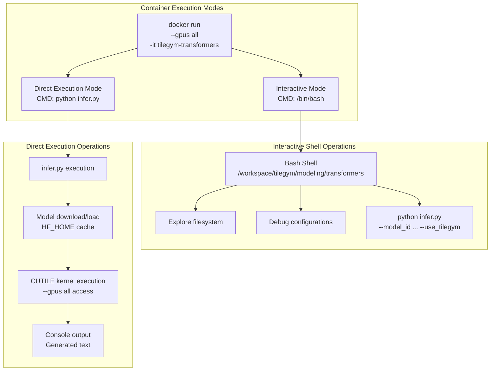
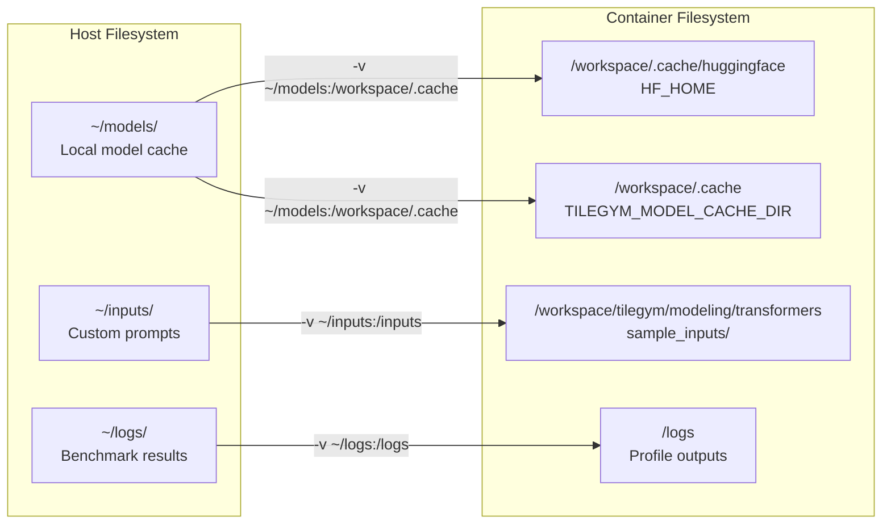
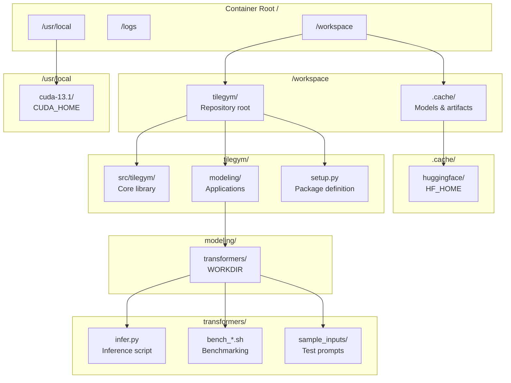

<!-- source: DeepWiki mcp.deepwiki.com · repo NVIDIA/TileGym · page 5.2 Running in Docker · fetched 2026-10-26 -->

# Running in Docker

<details>
<summary>Relevant source files</summary>

The following files were used as context for generating this wiki page:

- [modeling/transformers/Dockerfile](modeling/transformers/Dockerfile)
- [modeling/transformers/README.md](modeling/transformers/README.md)
- [modeling/transformers/build_docker.sh](modeling/transformers/build_docker.sh)

</details>


This page provides instructions for executing TileGym transformer inference within Docker containers. It covers container execution modes, GPU access configuration, volume mounting strategies, and troubleshooting common runtime issues. For information about building the Docker image, see [Building the Container](#5.1).

## Container Execution Overview

Once the `tilegym-transformers` container is built, it can be executed in two primary modes: interactive shell access for exploration and debugging, or direct inference execution for production workflows. Both modes require proper GPU access configuration to leverage NVIDIA hardware acceleration.

The container includes a pre-configured environment with CUDA 13.1, PyTorch 2.9.1, TileGym, and all transformer dependencies. The default working directory is set to `/workspace/tilegym/modeling/transformers` [modeling/transformers/Dockerfile:77]() where inference scripts reside.



**Sources:** [modeling/transformers/Dockerfile:77-83](), [modeling/transformers/README.md:32-36]()

## Interactive Mode

Interactive mode launches a bash shell inside the container, allowing manual command execution and environment inspection. This mode is useful for development, debugging, and exploratory workflows.

### Basic Interactive Execution

```bash
docker run --gpus all -it tilegym-transformers bash
```

This command:
- `--gpus all` - Exposes all host NVIDIA GPUs to the container
- `-it` - Allocates an interactive TTY session
- `tilegym-transformers` - Container image name
- `bash` - Overrides default CMD from [modeling/transformers/Dockerfile:83]()

### Interactive Shell Operations

Once inside the container shell:

```bash
# Verify environment
python -c "import torch; print(torch.cuda.is_available())"
python -c "import tilegym; print(tilegym.__version__)"

# Run basic inference
python infer.py --model_id meta-llama/Meta-Llama-3.1-8B --show_outputs

# Run with TileGym optimizations
python infer.py \
    --model_id meta-llama/Meta-Llama-3.1-8B \
    --use_tilegym \
    --use_cutile \
    --use_attn \
    --show_outputs

# Execute benchmarking scripts
./bench_llama.sh
./bench_deepseek.sh
```

**Sources:** [modeling/transformers/README.md:32](), [modeling/transformers/build_docker.sh:42-43]()

## Direct Inference Execution

Direct execution mode runs inference commands without entering an interactive shell. This approach is suitable for automated workflows, scripting, and production deployments.

### Single-Shot Inference

```bash
docker run --gpus all -it tilegym-transformers \
    python infer.py \
    --model_id meta-llama/Meta-Llama-3.1-8B \
    --use_tilegym \
    --use_cutile \
    --use_attn \
    --show_outputs
```

### Direct Execution with Custom Inputs

```bash
# Using default sample inputs
docker run --gpus all -it tilegym-transformers \
    python infer.py \
    --model_id meta-llama/Meta-Llama-3.1-8B \
    --sentence_file sample_inputs/input_prompt_32K.txt \
    --use_tilegym \
    --use_cutile \
    --use_attn \
    --output_length 100

# Using inline text input
docker run --gpus all -it tilegym-transformers \
    python infer.py \
    --model_id deepseek-ai/DeepSeek-V2-Lite-Chat \
    --input_text "Explain machine learning" \
    --use_tilegym \
    --use_cutile \
    --use_attn \
    --show_outputs
```

**Sources:** [modeling/transformers/README.md:34-36](), [modeling/transformers/build_docker.sh:45-47]()

## GPU Access Configuration

The `--gpus` flag controls GPU visibility within containers. This configuration is critical for CUDA kernel execution and TileGym optimizations.

| GPU Configuration | Syntax | Use Case |
|-------------------|--------|----------|
| All GPUs | `--gpus all` | Standard single-node inference |
| Specific GPU | `--gpus '"device=0"'` | Multi-tenant environments, GPU isolation |
| Multiple GPUs | `--gpus '"device=0,2"'` | Multi-GPU inference (when supported) |
| GPU capabilities | `--gpus '"capabilities=compute,utility"'` | Limited capability sets |

### GPU Access Verification

Inside the container, verify GPU access:

```bash
docker run --gpus all -it tilegym-transformers bash -c "nvidia-smi"
```

Expected output should show available NVIDIA GPUs with CUDA 13.1 driver support.

**Sources:** [modeling/transformers/README.md:32](), [modeling/transformers/Dockerfile:54-56]()

## Volume Mounting for Persistent Storage

Containers are ephemeral by default. Volume mounting enables persistent model caches, custom input files, and benchmark result preservation.



### Model Cache Persistence

The container defines two cache-related environment variables [modeling/transformers/Dockerfile:68-69]():

```bash
# Mount host cache directory to container cache location
docker run --gpus all -it \
    -v $HOME/.cache/huggingface:/workspace/.cache/huggingface \
    tilegym-transformers \
    python infer.py --model_id meta-llama/Meta-Llama-3.1-8B --use_tilegym --show_outputs
```

This mounting strategy:
- Prevents re-downloading models on subsequent runs
- Shares model cache across multiple containers
- Reduces startup time for repeated inference

### Custom Input Files

To use custom input files from the host:

```bash
docker run --gpus all -it \
    -v /path/to/custom/inputs:/inputs \
    tilegym-transformers \
    python infer.py \
    --model_id meta-llama/Meta-Llama-3.1-8B \
    --sentence_file /inputs/my_custom_prompt.txt \
    --use_tilegym \
    --use_cutile \
    --show_outputs
```

### Benchmark Output Persistence

Preserve profiling results and benchmark summaries:

```bash
docker run --gpus all -it \
    -v $PWD/benchmark_results:/logs \
    tilegym-transformers \
    python infer.py \
    --model_id meta-llama/Meta-Llama-3.1-8B \
    --use_tilegym \
    --use_cutile \
    --use_attn \
    --profile \
    --num_runs 5
```

The `/logs` directory is created during container build [modeling/transformers/Dockerfile:72-74]().

**Sources:** [modeling/transformers/Dockerfile:68-74](), [modeling/transformers/README.md:165-177]()

## Environment Variables

The container pre-configures several environment variables for CUDA and Python operations. These can be overridden using the `-e` flag.

| Variable | Default Value | Purpose |
|----------|---------------|---------|
| `HF_HOME` | `/workspace/.cache/huggingface` | HuggingFace model cache location |
| `TILEGYM_MODEL_CACHE_DIR` | `/workspace/.cache` | TileGym-specific cache directory |
| `CUDA_HOME` | `/usr/local/cuda-13.1` | CUDA Toolkit installation path |
| `PATH` | `${CUDA_HOME}/bin:${PATH}` | CUDA binary search path |
| `LD_LIBRARY_PATH` | `${CUDA_HOME}/lib64:...` | CUDA library search path |
| `PYTHONUNBUFFERED` | `1` | Disable Python output buffering |

### Environment Variable Override

```bash
# Override model cache location
docker run --gpus all -it \
    -e TILEGYM_MODEL_CACHE_DIR=/workspace/custom_cache \
    -v $HOME/custom_cache:/workspace/custom_cache \
    tilegym-transformers \
    python infer.py --model_id meta-llama/Meta-Llama-3.1-8B --use_tilegym
```

**Sources:** [modeling/transformers/Dockerfile:16](), [modeling/transformers/Dockerfile:54-56](), [modeling/transformers/Dockerfile:68-69]()

## Container Directory Structure

Understanding the container filesystem layout is essential for navigating the environment and referencing paths in commands.



The default working directory is `/workspace/tilegym/modeling/transformers` [modeling/transformers/Dockerfile:77](), so commands like `python infer.py` execute relative to this location.

**Sources:** [modeling/transformers/Dockerfile:36](), [modeling/transformers/Dockerfile:72-77]()

## Common Execution Patterns

### Pattern 1: Quick Test with Optimizations

```bash
docker run --gpus all -it tilegym-transformers \
    python infer.py \
    --model_id meta-llama/Meta-Llama-3.1-8B \
    --use_tilegym \
    --use_cutile \
    --use_attn \
    --show_outputs
```

### Pattern 2: Benchmark Comparison (PyTorch vs TileGym)

```bash
# Baseline
docker run --gpus all -it tilegym-transformers \
    python infer.py \
    --model_id meta-llama/Meta-Llama-3.1-8B \
    --profile \
    --sentence_file sample_inputs/input_prompt_32K.txt \
    --output_length 100

# TileGym optimized
docker run --gpus all -it tilegym-transformers \
    python infer.py \
    --model_id meta-llama/Meta-Llama-3.1-8B \
    --use_tilegym \
    --use_cutile \
    --use_attn \
    --profile \
    --sentence_file sample_inputs/input_prompt_32K.txt \
    --output_length 100
```

### Pattern 3: Persistent Cache with Custom Inputs

```bash
docker run --gpus all -it \
    -v $HOME/.cache/huggingface:/workspace/.cache/huggingface \
    -v $PWD/my_prompts:/inputs \
    -v $PWD/results:/logs \
    tilegym-transformers \
    python infer.py \
    --model_id deepseek-ai/DeepSeek-V2-Lite-Chat \
    --sentence_file /inputs/custom_prompt.txt \
    --use_tilegym \
    --use_cutile \
    --use_attn \
    --profile \
    --num_runs 10
```

### Pattern 4: Automated Benchmarking Scripts

```bash
# Execute pre-configured benchmark scripts
docker run --gpus all -it \
    -v $PWD/benchmark_logs:/logs \
    tilegym-transformers \
    bash -c "./bench_llama.sh && ./bench_deepseek.sh"
```

**Sources:** [modeling/transformers/README.md:34-36](), [modeling/transformers/README.md:43-70](), [modeling/transformers/README.md:106-144]()

## Troubleshooting Container Issues

### GPU Not Accessible

**Symptom:** `RuntimeError: CUDA not available` or `nvidia-smi` fails

**Solutions:**
1. Verify NVIDIA Docker runtime installation:
   ```bash
   docker run --gpus all nvidia/cuda:13.0.1-base-ubuntu22.04 nvidia-smi
   ```
2. Check `/etc/docker/daemon.json` includes `"default-runtime": "nvidia"`
3. Restart Docker daemon: `sudo systemctl restart docker`

### Model Download Failures

**Symptom:** HuggingFace authentication errors or network timeouts

**Solutions:**
1. Mount HuggingFace token into container:
   ```bash
   docker run --gpus all -it \
       -v $HOME/.huggingface:/root/.huggingface \
       tilegym-transformers bash
   ```
2. Set token via environment variable:
   ```bash
   docker run --gpus all -it \
       -e HF_TOKEN=your_token_here \
       tilegym-transformers python infer.py ...
   ```

See [modeling/transformers/README.md:185-188]() for additional model access troubleshooting.

### Out of Memory Errors

**Symptom:** `CUDA out of memory` during inference

**Solutions:**
1. Use smaller batch size: `--batch_size 1`
2. Use reduced precision: `--precision bfloat16`
3. Use shorter input sequences or reduce `--output_length`
4. For RTX 5090 GPUs, use LLaMA models instead of DeepSeek (see [modeling/transformers/README.md:18]())

### Permission Denied Errors

**Symptom:** Cannot write to `/logs` or cache directories

**Solutions:**
1. Run container with user namespace mapping:
   ```bash
   docker run --gpus all -it \
       --user $(id -u):$(id -g) \
       -v $PWD/logs:/logs \
       tilegym-transformers ...
   ```
2. Create directories with proper permissions before mounting:
   ```bash
   mkdir -p logs && chmod 777 logs
   docker run --gpus all -it -v $PWD/logs:/logs tilegym-transformers ...
   ```

### Import Errors for TileGym

**Symptom:** `ModuleNotFoundError: No module named 'tilegym'`

**Solution:** This indicates the container build process failed. Rebuild the container following instructions in [Building the Container](#5.1).

The editable install command is executed at [modeling/transformers/Dockerfile:62]() during build.

**Sources:** [modeling/transformers/README.md:179-196](), [modeling/transformers/Dockerfile:62]()

## Container Networking

By default, containers run with isolated networking. If the inference system needs to expose services or communicate with external endpoints:

```bash
# Expose port 8000 (configured in Dockerfile:80)
docker run --gpus all -it \
    -p 8000:8000 \
    tilegym-transformers bash

# Or use host networking for full network access
docker run --gpus all -it \
    --network host \
    tilegym-transformers bash
```

**Sources:** [modeling/transformers/Dockerfile:79-80]()

## Multi-Container Orchestration

For production deployments requiring multiple inference instances:

```yaml
# docker-compose.yml example
version: '3.8'
services:
  tilegym-inference-1:
    image: tilegym-transformers
    runtime: nvidia
    environment:
      - CUDA_VISIBLE_DEVICES=0
    volumes:
      - ./cache:/workspace/.cache
      - ./logs:/logs
    command: python infer.py --model_id meta-llama/Meta-Llama-3.1-8B --use_tilegym

  tilegym-inference-2:
    image: tilegym-transformers
    runtime: nvidia
    environment:
      - CUDA_VISIBLE_DEVICES=1
    volumes:
      - ./cache:/workspace/.cache
      - ./logs:/logs
    command: python infer.py --model_id deepseek-ai/DeepSeek-V2-Lite-Chat --use_tilegym
```

Launch with: `docker-compose up`

**Sources:** [modeling/transformers/Dockerfile:79-83]()

---

