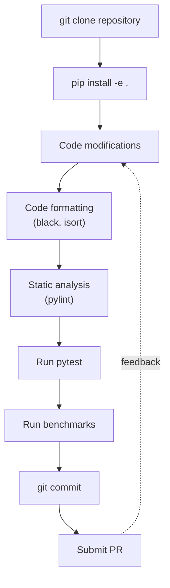
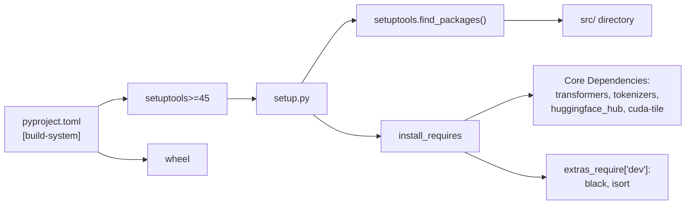
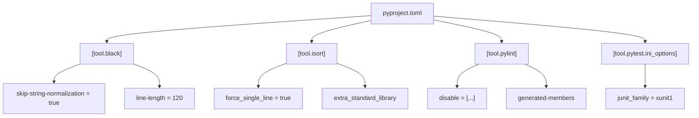
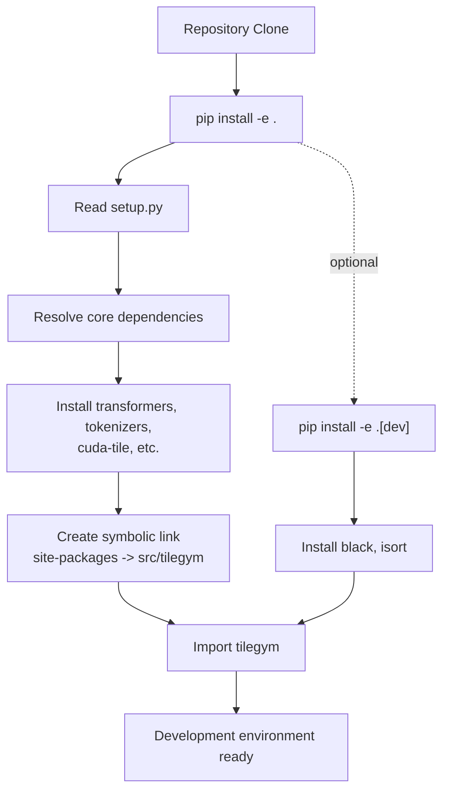
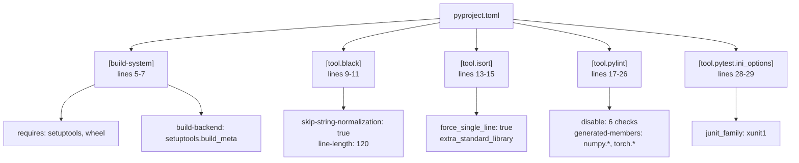

<!-- source: DeepWiki mcp.deepwiki.com · repo NVIDIA/TileGym · page 6 Development Guide · fetched 2026-10-26 -->

# Development Guide

<details>
<summary>Relevant source files</summary>

The following files were used as context for generating this wiki page:

- [pyproject.toml](pyproject.toml)
- [setup.py](setup.py)

</details>


This guide provides comprehensive information for developers who wish to contribute to TileGym, extend its capabilities, or understand its internal architecture. It covers repository organization, development environment setup, testing procedures, and code quality standards.

For specific topics related to development:
- For initial environment configuration and package installation, see [Development Setup](#6.1)
- For running tests and understanding test organization, see [Testing Infrastructure](#6.2)
- For code formatting and static analysis requirements, see [Code Quality Tools](#6.3)
- For contribution procedures and CLA requirements, see [Contributing](#7)

---

## Development Workflow Overview

TileGym follows a structured development workflow that emphasizes code quality, reproducibility, and thorough testing. The development process centers around an editable installation that allows immediate code changes without reinstallation, combined with automated tooling for formatting and analysis.

The project uses a modern Python packaging structure with a `src/` layout that separates source code from tests and documentation. This organization prevents common import issues and clearly delineates production code from development artifacts.

**Development Lifecycle**



**Sources:** Based on Diagram 4 from high-level architecture overview

---

## Repository Structure

The TileGym repository follows a standard Python package layout with clear separation between source code, configuration, and development tooling.

### Directory Organization

```mermaid
graph TB
    Root["TileGym Repository Root"]
    
    SrcDir["src/"]
    TileGymPkg["src/tilegym/"]
    Backend["src/tilegym/backend/"]
    Ops["src/tilegym/ops/"]
    
    TestDir["tests/"]
    
    ConfigFiles["Configuration Files"]
    SetupPy["setup.py"]
    PyProject["pyproject.toml"]
    GitIgnore[".gitignore"]
    
    DocFiles["Documentation"]
    README["README.md"]
    Contributing["CONTRIBUTING.md"]
    License["LICENSE"]
    
    Scripts["Scripts"]
    InferPy["infer.py"]
    BenchLlama["bench_llama.sh"]
    BenchDeepSeek["bench_deepseek.sh"]
    
    Docker["Docker Files"]
    Dockerfile["Dockerfile"]
    BuildDocker["build_docker.sh"]
    
    Inputs["Sample Inputs"]
    Input32K["32K prompts"]
    Input256K["256K prompts"]
    
    Root --> SrcDir
    Root --> TestDir
    Root --> ConfigFiles
    Root --> DocFiles
    Root --> Scripts
    Root --> Docker
    Root --> Inputs
    
    SrcDir --> TileGymPkg
    TileGymPkg --> Backend
    TileGymPkg --> Ops
    
    ConfigFiles --> SetupPy
    ConfigFiles --> PyProject
    ConfigFiles --> GitIgnore
    
    DocFiles --> README
    DocFiles --> Contributing
    DocFiles --> License
    
    Scripts --> InferPy
    Scripts --> BenchLlama
    Scripts --> BenchDeepSeek
    
    Docker --> Dockerfile
    Docker --> BuildDocker
    
    Inputs --> Input32K
    Inputs --> Input256K
```



**Sources:** [setup.py:20-21](), repository structure from Diagram 1

### Key Files and Their Roles

| File | Purpose | Key Contents |
|------|---------|--------------|
| `setup.py` | Package definition and dependency management | Package metadata, install requirements, version |
| `pyproject.toml` | Build system and tool configuration | black, isort, pylint, pytest settings |
| `src/tilegym/__init__.py` | Package initialization | Exports backend management and ops API |
| `tests/` | Test suite directory | Operation tests, integration tests |
| `infer.py` | Transformer inference script | Model loading, TileGym patching, benchmarking |
| `bench_llama.sh` | LLaMA benchmarking orchestration | Automated performance comparisons |
| `bench_deepseek.sh` | DeepSeek benchmarking orchestration | MoE model performance testing |

**Sources:** [setup.py:1-49](), [pyproject.toml:1-30]()

---

## Build System Architecture

TileGym uses a standard Python build system configured through `setup.py` and `pyproject.toml`. Understanding this architecture is essential for modifying dependencies or build behavior.

### Package Configuration



**Sources:** [setup.py:5-49](), [pyproject.toml:5-7]()

### Dependency Management Strategy

TileGym carefully manages its dependency stack to balance functionality with flexibility:

| Dependency Category | Packages | Installation Strategy |
|---------------------|----------|----------------------|
| **Pre-requisites** | PyTorch, Triton | Must be pre-installed in environment |
| **Core Runtime** | transformers==4.56.2, tokenizers==0.22.0, cuda-tile | Installed automatically via `install_requires` |
| **Optional Runtime** | accelerate | Install with `--no-deps` to avoid torch reinstall |
| **Visualization** | matplotlib, pandas | Installed automatically for benchmarking |
| **Testing** | pytest, numpy | Included in `install_requires` |
| **Development** | black==23.3.0, isort==5.12.0 | Available via `pip install -e .[dev]` |

**Note:** PyTorch and Triton are intentionally excluded from `install_requires` to avoid version conflicts with existing installations. Developers must ensure these are installed separately with CUDA support.

**Sources:** [setup.py:30-48]()

---

## Code Quality Standards

TileGym enforces consistent code quality through automated tooling configured in `pyproject.toml`. All code contributions must pass these checks before acceptance.

### Tool Configuration Summary



**Sources:** [pyproject.toml:9-30]()

### Black Configuration

The black formatter is configured with specific preferences in [pyproject.toml:9-11]():

- **Line Length:** 120 characters (extended from default 88)
- **String Normalization:** Disabled to preserve existing quote styles
- **Purpose:** Ensures consistent formatting across the entire codebase

**Usage:**
```bash
black src/tilegym tests/
```

### Isort Configuration

Import sorting follows strict rules defined in [pyproject.toml:13-15]():

- **Single Line Imports:** Each import on its own line for clarity
- **Standard Library Extensions:** Includes `pkg_resources` as standard library

**Usage:**
```bash
isort src/tilegym tests/
```

### Pylint Configuration

Static analysis is configured to balance strictness with practicality in [pyproject.toml:17-26]():

| Disabled Check | Rationale |
|----------------|-----------|
| `missing-function-docstring` | Allows concise internal functions |
| `missing-class-docstring` | Reduces boilerplate for simple classes |
| `missing-module-docstring` | Not all modules need docstrings |
| `broad-except` | Sometimes catching broad exceptions is appropriate |
| `invalid-name` | Allows short variable names common in ML code |
| `logging-fstring-interpolation` | Modern Python logging style |

The `generated-members` setting for `numpy.*` and `torch.*` prevents false positives from dynamically generated attributes.

**Usage:**
```bash
pylint src/tilegym
```

**Sources:** [pyproject.toml:17-26]()

---

## Editable Installation

Development installations use pip's editable mode, which allows code changes to take effect immediately without reinstallation.

### Installation Process Flow



**Sources:** [setup.py:12-49](), development workflow from Diagram 4

### Verification

After installation, verify the environment:

```bash
python -c "import tilegym; print(tilegym.__version__)"
python -c "import tilegym.backend; print('Backend system loaded')"
```

These commands should execute without errors, confirming that the package is correctly linked and dependencies are satisfied.

---

## Testing Strategy

TileGym uses pytest as its testing framework with configuration in [pyproject.toml:28-29](). The testing strategy encompasses unit tests for operations, integration tests for the backend system, and performance benchmarks.

### Test Discovery

Pytest automatically discovers tests following these patterns:
- Files matching `test_*.py` or `*_test.py`
- Classes named `Test*`
- Functions named `test_*`

The test suite is organized in the `tests/` directory at the repository root, keeping test code separate from production code.

### Test Execution Commands

| Command | Purpose |
|---------|---------|
| `pytest tests/` | Run all tests |
| `pytest tests/ -v` | Verbose output showing each test |
| `pytest tests/ -k "operation_name"` | Run tests matching pattern |
| `pytest tests/ --cov=tilegym` | Run with coverage reporting |
| `pytest tests/ --junitxml=results.xml` | Generate JUnit XML report |

The `junit_family = "xunit1"` configuration in [pyproject.toml:29]() ensures compatibility with CI/CD systems that expect xunit1 format.

**Sources:** [pyproject.toml:28-29]()

---

## Development Workflow Commands

This section provides a quick reference for common development tasks.

### Code Quality Checks

```bash
# Format code
black src/tilegym tests/

# Sort imports
isort src/tilegym tests/

# Run static analysis
pylint src/tilegym

# Run all quality checks together
black src/tilegym tests/ && isort src/tilegym tests/ && pylint src/tilegym
```

### Testing and Benchmarking

```bash
# Run test suite
pytest tests/

# Run with coverage
pytest tests/ --cov=tilegym --cov-report=html

# Run benchmarks
bash bench_llama.sh
bash bench_deepseek.sh
```

### Docker Development

```bash
# Build container
bash build_docker.sh

# Run interactive session
docker run -it --gpus all tilegym-transformers:latest bash

# Run inference in container
docker run --gpus all tilegym-transformers:latest \
    python infer.py --model_id meta-llama/Llama-3.1-8B --use_tilegym
```

**Sources:** Repository scripts from Diagram 4

---

## Configuration Files Reference

### pyproject.toml Structure



**Sources:** [pyproject.toml:1-30]()

### setup.py Key Elements

| Element | Location | Purpose |
|---------|----------|---------|
| Package name | [setup.py:13]() | `tilegym` |
| Version | [setup.py:14]() | `0.0.0` (pre-release) |
| Package discovery | [setup.py:20]() | `find_packages(where='src')` |
| Package directory | [setup.py:21]() | `{'': 'src'}` |
| Python requirement | [setup.py:29]() | `>=3.9` |
| Core dependencies | [setup.py:30-42]() | transformers, cuda-tile, etc. |
| Dev dependencies | [setup.py:43-48]() | black, isort |

**Sources:** [setup.py:1-49]()

---

## Next Steps

For more detailed information on specific development topics:

- **Setting up your development environment:** See [Development Setup](#6.1) for step-by-step instructions
- **Running and writing tests:** See [Testing Infrastructure](#6.2) for pytest usage and test organization
- **Using code quality tools:** See [Code Quality Tools](#6.3) for detailed tool configuration and usage
- **Submitting contributions:** See [Contributing](#7) for the contribution workflow and requirements
- **Understanding licensing:** See [Legal and Licensing](#8) for MIT license terms and third-party attributions

**Sources:** Documentation structure from table of contents

---

