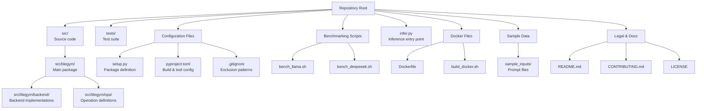
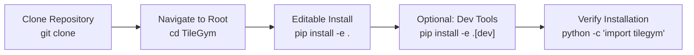
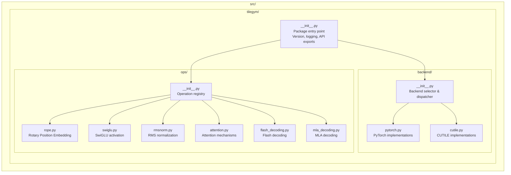
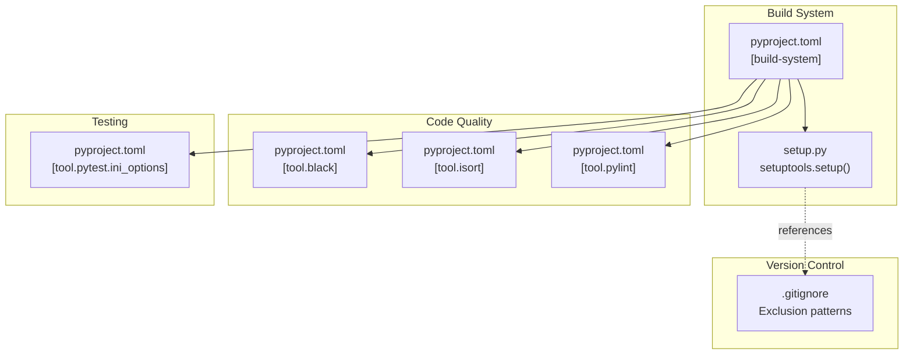
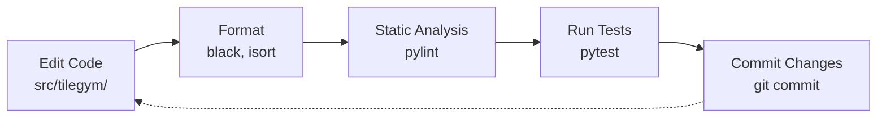
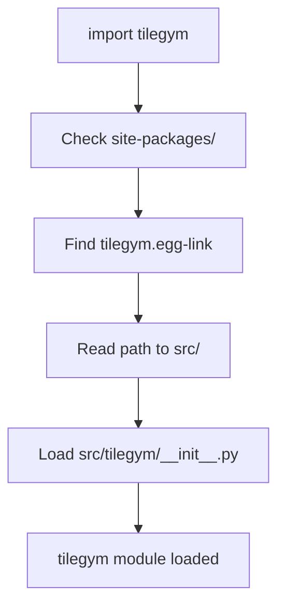

<!-- source: DeepWiki mcp.deepwiki.com · repo NVIDIA/TileGym · page 6.1 Development Setup · fetched 2026-10-26 -->

# Development Setup

<details>
<summary>Relevant source files</summary>

The following files were used as context for generating this wiki page:

- [.gitignore](.gitignore)
- [pyproject.toml](pyproject.toml)
- [setup.py](setup.py)

</details>


## Purpose and Scope

This page explains how to configure a local development environment for contributing to TileGym. It covers editable installation, repository structure, package organization, and configuration files that control the development workflow.

For production installation instructions, see [Prerequisites and Installation](#2.1). For information about testing after setup, see [Testing Infrastructure](#6.2). For code style requirements, see [Code Quality Tools](#6.3).

---

## Repository Structure

The TileGym repository follows a standard Python package layout with clear separation between source code, configuration, and auxiliary files.

**Repository Layout**


Sources: [setup.py:1-50](), [.gitignore:1-171](), [pyproject.toml:1-30]()

### Directory Organization

| Directory | Purpose | Key Contents |
|-----------|---------|--------------|
| `src/tilegym/` | Core library source | Package initialization, backend management, ops |
| `src/tilegym/backend/` | Backend implementations | PyTorch and CUTILE backend modules |
| `src/tilegym/ops/` | Operation definitions | Transformer operations (RoPE, SwiGLU, attention, etc.) |
| `tests/` | Test suite | pytest-based tests for operations and benchmarks |
| `sample_inputs/` | Test data | Prompt files for inference testing (32K, 256K contexts) |
| `prebuild_tools/` | Build utilities | Helper scripts (excluded from version control) |

Sources: [.gitignore:79-80](), [setup.py:20-21]()

---

## Development Installation

Development installation uses an editable install that allows code changes to take effect immediately without reinstalling the package.

**Installation Process**


Sources: [setup.py:12-49]()

### Step-by-Step Installation

**1. Clone the Repository**
```bash
git clone https://github.com/NVIDIA/TileGym.git
cd TileGym
```

**2. Install in Editable Mode**
```bash
pip install -e .
```

The `-e` flag installs the package in "editable" or "development" mode. This creates a link from the Python environment to the `src/` directory, so modifications to source files are immediately reflected when importing the package.

Sources: [setup.py:20-21]()

**3. Install Development Tools (Optional)**
```bash
pip install -e .[dev]
```

This installs additional development dependencies defined in the `extras_require` section of [setup.py:43-48]():
- `black==23.3.0` - Code formatter
- `isort==5.12.0` - Import sorter

Sources: [setup.py:43-48]()

**4. Verify Installation**
```bash
python -c "import tilegym; print(tilegym.__version__)"
```

This should output `0.0.0` (the current development version) without errors.

Sources: [setup.py:14]()

### Dependency Management

The installation automatically resolves and installs runtime dependencies defined in [setup.py:30-42]():

| Dependency | Version | Purpose |
|------------|---------|---------|
| `transformers` | 4.56.2 | HuggingFace transformer models |
| `tokenizers` | 0.22.0 | Text tokenization |
| `huggingface_hub` | (latest) | Model repository access |
| `matplotlib` | (latest) | Visualization |
| `pandas` | (latest) | Data structures |
| `pytest` | (latest) | Testing framework |
| `numpy` | (latest) | Array operations |
| `cuda-tile` | (latest) | CUDA tiling backend |

**Note**: PyTorch and Triton should be pre-installed in your environment with CUDA support before running `pip install -e .`, as indicated by the comment on [setup.py:31]().

Sources: [setup.py:30-42]()

---

## Package Structure

The `tilegym` package follows a hierarchical structure that separates concerns between API, backend management, and operation implementations.

**Package Architecture**


Sources: [setup.py:20-21]()

### Source Directory Layout

The package is located under `src/tilegym/` as defined in [setup.py:20-21]():

```
src/
└── tilegym/
    ├── __init__.py          # Package initialization, version, exports
    ├── backend/             # Backend management system
    │   ├── __init__.py      # Backend selection and dispatch logic
    │   ├── pytorch.py       # PyTorch backend implementations
    │   └── cutile.py        # CUTILE backend implementations
    └── ops/                 # Operation library
        ├── __init__.py      # Operation registry
        ├── rope.py          # Rotary Position Embedding
        ├── swiglu.py        # SwiGLU activation function
        ├── rmsnorm.py       # RMS normalization
        ├── attention.py     # Attention mechanisms
        ├── flash_decoding.py # Flash decoding for LLaMA
        └── mla_decoding.py   # Multi-head Latent Attention for DeepSeek
```

Sources: [setup.py:20-21]()

### Module Responsibilities

| Module | Responsibility | Key Classes/Functions |
|--------|----------------|----------------------|
| `tilegym.__init__` | Package initialization, API exports, version management | `__version__`, logging setup |
| `tilegym.backend` | Backend selection, operation dispatch, registration | `get_backend()`, `set_backend()`, `dispatch()`, `register_impl()` |
| `tilegym.ops` | Operation definitions, unified API for tensor operations | RoPE, SwiGLU, RMSNorm, attention variants |

Sources: [setup.py:20-21]()

---

## Configuration Files

TileGym uses several configuration files to control package building, code formatting, and development workflows.

**Configuration File Relationships**


Sources: [pyproject.toml:1-30](), [setup.py:1-50](), [.gitignore:1-171]()

### pyproject.toml

Located at the repository root, [pyproject.toml:1-30]() defines the build system and tool configurations.

**Build System Configuration** ([pyproject.toml:5-7]()):
```toml
[build-system]
requires = ["setuptools>=45", "wheel"]
build-backend = "setuptools.build_meta"
```

This declares that the package uses `setuptools` as its build backend, requiring version 45 or higher.

**Black Configuration** ([pyproject.toml:9-11]()):
```toml
[tool.black]
skip-string-normalization = true
line-length = 120
```

- `skip-string-normalization`: Preserves single quotes in strings (does not normalize to double quotes)
- `line-length`: Maximum line length of 120 characters

**isort Configuration** ([pyproject.toml:13-15]()):
```toml
[tool.isort]
force_single_line = true
extra_standard_library = ["pkg_resources"]
```

- `force_single_line`: Each import statement on its own line
- `extra_standard_library`: Treats `pkg_resources` as a standard library module

**pylint Configuration** ([pyproject.toml:17-26]()):
```toml
[tool.pylint]
disable = [
   "missing-function-docstring",
   "missing-class-docstring",
   "missing-module-docstring",
   "broad-except",
   "invalid-name",
   "logging-fstring-interpolation",
   ]
generated-members = "numpy.*, torch.*"
```

Disables certain pylint warnings that are not required for this project, and recognizes dynamically generated members in NumPy and PyTorch.

**pytest Configuration** ([pyproject.toml:28-29]()):
```toml
[tool.pytest.ini_options]
junit_family = "xunit1"
```

Configures pytest to use xunit1-style XML output for test results.

Sources: [pyproject.toml:1-30]()

### setup.py

The [setup.py:1-50]() file defines package metadata and dependencies using `setuptools.setup()`.

**Package Metadata** ([setup.py:12-28]()):

| Field | Value | Purpose |
|-------|-------|---------|
| `name` | `'tilegym'` | Package name for PyPI/pip |
| `version` | `'0.0.0'` | Development version |
| `author` | `'NVIDIA Corporation'` | Package author |
| `packages` | `find_packages(where='src')` | Auto-discover packages under `src/` |
| `package_dir` | `{'': 'src'}` | Source code root is `src/` |
| `python_requires` | `'>=3.9'` | Minimum Python 3.9 required |

**Dependency Specifications** ([setup.py:30-42]()):

The `install_requires` list defines runtime dependencies with specific version pins:
- `transformers==4.56.2`: Exact version pin for reproducibility
- `tokenizers==0.22.0`: Exact version pin
- Others: Latest compatible versions

**Development Dependencies** ([setup.py:43-48]()):

The `extras_require['dev']` section specifies optional development tools:
- `black==23.3.0`: Code formatter
- `isort==5.12.0`: Import sorter

These are installed with `pip install -e .[dev]`.

Sources: [setup.py:1-50]()

### .gitignore

The [.gitignore:1-171]() file specifies patterns for files that should not be tracked by Git.

**Key Exclusion Categories**:

| Pattern | Category | Examples |
|---------|----------|----------|
| `__pycache__/`, `*.pyc` | Python bytecode | Compiled Python files |
| `build/`, `dist/`, `*.egg-info/` | Build artifacts | Package distribution files |
| `.venv`, `venv/`, `env/` | Virtual environments | Python virtual environments |
| `htmlcov/`, `.coverage` | Test coverage | Coverage reports |
| `.pytest_cache/` | Test cache | pytest cache directory |
| `*.log`, `*.err` | Log files | Runtime logs |
| `*.nsys-rep`, `*.ncu-rep` | Profiling data | NVIDIA profiler outputs |
| `*.csv` | Data files | Profiler CSV logs |
| `prebuild_tools/` | Build utilities | Helper scripts directory |
| `.idea/` | IDE configuration | PyCharm settings |
| `**/temp/`, `**/cuda-driver/` | Intermediate files | Temporary build outputs |

Notable project-specific exclusions ([.gitignore:69-80]()):
- `*.nsys-rep`, `*.ncu-rep`: NVIDIA Nsight profiling data
- `*.csv`: Profiler output logs
- `prebuild_tools/`: Build utility directory

Sources: [.gitignore:1-171]()

---

## Development Workflow

A typical development session involves code modification, testing, and validation using the configured tools.

**Development Cycle**


Sources: [pyproject.toml:9-26](), [setup.py:43-48]()

### Working with Editable Install

After running `pip install -e .`, Python imports directly from `src/tilegym/`. This means:

1. **No reinstallation needed**: Changes to `.py` files take effect immediately
2. **Module reload**: In interactive sessions (IPython, Jupyter), use `importlib.reload()` to pick up changes
3. **Dependency changes**: If you modify [setup.py:30-42](), run `pip install -e .` again to update dependencies

Example workflow:
```bash
# Make changes to source files
vim src/tilegym/ops/rope.py

# Changes are immediately available
python -c "import tilegym.ops; tilegym.ops.rope(...)"
```

Sources: [setup.py:20-21]()

### Code Formatting and Linting

Run formatting and linting before committing:

```bash
# Format code with black
black src/tilegym/ tests/

# Sort imports with isort
isort src/tilegym/ tests/

# Check code quality with pylint
pylint src/tilegym/
```

These tools use configurations from [pyproject.toml:9-26]().

Sources: [pyproject.toml:9-26](), [setup.py:44-47]()

### Version Control Best Practices

**Files to Track**:
- Source code in `src/tilegym/`
- Test files in `tests/`
- Configuration files: `setup.py`, `pyproject.toml`
- Documentation: `README.md`, `CONTRIBUTING.md`
- Scripts: `infer.py`, `bench_*.sh`, `build_docker.sh`

**Files NOT to Track** (excluded by [.gitignore:1-171]()):
- Build artifacts: `build/`, `dist/`, `*.egg-info/`
- Python bytecode: `__pycache__/`, `*.pyc`
- Virtual environments: `.venv`, `venv/`
- Test artifacts: `.pytest_cache/`, `htmlcov/`, `.coverage`
- Profiling data: `*.nsys-rep`, `*.ncu-rep`, `*.csv`
- Temporary files: `temp/`, `prebuild_tools/`

Sources: [.gitignore:1-171]()

---

## Package Discovery and Imports

Understanding how Python finds the `tilegym` package after installation helps debug import issues.

**Import Resolution Path**


Sources: [setup.py:20-21]()

### Verifying Package Location

To verify where Python loads `tilegym` from:

```python
import tilegym
print(tilegym.__file__)
# Should print: /path/to/TileGym/src/tilegym/__init__.py
```

If the output points to `site-packages/tilegym/` instead of your source directory, the editable install may not have worked correctly. Reinstall with `pip install -e .`.

Sources: [setup.py:20-21]()

### Common Import Issues

| Issue | Cause | Solution |
|-------|-------|----------|
| `ModuleNotFoundError: No module named 'tilegym'` | Package not installed | Run `pip install -e .` |
| Changes not reflected | Python cached import | Restart Python or use `importlib.reload()` |
| Wrong module location | Multiple installations | Uninstall with `pip uninstall tilegym`, then reinstall |
| Missing dependencies | Incomplete installation | Run `pip install -e .` to resolve dependencies |

Sources: [setup.py:12-42]()

---

## Environment Variables

TileGym respects environment variables for configuration that may vary between development and production environments.

| Variable | Purpose | Used By |
|----------|---------|---------|
| `TILEGYM_MODEL_CACHE_DIR` | Model download cache location | `infer.py` model loading |
| `PYTORCH_CUDA_ALLOC_CONF` | CUDA memory configuration | PyTorch runtime |
| `CUDA_VISIBLE_DEVICES` | GPU selection | CUDA runtime |

These variables can be set in your shell profile for persistent configuration:

```bash
export TILEGYM_MODEL_CACHE_DIR=~/.cache/tilegym_models
export CUDA_VISIBLE_DEVICES=0
```

Sources: Based on standard PyTorch and HuggingFace conventions

---

## Next Steps

After completing development setup:

1. **Run Tests**: See [Testing Infrastructure](#6.2) for pytest usage and test organization
2. **Apply Code Quality**: See [Code Quality Tools](#6.3) for black, isort, and pylint configuration
3. **Understand Architecture**: See [Backend Management System](#3.2) for the pluggable backend design
4. **Run Benchmarks**: See [Benchmarking Performance](#4.3) for performance validation
5. **Contribute**: See [Contribution Guidelines](#7.1) for the submission process

Sources: General development workflow guidance

---

