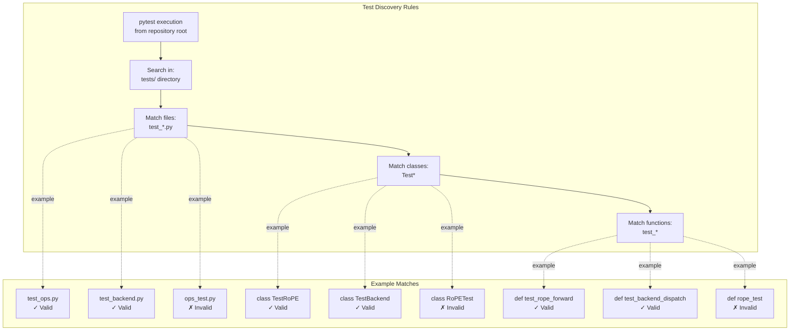
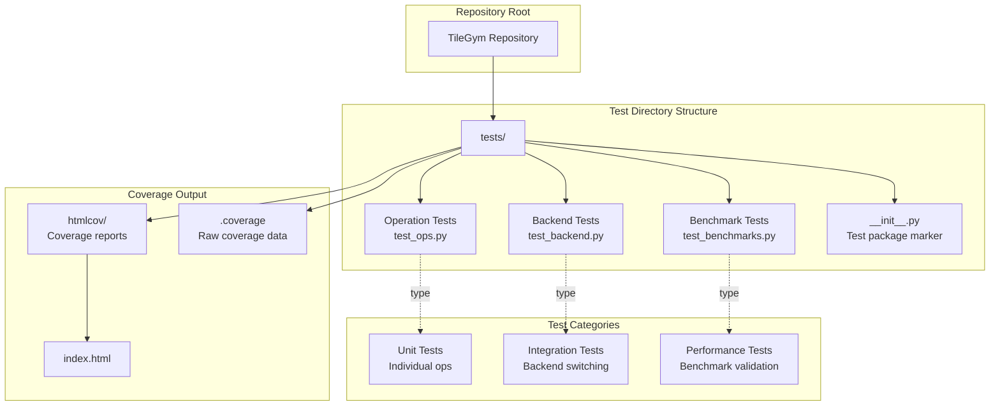
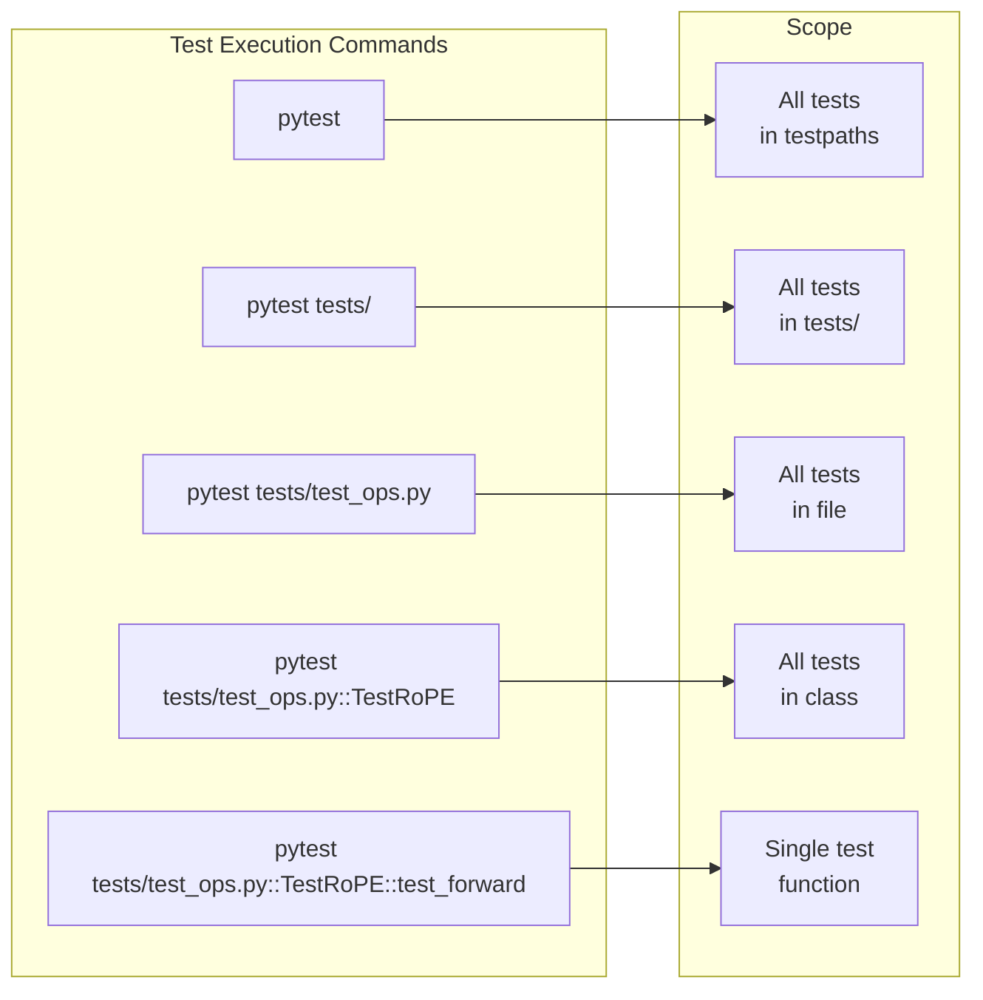

<!-- source: DeepWiki mcp.deepwiki.com · repo NVIDIA/TileGym · page 6.2 Testing Infrastructure · fetched 2026-10-26 -->

# Testing Infrastructure

<details>
<summary>Relevant source files</summary>

The following files were used as context for generating this wiki page:

- [pyproject.toml](pyproject.toml)
- [pytest.ini](pytest.ini)

</details>


## Purpose and Scope

This page documents TileGym's testing infrastructure, including pytest configuration, test discovery patterns, test organization, and execution procedures. It covers how to run unit tests for TileGym operations and validate backend implementations.

For information about setting up your development environment, see [Development Setup](#6.1). For code quality tools used alongside testing, see [Code Quality Tools](#6.3).

---

## Pytest Configuration

TileGym uses pytest as its test framework with configuration split across two files: `pyproject.toml` and `pytest.ini`.

### Configuration Files

The project defines pytest behavior through the following configuration:

| Configuration File | Purpose | Key Settings |
|-------------------|---------|--------------|
| `pyproject.toml` | Modern Python project metadata | JUnit XML output format |
| `pytest.ini` | Legacy pytest configuration | Test discovery patterns |

**Primary Configuration in pyproject.toml**

[pyproject.toml:28-29]() defines the JUnit family for test result reporting:

```toml
[tool.pytest.ini_options]
junit_family = "xunit1"
```

This setting ensures compatibility with CI/CD systems that expect xunit1-formatted XML output.

**Test Discovery Configuration in pytest.ini**

[pytest.ini:1-6]() specifies how pytest locates and identifies test files, classes, and functions:

```ini
[tool:pytest]
testpaths = tests
python_files = test_*.py
python_classes = Test*
python_functions = test_*
```

**Sources:** [pyproject.toml:28-29](), [pytest.ini:1-6]()

---

## Test Discovery Patterns

### File and Function Naming Conventions



### Discovery Pattern Details

| Pattern Type | Configuration | Example Valid Names | Example Invalid Names |
|-------------|---------------|---------------------|---------------------|
| **Test Directory** | `testpaths = tests` | `tests/` | `test/`, `testing/` |
| **Test Files** | `python_files = test_*.py` | `test_ops.py`, `test_rope.py` | `ops_test.py`, `test_ops.txt` |
| **Test Classes** | `python_classes = Test*` | `TestRoPE`, `TestBackend` | `RoPETest`, `BackendTest` |
| **Test Functions** | `python_functions = test_*` | `test_rope_forward()`, `test_dispatch()` | `rope_test()`, `validate_rope()` |

**Sources:** [pytest.ini:1-6]()

---

## Test Organization Structure



### Expected Test File Layout

Based on the test discovery patterns and project structure, the `tests/` directory is organized as follows:

| Directory/File | Purpose | Test Type |
|----------------|---------|-----------|
| `tests/` | Root test directory | All test files |
| `tests/__init__.py` | Python package marker | N/A |
| `tests/test_ops.py` | Operation unit tests | Unit |
| `tests/test_backend.py` | Backend switching tests | Integration |
| `tests/test_benchmarks.py` | Performance validation | Performance |

**Sources:** [pytest.ini:2](), Diagram 4 from repository overview

---

## Running Tests

### Basic Test Execution



### Common Testing Commands

| Command | Scope | Use Case |
|---------|-------|----------|
| `pytest` | All tests in `tests/` | Full test suite execution |
| `pytest tests/` | Explicit directory | Same as above, explicit path |
| `pytest tests/test_ops.py` | Single file | Test specific module |
| `pytest tests/test_ops.py::TestRoPE` | Single class | Test specific operation |
| `pytest tests/test_ops.py::TestRoPE::test_forward` | Single function | Test specific functionality |
| `pytest -v` | All tests, verbose | Detailed test output |
| `pytest -s` | All tests, no capture | Show print statements |
| `pytest -x` | Stop on first failure | Quick failure detection |
| `pytest -k "rope"` | Matching pattern | Test name filtering |

**Sources:** [pytest.ini:1-6]()

---

## Test Execution Options

### Verbosity and Output Control

```bash
# Verbose output with test names
pytest -v

# Very verbose with test docstrings
pytest -vv

# Show print statements and logs
pytest -s

# Quiet mode (minimal output)
pytest -q
```

### Test Selection and Filtering

```bash
# Run tests matching keyword expression
pytest -k "rope or backend"

# Run tests matching marker expression
pytest -m "slow"

# Run last failed tests
pytest --lf

# Run failed tests first, then others
pytest --ff
```

### Coverage Analysis

```bash
# Run tests with coverage
pytest --cov=tilegym

# Generate HTML coverage report
pytest --cov=tilegym --cov-report=html

# View coverage in terminal
pytest --cov=tilegym --cov-report=term

# Generate XML coverage report (for CI)
pytest --cov=tilegym --cov-report=xml
```

Coverage reports are generated in the `htmlcov/` directory and can be viewed by opening `htmlcov/index.html` in a browser.

**Sources:** [pytest.ini:1-6](), Diagram 4 from repository overview

---

## Integration with Development Workflow

### Pre-Commit Testing

Before submitting code, developers should run:

```bash
# Run full test suite
pytest

# Run with coverage
pytest --cov=tilegym --cov-report=html

# Run with verbose output for debugging
pytest -v -s
```

### Continuous Integration

The pytest configuration supports CI/CD integration through:

1. **JUnit XML Output:** [pyproject.toml:29]() configures `junit_family = "xunit1"` for CI compatibility
2. **Exit Codes:** pytest returns non-zero exit codes on failure, enabling CI failure detection
3. **Parallel Execution:** Can be extended with `pytest-xdist` for distributed testing

### Test Development Guidelines

When adding new tests:

1. **File Naming:** Create files matching `test_*.py` pattern
2. **Class Naming:** Use `Test*` prefix for test classes
3. **Function Naming:** Use `test_*` prefix for test functions
4. **Location:** Place all tests in `tests/` directory
5. **Organization:** Group related tests in the same file or class

**Sources:** [pytest.ini:1-6](), [pyproject.toml:28-29](), Diagram 4 from repository overview

---

## Configuration Summary

### Complete Pytest Settings

The following table summarizes all pytest configuration defined in TileGym:

| Setting | Value | Location | Purpose |
|---------|-------|----------|---------|
| `junit_family` | `"xunit1"` | [pyproject.toml:29]() | CI/CD XML output format |
| `testpaths` | `tests` | [pytest.ini:2]() | Root test directory |
| `python_files` | `test_*.py` | [pytest.ini:3]() | Test file naming pattern |
| `python_classes` | `Test*` | [pytest.ini:4]() | Test class naming pattern |
| `python_functions` | `test_*` | [pytest.ini:5]() | Test function naming pattern |

### Related Configuration Files

TileGym's testing infrastructure integrates with other development tools:

- **Black:** Code formatting before test execution (see [Code Quality Tools](#6.3))
- **Isort:** Import sorting before test execution (see [Code Quality Tools](#6.3))
- **Pylint:** Static analysis complementing tests (see [Code Quality Tools](#6.3))

**Sources:** [pyproject.toml:28-29](), [pytest.ini:1-6]()

---

