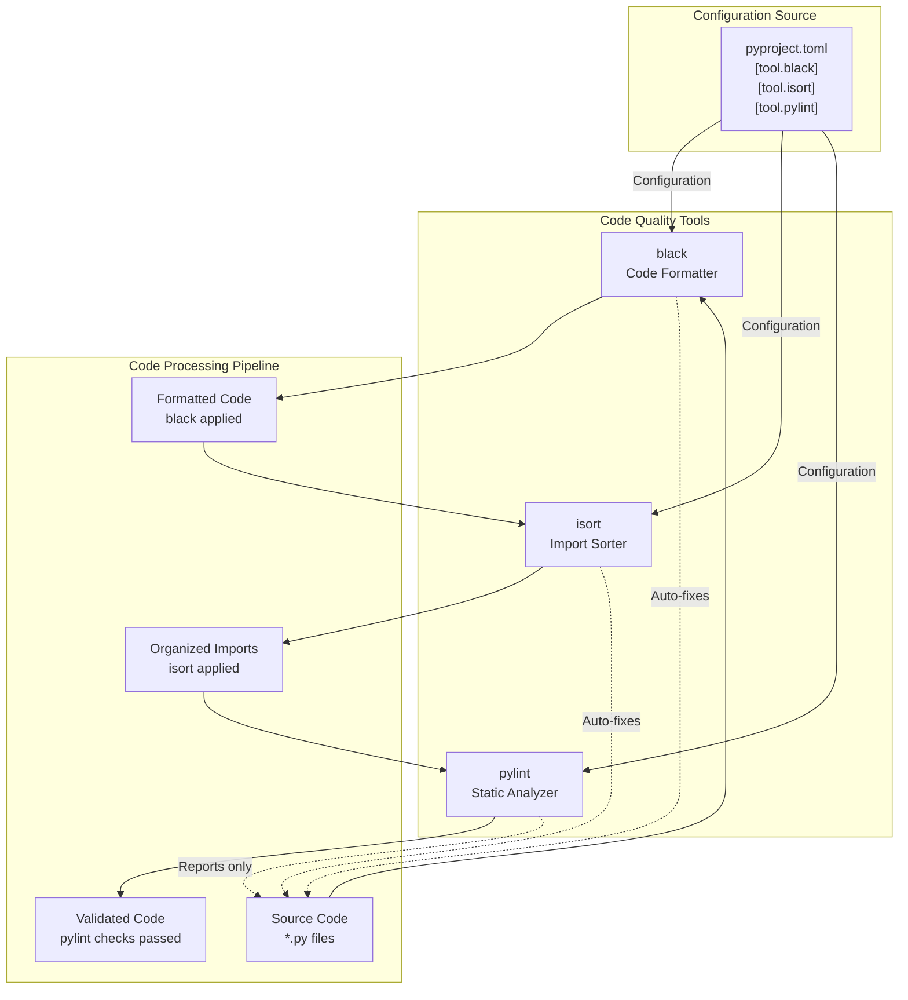
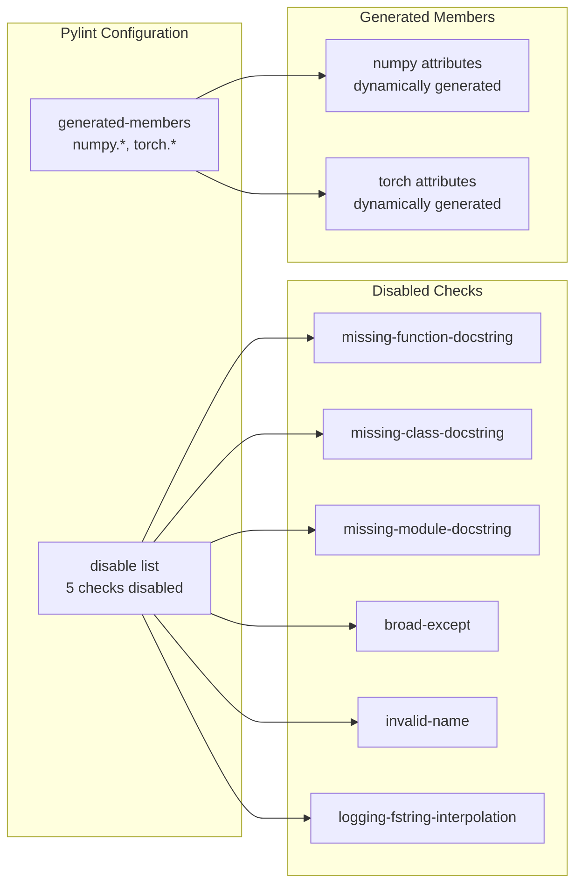
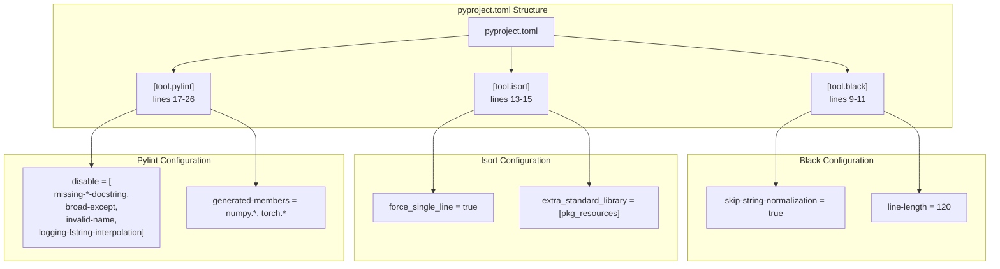
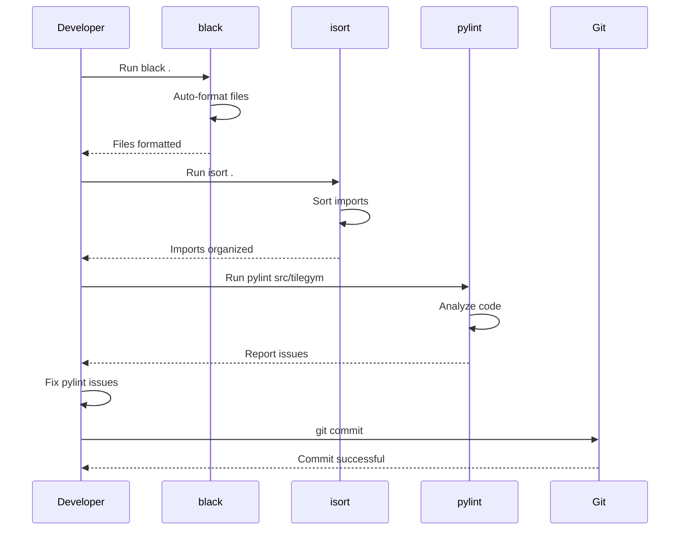

<!-- source: DeepWiki mcp.deepwiki.com · repo NVIDIA/TileGym · page 6.3 Code Quality Tools · fetched 2026-10-26 -->

# Code Quality Tools

<details>
<summary>Relevant source files</summary>

The following files were used as context for generating this wiki page:

- [pyproject.toml](pyproject.toml)

</details>


## Purpose and Scope

This page documents the code quality tools configured for the TileGym project: **black** for code formatting, **isort** for import statement organization, and **pylint** for static analysis. These tools enforce consistent code style and catch common programming errors before code is committed.

For information about setting up the development environment, see [Development Setup](#6.1). For information about the testing infrastructure, see [Testing Infrastructure](#6.2).

**Sources:** [pyproject.toml:1-30]()

---

## Tool Configuration Overview

TileGym uses three primary code quality tools, all configured through the `pyproject.toml` file. These tools work together to maintain code consistency and quality across the codebase.



**Sources:** [pyproject.toml:9-26]()

---

## Black: Code Formatting

Black is the code formatter configured for TileGym. It automatically reformats Python code to match a consistent style, eliminating debates about formatting choices.

### Configuration

The black configuration is defined in [pyproject.toml:9-11]() under the `[tool.black]` section:

| Configuration Key | Value | Purpose |
|-------------------|-------|---------|
| `skip-string-normalization` | `true` | Preserves string quote style (single vs double quotes) instead of normalizing to double quotes |
| `line-length` | `120` | Sets maximum line length to 120 characters instead of black's default 88 |

### String Normalization Behavior

With `skip-string-normalization = true`, black will not convert string quotes:

```python
# These strings are preserved as-is:
message = 'Hello world'  # Single quotes preserved
path = "path/to/file"    # Double quotes preserved
```

### Line Length Configuration

The 120-character line length balances readability with modern wide displays:

```python
# Lines up to 120 characters are acceptable
long_function_call = some_function(argument1, argument2, argument3, argument4, argument5, argument6, argument7)
```

### Running Black

To format all Python files in the project:

```bash
black .
```

To check formatting without making changes:

```bash
black --check .
```

To format specific files:

```bash
black src/tilegym/ops/rope.py
```

**Sources:** [pyproject.toml:9-11]()

---

## Isort: Import Sorting

Isort organizes import statements according to PEP 8 guidelines, grouping standard library imports, third-party imports, and local imports into separate sections.

### Configuration

The isort configuration is defined in [pyproject.toml:13-15]() under the `[tool.isort]` section:

| Configuration Key | Value | Purpose |
|-------------------|-------|---------|
| `force_single_line` | `true` | Forces each import to be on its own line |
| `extra_standard_library` | `["pkg_resources"]` | Treats `pkg_resources` as a standard library module |

### Single-Line Import Behavior

With `force_single_line = true`, isort enforces one import per line:

```python
# Preferred format:
import os
import sys
from typing import List
from typing import Dict
from typing import Optional

# Not allowed (would be split):
# import os, sys
# from typing import List, Dict, Optional
```

### Import Grouping

Isort organizes imports into three groups:

1. **Standard Library**: Built-in Python modules (including `pkg_resources` per configuration)
2. **Third-Party Libraries**: External packages like `torch`, `transformers`
3. **Local Imports**: TileGym modules (`from tilegym.ops import ...`)

Example of properly sorted imports:

```python
# Standard library
import os
import sys
from typing import Optional

# Third-party
import torch
from transformers import AutoModelForCausalLM

# Local
from tilegym import get_backend
from tilegym.ops import rope
```

### Running Isort

To sort imports in all Python files:

```bash
isort .
```

To check import sorting without making changes:

```bash
isort --check-only .
```

**Sources:** [pyproject.toml:13-15]()

---

## Pylint: Static Analysis

Pylint performs static analysis to detect errors, enforce coding standards, and identify potential bugs. TileGym uses a customized pylint configuration to focus on meaningful checks while disabling rules that don't align with the project's style.

### Configuration

The pylint configuration is defined in [pyproject.toml:17-26]() under the `[tool.pylint]` section.



### Disabled Checks

The following pylint checks are explicitly disabled in [pyproject.toml:18-25]():

| Check Name | Reason for Disabling |
|------------|---------------------|
| `missing-function-docstring` | Not all functions require docstrings in this codebase |
| `missing-class-docstring` | Not all classes require docstrings in this codebase |
| `missing-module-docstring` | Not all modules require top-level docstrings |
| `broad-except` | Generic exception catching is sometimes necessary for robustness |
| `invalid-name` | Project uses naming conventions that may differ from PEP 8 |
| `logging-fstring-interpolation` | f-strings in logging calls are acceptable |

### Generated Members

The `generated-members` configuration [pyproject.toml:26]() tells pylint to trust that `numpy.*` and `torch.*` attributes exist, even though they're dynamically generated:

```python
# Pylint won't complain about these:
import torch
import numpy as np

tensor = torch.zeros(10, 10)  # torch.zeros is dynamically generated
array = np.array([1, 2, 3])   # np.array is dynamically generated
```

This prevents false positives for attributes that exist at runtime but aren't statically analyzable.

### Running Pylint

To analyze all Python files:

```bash
pylint src/tilegym
```

To analyze specific files:

```bash
pylint src/tilegym/ops/rope.py
```

To generate a detailed report:

```bash
pylint --reports=y src/tilegym
```

**Sources:** [pyproject.toml:17-26]()

---

## Configuration File Structure

The complete code quality tool configuration is centralized in `pyproject.toml`. This diagram shows how the configuration sections map to specific tool behaviors:



**Sources:** [pyproject.toml:9-26]()

---

## Integration with Development Workflow

These tools should be run before committing code to ensure consistency and catch issues early. The recommended workflow is:

### Pre-Commit Sequence

1. **Format code with black**: Automatically fixes formatting issues
2. **Sort imports with isort**: Organizes import statements
3. **Analyze with pylint**: Reports potential issues (does not auto-fix)



### Combined Command

For convenience, you can run all tools in sequence:

```bash
black . && isort . && pylint src/tilegym
```

### Check Mode (CI/CD)

For continuous integration, use check modes that don't modify files:

```bash
black --check . && isort --check-only . && pylint src/tilegym
```

This will exit with a non-zero status if any issues are found, making it suitable for automated testing pipelines.

**Sources:** [pyproject.toml:9-26]()

---

## Tool Versions and Dependencies

While specific versions are not pinned in `pyproject.toml`, the development dependencies listed in the high-level diagrams indicate the following versions are tested:

| Tool | Version | Installation |
|------|---------|-------------|
| black | 23.3.0 | `pip install black==23.3.0` |
| isort | 5.12.0 | `pip install isort==5.12.0` |
| pylint | (latest) | `pip install pylint` |

These tools are automatically installed when setting up a development environment as described in [Development Setup](#6.1).

**Sources:** [pyproject.toml:1-30]()

---

