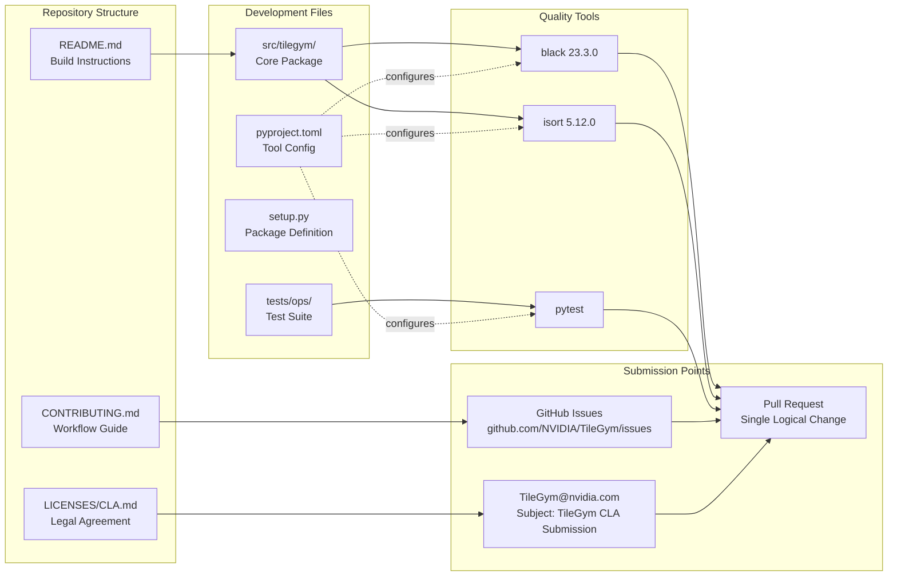
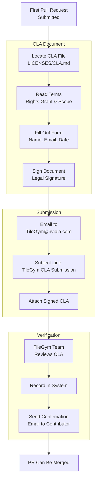

<!-- source: DeepWiki mcp.deepwiki.com · repo NVIDIA/TileGym · page 7 Contributing · fetched 2026-10-26 -->

# Contributing

<details>
<summary>Relevant source files</summary>

The following files were used as context for generating this wiki page:

- [CONTRIBUTING.md](CONTRIBUTING.md)

</details>


This document provides an overview of the contribution process for TileGym. It explains the types of contributions accepted, the high-level workflow, and the requirements for submitting code changes. For detailed submission procedures and testing requirements, see [Contribution Guidelines](#7.1). For information about the legal requirements and CLA signing process, see [Contributor License Agreement](#7.2).

## Purpose and Scope

TileGym welcomes contributions from the community to improve kernel implementations, add new operations, fix bugs, and enhance documentation. This page outlines the contribution framework, including issue reporting, code submission workflow, testing expectations, and legal requirements. The contribution process balances community involvement with the need to maintain code quality and legal compliance.

**Note**: Code contributions are currently limited while GitHub CI infrastructure is being established. Issue reporting and feature requests remain open.

## Contribution Types

TileGym accepts three primary types of contributions, each with different requirements and workflows:

| Contribution Type | Description | Requirements | Current Status |
|------------------|-------------|--------------|----------------|
| **Issue Reporting** | Bug reports, feature requests, improvement suggestions | GitHub account, clear description | Open |
| **Code Contributions** | Bug fixes, new features, refactoring | CLA signature, tests, PR review | Limited (CI pending) |
| **Testing Contributions** | New tests, test improvements, coverage expansion | Follows test structure, passes locally | Limited (CI pending) |

Sources: [CONTRIBUTING.md:10-23]()

## Contribution Workflow Overview

The following diagram illustrates the end-to-end contribution process, from initial issue creation through code merge:

```mermaid
flowchart TD
    START["Contributor<br/>Starts Work"]
    
    subgraph "Issue Management"
        CHECK_ISSUE["Check GitHub<br/>Issue Tracker"]
        CREATE_ISSUE["Create New Issue<br/>github.com/NVIDIA/TileGym/issues"]
        DISCUSS["Discuss Scope<br/>in Issue Comments"]
    end
    
    subgraph "CLA Process"
        CHECK_CLA{"First-time<br/>contributor?"}
        READ_CLA["Read CLA<br/>LICENSES/CLA.md"]
        SIGN_CLA["Sign and Submit<br/>to TileGym@nvidia.com"]
        AWAIT_CONFIRM["Await CLA<br/>Confirmation"]
    end
    
    subgraph "Development"
        FORK["Fork Repository"]
        CLONE["git clone"]
        INSTALL["pip install -e ."]
        IMPLEMENT["Write Code<br/>Follow Style Guidelines"]
        ADD_TESTS["Add/Update Tests<br/>tests/ops/"]
        RUN_TESTS["Run pytest Locally"]
    end
    
    subgraph "Code Quality"
        FORMAT["black src/"]
        SORT["isort src/"]
        LINT["pylint (optional)"]
    end
    
    subgraph "Submission"
        COMMIT["git commit"]
        PUSH["git push"]
        CREATE_PR["Create Pull Request<br/>Describe Changes"]
    end
    
    subgraph "Review Process"
        CI_CHECK["CI Checks<br/>(when available)"]
        MAINTAINER_REVIEW["Maintainer Review"]
        ADDRESS_FEEDBACK["Address Feedback<br/>Push Updates"]
        APPROVE["Approval"]
        MERGE["Merge to Main"]
    end
    
    START --> CHECK_ISSUE
    CHECK_ISSUE --> CREATE_ISSUE
    CREATE_ISSUE --> DISCUSS
    DISCUSS --> CHECK_CLA
    
    CHECK_CLA -->|"Yes"| READ_CLA
    CHECK_CLA -->|"No"| FORK
    READ_CLA --> SIGN_CLA
    SIGN_CLA --> AWAIT_CONFIRM
    AWAIT_CONFIRM --> FORK
    
    FORK --> CLONE
    CLONE --> INSTALL
    INSTALL --> IMPLEMENT
    IMPLEMENT --> ADD_TESTS
    ADD_TESTS --> RUN_TESTS
    
    RUN_TESTS --> FORMAT
    FORMAT --> SORT
    SORT --> LINT
    
    LINT --> COMMIT
    COMMIT --> PUSH
    PUSH --> CREATE_PR
    
    CREATE_PR --> CI_CHECK
    CI_CHECK --> MAINTAINER_REVIEW
    MAINTAINER_REVIEW --> ADDRESS_FEEDBACK
    ADDRESS_FEEDBACK --> MAINTAINER_REVIEW
    MAINTAINER_REVIEW --> APPROVE
    APPROVE --> MERGE
```



Sources: [CONTRIBUTING.md:26-68]()

## Issue Tracking and Communication

All contribution activity begins with the GitHub issue tracker. Issues serve as the central coordination point for bugs, features, and discussions.

### Issue Tracker Structure

The issue tracker at `https://github.com/NVIDIA/TileGym/issues` manages:

- **Bug Reports**: Defects in kernel implementations, incorrect behavior, performance regressions
- **Feature Requests**: New operations, backend support, optimization techniques
- **Improvement Suggestions**: Documentation updates, API enhancements, usability improvements

### Required Information for Issues

When creating an issue, include:

| Information Type | Details |
|-----------------|---------|
| **Clear Description** | Concise explanation of the problem or request |
| **Reproduction Steps** | For bugs: step-by-step instructions to reproduce |
| **Expected Behavior** | What should happen |
| **Actual Behavior** | What actually happens |
| **Environment Details** | GPU model, CUDA version, PyTorch version, TileGym version |
| **Related Code/Tests** | File paths or test names affected |

Sources: [CONTRIBUTING.md:12-14]()

## Code Submission Pipeline

The following diagram maps the code submission process to specific repository components and development tools:



Sources: [CONTRIBUTING.md:26-68](), [pyproject.toml]() (implied from references)

## Code Contribution Workflow

The code contribution process follows six structured steps, as documented in [CONTRIBUTING.md:26-44]():

### Step 1: Read Project Documentation

Before starting work:
- Review [README.md]() for build, install, and usage instructions
- Understand the package architecture and backend system (see [Package Architecture](#3.1))
- Familiarize yourself with the operations library structure

### Step 2: Pick or Propose an Issue

Contributors should:
- Search existing issues at the GitHub issue tracker
- Create a new issue if none exists
- Comment on the issue to indicate you are working on it
- Avoid duplicate work by checking issue assignments

### Step 3: Discuss Significant Changes

For substantial changes:
- Outline your approach in the issue
- Wait for maintainer feedback before implementation
- This applies to:
  - New kernel implementations
  - API changes
  - Backend modifications
  - Performance-critical refactoring

### Step 4: Implement the Change

During implementation:
- Follow existing coding style and patterns in affected modules
- Maintain consistency with the backend dispatch system (see [Backend Management System](#3.2))
- Add or update tests to cover new behavior (see [Testing Infrastructure](#6.2))
- Document new functionality

### Step 5: Open a Pull Request

PR requirements:
- Keep PRs focused on a single logical change
- Provide clear description of:
  - What the PR accomplishes
  - How you tested it
  - Potential user-facing impact
- Reference the related issue number

### Step 6: Respond to Review

After submission:
- Address reviewer comments promptly
- Push updates to the same PR branch
- Keep discussion on the PR or issue
- Be responsive to feedback

Sources: [CONTRIBUTING.md:26-44]()

## Testing Requirements

Testing is critical for maintaining TileGym's correctness and performance guarantees. The testing structure is documented in [tests/ops/README.md]().

### Test Coverage Expectations

Contributors must ensure:

| Test Category | Requirement |
|--------------|-------------|
| **Functional Tests** | Cover typical input shapes and data types |
| **Edge Cases** | Test boundary conditions, empty inputs, extreme values |
| **Mixed Precision** | Verify float16, bfloat16, float32 support where applicable |
| **Backend Compatibility** | Tests pass on both PyTorch and CUTILE backends |
| **Local Verification** | All tests pass locally with `pytest` before PR submission |

### Running Tests Locally

```bash
# Run all tests
pytest

# Run specific op tests
pytest tests/ops/

# Run with verbose output
pytest -v

# Run with coverage report
pytest --cov=tilegym --cov-report=html
```

For detailed testing procedures, see [Testing Infrastructure](#6.2).

Sources: [CONTRIBUTING.md:46-52]()

## CLA Requirement for First-Time Contributors

All code contributions require a signed Contributor License Agreement on file. The CLA process is detailed in [Contributor License Agreement](#7.2).

### CLA Submission Process



### CLA Details

- **Location**: [LICENSES/CLA.md:1-end]()
- **Email**: `TileGym@nvidia.com`
- **Subject**: `TileGym CLA Submission`
- **Requirement**: One-time per contributor
- **Timeline**: Wait for confirmation before PR merge

Sources: [CONTRIBUTING.md:54-61]()

## Review and Merge Process

After PR submission, the following review sequence occurs:

### Review Stages

1. **Automated Checks** (when CI is established):
   - Code formatting verification (black, isort)
   - Test suite execution (pytest)
   - Linting checks (pylint)

2. **Maintainer Review**:
   - Code quality assessment
   - Architecture fit evaluation
   - Performance impact analysis
   - Security review for kernel code

3. **Iteration**:
   - Contributors address feedback
   - Push updates to PR branch
   - Reviewers re-evaluate changes

4. **Approval and Merge**:
   - All CI checks pass
   - Maintainer approval granted
   - PR merged to main branch

### Review Expectations

To facilitate faster review:
- **Focused PRs**: Single logical change per PR
- **Clear Descriptions**: What, why, and how explained
- **Complete Testing**: All tests pass locally
- **Responsive Communication**: Address feedback promptly

Sources: [CONTRIBUTING.md:63-68]()

## Current Status: CI Infrastructure

As noted in [CONTRIBUTING.md:18](), code contributions are currently limited while GitHub CI infrastructure is being established. Contributors are encouraged to:

- Report issues and suggest features
- Participate in design discussions
- Prepare contributions for when CI is available
- Monitor repository announcements for CI launch

Sources: [CONTRIBUTING.md:17-18]()

## Summary

The TileGym contribution process ensures code quality, legal compliance, and community collaboration through structured workflows. Contributors must:

1. Start with issue creation or selection
2. Sign the CLA (first-time contributors)
3. Follow development best practices
4. Submit focused, well-tested PRs
5. Respond to review feedback

For detailed procedures, see [Contribution Guidelines](#7.1) for workflow specifics and [Contributor License Agreement](#7.2) for legal requirements. For development environment setup, see [Development Setup](#6.1). For testing procedures, see [Testing Infrastructure](#6.2).

Sources: [CONTRIBUTING.md:1-70]()

---

