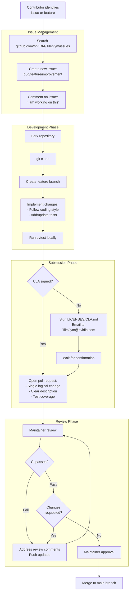
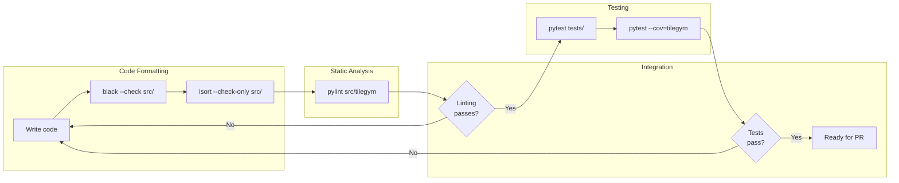
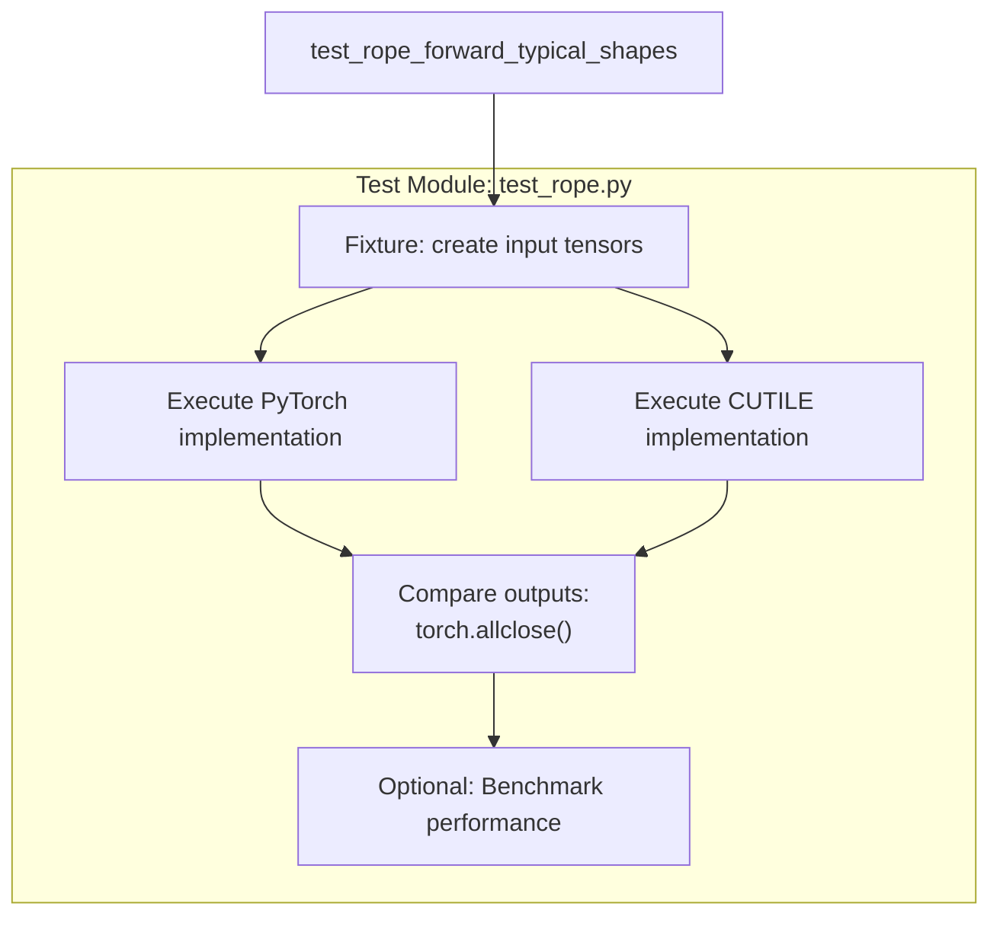
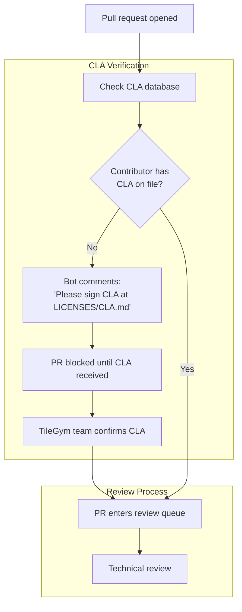

<!-- source: DeepWiki mcp.deepwiki.com · repo NVIDIA/TileGym · page 7.1 Contribution Guidelines · fetched 2026-10-26 -->

# Contribution Guidelines

<details>
<summary>Relevant source files</summary>

The following files were used as context for generating this wiki page:

- [CONTRIBUTING.md](CONTRIBUTING.md)

</details>


## Purpose and Scope

This document describes the end-to-end workflow for contributing to TileGym, including issue reporting procedures, code submission requirements, testing expectations, and the review process. It covers the practical mechanics of making contributions, from initial proposal through merge.

For legal requirements and CLA signing details, see [Contributor License Agreement](#7.2). For development environment setup, see [Development Setup](#6.1). For testing infrastructure details, see [Testing Infrastructure](#6.2).

**Current Status**: Code contributions are not yet open while GitHub CI infrastructure is being established. Issue reporting and discussion are welcome.

**Sources**: [CONTRIBUTING.md:5-8]()

---

## Contribution Workflow Overview

The contribution process follows a structured path from issue creation through pull request merge. The workflow enforces quality gates at multiple stages to maintain code stability.

### Contribution Lifecycle Diagram



**Sources**: [CONTRIBUTING.md:10-68]()

---

## Issue Reporting

### Issue Tracker Location

All issues are managed through the GitHub issue tracker at `github.com/NVIDIA/TileGym/issues`. This centralized system tracks bugs, feature requests, and enhancement proposals.

### Required Issue Information

When reporting issues, include the following components:

| Component | Description | Purpose |
|-----------|-------------|---------|
| **Clear reproduction steps** | Numbered list of actions to reproduce | Enables maintainers to verify the issue |
| **Expected behavior** | What should happen | Clarifies intended functionality |
| **Actual behavior** | What actually happens | Documents the problem |
| **Environment details** | GPU model, CUDA version, PyTorch version, OS | Isolates platform-specific issues |
| **Sample code/inputs** | Minimal reproducible example | Accelerates debugging |

### Issue Categories

Issues fall into three primary categories:

- **Bug reports**: Unexpected behavior, crashes, incorrect outputs
- **Feature requests**: New capabilities, operations, or backend support
- **Improvements**: Performance optimizations, documentation enhancements, API refinements

**Sources**: [CONTRIBUTING.md:12-14]()

---

## Code Contribution Process

### Pre-Implementation Requirements

Before writing code, contributors must complete these preparatory steps:

1. **Read project README**: Review [README.md:1-end]() for build instructions, architecture overview, and usage patterns
2. **Search for existing issues**: Check if the problem or feature is already tracked
3. **Create or claim issue**: Either create a new issue describing your proposal or comment on an existing issue to indicate you are working on it
4. **Discuss significant changes**: For major features or architectural changes, outline your approach in the issue for early maintainer feedback

**Sources**: [CONTRIBUTING.md:29-35]()

### Implementation Standards

Code submissions must adhere to these standards:

| Requirement | Implementation | Verification |
|-------------|----------------|--------------|
| **Coding style** | Follow existing patterns in affected modules | Enforced by `black` formatter [pyproject.toml:9-13]() |
| **Import organization** | Alphabetical, grouped by standard/third-party/local | Enforced by `isort` [pyproject.toml:15-29]() |
| **Test coverage** | Add or update tests for new behavior | Verified by `pytest` execution |
| **Documentation** | Update docstrings and README if API changes | Manual review |

### Code Quality Pipeline



**Sources**: [CONTRIBUTING.md:36-44](), [pyproject.toml:9-29]()

### Pull Request Structure

Pull requests must follow this structure:

**Title**: Concise summary of the change (e.g., "Add RoPE backward op implementation")

**Description sections**:
1. **What**: Description of the change and why it's needed
2. **How**: Technical approach and design decisions
3. **Testing**: How you verified the change works correctly
4. **Impact**: User-facing changes, breaking changes, performance implications

**PR scope**: Each PR should address a single logical change. Multiple unrelated fixes should be submitted as separate PRs to simplify review.

**Sources**: [CONTRIBUTING.md:39-43]()

---

## Testing Requirements

### Test Organization Structure

Tests are organized by category following the structure in `tests/`:

```
tests/
├── ops/                    # Operation unit tests
│   ├── README.md          # Testing guidelines
│   └── test_*.py          # Individual op test modules
└── conftest.py            # Shared pytest fixtures
```

### Operation Test Requirements

When contributing new operations or modifying existing ones, tests must cover:

| Test Category | Description | Example |
|--------------|-------------|---------|
| **Typical shapes** | Common tensor dimensions used in transformers | `(batch=8, seq_len=2048, hidden=4096)` |
| **Edge cases** | Boundary conditions, empty tensors, single elements | `seq_len=1`, `batch=1` |
| **Mixed precision** | FP16, BF16, FP32 data types | Test all supported dtypes |
| **Backend comparison** | PyTorch vs CUTILE output equivalence | `assert torch.allclose(pytorch_out, cutile_out)` |

### Test Execution Requirements

All tests must pass locally before PR submission:

```bash
# Run all tests
pytest tests/

# Run with coverage reporting
pytest --cov=tilegym --cov-report=html tests/

# Run specific op tests
pytest tests/ops/test_rope.py
```

### Test Pattern Example



**Sources**: [CONTRIBUTING.md:45-52](), [tests/ops/README.md:1-end]() (referenced but not provided)

---

## CLA Requirements

### CLA Location and Submission

All first-time contributors must complete a Contributor License Agreement before code can be merged. The process involves these steps:

1. **Locate CLA**: The agreement template is at [LICENSES/CLA.md:1-end]()
2. **Fill and sign**: Complete all required fields and provide signature
3. **Email submission**: Send signed CLA to `TileGym@nvidia.com` with subject line "TileGym CLA Submission"
4. **Wait for confirmation**: The TileGym team will confirm receipt and file the agreement
5. **Track status**: Confirmation must be received before any PR can be merged

### CLA Verification in PR Process



For detailed information about CLA terms and legal implications, see [Contributor License Agreement](#7.2).

**Sources**: [CONTRIBUTING.md:54-61]()

---

## Review and Merge Process

### Maintainer Review Stages

Pull requests pass through multiple review stages before merge:

| Stage | Activities | Success Criteria |
|-------|-----------|------------------|
| **Initial triage** | Maintainer assigns reviewer, checks PR scope | PR aligns with project goals |
| **Technical review** | Code quality, architecture, test coverage | Code meets standards, tests pass |
| **CI validation** | Automated checks run (when CI is active) | All CI jobs pass |
| **Final approval** | Maintainer accepts changes | All comments resolved, CI green |
| **Merge** | Squash and merge to main branch | PR is incorporated |

### CI Requirements (Future)

Once GitHub CI is established, the following automated checks will be required:

- **Code formatting**: `black --check` and `isort --check-only` must pass
- **Static analysis**: `pylint` must pass with no errors
- **Unit tests**: All `pytest` tests must pass on supported platforms
- **Build verification**: Package must build successfully with `pip install -e .`

### Review Response Guidelines

When responding to review comments:

1. **Address all comments**: Either implement the suggested change or provide reasoning for not doing so
2. **Push updates incrementally**: Add commits that address specific review points (these will be squashed at merge)
3. **Keep discussion on PR**: Avoid side-channel discussions that aren't visible to all reviewers
4. **Request re-review**: After addressing comments, explicitly request re-review from the reviewer

### Merge Criteria Checklist

Before a PR can be merged, all of the following must be satisfied:

- [ ] CLA is signed and on file
- [ ] All CI checks pass (when CI is active)
- [ ] All tests pass locally and in CI
- [ ] Code formatting and linting pass
- [ ] All review comments are resolved or explicitly addressed
- [ ] At least one maintainer has approved
- [ ] PR description clearly documents the change

**Sources**: [CONTRIBUTING.md:63-68]()

---

## Contribution Quality Guidelines

### What Makes a Good Contribution

High-quality contributions share these characteristics:

**Focused scope**: The PR addresses one logical change. If fixing multiple bugs, submit separate PRs for each.

**Clear description**: The PR description answers:
- What problem does this solve?
- How does this implementation work?
- What testing was performed?
- What is the user impact?

**Comprehensive testing**: Tests cover not just the happy path, but edge cases and error conditions.

**Clean history**: Commits are logically organized (though they will be squashed at merge).

### Common Rejection Reasons

PRs may be rejected or require significant rework if they:

- Mix multiple unrelated changes in a single PR
- Lack test coverage for new functionality
- Break existing tests without justification
- Introduce breaking API changes without discussion
- Fail to follow project coding standards
- Are submitted without a signed CLA

### Getting Help

If any aspect of the contribution process is unclear:

- Comment on the relevant issue or PR with questions
- Check existing PRs for examples of successful contributions
- Review related wiki pages: [Development Setup](#6.1), [Testing Infrastructure](#6.2), [Code Quality Tools](#6.3)

**Sources**: [CONTRIBUTING.md:67-69]()

---

## File Reference Map

This section maps contribution workflow stages to specific repository files:

| Workflow Stage | Relevant Files | Purpose |
|----------------|---------------|---------|
| **Issue reporting** | `README.md` | Project overview for context |
| **CLA signing** | `LICENSES/CLA.md` | Agreement template |
| **Code formatting** | `pyproject.toml` sections `[tool.black]`, `[tool.isort]` | Formatter configuration |
| **Testing** | `tests/ops/`, `tests/conftest.py`, `pyproject.toml` section `[tool.pytest.ini_options]` | Test organization and configuration |
| **Build verification** | `setup.py`, `pyproject.toml` | Package definition |
| **Documentation** | `README.md`, `CONTRIBUTING.md` | User and contributor documentation |

**Sources**: [CONTRIBUTING.md:1-70](), [pyproject.toml:1-end](), [setup.py:1-end]()

---

