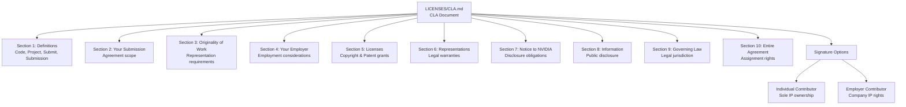
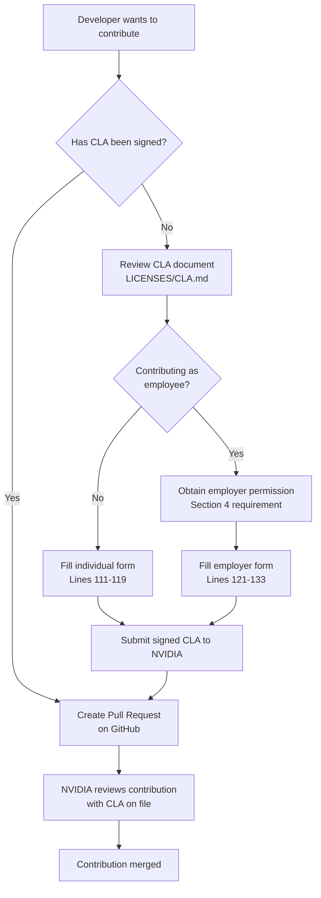
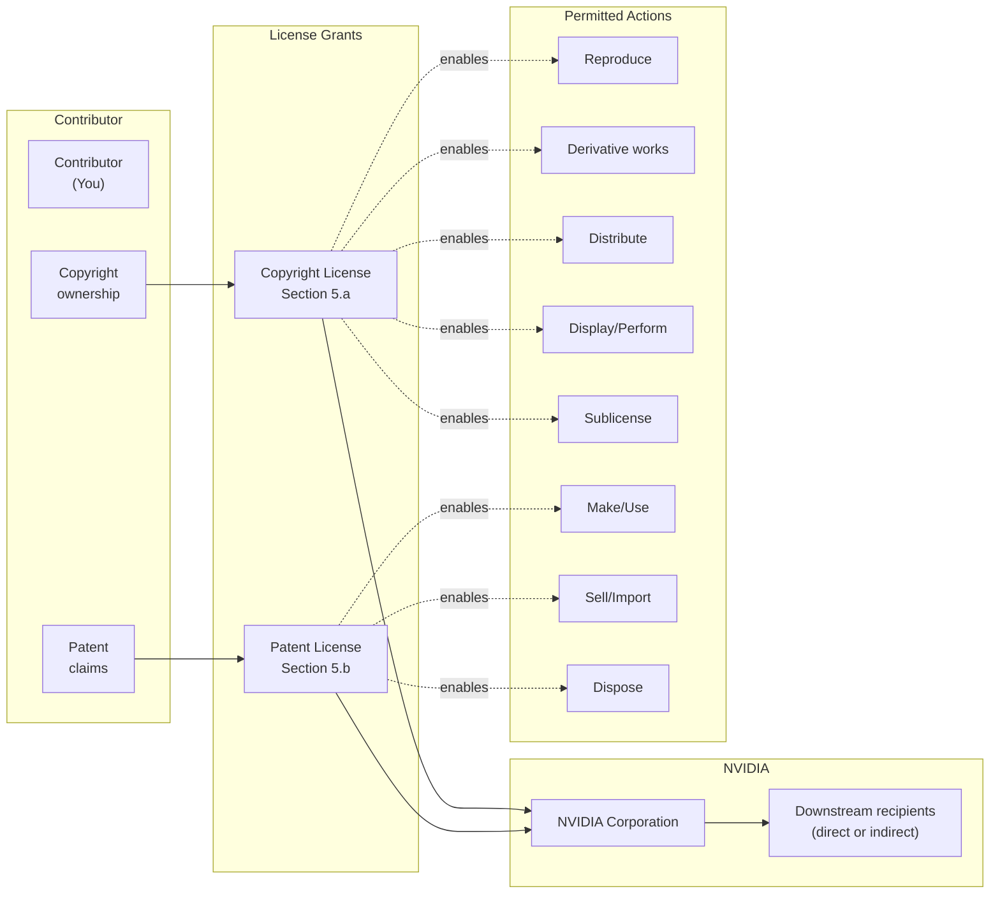
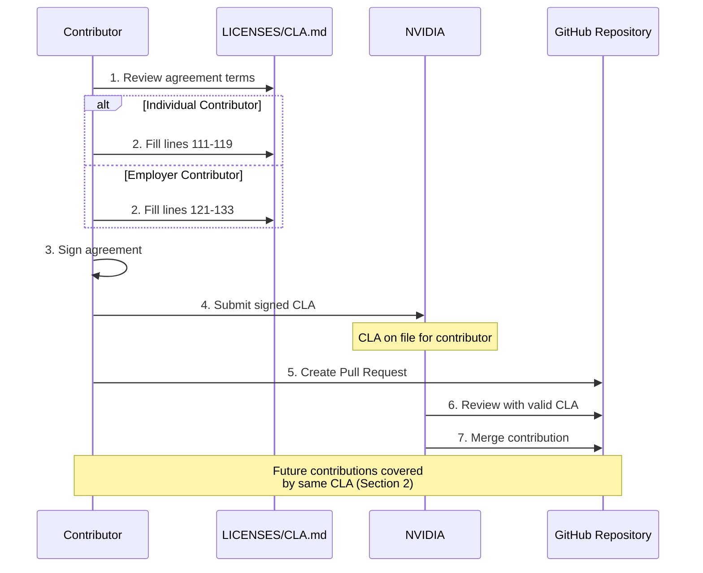

<!-- source: DeepWiki mcp.deepwiki.com · repo NVIDIA/TileGym · page 7.2 Contributor License Agreement · fetched 2026-10-26 -->

# Contributor License Agreement

Relevant source files

The following files were used as context for generating this wiki page:

- [LICENSES/CLA.md](LICENSES/CLA.md)

This page explains the Contributor License Agreement (CLA) required for contributing to TileGym. The CLA establishes the legal framework under which NVIDIA accepts code contributions, defining copyright and patent license grants, contributor representations, and submission requirements.

For information about the contribution workflow and code submission process, see [Contribution Guidelines](#7.1). For licensing terms under which TileGym itself is distributed, see [Project License](#8.1).

---

## Purpose and Scope

The CLA serves as a formal legal agreement between contributors and NVIDIA Corporation. Before any code, documentation, or other copyrightable material can be submitted to TileGym via pull request, contributors must sign this agreement. The CLA ensures that:

1. NVIDIA has clear legal rights to use, modify, and distribute contributed code
2. Contributors represent that they have the right to grant these licenses
3. Patent rights are explicitly granted to prevent future litigation
4. Both individual contributors and their employers (if applicable) are bound by the agreement

**Sources:** [LICENSES/CLA.md:1-10]()

---

## CLA Document Structure

The agreement is organized into ten sections, each addressing specific legal aspects of the contribution process:

**Sources:** [LICENSES/CLA.md:12-134]()

---

## Key Definitions

The CLA defines four critical terms that establish the agreement's scope:

| Term | Definition | Line Reference |
|------|------------|----------------|
| **Code** | Computer software in human-readable or machine-executable form delivered to NVIDIA | [LICENSES/CLA.md:14-15]() |
| **Project** | NVIDIA-managed projects offering software under OSI-approved licenses | [LICENSES/CLA.md:17-19]() |
| **Submit** | Act of uploading, transmitting, or distributing content to a Project through source control, issue tracking, or mailing lists | [LICENSES/CLA.md:21-25]() |
| **Submission** | Code and copyrightable material submitted by contributor, including comments and documentation | [LICENSES/CLA.md:27-28]() |

The definition of "Submit" explicitly excludes communications marked as "Not a Submission", allowing contributors to participate in discussions without triggering CLA requirements.

**Sources:** [LICENSES/CLA.md:12-28]()

---

## Contribution Workflow and CLA Requirement

The CLA is required before any submission can be accepted into the TileGym repository:

**Sources:** [LICENSES/CLA.md:30-33](), [LICENSES/CLA.md:108-109]()

---

## License Grants

Section 5 of the CLA establishes three types of license grants from contributor to NVIDIA:

### Copyright License

Contributors grant NVIDIA a perpetual, worldwide, non-exclusive, royalty-free, irrevocable copyright license with the following rights:

- **Reproduce** the Submission
- **Prepare derivative works** from the Submission
- **Publicly display and perform** the Submission
- **Distribute** the Submission and derivative works
- **Sublicense** any or all rights to third parties

This license extends not only to NVIDIA but also to anyone who receives the Submission directly or indirectly from NVIDIA.

**Sources:** [LICENSES/CLA.md:57-61]()

### Patent License

Contributors grant NVIDIA a perpetual, worldwide, non-exclusive, royalty-free, irrevocable patent license covering:

- Patent claims necessarily infringed by the Submission alone
- Patent claims necessarily infringed by the combination of the Submission with the Project

Licensed activities include: make, have made, use, offer to sell, sell, import, and otherwise dispose of the Submission.

**Sources:** [LICENSES/CLA.md:63-67]()

### Rights Reservation

All rights not explicitly granted in the agreement are reserved by each party. No additional licenses are granted by implication, exhaustion, estoppel, or otherwise.

**Sources:** [LICENSES/CLA.md:69-71]()

---

## License Flow Diagram

**Sources:** [LICENSES/CLA.md:55-71]()

---

## Originality and Third-Party Materials

Section 3 requires that each Submission be entirely the contributor's original work. If submitting materials that are not original work:

**Requirements for Third-Party Materials:**

1. **Retain copyright and license information** from the original materials as received
2. **Include in the description** the phrase: "Submission containing materials of a third party:" followed by third party names and any known licenses/restrictions
3. **Follow Project guidelines** for handling third-party submissions

This section ensures that all license obligations are properly tracked and maintained.

**Sources:** [LICENSES/CLA.md:35-42]()

---

## Employer Considerations

Section 4 addresses situations where contributions are made in the course of employment or where employers have intellectual property rights:

### When Employer Permission is Required

Employer permission must be obtained if:

- The Submission is made in the course of work for an employer
- The employer has intellectual property rights in the Submission by contract or applicable law

### Definition of "Employer"

The term "employer" includes not only traditional employment relationships but also:

- Contractors
- Vendors
- Agents
- Anyone for whom the contributor is acting in making the Submission

### Multi-Employer Scenario

If a contributor changes employers after signing the CLA:

1. A new Agreement must be signed for the new employer
2. Permission must be secured from the new employer
3. The new Agreement is required before submitting contributions for the new employer

**Sources:** [LICENSES/CLA.md:44-52]()

---

## Representations and Warranties

Section 6 requires contributors to represent that:

| Representation | Description |
|----------------|-------------|
| **Legal entitlement** | Contributor is legally entitled to grant the licenses specified in Section 5 |
| **Original work** | Each Submission is entirely the contributor's original work (except as disclosed under Section 3) |
| **Employer permission** | Permission has been secured from employer where applicable |
| **Corporate authority** | For corporate signers, the signer has authority to bind the employer to the Agreement |

### Warranty Disclaimer

Except for the express warranties stated in Sections 3, 4, and 6, Submissions are provided **WITHOUT WARRANTY OF ANY KIND**, including:

- No warranty of **NONINFRINGEMENT**
- No warranty of **MERCHANTABILITY**
- No warranty of **FITNESS FOR A PARTICULAR PURPOSE**

Contributors are not expected to provide support for Submissions unless they choose to do so.

**Sources:** [LICENSES/CLA.md:73-85]()

---

## Signing the CLA

The CLA provides two signature options based on intellectual property ownership:

### Option 1: Individual Contributor

Use this option if:
- You have sole ownership of intellectual property rights to your Submissions
- You are NOT making Submissions in the course of work for an employer

**Required Information:**
- Name
- Signature
- Date
- GitHub Login
- Email
- Address

**Sources:** [LICENSES/CLA.md:111-119]()

### Option 2: Employer Contributor

Use this option if:
- You are making Submissions in the course of work for an employer
- Your employer has intellectual property rights in your Submissions by contract or applicable law

**Required Information:**
- Company Name
- Signature
- By (signer name)
- Title
- Date
- GitHub Login
- Email
- Address

When signing on behalf of an employer, the defined term "You" in the Agreement includes both the individual and the employer collectively.

**Sources:** [LICENSES/CLA.md:121-133]()

---

## Submission Process

**Sources:** [LICENSES/CLA.md:30-33](), [LICENSES/CLA.md:108-133]()

---

## Notice and Disclosure Obligations

### Section 7: Notice to NVIDIA

Contributors must notify NVIDIA in writing of any facts or circumstances that later become known which would make the representations in the Agreement inaccurate in any respect.

**Sources:** [LICENSES/CLA.md:87-90]()

### Section 8: Information about Submissions

Contributors acknowledge and agree that:

- Contributions to Projects may be **maintained indefinitely**
- Contribution information may be **disclosed publicly**
- This includes the contributor's **name and other information** submitted with the Submission

**Sources:** [LICENSES/CLA.md:92-95]()

---

## Legal Framework

### Governing Law

Claims arising under the Agreement are governed by:

- **Delaware law** (excluding conflict of laws principles)
- Excludes the **United Nations Convention on Contracts for the Sale of Goods**

**Sources:** [LICENSES/CLA.md:97-98]()

### Jurisdiction

Exclusive jurisdiction for disputes resides in:

- **State and/or federal courts** residing in **Santa Clara County, California**

**Sources:** [LICENSES/CLA.md:98]()

### Export Control

Contributors may not export Software in violation of applicable export laws and regulations.

**Sources:** [LICENSES/CLA.md:98]()

### Entire Agreement and Assignment

The CLA constitutes the entire agreement between the parties and supersedes all prior agreements, understandings, or communications (written or oral) relating to the subject matter. The Agreement may be assigned by NVIDIA.

**Sources:** [LICENSES/CLA.md:100-103]()

---

## Practical Implications

### For Individual Contributors

1. Review the entire CLA document at [LICENSES/CLA.md:1-134]()
2. Ensure you have sole ownership of IP rights to your contributions
3. If employed, confirm your work is not covered by employer IP agreements
4. Complete the individual signature section
5. Submit the signed CLA to NVIDIA before creating pull requests

### For Corporate Contributors

1. Obtain explicit permission from your employer to contribute
2. Verify that the person signing has authority to bind the company
3. Complete the employer signature section with full corporate details
4. Remember that the agreement covers both the individual and employer collectively
5. Sign a new agreement if changing employers

### Coverage of Future Contributions

A signed CLA covers all present and future Submissions to any NVIDIA Project (except as described in Section 4 regarding employer changes). Contributors do not need to sign a new CLA for each contribution.

**Sources:** [LICENSES/CLA.md:30-33](), [LICENSES/CLA.md:44-52]()

---

## Summary Table

| CLA Aspect | Key Points | Section Reference |
|------------|------------|-------------------|
| **When Required** | Before any code submission to TileGym | [LICENSES/CLA.md:30-33]() |
| **Copyright License** | Perpetual, worldwide, royalty-free, includes sublicensing rights | [LICENSES/CLA.md:57-61]() |
| **Patent License** | Covers patents necessarily infringed by Submission | [LICENSES/CLA.md:63-67]() |
| **Originality** | Must be entirely original work or properly attributed | [LICENSES/CLA.md:35-42]() |
| **Employer Rights** | Permission required if employer has IP rights | [LICENSES/CLA.md:44-52]() |
| **Warranty** | No warranty except express representations | [LICENSES/CLA.md:81-85]() |
| **Governing Law** | Delaware law, Santa Clara County jurisdiction | [LICENSES/CLA.md:97-98]() |
| **Duration** | Covers all future submissions until employer change | [LICENSES/CLA.md:30-33]() |

**Sources:** [LICENSES/CLA.md:1-134]()

---

