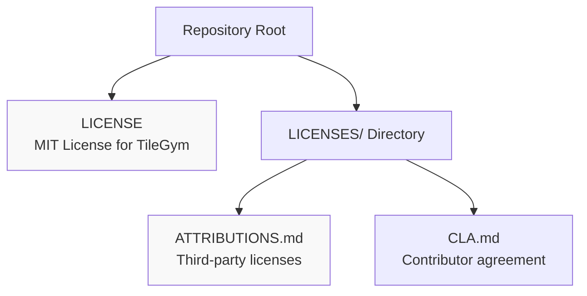
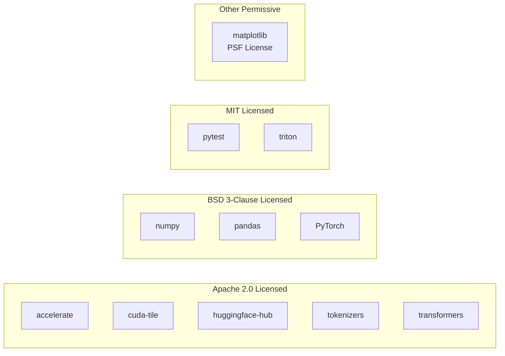
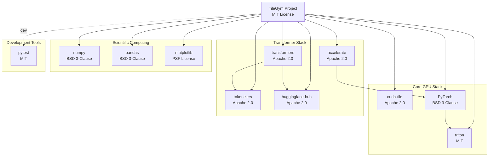
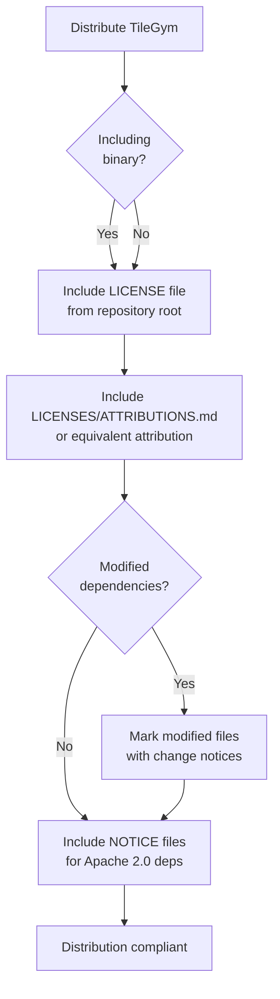

<!-- source: DeepWiki mcp.deepwiki.com · repo NVIDIA/TileGym · page 8 Legal and Licensing · fetched 2026-10-26 -->

# Legal and Licensing

<details>
<summary>Relevant source files</summary>

The following files were used as context for generating this wiki page:

- [LICENSE](LICENSE)
- [LICENSES/ATTRIBUTIONS.md](LICENSES/ATTRIBUTIONS.md)

</details>


## Purpose and Scope

This page provides an overview of the legal and licensing framework governing TileGym. It covers the project's own license terms and the licenses of third-party dependencies integrated into the codebase. For detailed information about TileGym's MIT License terms, see [Project License](#8.1). For comprehensive attribution information about third-party libraries, see [Third-Party Dependencies](#8.2). Information about contributor agreements for code submissions is covered in [Contributor License Agreement](#7.2).

## Licensing Overview

TileGym uses a dual-licensing structure where the project's original code is distributed under the MIT License while incorporating multiple third-party open-source libraries under various permissive licenses. All integrated dependencies use licenses compatible with commercial and academic use.

### License Files Location



**Sources:** [LICENSE:1-21](), [LICENSES/ATTRIBUTIONS.md:1-1329]()

## TileGym Project License

TileGym itself is distributed under the **MIT License**, a permissive open-source license that allows:

- **Commercial use**: Use in proprietary products and services
- **Modification**: Create derivative works and modifications
- **Distribution**: Distribute original and modified versions
- **Private use**: Use internally without disclosure obligations

The license requires preservation of copyright notices and disclaims all warranties.

### Copyright Notice

```
SPDX-FileCopyrightText: Copyright (c) 2025 NVIDIA CORPORATION & AFFILIATES. All rights reserved.
SPDX-License-Identifier: MIT
```

All source files in the TileGym codebase include SPDX headers identifying copyright ownership and license type. The SPDX identifiers enable automated license compliance tooling.

**Key License Terms:**

| Permission | Requirement | Limitation |
|------------|-------------|------------|
| Use, copy, modify, merge | Include copyright notice | No warranty |
| Publish, distribute, sublicense | Include license text | No liability |
| Sell copies | - | - |

For complete license text and detailed terms, see [Project License](#8.1).

**Sources:** [LICENSE:1-21]()

## Third-Party Dependencies

TileGym integrates eleven third-party open-source libraries spanning GPU computing, deep learning, and scientific computing domains. All dependencies use permissive licenses that allow commercial use without copyleft obligations.

### Dependency License Distribution



**Sources:** [LICENSES/ATTRIBUTIONS.md:1-1329]()

### License Categories by Use Case

| Dependency | License | Primary Use | Source Repository |
|------------|---------|-------------|-------------------|
| **cuda-tile** | Apache 2.0 | CUDA tiling backend | github.com/nvidia/cutile-python |
| **PyTorch** | BSD 3-Clause | Tensor operations | github.com/pytorch/pytorch |
| **transformers** | Apache 2.0 | Model architectures | github.com/huggingface/transformers |
| **accelerate** | Apache 2.0 | Distributed inference | github.com/huggingface/accelerate |
| **tokenizers** | Apache 2.0 | Text processing | github.com/huggingface/tokenizers |
| **huggingface-hub** | Apache 2.0 | Model repository | github.com/huggingface/huggingface_hub |
| **triton** | MIT | GPU kernel compiler | github.com/triton-lang/triton |
| **numpy** | BSD 3-Clause | Array operations | github.com/numpy/numpy |
| **pandas** | BSD 3-Clause | Data structures | github.com/pandas-dev/pandas |
| **matplotlib** | PSF License | Visualization | github.com/matplotlib/matplotlib |
| **pytest** | MIT | Testing framework | github.com/pytest-dev/pytest |

**Sources:** [LICENSES/ATTRIBUTIONS.md:9-1329]()

### Dependency License Stack



**Sources:** [LICENSES/ATTRIBUTIONS.md:1-1329]()

## License Compatibility Matrix

All licenses used in TileGym are mutually compatible and permit commercial use. The matrix below shows key compatibility characteristics:

| License Type | Commercial Use | Modification | Distribution | Patent Grant | Copyleft |
|--------------|----------------|--------------|--------------|--------------|----------|
| MIT (TileGym, pytest, triton) | ✓ | ✓ | ✓ | ✗ | ✗ |
| Apache 2.0 (cuda-tile, HF libs) | ✓ | ✓ | ✓ | ✓ | ✗ |
| BSD 3-Clause (PyTorch, numpy, pandas) | ✓ | ✓ | ✓ | ✗ | ✗ |
| PSF (matplotlib) | ✓ | ✓ | ✓ | ✗ | ✗ |

**Key Observations:**

- All licenses are **permissive** (non-copyleft), allowing integration into proprietary software
- Apache 2.0 licenses include explicit **patent grants**, providing additional IP protection
- No license imposes disclosure requirements on derivative works
- All licenses require preservation of copyright notices and disclaimers

**Sources:** [LICENSE:1-21](), [LICENSES/ATTRIBUTIONS.md:1-1329]()

## License Compliance Requirements

### Distribution Requirements

When distributing TileGym or derivative works, users must comply with the following requirements:

**For TileGym Code (MIT License):**
1. Include the copyright notice from [LICENSE:1-2]()
2. Include the full license text from [LICENSE:4-20]()
3. Apply to all copies or substantial portions

**For Third-Party Dependencies:**
1. Preserve all copyright notices listed in [LICENSES/ATTRIBUTIONS.md]()
2. Include license texts for all dependencies
3. For Apache 2.0 libraries: Include NOTICE files if present
4. For modified files: Mark changes (required by Apache 2.0, BSD)

### Attribution Workflow



**Sources:** [LICENSE:10-12](), [LICENSES/ATTRIBUTIONS.md:1-1329]()

## SPDX License Identifiers

TileGym uses SPDX (Software Package Data Exchange) license identifiers for machine-readable license declarations. Each source file header includes:

```
SPDX-FileCopyrightText: Copyright (c) 2025 NVIDIA CORPORATION & AFFILIATES. All rights reserved.
SPDX-License-Identifier: MIT
```

### SPDX Identifiers by Component

| Component | SPDX Identifier | Standardized Name |
|-----------|-----------------|-------------------|
| TileGym source files | `MIT` | MIT License |
| cuda-tile | `Apache-2.0` | Apache License 2.0 |
| PyTorch | `BSD-3-Clause` | BSD 3-Clause "New" or "Revised" License |
| transformers | `Apache-2.0` | Apache License 2.0 |
| accelerate | `Apache-2.0` | Apache License 2.0 |
| numpy | `BSD-3-Clause` | BSD 3-Clause "New" or "Revised" License |
| pandas | `BSD-3-Clause` | BSD 3-Clause "New" or "Revised" License |
| pytest | `MIT` | MIT License |
| triton | `MIT` | MIT License |

SPDX identifiers enable automated license scanning tools to identify license obligations without parsing full license texts.

**Sources:** [LICENSE:1-2]()

## Patent Considerations

### Apache 2.0 Patent Grant

Five dependencies (cuda-tile, transformers, accelerate, tokenizers, huggingface-hub) are licensed under Apache 2.0, which includes an explicit patent grant:

- Contributors grant a patent license covering patent claims necessarily infringed by their contributions
- Patent license terminates if licensee initiates patent litigation alleging infringement
- Provides stronger patent protection than MIT or BSD licenses

See [LICENSES/ATTRIBUTIONS.md:89-102]() for full Apache 2.0 patent license terms.

### MIT and BSD Licenses

MIT and BSD licenses do not include explicit patent grants. Users rely on implicit patent licenses under applicable law.

**Sources:** [LICENSES/ATTRIBUTIONS.md:89-102](), [LICENSES/ATTRIBUTIONS.md:259-261]()

## Warranty and Liability Disclaimers

All licenses used by TileGym disclaim warranties and limit liability:

**Warranty Disclaimers:**
- Software provided "AS IS" without warranties of any kind
- No warranties of merchantability, fitness for particular purpose, or non-infringement
- Users assume all risks associated with software use

**Liability Limitations:**
- Contributors not liable for direct, indirect, special, incidental, or consequential damages
- No liability even if advised of possibility of such damages
- Applies to all license types (MIT, Apache 2.0, BSD, PSF)

These disclaimers are standard for open-source software and recognized in most jurisdictions.

**Sources:** [LICENSE:14-20](), [LICENSES/ATTRIBUTIONS.md:158-178](), [LICENSES/ATTRIBUTIONS.md:279-281]()

## Contribution Licensing

Contributors to TileGym grant rights under the same MIT License used for the project. This is documented in the Contributor License Agreement (CLA) process described in [Contributor License Agreement](#7.2). Key terms:

- Contributions submitted under MIT License terms
- No additional terms or conditions apply
- Contributors retain copyright but grant broad usage rights
- Ensures all contributions remain under consistent licensing

**Sources:** [LICENSE:1-21]()

## Commercial Use Guidance

TileGym and all its dependencies permit commercial use without royalty obligations:

**Permitted Commercial Activities:**
- Integration into commercial products and services
- Use in proprietary software development
- Deployment in production environments
- Sale of software incorporating TileGym
- Modification for internal business purposes

**Required Compliance Actions:**
- Include license notices in distributed products
- Preserve copyright attributions
- Do not use NVIDIA or contributor names for endorsement without permission
- Comply with specific attribution requirements for modified files

**Sources:** [LICENSE:4-9](), [LICENSES/ATTRIBUTIONS.md:1-1329]()

## Summary

TileGym provides a clear, permissive licensing structure suitable for both academic research and commercial deployment. The MIT License governing the project imposes minimal restrictions while the Apache 2.0, BSD, and MIT licenses of dependencies ensure broad compatibility. Users must preserve copyright notices and license texts but face no disclosure obligations or copyleft requirements. For implementation details of specific license terms, see [Project License](#8.1) and [Third-Party Dependencies](#8.2).

**Sources:** [LICENSE:1-21](), [LICENSES/ATTRIBUTIONS.md:1-1329]()

---

