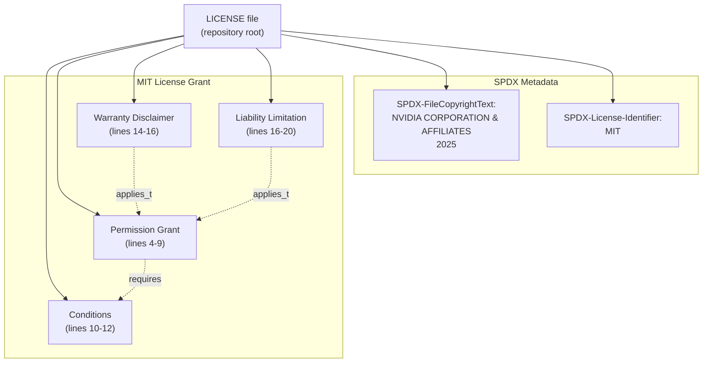
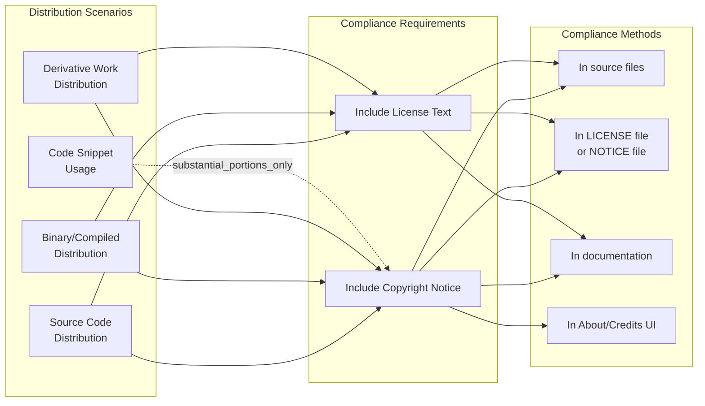
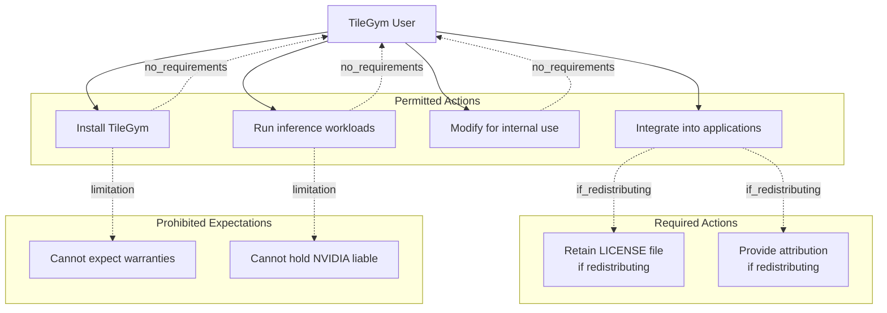

<!-- source: DeepWiki mcp.deepwiki.com · repo NVIDIA/TileGym · page 8.1 Project License · fetched 2026-10-26 -->

# Project License

<details>
<summary>Relevant source files</summary>

The following files were used as context for generating this wiki page:

- [LICENSE](LICENSE)

</details>


## Purpose and Scope

This document explains the MIT License terms under which TileGym is distributed, including the specific permissions granted to users, conditions that must be met, and limitations of liability. It covers the copyright notice, SPDX identifiers, and practical implications for both users and contributors of the TileGym library.

For information about third-party dependencies and their licenses, see [Third-Party Dependencies](#8.2). For contributor-specific legal requirements, see [Contributor License Agreement](#7.2).

---

## License Overview

TileGym is distributed under the **MIT License**, one of the most permissive open-source licenses. The license text is located in the repository root at [LICENSE:1-21]().

### SPDX Identifiers

The license file uses standardized SPDX (Software Package Data Exchange) identifiers for machine-readable license metadata:

| SPDX Field | Value | Location |
|------------|-------|----------|
| `SPDX-FileCopyrightText` | Copyright (c) 2025 NVIDIA CORPORATION & AFFILIATES. All rights reserved. | [LICENSE:1]() |
| `SPDX-License-Identifier` | MIT | [LICENSE:2]() |

These identifiers enable automated license compliance tools to accurately detect and track TileGym's licensing terms.

**Sources:** [LICENSE:1-2]()

---

## Copyright and Attribution

### Copyright Holder

The copyright for TileGym is held by:

```
NVIDIA CORPORATION & AFFILIATES
Copyright year: 2025
```

**Sources:** [LICENSE:1]()

### Required Attribution Notice

The MIT License requires that the following notice be included in all copies or substantial portions of the Software:

```
Copyright (c) 2025 NVIDIA CORPORATION & AFFILIATES. All rights reserved.
```

This copyright notice must be preserved in:
- Source code distributions
- Binary distributions
- Derivative works
- Documentation that accompanies the software

**Sources:** [LICENSE:1](), [LICENSE:10-12]()

---

## License Structure



**Diagram: LICENSE File Structure and Components**

This diagram maps the [LICENSE:1-21]() file to its constituent legal components. The SPDX metadata ([LICENSE:1-2]()) provides machine-readable identifiers, while the MIT License grant ([LICENSE:4-20]()) specifies permissions, conditions, and disclaimers.

**Sources:** [LICENSE:1-21]()

---

## Permissions Granted

The MIT License grants the following rights to any person obtaining a copy of TileGym:

| Permission | Description | License Reference |
|------------|-------------|-------------------|
| **Use** | Use the software for any purpose, commercial or non-commercial | [LICENSE:6]() |
| **Copy** | Make copies of the software | [LICENSE:5]() |
| **Modify** | Modify the source code | [LICENSE:7]() |
| **Merge** | Combine TileGym with other software | [LICENSE:7]() |
| **Publish** | Make the software publicly available | [LICENSE:7]() |
| **Distribute** | Share copies with others | [LICENSE:7]() |
| **Sublicense** | Grant licenses to derivative works | [LICENSE:7-8]() |
| **Sell** | Sell copies of the software | [LICENSE:8]() |

These permissions apply **without restriction** as stated in [LICENSE:6](), subject only to the conditions described below.

**Sources:** [LICENSE:4-9]()

---

## Conditions and Requirements

The MIT License imposes only two simple conditions:

### 1. Copyright Notice Inclusion

The copyright notice must be included in all copies or substantial portions of the Software:

```
Copyright (c) 2025 NVIDIA CORPORATION & AFFILIATES. All rights reserved.
```

**Reference:** [LICENSE:10-11]()

### 2. License Text Inclusion

The full MIT License permission notice must be included in all copies or substantial portions of the Software. This includes the complete text from [LICENSE:4-20]().

**Reference:** [LICENSE:11-12]()

### What Constitutes Compliance



**Diagram: License Compliance Requirements by Distribution Type**

This diagram illustrates how the conditions in [LICENSE:10-12]() apply to different distribution scenarios. All distribution types require both copyright notice and license text inclusion.

**Sources:** [LICENSE:10-12]()

---

## Limitations and Disclaimers

The MIT License includes important limitations on liability and warranties:

### No Warranty

The software is provided **"AS IS"** with no warranty of any kind:

| Warranty Type | Status | Reference |
|---------------|--------|-----------|
| Express Warranties | None | [LICENSE:14-15]() |
| Implied Warranties | None | [LICENSE:15]() |
| Warranty of MERCHANTABILITY | Excluded | [LICENSE:15-16]() |
| Warranty of FITNESS FOR PARTICULAR PURPOSE | Excluded | [LICENSE:16]() |
| Warranty of NONINFRINGEMENT | Excluded | [LICENSE:16]() |

**Sources:** [LICENSE:14-17]()

### Limitation of Liability

NVIDIA and the authors **shall not be liable** for any claims, damages, or other liability arising from:

- Use of the software
- Modifications to the software
- Distribution of the software
- Other dealings in the software

This limitation applies to:
- Contract claims
- Tort claims
- Any other legal theory

**Reference:** [LICENSE:16-20]()

### Legal Disclaimer Text

The exact disclaimer text from [LICENSE:14-20]():

```
THE SOFTWARE IS PROVIDED "AS IS", WITHOUT WARRANTY OF ANY KIND, EXPRESS OR
IMPLIED, INCLUDING BUT NOT LIMITED TO THE WARRANTIES OF MERCHANTABILITY,
FITNESS FOR A PARTICULAR PURPOSE AND NONINFRINGEMENT. IN NO EVENT SHALL
THE AUTHORS OR COPYRIGHT HOLDERS BE LIABLE FOR ANY CLAIM, DAMAGES OR OTHER
LIABILITY, WHETHER IN AN ACTION OF CONTRACT, TORT OR OTHERWISE, ARISING
FROM, OUT OF OR IN CONNECTION WITH THE SOFTWARE OR THE USE OR OTHER
DEALINGS IN THE SOFTWARE.
```

**Sources:** [LICENSE:14-20]()

---

## Practical Implications

### For Users



**Diagram: User Rights and Obligations Under MIT License**

This diagram maps the permissions from [LICENSE:4-9]() and conditions from [LICENSE:10-12]() to practical user scenarios.

### For Commercial Use

The MIT License explicitly permits commercial use without additional restrictions:

- ✓ Use TileGym in commercial products
- ✓ Charge for software that includes TileGym
- ✓ Provide TileGym as part of paid services
- ✓ No requirement to make derivative works open source
- ✓ No requirement to share modifications (unless distributing)

**Requirement:** If distributing TileGym or derivative works, include the copyright notice and license text from [LICENSE:1-2]() and [LICENSE:4-20]().

**Sources:** [LICENSE:4-9](), [LICENSE:10-12]()

### For Contributors

Contributors must sign the Contributor License Agreement (CLA) before their contributions can be accepted. See [Contributor License Agreement](#7.2) for details on the CLA process.

The MIT License governs the **outbound license** (how NVIDIA distributes TileGym), while the CLA governs the **inbound license** (how contributors grant rights to NVIDIA).

**Sources:** [LICENSE:1-21]()

### For Derivative Works

Derivative works may be:
- Licensed under different terms (including proprietary licenses)
- Sold commercially
- Combined with other software

**Requirements:**
1. Include original copyright notice: [LICENSE:1]()
2. Include original MIT License text: [LICENSE:4-20]()
3. Clearly indicate modifications made

**Optional:** Add your own copyright notice for new contributions while preserving the original NVIDIA copyright.

**Sources:** [LICENSE:10-12]()

---

## License Text Location

The complete license text is stored at:

```
TileGym/LICENSE
```

This file must be preserved in all distributions of TileGym.

**Sources:** [LICENSE:1-21]()

---

## Summary Table

| Aspect | Details |
|--------|---------|
| **License Type** | MIT License |
| **SPDX Identifier** | MIT |
| **Copyright Holder** | NVIDIA CORPORATION & AFFILIATES |
| **Copyright Year** | 2025 |
| **Permissions** | Use, copy, modify, merge, publish, distribute, sublicense, sell |
| **Conditions** | Include copyright notice and license text in distributions |
| **Warranty** | None (provided "AS IS") |
| **Liability** | Limited (no liability for damages) |
| **Commercial Use** | Permitted without restrictions |
| **License File** | [LICENSE:1-21]() |

**Sources:** [LICENSE:1-21]()

---

