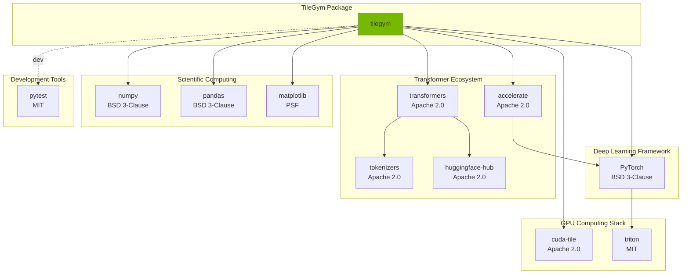
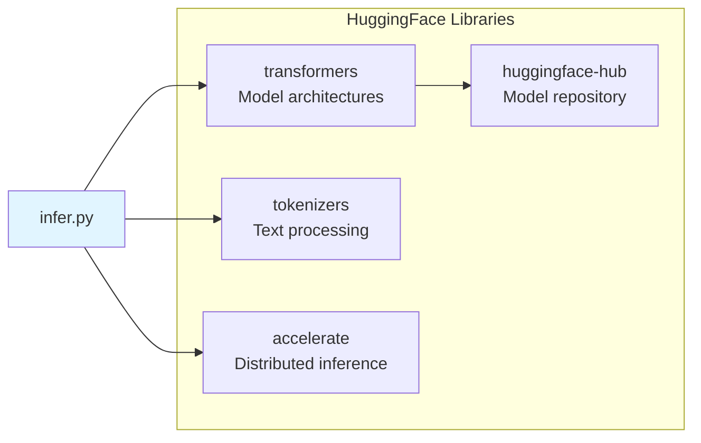
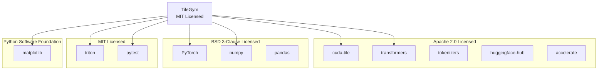
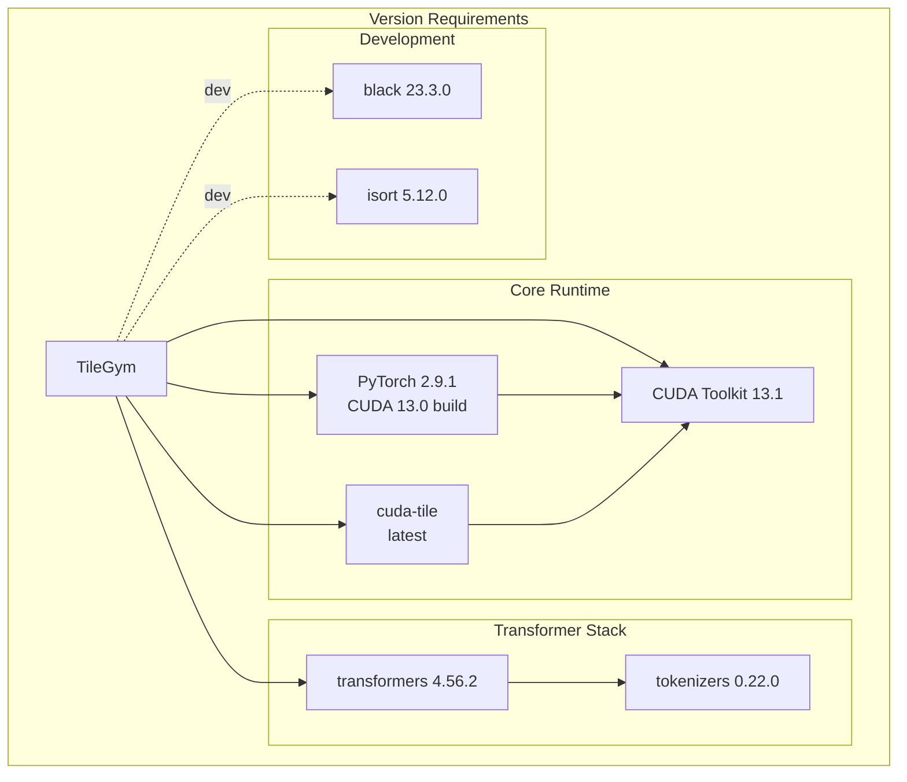

<!-- source: DeepWiki mcp.deepwiki.com · repo NVIDIA/TileGym · page 8.2 Third-Party Dependencies · fetched 2026-10-26 -->

# Third-Party Dependencies

<details>
<summary>Relevant source files</summary>

The following files were used as context for generating this wiki page:

- [LICENSES/ATTRIBUTIONS.md](LICENSES/ATTRIBUTIONS.md)

</details>


This document provides a comprehensive reference for all third-party libraries and packages used by TileGym, including their licenses, purposes, and attribution requirements. This information is essential for understanding legal obligations when using, modifying, or redistributing TileGym.

For information about TileGym's own license terms, see [Project License](#8.1).

## Overview

TileGym relies on multiple open-source libraries organized into functional categories. All dependencies and their complete license texts are documented in [LICENSES/ATTRIBUTIONS.md:1-1329]().

### Dependency Categories

| Category | Libraries | Primary Purpose |
|----------|-----------|----------------|
| GPU Computing | cuda-tile, triton | CUDA kernel development and compilation |
| Deep Learning Framework | PyTorch | Tensor operations and neural network execution |
| Transformer Ecosystem | transformers, tokenizers, huggingface-hub, accelerate | LLM model loading and inference |
| Scientific Computing | numpy, pandas, matplotlib | Data structures, numerical operations, visualization |
| Development & Testing | pytest | Unit testing and validation |

## Dependency Architecture



**TileGym Dependency Graph**

Sources: [LICENSES/ATTRIBUTIONS.md:1-1329]()

## GPU Computing Dependencies

### cuda-tile

**License:** Apache 2.0  
**Source:** https://github.com/nvidia/cutile-python  
**License Text:** [LICENSES/ATTRIBUTIONS.md:224-309]()

cuda-tile provides CUDA Tile primitives for optimized GPU kernel development on NVIDIA Blackwell architecture. This is the core optimization backend that TileGym wraps to provide high-performance kernel implementations.

**Copyright Notice:**
```
Copyright [yyyy] [name of copyright owner]
Licensed under the Apache License, Version 2.0
```

**Key Requirements:**
- Must include copy of Apache 2.0 license with redistributions
- Must retain copyright, patent, trademark, and attribution notices
- Must state prominent notices if modifying files

### triton

**License:** MIT License  
**Source:** https://github.com/triton-lang/triton/  
**License Text:** [LICENSES/ATTRIBUTIONS.md:1294-1329]()

Triton is a GPU kernel compiler used by PyTorch for dynamic kernel generation. TileGym inherits this dependency through PyTorch.

**Copyright Notice:**
```
Copyright 2018-2020 Philippe Tillet
Copyright 2020-2022 OpenAI
```

**Key Requirements:**
- Include copyright notice and permission notice in all copies
- Software provided "AS IS" without warranty

Sources: [LICENSES/ATTRIBUTIONS.md:224-329]()

## Deep Learning Framework

### PyTorch

**License:** BSD 3-Clause License  
**Source:** https://github.com/pytorch/pytorch  
**License Text:** [LICENSES/ATTRIBUTIONS.md:978-1075]()

PyTorch provides the foundational tensor operations and neural network execution capabilities. TileGym uses PyTorch 2.9.1 with CUDA 13.0 support as both a baseline implementation backend and for model execution.

**Copyright Notice:**
```
Copyright (c) 2016-     Facebook, Inc            (Adam Paszke)
Copyright (c) 2014-     Facebook, Inc            (Soumith Chintala)
[Additional contributors listed in full license]
```

**Key Requirements:**
- Must retain copyright notice, conditions, and disclaimer
- Must reproduce notices in binary distributions
- Cannot use contributor names for endorsement without permission

Sources: [LICENSES/ATTRIBUTIONS.md:978-1075]()

## Transformer Ecosystem



**HuggingFace Library Integration**

### transformers

**License:** Apache 2.0  
**Source:** https://github.com/huggingface/transformers  
**License Text:** [LICENSES/ATTRIBUTIONS.md:1077-1292]()

Provides pre-trained transformer model architectures including LLaMA and DeepSeek implementations. Version 4.56.2 is used.

**Copyright Notice:**
```
Copyright 2018- The Hugging Face team. All rights reserved.
```

### tokenizers

**License:** Apache 2.0  
**Source:** https://github.com/huggingface/tokenizers  
**License Text:** [LICENSES/ATTRIBUTIONS.md:765-976]()

Fast tokenization library for text preprocessing. Version 0.22.0 is used.

### huggingface-hub

**License:** Apache 2.0  
**Source:** https://github.com/huggingface/huggingface_hub  
**License Text:** [LICENSES/ATTRIBUTIONS.md:311-524]()

Client library for interacting with the HuggingFace Model Hub to download and cache models.

### accelerate

**License:** Apache 2.0  
**Source:** https://github.com/huggingface/accelerate  
**License Text:** [LICENSES/ATTRIBUTIONS.md:9-218]()

Enables distributed inference and mixed-precision training capabilities for transformer models.

**Shared Apache 2.0 Requirements:**
- Must include copy of license with redistributions
- Must state changes if files modified
- Must retain all copyright, patent, trademark notices
- Disclaimer of warranty applies

Sources: [LICENSES/ATTRIBUTIONS.md:9-218](), [LICENSES/ATTRIBUTIONS.md:311-524](), [LICENSES/ATTRIBUTIONS.md:765-976](), [LICENSES/ATTRIBUTIONS.md:1077-1292]()

## Scientific Computing Libraries

### numpy

**License:** BSD 3-Clause License  
**Source:** https://github.com/numpy/numpy  
**Homepage:** https://numpy.org  
**License Text:** [LICENSES/ATTRIBUTIONS.md:639-682]()

Fundamental package for numerical computing with Python. Provides multi-dimensional array objects and mathematical operations.

**Copyright Notice:**
```
Copyright (c) 2005-2024, NumPy Developers.
All rights reserved.
```

### pandas

**License:** BSD 3-Clause License  
**Source:** https://github.com/pandas-dev/pandas  
**Homepage:** https://pandas.pydata.org  
**License Text:** [LICENSES/ATTRIBUTIONS.md:684-727]()

Data analysis and manipulation library. Used for benchmark result aggregation and data processing.

**Copyright Notice:**
```
Copyright (c) 2008-2011, AQR Capital Management, LLC, Lambda Foundry, Inc. and PyData Development Team
Copyright (c) 2011-2023, Open source contributors.
```

### matplotlib

**License:** Python Software Foundation License  
**Source:** https://github.com/matplotlib/matplotlib  
**Homepage:** https://matplotlib.org  
**License Text:** [LICENSES/ATTRIBUTIONS.md:526-637]()

Plotting library for visualization. Used for performance metric visualization.

**Copyright Notice:**
```
Copyright (c) 2012- Matplotlib Development Team; All Rights Reserved
Copyright (c) 2002-2011 John D. Hunter; All Rights Reserved (versions prior to 1.3.0)
```

**Shared BSD 3-Clause Requirements:**
- Redistributions must retain copyright notice, conditions, and disclaimer
- Binary redistributions must reproduce notices in documentation
- Cannot use contributor names for endorsement

**Matplotlib Additional Requirements:**
- Must include brief summary of changes in derivative works
- License automatically terminates on material breach

Sources: [LICENSES/ATTRIBUTIONS.md:526-727]()

## Development and Testing

### pytest

**License:** MIT License  
**Source:** https://github.com/pytest-dev/pytest  
**Homepage:** https://docs.pytest.org/en/latest/  
**License Text:** [LICENSES/ATTRIBUTIONS.md:729-763]()

Testing framework used for unit tests and integration tests. This is a development-only dependency.

**Copyright Notice:**
```
Copyright (c) 2004 Holger Krekel and others
```

**Key Requirements:**
- Include copyright notice and permission notice in all copies
- Software provided "AS IS" without warranty

Sources: [LICENSES/ATTRIBUTIONS.md:729-763]()

## License Type Summary



**License Distribution by Type**

| License Type | Count | Libraries |
|-------------|-------|-----------|
| Apache 2.0 | 5 | cuda-tile, transformers, tokenizers, huggingface-hub, accelerate |
| BSD 3-Clause | 3 | PyTorch, numpy, pandas |
| MIT | 2 | triton, pytest |
| PSF | 1 | matplotlib |

Sources: [LICENSES/ATTRIBUTIONS.md:1-1329]()

## Attribution Requirements

### Required Notices

When redistributing TileGym or creating derivative works, the following attribution requirements must be met:

**Apache 2.0 Licensed Components:**
- Include full Apache 2.0 license text
- Retain all copyright, patent, trademark, and attribution notices
- State prominent notices on modified files
- Include NOTICE file contents if present

**BSD 3-Clause Licensed Components:**
- Include copyright notice and conditions in source distributions
- Reproduce notices in documentation for binary distributions
- Do not use contributor names for endorsement without permission

**MIT Licensed Components:**
- Include copyright notice and permission notice in all copies

**PSF Licensed Components:**
- Retain copyright notice and license agreement
- Include brief summary of changes in derivative works

### Attribution File

All complete license texts and attribution notices are maintained in:
- [LICENSES/ATTRIBUTIONS.md:1-1329]()

This file must be included in any distribution of TileGym.

## Version Compatibility



**Version Dependency Tree**

### Critical Version Notes

**CUDA Versions:** TileGym requires CUDA Toolkit 13.1, while PyTorch is built with CUDA 13.0. This dual version requirement reflects:
- CUDA 13.1 provides latest optimization features for cuda-tile
- PyTorch 2.9.1 official builds use CUDA 13.0
- Both versions are compatible for execution

**Python Version:** Python 3.8 or higher required by PyTorch and HuggingFace libraries.

Sources: [LICENSES/ATTRIBUTIONS.md:1-1329]()

## Compliance Checklist

When using or distributing TileGym, ensure:

- [ ] Include [LICENSES/ATTRIBUTIONS.md]() in distribution
- [ ] Include LICENSE file (TileGym's MIT license)
- [ ] Retain all copyright notices from dependencies
- [ ] Document any modifications to third-party code
- [ ] Include Apache 2.0 license text for applicable components
- [ ] Include BSD 3-Clause license text for applicable components
- [ ] Include MIT license text for applicable components
- [ ] Include PSF license text for matplotlib
- [ ] Reproduce notices in binary distribution documentation
- [ ] Do not use contributor names for endorsement

## Additional Resources

**Complete License Texts:**
- Apache 2.0: [LICENSES/ATTRIBUTIONS.md:14-218]() (example from accelerate)
- BSD 3-Clause (PyTorch): [LICENSES/ATTRIBUTIONS.md:983-1075]()
- BSD 3-Clause (numpy): [LICENSES/ATTRIBUTIONS.md:644-682]()
- MIT (pytest): [LICENSES/ATTRIBUTIONS.md:734-758]()
- PSF (matplotlib): [LICENSES/ATTRIBUTIONS.md:531-637]()

**Source Code Repositories:**
All dependencies include source code URLs in [LICENSES/ATTRIBUTIONS.md]() for reference and verification.

Sources: [LICENSES/ATTRIBUTIONS.md:1-1329]()