# Page: Overview

# Overview

<details>
<summary>Relevant source files</summary>

The following files were used as context for generating this wiki page:

- [README.md](README.md)

</details>


## Purpose and Scope

This document provides a high-level introduction to TileGym, explaining its purpose, architecture, and primary use cases. For detailed installation instructions, see [Prerequisites and Installation](#2.1). For hands-on usage guides, see [Quick Start Guide](#2.2). For information about the core library's internal design, see [Core Library](#3).

## What is TileGym?

TileGym is a CUDA Tile kernel library that provides GPU kernel implementations optimized for NVIDIA Blackwell architecture GPUs. The library serves three primary functions:

1. **Kernel Tutorial Platform**: A collection of tile-based GPU programming examples and educational resources
2. **Operations Library**: Production-ready implementations of common deep learning operators using CUDA Tile primitives
3. **Transformer Integration Layer**: End-to-end integration with large language models (LLaMA 3.1, DeepSeek V2) for practical performance evaluation

The library is built on top of the `cuda-tile` Python package and provides a pluggable backend architecture that allows seamless switching between PyTorch baseline implementations and optimized CUTILE kernels.

Sources: [README.md:5-18]()

## Hardware and Software Requirements

TileGym has strict hardware and software requirements due to its use of advanced CUDA Tile features:

| Requirement | Specification |
|------------|---------------|
| **GPU Architecture** | NVIDIA Blackwell (B200, RTX 5080, RTX 5090) |
| **CUDA Version** | 13.1 (Required) |
| **PyTorch Version** | 2.9.1 or compatible |
| **Python Package** | `cuda-tile` (auto-installed) |

> **Note**: CUDA 13.1 is mandatory. TileGym is built and tested exclusively on this version to leverage the latest CUDA Tile optimizations.

Sources: [README.md:29-35]()

## Repository Architecture

The following diagram shows the high-level structure of the TileGym repository, mapping conceptual components to actual file system locations:

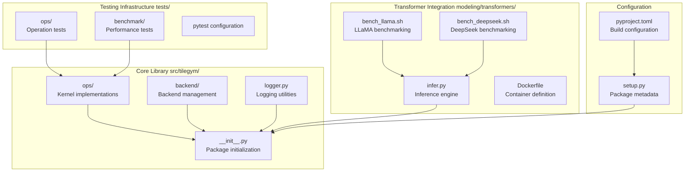

**Repository Structure Overview**

Sources: [README.md:1-110]()

## Key Components

### 1. Operations Library

Located in `src/tilegym/ops/`, this module contains CUDA Tile kernel implementations for common deep learning operations. Each operation is implemented as a Python module that can be imported and used directly.

Example operations include:
- Matrix multiplication kernels
- Attention mechanisms
- Normalization layers (RMSNorm)
- Activation functions (SwiGLU)
- Positional encodings (RoPE)

Sources: [README.md:66-68]()

### 2. Backend Management System

The backend system provides a pluggable architecture for switching between different kernel implementations. The two primary backends are:

| Backend | Description | Usage |
|---------|-------------|-------|
| **PyTorch** | Standard PyTorch operations, used as baseline | Default backend |
| **CUTILE** | CUDA Tile optimized kernels | Enabled via `set_backend("cutile")` |

This architecture allows users to run identical code with different backend implementations for performance comparison. For detailed information about the backend system, see [Backend Management System](#3.2).

Sources: Diagram 2 from provided context

### 3. Transformer Integration

The `modeling/transformers/` directory contains scripts for running LLM inference with TileGym optimizations. The main entry point is `infer.py`, which supports:

- Model loading from HuggingFace Hub
- Selective TileGym kernel patching
- Configurable optimization levels (CUTILE backend, attention optimizations)
- Performance profiling and benchmarking

For detailed usage instructions, see [Running Inference](#4.2) and [Benchmarking Performance](#4.3).

Sources: [README.md:81-98]()

## System Architecture Diagram

The following diagram illustrates how user code interacts with TileGym's API and backend system:

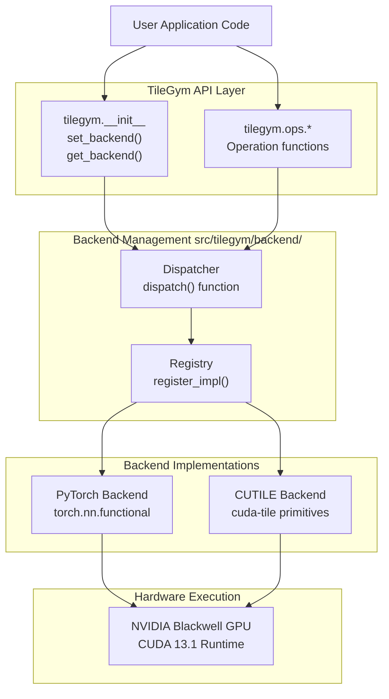

**TileGym API and Backend Architecture**

This diagram shows the flow from user code through the TileGym API layer, backend management system, and down to hardware execution. The `dispatch()` function routes operation calls to the appropriate backend implementation based on the current backend setting.

Sources: Diagram 2 from provided context

## Use Cases

TileGym supports three primary usage patterns:

### 1. Kernel Development and Learning

Developers can explore individual kernel implementations in `src/tilegym/ops/` to learn tile-based GPU programming techniques. Each operation provides a self-contained example of CUDA Tile usage.

**Access Pattern**:
```
src/tilegym/ops/<operation_name>/
```

Sources: [README.md:64-68]()

### 2. Performance Benchmarking

Micro-benchmarks in `tests/benchmark/` allow users to evaluate kernel performance in isolation. The benchmarks compare PyTorch baseline implementations against CUTILE optimizations.

**Access Pattern**:
```
tests/benchmark/
bash run_all.sh
```

For complete benchmarking documentation, see [Benchmarking Performance](#4.3).

Sources: [README.md:70-79]()

### 3. End-to-End LLM Inference

The transformer integration layer demonstrates TileGym's practical impact on real-world models. Users can run inference on LLaMA 3.1 or DeepSeek V2 with TileGym optimizations enabled.

**Access Pattern**:
```
modeling/transformers/infer.py --model_id <model> --use_tilegym --use_cutile
```

For detailed usage instructions, see [Running Inference](#4.2).

Sources: [README.md:81-98]()

## Execution Flow Diagram

The following diagram maps the execution flow for LLM inference using TileGym, showing the relationship between configuration, optimization layers, and execution:

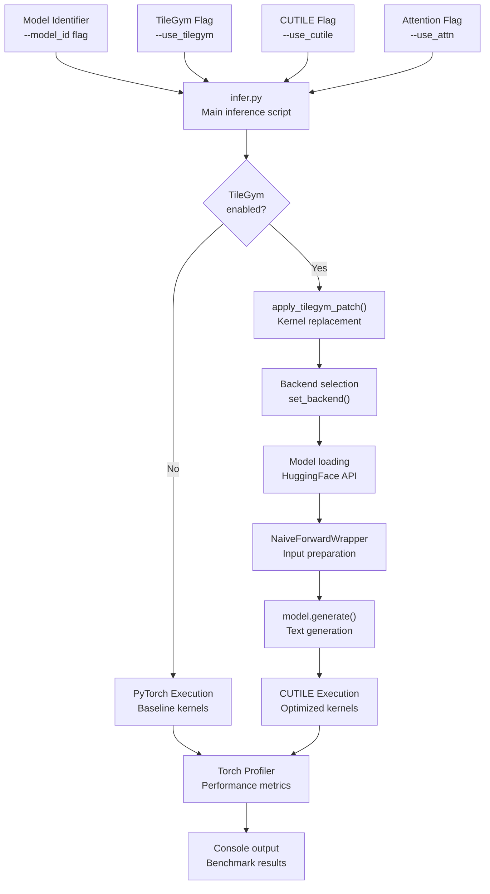

**LLM Inference Execution Flow**

This diagram shows the decision points and execution paths when running `infer.py`. The `--use_tilegym` flag determines whether TileGym kernel replacements are applied. When enabled, subsequent flags (`--use_cutile`, `--use_attn`) control which optimizations are activated.

Sources: Diagram 3 from provided context, [README.md:81-98]()

## Key Features Summary

| Feature | Description | Location |
|---------|-------------|----------|
| **Pluggable Backends** | Switch between PyTorch and CUTILE implementations | `src/tilegym/backend/` |
| **Operation Library** | CUDA Tile kernel implementations | `src/tilegym/ops/` |
| **LLM Integration** | LLaMA 3.1 and DeepSeek V2 support | `modeling/transformers/` |
| **Benchmarking Tools** | Performance comparison scripts | `tests/benchmark/`, `modeling/transformers/bench_*.sh` |
| **Docker Support** | Reproducible containerized environment | `modeling/transformers/Dockerfile` |
| **Testing Infrastructure** | Comprehensive test suite | `tests/` |

Sources: [README.md:20-25]()

## Supported Models

TileGym provides tested integration with the following transformer architectures:

### LLaMA 3.1-8B
- **Optimized Operations**: RoPE, SwiGLU, RMSNorm, Attention, Flash Decoding
- **Benchmark Script**: `modeling/transformers/bench_llama.sh`

### DeepSeek V2-Lite
- **Optimized Operations**: RoPE, SwiGLU, RMSNorm, MoE, MLADecoding, Attention
- **Benchmark Script**: `modeling/transformers/bench_deepseek.sh`

For details on running these models, see [Inference System Overview](#4.1) and [Running Inference](#4.2).

Sources: Diagram 6 from provided context

## Dependency Architecture

The following diagram shows TileGym's relationship to external dependencies and the GPU hardware layer:

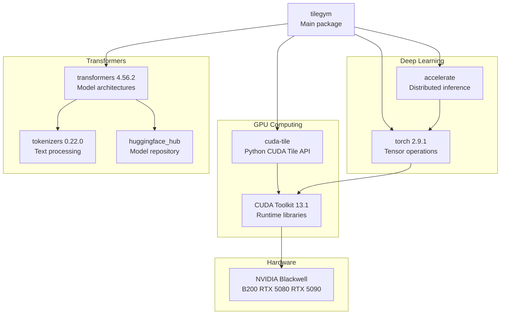

**TileGym Dependency Graph**

The library has three main dependency stacks: GPU Computing (cuda-tile and CUDA Toolkit 13.1), Deep Learning (PyTorch and accelerate), and Transformers (HuggingFace ecosystem). All execution paths converge at the NVIDIA Blackwell GPU hardware layer.

Sources: Diagram 5 from provided context, [README.md:29-56]()

## Getting Started Roadmap

For new users, the recommended path through the documentation is:

1. **Installation**: [Prerequisites and Installation](#2.1) - Set up CUDA 13.1, PyTorch, and TileGym
2. **First Steps**: [Quick Start Guide](#2.2) - Run your first inference example
3. **Core Concepts**: [Backend Management System](#3.2) - Understand the pluggable architecture
4. **Inference**: [Running Inference](#4.2) - Learn the `infer.py` command-line interface
5. **Performance**: [Benchmarking Performance](#4.3) - Compare PyTorch vs CUTILE implementations

Sources: [README.md:9-14]()

## Project Status and Support

TileGym is currently optimized for NVIDIA Blackwell architecture GPUs. Support for additional GPU architectures is planned for future releases. The project is actively maintained and welcomes community contributions through the process outlined in [Contributing](#7).

For development setup instructions, see [Development Guide](#6). For contribution requirements, including the CLA process, see [Contributor License Agreement](#7.2).

Sources: [README.md:31](), [README.md:100-102]()

## License

TileGym is distributed under the MIT License. For complete licensing information, including third-party attributions, see [Legal and Licensing](#8).

Sources: [README.md:104-109]()

---

# Page: Getting Started

# Getting Started

<details>
<summary>Relevant source files</summary>

The following files were used as context for generating this wiki page:

- [README.md](README.md)

</details>


This page provides an overview of TileGym's capabilities and guides you through the initial steps to begin using the library. It introduces the three main usage modes, explains the system architecture from a user perspective, and outlines the learning path for new users.

For detailed installation instructions, see [Prerequisites and Installation](#2.1). For hands-on examples and first steps, see [Quick Start Guide](#2.2). For information about development setup and contributing, see [Development Guide](#6).

## Understanding TileGym

TileGym is organized around three primary usage modes, each targeting different aspects of GPU kernel development and optimization:

| Usage Mode | Purpose | Primary Location | Entry Point |
|------------|---------|-----------------|-------------|
| **Kernel Exploration** | Learn and experiment with individual CUDA Tile operations | [src/tilegym/ops/](src/tilegym/ops/) | Python import: `import tilegym.ops` |
| **Performance Benchmarking** | Evaluate kernel performance with micro-benchmarks | [tests/benchmark/](tests/benchmark/) | Script: `run_all.sh` |
| **Transformer Inference** | Run end-to-end LLM inference with TileGym optimizations | [modeling/transformers/](modeling/transformers/) | Script: `infer.py` |

Each mode builds upon the core TileGym library but serves different use cases. Kernel exploration is ideal for learning tile-based GPU programming, benchmarking helps quantify optimization benefits, and transformer inference demonstrates real-world integration with production LLMs.

**Sources:** [README.md:64-98]()

## System Architecture from User Perspective

The following diagram shows how users interact with TileGym through different entry points and how these relate to the core library components:

**Diagram: User Interaction Model and Code Entry Points**

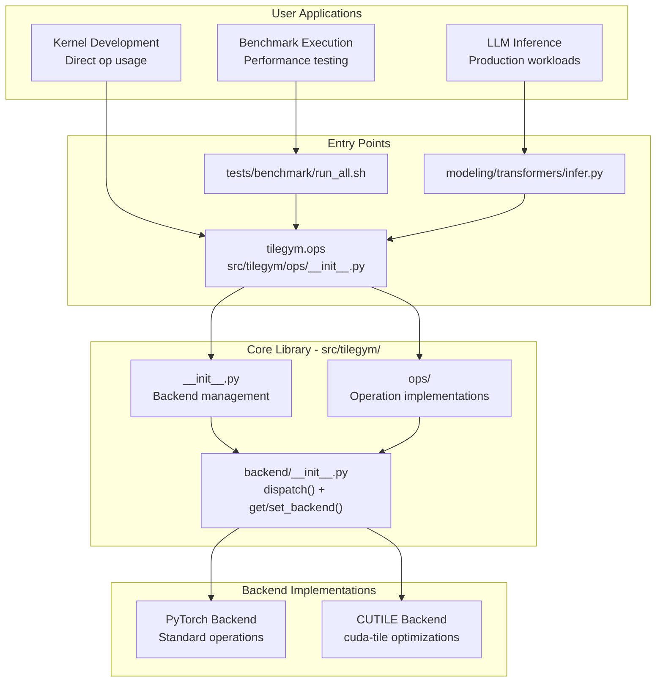

**Sources:** [README.md:64-98](), Diagram 1, Diagram 2

The architecture separates user-facing entry points from backend implementations. Users interact with three distinct entry points based on their use case, but all paths converge on the core library's backend management system. This design allows consistent operation semantics across different backends while enabling transparent optimization through backend switching.

## Package Structure and Key Modules

Understanding the repository structure helps locate relevant code for each usage mode:

**Diagram: Repository Organization and Code Locations**

```mermaid
graph TB
    subgraph Root["Repository Root"]
        SrcDir["src/tilegym/<br/>Core library package"]
        ModelDir["modeling/transformers/<br/>LLM integration"]
        TestDir["tests/<br/>Testing and benchmarks"]
        SetupFile["setup.py<br/>Package configuration"]
    end
    
    subgraph TileGymPkg["src/tilegym/"]
        InitFile["__init__.py<br/>Package initialization<br/>Backend setup"]
        BackendDir["backend/<br/>Backend system"]
        OpsDir["ops/<br/>Kernel implementations"]
        UtilsFile["utils.py<br/>Logging utilities"]
    end
    
    subgraph OpsStructure["src/tilegym/ops/"]
        OpsInit["__init__.py<br/>Operation exports"]
        RopeOp["rope.py"]
        RmsNormOp["rmsnorm.py"]
        SwigluOp["swiglu.py"]
        AttnOps["attention.py<br/>flash_decoding.py<br/>mla_decoding.py"]
    end
    
    subgraph BackendStructure["src/tilegym/backend/"]
        BackInit["__init__.py<br/>Backend management"]
        Dispatcher["Dispatch logic<br/>register_impl()"]
    end
    
    subgraph ModelingStructure["modeling/transformers/"]
        InferPy["infer.py<br/>Inference engine"]
        PatchPy["tilegym_patch.py<br/>Model patching"]
        BenchScripts["bench_llama.sh<br/>bench_deepseek.sh"]
        DockerFile["Dockerfile<br/>Container setup"]
    end
    
    subgraph TestStructure["tests/"]
        BenchDir["benchmark/<br/>Micro-benchmarks"]
        OpsTestDir["ops/<br/>Operation tests"]
    end
    
    Root --> SrcDir
    Root --> ModelDir
    Root --> TestDir
    Root --> SetupFile
    
    SrcDir --> InitFile
    SrcDir --> BackendDir
    SrcDir --> OpsDir
    SrcDir --> UtilsFile
    
    OpsDir --> OpsInit
    OpsDir --> RopeOp
    OpsDir --> RmsNormOp
    OpsDir --> SwigluOp
    OpsDir --> AttnOps
    
    BackendDir --> BackInit
    BackendDir --> Dispatcher
    
    ModelDir --> InferPy
    ModelDir --> PatchPy
    ModelDir --> BenchScripts
    ModelDir --> DockerFile
    
    TestDir --> BenchDir
    TestDir --> OpsTestDir
```

**Sources:** [README.md:1-110](), Diagram 1

The repository follows a clear separation of concerns:
- `src/tilegym/` contains the core library with backend-agnostic operation definitions
- `modeling/transformers/` provides LLM integration examples and benchmarking infrastructure
- `tests/` includes both unit tests and performance benchmarks

## Getting Started Workflow

The typical workflow for new users follows this progression:

**Diagram: User Onboarding Flow**

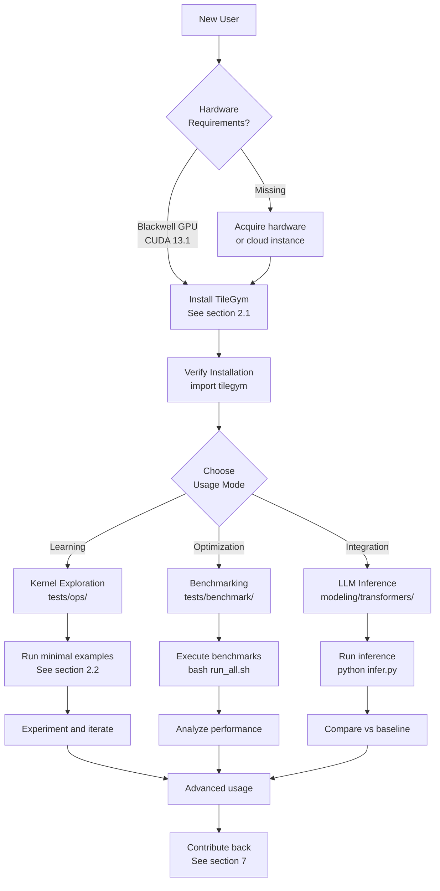

**Sources:** [README.md:27-98]()

This workflow accommodates users with different goals. Learners typically start with kernel exploration to understand tile-based programming concepts. Performance engineers begin with benchmarking to quantify optimization opportunities. Production users proceed directly to transformer inference to integrate TileGym into their LLM pipelines.

## Hardware and Software Requirements Overview

Before proceeding with installation, verify your system meets these requirements:

| Requirement | Specification | Verification Command |
|-------------|---------------|---------------------|
| **GPU Architecture** | NVIDIA Blackwell (B200, RTX 5080, RTX 5090) | `nvidia-smi` |
| **CUDA Toolkit** | CUDA 13.1 (required) | `nvcc --version` |
| **Python** | 3.8 or higher | `python --version` |
| **PyTorch** | 2.9.1 or compatible (CUDA 13.0 build) | `python -c "import torch; print(torch.__version__)"` |

> ⚠️ **Critical:** TileGym is currently compatible only with NVIDIA Blackwell architecture GPUs and requires CUDA 13.1. Support for additional GPU architectures is planned for future releases.

The CUDA version requirement is strict because TileGym uses features specific to CUDA 13.1. PyTorch compatibility requires a CUDA 13.0 build, which is compatible with CUDA 13.1 runtime.

**Sources:** [README.md:29-35]()

## Installation Methods

TileGym supports two installation methods depending on your use case:

**Standard Installation** (recommended for most users):
```bash
pip install .
```
This method installs TileGym as a standard Python package. The `setup.py` script [setup.py:1-50]() automatically resolves and installs dependencies including `cuda-tile` from https://github.com/nvidia/cutile-python.

**Editable Installation** (recommended for development):
```bash
pip install -e .
```
Editable mode creates symlinks to the source directory, allowing code changes to take effect immediately without reinstallation. This is essential for kernel development and debugging workflows.

For containerized deployments, Docker provides a reproducible environment with all dependencies pre-configured. See [Docker Deployment](#5) for details.

**Sources:** [README.md:49-60]()

## Backend Selection

TileGym's backend management system allows runtime selection between different operation implementations:

**Diagram: Backend Selection Mechanism**

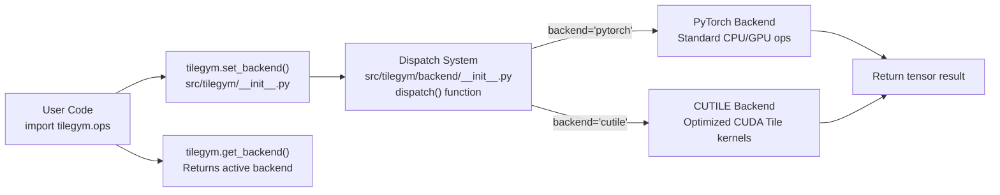

**Sources:** [README.md:1-110](), Diagram 2

The backend selection mechanism is implemented in [src/tilegym/__init__.py]() and [src/tilegym/backend/__init__.py](). By default, operations use the PyTorch backend for compatibility. Setting `backend='cutile'` activates optimized CUDA Tile implementations. This design enables A/B testing and performance comparison without modifying application code.

## Usage Mode Details

Each usage mode provides different capabilities and learning opportunities:

### Kernel Exploration Mode

Direct operation usage through the `tilegym.ops` module enables experimentation with individual kernels:

```python
import tilegym
import torch

# Set backend
tilegym.set_backend('cutile')

# Use operations
from tilegym.ops import rope, rmsnorm, swiglu

# Example operation call
output = rope(input_tensor, freqs_cos, freqs_sin)
```

All operation implementations reside in [src/tilegym/ops/](). Each operation module (e.g., `rope.py`, `rmsnorm.py`, `swiglu.py`) contains both the operation interface and backend-specific implementations.

**Sources:** [README.md:66-68]()

### Benchmarking Mode

The benchmarking infrastructure in [tests/benchmark/](tests/benchmark/) provides micro-benchmarks for performance evaluation. The [tests/benchmark/run_all.sh]() script orchestrates benchmark execution across all operations.

Benchmarks measure:
- Kernel execution time
- Memory bandwidth utilization
- Performance scaling across input sizes

Results quantify the optimization benefit of CUTILE backend over PyTorch baseline.

**Sources:** [README.md:72-79]()

### Transformer Inference Mode

The [modeling/transformers/infer.py]() script demonstrates end-to-end LLM inference with TileGym optimizations. It supports:

- Model loading from HuggingFace Hub
- Selective operation patching via [modeling/transformers/tilegym_patch.py]()
- Performance profiling with torch profiler
- Comparison against PyTorch baseline

Benchmark scripts [modeling/transformers/bench_llama.sh]() and [modeling/transformers/bench_deepseek.sh]() automate performance comparison for LLaMA and DeepSeek models respectively.

**Sources:** [README.md:82-98]()

## Next Steps

After understanding the TileGym architecture and usage modes:

1. **Install TileGym**: Follow detailed instructions in [Prerequisites and Installation](#2.1) to set up your environment.

2. **Run First Examples**: Work through hands-on tutorials in [Quick Start Guide](#2.2) to verify your installation and understand basic usage patterns.

3. **Explore Operations**: Review individual kernel implementations in [Core Library](#3) to understand available operations and their semantics.

4. **Optimize LLMs**: Learn to integrate TileGym into transformer models in [Transformer Inference](#4).

5. **Contribute**: Once comfortable with TileGym, consider contributing improvements via [Contributing](#7).

The learning path varies based on your goals. Users focused on learning GPU programming should start with kernel exploration. Performance engineers should begin with benchmarking. Production users can proceed directly to transformer inference after verifying installation.

**Sources:** [README.md:1-110]()

---

# Page: Prerequisites and Installation

# Prerequisites and Installation

<details>
<summary>Relevant source files</summary>

The following files were used as context for generating this wiki page:

- [README.md](README.md)
- [pyproject.toml](pyproject.toml)
- [setup.py](setup.py)

</details>


This page details the hardware requirements, software dependencies, and installation procedures for TileGym. It covers system prerequisites, dependency resolution, and verification steps. For setting up a development environment with editable installation, see [Development Setup](#6.1). For containerized deployment options, see [Docker Deployment](#5).

## Purpose and Scope

This document provides complete information for installing TileGym on a target system. It specifies mandatory hardware requirements (NVIDIA Blackwell GPUs), software dependencies with exact version constraints, and step-by-step installation procedures for both standard and development use cases.

## Hardware Requirements

TileGym requires specific GPU hardware to function correctly.

### Supported GPU Architectures

| Requirement | Specification |
|------------|---------------|
| **GPU Architecture** | NVIDIA Blackwell architecture only |
| **Supported Models** | B200, RTX 5080, RTX 5090 |
| **CUDA Compute Capability** | Compatible with CUDA 13.1 |
| **Future Support** | Other GPU architectures planned for future releases |

> ⚠️ **Critical Limitation**: TileGym is currently exclusive to NVIDIA Blackwell architecture GPUs. The CUDA Tile optimizations target Blackwell-specific hardware features and will not function on earlier GPU generations (Ampere, Ada Lovelace, Hopper).

**Sources:** [README.md:31-31]()

## Software Dependencies

TileGym has a layered dependency structure with specific version requirements.

### Dependency Architecture

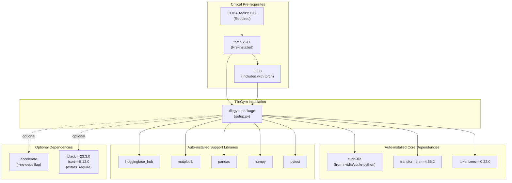

**Sources:** [setup.py:30-48](), [README.md:33-35]()

### Version Requirements Table

| Dependency | Version | Installation Method | Purpose |
|-----------|---------|---------------------|---------|
| **CUDA Toolkit** | 13.1 | Manual download | GPU runtime and compilation |
| **Python** | ≥3.9 | System package manager | Language runtime |
| **torch** | 2.9.1 (verified) | Pre-install via pip | Tensor operations and CUDA 13.0 build |
| **triton** | Bundled with torch | Automatic | GPU kernel compilation |
| **cuda-tile** | Latest | Auto-install from PyPI | CUDA Tile primitives |
| **transformers** | 4.56.2 | Auto-install | Model architectures |
| **tokenizers** | 0.22.0 | Auto-install | Text processing |
| **huggingface_hub** | Latest | Auto-install | Model repository access |
| **matplotlib** | Latest | Auto-install | Visualization |
| **pandas** | Latest | Auto-install | Data structures |
| **numpy** | Latest | Auto-install | Array operations |
| **pytest** | Latest | Auto-install | Testing framework |
| **accelerate** | Latest | Manual (`--no-deps`) | Distributed inference |
| **black** | 23.3.0 | Dev extra | Code formatting |
| **isort** | 5.12.0 | Dev extra | Import sorting |

**Sources:** [setup.py:29-48](), [README.md:33-35](), [README.md:44-44]()

### Critical Version Notes

**CUDA Version Mismatch**: TileGym requires CUDA 13.1 for the toolkit, while PyTorch 2.9.1 is built against CUDA 13.0. This is intentional:
- **CUDA 13.0** provides PyTorch binary compatibility
- **CUDA 13.1** enables latest CUDA Tile optimizations

Both versions coexist without conflict when CUDA 13.1 is installed system-wide.

**Sources:** [README.md:34-34](), [README.md:44-44]()

## Installation Process

### Standard Installation Flow

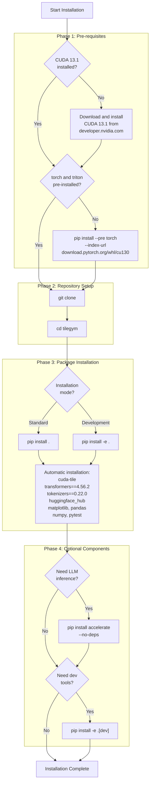

**Sources:** [README.md:29-60](), [setup.py:30-48]()

### Step-by-Step Installation

#### Phase 1: Install Prerequisites

**1.1 Install CUDA 13.1**

Download CUDA Toolkit 13.1 from [NVIDIA CUDA Downloads](https://developer.nvidia.com/cuda-downloads) and install according to platform-specific instructions. Verify installation:

```bash
nvcc --version
```

Expected output should show CUDA compilation tools release 13.1.

**1.2 Install PyTorch and Triton**

If `torch` and `triton` are not already installed:

```bash
pip install --pre torch --index-url https://download.pytorch.org/whl/cu130
```

This installs PyTorch 2.9.1 (verified working version) built against CUDA 13.0. The `triton` package is automatically included.

Verify installation:

```bash
python -c "import torch; print(torch.__version__); print(torch.cuda.is_available())"
```

Expected output: version `2.9.1` and `True` for CUDA availability.

**Sources:** [README.md:39-47]()

#### Phase 2: Clone Repository

```bash
git clone <tilegym-repository-url>
cd tilegym
```

**Sources:** [README.md:52-53]()

#### Phase 3: Install TileGym Package

**Standard Installation** (for production use):

```bash
pip install .
```

This installs TileGym as a site package. The `setup.py` file [setup.py:30-42]() specifies all dependencies that will be automatically installed:
- `cuda-tile` from https://github.com/nvidia/cutile-python
- `transformers==4.56.2`
- `tokenizers==0.22.0`
- `huggingface_hub`
- `matplotlib`, `pandas`, `numpy`, `pytest`

**Development Installation** (for contributors):

```bash
pip install -e .
```

The `-e` flag enables editable mode, allowing code changes to take effect without reinstalling. This is documented in [README.md:58-58]().

**Sources:** [README.md:54-58](), [setup.py:30-42]()

#### Phase 4: Install Optional Dependencies

**For LLM Inference Support** (required for transformer examples):

```bash
pip install accelerate --no-deps
```

The `--no-deps` flag prevents `accelerate` from reinstalling PyTorch and potentially downgrading to an incompatible version. This is critical to maintain the CUDA 13.0-built PyTorch installation.

**For Development Tools**:

```bash
pip install -e .[dev]
```

This installs additional development dependencies specified in `extras_require` [setup.py:43-47]():
- `black==23.3.0` for code formatting
- `isort==5.12.0` for import sorting

**Sources:** [README.md:88-89](), [setup.py:43-47]()

## Docker Alternative

For users who prefer containerized environments or cannot meet the hardware/software prerequisites, Docker provides a pre-configured environment.

### Docker Installation Mapping

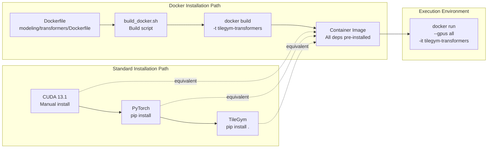

**Quick Docker Setup**:

```bash
docker build -t tilegym-transformers -f modeling/transformers/Dockerfile .
docker run --gpus all -it tilegym-transformers bash
```

For detailed Docker usage, see [Building the Container](#5.1) and [Running in Docker](#5.2).

**Sources:** [README.md:60-60](), [README.md:92-96]()

## Installation Verification

### Verification Checklist

After installation, verify the environment is correctly configured:

| Component | Verification Command | Expected Output |
|-----------|---------------------|-----------------|
| CUDA Toolkit | `nvcc --version` | Release 13.1.x |
| PyTorch | `python -c "import torch; print(torch.__version__)"` | 2.9.1 |
| CUDA availability | `python -c "import torch; print(torch.cuda.is_available())"` | True |
| Triton | `python -c "import triton; print(triton.__version__)"` | Version info displayed |
| TileGym | `python -c "import tilegym; print(tilegym.__version__)"` | 0.0.0 |
| CUDA Tile | `python -c "import cuda.tile"` | No import errors |

### Import Test Script

```python
# test_installation.py
import sys

def verify_installation():
    try:
        import torch
        print(f"✓ torch {torch.__version__}")
        print(f"✓ CUDA available: {torch.cuda.is_available()}")
        
        import triton
        print(f"✓ triton {triton.__version__}")
        
        import tilegym
        print(f"✓ tilegym {tilegym.__version__}")
        
        import cuda.tile
        print("✓ cuda.tile imported successfully")
        
        import transformers
        print(f"✓ transformers {transformers.__version__}")
        
        print("\nAll components verified successfully!")
        return True
        
    except ImportError as e:
        print(f"✗ Import failed: {e}")
        return False

if __name__ == "__main__":
    sys.exit(0 if verify_installation() else 1)
```

Run verification:

```bash
python test_installation.py
```

**Sources:** [setup.py:14-14](), [setup.py:30-42]()

## Troubleshooting Common Issues

### CUDA Version Mismatch

**Symptom**: Error messages about CUDA runtime version mismatches.

**Solution**: Ensure CUDA Toolkit 13.1 is installed system-wide. PyTorch 2.9.1 built with CUDA 13.0 is compatible with CUDA 13.1 runtime.

### Missing cuda-tile Package

**Symptom**: `ImportError: No module named 'cuda.tile'`

**Solution**: The `cuda-tile` package should install automatically via `setup.py` [setup.py:40](). If missing, manually install:

```bash
pip install cuda-tile
```

### Accelerate Dependency Conflicts

**Symptom**: Installing `accelerate` downgrades PyTorch to incompatible version.

**Solution**: Always use the `--no-deps` flag as specified in [README.md:88-89]():

```bash
pip install accelerate --no-deps
```

### GPU Not Detected

**Symptom**: `torch.cuda.is_available()` returns `False`

**Solution**: 
1. Verify GPU is Blackwell architecture (B200, RTX 5080, RTX 5090)
2. Ensure NVIDIA drivers are installed and current
3. Check Docker GPU access with `--gpus all` flag if using containers

**Sources:** [README.md:31-31](), [README.md:88-89](), [setup.py:30-42]()

## Configuration Files

The installation process is controlled by two primary configuration files:

### setup.py Structure

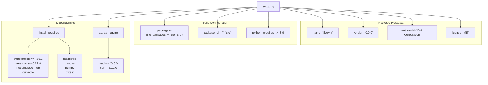

Key elements in [setup.py:12-48]():
- **Package discovery**: Uses `setuptools.find_packages(where='src')` to locate all packages in `src/` directory
- **Version management**: Currently set to `0.0.0` in [setup.py:14]()
- **Dependency locking**: Critical packages like `transformers` and `tokenizers` have exact version pins
- **Development extras**: Accessible via `pip install -e .[dev]`

### pyproject.toml Structure

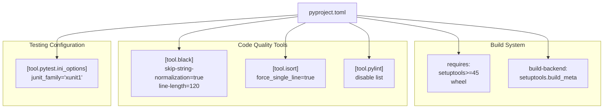

The [pyproject.toml:1-30]() file configures:
- **Build system**: Uses `setuptools` with PEP 517 compliance [pyproject.toml:5-7]()
- **Formatting tools**: `black` configured for 120-character lines [pyproject.toml:9-11]()
- **Import sorting**: `isort` enforces single-line imports [pyproject.toml:13-15]()
- **Testing**: `pytest` configured for xunit1 output format [pyproject.toml:28-29]()

**Sources:** [setup.py:1-49](), [pyproject.toml:1-30]()

## Next Steps

After successful installation:
1. Follow the [Quick Start Guide](#2.2) for your first inference example
2. Explore the [Package Architecture](#3.1) to understand TileGym's structure
3. Review [Backend Management System](#3.2) to learn about switching between PyTorch and CUTILE backends
4. Run transformer inference examples in [Running Inference](#4.2)

---

# Page: Quick Start Guide

# Quick Start Guide

<details>
<summary>Relevant source files</summary>

The following files were used as context for generating this wiki page:

- [README.md](README.md)
- [modeling/transformers/README.md](modeling/transformers/README.md)

</details>


This guide provides a step-by-step walkthrough for running your first TileGym examples and understanding the basic usage patterns. It assumes you have completed the installation steps covered in [Prerequisites and Installation](#2.1). For detailed transformer inference configuration, see [Running Inference](#4.2). For comprehensive benchmarking methodologies, see [Benchmarking Performance](#4.3).

## Usage Patterns Overview

TileGym supports three primary usage patterns, each serving different development and evaluation needs. The table below summarizes these patterns and their typical use cases:

| Pattern | Primary Purpose | Entry Point | Typical Users |
|---------|----------------|-------------|---------------|
| **Individual Operations** | Test and explore kernel implementations | `src/tilegym/ops/` | Kernel developers, researchers |
| **Micro-benchmarks** | Evaluate kernel performance in isolation | `tests/benchmark/run_all.sh` | Performance engineers |
| **LLM Inference** | End-to-end transformer model acceleration | `modeling/transformers/infer.py` | ML engineers, practitioners |

Sources: [README.md:64-99]()

## TileGym Usage Workflow

The following diagram illustrates how the three usage patterns relate to the TileGym codebase structure and typical user workflows:

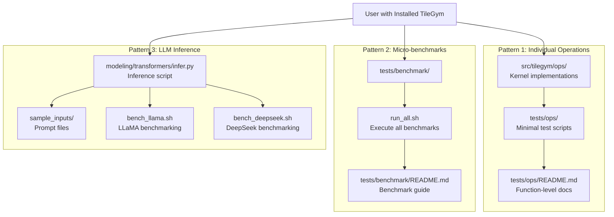

Sources: [README.md:64-99](), [modeling/transformers/README.md:1-196]()

## Pattern 1: Exploring Individual Operations

### Overview

The `src/tilegym/ops/` directory contains all kernel implementations. Each operation can be tested independently using minimal scripts located in `tests/ops/`. This pattern is ideal for understanding individual kernel behavior and developing new operations.

### Basic Workflow

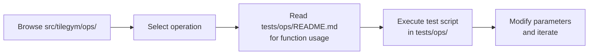

### Example: Testing an Operation

1. **Browse available operations** in `src/tilegym/ops/`
2. **Consult the operation documentation** at `tests/ops/README.md` for function-level usage examples
3. **Run minimal test scripts** to validate operation behavior

The documentation provides function signatures, parameter descriptions, and minimal usage examples for each operation in TileGym's kernel library.

Sources: [README.md:66-69]()

## Pattern 2: Running Micro-benchmarks

### Overview

Micro-benchmarks evaluate individual kernel performance in controlled conditions. The benchmarking infrastructure is located in `tests/benchmark/` and provides automated execution of all performance tests.

### Quick Start

Execute all benchmarks using the unified script:

```bash
cd tests/benchmark
bash run_all.sh
```

This command runs the complete benchmark suite and generates performance metrics for all implemented kernels. Detailed benchmark configuration and result interpretation are available in `tests/benchmark/README.md`.

Sources: [README.md:70-79]()

### Benchmark Execution Flow

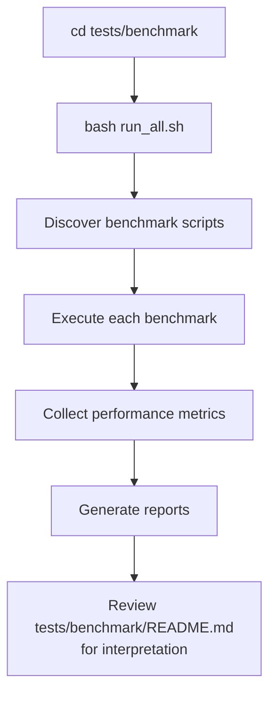

Sources: [README.md:70-79]()

## Pattern 3: Running LLM Transformer Inference

### Overview

The transformer inference pattern demonstrates TileGym's kernel integration in end-to-end LLM scenarios. The primary entry point is `modeling/transformers/infer.py`, which supports models like LLaMA 3.1 and DeepSeek V2.

### Supported Models

| Model | Model ID | Compatible GPUs |
|-------|----------|-----------------|
| LLaMA-3.1-8B | `meta-llama/Meta-Llama-3.1-8B` | B200, RTX 5080, RTX 5090 |
| DeepSeek-V2-Lite-Chat | `deepseek-ai/DeepSeek-V2-Lite-Chat` | B200 only (high memory) |

Sources: [modeling/transformers/README.md:9-18]()

### Installation Prerequisites

Before running transformer inference, install the additional dependency:

```bash
pip install accelerate --no-deps
```

Sources: [README.md:85-89]()

### Basic Inference Examples

The following diagram shows the command structure and key flags for `infer.py`:

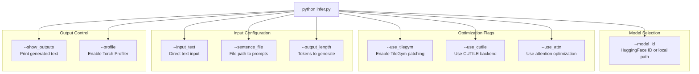

Sources: [modeling/transformers/README.md:146-163]()

#### Example 1: Baseline PyTorch Inference

Run standard transformer inference without TileGym optimizations:

```bash
python infer.py --model_id meta-llama/Meta-Llama-3.1-8B --show_outputs
```

This command executes inference using the baseline PyTorch implementation. The `--show_outputs` flag prints the generated text to the console.

Sources: [modeling/transformers/README.md:44-45]()

#### Example 2: TileGym-Optimized Inference

Enable TileGym's CUTILE-optimized kernels and attention optimizations:

```bash
python infer.py \
    --model_id meta-llama/Meta-Llama-3.1-8B \
    --use_tilegym \
    --use_cutile \
    --use_attn \
    --show_outputs
```

The optimization flags activate TileGym's kernel replacement mechanism:
- `--use_tilegym`: Enables the patching system that intercepts PyTorch operations
- `--use_cutile`: Activates the CUTILE backend for tile-based optimizations
- `--use_attn`: Replaces standard attention with TileGym's optimized implementation

Sources: [modeling/transformers/README.md:47-49]()

#### Example 3: Custom Input from File

Use pre-defined prompt files from the `sample_inputs/` directory:

```bash
python infer.py \
    --model_id meta-llama/Meta-Llama-3.1-8B \
    --use_tilegym \
    --use_cutile \
    --use_attn \
    --sentence_file sample_inputs/input_prompt_32K.txt \
    --output_length 100
```

Available sample input files:
- `sample_inputs/input_prompt_small.txt`: Quick testing
- `sample_inputs/input_prompt_32K.txt`: Standard 32K context
- `sample_inputs/input_prompt_256K.txt`: Long-context testing (256K tokens)

The `--output_length` parameter controls the number of tokens to generate.

Sources: [modeling/transformers/README.md:54-61](), [modeling/transformers/README.md:131-133]()

#### Example 4: Custom Text Input

Provide input text directly via command line:

```bash
python infer.py \
    --model_id meta-llama/Meta-Llama-3.1-8B \
    --use_tilegym \
    --use_cutile \
    --use_attn \
    --input_text "Explain machine learning" \
    --show_outputs
```

Sources: [modeling/transformers/README.md:63-70]()

#### Example 5: Performance Profiling

Enable Torch Profiler to collect detailed performance metrics:

```bash
python infer.py \
    --model_id meta-llama/Meta-Llama-3.1-8B \
    --sentence_file sample_inputs/input_prompt_32K.txt \
    --use_tilegym \
    --use_cutile \
    --use_attn \
    --profile \
    --num_runs 5
```

The `--profile` flag activates PyTorch's profiler, which generates:
- Throughput measurements (tokens/second)
- Generation latency metrics
- CUDA kernel execution times
- Chrome trace files for visualization

The `--num_runs` parameter specifies how many benchmark iterations to execute.

Sources: [modeling/transformers/README.md:74-84]()

### Quick Benchmarking Scripts

TileGym provides automated benchmark scripts that compare PyTorch baseline against TileGym-optimized implementations:

```bash
# Benchmark LLaMA-3.1-8B
./bench_llama.sh

# Benchmark DeepSeek-V2-Lite
./bench_deepseek.sh
```

These scripts execute both baseline and optimized inference runs with profiling enabled, generating comprehensive performance comparisons.

Sources: [modeling/transformers/README.md:90-100]()

### Inference Execution Flow

The following diagram illustrates the execution path through `infer.py` with key code entities:

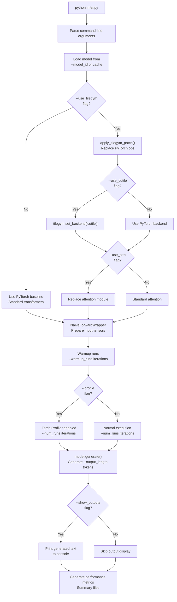

Sources: [modeling/transformers/README.md:39-84](), [modeling/transformers/README.md:146-163]()

## Docker-Based Quick Start

For reproducible environments, use the containerized setup:

```bash
# Build the container
docker build -t tilegym-transformers -f modeling/transformers/Dockerfile .

# Run interactive session
docker run --gpus all -it tilegym-transformers bash

# Inside container, run inference
python infer.py \
    --model_id meta-llama/Meta-Llama-3.1-8B \
    --use_tilegym \
    --use_cutile \
    --use_attn \
    --show_outputs
```

Alternatively, execute inference directly without entering the container:

```bash
docker run --gpus all -it tilegym-transformers \
    python infer.py \
        --model_id deepseek-ai/DeepSeek-V2-Lite-Chat \
        --use_tilegym \
        --use_cutile \
        --use_attn \
        --show_outputs
```

The Docker image includes all dependencies pre-configured with CUDA 13.1, PyTorch, and TileGym. See [Docker Deployment](#5) for detailed container management.

Sources: [README.md:91-98](), [modeling/transformers/README.md:22-37]()

## Common Command-Line Flags Summary

The following table summarizes the most frequently used flags across TileGym's inference tools:

| Flag | Type | Purpose | Default Value |
|------|------|---------|---------------|
| `--model_id` | string | HuggingFace model ID or local path | `meta-llama/Meta-Llama-3.1-8B` |
| `--use_tilegym` | boolean | Enable TileGym kernel patching | `False` |
| `--use_cutile` | boolean | Activate CUTILE backend | `False` |
| `--use_attn` | boolean | Use optimized attention implementation | `False` |
| `--input_text` | string | Direct text input for inference | None |
| `--sentence_file` | string | Path to input prompt file | None |
| `--output_length` | integer | Number of tokens to generate | `100` |
| `--batch_size` | integer | Batch size for inference | `1` |
| `--precision` | string | `bfloat16` or `float32` | `bfloat16` |
| `--num_runs` | integer | Number of benchmark iterations | `5` |
| `--warmup_runs` | integer | Number of warmup iterations | `2` |
| `--profile` | boolean | Enable Torch Profiler | `False` |
| `--show_outputs` | boolean | Print generated text to console | `False` |

Sources: [modeling/transformers/README.md:146-163]()

## Next Steps

After completing this quick start guide:

- **Explore operations in detail**: Review [tests/ops/README.md]() for comprehensive operation documentation
- **Understand benchmarking methodology**: See [Benchmarking Performance](#4.3) for detailed performance analysis techniques
- **Configure custom inference**: Consult [Running Inference](#4.2) for advanced configuration options
- **Deploy in production**: Review [Docker Deployment](#5) for containerized deployment strategies
- **Contribute kernels**: See [Development Guide](#6) for extending TileGym with custom operations

---

# Page: Core Library

# Core Library

<details>
<summary>Relevant source files</summary>

The following files were used as context for generating this wiki page:

- [src/tilegym/__init__.py](src/tilegym/__init__.py)
- [src/tilegym/backend/__init__.py](src/tilegym/backend/__init__.py)

</details>


## Purpose and Scope

The Core Library constitutes the foundational layer of TileGym, providing a unified, backend-agnostic interface for GPU kernel operations. This document covers the architecture of the `tilegym` Python package and its backend abstraction system.

For detailed information about the package organization and module structure, see [Package Architecture](#3.1). For information about backend selection, operation dispatch, and implementation registration, see [Backend Management System](#3.2).

**Sources:** Diagram 2 from provided context, [src/tilegym/__init__.py:1-53]()

---

## High-Level Architecture

The Core Library implements a three-layer architecture that separates user-facing APIs from hardware-specific implementations:

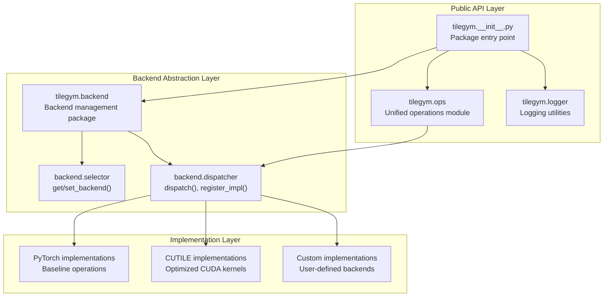

**Package Layer Responsibilities:**

| Layer | Module | Primary Functions | Purpose |
|-------|--------|------------------|---------|
| Public API | `tilegym.__init__.py` | `set_backend()`, `get_current_backend()`, `ops` | User-facing interface, exports core functionality |
| Public API | `tilegym.ops` | Operation implementations | Unified operations API (RoPE, attention, etc.) |
| Public API | `tilegym.logger` | `get_logger()`, `set_log_level()`, `warn_once()` | Logging and diagnostic utilities |
| Backend Abstraction | `tilegym.backend.selector` | `set_backend()`, `get_available_backends()` | Backend selection and availability checks |
| Backend Abstraction | `tilegym.backend.dispatcher` | `dispatch()`, `register_impl()` | Operation routing and implementation registry |
| Implementation | Backend-specific modules | Actual kernel implementations | Hardware-optimized operations |

**Sources:** [src/tilegym/__init__.py:1-53](), [src/tilegym/backend/__init__.py:1-67](), Diagram 2 from provided context

---

## Package Entry Point

The `tilegym` package exposes its functionality through `__init__.py`, which serves as the primary integration point for applications:

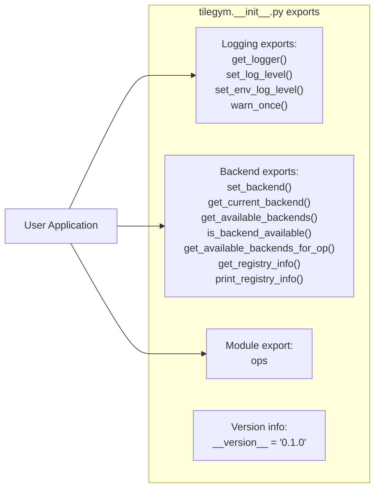

**Core Exports:**

The package initialization follows a specific import order to avoid circular dependencies:

1. **Logging utilities** ([src/tilegym/__init__.py:5-11]()): Imported first to enable diagnostics during subsequent imports
2. **Backend management** ([src/tilegym/__init__.py:14-20]()): Initialized before operations to ensure backend selector is ready
3. **Operations module** ([src/tilegym/__init__.py:23]()): Imported after backend system is available
4. **Optional dependencies** ([src/tilegym/__init__.py:25-28]()): Transformers library with graceful fallback

**Sources:** [src/tilegym/__init__.py:1-53]()

---

## Backend Abstraction System

The backend abstraction system decouples operation semantics from hardware-specific implementations, enabling runtime backend selection without code changes:

```mermaid
graph TD
    subgraph "Application Code"
        APP_CALL["Application calls:<br/>tilegym.ops.rope(...)"]
    end
    
    subgraph "Backend Selection"
        SET_BACKEND["tilegym.set_backend('cutile')<br/>or environment variable"]
        GET_BACKEND["tilegym.get_current_backend()"]
        CHECK_BACKEND["tilegym.is_backend_available('cutile')"]
    end
    
    subgraph "Operation Dispatch"
        DISPATCH["backend.dispatcher.dispatch()<br/>Routes op to active backend"]
        REGISTRY["Backend registry:<br/>op_name → backend → implementation"]
    end
    
    subgraph "Implementation Selection"
        PYTORCH_PATH["PyTorch backend:<br/>Standard implementation"]
        CUTILE_PATH["CUTILE backend:<br/>CUDA Tile optimizations"]
    end
    
    SET_BACKEND --> GET_BACKEND
    CHECK_BACKEND --> SET_BACKEND
    
    APP_CALL --> DISPATCH
    GET_BACKEND --> DISPATCH
    
    DISPATCH --> REGISTRY
    REGISTRY --> PYTORCH_PATH
    REGISTRY --> CUTILE_PATH
```

**Key Backend Functions:**

| Function | Module | Purpose | Returns |
|----------|--------|---------|---------|
| `set_backend(name)` | `backend.selector` | Set active backend | None |
| `get_current_backend()` | `backend.selector` | Query active backend | str (backend name) |
| `get_available_backends()` | `backend.selector` | List all available backends | list[str] |
| `is_backend_available(name)` | `backend.selector` | Check backend availability | bool |
| `dispatch(op_name, *args, **kwargs)` | `backend.dispatcher` | Route operation to backend | Operation result |
| `register_impl(op_name, backend, impl)` | `backend.dispatcher` | Register implementation | None |
| `get_available_backends_for_op(op_name)` | `backend.dispatcher` | Backends supporting operation | list[str] |
| `get_registry_info()` | `backend.dispatcher` | Diagnostic information | dict |

**Sources:** [src/tilegym/__init__.py:14-20](), [src/tilegym/backend/__init__.py:9-23]()

---

## Backend Registration and Dispatch Flow

The following diagram illustrates how operations are registered and dispatched to backend implementations:

```mermaid
sequenceDiagram
    participant Init as "Package Initialization"
    participant Backend as "Backend System"
    participant Registry as "Operation Registry"
    participant User as "User Code"
    participant Dispatcher as "backend.dispatcher"
    participant Impl as "Backend Implementation"
    
    Note over Init,Registry: Registration Phase
    Init->>Backend: Import backend module
    Backend->>Registry: register_impl('rope', 'pytorch', pytorch_rope)
    Backend->>Registry: register_impl('rope', 'cutile', cutile_rope)
    
    Note over User,Impl: Execution Phase
    User->>Backend: set_backend('cutile')
    User->>User: import tilegym.ops as ops
    User->>Dispatcher: ops.rope(x, freqs)
    Dispatcher->>Registry: Lookup 'rope' for 'cutile' backend
    Registry-->>Dispatcher: Return cutile_rope function
    Dispatcher->>Impl: cutile_rope(x, freqs)
    Impl-->>User: Return result tensor
```

**Dispatch Mechanism:**

The dispatcher provides a centralized routing system that:

1. **Looks up** the current backend via `get_current_backend()`
2. **Queries** the registry for `(op_name, backend)` → `implementation`
3. **Invokes** the implementation with provided arguments
4. **Falls back** to alternative backends if primary is unavailable
5. **Raises** informative errors if no implementation exists

**Sources:** [src/tilegym/backend/__init__.py:17-23]()

---

## CUTILE Backend Availability Handling

The package provides graceful degradation when the CUTILE backend is unavailable:

```mermaid
graph TD
    IMPORT["User imports tilegym.ops.cutile_specific"]
    
    CHECK{"is_backend_available('cutile')"}
    
    SUCCESS["Return CUTILE implementation"]
    ERROR["Raise ImportError with installation instructions"]
    
    IMPORT --> CHECK
    CHECK -->|Available| SUCCESS
    CHECK -->|Not Available| ERROR
    
    ERROR --> MSG["Error message:<br/>pip install --pre --extra-index-url<br/>https://urm.nvidia.com/artifactory/api/pypi/nv-shared-pypi-local/simple<br/>cuda-tile"]
```

**Implementation Details:**

The `make_missing_backend_handler()` function ([src/tilegym/backend/__init__.py:25-48]()) generates a custom `__getattr__` that:

1. Intercepts attribute access on backend-specific modules
2. Checks if CUTILE backend is available via `is_backend_available("cutile")`
3. Provides installation instructions if unavailable
4. Raises `AttributeError` for truly missing attributes

This pattern ensures users receive actionable error messages rather than cryptic import failures.

**Sources:** [src/tilegym/backend/__init__.py:25-48]()

---

## Logging Infrastructure

TileGym includes a centralized logging system for diagnostics and debugging:

```mermaid
graph TD
    subgraph "Logging Configuration"
        GET_LOGGER["tilegym.get_logger()<br/>Returns logger instance"]
        SET_LEVEL["tilegym.set_log_level(level)<br/>Configure verbosity"]
        SET_ENV["tilegym.set_env_log_level()<br/>Environment-based config"]
    end
    
    subgraph "Logging Utilities"
        WARN_ONCE["tilegym.warn_once(msg)<br/>Deduplicated warnings"]
        LOGGER["logger.info/warning/error()<br/>Standard logging"]
    end
    
    subgraph "Usage Examples"
        IMPORT_WARN["Warn if transformers unavailable"]
        BACKEND_WARN["Warn on backend fallback"]
        OP_INFO["Log operation dispatch"]
    end
    
    GET_LOGGER --> WARN_ONCE
    GET_LOGGER --> LOGGER
    SET_LEVEL --> GET_LOGGER
    SET_ENV --> GET_LOGGER
    
    WARN_ONCE --> IMPORT_WARN
    LOGGER --> BACKEND_WARN
    LOGGER --> OP_INFO
```

**Logger Functions:**

| Function | Purpose | Example Use Case |
|----------|---------|-----------------|
| `get_logger()` | Retrieve package logger | Access logging in any module |
| `set_log_level(level)` | Set verbosity (DEBUG, INFO, WARNING) | Control diagnostic output |
| `set_env_log_level()` | Configure via environment variable | Production deployment |
| `warn_once(msg)` | Emit warning once per message | Avoid log spam for repeated issues |

The logger is initialized early ([src/tilegym/__init__.py:6-11]()) and used throughout the package, including for optional dependency warnings ([src/tilegym/__init__.py:25-28]()).

**Sources:** [src/tilegym/__init__.py:5-11](), [src/tilegym/__init__.py:25-28]()

---

## Version Management

The package exposes version information through the `__version__` attribute:

```python
# Current version
tilegym.__version__  # Returns: '0.1.0'
```

This enables version checking in dependent packages and compatibility validation.

**Sources:** [src/tilegym/__init__.py:48]()

---

## Relationship to Child Components

The Core Library serves as the foundation for specialized subsystems:

| Component | Page | Relationship |
|-----------|------|--------------|
| Package Architecture | [3.1](#3.1) | Detailed structure of modules, file organization, and ops module design |
| Backend Management System | [3.2](#3.2) | In-depth coverage of selector, dispatcher, registry, and backend implementations |
| Transformer Inference | [4](#4) | Consumer of Core Library APIs for LLM optimization |
| Operations Library | Covered in 3.1 | Specific operation implementations (RoPE, attention, etc.) |

The architecture ensures that higher-level systems like transformer inference can remain agnostic to backend details while still benefiting from hardware-specific optimizations.

**Sources:** Diagram 1 and Diagram 2 from provided context

---

# Page: Package Architecture

# Package Architecture

<details>
<summary>Relevant source files</summary>

The following files were used as context for generating this wiki page:

- [src/tilegym/__init__.py](src/tilegym/__init__.py)
- [src/tilegym/backend/__init__.py](src/tilegym/backend/__init__.py)

</details>


## Purpose and Scope

This document describes the overall structure and organization of the `tilegym` Python package, including its core modules, public API surface, logging infrastructure, and version management. It provides a high-level view of how the package is organized and how its components fit together.

For detailed information about the backend management system and operation dispatching, see [Backend Management System](#3.2). For information about specific operations and their implementations, those will be covered in subsequent sections.

## Package Structure Overview

The TileGym package follows a modular architecture where the root `__init__.py` file serves as the primary entry point, exposing a carefully designed public API while organizing internal functionality into focused submodules.

```mermaid
graph TD
    ROOT["tilegym/__init__.py<br/>Package Entry Point"]
    
    subgraph "Core Modules"
        LOGGER["tilegym/logger.py<br/>Logging Infrastructure"]
        BACKEND["tilegym/backend/<br/>Backend Management"]
        OPS["tilegym/ops/<br/>Operations Library"]
    end
    
    subgraph "Optional Dependencies"
        TRANSFORMERS["transformers<br/>External Package"]
    end
    
    subgraph "Package Metadata"
        VERSION["__version__ = '0.1.0'"]
        ALL["__all__<br/>Public API Definition"]
    end
    
    ROOT --> LOGGER
    ROOT --> BACKEND
    ROOT --> OPS
    ROOT -.optional.-> TRANSFORMERS
    ROOT --> VERSION
    ROOT --> ALL
    
    BACKEND --> SELECTOR["backend/selector.py"]
    BACKEND --> DISPATCHER["backend/dispatcher.py"]
```

**Directory Structure:**
```
src/tilegym/
├── __init__.py              # Package entry point
├── logger.py                # Logging utilities
├── backend/                 # Backend management system
│   ├── __init__.py
│   ├── selector.py          # Backend selection
│   └── dispatcher.py        # Operation dispatching
└── ops/                     # Operations module
    └── ...                  # Operation implementations
```

**Sources:** [src/tilegym/__init__.py:1-53](), [src/tilegym/backend/__init__.py:1-67]()

## Initialization Sequence

The package initialization follows a specific order to avoid import dependency issues. The initialization process is critical for establishing the runtime environment correctly.

```mermaid
sequenceDiagram
    participant User
    participant Init as "tilegym/__init__.py"
    participant Logger as "logger module"
    participant Backend as "backend module"
    participant Ops as "ops module"
    participant TF as "transformers (optional)"
    
    User->>Init: import tilegym
    Init->>Logger: Import logging utilities
    Logger-->>Init: get_logger, set_log_level, etc.
    Init->>Init: Create package logger
    Init->>Backend: Import backend management
    Backend-->>Init: set_backend, get_current_backend, etc.
    Init->>Ops: Import ops module
    Ops-->>Init: Unified operations API
    Init->>TF: Try import transformers
    alt transformers available
        TF-->>Init: Module imported
    else ImportError
        Init->>Init: Log warning
    end
    Init-->>User: Package ready
```

**Initialization Order Rationale:**

| Step | Module | Reason |
|------|--------|--------|
| 1 | Logger | Must be available before any other imports to capture initialization logs |
| 2 | Backend | Required by ops module for operation dispatching |
| 3 | Ops | Depends on backend system being initialized |
| 4 | Transformers | Optional dependency, checked with try/except |

**Sources:** [src/tilegym/__init__.py:5-28]()

## Core Components

### Package Entry Point

The `tilegym/__init__.py` file serves as the package's public interface, exposing selected functionality while hiding internal implementation details.

**Key Responsibilities:**
- Define public API via `__all__` list
- Import and re-export core functionality
- Initialize package-level logger
- Manage version information
- Handle optional dependencies gracefully

```mermaid
graph LR
    subgraph "Public API (__all__)"
        OPS_API["'ops'"]
        BACKEND_API["Backend Functions:<br/>'set_backend'<br/>'get_current_backend'<br/>'get_available_backends'<br/>'is_backend_available'<br/>'get_available_backends_for_op'<br/>'get_registry_info'<br/>'print_registry_info'"]
        LOGGER_API["Logger Functions:<br/>'warn_once'<br/>'get_logger'<br/>'set_log_level'<br/>'set_env_log_level'"]
        TF_API["'transformers'"]
    end
    
    ENTRY["tilegym module"] --> OPS_API
    ENTRY --> BACKEND_API
    ENTRY --> LOGGER_API
    ENTRY --> TF_API
```

**Sources:** [src/tilegym/__init__.py:30-45]()

### Logging Infrastructure

The logging system provides structured logging capabilities with level control and one-time warning functionality.

**Exported Logging Functions:**

| Function | Purpose | Defined In |
|----------|---------|------------|
| `get_logger()` | Retrieve package logger instance | `tilegym.logger` |
| `set_log_level()` | Set logging level programmatically | `tilegym.logger` |
| `set_env_log_level()` | Set logging level from environment variables | `tilegym.logger` |
| `warn_once()` | Emit a warning only once during execution | `tilegym.logger` |

**Usage Pattern:**
```python
import tilegym

# Get package logger
logger = tilegym.get_logger()

# Set log level
tilegym.set_log_level('DEBUG')

# Use one-time warning for deprecations
tilegym.warn_once("This feature is deprecated")
```

**Package Logger Instantiation:**
The package creates its own logger at import time [src/tilegym/__init__.py:11](), making it available for all internal modules.

**Sources:** [src/tilegym/__init__.py:5-11](), [src/tilegym/__init__.py:40-44]()

### Backend Management System

The backend system enables pluggable implementations for operations. While detailed coverage is provided in [Backend Management System](#3.2), the key integration points at the package level are:

**Exposed Backend Functions:**

| Function | Purpose | Return Type |
|----------|---------|-------------|
| `set_backend(name)` | Switch active backend | `None` |
| `get_current_backend()` | Query active backend | `str` |
| `get_available_backends()` | List all available backends | `list[str]` |
| `is_backend_available(name)` | Check backend availability | `bool` |
| `get_available_backends_for_op(op_name)` | List backends supporting specific operation | `list[str]` |
| `get_registry_info()` | Get operation-backend mappings | `dict` |
| `print_registry_info()` | Display registry in human-readable format | `None` |

**Import Order Consideration:**
The backend system is imported immediately after logging [src/tilegym/__init__.py:14-20]() to ensure it is available before the ops module, which depends on it for dispatching.

**Sources:** [src/tilegym/__init__.py:14-20](), [src/tilegym/__init__.py:33-39](), [src/tilegym/backend/__init__.py:9-23]()

### Operations Module

The `ops` module provides a unified interface for GPU operations, abstracting backend-specific implementations.

**Module Organization:**
```mermaid
graph TD
    OPS_ROOT["tilegym.ops<br/>Unified Operations API"]
    
    USER["User Code"] --> OPS_ROOT
    OPS_ROOT --> DISPATCH["Backend Dispatcher"]
    
    DISPATCH --> PYTORCH["PyTorch Implementation"]
    DISPATCH --> CUTILE["CUTILE Implementation"]
    DISPATCH --> CUSTOM["Custom Backends"]
```

The ops module is imported as a namespace [src/tilegym/__init__.py:23]() and exposed in the public API [src/tilegym/__init__.py:31](). This allows users to access operations via `tilegym.ops.operation_name()`.

**Sources:** [src/tilegym/__init__.py:23](), [src/tilegym/__init__.py:31]()

### Optional Transformers Integration

TileGym optionally integrates with HuggingFace Transformers for LLM inference optimization. The integration is handled gracefully if the dependency is not available.

**Import Handling:**
```python
try:
    import transformers
except ImportError:
    logger.warning("transformers is not available")
```

This pattern [src/tilegym/__init__.py:25-28]() ensures:
1. The package can be imported without transformers installed
2. Users are warned if transformers-dependent features are unavailable
3. The package logger captures the warning for diagnostics

The `transformers` module is included in `__all__` [src/tilegym/__init__.py:32]() to re-export it when available, allowing `import tilegym.transformers` as a convenience.

**Sources:** [src/tilegym/__init__.py:25-28](), [src/tilegym/__init__.py:32]()

### Version Management

Package version information is defined as a module-level constant:

```python
__version__ = '0.1.0'
```

This follows Python packaging conventions and enables:
- Programmatic version checking: `tilegym.__version__`
- Build system integration (setup.py, pyproject.toml)
- Dependency resolution in other packages

**Sources:** [src/tilegym/__init__.py:48]()

## Public API Surface

The `__all__` list explicitly defines the package's public interface, controlling what is exposed during wildcard imports (`from tilegym import *`) and signaling the intended API to users.

**API Categories:**

```mermaid
graph TD
    API["tilegym.__all__"]
    
    API --> CAT1["Operations<br/>'ops'"]
    API --> CAT2["Integrations<br/>'transformers'"]
    API --> CAT3["Backend Control<br/>7 functions"]
    API --> CAT4["Logging<br/>4 functions"]
    
    CAT3 --> B1["set_backend"]
    CAT3 --> B2["get_current_backend"]
    CAT3 --> B3["get_available_backends"]
    CAT3 --> B4["is_backend_available"]
    CAT3 --> B5["get_available_backends_for_op"]
    CAT3 --> B6["get_registry_info"]
    CAT3 --> B7["print_registry_info"]
    
    CAT4 --> L1["warn_once"]
    CAT4 --> L2["get_logger"]
    CAT4 --> L3["set_log_level"]
    CAT4 --> L4["set_env_log_level"]
```

**Complete API Reference:**

| Category | Symbol | Type | Purpose |
|----------|--------|------|---------|
| Operations | `ops` | Module | Unified operations interface |
| Integration | `transformers` | Module | HuggingFace transformers (optional) |
| Backend | `set_backend` | Function | Switch active backend |
| Backend | `get_current_backend` | Function | Query active backend |
| Backend | `get_available_backends` | Function | List available backends |
| Backend | `is_backend_available` | Function | Check backend availability |
| Backend | `get_available_backends_for_op` | Function | List backends for operation |
| Backend | `get_registry_info` | Function | Get operation registry |
| Backend | `print_registry_info` | Function | Display registry |
| Logging | `warn_once` | Function | One-time warning |
| Logging | `get_logger` | Function | Get package logger |
| Logging | `set_log_level` | Function | Set log level |
| Logging | `set_env_log_level` | Function | Set log level from environment |

**Sources:** [src/tilegym/__init__.py:30-45]()

## Backend Module Organization

The backend system is organized into submodules that separate concerns between backend selection and operation dispatching.

```mermaid
graph TD
    BACKEND_PKG["tilegym/backend/__init__.py"]
    
    subgraph "Backend Submodules"
        SELECTOR["selector.py<br/>Backend Selection"]
        DISPATCHER["dispatcher.py<br/>Operation Dispatching"]
    end
    
    subgraph "Selector Exports"
        S1["get_available_backends"]
        S2["get_current_backend"]
        S3["set_backend"]
        S4["is_backend_available"]
        S5["assert_backend_available"]
    end
    
    subgraph "Dispatcher Exports"
        D1["dispatch"]
        D2["register_impl"]
        D3["get_available_backends_for_op"]
        D4["get_registry_info"]
        D5["print_registry_info"]
    end
    
    subgraph "Utilities"
        UTIL["make_missing_backend_handler"]
    end
    
    BACKEND_PKG --> SELECTOR
    BACKEND_PKG --> DISPATCHER
    
    SELECTOR --> S1
    SELECTOR --> S2
    SELECTOR --> S3
    SELECTOR --> S4
    SELECTOR --> S5
    
    DISPATCHER --> D1
    DISPATCHER --> D2
    DISPATCHER --> D3
    DISPATCHER --> D4
    DISPATCHER --> D5
    
    BACKEND_PKG --> UTIL
```

**Backend Module Responsibilities:**

| Module | Purpose | Key Functions |
|--------|---------|---------------|
| `selector.py` | Manage active backend state | `set_backend()`, `get_current_backend()`, `is_backend_available()` |
| `dispatcher.py` | Route operations to backends | `dispatch()`, `register_impl()`, `get_registry_info()` |
| `__init__.py` | Coordinate and re-export | `make_missing_backend_handler()` |

**Missing Backend Handler:**

The backend package provides a utility function `make_missing_backend_handler()` [src/tilegym/backend/__init__.py:25-48]() that generates helpful error messages when operations requiring specific backends are accessed without those backends installed. This is used by backend-specific subpackages (e.g., `tilegym.ops.cutile`).

**Sources:** [src/tilegym/backend/__init__.py:1-67]()

## Module Dependency Graph

The following diagram shows how package modules depend on each other, clarifying the initialization order and import relationships:

```mermaid
graph TD
    INIT["tilegym/__init__.py"]
    LOGGER["tilegym/logger.py"]
    BACKEND_INIT["tilegym/backend/__init__.py"]
    SELECTOR["tilegym/backend/selector.py"]
    DISPATCHER["tilegym/backend/dispatcher.py"]
    OPS["tilegym/ops/"]
    TRANSFORMERS["transformers (external)"]
    
    INIT --> LOGGER
    INIT --> BACKEND_INIT
    INIT --> OPS
    INIT -.optional.-> TRANSFORMERS
    
    BACKEND_INIT --> SELECTOR
    BACKEND_INIT --> DISPATCHER
    
    OPS --> BACKEND_INIT
    
    note1["Imports first to provide<br/>logging for all modules"]
    note2["Required by ops for<br/>operation dispatching"]
    note3["Gracefully handled<br/>if not installed"]
    
    LOGGER -.-> note1
    BACKEND_INIT -.-> note2
    TRANSFORMERS -.-> note3
```

**Import Order Rules:**

1. **Logger First:** The logger module must be imported before other components to capture initialization logs
2. **Backend Before Ops:** The backend system must be initialized before the ops module since operations depend on dispatching
3. **Transformers Last:** Optional integrations are imported last with error handling

**Sources:** [src/tilegym/__init__.py:5-28]()

## Design Principles

The package architecture follows several key design principles:

| Principle | Implementation | Benefit |
|-----------|----------------|---------|
| **Explicit Public API** | `__all__` list defines exports | Clear contract for users, prevents namespace pollution |
| **Lazy Module Loading** | Modules imported only when needed | Faster import times, reduced memory footprint |
| **Graceful Degradation** | Optional dependencies handled with try/except | Package usable even without all features |
| **Separation of Concerns** | Backend, ops, logger in separate modules | Maintainable, testable, modular code |
| **Centralized Entry Point** | Single `__init__.py` orchestrates imports | Predictable initialization, easier debugging |

These principles ensure TileGym is both easy to use for common cases and flexible for advanced scenarios.

**Sources:** [src/tilegym/__init__.py:1-53](), [src/tilegym/backend/__init__.py:1-67]()

---

# Page: Backend Management System

# Backend Management System

<details>
<summary>Relevant source files</summary>

The following files were used as context for generating this wiki page:

- [src/tilegym/__init__.py](src/tilegym/__init__.py)
- [src/tilegym/backend/__init__.py](src/tilegym/backend/__init__.py)

</details>


## Purpose and Scope

This document describes the Backend Management System, which provides TileGym's pluggable architecture for switching between different backend implementations (PyTorch, CUTILE, custom) without changing application code. The system consists of three core components: the Backend Selector for managing which backend is active, the Operation Dispatcher for routing function calls to backend-specific implementations, and the Backend Registry for maintaining operation-to-backend mappings.

For information about the operations that use this backend system, see [Operations Library](#4). For package-level architecture, see [Package Architecture](#3.1).

**Sources:** [src/tilegym/backend/__init__.py:1-67](), [README.md (from context)]()

---

## System Architecture

The Backend Management System is organized into three layers within the `src/tilegym/backend/` module:

| Component | Module | Primary Functions | Purpose |
|-----------|--------|------------------|---------|
| Backend Selector | `selector.py` | `set_backend()`, `get_current_backend()`, `is_backend_available()` | Manages active backend state |
| Operation Dispatcher | `dispatcher.py` | `dispatch()`, `register_impl()` | Routes operations to backend implementations |
| Backend Registry | `dispatcher.py` | `get_registry_info()`, `print_registry_info()` | Stores operation mappings |

### Backend Management Module Structure

```mermaid
graph TB
    subgraph "tilegym Package"
        INIT["__init__.py<br/>Public API Exports"]
    end
    
    subgraph "backend/ Module"
        BACKEND_INIT["backend/__init__.py<br/>Module Orchestration"]
        SELECTOR["selector.py<br/>Backend Selection"]
        DISPATCHER["dispatcher.py<br/>Operation Dispatch"]
    end
    
    subgraph "Selector Functions"
        SET_BACKEND["set_backend()"]
        GET_BACKEND["get_current_backend()"]
        IS_AVAILABLE["is_backend_available()"]
        ASSERT_AVAILABLE["assert_backend_available()"]
        GET_ALL["get_available_backends()"]
    end
    
    subgraph "Dispatcher Functions"
        DISPATCH["dispatch()"]
        REGISTER["register_impl()"]
        GET_OP_BACKENDS["get_available_backends_for_op()"]
        GET_REGISTRY["get_registry_info()"]
        PRINT_REGISTRY["print_registry_info()"]
    end
    
    INIT --> BACKEND_INIT
    BACKEND_INIT --> SELECTOR
    BACKEND_INIT --> DISPATCHER
    
    SELECTOR --> SET_BACKEND
    SELECTOR --> GET_BACKEND
    SELECTOR --> IS_AVAILABLE
    SELECTOR --> ASSERT_AVAILABLE
    SELECTOR --> GET_ALL
    
    DISPATCHER --> DISPATCH
    DISPATCHER --> REGISTER
    DISPATCHER --> GET_OP_BACKENDS
    DISPATCHER --> GET_REGISTRY
    DISPATCHER --> PRINT_REGISTRY
```

**Diagram: Backend Management Module Organization**

The module structure follows a clear separation of concerns: the `selector` module maintains backend state, the `dispatcher` module handles operation routing, and the `backend/__init__.py` orchestrates both by exporting a unified API.

**Sources:** [src/tilegym/__init__.py:14-20](), [src/tilegym/backend/__init__.py:9-23]()

---

## Backend Selector

The Backend Selector manages which backend implementation is currently active. It provides functions for setting the backend, querying the current backend, and checking backend availability.

### Core Selector Functions

| Function | Return Type | Description |
|----------|-------------|-------------|
| `set_backend(name: str)` | None | Sets the active backend to the specified name |
| `get_current_backend()` | str | Returns the name of the currently active backend |
| `is_backend_available(name: str)` | bool | Checks if a backend is available for use |
| `assert_backend_available(name: str)` | None | Raises error if backend is unavailable |
| `get_available_backends()` | List[str] | Returns list of all available backends |

### Backend Selection Flow

```mermaid
flowchart TD
    USER["User Application"]
    SET_BACKEND["set_backend(name)"]
    CHECK_AVAILABLE{"is_backend_available(name)?"}
    IMPORT_CHECK["Backend Import Check"]
    GLOBAL_STATE["Global Backend State Variable"]
    SUCCESS["Backend Set Successfully"]
    ERROR["Raise ImportError"]
    
    USER --> SET_BACKEND
    SET_BACKEND --> CHECK_AVAILABLE
    CHECK_AVAILABLE --> IMPORT_CHECK
    IMPORT_CHECK -->|"Available"| GLOBAL_STATE
    IMPORT_CHECK -->|"Not Available"| ERROR
    GLOBAL_STATE --> SUCCESS
    
    GET_CURRENT["get_current_backend()"]
    USER --> GET_CURRENT
    GET_CURRENT --> GLOBAL_STATE
```

**Diagram: Backend Selection Process**

The selector maintains a global state variable that tracks the currently active backend. When `set_backend()` is called, it first verifies backend availability by attempting to import required modules, then updates the global state if successful.

**Sources:** [src/tilegym/backend/__init__.py:9-15]()

### Backend Availability

The system determines backend availability through dynamic import checks:

- **PyTorch Backend**: Always available (required dependency)
- **CUTILE Backend**: Available if `cuda-tile` package is installed
- **Custom Backends**: Available if registered and dependencies met

The `is_backend_available()` function performs these checks without side effects, while `assert_backend_available()` raises an exception if the backend is unavailable, providing installation instructions.

**Sources:** [src/tilegym/backend/__init__.py:14](), [src/tilegym/backend/__init__.py:39-46]()

---

## Operation Dispatcher

The Operation Dispatcher provides the core routing mechanism that directs operation calls to the appropriate backend implementation. It maintains a registry of operation-to-backend mappings and provides both registration and dispatch functions.

### Dispatcher API

```mermaid
graph LR
    subgraph "Registration Phase"
        OP_IMPL["Backend Implementation<br/>Function"]
        REGISTER["register_impl(op_name, backend, impl_fn)"]
        REGISTRY["Backend Registry<br/>Dict[op_name → Dict[backend → impl_fn]]"]
    end
    
    subgraph "Dispatch Phase"
        USER_CALL["User Operation Call"]
        DISPATCH["dispatch(op_name, *args, **kwargs)"]
        BACKEND_QUERY["get_current_backend()"]
        IMPL_LOOKUP["Registry Lookup"]
        EXEC["Execute impl_fn(*args, **kwargs)"]
    end
    
    OP_IMPL --> REGISTER
    REGISTER --> REGISTRY
    
    USER_CALL --> DISPATCH
    DISPATCH --> BACKEND_QUERY
    BACKEND_QUERY --> IMPL_LOOKUP
    IMPL_LOOKUP --> REGISTRY
    IMPL_LOOKUP --> EXEC
```

**Diagram: Operation Registration and Dispatch Flow**

**Sources:** [src/tilegym/backend/__init__.py:17-22]()

### Core Dispatcher Functions

| Function | Parameters | Return Type | Description |
|----------|-----------|-------------|-------------|
| `dispatch(op_name, *args, **kwargs)` | Operation name, arguments | Any | Executes operation using current backend |
| `register_impl(op_name, backend, impl_fn)` | Operation name, backend name, implementation function | None | Registers backend implementation |
| `get_available_backends_for_op(op_name)` | Operation name | List[str] | Returns backends supporting the operation |
| `get_registry_info()` | None | Dict | Returns complete registry as dictionary |
| `print_registry_info()` | None | None | Prints formatted registry to console |

### Dispatch Resolution

When `dispatch()` is called, the system follows this resolution order:

1. Query current backend using `get_current_backend()`
2. Look up operation name in registry
3. Check if current backend has implementation for the operation
4. If found, execute the implementation with provided arguments
5. If not found, raise `NotImplementedError` with available backends

This design allows graceful degradation and clear error messages when backend implementations are missing.

**Sources:** [src/tilegym/backend/__init__.py:18-19]()

---

## Backend Registry

The Backend Registry stores the mapping between operation names and their backend-specific implementations. It is implemented as a nested dictionary structure within the `dispatcher` module.

### Registry Structure

The registry follows this schema:

```
Registry: Dict[str, Dict[str, Callable]]
    ├── operation_name_1: Dict[str, Callable]
    │   ├── "pytorch": implementation_function
    │   ├── "cutile": implementation_function
    │   └── "custom_backend": implementation_function
    ├── operation_name_2: Dict[str, Callable]
    │   ├── "pytorch": implementation_function
    │   └── "cutile": implementation_function
    └── ...
```

### Registry Query Functions

```mermaid
graph TB
    REGISTRY["Backend Registry<br/>Nested Dict Structure"]
    
    subgraph "Query Operations"
        GET_INFO["get_registry_info()"]
        PRINT_INFO["print_registry_info()"]
        GET_OP_BACKENDS["get_available_backends_for_op(op_name)"]
    end
    
    subgraph "Query Results"
        FULL_DICT["Complete Registry Dict"]
        CONSOLE_OUTPUT["Formatted Console Output"]
        BACKEND_LIST["List of Backend Names"]
    end
    
    REGISTRY --> GET_INFO
    REGISTRY --> PRINT_INFO
    REGISTRY --> GET_OP_BACKENDS
    
    GET_INFO --> FULL_DICT
    PRINT_INFO --> CONSOLE_OUTPUT
    GET_OP_BACKENDS --> BACKEND_LIST
```

**Diagram: Registry Query Interface**

The `get_registry_info()` function returns the complete registry as a dictionary, useful for programmatic inspection. The `print_registry_info()` function provides human-readable output for debugging. The `get_available_backends_for_op()` function returns only the backends that implement a specific operation.

**Sources:** [src/tilegym/backend/__init__.py:20-22]()

---

## Backend Implementations

TileGym supports multiple backend implementations, each providing different optimization strategies for GPU operations.

### Supported Backends

| Backend | Identifier | Availability | Purpose |
|---------|-----------|--------------|---------|
| PyTorch | `"pytorch"` | Always | Baseline reference implementation |
| CUTILE | `"cutile"` | Requires `cuda-tile` | CUDA Tile optimized kernels for Blackwell |
| Custom | User-defined | User-registered | Extensible for custom implementations |

### Backend Capabilities

```mermaid
graph TB
    subgraph "PyTorch Backend"
        PT_OPS["Standard PyTorch Operations"]
        PT_COMPAT["Full Compatibility"]
        PT_BASELINE["Performance Baseline"]
    end
    
    subgraph "CUTILE Backend"
        CT_TILE["CUDA Tile Primitives"]
        CT_OPT["Blackwell Optimizations"]
        CT_PERF["Enhanced Performance"]
    end
    
    subgraph "Custom Backend"
        CUSTOM_IMPL["User-defined Kernels"]
        CUSTOM_REG["register_impl() Integration"]
        CUSTOM_EXT["Extensibility"]
    end
    
    OP_CALL["Operation Call"]
    DISPATCH_SYS["dispatch() System"]
    
    OP_CALL --> DISPATCH_SYS
    DISPATCH_SYS --> PT_OPS
    DISPATCH_SYS --> CT_TILE
    DISPATCH_SYS --> CUSTOM_IMPL
```

**Diagram: Backend Implementation Capabilities**

**Sources:** [src/tilegym/__init__.py:14-20](), [High-level Diagram 2]()

### Missing Backend Handling

The system provides helpful error messages when attempting to use unavailable backends. The `make_missing_backend_handler()` function creates custom `__getattr__` handlers for packages that require specific backends:

```python
make_missing_backend_handler(package_name, available_items)
```

When a user attempts to import an item that requires an unavailable backend (e.g., CUTILE), the handler raises an `ImportError` with installation instructions.

**Sources:** [src/tilegym/backend/__init__.py:25-48]()

---

## Usage Patterns

### Setting a Backend

```python
import tilegym

# Set backend to CUTILE
tilegym.set_backend("cutile")

# Check current backend
current = tilegym.get_current_backend()
print(f"Current backend: {current}")
```

### Checking Backend Availability

```python
import tilegym

# Check if CUTILE is available
if tilegym.is_backend_available("cutile"):
    tilegym.set_backend("cutile")
else:
    print("CUTILE backend not available, using PyTorch")
    tilegym.set_backend("pytorch")
```

### Inspecting Registry

```python
import tilegym

# Print all registered operations and backends
tilegym.print_registry_info()

# Get available backends for specific operation
backends = tilegym.get_available_backends_for_op("some_operation")
print(f"Available backends: {backends}")

# Get complete registry as dictionary
registry = tilegym.get_registry_info()
```

### Registering Custom Implementation

```python
from tilegym.backend import register_impl

def custom_operation_impl(*args, **kwargs):
    # Custom implementation
    pass

# Register implementation for custom backend
register_impl("my_operation", "custom_backend", custom_operation_impl)
```

**Sources:** [src/tilegym/__init__.py:30-45](), [src/tilegym/backend/__init__.py:9-23]()

---

## Backend Management API Reference

### Exported Functions

The following functions are exported from the `tilegym` package for backend management:

| Function | Module | Line Reference | Description |
|----------|--------|----------------|-------------|
| `set_backend` | `selector` | [src/tilegym/__init__.py:20]() | Set active backend |
| `get_current_backend` | `selector` | [src/tilegym/__init__.py:16]() | Get current backend name |
| `get_available_backends` | `selector` | [src/tilegym/__init__.py:14]() | List all available backends |
| `is_backend_available` | `selector` | [src/tilegym/__init__.py:18]() | Check backend availability |
| `get_available_backends_for_op` | `dispatcher` | [src/tilegym/__init__.py:15]() | List backends for operation |
| `get_registry_info` | `dispatcher` | [src/tilegym/__init__.py:17]() | Get registry as dict |
| `print_registry_info` | `dispatcher` | [src/tilegym/__init__.py:19]() | Print registry to console |

### Import Hierarchy

```mermaid
graph TD
    USER["User Code:<br/>import tilegym"]
    
    TILEGYM_INIT["tilegym/__init__.py"]
    BACKEND_INIT["tilegym/backend/__init__.py"]
    
    SELECTOR_MOD["tilegym/backend/selector.py"]
    DISPATCHER_MOD["tilegym/backend/dispatcher.py"]
    
    subgraph "Selector Functions"
        FUNC_SET["set_backend()"]
        FUNC_GET["get_current_backend()"]
        FUNC_CHECK["is_backend_available()"]
    end
    
    subgraph "Dispatcher Functions"
        FUNC_DISPATCH["dispatch()"]
        FUNC_REGISTER["register_impl()"]
        FUNC_QUERY["get_registry_info()"]
    end
    
    USER --> TILEGYM_INIT
    TILEGYM_INIT --> BACKEND_INIT
    BACKEND_INIT --> SELECTOR_MOD
    BACKEND_INIT --> DISPATCHER_MOD
    
    SELECTOR_MOD --> FUNC_SET
    SELECTOR_MOD --> FUNC_GET
    SELECTOR_MOD --> FUNC_CHECK
    
    DISPATCHER_MOD --> FUNC_DISPATCH
    DISPATCHER_MOD --> FUNC_REGISTER
    DISPATCHER_MOD --> FUNC_QUERY
```

**Diagram: Backend Management Import Structure**

All backend management functions are accessible through the top-level `tilegym` module, which re-exports them from the `backend` submodule for convenience.

**Sources:** [src/tilegym/__init__.py:13-20](), [src/tilegym/backend/__init__.py:1-67]()

---

## Design Principles

The Backend Management System follows these design principles:

1. **Zero-Cost Abstraction**: Backend switching incurs minimal overhead through direct function calls
2. **Explicit State**: Backend selection is explicit through `set_backend()` calls
3. **Graceful Degradation**: Missing backend implementations provide clear error messages
4. **Extensibility**: Custom backends can be registered without modifying core code
5. **Introspection**: Registry inspection functions enable debugging and validation

These principles ensure that the backend system provides flexibility without sacrificing performance or developer experience.

**Sources:** [High-level Diagram 2](), [src/tilegym/backend/__init__.py:25-48]()

---

# Page: Transformer Inference

# Transformer Inference

<details>
<summary>Relevant source files</summary>

The following files were used as context for generating this wiki page:

- [modeling/transformers/README.md](modeling/transformers/README.md)
- [modeling/transformers/infer.py](modeling/transformers/infer.py)

</details>


## Purpose and Scope

This document describes the transformer model inference layer in TileGym, which provides an end-to-end system for running large language model (LLM) inference with optional TileGym kernel optimizations. The system demonstrates how TileGym's backend-agnostic operations integrate with HuggingFace transformer models to accelerate inference on NVIDIA Blackwell GPUs.

The transformer inference system is located in `modeling/transformers/` and includes model loading, input preprocessing, optimization patching, execution, and performance profiling capabilities. For details on the underlying TileGym core library and backend system, see [Core Library](#3). For Docker containerization of this inference system, see [Docker Deployment](#5). For development and testing workflows, see [Development Guide](#6).

**Sources:** [modeling/transformers/README.md:1-196](), [modeling/transformers/infer.py:1-540]()

---

## System Architecture

The transformer inference system consists of five major layers that process requests from model selection through result generation:

```mermaid
graph TD
    subgraph InputLayer["Input Layer"]
        ModelHub["HuggingFace Model Hub<br/>(meta-llama, deepseek-ai)"]
        LocalCache["Local Model Cache<br/>(TILEGYM_MODEL_CACHE_DIR)"]
        PromptInput["Input Sources<br/>(--input_text, --sentence_file)"]
    end
    
    subgraph ConfigLayer["Configuration Layer"]
        ArgParser["parse_args()<br/>infer.py:148-185"]
        CacheSetup["check_and_setup_model_cache()<br/>infer.py:20-41"]
        LoaderFallback["_load_with_fallback()<br/>infer.py:55-95"]
    end
    
    subgraph OptimizationLayer["Optimization Layer"]
        TileGymCheck{{"--use_tilegym flag"}}
        ApplyPatch["apply_tilegym_patch()<br/>infer.py:206-226"]
        KernelReplace["apply_tilegym_kernel_to_llama()<br/>apply_tilegym_kernel_to_deepseek_v2()<br/>tilegym.transformers"]
    end
    
    subgraph ExecutionLayer["Execution Layer"]
        ModelLoader["load_model_with_cache()<br/>infer.py:98-100"]
        TokenizerLoader["load_tokenizer_with_cache()<br/>infer.py:103-105"]
        ForwardWrapper["NaiveForwardWrapper<br/>infer.py:108-146"]
        Generate["model.generate()"]
    end
    
    subgraph ProfileLayer["Profiling & Analysis Layer"]
        WarmupRuns["Warmup Phase<br/>(--warmup_runs)"]
        BenchmarkRuns["Benchmark Phase<br/>(--num_runs)"]
        TorchProfiler["torch.profiler.profile<br/>infer.py:417-421"]
        KernelFilter["KernelFilter<br/>infer.py:228-273"]
    end
    
    ModelHub --> LoaderFallback
    LocalCache --> LoaderFallback
    PromptInput --> ArgParser
    
    ArgParser --> CacheSetup
    CacheSetup --> TileGymCheck
    
    TileGymCheck -->|"Yes"| ApplyPatch
    TileGymCheck -->|"No"| ModelLoader
    ApplyPatch --> KernelReplace
    KernelReplace --> ModelLoader
    
    LoaderFallback --> ModelLoader
    LoaderFallback --> TokenizerLoader
    
    ModelLoader --> ForwardWrapper
    TokenizerLoader --> ForwardWrapper
    ForwardWrapper --> Generate
    
    Generate --> WarmupRuns
    WarmupRuns --> BenchmarkRuns
    BenchmarkRuns --> TorchProfiler
    TorchProfiler --> KernelFilter
```

**Architecture Layers:**

| Layer | Purpose | Key Components |
|-------|---------|----------------|
| Input Layer | Model and prompt acquisition | HuggingFace Hub, local cache, prompt files |
| Configuration Layer | Command-line parsing and setup | `parse_args()`, cache directory configuration |
| Optimization Layer | Selective TileGym kernel injection | `apply_tilegym_patch()`, kernel replacement functions |
| Execution Layer | Model loading and inference | `NaiveForwardWrapper`, `model.generate()` |
| Profiling Layer | Performance measurement | `torch.profiler`, warmup/benchmark runs, kernel filtering |

**Sources:** [modeling/transformers/infer.py:148-540](), [modeling/transformers/README.md:5-163]()

---

## Supported Models

The system supports two transformer model families with specific optimizations for each architecture:

| Model | HuggingFace ID | Optimized Operations | Memory Requirements |
|-------|----------------|---------------------|---------------------|
| LLaMA 3.1-8B | `meta-llama/Meta-Llama-3.1-8B` | RoPE, SwiGLU, RMSNorm, Attention, Flash Decoding | Compatible with RTX 5090 |
| DeepSeek V2-Lite-Chat | `deepseek-ai/DeepSeek-V2-Lite-Chat` | RoPE, SwiGLU, RMSNorm, MoE, MLADecoding, Attention | Requires B200 (high memory) |

The model-specific optimizations are applied through `apply_tilegym_patch()` [infer.py:206-226](), which detects the model type from the `--model_id` parameter and calls the appropriate kernel replacement function:

- **LLaMA models**: `apply_tilegym_kernel_to_llama(rope=True, swiglu=True, rms_norm=True, attn=use_attn, use_cutile=use_cutile)` [infer.py:209-215]()
- **DeepSeek models**: `apply_tilegym_kernel_to_deepseek_v2(rope=True, rms_norm=True, swiglu=True, attn=use_attn, moe=True, use_cutile=use_cutile)` [infer.py:217-224]()

**Sources:** [modeling/transformers/README.md:9-18](), [modeling/transformers/infer.py:206-226]()

---

## Key Components

### Model Cache Management

The caching system checks for locally cached models before downloading from HuggingFace Hub, reducing network dependency and improving load times:

```mermaid
graph LR
    CheckCache["check_and_setup_model_cache()<br/>infer.py:20-41"]
    SetupDirs["Create HF_HOME and<br/>HF_HUB_CACHE directories"]
    CheckComplete["_check_cache_complete()<br/>infer.py:44-52"]
    
    LoadFallback["_load_with_fallback()<br/>infer.py:55-95"]
    LocalPath{{"Local path<br/>exists?"}}
    LoadLocal["Load from<br/>local filesystem"]
    CacheExists{{"Cache<br/>complete?"}}
    LoadCache["Load with<br/>local_files_only=True"]
    Download["Download from<br/>HuggingFace Hub"]
    
    CheckCache --> SetupDirs
    SetupDirs --> LoadFallback
    
    LoadFallback --> LocalPath
    LocalPath -->|"Yes"| LoadLocal
    LocalPath -->|"No"| CheckComplete
    
    CheckComplete --> CacheExists
    CacheExists -->|"Yes"| LoadCache
    CacheExists -->|"No"| Download
    LoadCache -->|"Failure"| Download
```

The cache directory is configured via the `TILEGYM_MODEL_CACHE_DIR` environment variable [infer.py:26-27]() and defaults to `~/.cache/huggingface/hub`. The system creates subdirectories named `models--{org}--{model}` with snapshot storage [infer.py:48-49]().

**Sources:** [modeling/transformers/infer.py:20-105]()

### NaiveForwardWrapper

The `NaiveForwardWrapper` class [infer.py:108-146]() encapsulates model execution with standardized input preprocessing and parameter management:

| Method | Purpose | Key Operations |
|--------|---------|----------------|
| `__init__(model, tokenizer, messages_list, args, device, **default_kwargs)` | Initialize wrapper with model and inputs | Tokenize inputs, move to device, configure generation parameters [infer.py:109-133]() |
| `get_input_seq_len()` | Return input sequence length | Access `self.input_seq_len` [infer.py:135-136]() |
| `update_params(**kwargs)` | Update generation parameters | Merge with `self.default_kwargs` [infer.py:138-139]() |
| `forward()` | Execute generation | Call `model.generate(**self.default_kwargs)` [infer.py:141-142]() |
| `post_process(outputs)` | Process generation results | Identity function for extensibility [infer.py:144-145]() |

The wrapper enforces exact token generation by setting both `max_new_tokens` and `min_new_tokens` to `args.output_length` [infer.py:130-132](), ensuring consistent benchmarking results.

**Sources:** [modeling/transformers/infer.py:108-146]()

### KernelFilter

The `KernelFilter` class [infer.py:228-273]() identifies TileGym-optimized kernels in profiling output by maintaining a list of kernel name prefixes:

```python
# Example kernel prefixes (from infer.py:230-263)
kernel_names_prefix = [
    "rope", "tile_rope_kernel",                    # RoPE operations
    "prefill_fmha", "fmha_kernel", "attention_decode_kernel",  # Attention
    "moe", "fused_moe_kernel",                     # Mixture of Experts
    "silu_and_mul", "swiglu_forward",              # Activation functions
    "tile_", "cutile",                             # General TileGym kernels
    "rms_norm_kernel",                             # Normalization
    "naive_absorb_mla", "_mla_decoding",           # Multi-head latent attention
    "static_persistent_gemm_kernel", "matmul"      # Linear algebra
]
```

The `contains(key)` method [infer.py:269-273]() filters profiler results, excluding blacklisted operations like `aten::matmul` [infer.py:264-266]() to prevent false positives.

**Sources:** [modeling/transformers/infer.py:228-273]()

---

## Inference Execution Pipeline

The main execution flow in `infer.py:main()` [infer.py:275-536]() follows this sequence:

```mermaid
flowchart TD
    Start["main() entry<br/>infer.py:275"]
    ParseArgs["args = parse_args()<br/>infer.py:276"]
    CheckGPU["device = 'cuda' or 'cpu'<br/>infer.py:279"]
    
    LoadTokenizer["tokenizer = load_tokenizer_with_cache()<br/>infer.py:287"]
    CheckTileGym{{"args.use_tilegym?"}}
    ApplyPatch["apply_tilegym_patch(model_id, use_attn, use_cutile)<br/>infer.py:295"]
    
    LoadModel["model = load_model_with_cache()<br/>infer.py:306"]
    ConfigSample{{"args.show_outputs or<br/>args.profile?"}}
    SetSample["do_sample = True"]
    UnsetSample["do_sample = False<br/>warmup_runs = 1"]
    
    CreateWrapper["forward_wrapper = NaiveForwardWrapper()<br/>infer.py:316-324"]
    
    WarmupLoop["for i in range(args.warmup_runs):<br/>infer.py:328-331"]
    BenchLoop["for run in range(args.num_runs):<br/>infer.py:337-365"]
    
    RecordStart["start_event.record()<br/>infer.py:346"]
    Execute["outputs = forward_wrapper.forward()<br/>infer.py:348"]
    RecordEnd["end_event.record()<br/>infer.py:349"]
    
    CalcMetrics["Calculate tokens/sec, latency<br/>infer.py:354-364"]
    PrintResults["Print benchmark results<br/>infer.py:372-382"]
    
    ShowOutputsCheck{{"args.show_outputs?"}}
    PrintOutputs["Decode and print outputs<br/>infer.py:385-392"]
    
    ProfileCheck{{"args.profile?"}}
    RunProfiler["torch.profiler.profile()<br/>infer.py:417-421"]
    FilterResults["Filter with KernelFilter<br/>infer.py:425-428"]
    SaveCSV["Save results to CSV<br/>infer.py:466-484"]
    ExportTrace["Export Chrome trace (zipped)<br/>infer.py:485-493"]
    
    Start --> ParseArgs
    ParseArgs --> CheckGPU
    CheckGPU --> LoadTokenizer
    LoadTokenizer --> CheckTileGym
    
    CheckTileGym -->|"Yes"| ApplyPatch
    CheckTileGym -->|"No"| LoadModel
    ApplyPatch --> LoadModel
    
    LoadModel --> ConfigSample
    ConfigSample -->|"Yes"| UnsetSample
    ConfigSample -->|"No"| SetSample
    UnsetSample --> CreateWrapper
    SetSample --> CreateWrapper
    
    CreateWrapper --> WarmupLoop
    WarmupLoop --> BenchLoop
    
    BenchLoop --> RecordStart
    RecordStart --> Execute
    Execute --> RecordEnd
    RecordEnd --> CalcMetrics
    
    CalcMetrics --> PrintResults
    PrintResults --> ShowOutputsCheck
    
    ShowOutputsCheck -->|"Yes"| PrintOutputs
    ShowOutputsCheck -->|"No"| ProfileCheck
    PrintOutputs --> ProfileCheck
    
    ProfileCheck -->|"Yes"| RunProfiler
    ProfileCheck -->|"No"| End["End"]
    
    RunProfiler --> FilterResults
    FilterResults --> SaveCSV
    SaveCSV --> ExportTrace
    ExportTrace --> End
```

**Key Pipeline Stages:**

1. **Initialization** [infer.py:276-287](): Parse arguments, check GPU availability, load tokenizer
2. **Optimization** [infer.py:289-295](): Conditionally apply TileGym patches based on `--use_tilegym` flag
3. **Model Loading** [infer.py:298-306](): Load model with cache support and specified precision (`bfloat16` or `float32`)
4. **Wrapper Setup** [infer.py:308-324](): Create `NaiveForwardWrapper` with tokenized inputs and generation parameters
5. **Warmup** [infer.py:327-331](): Execute `args.warmup_runs` iterations to stabilize GPU state
6. **Benchmark** [infer.py:337-365](): Run `args.num_runs` iterations with CUDA event timing
7. **Reporting** [infer.py:372-392](): Calculate and display throughput, latency, and optionally generated text
8. **Profiling** [infer.py:415-535](): Generate detailed kernel-level performance data with torch profiler

**Sources:** [modeling/transformers/infer.py:275-540]()

---

## Optimization Configuration

The system provides three command-line flags that control optimization layers:

| Flag | Effect | Applied Kernels |
|------|--------|----------------|
| `--use_tilegym` | Enable TileGym kernel replacement | RoPE, SwiGLU, RMSNorm (always); Attention and MoE (model-dependent) |
| `--use_cutile` | Use CUTILE backend instead of PyTorch baseline | All TileGym kernels execute via cuda-tile optimized implementations |
| `--use_attn` | Enable TileGym attention kernels | Flash attention (LLaMA), MLA decoding (DeepSeek) |

**Optimization Path Selection:**

```mermaid
graph TD
    Start["Model loaded"]
    TileGymFlag{{"--use_tilegym?"}}
    NoOpt["PyTorch Baseline<br/>No optimization"]
    
    CutileFlag{{"--use_cutile?"}}
    AttnFlag{{"--use_attn?"}}
    
    BaseKernels["TileGym PyTorch Backend<br/>RoPE, SwiGLU, RMSNorm"]
    BaseAttn["+ Attention kernels"]
    
    CutileKernels["TileGym CUTILE Backend<br/>RoPE, SwiGLU, RMSNorm"]
    CutileAttn["+ Attention kernels"]
    
    Start --> TileGymFlag
    TileGymFlag -->|"No"| NoOpt
    TileGymFlag -->|"Yes"| CutileFlag
    
    CutileFlag -->|"No"| AttnFlag
    CutileFlag -->|"Yes"| CutileAttn
    
    AttnFlag -->|"No"| BaseKernels
    AttnFlag -->|"Yes"| BaseAttn
    
    CutileAttn -->|"--use_attn=False"| CutileKernels
    CutileAttn -->|"--use_attn=True"| CutileKernels
```

The backend selection is stored in the `backend` variable [infer.py:288-295](), which defaults to `"base"` and changes to `"cutile"` when `--use_cutile` is specified.

**Sources:** [modeling/transformers/infer.py:150-162](), [modeling/transformers/infer.py:288-295](), [modeling/transformers/README.md:13-16]()

---

## Performance Profiling System

The profiling system captures three levels of performance metrics:

### 1. Throughput and Latency Metrics

Measured using CUDA events [infer.py:339-364]():

```python
# Timing code structure (infer.py:339-364)
start_event = torch.cuda.Event(enable_timing=True)
end_event = torch.cuda.Event(enable_timing=True)

start_event.record()
outputs = forward_wrapper.forward()
end_event.record()

torch.cuda.synchronize()
elapsed_time = start_event.elapsed_time(end_event) / 1000.0  # Convert to seconds
tokens_per_second = total_tokens / elapsed_time
```

Results are aggregated across `args.num_runs` iterations [infer.py:368-382]() to compute mean and standard deviation.

### 2. Kernel-Level Profiling

Enabled with `--profile` flag [infer.py:415-497](). The torch profiler captures:

- **CPU time total/average**: Host-side execution time
- **CUDA time total/average**: Device-side kernel execution time  
- **Self time**: Time excluding child operations
- **Call count**: Number of kernel invocations

Profiler configuration [infer.py:417-421]():
```python
with profile(activities=[ProfilerActivity.CPU, ProfilerActivity.CUDA], 
             with_stack=False, 
             record_shapes=False) as prof:
    with record_function("model_inference"):
        _ = forward_wrapper.forward()
```

### 3. Output Artifacts

| Artifact | Format | Content | Location |
|----------|--------|---------|----------|
| Console output | Text | Real-time metrics, filtered profiler table | stdout |
| CSV file | CSV | All operations sorted by device time | `{log_dir}/profiler_results_{case_id}_{timestamp}.csv` [infer.py:466]() |
| Chrome trace | JSON (zipped) | Timeline visualization | `{log_dir}/trace_{case_id}_{timestamp}.zip` [infer.py:489]() |
| Summary file | Text | Per-case throughput, latency, CUDA kernel time | Specified by `--summary_file` [infer.py:398-413](), [infer.py:500-535]() |

The CSV file includes all profiler operations with columns: `Name`, `CPU_time_total_us`, `CPU_time_avg_us`, `CUDA_time_total_us`, `CUDA_time_avg_us`, `Self_CPU_time_total_us`, `Self_CUDA_time_total_us`, `Count`, `Filtered`, `DeviceType` [infer.py:470-471]().

**Sources:** [modeling/transformers/infer.py:336-365](), [modeling/transformers/infer.py:415-535]()

---

## Command-Line Interface

The `parse_args()` function [infer.py:148-185]() defines the complete CLI:

### Model and Backend Configuration

| Argument | Type | Default | Description |
|----------|------|---------|-------------|
| `--model_id` | str | `meta-llama/Meta-Llama-3.1-8B` | HuggingFace model ID or local path [infer.py:151]() |
| `--use_tilegym` | flag | False | Enable TileGym optimization [infer.py:150]() |
| `--use_cutile` | flag | False | Use CUTILE backend [infer.py:161]() |
| `--use_attn` | flag | False | Enable attention optimization [infer.py:159]() |
| `--precision` | str | `bfloat16` | `bfloat16` or `float32` [infer.py:166]() |

### Input Configuration

| Argument | Type | Default | Description |
|----------|------|---------|-------------|
| `--input_text` | str | `"What is the capital of France?"` | Input prompt text [infer.py:153]() |
| `--sentence_file` | str | None | Path to input file [infer.py:167-171]() |
| `--output_length` | int | 100 | Number of tokens to generate [infer.py:173-178]() |
| `--batch_size` | int | 1 | Batch size for inference [infer.py:152]() |
| `--mock_input_len` | int | 0 | Mock input length for benchmarking [infer.py:182-184]() |

### Performance Configuration

| Argument | Type | Default | Description |
|----------|------|---------|-------------|
| `--num_runs` | int | 5 | Number of benchmark iterations [infer.py:154]() |
| `--warmup_runs` | int | 2 | Number of warmup iterations [infer.py:155]() |
| `--profile` | flag | False | Enable profiling [infer.py:163]() |
| `--show_outputs` | flag | False | Print generated text [infer.py:156]() |
| `--summary_file` | str | None | File to append summary lines [infer.py:157]() |
| `--log_dir` | str | `/logs` | Directory for profiler logs [infer.py:164]() |

**Sources:** [modeling/transformers/infer.py:148-185](), [modeling/transformers/README.md:146-163]()

---

## Input Processing

The `get_messages_list()` function [infer.py:187-204]() constructs input prompts based on the configuration:

```mermaid
graph TD
    Start["get_messages_list(args)"]
    MockCheck{{"args.mock_input_len > 0?"}}
    
    MockGen["Generate: ' Hello' * (mock_input_len - 1)<br/>infer.py:190-191"]
    Replicate1["Replicate batch_size times<br/>infer.py:193-194"]
    
    FileCheck{{"args.sentence_file != None?"}}
    ReadFile["Read lines from file<br/>infer.py:197"]
    JoinLines["Join lines with newline<br/>infer.py:199"]
    Replicate2["Replicate batch_size times<br/>infer.py:198-199"]
    
    UseDefault["Use args.input_text<br/>infer.py:202"]
    Replicate3["Replicate batch_size times<br/>infer.py:201-202"]
    
    Return["Return messages_list"]
    
    Start --> MockCheck
    MockCheck -->|"Yes"| MockGen
    MockCheck -->|"No"| FileCheck
    
    MockGen --> Replicate1
    Replicate1 --> Return
    
    FileCheck -->|"Yes"| ReadFile
    FileCheck -->|"No"| UseDefault
    
    ReadFile --> JoinLines
    JoinLines --> Replicate2
    Replicate2 --> Return
    
    UseDefault --> Replicate3
    Replicate3 --> Return
```

**Input Source Priority:**
1. **Mock input** (`--mock_input_len > 0`): Generates repeated "Hello" tokens for controlled benchmarking [infer.py:189-194]()
2. **File input** (`--sentence_file`): Reads and joins all lines from specified file [infer.py:195-199]()
3. **CLI input** (default): Uses `--input_text` argument [infer.py:201-203]()

All inputs are replicated `args.batch_size` times to create the batch [infer.py:193-194, 198-199, 201-202]().

**Sources:** [modeling/transformers/infer.py:187-204]()

---

# Page: Inference System Overview

# Inference System Overview

<details>
<summary>Relevant source files</summary>

The following files were used as context for generating this wiki page:

- [modeling/transformers/README.md](modeling/transformers/README.md)
- [modeling/transformers/infer.py](modeling/transformers/infer.py)

</details>


## Purpose and Scope

This page documents the architecture of the TileGym transformer inference system, which provides end-to-end inference capabilities for large language models with optional TileGym kernel optimizations. The system handles model loading, input processing, generation, and performance profiling.

The inference system is implemented primarily in [modeling/transformers/infer.py](). For instructions on running inference and using command-line options, see [Running Inference](#4.2). For benchmarking methodology and performance comparison, see [Benchmarking Performance](#4.3).

**Sources:** [modeling/transformers/infer.py:1-540](), [modeling/transformers/README.md:1-196]()

---

## System Architecture

The inference system consists of five major subsystems that work together to execute transformer model inference with optional optimizations:

```mermaid
graph TB
    subgraph "Model_Loading_Subsystem"
        CacheCheck["check_and_setup_model_cache()"]
        LoadFallback["_load_with_fallback()"]
        LoadModel["load_model_with_cache()"]
        LoadTokenizer["load_tokenizer_with_cache()"]
    end
    
    subgraph "Optimization_Subsystem"
        ParseArgs["parse_args()"]
        ApplyPatch["apply_tilegym_patch()"]
        PatchLlama["apply_tilegym_kernel_to_llama()"]
        PatchDeepseek["apply_tilegym_kernel_to_deepseek_v2()"]
    end
    
    subgraph "Input_Processing_Subsystem"
        GetMessages["get_messages_list()"]
        WrapperClass["NaiveForwardWrapper"]
        Tokenize["tokenizer()"]
    end
    
    subgraph "Execution_Subsystem"
        Warmup["Warmup Loop"]
        Benchmark["Benchmark Loop"]
        Forward["forward_wrapper.forward()"]
        Generate["model.generate()"]
    end
    
    subgraph "Profiling_Subsystem"
        ProfileContext["torch.profiler.profile()"]
        KernelFilterClass["KernelFilter"]
        ExportResults["CSV Export + Chrome Trace"]
    end
    
    ParseArgs --> CacheCheck
    CacheCheck --> LoadModel
    CacheCheck --> LoadTokenizer
    
    ParseArgs --> ApplyPatch
    ApplyPatch --> PatchLlama
    ApplyPatch --> PatchDeepseek
    
    LoadTokenizer --> GetMessages
    GetMessages --> WrapperClass
    LoadModel --> WrapperClass
    
    WrapperClass --> Warmup
    Warmup --> Benchmark
    Benchmark --> Forward
    Forward --> Generate
    
    Benchmark --> ProfileContext
    ProfileContext --> KernelFilterClass
    KernelFilterClass --> ExportResults
```

**Sources:** [modeling/transformers/infer.py:20-227](), [modeling/transformers/infer.py:275-540]()

---

## Model Loading System

The model loading system provides robust model acquisition with automatic cache management and fallback strategies. It supports both HuggingFace Hub models and local filesystem paths.

### Cache Management

The system manages model caching through environment variables and directory structure:

| Environment Variable | Purpose | Default Value |
|---------------------|---------|---------------|
| `TILEGYM_MODEL_CACHE_DIR` | Base cache directory | `~/.cache` |
| `HF_HOME` | HuggingFace home directory | `{CACHE_DIR}/huggingface` |
| `HF_HUB_CACHE` | Model repository cache | `{HF_HOME}/hub` |

The `check_and_setup_model_cache()` function [modeling/transformers/infer.py:20-41]() initializes these directories and sets environment variables. Model files are cached at `{HF_HUB_CACHE}/models--{org}--{model}/snapshots/`.

### Loading Strategy

The loading process follows a three-tier fallback strategy:

```mermaid
flowchart TD
    Start["_load_with_fallback()"]
    CheckLocal{"Is model_id a<br/>local path?"}
    LoadLocal["Load from filesystem<br/>loader_class.from_pretrained(path)"]
    CheckCache{"Does snapshot<br/>directory exist?"}
    TryCache["Attempt cache load<br/>local_files_only=True"]
    CacheSuccess{"Load<br/>successful?"}
    Download["Download from HuggingFace Hub<br/>loader_class.from_pretrained(model_id)"]
    Return["Return loaded resource"]
    Error["Raise exception"]
    
    Start --> CheckLocal
    CheckLocal -->|Yes| LoadLocal
    CheckLocal -->|No| CheckCache
    LoadLocal -->|Success| Return
    LoadLocal -->|Failure| Error
    
    CheckCache -->|Yes| TryCache
    CheckCache -->|No| Download
    TryCache --> CacheSuccess
    CacheSuccess -->|Yes| Return
    CacheSuccess -->|No| Download
    Download -->|Success| Return
    Download -->|Failure| Error
```

The `_load_with_fallback()` function [modeling/transformers/infer.py:55-95]() implements this strategy and is used by:
- `load_model_with_cache()` [modeling/transformers/infer.py:98-100]() - Loads `AutoModelForCausalLM`
- `load_tokenizer_with_cache()` [modeling/transformers/infer.py:103-105]() - Loads `AutoTokenizer`

**Sources:** [modeling/transformers/infer.py:20-105]()

---

## Input Processing and Generation

The `NaiveForwardWrapper` class [modeling/transformers/infer.py:108-146]() encapsulates input processing and generation logic, providing a consistent interface for model execution.

### Class Structure

```mermaid
classDiagram
    class NaiveForwardWrapper {
        +model: AutoModelForCausalLM
        +tokenizer: AutoTokenizer
        +tokenized_inputs: BatchEncoding
        +input_seq_len: int
        +default_kwargs: dict
        +__init__(model, tokenizer, messages_list, args, device, **kwargs)
        +get_input_seq_len() int
        +update_params(**kwargs) void
        +forward() Tensor
        +post_process(outputs) Tensor
    }
```

### Initialization and Tokenization

The wrapper initializes by tokenizing input messages and preparing generation parameters:

| Parameter | Source | Purpose |
|-----------|--------|---------|
| `input_ids` | `tokenizer(messages_list)` | Token sequence input |
| `attention_mask` | `tokenizer(messages_list)` | Valid token positions |
| `max_new_tokens` | `args.output_length` | Maximum tokens to generate |
| `min_new_tokens` | `args.output_length` | Minimum tokens to generate |
| `pad_token_id` | `tokenizer.eos_token_id` | Padding token identifier |
| `do_sample` | Conditional | Sampling vs greedy decoding |
| `early_stopping` | `False` | Stop generation early |

The initialization occurs in [modeling/transformers/infer.py:109-133](). Setting `min_new_tokens` equal to `max_new_tokens` forces deterministic output length.

### Message List Construction

The `get_messages_list()` function [modeling/transformers/infer.py:187-204]() constructs input messages from three possible sources:

```mermaid
flowchart LR
    GetMessages["get_messages_list(args)"]
    CheckMock{"args.mock_input_len > 0?"}
    CheckFile{"args.sentence_file<br/>provided?"}
    MockInput["Repeat 'Hello' tokens<br/>to target length"]
    FileInput["Read lines from file<br/>concatenate with newlines"]
    TextInput["Use args.input_text"]
    Replicate["Replicate for<br/>args.batch_size"]
    Return["Return messages_list"]
    
    GetMessages --> CheckMock
    CheckMock -->|Yes| MockInput
    CheckMock -->|No| CheckFile
    CheckFile -->|Yes| FileInput
    CheckFile -->|No| TextInput
    
    MockInput --> Replicate
    FileInput --> Replicate
    TextInput --> Replicate
    Replicate --> Return
```

**Sources:** [modeling/transformers/infer.py:108-204](), [modeling/transformers/infer.py:316-324]()

---

## TileGym Patching Mechanism

The patching system dynamically replaces standard transformer operations with TileGym-optimized kernels before model loading. This allows seamless integration without modifying model architecture code.

### Patching Entry Point

The `apply_tilegym_patch()` function [modeling/transformers/infer.py:206-226]() serves as the patching dispatcher:

```python
# Key logic from modeling/transformers/infer.py:206-226
def apply_tilegym_patch(model_id, use_attn=False, use_cutile=False):
    model_name = model_id.lower()
    if "llama" in model_name:
        apply_tilegym_kernel_to_llama(
            rope=True, swiglu=True, rms_norm=True,
            attn=use_attn, use_cutile=use_cutile
        )
    elif "deepseek" in model_name:
        apply_tilegym_kernel_to_deepseek_v2(
            rope=True, rms_norm=True, swiglu=True,
            attn=use_attn, moe=True, use_cutile=use_cutile
        )
```

### Model-Specific Patches

The system provides dedicated patching functions for each supported model architecture:

| Model Family | Patch Function | Optimized Operations |
|--------------|----------------|----------------------|
| LLaMA 3.1 | `apply_tilegym_kernel_to_llama()` | RoPE, SwiGLU, RMSNorm, Attention, Flash Decoding |
| DeepSeek V2 | `apply_tilegym_kernel_to_deepseek_v2()` | RoPE, SwiGLU, RMSNorm, MoE, MLADecoding, Attention |

### Patch Application Flow

```mermaid
sequenceDiagram
    participant Main as main()
    participant Args as parse_args()
    participant Patch as apply_tilegym_patch()
    participant TG as tilegym.transformers
    participant Load as load_model_with_cache()
    participant Model as AutoModelForCausalLM
    
    Main->>Args: Parse command-line flags
    Args-->>Main: args object
    
    alt args.use_tilegym == True
        Main->>Patch: apply_tilegym_patch(model_id, use_attn, use_cutile)
        Patch->>TG: apply_tilegym_kernel_to_llama() or<br/>apply_tilegym_kernel_to_deepseek_v2()
        TG-->>Patch: Kernels registered
        Patch-->>Main: Patching complete
    end
    
    Main->>Load: load_model_with_cache(model_id)
    Load->>Model: from_pretrained()
    Note over Model: Uses patched kernels if enabled
    Model-->>Load: model instance
    Load-->>Main: model
```

The patching occurs at [modeling/transformers/infer.py:289-295]() before model instantiation at [modeling/transformers/infer.py:306]().

**Sources:** [modeling/transformers/infer.py:18-19](), [modeling/transformers/infer.py:206-226](), [modeling/transformers/infer.py:289-306]()

---

## Supported Models

The inference system supports two transformer architectures with different feature sets:

### Model Compatibility Matrix

| Model | Model ID | RoPE | SwiGLU | RMSNorm | Attention | Flash Decoding | MoE | MLADecoding | GPU Requirements |
|-------|----------|------|--------|---------|-----------|----------------|-----|-------------|------------------|
| LLaMA 3.1-8B | `meta-llama/Meta-Llama-3.1-8B` | ✓ | ✓ | ✓ | ✓* | ✓* | - | - | B200, RTX 5080/5090 |
| DeepSeek V2-Lite-Chat | `deepseek-ai/DeepSeek-V2-Lite-Chat` | ✓ | ✓ | ✓ | ✓* | - | ✓ | ✓* | B200 only |

\* Optional: Enable with `--use_attn` flag

### Hardware Constraints

- **NVIDIA B200**: Supports all models
- **RTX 5080/5090**: LLaMA 3.1-8B only (memory constraints prevent DeepSeek V2)

The model identification logic uses case-insensitive substring matching on the model ID [modeling/transformers/infer.py:207-222](). Models not matching "llama" or "deepseek" patterns will load without TileGym optimizations.

**Sources:** [modeling/transformers/README.md:9-18](), [modeling/transformers/infer.py:206-226]()

---

## Execution Pipeline

The inference execution follows a three-phase pipeline: warmup, benchmark, and optional profiling. This structure ensures stable performance measurements.

### Pipeline Overview

```mermaid
flowchart TD
    Start["main() execution"]
    LoadPhase["Model & Tokenizer Loading"]
    WrapperInit["NaiveForwardWrapper initialization"]
    
    subgraph Warmup_Phase
        WarmupLoop["for i in range(warmup_runs)"]
        WarmupForward["forward_wrapper.forward()"]
        WarmupSync["torch.cuda.synchronize()"]
    end
    
    subgraph Benchmark_Phase
        BenchLoop["for run in range(num_runs)"]
        StartEvent["start_event.record()"]
        BenchForward["forward_wrapper.forward()"]
        EndEvent["end_event.record()"]
        CalcMetrics["Calculate tokens/sec, latency"]
    end
    
    subgraph Profile_Phase
        ProfileCheck{"args.profile?"}
        ProfileContext["torch.profiler.profile()"]
        ProfileForward["forward_wrapper.forward()"]
        FilterKernels["KernelFilter.contains()"]
        ExportCSV["Export CSV + Chrome Trace"]
    end
    
    Results["Print benchmark results<br/>Write summary file"]
    
    Start --> LoadPhase
    LoadPhase --> WrapperInit
    WrapperInit --> WarmupLoop
    WarmupLoop --> WarmupForward
    WarmupForward --> WarmupSync
    WarmupSync --> BenchLoop
    
    BenchLoop --> StartEvent
    StartEvent --> BenchForward
    BenchForward --> EndEvent
    EndEvent --> CalcMetrics
    CalcMetrics --> ProfileCheck
    
    ProfileCheck -->|Yes| ProfileContext
    ProfileContext --> ProfileForward
    ProfileForward --> FilterKernels
    FilterKernels --> ExportCSV
    ExportCSV --> Results
    
    ProfileCheck -->|No| Results
```

### Warmup Phase

The warmup phase [modeling/transformers/infer.py:327-331]() executes model generation `--warmup_runs` times (default: 2) to:
- Initialize CUDA kernels and memory allocators
- Populate GPU caches
- Stabilize GPU frequency scaling

Generation results are discarded during warmup.

### Benchmark Phase

The benchmark phase [modeling/transformers/infer.py:333-365]() performs timed inference runs:

```python
# Timing logic from modeling/transformers/infer.py:336-361
start_event = torch.cuda.Event(enable_timing=True)
end_event = torch.cuda.Event(enable_timing=True)

start_event.record()
with torch.no_grad():
    outputs = forward_wrapper.forward()
end_event.record()

torch.cuda.synchronize()
elapsed_time = start_event.elapsed_time(end_event) / 1000.0  # ms to seconds
```

Key metrics collected per run:
- `elapsed_time`: Total generation time in seconds
- `generated_tokens`: Number of new tokens produced
- `tokens_per_second`: Throughput metric (tokens / elapsed_time)

Results are aggregated to compute mean and standard deviation across all runs [modeling/transformers/infer.py:368-382]().

### Profile Phase

When `--profile` is enabled, the system executes an additional generation pass with PyTorch profiler [modeling/transformers/infer.py:415-535](). The profiler captures:
- CPU and CUDA time per operation
- Kernel launch counts
- Self-time (excluding child operations)
- Device type (CPU vs CUDA)

**Sources:** [modeling/transformers/infer.py:327-382](), [modeling/transformers/infer.py:415-535]()

---

## Performance Monitoring

The profiling subsystem provides detailed kernel-level performance analysis through filtering and export mechanisms.

### Kernel Filtering

The `KernelFilter` class [modeling/transformers/infer.py:228-273]() identifies TileGym-relevant kernels by prefix matching:

| Kernel Category | Prefixes | Operations |
|-----------------|----------|------------|
| RoPE | `rope`, `tile_rope_kernel` | Rotary position embeddings |
| Attention | `prefill_fmha`, `prefill_mla`, `fmha_kernel`, `attention_decode_kernel` | Attention mechanisms |
| MoE | `moe`, `fused_moe_kernel`, `moe_align_block_size` | Mixture of Experts |
| Activation | `silu_and_mul`, `_silu_and_mul_kernel`, `swiglu_forward` | SwiGLU activations |
| Normalization | `rms_norm_kernel` | RMS normalization |
| MLA | `naive_absorb_mla`, `_mla_decoding` | Multi-head latent attention |
| GEMM | `static_persistent_gemm_kernel`, `matmul`, `gemm_kernel` | Matrix multiplication |
| General TileGym | `tile_`, `cutile` | All tile-based kernels |

The `contains()` method [modeling/transformers/infer.py:269-273]() checks if an operation name matches any prefix while excluding blacklisted patterns.

### Output Formats

Profiling results are exported in three formats:

```mermaid
graph LR
    Profiler["torch.profiler.profile()"]
    KeyAverages["prof.key_averages()"]
    
    subgraph Export_Formats
        CSV["CSV File<br/>profiler_results_{case_id}_{timestamp}.csv"]
        Trace["Chrome Trace (Zipped)<br/>trace_{case_id}_{timestamp}.zip"]
        Console["Console Table<br/>Filtered results only"]
    end
    
    Profiler --> KeyAverages
    KeyAverages --> CSV
    KeyAverages --> Trace
    KeyAverages --> Console
```

#### CSV Format

The CSV export [modeling/transformers/infer.py:463-484]() includes all operations with columns:
- `Name`: Operation identifier
- `CPU_time_total_us`, `CPU_time_avg_us`: CPU timings
- `CUDA_time_total_us`, `CUDA_time_avg_us`: CUDA timings
- `Self_CPU_time_total_us`, `Self_CUDA_time_total_us`: Self-time metrics
- `Count`: Number of invocations
- `Filtered`: Boolean indicating if operation matches kernel filter
- `DeviceType`: `DeviceType.CUDA` or `DeviceType.CPU`

Results are sorted by `device_time_total` in descending order [modeling/transformers/infer.py:458-460]().

#### Chrome Trace

The Chrome trace [modeling/transformers/infer.py:485-493]() provides timeline visualization for chrome://tracing. Files are automatically zipped to reduce disk usage.

#### Summary File

When `--summary_file` is specified, a summary line is appended [modeling/transformers/infer.py:397-413]() with format:

```
{case_id:<40} | {throughput:>10.2f} | {latency:>9.4f} | {cuda_kernel_time_ms:>10.1f}
```

The CUDA kernel time is calculated by summing `self_device_time_total` for all `DeviceType.CUDA` operations [modeling/transformers/infer.py:500-535]().

**Sources:** [modeling/transformers/infer.py:228-273](), [modeling/transformers/infer.py:415-535]()

---

## Execution Context

The inference system executes within the main entry point at [modeling/transformers/infer.py:275-539](). The complete flow integrates all subsystems:

1. **Configuration**: Parse arguments [modeling/transformers/infer.py:276]()
2. **Device Setup**: Check CUDA availability [modeling/transformers/infer.py:279-283]()
3. **Optional Patching**: Apply TileGym kernels [modeling/transformers/infer.py:289-295]()
4. **Model Loading**: Load model and tokenizer with cache [modeling/transformers/infer.py:287-306]()
5. **Input Preparation**: Create NaiveForwardWrapper [modeling/transformers/infer.py:316-324]()
6. **Warmup Execution**: Stabilize GPU state [modeling/transformers/infer.py:327-331]()
7. **Benchmark Execution**: Collect performance metrics [modeling/transformers/infer.py:333-382]()
8. **Optional Display**: Show generated outputs [modeling/transformers/infer.py:385-392]()
9. **Optional Profiling**: Detailed kernel analysis [modeling/transformers/infer.py:415-535]()

The system maintains separation between execution modes through conditional logic based on command-line flags (`--use_tilegym`, `--use_cutile`, `--use_attn`, `--profile`, `--show_outputs`).

**Sources:** [modeling/transformers/infer.py:275-539]()

---

# Page: Running Inference

# Running Inference

<details>
<summary>Relevant source files</summary>

The following files were used as context for generating this wiki page:

- [modeling/transformers/README.md](modeling/transformers/README.md)
- [modeling/transformers/infer.py](modeling/transformers/infer.py)

</details>


This page provides detailed instructions for executing transformer model inference using the `infer.py` script. It covers all command-line options, input configuration methods, optimization flags for TileGym/CUTILE backends, profiling capabilities, and output handling.

For information about the overall inference system architecture and model loading mechanisms, see [Inference System Overview](#4.1). For automated performance comparison workflows, see [Benchmarking Performance](#4.3). For details about sample input files and their purposes, see [Sample Input Data](#4.4).

---

## The infer.py Script

The `infer.py` script located at [modeling/transformers/infer.py]() serves as the primary entry point for running transformer inference with optional TileGym optimizations. The script orchestrates model loading, tokenization, generation, and optional profiling in a single execution flow.

### Core Components

```mermaid
graph TB
    subgraph "Entry Point"
        MAIN["main()"]
        PARSE["parse_args()"]
    end
    
    subgraph "Model Loading"
        CACHE_SETUP["check_and_setup_model_cache()"]
        LOAD_MODEL["load_model_with_cache()"]
        LOAD_TOK["load_tokenizer_with_cache()"]
        FALLBACK["_load_with_fallback()"]
    end
    
    subgraph "Input Preparation"
        GET_MSG["get_messages_list()"]
        WRAPPER["NaiveForwardWrapper"]
        TOKENIZE["tokenized_inputs"]
    end
    
    subgraph "Optimization"
        PATCH["apply_tilegym_patch()"]
        CUTILE["use_cutile backend"]
        ATTN["use_attn flag"]
    end
    
    subgraph "Execution"
        WARMUP["Warmup runs"]
        BENCHMARK["Benchmark runs"]
        FORWARD["forward_wrapper.forward()"]
    end
    
    subgraph "Analysis"
        PROFILER["torch.profiler.profile"]
        KERNEL_FILTER["KernelFilter"]
        METRICS["Performance metrics"]
    end
    
    MAIN --> PARSE
    PARSE --> CACHE_SETUP
    CACHE_SETUP --> LOAD_TOK
    CACHE_SETUP --> PATCH
    PATCH --> LOAD_MODEL
    LOAD_MODEL --> FALLBACK
    LOAD_TOK --> FALLBACK
    
    PARSE --> GET_MSG
    GET_MSG --> WRAPPER
    LOAD_MODEL --> WRAPPER
    LOAD_TOK --> WRAPPER
    
    WRAPPER --> WARMUP
    WARMUP --> BENCHMARK
    BENCHMARK --> FORWARD
    
    PARSE --> PROFILER
    FORWARD --> PROFILER
    PROFILER --> KERNEL_FILTER
    KERNEL_FILTER --> METRICS
```

**Sources:** [modeling/transformers/infer.py:1-540]()

---

## Command-Line Arguments

The script accepts comprehensive command-line arguments to configure model selection, optimization modes, input sources, profiling, and output behavior. All arguments are parsed by the `parse_args()` function defined at [modeling/transformers/infer.py:148-185]().

### Argument Reference Table

| Argument | Type | Default | Description |
|----------|------|---------|-------------|
| `--model_id` | str | `meta-llama/Meta-Llama-3.1-8B` | HuggingFace model ID or local filesystem path |
| `--use_tilegym` | flag | False | Enable TileGym kernel optimizations |
| `--use_cutile` | flag | False | Use CUTILE backend (requires `--use_tilegym`) |
| `--use_attn` | flag | False | Enable attention optimizations (requires `--use_tilegym`) |
| `--input_text` | str | `"What is the capital of France?"` | Direct text input for generation |
| `--sentence_file` | str | None | Path to input file containing prompt text |
| `--output_length` | int | 100 | Number of tokens to generate |
| `--batch_size` | int | 1 | Batch size for inference |
| `--precision` | str | `bfloat16` | Tensor precision (`bfloat16` or `float32`) |
| `--num_runs` | int | 5 | Number of benchmark iterations |
| `--warmup_runs` | int | 2 | Number of warmup iterations before benchmarking |
| `--profile` | flag | False | Enable torch profiler for kernel-level analysis |
| `--log_dir` | str | `/logs` | Directory for profiler output files |
| `--show_outputs` | flag | False | Display generated text to console |
| `--summary_file` | str | None | File path to append performance summary |
| `--mock_input_len` | int | 0 | Override input length for benchmarking (used internally) |

**Sources:** [modeling/transformers/infer.py:148-185](), [modeling/transformers/README.md:147-162]()

---

## Input Configuration

The script supports three methods for providing input prompts, processed by the `get_messages_list()` function at [modeling/transformers/infer.py:187-204]().

### Input Methods

```mermaid
graph LR
    subgraph "Input Sources"
        TEXT["--input_text"]
        FILE["--sentence_file"]
        MOCK["--mock_input_len"]
    end
    
    subgraph "Processing"
        GET_MSG["get_messages_list()"]
    end
    
    subgraph "Output"
        MSGS["messages_list"]
        BATCH["Replicated by batch_size"]
    end
    
    TEXT --> GET_MSG
    FILE --> GET_MSG
    MOCK --> GET_MSG
    GET_MSG --> MSGS
    MSGS --> BATCH
```

### Direct Text Input

Provide prompt text directly via command line:

```bash
python infer.py \
    --model_id meta-llama/Meta-Llama-3.1-8B \
    --input_text "Explain quantum computing in simple terms"
```

The text is replicated `batch_size` times to create the batch.

### File-Based Input

Read prompt from a text file:

```bash
python infer.py \
    --model_id meta-llama/Meta-Llama-3.1-8B \
    --sentence_file sample_inputs/input_prompt_32K.txt \
    --output_length 100
```

The file contents are read using [modeling/transformers/infer.py:196-199](), with all lines concatenated and replicated for batching.

### Mock Input Length

For controlled benchmarking with specific input lengths without actual prompt text:

```bash
python infer.py \
    --model_id meta-llama/Meta-Llama-3.1-8B \
    --mock_input_len 32768
```

This creates a repeated "Hello" pattern to achieve the target token count, implemented in [modeling/transformers/infer.py:189-194]().

**Sources:** [modeling/transformers/infer.py:187-204](), [modeling/transformers/README.md:52-70]()

---

## Optimization Modes

TileGym provides multiple optimization levels controlled by three flags: `--use_tilegym`, `--use_cutile`, and `--use_attn`. These flags determine which kernels are replaced with optimized implementations.

### Optimization Flag Interaction

```mermaid
graph TD
    START["Script Start"]
    CHECK_TG{"--use_tilegym?"}
    CHECK_CUT{"--use_cutile?"}
    CHECK_ATT{"--use_attn?"}
    
    subgraph "Optimization Paths"
        BASELINE["PyTorch Baseline<br/>No optimizations"]
        TG_BASE["TileGym PyTorch Backend<br/>rope, swiglu, rms_norm"]
        TG_CUTILE["TileGym CUTILE Backend<br/>rope, swiglu, rms_norm"]
        TG_ATT["+ Attention Optimizations<br/>prefill_fmha, decode_attn"]
        TG_CUTILE_ATT["CUTILE + Attention<br/>All optimizations"]
    end
    
    APPLY_PATCH["apply_tilegym_patch()"]
    SET_BACKEND["backend = 'cutile'"]
    LOAD_MODEL["load_model_with_cache()"]
    
    START --> CHECK_TG
    CHECK_TG -->|No| BASELINE
    CHECK_TG -->|Yes| APPLY_PATCH
    APPLY_PATCH --> CHECK_CUT
    CHECK_CUT -->|No| CHECK_ATT
    CHECK_CUT -->|Yes| SET_BACKEND
    SET_BACKEND --> CHECK_ATT
    CHECK_ATT -->|No + PyTorch| TG_BASE
    CHECK_ATT -->|Yes + PyTorch| TG_ATT
    CHECK_ATT -->|No + CUTILE| TG_CUTILE
    CHECK_ATT -->|Yes + CUTILE| TG_CUTILE_ATT
    
    BASELINE --> LOAD_MODEL
    TG_BASE --> LOAD_MODEL
    TG_ATT --> LOAD_MODEL
    TG_CUTILE --> LOAD_MODEL
    TG_CUTILE_ATT --> LOAD_MODEL
```

### Patch Application

The `apply_tilegym_patch()` function at [modeling/transformers/infer.py:206-226]() determines which model-specific kernel replacements to apply:

| Model Type | Patched Kernels |
|------------|----------------|
| LLaMA (detected via `"llama"` in model_id) | `rope`, `swiglu`, `rms_norm`, optionally `attn` |
| DeepSeek (detected via `"deepseek"` in model_id) | `rope`, `rms_norm`, `swiglu`, `moe`, optionally `attn` |

The actual patching is performed by `apply_tilegym_kernel_to_llama()` and `apply_tilegym_kernel_to_deepseek_v2()` imported from the TileGym transformers module.

### Usage Examples

**PyTorch baseline (no optimizations):**
```bash
python infer.py --model_id meta-llama/Meta-Llama-3.1-8B
```

**TileGym with PyTorch backend:**
```bash
python infer.py --model_id meta-llama/Meta-Llama-3.1-8B --use_tilegym
```

**TileGym with CUTILE backend:**
```bash
python infer.py --model_id meta-llama/Meta-Llama-3.1-8B --use_tilegym --use_cutile
```

**Full optimizations (CUTILE + attention):**
```bash
python infer.py --model_id meta-llama/Meta-Llama-3.1-8B --use_tilegym --use_cutile --use_attn
```

**Sources:** [modeling/transformers/infer.py:206-226](), [modeling/transformers/infer.py:289-295](), [modeling/transformers/README.md:40-49]()

---

## Model Loading and Caching

The inference script implements a sophisticated model loading system with automatic cache management and fallback mechanisms.

### Cache Directory Setup

The `check_and_setup_model_cache()` function at [modeling/transformers/infer.py:20-41]() configures HuggingFace cache locations:

1. Reads `TILEGYM_MODEL_CACHE_DIR` environment variable or defaults to `~/.cache`
2. Sets up `HF_HOME` and `HF_HUB_CACHE` environment variables
3. Creates cache directories if they don't exist

### Fallback Loading Strategy

The `_load_with_fallback()` function at [modeling/transformers/infer.py:55-95]() implements a three-tier loading strategy:

```mermaid
graph TD
    START["_load_with_fallback()"]
    CHECK_PATH{"Local path exists?"}
    LOAD_LOCAL["Load from filesystem"]
    CHECK_CACHE{"Cache complete?"}
    TRY_CACHE["Try local_files_only=True"]
    CACHE_SUCCESS{"Success?"}
    DOWNLOAD["Download from HuggingFace"]
    RETURN["Return loaded resource"]
    ERROR["Raise exception"]
    
    START --> CHECK_PATH
    CHECK_PATH -->|Yes| LOAD_LOCAL
    CHECK_PATH -->|No| CHECK_CACHE
    LOAD_LOCAL -->|Success| RETURN
    LOAD_LOCAL -->|Error| ERROR
    
    CHECK_CACHE -->|Yes| TRY_CACHE
    CHECK_CACHE -->|No| DOWNLOAD
    TRY_CACHE --> CACHE_SUCCESS
    CACHE_SUCCESS -->|Yes| RETURN
    CACHE_SUCCESS -->|No| DOWNLOAD
    DOWNLOAD -->|Success| RETURN
    DOWNLOAD -->|Error| ERROR
```

This strategy ensures:
- Local filesystem paths are tried first
- Cached models are used when available
- Downloads occur only when necessary
- Clear error messages for failures

### Model and Tokenizer Loading

Two wrapper functions provide typed interfaces:

- `load_model_with_cache()` at [modeling/transformers/infer.py:98-100]() loads the `AutoModelForCausalLM`
- `load_tokenizer_with_cache()` at [modeling/transformers/infer.py:103-105]() loads the `AutoTokenizer`

Both use the fallback strategy and are called in the main execution flow at [modeling/transformers/infer.py:287-306]().

**Sources:** [modeling/transformers/infer.py:20-106](), [modeling/transformers/README.md:165-177]()

---

## Generation Wrapper

The `NaiveForwardWrapper` class at [modeling/transformers/infer.py:108-145]() encapsulates model generation logic and input management.

### Class Structure

| Method | Purpose |
|--------|---------|
| `__init__()` | Tokenizes input, stores model/tokenizer, configures generation parameters |
| `get_input_seq_len()` | Returns tokenized input sequence length |
| `update_params()` | Updates generation kwargs dynamically |
| `forward()` | Executes `model.generate()` with configured parameters |
| `post_process()` | Applies any post-generation transformations |

### Initialization

The wrapper is instantiated at [modeling/transformers/infer.py:316-324]() with:

```python
forward_wrapper = NaiveForwardWrapper(
    model,
    tokenizer=tokenizer,
    messages_list=get_messages_list(args),
    args=args,
    pad_token_id=tokenizer.eos_token_id,
    do_sample=do_sample,
    early_stopping=False,
)
```

Key behaviors:
- Tokenizes `messages_list` to GPU tensors immediately
- Calculates input sequence length for metrics
- Configures `max_new_tokens` and `min_new_tokens` to enforce exact output length
- Stores both model reference and generation kwargs

**Sources:** [modeling/transformers/infer.py:108-145](), [modeling/transformers/infer.py:316-324]()

---

## Execution Flow

The main execution follows a structured warmup-benchmark-profile pattern.

### Complete Execution Pipeline

```mermaid
graph TD
    ARGS["parse_args()"]
    DEVICE["Check CUDA availability"]
    CACHE["check_and_setup_model_cache()"]
    TOKENIZER["load_tokenizer_with_cache()"]
    PATCH_CHECK{"args.use_tilegym?"}
    PATCH_APPLY["apply_tilegym_patch()"]
    MODEL["load_model_with_cache()"]
    WRAPPER["NaiveForwardWrapper()"]
    
    subgraph "Warmup Phase"
        WARMUP_LOOP["for i in warmup_runs"]
        WARMUP_FWD["forward_wrapper.forward()"]
    end
    
    subgraph "Benchmark Phase"
        BENCH_LOOP["for i in num_runs"]
        CUDA_EVENTS["CUDA timing events"]
        BENCH_FWD["forward_wrapper.forward()"]
        CALC_METRICS["Calculate tokens/sec"]
    end
    
    PROFILE_CHECK{"args.profile?"}
    
    subgraph "Profiling Phase"
        PROF_CTX["torch.profiler.profile"]
        PROF_FWD["forward_wrapper.forward()"]
        FILTER["KernelFilter.contains()"]
        EXPORT["Export CSV and trace.zip"]
    end
    
    OUTPUT_CHECK{"args.show_outputs?"}
    DECODE["tokenizer.decode()"]
    SUMMARY_CHECK{"args.summary_file?"}
    WRITE_SUMMARY["Append to summary file"]
    
    ARGS --> DEVICE
    DEVICE --> CACHE
    CACHE --> TOKENIZER
    TOKENIZER --> PATCH_CHECK
    PATCH_CHECK -->|Yes| PATCH_APPLY
    PATCH_CHECK -->|No| MODEL
    PATCH_APPLY --> MODEL
    MODEL --> WRAPPER
    
    WRAPPER --> WARMUP_LOOP
    WARMUP_LOOP --> WARMUP_FWD
    WARMUP_FWD --> BENCH_LOOP
    
    BENCH_LOOP --> CUDA_EVENTS
    CUDA_EVENTS --> BENCH_FWD
    BENCH_FWD --> CALC_METRICS
    
    CALC_METRICS --> PROFILE_CHECK
    PROFILE_CHECK -->|Yes| PROF_CTX
    PROFILE_CHECK -->|No| OUTPUT_CHECK
    
    PROF_CTX --> PROF_FWD
    PROF_FWD --> FILTER
    FILTER --> EXPORT
    EXPORT --> OUTPUT_CHECK
    
    OUTPUT_CHECK -->|Yes| DECODE
    OUTPUT_CHECK -->|No| SUMMARY_CHECK
    DECODE --> SUMMARY_CHECK
    
    SUMMARY_CHECK -->|Yes| WRITE_SUMMARY
    SUMMARY_CHECK -->|No| END["Exit"]
    WRITE_SUMMARY --> END
```

### Warmup Phase

Warmup runs at [modeling/transformers/infer.py:326-331]() stabilize GPU state before measurements:

```python
for i in range(args.warmup_runs):
    with torch.no_grad():
        _ = forward_wrapper.forward()
```

Default: 2 warmup runs (configurable via `--warmup_runs`)

### Benchmark Phase

The benchmark loop at [modeling/transformers/infer.py:333-365]() uses CUDA events for precise timing:

1. **Synchronize:** `torch.cuda.synchronize()` ensures clean start
2. **Create events:** `torch.cuda.Event(enable_timing=True)`
3. **Record start:** `start_event.record()`
4. **Generate:** `forward_wrapper.forward()` with `torch.no_grad()`
5. **Record end:** `end_event.record()`
6. **Calculate metrics:** `elapsed_time = start_event.elapsed_time(end_event) / 1000.0`

Metrics collected:
- Generation time per run (seconds)
- Tokens per second (throughput)
- Generated token count (excluding input)

**Sources:** [modeling/transformers/infer.py:275-392](), [modeling/transformers/infer.py:326-365]()

---

## Profiling and Performance Analysis

The `--profile` flag enables detailed kernel-level performance analysis using PyTorch's profiler.

### Profiler Configuration

Profiling is executed at [modeling/transformers/infer.py:415-421]() with:

```python
with profile(activities=[ProfilerActivity.CPU, ProfilerActivity.CUDA], 
             with_stack=False, 
             record_shapes=False) as prof:
    with record_function("model_inference"):
        with torch.no_grad():
            _ = forward_wrapper.forward()
```

### Kernel Filtering

The `KernelFilter` class at [modeling/transformers/infer.py:228-273]() identifies TileGym and optimization-relevant kernels:

```mermaid
graph LR
    subgraph "Kernel Categories"
        ROPE["RoPE kernels<br/>rope, tile_rope_kernel"]
        ATTN["Attention kernels<br/>prefill_fmha, attention_decode_kernel"]
        MOE["MoE kernels<br/>moe, fused_moe_kernel"]
        ACT["Activation kernels<br/>silu_and_mul, swiglu_forward"]
        NORM["Normalization kernels<br/>rms_norm_kernel"]
        GEMM["GEMM kernels<br/>static_persistent_gemm_kernel"]
    end
    
    FILTER["KernelFilter.contains()"]
    
    ROPE --> FILTER
    ATTN --> FILTER
    MOE --> FILTER
    ACT --> FILTER
    NORM --> FILTER
    GEMM --> FILTER
```

The filter uses a prefix-based matching strategy defined in `kernel_names_prefix` at [modeling/transformers/infer.py:230-263]() and a blacklist at [modeling/transformers/infer.py:264-266]() to exclude false positives like `aten::matmul`.

### Profiler Outputs

Three output files are generated with timestamps:

| File Type | Naming Pattern | Content |
|-----------|----------------|---------|
| CSV | `profiler_results_{case_id}_{timestamp}.csv` | All operations with CPU/CUDA times, self-times, counts, filter status |
| ZIP | `trace_{case_id}_{timestamp}.zip` | Chrome trace JSON (compressed) |
| Console | - | Filtered kernel table with times and counts |

CSV structure (from [modeling/transformers/infer.py:469-484]()):
```
Name,CPU_time_total_us,CPU_time_avg_us,CUDA_time_total_us,CUDA_time_avg_us,Self_CPU_time_total_us,Self_CUDA_time_total_us,Count,Filtered,DeviceType
```

### CUDA Kernel Time Calculation

For summary file updates, the script calculates total CUDA kernel time at [modeling/transformers/infer.py:499-535]() by:

1. Summing `self_device_time_total` for all `DeviceType.CUDA` operations
2. Excluding the `model_inference` wrapper operation
3. Converting microseconds to milliseconds
4. Appending to the summary line

**Sources:** [modeling/transformers/infer.py:228-273](), [modeling/transformers/infer.py:415-535](), [modeling/transformers/README.md:72-84]()

---

## Output Options

The script provides multiple output modes for different use cases.

### Console Output Modes

**Default (benchmark mode):** Displays per-run metrics and final summary:
```
Run 1: Generated 100 tokens in 1.2345s (81.00 tokens/sec)
===== BENCHMARK RESULTS =====
Average throughput: 80.50 ± 1.20 tokens/sec
```

**Show outputs mode (`--show_outputs`):** Displays generated text at [modeling/transformers/infer.py:385-392]():
```bash
python infer.py --model_id meta-llama/Meta-Llama-3.1-8B --show_outputs
```
Output includes decoded text for each batch element with separators.

### Summary File Format

When `--summary_file` is specified, a formatted line is appended at [modeling/transformers/infer.py:398-413]():

```
{case_id:<40} | {avg_tokens_per_sec:>10.2f} | {avg_time:>9.4f}
```

Case ID format includes:
- Model name (e.g., `Meta-Llama-3.1-8B`)
- Backend suffix (`_cutile` if CUTILE enabled)
- Attention suffix (`_attn` if attention enabled)
- Fallback suffix (`_naive` if no TileGym)
- Precision suffix (`_bfloat16` or `_float32`)

If profiling is enabled, CUDA kernel time is appended at [modeling/transformers/infer.py:518-535]():
```
{case_id:<40} | {avg_tokens_per_sec:>10.2f} | {avg_time:>9.4f} | {cuda_kernel_time_ms:>10.1f}
```

### Profiler Log Directory

Profiler outputs are saved to the directory specified by `--log_dir` (default: `/logs`), created automatically at [modeling/transformers/infer.py:465]().

**Sources:** [modeling/transformers/infer.py:367-392](), [modeling/transformers/infer.py:398-535](), [modeling/transformers/README.md:162]()

---

## Complete Usage Examples

### Basic Inference Examples

**Minimal command (PyTorch baseline):**
```bash
python infer.py
```

**Custom model and input:**
```bash
python infer.py \
    --model_id deepseek-ai/DeepSeek-V2-Lite-Chat \
    --input_text "Explain the transformer architecture" \
    --output_length 200
```

**File-based input with optimizations:**
```bash
python infer.py \
    --model_id meta-llama/Meta-Llama-3.1-8B \
    --sentence_file sample_inputs/input_prompt_32K.txt \
    --use_tilegym \
    --use_cutile \
    --use_attn \
    --output_length 100
```

### Profiling Examples

**Profile with all optimizations:**
```bash
python infer.py \
    --model_id meta-llama/Meta-Llama-3.1-8B \
    --sentence_file sample_inputs/input_prompt_32K.txt \
    --use_tilegym \
    --use_cutile \
    --use_attn \
    --profile \
    --log_dir ./profiler_results \
    --num_runs 5
```

**Profile baseline for comparison:**
```bash
python infer.py \
    --model_id meta-llama/Meta-Llama-3.1-8B \
    --sentence_file sample_inputs/input_prompt_32K.txt \
    --profile \
    --log_dir ./profiler_results \
    --num_runs 5
```

### Batch Processing

```bash
python infer.py \
    --model_id meta-llama/Meta-Llama-3.1-8B \
    --input_text "Hello world" \
    --batch_size 4 \
    --use_tilegym \
    --use_cutile
```

### Local Model Path

```bash
python infer.py \
    --model_id /path/to/local/Meta-Llama-3.1-8B \
    --use_tilegym \
    --use_attn \
    --show_outputs
```

**Sources:** [modeling/transformers/README.md:40-70](), [modeling/transformers/README.md:72-84](), [modeling/transformers/README.md:165-177]()

---

# Page: Benchmarking Performance

# Benchmarking Performance

<details>
<summary>Relevant source files</summary>

The following files were used as context for generating this wiki page:

- [modeling/transformers/README.md](modeling/transformers/README.md)
- [modeling/transformers/bench_deepseek.sh](modeling/transformers/bench_deepseek.sh)
- [modeling/transformers/bench_llama.sh](modeling/transformers/bench_llama.sh)

</details>


This document explains how to use TileGym's benchmarking infrastructure to quantify the performance improvements of CUTILE-optimized kernels compared to PyTorch baseline implementations. It covers the automated benchmark scripts, manual benchmarking procedures, metric interpretation, and result analysis.

For detailed information about the `infer.py` command-line interface, see [Running Inference](#4.2). For information about the inference system architecture, see [Inference System Overview](#4.1).

## Overview

TileGym provides automated benchmarking scripts that implement controlled A/B testing methodology to compare execution performance between two modes:

1. **PyTorch Baseline Mode**: Standard transformer implementation without optimizations
2. **TileGym CUTILE Mode**: Optimized implementation using TileGym kernels with CUTILE backend

The benchmarking system executes both modes with identical configurations, collects performance metrics through PyTorch Profiler, and generates comparative summary reports. This approach enables precise quantification of optimization benefits across different model architectures and context lengths.

Sources: [modeling/transformers/README.md:86-144]()

## Benchmark Scripts

TileGym provides two pre-configured benchmark scripts that automate the comparison process:

| Script | Model | Input File | Output Length | Summary File |
|--------|-------|------------|---------------|--------------|
| `bench_llama.sh` | `meta-llama/Meta-Llama-3.1-8B` | `input_prompt_32K.txt` | 50 tokens | `llama_benchmark_summary.txt` |
| `bench_deepseek.sh` | `deepseek-ai/DeepSeek-V2-Lite-Chat` | `input_prompt_small.txt` | 100 tokens | `deepseek_benchmark_summary.txt` |

Each script follows a standard execution pattern:

1. Clean previous benchmark results
2. Execute PyTorch baseline with `--profile` flag
3. Execute TileGym CUTILE backend with `--use_tilegym --use_cutile --use_attn --profile` flags
4. Display aggregated results from summary file
5. Clean up temporary artifacts

**Benchmark Script Execution Flow**

```mermaid
flowchart TD
    START["bench_llama.sh / bench_deepseek.sh"]
    SETUP["Set Configuration Variables<br/>MODEL_ID, INPUT_FILE,<br/>OUTPUT_LENGTH, SUMMARY_FILE"]
    CLEAN["rm -f SUMMARY_FILE"]
    
    BASELINE["python infer.py<br/>--model_id MODEL_ID<br/>--profile<br/>--sentence_file INPUT_FILE<br/>--output_length OUTPUT_LENGTH<br/>--summary_file SUMMARY_FILE"]
    
    OPTIMIZED["python infer.py<br/>--model_id MODEL_ID<br/>--use_tilegym<br/>--use_cutile<br/>--use_attn<br/>--profile<br/>--sentence_file INPUT_FILE<br/>--output_length OUTPUT_LENGTH<br/>--summary_file SUMMARY_FILE"]
    
    DISPLAY["cat SUMMARY_FILE"]
    CLEANUP["rm -f SUMMARY_FILE"]
    END["Benchmark Complete"]
    
    START --> SETUP
    SETUP --> CLEAN
    CLEAN --> BASELINE
    BASELINE --> OPTIMIZED
    OPTIMIZED --> DISPLAY
    DISPLAY --> CLEANUP
    CLEANUP --> END
```

Sources: [modeling/transformers/bench_llama.sh:1-58](), [modeling/transformers/bench_deepseek.sh:1-58]()

## Running Benchmarks

### Automated Benchmarking

The simplest approach uses the provided shell scripts, which handle all configuration automatically:

```bash
# Navigate to transformers directory
cd modeling/transformers

# Run LLaMA-3.1-8B benchmark
./bench_llama.sh

# Run DeepSeek-V2-Lite benchmark
./bench_deepseek.sh
```

Each script displays progress messages during execution and prints a formatted summary table upon completion. The benchmark executes warmup runs (default: 2) followed by measurement runs (default: 5) for each execution mode.

Sources: [modeling/transformers/README.md:90-100]()

### Manual Benchmarking

Manual benchmarking provides control over all configuration parameters. This approach is useful for testing custom configurations, different input files, or alternative model architectures.

**LLaMA-3.1-8B Manual Benchmark**

```bash
# PyTorch baseline
python infer.py \
    --model_id meta-llama/Meta-Llama-3.1-8B \
    --profile \
    --sentence_file sample_inputs/input_prompt_32K.txt \
    --output_length 100

# TileGym CUTILE backend
python infer.py \
    --model_id meta-llama/Meta-Llama-3.1-8B \
    --use_tilegym \
    --use_cutile \
    --use_attn \
    --profile \
    --sentence_file sample_inputs/input_prompt_32K.txt \
    --output_length 100
```

**DeepSeek-V2-Lite Manual Benchmark**

```bash
# PyTorch baseline
python infer.py \
    --model_id deepseek-ai/DeepSeek-V2-Lite-Chat \
    --profile \
    --sentence_file sample_inputs/input_prompt_small.txt \
    --output_length 100

# TileGym CUTILE backend
python infer.py \
    --model_id deepseek-ai/DeepSeek-V2-Lite-Chat \
    --use_tilegym \
    --use_cutile \
    --use_attn \
    --profile \
    --sentence_file sample_inputs/input_prompt_small.txt \
    --output_length 100
```

Manual benchmarking allows customization of all parameters documented in [Running Inference](#4.2), including batch size, precision, number of runs, and warmup iterations.

Sources: [modeling/transformers/README.md:102-144]()

## Execution Modes

The benchmarking system tests two distinct execution modes by varying command-line flags passed to `infer.py`:

**Execution Mode Configuration Comparison**

```mermaid
graph LR
    subgraph "PyTorch Baseline Mode"
        BASE_FLAGS["Command Flags:<br/>--profile<br/>--sentence_file INPUT_FILE<br/>--output_length N"]
        BASE_EXEC["Execution Path:<br/>Standard PyTorch kernels<br/>No TileGym patching<br/>No CUTILE backend"]
        BASE_FLAGS --> BASE_EXEC
    end
    
    subgraph "TileGym CUTILE Mode"
        OPT_FLAGS["Command Flags:<br/>--use_tilegym<br/>--use_cutile<br/>--use_attn<br/>--profile<br/>--sentence_file INPUT_FILE<br/>--output_length N"]
        OPT_EXEC["Execution Path:<br/>TileGym kernel patching<br/>CUTILE backend active<br/>Optimized attention"]
        OPT_FLAGS --> OPT_EXEC
    end
    
    BASE_EXEC --> METRICS["Performance Metrics<br/>Throughput, Latency,<br/>CUDA Kernel Time"]
    OPT_EXEC --> METRICS
```

### PyTorch Baseline Mode

Executes inference using standard PyTorch operations without TileGym optimizations. This mode serves as the reference implementation for performance comparison. Configuration:

- No `--use_tilegym` flag
- Standard transformer implementation
- PyTorch's default kernel selection
- No CUTILE backend involvement

### TileGym CUTILE Mode

Executes inference with TileGym's optimized kernels. This mode demonstrates the performance improvements achievable through CUDA tile-based optimizations. Configuration requires three flags:

- `--use_tilegym`: Enables TileGym kernel patching via `apply_tilegym_patch`
- `--use_cutile`: Activates CUTILE backend for tile-optimized operations
- `--use_attn`: Enables attention-specific optimizations

Both modes execute with the `--profile` flag to enable PyTorch Profiler's performance measurement capabilities.

Sources: [modeling/transformers/README.md:86-144](), [modeling/transformers/bench_llama.sh:27-45]()

## Performance Metrics

The benchmarking system collects three primary performance metrics through PyTorch Profiler:

| Metric | Description | Calculation | Significance |
|--------|-------------|-------------|--------------|
| **Throughput** | Generation speed | Tokens / Total Time | Higher values indicate better performance |
| **Latency** | Time per generation | Total Time / Iterations | Lower values indicate better performance |
| **CUDA Kernel Time** | GPU execution time | Sum of CUDA kernel durations | Isolates GPU computational efficiency |

**Metrics Collection Pipeline**

```mermaid
flowchart TD
    WARMUP["Warmup Phase<br/>--warmup_runs iterations<br/>Stabilize GPU state"]
    BENCH["Benchmark Phase<br/>--num_runs iterations<br/>Metric collection"]
    
    PROFILER["torch.profiler.profile()<br/>Context Manager"]
    CUDA_EVENTS["CUDA Events:<br/>ProfilerActivity.CUDA"]
    CPU_EVENTS["CPU Events:<br/>ProfilerActivity.CPU"]
    
    THROUGHPUT["Throughput Calculation:<br/>output_length / avg_time"]
    LATENCY["Latency Calculation:<br/>avg_time / num_runs"]
    KERNEL_TIME["CUDA Kernel Time:<br/>Sum of device durations"]
    
    SUMMARY_FILE["Summary Output:<br/>*_benchmark_summary.txt"]
    CSV_LOG["CSV Export:<br/>key_averages().table()"]
    CHROME_TRACE["Chrome Trace:<br/>profiler.export_chrome_trace()"]
    
    WARMUP --> BENCH
    BENCH --> PROFILER
    
    PROFILER --> CUDA_EVENTS
    PROFILER --> CPU_EVENTS
    
    CUDA_EVENTS --> THROUGHPUT
    CUDA_EVENTS --> LATENCY
    CUDA_EVENTS --> KERNEL_TIME
    
    CPU_EVENTS --> THROUGHPUT
    CPU_EVENTS --> LATENCY
    
    THROUGHPUT --> SUMMARY_FILE
    LATENCY --> SUMMARY_FILE
    KERNEL_TIME --> SUMMARY_FILE
    
    PROFILER --> CSV_LOG
    PROFILER --> CHROME_TRACE
```

### Throughput

Measured in tokens per second, throughput quantifies the generation speed. Calculated as:

```
Throughput = output_length / average_generation_time
```

Higher throughput indicates more efficient token generation.

### Latency

Measured in seconds per generation, latency quantifies the time cost per inference run. Calculated as:

```
Latency = average_generation_time / num_runs
```

Lower latency indicates faster individual generations.

### CUDA Kernel Time

Measured in seconds, this metric isolates GPU computational time by summing all CUDA kernel execution durations. This excludes CPU overhead, memory transfers, and synchronization, providing a pure measure of GPU computational efficiency.

Sources: [modeling/transformers/README.md:72-84]()

## Output Artifacts

The benchmarking system generates multiple output formats for different analysis needs:

### Summary File

The `--summary_file` parameter directs aggregate metrics to a text file. Both execution modes append to the same file, enabling side-by-side comparison. Format:

```
========================================
  PyTorch Baseline Results
========================================
Throughput: X.XX tokens/sec
Latency: X.XXX sec
CUDA Kernel Time: X.XXX sec

========================================
  TileGym CUTILE Results
========================================
Throughput: X.XX tokens/sec
Latency: X.XXX sec
CUDA Kernel Time: X.XXX sec
```

The benchmark scripts display this file contents via `cat SUMMARY_FILE` and then remove it with `rm -f SUMMARY_FILE`.

Sources: [modeling/transformers/bench_llama.sh:13-57](), [modeling/transformers/bench_deepseek.sh:13-57]()

### CSV Profiler Logs

PyTorch Profiler's `key_averages().table()` method exports detailed kernel-level statistics to CSV format, including:

- Kernel names and categories
- CPU and CUDA execution times
- Number of calls
- Average duration per call
- Memory operations

This format enables programmatic analysis and comparison of individual kernel performance.

### Chrome Trace

The `profiler.export_chrome_trace()` method generates JSON files compatible with Chrome's `chrome://tracing` viewer. These traces provide timeline visualization showing:

- Kernel execution order
- CPU-GPU synchronization points
- Memory transfer operations
- Parallelism and idle time

Chrome traces are particularly useful for identifying bottlenecks and understanding execution flow.

### Console Output

Real-time execution progress and final metrics print to stdout, providing immediate feedback during benchmark execution. This includes:

- Model loading status
- Generation progress
- Final performance metrics
- Error messages and warnings

Sources: [modeling/transformers/README.md:72-84]()

## Benchmark Configuration Parameters

Key parameters that affect benchmark behavior:

| Parameter | Default | Purpose |
|-----------|---------|---------|
| `--num_runs` | 5 | Number of benchmark iterations for averaging |
| `--warmup_runs` | 2 | Iterations to stabilize GPU state before measurement |
| `--output_length` | 100 | Tokens to generate per run |
| `--batch_size` | 1 | Inference batch size |
| `--precision` | `bfloat16` | Computation precision (`bfloat16` or `float32`) |

Benchmark scripts use fixed values for reproducibility. Manual benchmarking allows customization of these parameters. For example, increasing `--num_runs` improves statistical confidence at the cost of longer execution time.

Sources: [modeling/transformers/README.md:146-163]()

## Interpreting Results

When analyzing benchmark results, consider:

1. **Relative Improvement**: Compare throughput and latency ratios between modes rather than absolute values, as hardware capabilities vary
2. **Statistical Variance**: Multiple runs average out noise; low variance indicates consistent performance
3. **Context Length Impact**: Performance benefits typically increase with longer context windows (see sample inputs in [Sample Input Data](#4.4))
4. **Memory Constraints**: CUDA Out of Memory errors indicate the need for smaller batch sizes or reduced precision

Example interpretation:

```
PyTorch Baseline:    50 tokens/sec,  2.0 sec latency
TileGym CUTILE:      75 tokens/sec,  1.33 sec latency

Speedup: 75/50 = 1.5x throughput improvement
         2.0/1.33 = 1.5x latency reduction
```

Sources: [modeling/transformers/README.md:86-144]()

---

# Page: Sample Input Data

# Sample Input Data

<details>
<summary>Relevant source files</summary>

The following files were used as context for generating this wiki page:

- [modeling/transformers/sample_inputs/input_prompt_256K.txt](modeling/transformers/sample_inputs/input_prompt_256K.txt)
- [modeling/transformers/sample_inputs/input_prompt_32K.txt](modeling/transformers/sample_inputs/input_prompt_32K.txt)
- [modeling/transformers/sample_inputs/input_prompt_small.txt](modeling/transformers/sample_inputs/input_prompt_small.txt)

</details>


This page documents the sample input files provided with TileGym for testing and benchmarking transformer model inference. These pre-configured prompts enable quick validation of the inference system and performance testing across different context lengths.

For information about running inference with these inputs, see [Running Inference](#4.2). For benchmarking workflows that use these files, see [Benchmarking Performance](#4.3).

## Overview

TileGym provides three sample input files located in [modeling/transformers/sample_inputs/](), each designed for specific testing scenarios. These files contain concatenated Wikipedia articles that serve as representative real-world text data for language model inference.

## Available Sample Files

| File Name | Approximate Tokens | Primary Use Case | Typical Inference Time |
|-----------|-------------------|------------------|----------------------|
| `input_prompt_small.txt` | ~2-5K | Quick functionality tests, debugging | Seconds |
| `input_prompt_32K.txt` | ~32K | Standard context length testing | Minutes |
| `input_prompt_256K.txt` | ~256K | Long-context capability validation | Extended duration |

Sources: [modeling/transformers/sample_inputs/input_prompt_small.txt](), [modeling/transformers/sample_inputs/input_prompt_32K.txt](), [modeling/transformers/sample_inputs/input_prompt_256K.txt]()

## File Content Structure

### Content Source

All three sample files contain concatenated Wikipedia articles formatted as plain text. The content begins with articles on topics including:

- **Anarchism**: Political philosophy and movement history
- **Albedo**: Scientific discussion of light reflection
- **A**: Linguistic and historical information about the letter
- **Alabama**: U.S. state geography and history (in larger files)

This diversity of content provides:
- **Varied vocabulary**: Technical, historical, and general knowledge domains
- **Natural language patterns**: Representative of real-world text generation tasks
- **Consistent structure**: Same starting content across all files for reproducibility

[Sample content from input_prompt_small.txt:1-10]()

```text
Anarchism: Anarchism is a political philosophy and movement that is against 
all forms of authority and seeks to abolish the institutions it claims maintain 
unnecessary coercion and hierarchy, typically including the state and capitalism.
```

### Scaling Pattern

The files follow a progressive scaling pattern:

```mermaid
graph LR
    Small["input_prompt_small.txt<br/>~2-5K tokens<br/>Articles: 3-4"]
    Medium["input_prompt_32K.txt<br/>~32K tokens<br/>Articles: ~10"]
    Large["input_prompt_256K.txt<br/>~256K tokens<br/>Articles: ~50+"]
    
    Small -->|"Expanded with<br/>more articles"| Medium
    Medium -->|"Further expanded<br/>to long context"| Large
```

Sources: [modeling/transformers/sample_inputs/input_prompt_small.txt:1-100](), [modeling/transformers/sample_inputs/input_prompt_32K.txt:1-100](), [modeling/transformers/sample_inputs/input_prompt_256K.txt:1-100]()

## Token Length Context

### Context Window Sizes

The file naming convention reflects approximate token counts after tokenization:

- **32K context**: Standard context window supported by most modern LLMs (e.g., LLaMA 3.1-8B)
- **256K context**: Extended context window for testing long-context capabilities (e.g., DeepSeek V2-Lite)

**Note**: Actual token counts vary based on the tokenizer used by the specific model. The values "32K" and "256K" are approximate and refer to token counts, not character counts or file sizes.

### Token Count Calculation

The relationship between file content and tokens:

```mermaid
graph TD
    TextFile["Plain Text File<br/>Characters: ~150K-1.2M"]
    Tokenizer["Model Tokenizer<br/>e.g., SentencePiece, BPE"]
    Tokens["Token Sequence<br/>Tokens: ~32K-256K"]
    
    TextFile -->|"Tokenization"| Tokenizer
    Tokenizer -->|"Produces"| Tokens
    
    Note1["Note: ~4-5 characters<br/>per token typical"]
    Note2["Note: Varies by model<br/>and vocabulary"]
    
    TextFile -.->|"Approximation"| Note1
    Tokenizer -.->|"Model-specific"| Note2
```

Sources: Tokenization is performed by the model's tokenizer loaded via HuggingFace transformers

## Usage with Inference System

### Command-Line Integration

Sample inputs integrate with the inference system through the `--input_type` and `--input_text` arguments in `infer.py`:

```bash
# Using the small sample file
python modeling/transformers/infer.py \
    --model_id meta-llama/Llama-3.1-8B \
    --input_type file \
    --input_text modeling/transformers/sample_inputs/input_prompt_small.txt

# Using the 32K sample file
python modeling/transformers/infer.py \
    --model_id meta-llama/Llama-3.1-8B \
    --input_type file \
    --input_text modeling/transformers/sample_inputs/input_prompt_32K.txt

# Using the 256K sample file (requires long-context model)
python modeling/transformers/infer.py \
    --model_id deepseek-ai/DeepSeek-V2-Lite \
    --input_type file \
    --input_text modeling/transformers/sample_inputs/input_prompt_256K.txt
```

### Input Processing Flow

```mermaid
graph TD
    SampleFiles["Sample Input Files<br/>sample_inputs/*.txt"]
    CLI["infer.py CLI Arguments<br/>--input_type file<br/>--input_text path"]
    Wrapper["NaiveForwardWrapper<br/>Input preparation"]
    Tokenizer["Model Tokenizer<br/>text → tokens"]
    Model["Transformer Model<br/>LLaMA/DeepSeek"]
    
    SampleFiles -->|"File path"| CLI
    CLI -->|"Passes to"| Wrapper
    Wrapper -->|"Reads file"| Tokenizer
    Tokenizer -->|"Token IDs"| Model
```

Sources: Input processing occurs in the inference system's wrapper and tokenizer components

## Benchmarking Scripts Usage

### Integration with Benchmark Scripts

The benchmarking scripts automatically utilize appropriate sample inputs:

**bench_llama.sh** typically uses `input_prompt_32K.txt`:
```bash
#!/bin/bash
# Standard context length testing for LLaMA models
INPUT_FILE="modeling/transformers/sample_inputs/input_prompt_32K.txt"
```

**bench_deepseek.sh** may use `input_prompt_256K.txt` for long-context validation:
```bash
#!/bin/bash
# Long-context testing for DeepSeek models
INPUT_FILE="modeling/transformers/sample_inputs/input_prompt_256K.txt"
```

### Benchmark Input Selection Strategy

```mermaid
graph TD
    BenchScript["Benchmark Script<br/>bench_llama.sh or<br/>bench_deepseek.sh"]
    
    ModelCheck{Model Type?}
    
    LlamaPath["Use 32K Input<br/>Standard context"]
    DeepSeekPath["Use 256K Input<br/>Long context"]
    
    Input32K["input_prompt_32K.txt"]
    Input256K["input_prompt_256K.txt"]
    
    InferPyTorch["Inference: PyTorch Baseline"]
    InferTileGym["Inference: TileGym CUTILE"]
    
    BenchScript --> ModelCheck
    ModelCheck -->|"LLaMA"| LlamaPath
    ModelCheck -->|"DeepSeek"| DeepSeekPath
    
    LlamaPath --> Input32K
    DeepSeekPath --> Input256K
    
    Input32K --> InferPyTorch
    Input32K --> InferTileGym
    Input256K --> InferPyTorch
    Input256K --> InferTileGym
```

Sources: Benchmark script configurations determine which sample input to use based on model capabilities

## Custom Input Support

### Using Custom Text Files

Users can provide custom input files by specifying any text file path:

```bash
python modeling/transformers/infer.py \
    --model_id meta-llama/Llama-3.1-8B \
    --input_type file \
    --input_text /path/to/custom_prompt.txt
```

**Custom file requirements**:
- Plain text format (UTF-8 encoding recommended)
- No specific length requirement (limited by model's context window)
- Content should be meaningful natural language for representative testing

### Using Direct Text Input

Alternatively, provide text directly via command line:

```bash
python modeling/transformers/infer.py \
    --model_id meta-llama/Llama-3.1-8B \
    --input_type text \
    --input_text "Your custom prompt text here"
```

### Custom Input Processing

```mermaid
graph TD
    UserInput["User Input Specification"]
    
    InputTypeCheck{input_type?}
    
    FileInput["File Path<br/>--input_type file"]
    TextInput["Direct Text<br/>--input_type text"]
    
    ReadFile["Read file contents<br/>from disk"]
    UseText["Use text directly"]
    
    Validation["Validate input:<br/>Check length,<br/>encoding, format"]
    
    Tokenization["Tokenize input<br/>using model tokenizer"]
    
    UserInput --> InputTypeCheck
    InputTypeCheck -->|"file"| FileInput
    InputTypeCheck -->|"text"| TextInput
    
    FileInput --> ReadFile
    TextInput --> UseText
    
    ReadFile --> Validation
    UseText --> Validation
    
    Validation --> Tokenization
```

Sources: Input handling logic in inference script argument parsing and wrapper implementation

## File Size and Storage Characteristics

### Physical File Properties

| File | Approximate Size | Lines | Compression |
|------|-----------------|-------|-------------|
| `input_prompt_small.txt` | ~150-200 KB | ~2,500 | Uncompressed |
| `input_prompt_32K.txt` | ~1.2 MB | ~20,000 | Uncompressed |
| `input_prompt_256K.txt` | ~9-10 MB | ~150,000 | Uncompressed |

### Storage Considerations

All sample input files are stored as plain text without compression to ensure:
- **Fast loading**: No decompression overhead during inference
- **Universal compatibility**: Standard text format readable by all systems
- **Easy inspection**: Users can view/edit files with any text editor
- **Git-friendly**: Text files integrate well with version control

Sources: [modeling/transformers/sample_inputs/input_prompt_small.txt](), [modeling/transformers/sample_inputs/input_prompt_32K.txt](), [modeling/transformers/sample_inputs/input_prompt_256K.txt]()

## Testing and Validation Workflows

### Progressive Testing Strategy

Sample files support a progressive testing workflow:

```mermaid
graph TD
    Start["Start Testing"]
    
    QuickTest["Quick Validation<br/>input_prompt_small.txt<br/>~seconds"]
    StandardTest["Standard Testing<br/>input_prompt_32K.txt<br/>~minutes"]
    LongContextTest["Long-Context Testing<br/>input_prompt_256K.txt<br/>~extended time"]
    
    QuickCheck{Functionality OK?}
    StandardCheck{Performance OK?}
    LongCheck{Long-context OK?}
    
    FixIssues["Debug and fix issues"]
    Complete["Testing Complete"]
    
    Start --> QuickTest
    QuickTest --> QuickCheck
    
    QuickCheck -->|"No"| FixIssues
    QuickCheck -->|"Yes"| StandardTest
    
    StandardTest --> StandardCheck
    StandardCheck -->|"No"| FixIssues
    StandardCheck -->|"Yes"| LongContextTest
    
    LongContextTest --> LongCheck
    LongCheck -->|"No"| FixIssues
    LongCheck -->|"Yes"| Complete
    
    FixIssues --> QuickTest
```

Sources: Testing strategy follows best practices for validating inference system functionality and performance

## Best Practices

### File Selection Guidelines

**Use `input_prompt_small.txt` when**:
- Validating installation and basic functionality
- Debugging inference pipeline issues
- Quick iteration during development
- Testing model loading and tokenization

**Use `input_prompt_32K.txt` when**:
- Benchmarking standard context length performance
- Comparing PyTorch baseline vs TileGym CUTILE optimizations
- Testing typical LLM workloads
- Generating performance reports

**Use `input_prompt_256K.txt` when**:
- Validating long-context model capabilities
- Testing memory efficiency at scale
- Benchmarking models with extended context windows
- Stress-testing inference optimizations

### Performance Implications

| Input Size | Memory Usage | Inference Time | Recommended For |
|------------|--------------|----------------|-----------------|
| Small (~5K) | Low (~2-4 GB) | Fast (seconds) | Development, debugging |
| 32K | Medium (~8-16 GB) | Moderate (minutes) | Standard benchmarking |
| 256K | High (~32-64 GB) | Long (extended) | Long-context validation |

**Note**: Memory usage varies significantly based on model size, batch size, and optimization flags (`--use_tilegym`, `--use_cutile`, `--use_attn`).

Sources: Performance characteristics based on typical inference execution with LLaMA and DeepSeek models

## Summary

The sample input files provide a standardized, reproducible testing framework for TileGym transformer inference. By offering three progressively larger inputs, users can efficiently validate functionality, benchmark performance, and test long-context capabilities across different model configurations.

Sources: [modeling/transformers/sample_inputs/input_prompt_small.txt](), [modeling/transformers/sample_inputs/input_prompt_32K.txt](), [modeling/transformers/sample_inputs/input_prompt_256K.txt]()

---

# Page: Docker Deployment

# Docker Deployment

<details>
<summary>Relevant source files</summary>

The following files were used as context for generating this wiki page:

- [modeling/transformers/Dockerfile](modeling/transformers/Dockerfile)
- [modeling/transformers/build_docker.sh](modeling/transformers/build_docker.sh)

</details>


This document covers the containerized deployment system for TileGym-accelerated transformer inference. It explains the Docker image structure, build process, and runtime configuration. For instructions on running inference within containers, see [Running in Docker](#5.2). For building the container image, see [Building the Container](#5.1).

## Purpose and Scope

The Docker deployment system provides a reproducible, self-contained environment for running TileGym-optimized transformer models. The container packages all dependencies—including CUDA Toolkit 13.1, PyTorch 2.9.1, cuda-tile, and TileGym itself—into a single image based on NVIDIA's official CUDA base image. This eliminates host system configuration complexity and ensures consistent behavior across different deployment environments.

## Container Architecture Overview

The TileGym transformer container is built as a multi-layer Docker image with each layer serving a specific purpose in the software stack:

```mermaid
graph TB
    subgraph "Docker Image: tilegym-transformers"
        BASE["Base Layer<br/>nvcr.io/nvidia/cuda:13.0.1-devel-ubuntu22.04"]
        SYSTEM["System Layer<br/>python3-pip, git, wget, build-essential"]
        PYTORCH["PyTorch Layer<br/>torch==2.9.1 (CUDA 13.0)"]
        CUDA131["CUDA Toolkit Layer<br/>cuda-toolkit-13-1"]
        CUTILE["cuda-tile Layer<br/>pip install cuda-tile"]
        TILEGYM["TileGym Layer<br/>pip install -e ."]
        ACCEL["Accelerate Layer<br/>pip install accelerate --no-deps"]
        ENV["Environment Configuration<br/>HF_HOME, TILEGYM_MODEL_CACHE_DIR,<br/>CUDA_HOME, PATH, LD_LIBRARY_PATH"]
    end
    
    subgraph "File System Layout"
        WORKSPACE["/workspace/tilegym<br/>TileGym source code"]
        CACHE["/workspace/.cache<br/>Model cache directory"]
        LOGS["/logs<br/>Log output directory"]
        WORKDIR["/workspace/tilegym/modeling/transformers<br/>Working directory"]
    end
    
    subgraph "Runtime Configuration"
        PORT["Port 8000<br/>Exposed for web services"]
        CMD["Default Command<br/>/bin/bash"]
    end
    
    BASE --> SYSTEM
    SYSTEM --> PYTORCH
    PYTORCH --> CUDA131
    CUDA131 --> CUTILE
    CUTILE --> TILEGYM
    TILEGYM --> ACCEL
    ACCEL --> ENV
    
    ENV --> WORKSPACE
    ENV --> CACHE
    ENV --> LOGS
    ENV --> WORKDIR
    
    WORKDIR --> PORT
    WORKDIR --> CMD
```

**Sources:** [modeling/transformers/Dockerfile:1-84]()

## Image Configuration

The container is configured through build arguments, environment variables, and filesystem structure to support both development and production workflows.

### Build Arguments

| Argument | Default Value | Purpose |
|----------|---------------|---------|
| `BASE_IMAGE` | `nvcr.io/nvidia/cuda:13.0.1-devel-ubuntu22.04` | NVIDIA CUDA development base image |
| `TORCH_VERSION` | `2.9.1` | PyTorch version to install |

### Environment Variables

The Dockerfile configures multiple environment variables to ensure proper operation:

| Variable | Value | Purpose |
|----------|-------|---------|
| `PYTHONUNBUFFERED` | `1` | Enable real-time Python output |
| `CUDA_HOME` | `/usr/local/cuda-13.1` | CUDA Toolkit 13.1 installation path |
| `PATH` | `${CUDA_HOME}/bin:${PATH}` | Add CUDA binaries to system path |
| `LD_LIBRARY_PATH` | `${CUDA_HOME}/lib64:${LD_LIBRARY_PATH}` | Add CUDA libraries to linker path |
| `HF_HOME` | `/workspace/.cache/huggingface` | HuggingFace cache directory |
| `TILEGYM_MODEL_CACHE_DIR` | `/workspace/.cache` | TileGym model cache location |

**Sources:** [modeling/transformers/Dockerfile:16-69]()

### Filesystem Structure

The container creates the following directory hierarchy:

```mermaid
graph TD
    ROOT["/workspace"]
    TILEGYM["/workspace/tilegym<br/>Complete repository"]
    CACHE["/workspace/.cache<br/>Model and tokenizer cache"]
    HF_CACHE["/workspace/.cache/huggingface/hub<br/>HuggingFace model storage"]
    LOGS["/logs<br/>Inference and profiling logs"]
    WORKDIR["/workspace/tilegym/modeling/transformers<br/>Default working directory"]
    
    ROOT --> TILEGYM
    ROOT --> CACHE
    ROOT --> LOGS
    CACHE --> HF_CACHE
    TILEGYM --> WORKDIR
```

**Sources:** [modeling/transformers/Dockerfile:36-77]()

## Dockerfile Layer Breakdown

The Dockerfile constructs the image through a series of installation stages:

### System Dependencies Layer

The first layer installs Ubuntu system packages required for Python development and network operations:

```
python3-pip, python3-dev, python-is-python3
git, wget, curl
build-essential
```

This layer uses `--no-install-recommends` to minimize image size and removes apt cache files to reduce storage footprint [modeling/transformers/Dockerfile:19-27]().

### PyTorch Installation Layer

PyTorch 2.9.1 is installed from the PyTorch nightly repository with CUDA 13.0 support. The `--pre` flag enables pre-release package installation:

```bash
pip install --pre "torch==${TORCH_VERSION}" --index-url https://download.pytorch.org/whl/cu130
```

**Sources:** [modeling/transformers/Dockerfile:32-33]()

### CUDA Toolkit 13.1 Layer

The container installs CUDA Toolkit 13.1 using NVIDIA's official Debian package. This provides nvcc compiler, CUDA runtime libraries, and development headers. The installation sequence:

1. Download and install apt repository configuration
2. Download CUDA 13.1.0 local installer (.deb package)
3. Install package with dpkg
4. Copy GPG keyring for package verification
5. Update apt cache and install cuda-toolkit-13-1

The CUDA 13.1 environment is then configured as the default CUDA version through environment variables.

**Sources:** [modeling/transformers/Dockerfile:44-56]()

### CUDA Tile and TileGym Layers

The `cuda-tile` package is installed via pip, followed by TileGym in editable mode (`pip install -e .`). The editable installation allows the container to reflect source code changes during development without rebuilding the entire image. The Dockerfile includes a verification step that fails the build if `setup.py` is not present, ensuring the container is built from the repository root.

**Sources:** [modeling/transformers/Dockerfile:38-62]()

### Accelerate Layer

The HuggingFace `accelerate` library is installed with `--no-deps` to prevent dependency conflicts with the already-installed PyTorch and transformers versions. This library is used by TileGym's inference system for distributed model execution.

**Sources:** [modeling/transformers/Dockerfile:64-65]()

## Build Process

The `build_docker.sh` script automates the Docker build process and provides user-friendly output:

```mermaid
flowchart TD
    START["build_docker.sh executed"]
    FIND_ROOT["Locate repository root<br/>from script location"]
    VERIFY["Verify setup.py exists<br/>at repository root"]
    CHECK_VERIFY{setup.py<br/>found?}
    ERROR_EXIT["Print error message<br/>Exit with status 1"]
    CHANGE_DIR["cd to repository root"]
    BUILD["Execute docker build<br/>-t tilegym-transformers<br/>-f modeling/transformers/Dockerfile ."]
    SUCCESS["Print success message<br/>and usage examples"]
    
    START --> FIND_ROOT
    FIND_ROOT --> VERIFY
    VERIFY --> CHECK_VERIFY
    CHECK_VERIFY -->|No| ERROR_EXIT
    CHECK_VERIFY -->|Yes| CHANGE_DIR
    CHANGE_DIR --> BUILD
    BUILD --> SUCCESS
```

### Repository Root Detection

The script uses bash parameter expansion to determine the repository root:

```bash
SCRIPT_DIR="$(cd "$(dirname "${BASH_SOURCE[0]}")" && pwd)"
TILEGYM_ROOT="$(cd "${SCRIPT_DIR}/../.." && pwd)"
```

This navigation assumes the script is located at `modeling/transformers/build_docker.sh` and calculates the root as two directories up.

**Sources:** [modeling/transformers/build_docker.sh:17-18]()

### Build Command

The script changes to the repository root and executes the Docker build command:

```bash
docker build -t tilegym-transformers -f modeling/transformers/Dockerfile .
```

Key parameters:
- `-t tilegym-transformers`: Tags the image with a human-readable name
- `-f modeling/transformers/Dockerfile`: Specifies the Dockerfile path
- `.`: Sets the build context to the repository root, allowing the Dockerfile to access all source files

**Sources:** [modeling/transformers/build_docker.sh:36-37]()

### Error Handling

The script uses `set -e` to exit immediately on any command failure. It explicitly verifies the repository structure before attempting the build, providing a clear error message if executed from the wrong location.

**Sources:** [modeling/transformers/build_docker.sh:8-29]()

## Usage Patterns

After building the image, the script prints two usage examples:

**Interactive Mode:**
```bash
docker run --gpus all -it tilegym-transformers bash
```

**Direct Inference Execution:**
```bash
docker run --gpus all -it tilegym-transformers \
  python infer.py --model_id deepseek-ai/DeepSeek-V2-Lite-Chat --use_tilegym --use_cutile --show_outputs
```

The `--gpus all` flag is required to grant the container access to host GPU devices. Without this flag, CUDA operations will fail.

**Sources:** [modeling/transformers/build_docker.sh:42-47]()

## Port Exposure

The Dockerfile exposes port 8000 for potential web service integration, though no web server is configured by default. This allows future extensions to serve inference endpoints via HTTP APIs.

**Sources:** [modeling/transformers/Dockerfile:79-80]()

## Default Command

The container's default command is `/bin/bash`, providing an interactive shell. This enables manual exploration, debugging, and ad-hoc inference execution. Users can override this command at runtime to execute specific scripts or applications.

**Sources:** [modeling/transformers/Dockerfile:82-83]()

---

# Page: Building the Container

# Building the Container

<details>
<summary>Relevant source files</summary>

The following files were used as context for generating this wiki page:

- [modeling/transformers/Dockerfile](modeling/transformers/Dockerfile)
- [modeling/transformers/build_docker.sh](modeling/transformers/build_docker.sh)

</details>


## Purpose and Scope

This document explains the Docker container build process for TileGym's transformer inference environment. It covers the multi-stage build configuration defined in the Dockerfile, the build automation script, and the layer-by-layer construction of the container image. For instructions on running inference within the built container, see [Running in Docker](#5.2).

**Sources:** [modeling/transformers/Dockerfile:1-84](), [modeling/transformers/build_docker.sh:1-48]()

---

## Build Process Overview

The TileGym container build follows a layered architecture that installs dependencies in a specific order to ensure compatibility between CUDA 13.1, PyTorch 2.9.1, and the cuda-tile backend. The build must be executed from the TileGym repository root to correctly copy source files into the container.

### Build Command

```bash
docker build -t tilegym-transformers -f modeling/transformers/Dockerfile .
```

The build helper script [modeling/transformers/build_docker.sh]() automates repository root detection and build execution:

```bash
./modeling/transformers/build_docker.sh
```

**Sources:** [modeling/transformers/Dockerfile:8-9](), [modeling/transformers/build_docker.sh:36-37]()

---

## Container Build Flow

The following diagram shows the complete build process from base image to final container:

```mermaid
flowchart TD
    START["Build Invocation"]
    SCRIPT["build_docker.sh"]
    VALIDATE["Validate Repository Structure"]
    
    BASE["Base Image Selection<br/>nvcr.io/nvidia/cuda:13.0.1-devel-ubuntu22.04"]
    
    SYSBASE["System Base Layer"]
    APT["apt-get install"]
    PYTHON["Python 3 + pip"]
    BUILD_TOOLS["build-essential, git, wget, curl"]
    
    PYTORCH_LAYER["PyTorch Installation Layer"]
    PIP_UPGRADE["pip install --upgrade pip setuptools wheel"]
    TORCH_INSTALL["pip install torch==2.9.1 (CUDA 13.0)"]
    
    SOURCE_LAYER["Source Code Layer"]
    COPY_SOURCE["COPY . /workspace/tilegym/"]
    VERIFY["test -f setup.py"]
    
    CUDA_LAYER["CUDA Toolkit 13.1 Layer"]
    WGET_CUDA["wget cuda-repo .deb"]
    DPKG["dpkg -i cuda-repo"]
    INSTALL_CUDA["apt-get install cuda-toolkit-13-1"]
    ENV_CUDA["Set CUDA_HOME, PATH, LD_LIBRARY_PATH"]
    
    TILE_LAYER["TileGym Integration Layer"]
    TILE_INSTALL["pip install cuda-tile"]
    TILEGYM_INSTALL["pip install -e ."]
    ACCEL_INSTALL["pip install accelerate --no-deps"]
    
    FINALIZE["Finalization Layer"]
    ENV_VARS["Set HF_HOME, TILEGYM_MODEL_CACHE_DIR"]
    MKDIR["mkdir -p cache directories"]
    WORKDIR["WORKDIR /workspace/tilegym/modeling/transformers"]
    
    COMPLETE["Image Ready<br/>tilegym-transformers"]
    
    START --> SCRIPT
    SCRIPT --> VALIDATE
    VALIDATE --> BASE
    
    BASE --> SYSBASE
    SYSBASE --> APT
    APT --> PYTHON
    APT --> BUILD_TOOLS
    
    PYTHON --> PYTORCH_LAYER
    BUILD_TOOLS --> PYTORCH_LAYER
    PYTORCH_LAYER --> PIP_UPGRADE
    PIP_UPGRADE --> TORCH_INSTALL
    
    TORCH_INSTALL --> SOURCE_LAYER
    SOURCE_LAYER --> COPY_SOURCE
    COPY_SOURCE --> VERIFY
    
    VERIFY --> CUDA_LAYER
    CUDA_LAYER --> WGET_CUDA
    WGET_CUDA --> DPKG
    DPKG --> INSTALL_CUDA
    INSTALL_CUDA --> ENV_CUDA
    
    ENV_CUDA --> TILE_LAYER
    TILE_LAYER --> TILE_INSTALL
    TILE_INSTALL --> TILEGYM_INSTALL
    TILEGYM_INSTALL --> ACCEL_INSTALL
    
    ACCEL_INSTALL --> FINALIZE
    FINALIZE --> ENV_VARS
    ENV_VARS --> MKDIR
    MKDIR --> WORKDIR
    
    WORKDIR --> COMPLETE
```

**Sources:** [modeling/transformers/Dockerfile:11-83](), [modeling/transformers/build_docker.sh:17-37]()

---

## Dockerfile Structure

### Build Arguments

The Dockerfile accepts two build arguments for customization:

| Argument | Default Value | Purpose |
|----------|---------------|---------|
| `BASE_IMAGE` | `nvcr.io/nvidia/cuda:13.0.1-devel-ubuntu22.04` | CUDA base image |
| `TORCH_VERSION` | `2.9.1` | PyTorch version to install |

**Sources:** [modeling/transformers/Dockerfile:11-14]()

### Layer Breakdown

The following table maps each Dockerfile instruction block to its purpose and resulting layer:

| Lines | Layer Purpose | Key Operations |
|-------|---------------|----------------|
| [11-12]() | Base image selection | `FROM nvcr.io/nvidia/cuda:13.0.1-devel-ubuntu22.04` |
| [16-27]() | System dependencies | `apt-get install python3-pip git wget curl build-essential` |
| [30]() | Python package manager upgrade | `pip install --upgrade pip setuptools wheel` |
| [33]() | PyTorch with CUDA 13.0 | `pip install torch==2.9.1 --index-url .../cu130` |
| [36-42]() | TileGym source code | `COPY . /workspace/tilegym/` + validation |
| [45-51]() | CUDA Toolkit 13.1 installation | `wget` .deb + `dpkg -i` + `apt-get install cuda-toolkit-13-1` |
| [54-56]() | CUDA environment configuration | Set `CUDA_HOME`, `PATH`, `LD_LIBRARY_PATH` |
| [59]() | cuda-tile backend | `pip install cuda-tile` |
| [62]() | TileGym package | `pip install -e .` (editable install) |
| [65]() | Inference acceleration | `pip install accelerate --no-deps` |
| [68-74]() | Environment and directories | Set `HF_HOME`, create cache dirs |
| [77]() | Working directory | `WORKDIR /workspace/tilegym/modeling/transformers` |

**Sources:** [modeling/transformers/Dockerfile:11-77]()

---

## Image Layer Architecture

```mermaid
graph TD
    subgraph "Final Image: tilegym-transformers"
        L7["Layer 7: Configuration<br/>WORKDIR, ENV vars, directories"]
        L6["Layer 6: TileGym Integration<br/>pip install -e .<br/>pip install accelerate"]
        L5["Layer 5: cuda-tile Backend<br/>pip install cuda-tile"]
        L4["Layer 4: CUDA 13.1 Environment<br/>CUDA_HOME=/usr/local/cuda-13.1"]
        L3["Layer 3: CUDA Toolkit 13.1<br/>apt-get install cuda-toolkit-13-1"]
        L2["Layer 2: Source Code<br/>COPY . /workspace/tilegym/"]
        L1["Layer 1: PyTorch 2.9.1<br/>pip install torch (CUDA 13.0)"]
        L0["Layer 0: System Base<br/>Python 3, build tools, git"]
        BASE["Base: nvidia/cuda:13.0.1-devel-ubuntu22.04"]
    end
    
    BASE --> L0
    L0 --> L1
    L1 --> L2
    L2 --> L3
    L3 --> L4
    L4 --> L5
    L5 --> L6
    L6 --> L7
```

**Sources:** [modeling/transformers/Dockerfile:11-77]()

---

## CUDA Version Management

The container uses two CUDA versions for specific purposes:

### CUDA 13.0 (PyTorch Compatibility)

- **Purpose:** PyTorch 2.9.1 is built against CUDA 13.0
- **Source:** Base image `nvcr.io/nvidia/cuda:13.0.1-devel-ubuntu22.04`
- **Installation:** Pre-configured in base image
- **Usage:** PyTorch tensor operations, baseline inference

**Sources:** [modeling/transformers/Dockerfile:11]()

### CUDA 13.1 (TileGym Optimization)

- **Purpose:** Latest CUDA features required by cuda-tile backend
- **Installation:** Downloaded and installed via apt [modeling/transformers/Dockerfile:45-51]()
- **Environment Configuration:**
  ```dockerfile
  ENV CUDA_HOME=/usr/local/cuda-13.1
  ENV PATH=${CUDA_HOME}/bin:${PATH}
  ENV LD_LIBRARY_PATH=${CUDA_HOME}/lib64:${LD_LIBRARY_PATH}
  ```
- **Usage:** TileGym CUTILE kernels, optimized attention operations

**Sources:** [modeling/transformers/Dockerfile:45-56]()

### CUDA Installation Process

```mermaid
flowchart LR
    WGET["wget cuda-repo .deb<br/>590.44.01 driver"]
    PIN["Pin repository<br/>cuda-ubuntu2204.pin"]
    DPKG["dpkg -i cuda-repo .deb"]
    KEYRING["Copy keyring to<br/>/usr/share/keyrings/"]
    UPDATE["apt-get update"]
    INSTALL["apt-get install<br/>cuda-toolkit-13-1"]
    
    WGET --> PIN
    PIN --> DPKG
    DPKG --> KEYRING
    KEYRING --> UPDATE
    UPDATE --> INSTALL
```

**Sources:** [modeling/transformers/Dockerfile:45-51]()

---

## Build Helper Script

The [modeling/transformers/build_docker.sh]() script provides automated build invocation with validation:

### Script Workflow

```mermaid
flowchart TD
    START["Script Execution"]
    DETECT["Detect Script Directory<br/>SCRIPT_DIR=$(dirname BASH_SOURCE)"]
    ROOT["Calculate Repository Root<br/>TILEGYM_ROOT=SCRIPT_DIR/../.."]
    VALIDATE["Validate setup.py Exists"]
    
    ERROR{{"ERROR: setup.py not found"}}
    SUCCESS["Print Repository Path"]
    
    CD["cd TILEGYM_ROOT"]
    BUILD["docker build -t tilegym-transformers<br/>-f modeling/transformers/Dockerfile ."]
    
    COMPLETE["Print Usage Instructions"]
    
    START --> DETECT
    DETECT --> ROOT
    ROOT --> VALIDATE
    VALIDATE -->|Not Found| ERROR
    VALIDATE -->|Found| SUCCESS
    SUCCESS --> CD
    CD --> BUILD
    BUILD --> COMPLETE
```

**Sources:** [modeling/transformers/build_docker.sh:17-48]()

### Key Features

1. **Automatic Root Detection:** Calculates repository root from script location [modeling/transformers/build_docker.sh:17-18]()
2. **Pre-build Validation:** Verifies `setup.py` exists before invoking Docker [modeling/transformers/build_docker.sh:25-29]()
3. **User Feedback:** Color-coded output for status messages [modeling/transformers/build_docker.sh:10-14]()
4. **Usage Examples:** Prints run commands after successful build [modeling/transformers/build_docker.sh:42-47]()

**Sources:** [modeling/transformers/build_docker.sh:1-48]()

---

## Environment Configuration

The container configures multiple environment variables for runtime operation:

| Variable | Value | Purpose |
|----------|-------|---------|
| `PYTHONUNBUFFERED` | `1` | Enable real-time Python output |
| `CUDA_HOME` | `/usr/local/cuda-13.1` | Point to CUDA 13.1 toolkit |
| `PATH` | `${CUDA_HOME}/bin:${PATH}` | Include CUDA binaries |
| `LD_LIBRARY_PATH` | `${CUDA_HOME}/lib64:${LD_LIBRARY_PATH}` | Include CUDA libraries |
| `HF_HOME` | `/workspace/.cache/huggingface` | HuggingFace model cache |
| `TILEGYM_MODEL_CACHE_DIR` | `/workspace/.cache` | TileGym model cache |

**Sources:** [modeling/transformers/Dockerfile:16](), [modeling/transformers/Dockerfile:54-56](), [modeling/transformers/Dockerfile:68-69]()

### Directory Structure

The build creates the following directory structure in the container:

```
/workspace/
├── tilegym/                          # TileGym source code
│   ├── src/tilegym/                  # Python package
│   ├── modeling/transformers/        # Inference scripts
│   │   ├── infer.py
│   │   ├── bench_llama.sh
│   │   └── bench_deepseek.sh
│   └── setup.py
├── .cache/                           # Model and data cache
│   └── huggingface/
│       └── hub/                      # HuggingFace model storage
└── logs/                             # Log output directory
```

**Sources:** [modeling/transformers/Dockerfile:36](), [modeling/transformers/Dockerfile:72-77]()

---

## TileGym Package Installation

The TileGym package is installed in editable mode to allow runtime modifications:

```dockerfile
RUN pip install -e .
```

This creates a development installation where:
- Source files remain in `/workspace/tilegym/src/tilegym/`
- Python imports resolve to the source directory
- Code changes take effect without reinstallation
- The `tilegym` package becomes importable system-wide

**Sources:** [modeling/transformers/Dockerfile:62]()

### Installation Dependencies

The TileGym installation triggers automatic dependency resolution via [setup.py](). Key dependencies installed include:

| Package | Source | Purpose |
|---------|--------|---------|
| `transformers` | PyPI | Model architectures (LLaMA, DeepSeek) |
| `tokenizers` | PyPI | Text tokenization |
| `huggingface_hub` | PyPI | Model repository access |
| `numpy` | PyPI | Numerical operations |
| `pandas` | PyPI | Data structures |

**Sources:** [modeling/transformers/Dockerfile:62](), Referenced from setup.py configuration

---

## Accelerate Library Integration

The `accelerate` library is installed separately with `--no-deps` to avoid dependency conflicts:

```dockerfile
RUN pip install accelerate --no-deps
```

This approach:
- Installs only the `accelerate` package without its dependencies
- Relies on dependencies already installed by TileGym's `setup.py`
- Prevents version conflicts between PyTorch builds
- Enables distributed inference capabilities in `infer.py`

**Sources:** [modeling/transformers/Dockerfile:65]()

---

## Build Verification

The Dockerfile includes a validation step to fail fast if built from an incorrect directory:

```dockerfile
RUN test -f setup.py || (echo "ERROR: setup.py not found! Please build from tilegym repository root." && exit 1)
```

This check:
- Executes after `COPY . /workspace/tilegym/`
- Verifies that `setup.py` exists in the copied directory
- Exits with error code 1 if validation fails
- Prevents silent failures from incorrect build context

**Sources:** [modeling/transformers/Dockerfile:42]()

---

## Build Context Requirements

The Docker build requires specific context configuration:

### Required Build Location

The build **must** be executed from the TileGym repository root:

```bash
# Correct - from repository root
cd /path/to/tilegym
docker build -t tilegym-transformers -f modeling/transformers/Dockerfile .

# Incorrect - from transformers directory
cd /path/to/tilegym/modeling/transformers
docker build -t tilegym-transformers -f Dockerfile .  # FAILS
```

**Sources:** [modeling/transformers/Dockerfile:8-9](), [modeling/transformers/build_docker.sh:25-29]()

### Context Inclusion

The build context (`.` argument) determines what files are copied:

```dockerfile
COPY . /workspace/tilegym/
```

This copies the entire repository including:
- `src/tilegym/` - Core library
- `modeling/transformers/` - Inference scripts
- `setup.py` - Package definition
- `tests/` - Test suite
- `README.md` - Documentation

**Sources:** [modeling/transformers/Dockerfile:39]()

---

## Image Optimization Considerations

### Layer Caching

The Dockerfile orders instructions to maximize Docker layer caching:

1. **System packages** (rarely change) - cached
2. **PyTorch** (pinned version) - cached
3. **Source code** (changes frequently) - not cached
4. **CUDA toolkit** (rarely changes) - cached if source unchanged
5. **TileGym** (changes with source) - not cached

**Sources:** [modeling/transformers/Dockerfile:19-83]()

### Size Optimization

The build includes cleanup operations:

```dockerfile
RUN apt-get update && apt-get install -y --no-install-recommends \
    ... \
    && rm -rf /var/lib/apt/lists/*
```

This reduces image size by:
- Using `--no-install-recommends` to skip optional packages
- Removing apt package lists after installation
- Chaining commands with `&&` to keep cleanup in same layer

**Sources:** [modeling/transformers/Dockerfile:19-27]()

---

## Port Exposure

The Dockerfile exposes port 8000 for potential web service integration:

```dockerfile
EXPOSE 8000
```

While the default `CMD` provides a bash shell, this port is available for:
- Future HTTP API endpoints
- Jupyter notebook servers
- Model serving interfaces
- Monitoring dashboards

**Sources:** [modeling/transformers/Dockerfile:80]()

---

## Default Command

The container launches with an interactive bash shell by default:

```dockerfile
CMD ["/bin/bash"]
```

This allows:
- Interactive exploration of the container environment
- Manual execution of `infer.py` with custom arguments
- Debugging and development workflows
- Running benchmarking scripts

The command can be overridden at runtime to execute inference directly (see [Running in Docker](#5.2)).

**Sources:** [modeling/transformers/Dockerfile:83]()

---

# Page: Running in Docker

# Running in Docker

<details>
<summary>Relevant source files</summary>

The following files were used as context for generating this wiki page:

- [modeling/transformers/Dockerfile](modeling/transformers/Dockerfile)
- [modeling/transformers/README.md](modeling/transformers/README.md)
- [modeling/transformers/build_docker.sh](modeling/transformers/build_docker.sh)

</details>


This page provides instructions for executing TileGym transformer inference within Docker containers. It covers container execution modes, GPU access configuration, volume mounting strategies, and troubleshooting common runtime issues. For information about building the Docker image, see [Building the Container](#5.1).

## Container Execution Overview

Once the `tilegym-transformers` container is built, it can be executed in two primary modes: interactive shell access for exploration and debugging, or direct inference execution for production workflows. Both modes require proper GPU access configuration to leverage NVIDIA hardware acceleration.

The container includes a pre-configured environment with CUDA 13.1, PyTorch 2.9.1, TileGym, and all transformer dependencies. The default working directory is set to `/workspace/tilegym/modeling/transformers` [modeling/transformers/Dockerfile:77]() where inference scripts reside.

```mermaid
graph TB
    subgraph "Container Execution Modes"
        START["docker run<br/>--gpus all<br/>-it tilegym-transformers"]
        
        MODE_INTERACTIVE["Interactive Mode<br/>CMD: /bin/bash"]
        MODE_DIRECT["Direct Execution Mode<br/>CMD: python infer.py"]
    end
    
    subgraph "Interactive Shell Operations"
        SHELL["Bash Shell<br/>/workspace/tilegym/modeling/transformers"]
        EXPLORE["Explore filesystem"]
        DEBUG["Debug configurations"]
        MANUAL_INFER["python infer.py<br/>--model_id ... --use_tilegym"]
    end
    
    subgraph "Direct Execution Operations"
        INFER_EXEC["infer.py execution"]
        MODEL_LOAD["Model download/load<br/>HF_HOME cache"]
        KERNEL_EXEC["CUTILE kernel execution<br/>--gpus all access"]
        OUTPUT["Console output<br/>Generated text"]
    end
    
    START --> MODE_INTERACTIVE
    START --> MODE_DIRECT
    
    MODE_INTERACTIVE --> SHELL
    SHELL --> EXPLORE
    SHELL --> DEBUG
    SHELL --> MANUAL_INFER
    
    MODE_DIRECT --> INFER_EXEC
    INFER_EXEC --> MODEL_LOAD
    MODEL_LOAD --> KERNEL_EXEC
    KERNEL_EXEC --> OUTPUT
```

**Sources:** [modeling/transformers/Dockerfile:77-83](), [modeling/transformers/README.md:32-36]()

## Interactive Mode

Interactive mode launches a bash shell inside the container, allowing manual command execution and environment inspection. This mode is useful for development, debugging, and exploratory workflows.

### Basic Interactive Execution

```bash
docker run --gpus all -it tilegym-transformers bash
```

This command:
- `--gpus all` - Exposes all host NVIDIA GPUs to the container
- `-it` - Allocates an interactive TTY session
- `tilegym-transformers` - Container image name
- `bash` - Overrides default CMD from [modeling/transformers/Dockerfile:83]()

### Interactive Shell Operations

Once inside the container shell:

```bash
# Verify environment
python -c "import torch; print(torch.cuda.is_available())"
python -c "import tilegym; print(tilegym.__version__)"

# Run basic inference
python infer.py --model_id meta-llama/Meta-Llama-3.1-8B --show_outputs

# Run with TileGym optimizations
python infer.py \
    --model_id meta-llama/Meta-Llama-3.1-8B \
    --use_tilegym \
    --use_cutile \
    --use_attn \
    --show_outputs

# Execute benchmarking scripts
./bench_llama.sh
./bench_deepseek.sh
```

**Sources:** [modeling/transformers/README.md:32](), [modeling/transformers/build_docker.sh:42-43]()

## Direct Inference Execution

Direct execution mode runs inference commands without entering an interactive shell. This approach is suitable for automated workflows, scripting, and production deployments.

### Single-Shot Inference

```bash
docker run --gpus all -it tilegym-transformers \
    python infer.py \
    --model_id meta-llama/Meta-Llama-3.1-8B \
    --use_tilegym \
    --use_cutile \
    --use_attn \
    --show_outputs
```

### Direct Execution with Custom Inputs

```bash
# Using default sample inputs
docker run --gpus all -it tilegym-transformers \
    python infer.py \
    --model_id meta-llama/Meta-Llama-3.1-8B \
    --sentence_file sample_inputs/input_prompt_32K.txt \
    --use_tilegym \
    --use_cutile \
    --use_attn \
    --output_length 100

# Using inline text input
docker run --gpus all -it tilegym-transformers \
    python infer.py \
    --model_id deepseek-ai/DeepSeek-V2-Lite-Chat \
    --input_text "Explain machine learning" \
    --use_tilegym \
    --use_cutile \
    --use_attn \
    --show_outputs
```

**Sources:** [modeling/transformers/README.md:34-36](), [modeling/transformers/build_docker.sh:45-47]()

## GPU Access Configuration

The `--gpus` flag controls GPU visibility within containers. This configuration is critical for CUDA kernel execution and TileGym optimizations.

| GPU Configuration | Syntax | Use Case |
|-------------------|--------|----------|
| All GPUs | `--gpus all` | Standard single-node inference |
| Specific GPU | `--gpus '"device=0"'` | Multi-tenant environments, GPU isolation |
| Multiple GPUs | `--gpus '"device=0,2"'` | Multi-GPU inference (when supported) |
| GPU capabilities | `--gpus '"capabilities=compute,utility"'` | Limited capability sets |

### GPU Access Verification

Inside the container, verify GPU access:

```bash
docker run --gpus all -it tilegym-transformers bash -c "nvidia-smi"
```

Expected output should show available NVIDIA GPUs with CUDA 13.1 driver support.

**Sources:** [modeling/transformers/README.md:32](), [modeling/transformers/Dockerfile:54-56]()

## Volume Mounting for Persistent Storage

Containers are ephemeral by default. Volume mounting enables persistent model caches, custom input files, and benchmark result preservation.

```mermaid
graph LR
    subgraph "Host Filesystem"
        HOST_MODELS["~/models/<br/>Local model cache"]
        HOST_INPUTS["~/inputs/<br/>Custom prompts"]
        HOST_LOGS["~/logs/<br/>Benchmark results"]
    end
    
    subgraph "Container Filesystem"
        CONT_HF_HOME["/workspace/.cache/huggingface<br/>HF_HOME"]
        CONT_TILEGYM_CACHE["/workspace/.cache<br/>TILEGYM_MODEL_CACHE_DIR"]
        CONT_INPUTS["/workspace/tilegym/modeling/transformers<br/>sample_inputs/"]
        CONT_LOGS["/logs<br/>Profile outputs"]
    end
    
    HOST_MODELS -->|"-v ~/models:/workspace/.cache"| CONT_HF_HOME
    HOST_MODELS -->|"-v ~/models:/workspace/.cache"| CONT_TILEGYM_CACHE
    HOST_INPUTS -->|"-v ~/inputs:/inputs"| CONT_INPUTS
    HOST_LOGS -->|"-v ~/logs:/logs"| CONT_LOGS
```

### Model Cache Persistence

The container defines two cache-related environment variables [modeling/transformers/Dockerfile:68-69]():

```bash
# Mount host cache directory to container cache location
docker run --gpus all -it \
    -v $HOME/.cache/huggingface:/workspace/.cache/huggingface \
    tilegym-transformers \
    python infer.py --model_id meta-llama/Meta-Llama-3.1-8B --use_tilegym --show_outputs
```

This mounting strategy:
- Prevents re-downloading models on subsequent runs
- Shares model cache across multiple containers
- Reduces startup time for repeated inference

### Custom Input Files

To use custom input files from the host:

```bash
docker run --gpus all -it \
    -v /path/to/custom/inputs:/inputs \
    tilegym-transformers \
    python infer.py \
    --model_id meta-llama/Meta-Llama-3.1-8B \
    --sentence_file /inputs/my_custom_prompt.txt \
    --use_tilegym \
    --use_cutile \
    --show_outputs
```

### Benchmark Output Persistence

Preserve profiling results and benchmark summaries:

```bash
docker run --gpus all -it \
    -v $PWD/benchmark_results:/logs \
    tilegym-transformers \
    python infer.py \
    --model_id meta-llama/Meta-Llama-3.1-8B \
    --use_tilegym \
    --use_cutile \
    --use_attn \
    --profile \
    --num_runs 5
```

The `/logs` directory is created during container build [modeling/transformers/Dockerfile:72-74]().

**Sources:** [modeling/transformers/Dockerfile:68-74](), [modeling/transformers/README.md:165-177]()

## Environment Variables

The container pre-configures several environment variables for CUDA and Python operations. These can be overridden using the `-e` flag.

| Variable | Default Value | Purpose |
|----------|---------------|---------|
| `HF_HOME` | `/workspace/.cache/huggingface` | HuggingFace model cache location |
| `TILEGYM_MODEL_CACHE_DIR` | `/workspace/.cache` | TileGym-specific cache directory |
| `CUDA_HOME` | `/usr/local/cuda-13.1` | CUDA Toolkit installation path |
| `PATH` | `${CUDA_HOME}/bin:${PATH}` | CUDA binary search path |
| `LD_LIBRARY_PATH` | `${CUDA_HOME}/lib64:...` | CUDA library search path |
| `PYTHONUNBUFFERED` | `1` | Disable Python output buffering |

### Environment Variable Override

```bash
# Override model cache location
docker run --gpus all -it \
    -e TILEGYM_MODEL_CACHE_DIR=/workspace/custom_cache \
    -v $HOME/custom_cache:/workspace/custom_cache \
    tilegym-transformers \
    python infer.py --model_id meta-llama/Meta-Llama-3.1-8B --use_tilegym
```

**Sources:** [modeling/transformers/Dockerfile:16](), [modeling/transformers/Dockerfile:54-56](), [modeling/transformers/Dockerfile:68-69]()

## Container Directory Structure

Understanding the container filesystem layout is essential for navigating the environment and referencing paths in commands.

```mermaid
graph TD
    subgraph "Container Root /"
        WORKSPACE["/workspace"]
        LOGS["/logs"]
        USR_LOCAL["/usr/local"]
    end
    
    subgraph "/workspace"
        CACHE_DIR[".cache/<br/>Models & artifacts"]
        TILEGYM_DIR["tilegym/<br/>Repository root"]
    end
    
    subgraph ".cache/"
        HF_CACHE["huggingface/<br/>HF_HOME"]
    end
    
    subgraph "tilegym/"
        SRC["src/tilegym/<br/>Core library"]
        MODELING["modeling/<br/>Applications"]
        SETUP["setup.py<br/>Package definition"]
    end
    
    subgraph "modeling/"
        TRANSFORMERS_DIR["transformers/<br/>WORKDIR"]
    end
    
    subgraph "transformers/"
        INFER_PY["infer.py<br/>Inference script"]
        BENCH_SCRIPTS["bench_*.sh<br/>Benchmarking"]
        SAMPLE_INPUTS["sample_inputs/<br/>Test prompts"]
    end
    
    subgraph "/usr/local"
        CUDA_13_1["cuda-13.1/<br/>CUDA_HOME"]
    end
    
    WORKSPACE --> CACHE_DIR
    WORKSPACE --> TILEGYM_DIR
    CACHE_DIR --> HF_CACHE
    TILEGYM_DIR --> SRC
    TILEGYM_DIR --> MODELING
    TILEGYM_DIR --> SETUP
    MODELING --> TRANSFORMERS_DIR
    TRANSFORMERS_DIR --> INFER_PY
    TRANSFORMERS_DIR --> BENCH_SCRIPTS
    TRANSFORMERS_DIR --> SAMPLE_INPUTS
    USR_LOCAL --> CUDA_13_1
```

The default working directory is `/workspace/tilegym/modeling/transformers` [modeling/transformers/Dockerfile:77](), so commands like `python infer.py` execute relative to this location.

**Sources:** [modeling/transformers/Dockerfile:36](), [modeling/transformers/Dockerfile:72-77]()

## Common Execution Patterns

### Pattern 1: Quick Test with Optimizations

```bash
docker run --gpus all -it tilegym-transformers \
    python infer.py \
    --model_id meta-llama/Meta-Llama-3.1-8B \
    --use_tilegym \
    --use_cutile \
    --use_attn \
    --show_outputs
```

### Pattern 2: Benchmark Comparison (PyTorch vs TileGym)

```bash
# Baseline
docker run --gpus all -it tilegym-transformers \
    python infer.py \
    --model_id meta-llama/Meta-Llama-3.1-8B \
    --profile \
    --sentence_file sample_inputs/input_prompt_32K.txt \
    --output_length 100

# TileGym optimized
docker run --gpus all -it tilegym-transformers \
    python infer.py \
    --model_id meta-llama/Meta-Llama-3.1-8B \
    --use_tilegym \
    --use_cutile \
    --use_attn \
    --profile \
    --sentence_file sample_inputs/input_prompt_32K.txt \
    --output_length 100
```

### Pattern 3: Persistent Cache with Custom Inputs

```bash
docker run --gpus all -it \
    -v $HOME/.cache/huggingface:/workspace/.cache/huggingface \
    -v $PWD/my_prompts:/inputs \
    -v $PWD/results:/logs \
    tilegym-transformers \
    python infer.py \
    --model_id deepseek-ai/DeepSeek-V2-Lite-Chat \
    --sentence_file /inputs/custom_prompt.txt \
    --use_tilegym \
    --use_cutile \
    --use_attn \
    --profile \
    --num_runs 10
```

### Pattern 4: Automated Benchmarking Scripts

```bash
# Execute pre-configured benchmark scripts
docker run --gpus all -it \
    -v $PWD/benchmark_logs:/logs \
    tilegym-transformers \
    bash -c "./bench_llama.sh && ./bench_deepseek.sh"
```

**Sources:** [modeling/transformers/README.md:34-36](), [modeling/transformers/README.md:43-70](), [modeling/transformers/README.md:106-144]()

## Troubleshooting Container Issues

### GPU Not Accessible

**Symptom:** `RuntimeError: CUDA not available` or `nvidia-smi` fails

**Solutions:**
1. Verify NVIDIA Docker runtime installation:
   ```bash
   docker run --gpus all nvidia/cuda:13.0.1-base-ubuntu22.04 nvidia-smi
   ```
2. Check `/etc/docker/daemon.json` includes `"default-runtime": "nvidia"`
3. Restart Docker daemon: `sudo systemctl restart docker`

### Model Download Failures

**Symptom:** HuggingFace authentication errors or network timeouts

**Solutions:**
1. Mount HuggingFace token into container:
   ```bash
   docker run --gpus all -it \
       -v $HOME/.huggingface:/root/.huggingface \
       tilegym-transformers bash
   ```
2. Set token via environment variable:
   ```bash
   docker run --gpus all -it \
       -e HF_TOKEN=your_token_here \
       tilegym-transformers python infer.py ...
   ```

See [modeling/transformers/README.md:185-188]() for additional model access troubleshooting.

### Out of Memory Errors

**Symptom:** `CUDA out of memory` during inference

**Solutions:**
1. Use smaller batch size: `--batch_size 1`
2. Use reduced precision: `--precision bfloat16`
3. Use shorter input sequences or reduce `--output_length`
4. For RTX 5090 GPUs, use LLaMA models instead of DeepSeek (see [modeling/transformers/README.md:18]())

### Permission Denied Errors

**Symptom:** Cannot write to `/logs` or cache directories

**Solutions:**
1. Run container with user namespace mapping:
   ```bash
   docker run --gpus all -it \
       --user $(id -u):$(id -g) \
       -v $PWD/logs:/logs \
       tilegym-transformers ...
   ```
2. Create directories with proper permissions before mounting:
   ```bash
   mkdir -p logs && chmod 777 logs
   docker run --gpus all -it -v $PWD/logs:/logs tilegym-transformers ...
   ```

### Import Errors for TileGym

**Symptom:** `ModuleNotFoundError: No module named 'tilegym'`

**Solution:** This indicates the container build process failed. Rebuild the container following instructions in [Building the Container](#5.1).

The editable install command is executed at [modeling/transformers/Dockerfile:62]() during build.

**Sources:** [modeling/transformers/README.md:179-196](), [modeling/transformers/Dockerfile:62]()

## Container Networking

By default, containers run with isolated networking. If the inference system needs to expose services or communicate with external endpoints:

```bash
# Expose port 8000 (configured in Dockerfile:80)
docker run --gpus all -it \
    -p 8000:8000 \
    tilegym-transformers bash

# Or use host networking for full network access
docker run --gpus all -it \
    --network host \
    tilegym-transformers bash
```

**Sources:** [modeling/transformers/Dockerfile:79-80]()

## Multi-Container Orchestration

For production deployments requiring multiple inference instances:

```yaml
# docker-compose.yml example
version: '3.8'
services:
  tilegym-inference-1:
    image: tilegym-transformers
    runtime: nvidia
    environment:
      - CUDA_VISIBLE_DEVICES=0
    volumes:
      - ./cache:/workspace/.cache
      - ./logs:/logs
    command: python infer.py --model_id meta-llama/Meta-Llama-3.1-8B --use_tilegym

  tilegym-inference-2:
    image: tilegym-transformers
    runtime: nvidia
    environment:
      - CUDA_VISIBLE_DEVICES=1
    volumes:
      - ./cache:/workspace/.cache
      - ./logs:/logs
    command: python infer.py --model_id deepseek-ai/DeepSeek-V2-Lite-Chat --use_tilegym
```

Launch with: `docker-compose up`

**Sources:** [modeling/transformers/Dockerfile:79-83]()

---

# Page: Development Guide

# Development Guide

<details>
<summary>Relevant source files</summary>

The following files were used as context for generating this wiki page:

- [pyproject.toml](pyproject.toml)
- [setup.py](setup.py)

</details>


This guide provides comprehensive information for developers who wish to contribute to TileGym, extend its capabilities, or understand its internal architecture. It covers repository organization, development environment setup, testing procedures, and code quality standards.

For specific topics related to development:
- For initial environment configuration and package installation, see [Development Setup](#6.1)
- For running tests and understanding test organization, see [Testing Infrastructure](#6.2)
- For code formatting and static analysis requirements, see [Code Quality Tools](#6.3)
- For contribution procedures and CLA requirements, see [Contributing](#7)

---

## Development Workflow Overview

TileGym follows a structured development workflow that emphasizes code quality, reproducibility, and thorough testing. The development process centers around an editable installation that allows immediate code changes without reinstallation, combined with automated tooling for formatting and analysis.

The project uses a modern Python packaging structure with a `src/` layout that separates source code from tests and documentation. This organization prevents common import issues and clearly delineates production code from development artifacts.

**Development Lifecycle**

```mermaid
graph TD
    Clone["git clone repository"]
    Install["pip install -e ."]
    Develop["Code modifications"]
    Format["Code formatting<br/>(black, isort)"]
    Lint["Static analysis<br/>(pylint)"]
    Test["Run pytest"]
    Benchmark["Run benchmarks"]
    Commit["git commit"]
    PR["Submit PR"]
    
    Clone --> Install
    Install --> Develop
    Develop --> Format
    Format --> Lint
    Lint --> Test
    Test --> Benchmark
    Benchmark --> Commit
    Commit --> PR
    
    PR -.feedback.-> Develop
```

**Sources:** Based on Diagram 4 from high-level architecture overview

---

## Repository Structure

The TileGym repository follows a standard Python package layout with clear separation between source code, configuration, and development tooling.

### Directory Organization

```mermaid
graph TB
    Root["TileGym Repository Root"]
    
    SrcDir["src/"]
    TileGymPkg["src/tilegym/"]
    Backend["src/tilegym/backend/"]
    Ops["src/tilegym/ops/"]
    
    TestDir["tests/"]
    
    ConfigFiles["Configuration Files"]
    SetupPy["setup.py"]
    PyProject["pyproject.toml"]
    GitIgnore[".gitignore"]
    
    DocFiles["Documentation"]
    README["README.md"]
    Contributing["CONTRIBUTING.md"]
    License["LICENSE"]
    
    Scripts["Scripts"]
    InferPy["infer.py"]
    BenchLlama["bench_llama.sh"]
    BenchDeepSeek["bench_deepseek.sh"]
    
    Docker["Docker Files"]
    Dockerfile["Dockerfile"]
    BuildDocker["build_docker.sh"]
    
    Inputs["Sample Inputs"]
    Input32K["32K prompts"]
    Input256K["256K prompts"]
    
    Root --> SrcDir
    Root --> TestDir
    Root --> ConfigFiles
    Root --> DocFiles
    Root --> Scripts
    Root --> Docker
    Root --> Inputs
    
    SrcDir --> TileGymPkg
    TileGymPkg --> Backend
    TileGymPkg --> Ops
    
    ConfigFiles --> SetupPy
    ConfigFiles --> PyProject
    ConfigFiles --> GitIgnore
    
    DocFiles --> README
    DocFiles --> Contributing
    DocFiles --> License
    
    Scripts --> InferPy
    Scripts --> BenchLlama
    Scripts --> BenchDeepSeek
    
    Docker --> Dockerfile
    Docker --> BuildDocker
    
    Inputs --> Input32K
    Inputs --> Input256K
```

**Sources:** [setup.py:20-21](), repository structure from Diagram 1

### Key Files and Their Roles

| File | Purpose | Key Contents |
|------|---------|--------------|
| `setup.py` | Package definition and dependency management | Package metadata, install requirements, version |
| `pyproject.toml` | Build system and tool configuration | black, isort, pylint, pytest settings |
| `src/tilegym/__init__.py` | Package initialization | Exports backend management and ops API |
| `tests/` | Test suite directory | Operation tests, integration tests |
| `infer.py` | Transformer inference script | Model loading, TileGym patching, benchmarking |
| `bench_llama.sh` | LLaMA benchmarking orchestration | Automated performance comparisons |
| `bench_deepseek.sh` | DeepSeek benchmarking orchestration | MoE model performance testing |

**Sources:** [setup.py:1-49](), [pyproject.toml:1-30]()

---

## Build System Architecture

TileGym uses a standard Python build system configured through `setup.py` and `pyproject.toml`. Understanding this architecture is essential for modifying dependencies or build behavior.

### Package Configuration

```mermaid
graph LR
    PyProject["pyproject.toml<br/>[build-system]"]
    Setuptools["setuptools>=45"]
    Wheel["wheel"]
    
    SetupPy["setup.py"]
    FindPackages["setuptools.find_packages()"]
    SrcDir["src/ directory"]
    
    InstallReqs["install_requires"]
    CoreDeps["Core Dependencies:<br/>transformers, tokenizers,<br/>huggingface_hub, cuda-tile"]
    DevDeps["extras_require['dev']:<br/>black, isort"]
    
    PyProject --> Setuptools
    PyProject --> Wheel
    
    Setuptools --> SetupPy
    
    SetupPy --> FindPackages
    SetupPy --> InstallReqs
    
    FindPackages --> SrcDir
    
    InstallReqs --> CoreDeps
    InstallReqs --> DevDeps
```

**Sources:** [setup.py:5-49](), [pyproject.toml:5-7]()

### Dependency Management Strategy

TileGym carefully manages its dependency stack to balance functionality with flexibility:

| Dependency Category | Packages | Installation Strategy |
|---------------------|----------|----------------------|
| **Pre-requisites** | PyTorch, Triton | Must be pre-installed in environment |
| **Core Runtime** | transformers==4.56.2, tokenizers==0.22.0, cuda-tile | Installed automatically via `install_requires` |
| **Optional Runtime** | accelerate | Install with `--no-deps` to avoid torch reinstall |
| **Visualization** | matplotlib, pandas | Installed automatically for benchmarking |
| **Testing** | pytest, numpy | Included in `install_requires` |
| **Development** | black==23.3.0, isort==5.12.0 | Available via `pip install -e .[dev]` |

**Note:** PyTorch and Triton are intentionally excluded from `install_requires` to avoid version conflicts with existing installations. Developers must ensure these are installed separately with CUDA support.

**Sources:** [setup.py:30-48]()

---

## Code Quality Standards

TileGym enforces consistent code quality through automated tooling configured in `pyproject.toml`. All code contributions must pass these checks before acceptance.

### Tool Configuration Summary

```mermaid
graph TD
    PyProjectToml["pyproject.toml"]
    
    BlackConfig["[tool.black]"]
    BlackSkipNorm["skip-string-normalization = true"]
    BlackLineLen["line-length = 120"]
    
    IsortConfig["[tool.isort]"]
    IsortSingle["force_single_line = true"]
    IsortExtra["extra_standard_library"]
    
    PylintConfig["[tool.pylint]"]
    PylintDisable["disable = [...]"]
    PylintGenerated["generated-members"]
    
    PytestConfig["[tool.pytest.ini_options]"]
    PytestJunit["junit_family = xunit1"]
    
    PyProjectToml --> BlackConfig
    PyProjectToml --> IsortConfig
    PyProjectToml --> PylintConfig
    PyProjectToml --> PytestConfig
    
    BlackConfig --> BlackSkipNorm
    BlackConfig --> BlackLineLen
    
    IsortConfig --> IsortSingle
    IsortConfig --> IsortExtra
    
    PylintConfig --> PylintDisable
    PylintConfig --> PylintGenerated
    
    PytestConfig --> PytestJunit
```

**Sources:** [pyproject.toml:9-30]()

### Black Configuration

The black formatter is configured with specific preferences in [pyproject.toml:9-11]():

- **Line Length:** 120 characters (extended from default 88)
- **String Normalization:** Disabled to preserve existing quote styles
- **Purpose:** Ensures consistent formatting across the entire codebase

**Usage:**
```bash
black src/tilegym tests/
```

### Isort Configuration

Import sorting follows strict rules defined in [pyproject.toml:13-15]():

- **Single Line Imports:** Each import on its own line for clarity
- **Standard Library Extensions:** Includes `pkg_resources` as standard library

**Usage:**
```bash
isort src/tilegym tests/
```

### Pylint Configuration

Static analysis is configured to balance strictness with practicality in [pyproject.toml:17-26]():

| Disabled Check | Rationale |
|----------------|-----------|
| `missing-function-docstring` | Allows concise internal functions |
| `missing-class-docstring` | Reduces boilerplate for simple classes |
| `missing-module-docstring` | Not all modules need docstrings |
| `broad-except` | Sometimes catching broad exceptions is appropriate |
| `invalid-name` | Allows short variable names common in ML code |
| `logging-fstring-interpolation` | Modern Python logging style |

The `generated-members` setting for `numpy.*` and `torch.*` prevents false positives from dynamically generated attributes.

**Usage:**
```bash
pylint src/tilegym
```

**Sources:** [pyproject.toml:17-26]()

---

## Editable Installation

Development installations use pip's editable mode, which allows code changes to take effect immediately without reinstallation.

### Installation Process Flow

```mermaid
graph TD
    Clone["Repository Clone"]
    EditableCmd["pip install -e ."]
    
    ReadSetup["Read setup.py"]
    ResolveDepCore["Resolve core dependencies"]
    InstallCore["Install transformers, tokenizers,<br/>cuda-tile, etc."]
    
    DevExtra["pip install -e .[dev]"]
    InstallDev["Install black, isort"]
    
    CreateLink["Create symbolic link<br/>site-packages -> src/tilegym"]
    
    Verify["Import tilegym"]
    Success["Development environment ready"]
    
    Clone --> EditableCmd
    EditableCmd --> ReadSetup
    ReadSetup --> ResolveDepCore
    ResolveDepCore --> InstallCore
    
    InstallCore --> CreateLink
    
    EditableCmd -.optional.-> DevExtra
    DevExtra --> InstallDev
    
    CreateLink --> Verify
    InstallDev --> Verify
    Verify --> Success
```

**Sources:** [setup.py:12-49](), development workflow from Diagram 4

### Verification

After installation, verify the environment:

```bash
python -c "import tilegym; print(tilegym.__version__)"
python -c "import tilegym.backend; print('Backend system loaded')"
```

These commands should execute without errors, confirming that the package is correctly linked and dependencies are satisfied.

---

## Testing Strategy

TileGym uses pytest as its testing framework with configuration in [pyproject.toml:28-29](). The testing strategy encompasses unit tests for operations, integration tests for the backend system, and performance benchmarks.

### Test Discovery

Pytest automatically discovers tests following these patterns:
- Files matching `test_*.py` or `*_test.py`
- Classes named `Test*`
- Functions named `test_*`

The test suite is organized in the `tests/` directory at the repository root, keeping test code separate from production code.

### Test Execution Commands

| Command | Purpose |
|---------|---------|
| `pytest tests/` | Run all tests |
| `pytest tests/ -v` | Verbose output showing each test |
| `pytest tests/ -k "operation_name"` | Run tests matching pattern |
| `pytest tests/ --cov=tilegym` | Run with coverage reporting |
| `pytest tests/ --junitxml=results.xml` | Generate JUnit XML report |

The `junit_family = "xunit1"` configuration in [pyproject.toml:29]() ensures compatibility with CI/CD systems that expect xunit1 format.

**Sources:** [pyproject.toml:28-29]()

---

## Development Workflow Commands

This section provides a quick reference for common development tasks.

### Code Quality Checks

```bash
# Format code
black src/tilegym tests/

# Sort imports
isort src/tilegym tests/

# Run static analysis
pylint src/tilegym

# Run all quality checks together
black src/tilegym tests/ && isort src/tilegym tests/ && pylint src/tilegym
```

### Testing and Benchmarking

```bash
# Run test suite
pytest tests/

# Run with coverage
pytest tests/ --cov=tilegym --cov-report=html

# Run benchmarks
bash bench_llama.sh
bash bench_deepseek.sh
```

### Docker Development

```bash
# Build container
bash build_docker.sh

# Run interactive session
docker run -it --gpus all tilegym-transformers:latest bash

# Run inference in container
docker run --gpus all tilegym-transformers:latest \
    python infer.py --model_id meta-llama/Llama-3.1-8B --use_tilegym
```

**Sources:** Repository scripts from Diagram 4

---

## Configuration Files Reference

### pyproject.toml Structure

```mermaid
graph TD
    PyProject["pyproject.toml"]
    
    BuildSys["[build-system]<br/>lines 5-7"]
    ToolBlack["[tool.black]<br/>lines 9-11"]
    ToolIsort["[tool.isort]<br/>lines 13-15"]
    ToolPylint["[tool.pylint]<br/>lines 17-26"]
    ToolPytest["[tool.pytest.ini_options]<br/>lines 28-29"]
    
    PyProject --> BuildSys
    PyProject --> ToolBlack
    PyProject --> ToolIsort
    PyProject --> ToolPylint
    PyProject --> ToolPytest
    
    BuildSys --> BuildReqs["requires: setuptools, wheel"]
    BuildSys --> BuildBack["build-backend: setuptools.build_meta"]
    
    ToolBlack --> BlackOpts["skip-string-normalization: true<br/>line-length: 120"]
    ToolIsort --> IsortOpts["force_single_line: true<br/>extra_standard_library"]
    ToolPylint --> PylintOpts["disable: 6 checks<br/>generated-members: numpy.*, torch.*"]
    ToolPytest --> PytestOpts["junit_family: xunit1"]
```

**Sources:** [pyproject.toml:1-30]()

### setup.py Key Elements

| Element | Location | Purpose |
|---------|----------|---------|
| Package name | [setup.py:13]() | `tilegym` |
| Version | [setup.py:14]() | `0.0.0` (pre-release) |
| Package discovery | [setup.py:20]() | `find_packages(where='src')` |
| Package directory | [setup.py:21]() | `{'': 'src'}` |
| Python requirement | [setup.py:29]() | `>=3.9` |
| Core dependencies | [setup.py:30-42]() | transformers, cuda-tile, etc. |
| Dev dependencies | [setup.py:43-48]() | black, isort |

**Sources:** [setup.py:1-49]()

---

## Next Steps

For more detailed information on specific development topics:

- **Setting up your development environment:** See [Development Setup](#6.1) for step-by-step instructions
- **Running and writing tests:** See [Testing Infrastructure](#6.2) for pytest usage and test organization
- **Using code quality tools:** See [Code Quality Tools](#6.3) for detailed tool configuration and usage
- **Submitting contributions:** See [Contributing](#7) for the contribution workflow and requirements
- **Understanding licensing:** See [Legal and Licensing](#8) for MIT license terms and third-party attributions

**Sources:** Documentation structure from table of contents

---

# Page: Development Setup

# Development Setup

<details>
<summary>Relevant source files</summary>

The following files were used as context for generating this wiki page:

- [.gitignore](.gitignore)
- [pyproject.toml](pyproject.toml)
- [setup.py](setup.py)

</details>


## Purpose and Scope

This page explains how to configure a local development environment for contributing to TileGym. It covers editable installation, repository structure, package organization, and configuration files that control the development workflow.

For production installation instructions, see [Prerequisites and Installation](#2.1). For information about testing after setup, see [Testing Infrastructure](#6.2). For code style requirements, see [Code Quality Tools](#6.3).

---

## Repository Structure

The TileGym repository follows a standard Python package layout with clear separation between source code, configuration, and auxiliary files.

**Repository Layout**
```mermaid
graph TB
    ROOT["Repository Root"]
    
    SRC["src/<br/>Source code"]
    TILEGYM["src/tilegym/<br/>Main package"]
    BACKEND["src/tilegym/backend/<br/>Backend implementations"]
    OPS["src/tilegym/ops/<br/>Operation definitions"]
    
    TESTS["tests/<br/>Test suite"]
    
    CONFIG["Configuration Files"]
    SETUP["setup.py<br/>Package definition"]
    PYPROJECT["pyproject.toml<br/>Build & tool config"]
    GITIGNORE[".gitignore<br/>Exclusion patterns"]
    
    SCRIPTS["Benchmarking Scripts"]
    BENCH_L["bench_llama.sh"]
    BENCH_D["bench_deepseek.sh"]
    
    INFER["infer.py<br/>Inference entry point"]
    
    DOCKER["Docker Files"]
    DOCKERFILE["Dockerfile"]
    BUILD_DOCKER["build_docker.sh"]
    
    SAMPLES["Sample Data"]
    INPUTS["sample_inputs/<br/>Prompt files"]
    
    LEGAL["Legal & Docs"]
    README["README.md"]
    CONTRIB["CONTRIBUTING.md"]
    LICENSE["LICENSE"]
    
    ROOT --> SRC
    ROOT --> TESTS
    ROOT --> CONFIG
    ROOT --> SCRIPTS
    ROOT --> INFER
    ROOT --> DOCKER
    ROOT --> SAMPLES
    ROOT --> LEGAL
    
    SRC --> TILEGYM
    TILEGYM --> BACKEND
    TILEGYM --> OPS
    
    CONFIG --> SETUP
    CONFIG --> PYPROJECT
    CONFIG --> GITIGNORE
    
    SCRIPTS --> BENCH_L
    SCRIPTS --> BENCH_D
    
    DOCKER --> DOCKERFILE
    DOCKER --> BUILD_DOCKER
    
    SAMPLES --> INPUTS
    
    LEGAL --> README
    LEGAL --> CONTRIB
    LEGAL --> LICENSE
```

Sources: [setup.py:1-50](), [.gitignore:1-171](), [pyproject.toml:1-30]()

### Directory Organization

| Directory | Purpose | Key Contents |
|-----------|---------|--------------|
| `src/tilegym/` | Core library source | Package initialization, backend management, ops |
| `src/tilegym/backend/` | Backend implementations | PyTorch and CUTILE backend modules |
| `src/tilegym/ops/` | Operation definitions | Transformer operations (RoPE, SwiGLU, attention, etc.) |
| `tests/` | Test suite | pytest-based tests for operations and benchmarks |
| `sample_inputs/` | Test data | Prompt files for inference testing (32K, 256K contexts) |
| `prebuild_tools/` | Build utilities | Helper scripts (excluded from version control) |

Sources: [.gitignore:79-80](), [setup.py:20-21]()

---

## Development Installation

Development installation uses an editable install that allows code changes to take effect immediately without reinstalling the package.

**Installation Process**
```mermaid
graph LR
    CLONE["Clone Repository<br/>git clone"]
    CD["Navigate to Root<br/>cd TileGym"]
    INSTALL["Editable Install<br/>pip install -e ."]
    DEV_DEPS["Optional: Dev Tools<br/>pip install -e .[dev]"]
    VERIFY["Verify Installation<br/>python -c 'import tilegym'"]
    
    CLONE --> CD
    CD --> INSTALL
    INSTALL --> DEV_DEPS
    DEV_DEPS --> VERIFY
```

Sources: [setup.py:12-49]()

### Step-by-Step Installation

**1. Clone the Repository**
```bash
git clone https://github.com/NVIDIA/TileGym.git
cd TileGym
```

**2. Install in Editable Mode**
```bash
pip install -e .
```

The `-e` flag installs the package in "editable" or "development" mode. This creates a link from the Python environment to the `src/` directory, so modifications to source files are immediately reflected when importing the package.

Sources: [setup.py:20-21]()

**3. Install Development Tools (Optional)**
```bash
pip install -e .[dev]
```

This installs additional development dependencies defined in the `extras_require` section of [setup.py:43-48]():
- `black==23.3.0` - Code formatter
- `isort==5.12.0` - Import sorter

Sources: [setup.py:43-48]()

**4. Verify Installation**
```bash
python -c "import tilegym; print(tilegym.__version__)"
```

This should output `0.0.0` (the current development version) without errors.

Sources: [setup.py:14]()

### Dependency Management

The installation automatically resolves and installs runtime dependencies defined in [setup.py:30-42]():

| Dependency | Version | Purpose |
|------------|---------|---------|
| `transformers` | 4.56.2 | HuggingFace transformer models |
| `tokenizers` | 0.22.0 | Text tokenization |
| `huggingface_hub` | (latest) | Model repository access |
| `matplotlib` | (latest) | Visualization |
| `pandas` | (latest) | Data structures |
| `pytest` | (latest) | Testing framework |
| `numpy` | (latest) | Array operations |
| `cuda-tile` | (latest) | CUDA tiling backend |

**Note**: PyTorch and Triton should be pre-installed in your environment with CUDA support before running `pip install -e .`, as indicated by the comment on [setup.py:31]().

Sources: [setup.py:30-42]()

---

## Package Structure

The `tilegym` package follows a hierarchical structure that separates concerns between API, backend management, and operation implementations.

**Package Architecture**
```mermaid
graph TB
    subgraph "src/"
        subgraph "tilegym/"
            INIT["__init__.py<br/>Package entry point<br/>Version, logging, API exports"]
            
            subgraph "backend/"
                BACKEND_INIT["__init__.py<br/>Backend selector & dispatcher"]
                PYTORCH_BE["pytorch.py<br/>PyTorch implementations"]
                CUTILE_BE["cutile.py<br/>CUTILE implementations"]
            end
            
            subgraph "ops/"
                OPS_INIT["__init__.py<br/>Operation registry"]
                ROPE["rope.py<br/>Rotary Position Embedding"]
                SWIGLU["swiglu.py<br/>SwiGLU activation"]
                RMSNORM["rmsnorm.py<br/>RMS normalization"]
                ATTENTION["attention.py<br/>Attention mechanisms"]
                FLASH["flash_decoding.py<br/>Flash decoding"]
                MLA["mla_decoding.py<br/>MLA decoding"]
            end
        end
    end
    
    INIT --> BACKEND_INIT
    INIT --> OPS_INIT
    
    BACKEND_INIT --> PYTORCH_BE
    BACKEND_INIT --> CUTILE_BE
    
    OPS_INIT --> ROPE
    OPS_INIT --> SWIGLU
    OPS_INIT --> RMSNORM
    OPS_INIT --> ATTENTION
    OPS_INIT --> FLASH
    OPS_INIT --> MLA
```

Sources: [setup.py:20-21]()

### Source Directory Layout

The package is located under `src/tilegym/` as defined in [setup.py:20-21]():

```
src/
└── tilegym/
    ├── __init__.py          # Package initialization, version, exports
    ├── backend/             # Backend management system
    │   ├── __init__.py      # Backend selection and dispatch logic
    │   ├── pytorch.py       # PyTorch backend implementations
    │   └── cutile.py        # CUTILE backend implementations
    └── ops/                 # Operation library
        ├── __init__.py      # Operation registry
        ├── rope.py          # Rotary Position Embedding
        ├── swiglu.py        # SwiGLU activation function
        ├── rmsnorm.py       # RMS normalization
        ├── attention.py     # Attention mechanisms
        ├── flash_decoding.py # Flash decoding for LLaMA
        └── mla_decoding.py   # Multi-head Latent Attention for DeepSeek
```

Sources: [setup.py:20-21]()

### Module Responsibilities

| Module | Responsibility | Key Classes/Functions |
|--------|----------------|----------------------|
| `tilegym.__init__` | Package initialization, API exports, version management | `__version__`, logging setup |
| `tilegym.backend` | Backend selection, operation dispatch, registration | `get_backend()`, `set_backend()`, `dispatch()`, `register_impl()` |
| `tilegym.ops` | Operation definitions, unified API for tensor operations | RoPE, SwiGLU, RMSNorm, attention variants |

Sources: [setup.py:20-21]()

---

## Configuration Files

TileGym uses several configuration files to control package building, code formatting, and development workflows.

**Configuration File Relationships**
```mermaid
graph TB
    subgraph "Build System"
        PYPROJECT["pyproject.toml<br/>[build-system]"]
        SETUP["setup.py<br/>setuptools.setup()"]
    end
    
    subgraph "Code Quality"
        BLACK["pyproject.toml<br/>[tool.black]"]
        ISORT["pyproject.toml<br/>[tool.isort]"]
        PYLINT["pyproject.toml<br/>[tool.pylint]"]
    end
    
    subgraph "Testing"
        PYTEST["pyproject.toml<br/>[tool.pytest.ini_options]"]
    end
    
    subgraph "Version Control"
        GITIGNORE[".gitignore<br/>Exclusion patterns"]
    end
    
    PYPROJECT --> SETUP
    PYPROJECT --> BLACK
    PYPROJECT --> ISORT
    PYPROJECT --> PYLINT
    PYPROJECT --> PYTEST
    
    SETUP -.references.-> GITIGNORE
```

Sources: [pyproject.toml:1-30](), [setup.py:1-50](), [.gitignore:1-171]()

### pyproject.toml

Located at the repository root, [pyproject.toml:1-30]() defines the build system and tool configurations.

**Build System Configuration** ([pyproject.toml:5-7]()):
```toml
[build-system]
requires = ["setuptools>=45", "wheel"]
build-backend = "setuptools.build_meta"
```

This declares that the package uses `setuptools` as its build backend, requiring version 45 or higher.

**Black Configuration** ([pyproject.toml:9-11]()):
```toml
[tool.black]
skip-string-normalization = true
line-length = 120
```

- `skip-string-normalization`: Preserves single quotes in strings (does not normalize to double quotes)
- `line-length`: Maximum line length of 120 characters

**isort Configuration** ([pyproject.toml:13-15]()):
```toml
[tool.isort]
force_single_line = true
extra_standard_library = ["pkg_resources"]
```

- `force_single_line`: Each import statement on its own line
- `extra_standard_library`: Treats `pkg_resources` as a standard library module

**pylint Configuration** ([pyproject.toml:17-26]()):
```toml
[tool.pylint]
disable = [
   "missing-function-docstring",
   "missing-class-docstring",
   "missing-module-docstring",
   "broad-except",
   "invalid-name",
   "logging-fstring-interpolation",
   ]
generated-members = "numpy.*, torch.*"
```

Disables certain pylint warnings that are not required for this project, and recognizes dynamically generated members in NumPy and PyTorch.

**pytest Configuration** ([pyproject.toml:28-29]()):
```toml
[tool.pytest.ini_options]
junit_family = "xunit1"
```

Configures pytest to use xunit1-style XML output for test results.

Sources: [pyproject.toml:1-30]()

### setup.py

The [setup.py:1-50]() file defines package metadata and dependencies using `setuptools.setup()`.

**Package Metadata** ([setup.py:12-28]()):

| Field | Value | Purpose |
|-------|-------|---------|
| `name` | `'tilegym'` | Package name for PyPI/pip |
| `version` | `'0.0.0'` | Development version |
| `author` | `'NVIDIA Corporation'` | Package author |
| `packages` | `find_packages(where='src')` | Auto-discover packages under `src/` |
| `package_dir` | `{'': 'src'}` | Source code root is `src/` |
| `python_requires` | `'>=3.9'` | Minimum Python 3.9 required |

**Dependency Specifications** ([setup.py:30-42]()):

The `install_requires` list defines runtime dependencies with specific version pins:
- `transformers==4.56.2`: Exact version pin for reproducibility
- `tokenizers==0.22.0`: Exact version pin
- Others: Latest compatible versions

**Development Dependencies** ([setup.py:43-48]()):

The `extras_require['dev']` section specifies optional development tools:
- `black==23.3.0`: Code formatter
- `isort==5.12.0`: Import sorter

These are installed with `pip install -e .[dev]`.

Sources: [setup.py:1-50]()

### .gitignore

The [.gitignore:1-171]() file specifies patterns for files that should not be tracked by Git.

**Key Exclusion Categories**:

| Pattern | Category | Examples |
|---------|----------|----------|
| `__pycache__/`, `*.pyc` | Python bytecode | Compiled Python files |
| `build/`, `dist/`, `*.egg-info/` | Build artifacts | Package distribution files |
| `.venv`, `venv/`, `env/` | Virtual environments | Python virtual environments |
| `htmlcov/`, `.coverage` | Test coverage | Coverage reports |
| `.pytest_cache/` | Test cache | pytest cache directory |
| `*.log`, `*.err` | Log files | Runtime logs |
| `*.nsys-rep`, `*.ncu-rep` | Profiling data | NVIDIA profiler outputs |
| `*.csv` | Data files | Profiler CSV logs |
| `prebuild_tools/` | Build utilities | Helper scripts directory |
| `.idea/` | IDE configuration | PyCharm settings |
| `**/temp/`, `**/cuda-driver/` | Intermediate files | Temporary build outputs |

Notable project-specific exclusions ([.gitignore:69-80]()):
- `*.nsys-rep`, `*.ncu-rep`: NVIDIA Nsight profiling data
- `*.csv`: Profiler output logs
- `prebuild_tools/`: Build utility directory

Sources: [.gitignore:1-171]()

---

## Development Workflow

A typical development session involves code modification, testing, and validation using the configured tools.

**Development Cycle**
```mermaid
graph LR
    EDIT["Edit Code<br/>src/tilegym/"]
    FORMAT["Format<br/>black, isort"]
    LINT["Static Analysis<br/>pylint"]
    TEST["Run Tests<br/>pytest"]
    COMMIT["Commit Changes<br/>git commit"]
    
    EDIT --> FORMAT
    FORMAT --> LINT
    LINT --> TEST
    TEST --> COMMIT
    COMMIT -.-> EDIT
```

Sources: [pyproject.toml:9-26](), [setup.py:43-48]()

### Working with Editable Install

After running `pip install -e .`, Python imports directly from `src/tilegym/`. This means:

1. **No reinstallation needed**: Changes to `.py` files take effect immediately
2. **Module reload**: In interactive sessions (IPython, Jupyter), use `importlib.reload()` to pick up changes
3. **Dependency changes**: If you modify [setup.py:30-42](), run `pip install -e .` again to update dependencies

Example workflow:
```bash
# Make changes to source files
vim src/tilegym/ops/rope.py

# Changes are immediately available
python -c "import tilegym.ops; tilegym.ops.rope(...)"
```

Sources: [setup.py:20-21]()

### Code Formatting and Linting

Run formatting and linting before committing:

```bash
# Format code with black
black src/tilegym/ tests/

# Sort imports with isort
isort src/tilegym/ tests/

# Check code quality with pylint
pylint src/tilegym/
```

These tools use configurations from [pyproject.toml:9-26]().

Sources: [pyproject.toml:9-26](), [setup.py:44-47]()

### Version Control Best Practices

**Files to Track**:
- Source code in `src/tilegym/`
- Test files in `tests/`
- Configuration files: `setup.py`, `pyproject.toml`
- Documentation: `README.md`, `CONTRIBUTING.md`
- Scripts: `infer.py`, `bench_*.sh`, `build_docker.sh`

**Files NOT to Track** (excluded by [.gitignore:1-171]()):
- Build artifacts: `build/`, `dist/`, `*.egg-info/`
- Python bytecode: `__pycache__/`, `*.pyc`
- Virtual environments: `.venv`, `venv/`
- Test artifacts: `.pytest_cache/`, `htmlcov/`, `.coverage`
- Profiling data: `*.nsys-rep`, `*.ncu-rep`, `*.csv`
- Temporary files: `temp/`, `prebuild_tools/`

Sources: [.gitignore:1-171]()

---

## Package Discovery and Imports

Understanding how Python finds the `tilegym` package after installation helps debug import issues.

**Import Resolution Path**
```mermaid
graph TD
    IMPORT["import tilegym"]
    SITEPKG["Check site-packages/"]
    EGGLINK["Find tilegym.egg-link"]
    SRCPATH["Read path to src/"]
    INITPY["Load src/tilegym/__init__.py"]
    MODULE["tilegym module loaded"]
    
    IMPORT --> SITEPKG
    SITEPKG --> EGGLINK
    EGGLINK --> SRCPATH
    SRCPATH --> INITPY
    INITPY --> MODULE
```

Sources: [setup.py:20-21]()

### Verifying Package Location

To verify where Python loads `tilegym` from:

```python
import tilegym
print(tilegym.__file__)
# Should print: /path/to/TileGym/src/tilegym/__init__.py
```

If the output points to `site-packages/tilegym/` instead of your source directory, the editable install may not have worked correctly. Reinstall with `pip install -e .`.

Sources: [setup.py:20-21]()

### Common Import Issues

| Issue | Cause | Solution |
|-------|-------|----------|
| `ModuleNotFoundError: No module named 'tilegym'` | Package not installed | Run `pip install -e .` |
| Changes not reflected | Python cached import | Restart Python or use `importlib.reload()` |
| Wrong module location | Multiple installations | Uninstall with `pip uninstall tilegym`, then reinstall |
| Missing dependencies | Incomplete installation | Run `pip install -e .` to resolve dependencies |

Sources: [setup.py:12-42]()

---

## Environment Variables

TileGym respects environment variables for configuration that may vary between development and production environments.

| Variable | Purpose | Used By |
|----------|---------|---------|
| `TILEGYM_MODEL_CACHE_DIR` | Model download cache location | `infer.py` model loading |
| `PYTORCH_CUDA_ALLOC_CONF` | CUDA memory configuration | PyTorch runtime |
| `CUDA_VISIBLE_DEVICES` | GPU selection | CUDA runtime |

These variables can be set in your shell profile for persistent configuration:

```bash
export TILEGYM_MODEL_CACHE_DIR=~/.cache/tilegym_models
export CUDA_VISIBLE_DEVICES=0
```

Sources: Based on standard PyTorch and HuggingFace conventions

---

## Next Steps

After completing development setup:

1. **Run Tests**: See [Testing Infrastructure](#6.2) for pytest usage and test organization
2. **Apply Code Quality**: See [Code Quality Tools](#6.3) for black, isort, and pylint configuration
3. **Understand Architecture**: See [Backend Management System](#3.2) for the pluggable backend design
4. **Run Benchmarks**: See [Benchmarking Performance](#4.3) for performance validation
5. **Contribute**: See [Contribution Guidelines](#7.1) for the submission process

Sources: General development workflow guidance

---

# Page: Testing Infrastructure

# Testing Infrastructure

<details>
<summary>Relevant source files</summary>

The following files were used as context for generating this wiki page:

- [pyproject.toml](pyproject.toml)
- [pytest.ini](pytest.ini)

</details>


## Purpose and Scope

This page documents TileGym's testing infrastructure, including pytest configuration, test discovery patterns, test organization, and execution procedures. It covers how to run unit tests for TileGym operations and validate backend implementations.

For information about setting up your development environment, see [Development Setup](#6.1). For code quality tools used alongside testing, see [Code Quality Tools](#6.3).

---

## Pytest Configuration

TileGym uses pytest as its test framework with configuration split across two files: `pyproject.toml` and `pytest.ini`.

### Configuration Files

The project defines pytest behavior through the following configuration:

| Configuration File | Purpose | Key Settings |
|-------------------|---------|--------------|
| `pyproject.toml` | Modern Python project metadata | JUnit XML output format |
| `pytest.ini` | Legacy pytest configuration | Test discovery patterns |

**Primary Configuration in pyproject.toml**

[pyproject.toml:28-29]() defines the JUnit family for test result reporting:

```toml
[tool.pytest.ini_options]
junit_family = "xunit1"
```

This setting ensures compatibility with CI/CD systems that expect xunit1-formatted XML output.

**Test Discovery Configuration in pytest.ini**

[pytest.ini:1-6]() specifies how pytest locates and identifies test files, classes, and functions:

```ini
[tool:pytest]
testpaths = tests
python_files = test_*.py
python_classes = Test*
python_functions = test_*
```

**Sources:** [pyproject.toml:28-29](), [pytest.ini:1-6]()

---

## Test Discovery Patterns

### File and Function Naming Conventions

```mermaid
graph TD
    subgraph "Test Discovery Rules"
        ROOT["pytest execution<br/>from repository root"]
        TESTPATH["Search in:<br/>tests/ directory"]
        FILES["Match files:<br/>test_*.py"]
        CLASSES["Match classes:<br/>Test*"]
        FUNCTIONS["Match functions:<br/>test_*"]
    end
    
    subgraph "Example Matches"
        FILE1["test_ops.py<br/>✓ Valid"]
        FILE2["test_backend.py<br/>✓ Valid"]
        FILE3["ops_test.py<br/>✗ Invalid"]
        
        CLASS1["class TestRoPE<br/>✓ Valid"]
        CLASS2["class TestBackend<br/>✓ Valid"]
        CLASS3["class RoPETest<br/>✗ Invalid"]
        
        FUNC1["def test_rope_forward<br/>✓ Valid"]
        FUNC2["def test_backend_dispatch<br/>✓ Valid"]
        FUNC3["def rope_test<br/>✗ Invalid"]
    end
    
    ROOT --> TESTPATH
    TESTPATH --> FILES
    FILES --> CLASSES
    CLASSES --> FUNCTIONS
    
    FILES -.example.-> FILE1
    FILES -.example.-> FILE2
    FILES -.example.-> FILE3
    
    CLASSES -.example.-> CLASS1
    CLASSES -.example.-> CLASS2
    CLASSES -.example.-> CLASS3
    
    FUNCTIONS -.example.-> FUNC1
    FUNCTIONS -.example.-> FUNC2
    FUNCTIONS -.example.-> FUNC3
```

### Discovery Pattern Details

| Pattern Type | Configuration | Example Valid Names | Example Invalid Names |
|-------------|---------------|---------------------|---------------------|
| **Test Directory** | `testpaths = tests` | `tests/` | `test/`, `testing/` |
| **Test Files** | `python_files = test_*.py` | `test_ops.py`, `test_rope.py` | `ops_test.py`, `test_ops.txt` |
| **Test Classes** | `python_classes = Test*` | `TestRoPE`, `TestBackend` | `RoPETest`, `BackendTest` |
| **Test Functions** | `python_functions = test_*` | `test_rope_forward()`, `test_dispatch()` | `rope_test()`, `validate_rope()` |

**Sources:** [pytest.ini:1-6]()

---

## Test Organization Structure

```mermaid
graph TB
    subgraph "Repository Root"
        REPO["TileGym Repository"]
    end
    
    subgraph "Test Directory Structure"
        TESTS["tests/"]
        OP_TESTS["Operation Tests<br/>test_ops.py"]
        BACKEND_TESTS["Backend Tests<br/>test_backend.py"]
        BENCH_TESTS["Benchmark Tests<br/>test_benchmarks.py"]
        INIT["__init__.py<br/>Test package marker"]
    end
    
    subgraph "Test Categories"
        UNIT["Unit Tests<br/>Individual ops"]
        INTEGRATION["Integration Tests<br/>Backend switching"]
        PERFORMANCE["Performance Tests<br/>Benchmark validation"]
    end
    
    subgraph "Coverage Output"
        HTMLCOV["htmlcov/<br/>Coverage reports"]
        COVERAGE_HTML["index.html"]
        COVERAGE_DATA[".coverage<br/>Raw coverage data"]
    end
    
    REPO --> TESTS
    TESTS --> OP_TESTS
    TESTS --> BACKEND_TESTS
    TESTS --> BENCH_TESTS
    TESTS --> INIT
    
    OP_TESTS -.type.-> UNIT
    BACKEND_TESTS -.type.-> INTEGRATION
    BENCH_TESTS -.type.-> PERFORMANCE
    
    TESTS --> HTMLCOV
    HTMLCOV --> COVERAGE_HTML
    TESTS --> COVERAGE_DATA
```

### Expected Test File Layout

Based on the test discovery patterns and project structure, the `tests/` directory is organized as follows:

| Directory/File | Purpose | Test Type |
|----------------|---------|-----------|
| `tests/` | Root test directory | All test files |
| `tests/__init__.py` | Python package marker | N/A |
| `tests/test_ops.py` | Operation unit tests | Unit |
| `tests/test_backend.py` | Backend switching tests | Integration |
| `tests/test_benchmarks.py` | Performance validation | Performance |

**Sources:** [pytest.ini:2](), Diagram 4 from repository overview

---

## Running Tests

### Basic Test Execution

```mermaid
graph LR
    subgraph "Test Execution Commands"
        CMD1["pytest"]
        CMD2["pytest tests/"]
        CMD3["pytest tests/test_ops.py"]
        CMD4["pytest tests/test_ops.py::TestRoPE"]
        CMD5["pytest tests/test_ops.py::TestRoPE::test_forward"]
    end
    
    subgraph "Scope"
        SCOPE1["All tests<br/>in testpaths"]
        SCOPE2["All tests<br/>in tests/"]
        SCOPE3["All tests<br/>in file"]
        SCOPE4["All tests<br/>in class"]
        SCOPE5["Single test<br/>function"]
    end
    
    CMD1 --> SCOPE1
    CMD2 --> SCOPE2
    CMD3 --> SCOPE3
    CMD4 --> SCOPE4
    CMD5 --> SCOPE5
```

### Common Testing Commands

| Command | Scope | Use Case |
|---------|-------|----------|
| `pytest` | All tests in `tests/` | Full test suite execution |
| `pytest tests/` | Explicit directory | Same as above, explicit path |
| `pytest tests/test_ops.py` | Single file | Test specific module |
| `pytest tests/test_ops.py::TestRoPE` | Single class | Test specific operation |
| `pytest tests/test_ops.py::TestRoPE::test_forward` | Single function | Test specific functionality |
| `pytest -v` | All tests, verbose | Detailed test output |
| `pytest -s` | All tests, no capture | Show print statements |
| `pytest -x` | Stop on first failure | Quick failure detection |
| `pytest -k "rope"` | Matching pattern | Test name filtering |

**Sources:** [pytest.ini:1-6]()

---

## Test Execution Options

### Verbosity and Output Control

```bash
# Verbose output with test names
pytest -v

# Very verbose with test docstrings
pytest -vv

# Show print statements and logs
pytest -s

# Quiet mode (minimal output)
pytest -q
```

### Test Selection and Filtering

```bash
# Run tests matching keyword expression
pytest -k "rope or backend"

# Run tests matching marker expression
pytest -m "slow"

# Run last failed tests
pytest --lf

# Run failed tests first, then others
pytest --ff
```

### Coverage Analysis

```bash
# Run tests with coverage
pytest --cov=tilegym

# Generate HTML coverage report
pytest --cov=tilegym --cov-report=html

# View coverage in terminal
pytest --cov=tilegym --cov-report=term

# Generate XML coverage report (for CI)
pytest --cov=tilegym --cov-report=xml
```

Coverage reports are generated in the `htmlcov/` directory and can be viewed by opening `htmlcov/index.html` in a browser.

**Sources:** [pytest.ini:1-6](), Diagram 4 from repository overview

---

## Integration with Development Workflow

### Pre-Commit Testing

Before submitting code, developers should run:

```bash
# Run full test suite
pytest

# Run with coverage
pytest --cov=tilegym --cov-report=html

# Run with verbose output for debugging
pytest -v -s
```

### Continuous Integration

The pytest configuration supports CI/CD integration through:

1. **JUnit XML Output:** [pyproject.toml:29]() configures `junit_family = "xunit1"` for CI compatibility
2. **Exit Codes:** pytest returns non-zero exit codes on failure, enabling CI failure detection
3. **Parallel Execution:** Can be extended with `pytest-xdist` for distributed testing

### Test Development Guidelines

When adding new tests:

1. **File Naming:** Create files matching `test_*.py` pattern
2. **Class Naming:** Use `Test*` prefix for test classes
3. **Function Naming:** Use `test_*` prefix for test functions
4. **Location:** Place all tests in `tests/` directory
5. **Organization:** Group related tests in the same file or class

**Sources:** [pytest.ini:1-6](), [pyproject.toml:28-29](), Diagram 4 from repository overview

---

## Configuration Summary

### Complete Pytest Settings

The following table summarizes all pytest configuration defined in TileGym:

| Setting | Value | Location | Purpose |
|---------|-------|----------|---------|
| `junit_family` | `"xunit1"` | [pyproject.toml:29]() | CI/CD XML output format |
| `testpaths` | `tests` | [pytest.ini:2]() | Root test directory |
| `python_files` | `test_*.py` | [pytest.ini:3]() | Test file naming pattern |
| `python_classes` | `Test*` | [pytest.ini:4]() | Test class naming pattern |
| `python_functions` | `test_*` | [pytest.ini:5]() | Test function naming pattern |

### Related Configuration Files

TileGym's testing infrastructure integrates with other development tools:

- **Black:** Code formatting before test execution (see [Code Quality Tools](#6.3))
- **Isort:** Import sorting before test execution (see [Code Quality Tools](#6.3))
- **Pylint:** Static analysis complementing tests (see [Code Quality Tools](#6.3))

**Sources:** [pyproject.toml:28-29](), [pytest.ini:1-6]()

---

# Page: Code Quality Tools

# Code Quality Tools

<details>
<summary>Relevant source files</summary>

The following files were used as context for generating this wiki page:

- [pyproject.toml](pyproject.toml)

</details>


## Purpose and Scope

This page documents the code quality tools configured for the TileGym project: **black** for code formatting, **isort** for import statement organization, and **pylint** for static analysis. These tools enforce consistent code style and catch common programming errors before code is committed.

For information about setting up the development environment, see [Development Setup](#6.1). For information about the testing infrastructure, see [Testing Infrastructure](#6.2).

**Sources:** [pyproject.toml:1-30]()

---

## Tool Configuration Overview

TileGym uses three primary code quality tools, all configured through the `pyproject.toml` file. These tools work together to maintain code consistency and quality across the codebase.

```mermaid
graph TD
    subgraph "Configuration Source"
        PYPROJECT["pyproject.toml<br/>[tool.black]<br/>[tool.isort]<br/>[tool.pylint]"]
    end
    
    subgraph "Code Quality Tools"
        BLACK["black<br/>Code Formatter"]
        ISORT["isort<br/>Import Sorter"]
        PYLINT["pylint<br/>Static Analyzer"]
    end
    
    subgraph "Code Processing Pipeline"
        SOURCE["Source Code<br/>*.py files"]
        FORMATTED["Formatted Code<br/>black applied"]
        SORTED["Organized Imports<br/>isort applied"]
        VALIDATED["Validated Code<br/>pylint checks passed"]
    end
    
    PYPROJECT -->|"Configuration"| BLACK
    PYPROJECT -->|"Configuration"| ISORT
    PYPROJECT -->|"Configuration"| PYLINT
    
    SOURCE --> BLACK
    BLACK --> FORMATTED
    FORMATTED --> ISORT
    ISORT --> SORTED
    SORTED --> PYLINT
    PYLINT --> VALIDATED
    
    BLACK -.->|"Auto-fixes"| SOURCE
    ISORT -.->|"Auto-fixes"| SOURCE
    PYLINT -.->|"Reports only"| SOURCE
```

**Sources:** [pyproject.toml:9-26]()

---

## Black: Code Formatting

Black is the code formatter configured for TileGym. It automatically reformats Python code to match a consistent style, eliminating debates about formatting choices.

### Configuration

The black configuration is defined in [pyproject.toml:9-11]() under the `[tool.black]` section:

| Configuration Key | Value | Purpose |
|-------------------|-------|---------|
| `skip-string-normalization` | `true` | Preserves string quote style (single vs double quotes) instead of normalizing to double quotes |
| `line-length` | `120` | Sets maximum line length to 120 characters instead of black's default 88 |

### String Normalization Behavior

With `skip-string-normalization = true`, black will not convert string quotes:

```python
# These strings are preserved as-is:
message = 'Hello world'  # Single quotes preserved
path = "path/to/file"    # Double quotes preserved
```

### Line Length Configuration

The 120-character line length balances readability with modern wide displays:

```python
# Lines up to 120 characters are acceptable
long_function_call = some_function(argument1, argument2, argument3, argument4, argument5, argument6, argument7)
```

### Running Black

To format all Python files in the project:

```bash
black .
```

To check formatting without making changes:

```bash
black --check .
```

To format specific files:

```bash
black src/tilegym/ops/rope.py
```

**Sources:** [pyproject.toml:9-11]()

---

## Isort: Import Sorting

Isort organizes import statements according to PEP 8 guidelines, grouping standard library imports, third-party imports, and local imports into separate sections.

### Configuration

The isort configuration is defined in [pyproject.toml:13-15]() under the `[tool.isort]` section:

| Configuration Key | Value | Purpose |
|-------------------|-------|---------|
| `force_single_line` | `true` | Forces each import to be on its own line |
| `extra_standard_library` | `["pkg_resources"]` | Treats `pkg_resources` as a standard library module |

### Single-Line Import Behavior

With `force_single_line = true`, isort enforces one import per line:

```python
# Preferred format:
import os
import sys
from typing import List
from typing import Dict
from typing import Optional

# Not allowed (would be split):
# import os, sys
# from typing import List, Dict, Optional
```

### Import Grouping

Isort organizes imports into three groups:

1. **Standard Library**: Built-in Python modules (including `pkg_resources` per configuration)
2. **Third-Party Libraries**: External packages like `torch`, `transformers`
3. **Local Imports**: TileGym modules (`from tilegym.ops import ...`)

Example of properly sorted imports:

```python
# Standard library
import os
import sys
from typing import Optional

# Third-party
import torch
from transformers import AutoModelForCausalLM

# Local
from tilegym import get_backend
from tilegym.ops import rope
```

### Running Isort

To sort imports in all Python files:

```bash
isort .
```

To check import sorting without making changes:

```bash
isort --check-only .
```

**Sources:** [pyproject.toml:13-15]()

---

## Pylint: Static Analysis

Pylint performs static analysis to detect errors, enforce coding standards, and identify potential bugs. TileGym uses a customized pylint configuration to focus on meaningful checks while disabling rules that don't align with the project's style.

### Configuration

The pylint configuration is defined in [pyproject.toml:17-26]() under the `[tool.pylint]` section.

```mermaid
graph LR
    subgraph "Pylint Configuration"
        DISABLED["disable list<br/>5 checks disabled"]
        GENERATED["generated-members<br/>numpy.*, torch.*"]
    end
    
    subgraph "Disabled Checks"
        DOC1["missing-function-docstring"]
        DOC2["missing-class-docstring"]
        DOC3["missing-module-docstring"]
        ERR1["broad-except"]
        ERR2["invalid-name"]
        ERR3["logging-fstring-interpolation"]
    end
    
    subgraph "Generated Members"
        NUMPY["numpy attributes<br/>dynamically generated"]
        TORCH["torch attributes<br/>dynamically generated"]
    end
    
    DISABLED --> DOC1
    DISABLED --> DOC2
    DISABLED --> DOC3
    DISABLED --> ERR1
    DISABLED --> ERR2
    DISABLED --> ERR3
    
    GENERATED --> NUMPY
    GENERATED --> TORCH
```

### Disabled Checks

The following pylint checks are explicitly disabled in [pyproject.toml:18-25]():

| Check Name | Reason for Disabling |
|------------|---------------------|
| `missing-function-docstring` | Not all functions require docstrings in this codebase |
| `missing-class-docstring` | Not all classes require docstrings in this codebase |
| `missing-module-docstring` | Not all modules require top-level docstrings |
| `broad-except` | Generic exception catching is sometimes necessary for robustness |
| `invalid-name` | Project uses naming conventions that may differ from PEP 8 |
| `logging-fstring-interpolation` | f-strings in logging calls are acceptable |

### Generated Members

The `generated-members` configuration [pyproject.toml:26]() tells pylint to trust that `numpy.*` and `torch.*` attributes exist, even though they're dynamically generated:

```python
# Pylint won't complain about these:
import torch
import numpy as np

tensor = torch.zeros(10, 10)  # torch.zeros is dynamically generated
array = np.array([1, 2, 3])   # np.array is dynamically generated
```

This prevents false positives for attributes that exist at runtime but aren't statically analyzable.

### Running Pylint

To analyze all Python files:

```bash
pylint src/tilegym
```

To analyze specific files:

```bash
pylint src/tilegym/ops/rope.py
```

To generate a detailed report:

```bash
pylint --reports=y src/tilegym
```

**Sources:** [pyproject.toml:17-26]()

---

## Configuration File Structure

The complete code quality tool configuration is centralized in `pyproject.toml`. This diagram shows how the configuration sections map to specific tool behaviors:

```mermaid
graph TD
    subgraph "pyproject.toml Structure"
        ROOT["pyproject.toml"]
        BLACK_SECTION["[tool.black]<br/>lines 9-11"]
        ISORT_SECTION["[tool.isort]<br/>lines 13-15"]
        PYLINT_SECTION["[tool.pylint]<br/>lines 17-26"]
    end
    
    subgraph "Black Configuration"
        BLACK_SKIP["skip-string-normalization = true"]
        BLACK_LINE["line-length = 120"]
    end
    
    subgraph "Isort Configuration"
        ISORT_SINGLE["force_single_line = true"]
        ISORT_EXTRA["extra_standard_library = [pkg_resources]"]
    end
    
    subgraph "Pylint Configuration"
        PYLINT_DISABLE["disable = [<br/>missing-*-docstring,<br/>broad-except,<br/>invalid-name,<br/>logging-fstring-interpolation]"]
        PYLINT_GEN["generated-members = numpy.*, torch.*"]
    end
    
    ROOT --> BLACK_SECTION
    ROOT --> ISORT_SECTION
    ROOT --> PYLINT_SECTION
    
    BLACK_SECTION --> BLACK_SKIP
    BLACK_SECTION --> BLACK_LINE
    
    ISORT_SECTION --> ISORT_SINGLE
    ISORT_SECTION --> ISORT_EXTRA
    
    PYLINT_SECTION --> PYLINT_DISABLE
    PYLINT_SECTION --> PYLINT_GEN
```

**Sources:** [pyproject.toml:9-26]()

---

## Integration with Development Workflow

These tools should be run before committing code to ensure consistency and catch issues early. The recommended workflow is:

### Pre-Commit Sequence

1. **Format code with black**: Automatically fixes formatting issues
2. **Sort imports with isort**: Organizes import statements
3. **Analyze with pylint**: Reports potential issues (does not auto-fix)

```mermaid
sequenceDiagram
    participant DEV as Developer
    participant BLACK as black
    participant ISORT as isort
    participant PYLINT as pylint
    participant GIT as Git
    
    DEV->>BLACK: Run black .
    BLACK->>BLACK: Auto-format files
    BLACK-->>DEV: Files formatted
    
    DEV->>ISORT: Run isort .
    ISORT->>ISORT: Sort imports
    ISORT-->>DEV: Imports organized
    
    DEV->>PYLINT: Run pylint src/tilegym
    PYLINT->>PYLINT: Analyze code
    PYLINT-->>DEV: Report issues
    
    DEV->>DEV: Fix pylint issues
    
    DEV->>GIT: git commit
    GIT-->>DEV: Commit successful
```

### Combined Command

For convenience, you can run all tools in sequence:

```bash
black . && isort . && pylint src/tilegym
```

### Check Mode (CI/CD)

For continuous integration, use check modes that don't modify files:

```bash
black --check . && isort --check-only . && pylint src/tilegym
```

This will exit with a non-zero status if any issues are found, making it suitable for automated testing pipelines.

**Sources:** [pyproject.toml:9-26]()

---

## Tool Versions and Dependencies

While specific versions are not pinned in `pyproject.toml`, the development dependencies listed in the high-level diagrams indicate the following versions are tested:

| Tool | Version | Installation |
|------|---------|-------------|
| black | 23.3.0 | `pip install black==23.3.0` |
| isort | 5.12.0 | `pip install isort==5.12.0` |
| pylint | (latest) | `pip install pylint` |

These tools are automatically installed when setting up a development environment as described in [Development Setup](#6.1).

**Sources:** [pyproject.toml:1-30]()

---

# Page: Contributing

# Contributing

<details>
<summary>Relevant source files</summary>

The following files were used as context for generating this wiki page:

- [CONTRIBUTING.md](CONTRIBUTING.md)

</details>


This document provides an overview of the contribution process for TileGym. It explains the types of contributions accepted, the high-level workflow, and the requirements for submitting code changes. For detailed submission procedures and testing requirements, see [Contribution Guidelines](#7.1). For information about the legal requirements and CLA signing process, see [Contributor License Agreement](#7.2).

## Purpose and Scope

TileGym welcomes contributions from the community to improve kernel implementations, add new operations, fix bugs, and enhance documentation. This page outlines the contribution framework, including issue reporting, code submission workflow, testing expectations, and legal requirements. The contribution process balances community involvement with the need to maintain code quality and legal compliance.

**Note**: Code contributions are currently limited while GitHub CI infrastructure is being established. Issue reporting and feature requests remain open.

## Contribution Types

TileGym accepts three primary types of contributions, each with different requirements and workflows:

| Contribution Type | Description | Requirements | Current Status |
|------------------|-------------|--------------|----------------|
| **Issue Reporting** | Bug reports, feature requests, improvement suggestions | GitHub account, clear description | Open |
| **Code Contributions** | Bug fixes, new features, refactoring | CLA signature, tests, PR review | Limited (CI pending) |
| **Testing Contributions** | New tests, test improvements, coverage expansion | Follows test structure, passes locally | Limited (CI pending) |

Sources: [CONTRIBUTING.md:10-23]()

## Contribution Workflow Overview

The following diagram illustrates the end-to-end contribution process, from initial issue creation through code merge:

```mermaid
flowchart TD
    START["Contributor<br/>Starts Work"]
    
    subgraph "Issue Management"
        CHECK_ISSUE["Check GitHub<br/>Issue Tracker"]
        CREATE_ISSUE["Create New Issue<br/>github.com/NVIDIA/TileGym/issues"]
        DISCUSS["Discuss Scope<br/>in Issue Comments"]
    end
    
    subgraph "CLA Process"
        CHECK_CLA{"First-time<br/>contributor?"}
        READ_CLA["Read CLA<br/>LICENSES/CLA.md"]
        SIGN_CLA["Sign and Submit<br/>to TileGym@nvidia.com"]
        AWAIT_CONFIRM["Await CLA<br/>Confirmation"]
    end
    
    subgraph "Development"
        FORK["Fork Repository"]
        CLONE["git clone"]
        INSTALL["pip install -e ."]
        IMPLEMENT["Write Code<br/>Follow Style Guidelines"]
        ADD_TESTS["Add/Update Tests<br/>tests/ops/"]
        RUN_TESTS["Run pytest Locally"]
    end
    
    subgraph "Code Quality"
        FORMAT["black src/"]
        SORT["isort src/"]
        LINT["pylint (optional)"]
    end
    
    subgraph "Submission"
        COMMIT["git commit"]
        PUSH["git push"]
        CREATE_PR["Create Pull Request<br/>Describe Changes"]
    end
    
    subgraph "Review Process"
        CI_CHECK["CI Checks<br/>(when available)"]
        MAINTAINER_REVIEW["Maintainer Review"]
        ADDRESS_FEEDBACK["Address Feedback<br/>Push Updates"]
        APPROVE["Approval"]
        MERGE["Merge to Main"]
    end
    
    START --> CHECK_ISSUE
    CHECK_ISSUE --> CREATE_ISSUE
    CREATE_ISSUE --> DISCUSS
    DISCUSS --> CHECK_CLA
    
    CHECK_CLA -->|"Yes"| READ_CLA
    CHECK_CLA -->|"No"| FORK
    READ_CLA --> SIGN_CLA
    SIGN_CLA --> AWAIT_CONFIRM
    AWAIT_CONFIRM --> FORK
    
    FORK --> CLONE
    CLONE --> INSTALL
    INSTALL --> IMPLEMENT
    IMPLEMENT --> ADD_TESTS
    ADD_TESTS --> RUN_TESTS
    
    RUN_TESTS --> FORMAT
    FORMAT --> SORT
    SORT --> LINT
    
    LINT --> COMMIT
    COMMIT --> PUSH
    PUSH --> CREATE_PR
    
    CREATE_PR --> CI_CHECK
    CI_CHECK --> MAINTAINER_REVIEW
    MAINTAINER_REVIEW --> ADDRESS_FEEDBACK
    ADDRESS_FEEDBACK --> MAINTAINER_REVIEW
    MAINTAINER_REVIEW --> APPROVE
    APPROVE --> MERGE
```

Sources: [CONTRIBUTING.md:26-68]()

## Issue Tracking and Communication

All contribution activity begins with the GitHub issue tracker. Issues serve as the central coordination point for bugs, features, and discussions.

### Issue Tracker Structure

The issue tracker at `https://github.com/NVIDIA/TileGym/issues` manages:

- **Bug Reports**: Defects in kernel implementations, incorrect behavior, performance regressions
- **Feature Requests**: New operations, backend support, optimization techniques
- **Improvement Suggestions**: Documentation updates, API enhancements, usability improvements

### Required Information for Issues

When creating an issue, include:

| Information Type | Details |
|-----------------|---------|
| **Clear Description** | Concise explanation of the problem or request |
| **Reproduction Steps** | For bugs: step-by-step instructions to reproduce |
| **Expected Behavior** | What should happen |
| **Actual Behavior** | What actually happens |
| **Environment Details** | GPU model, CUDA version, PyTorch version, TileGym version |
| **Related Code/Tests** | File paths or test names affected |

Sources: [CONTRIBUTING.md:12-14]()

## Code Submission Pipeline

The following diagram maps the code submission process to specific repository components and development tools:

```mermaid
flowchart LR
    subgraph "Repository Structure"
        README["README.md<br/>Build Instructions"]
        CONTRIBUTING["CONTRIBUTING.md<br/>Workflow Guide"]
        CLA_DOC["LICENSES/CLA.md<br/>Legal Agreement"]
    end
    
    subgraph "Development Files"
        SRC["src/tilegym/<br/>Core Package"]
        TESTS["tests/ops/<br/>Test Suite"]
        SETUP["setup.py<br/>Package Definition"]
        PYPROJECT["pyproject.toml<br/>Tool Config"]
    end
    
    subgraph "Quality Tools"
        BLACK_CMD["black 23.3.0"]
        ISORT_CMD["isort 5.12.0"]
        PYTEST_CMD["pytest"]
    end
    
    subgraph "Submission Points"
        ISSUE_TRACKER["GitHub Issues<br/>github.com/NVIDIA/TileGym/issues"]
        PR_INTERFACE["Pull Request<br/>Single Logical Change"]
        CLA_EMAIL["TileGym@nvidia.com<br/>Subject: TileGym CLA Submission"]
    end
    
    README --> SRC
    CONTRIBUTING --> ISSUE_TRACKER
    CLA_DOC --> CLA_EMAIL
    
    SRC --> BLACK_CMD
    SRC --> ISORT_CMD
    TESTS --> PYTEST_CMD
    
    BLACK_CMD --> PR_INTERFACE
    ISORT_CMD --> PR_INTERFACE
    PYTEST_CMD --> PR_INTERFACE
    
    ISSUE_TRACKER --> PR_INTERFACE
    CLA_EMAIL --> PR_INTERFACE
    
    PYPROJECT -.configures.-> BLACK_CMD
    PYPROJECT -.configures.-> ISORT_CMD
    PYPROJECT -.configures.-> PYTEST_CMD
```

Sources: [CONTRIBUTING.md:26-68](), [pyproject.toml]() (implied from references)

## Code Contribution Workflow

The code contribution process follows six structured steps, as documented in [CONTRIBUTING.md:26-44]():

### Step 1: Read Project Documentation

Before starting work:
- Review [README.md]() for build, install, and usage instructions
- Understand the package architecture and backend system (see [Package Architecture](#3.1))
- Familiarize yourself with the operations library structure

### Step 2: Pick or Propose an Issue

Contributors should:
- Search existing issues at the GitHub issue tracker
- Create a new issue if none exists
- Comment on the issue to indicate you are working on it
- Avoid duplicate work by checking issue assignments

### Step 3: Discuss Significant Changes

For substantial changes:
- Outline your approach in the issue
- Wait for maintainer feedback before implementation
- This applies to:
  - New kernel implementations
  - API changes
  - Backend modifications
  - Performance-critical refactoring

### Step 4: Implement the Change

During implementation:
- Follow existing coding style and patterns in affected modules
- Maintain consistency with the backend dispatch system (see [Backend Management System](#3.2))
- Add or update tests to cover new behavior (see [Testing Infrastructure](#6.2))
- Document new functionality

### Step 5: Open a Pull Request

PR requirements:
- Keep PRs focused on a single logical change
- Provide clear description of:
  - What the PR accomplishes
  - How you tested it
  - Potential user-facing impact
- Reference the related issue number

### Step 6: Respond to Review

After submission:
- Address reviewer comments promptly
- Push updates to the same PR branch
- Keep discussion on the PR or issue
- Be responsive to feedback

Sources: [CONTRIBUTING.md:26-44]()

## Testing Requirements

Testing is critical for maintaining TileGym's correctness and performance guarantees. The testing structure is documented in [tests/ops/README.md]().

### Test Coverage Expectations

Contributors must ensure:

| Test Category | Requirement |
|--------------|-------------|
| **Functional Tests** | Cover typical input shapes and data types |
| **Edge Cases** | Test boundary conditions, empty inputs, extreme values |
| **Mixed Precision** | Verify float16, bfloat16, float32 support where applicable |
| **Backend Compatibility** | Tests pass on both PyTorch and CUTILE backends |
| **Local Verification** | All tests pass locally with `pytest` before PR submission |

### Running Tests Locally

```bash
# Run all tests
pytest

# Run specific op tests
pytest tests/ops/

# Run with verbose output
pytest -v

# Run with coverage report
pytest --cov=tilegym --cov-report=html
```

For detailed testing procedures, see [Testing Infrastructure](#6.2).

Sources: [CONTRIBUTING.md:46-52]()

## CLA Requirement for First-Time Contributors

All code contributions require a signed Contributor License Agreement on file. The CLA process is detailed in [Contributor License Agreement](#7.2).

### CLA Submission Process

```mermaid
flowchart TD
    FIRST_PR["First Pull Request<br/>Submitted"]
    
    subgraph "CLA Document"
        LOCATE["Locate CLA File<br/>LICENSES/CLA.md"]
        READ["Read Terms<br/>Rights Grant & Scope"]
        FILL["Fill Out Form<br/>Name, Email, Date"]
        SIGN["Sign Document<br/>Legal Signature"]
    end
    
    subgraph "Submission"
        EMAIL["Email to<br/>TileGym@nvidia.com"]
        SUBJECT["Subject Line:<br/>TileGym CLA Submission"]
        ATTACH["Attach Signed CLA"]
    end
    
    subgraph "Verification"
        TEAM_REVIEW["TileGym Team<br/>Reviews CLA"]
        RECORD["Record in System"]
        CONFIRM["Send Confirmation<br/>Email to Contributor"]
    end
    
    MERGE_BLOCK["PR Can Be Merged"]
    
    FIRST_PR --> LOCATE
    LOCATE --> READ
    READ --> FILL
    FILL --> SIGN
    
    SIGN --> EMAIL
    EMAIL --> SUBJECT
    SUBJECT --> ATTACH
    
    ATTACH --> TEAM_REVIEW
    TEAM_REVIEW --> RECORD
    RECORD --> CONFIRM
    
    CONFIRM --> MERGE_BLOCK
```

### CLA Details

- **Location**: [LICENSES/CLA.md:1-end]()
- **Email**: `TileGym@nvidia.com`
- **Subject**: `TileGym CLA Submission`
- **Requirement**: One-time per contributor
- **Timeline**: Wait for confirmation before PR merge

Sources: [CONTRIBUTING.md:54-61]()

## Review and Merge Process

After PR submission, the following review sequence occurs:

### Review Stages

1. **Automated Checks** (when CI is established):
   - Code formatting verification (black, isort)
   - Test suite execution (pytest)
   - Linting checks (pylint)

2. **Maintainer Review**:
   - Code quality assessment
   - Architecture fit evaluation
   - Performance impact analysis
   - Security review for kernel code

3. **Iteration**:
   - Contributors address feedback
   - Push updates to PR branch
   - Reviewers re-evaluate changes

4. **Approval and Merge**:
   - All CI checks pass
   - Maintainer approval granted
   - PR merged to main branch

### Review Expectations

To facilitate faster review:
- **Focused PRs**: Single logical change per PR
- **Clear Descriptions**: What, why, and how explained
- **Complete Testing**: All tests pass locally
- **Responsive Communication**: Address feedback promptly

Sources: [CONTRIBUTING.md:63-68]()

## Current Status: CI Infrastructure

As noted in [CONTRIBUTING.md:18](), code contributions are currently limited while GitHub CI infrastructure is being established. Contributors are encouraged to:

- Report issues and suggest features
- Participate in design discussions
- Prepare contributions for when CI is available
- Monitor repository announcements for CI launch

Sources: [CONTRIBUTING.md:17-18]()

## Summary

The TileGym contribution process ensures code quality, legal compliance, and community collaboration through structured workflows. Contributors must:

1. Start with issue creation or selection
2. Sign the CLA (first-time contributors)
3. Follow development best practices
4. Submit focused, well-tested PRs
5. Respond to review feedback

For detailed procedures, see [Contribution Guidelines](#7.1) for workflow specifics and [Contributor License Agreement](#7.2) for legal requirements. For development environment setup, see [Development Setup](#6.1). For testing procedures, see [Testing Infrastructure](#6.2).

Sources: [CONTRIBUTING.md:1-70]()

---

# Page: Contribution Guidelines

# Contribution Guidelines

<details>
<summary>Relevant source files</summary>

The following files were used as context for generating this wiki page:

- [CONTRIBUTING.md](CONTRIBUTING.md)

</details>


## Purpose and Scope

This document describes the end-to-end workflow for contributing to TileGym, including issue reporting procedures, code submission requirements, testing expectations, and the review process. It covers the practical mechanics of making contributions, from initial proposal through merge.

For legal requirements and CLA signing details, see [Contributor License Agreement](#7.2). For development environment setup, see [Development Setup](#6.1). For testing infrastructure details, see [Testing Infrastructure](#6.2).

**Current Status**: Code contributions are not yet open while GitHub CI infrastructure is being established. Issue reporting and discussion are welcome.

**Sources**: [CONTRIBUTING.md:5-8]()

---

## Contribution Workflow Overview

The contribution process follows a structured path from issue creation through pull request merge. The workflow enforces quality gates at multiple stages to maintain code stability.

### Contribution Lifecycle Diagram

```mermaid
flowchart TD
    START["Contributor identifies<br/>issue or feature"]
    
    subgraph "Issue Management"
        CHECK_ISSUE["Search github.com/NVIDIA/TileGym/issues"]
        CREATE_ISSUE["Create new issue:<br/>bug/feature/improvement"]
        COMMENT["Comment on issue:<br/>'I am working on this'"]
    end
    
    subgraph "Development Phase"
        FORK["Fork repository"]
        CLONE["git clone"]
        BRANCH["Create feature branch"]
        IMPLEMENT["Implement changes:<br/>- Follow coding style<br/>- Add/update tests"]
        LOCAL_TEST["Run pytest locally"]
    end
    
    subgraph "Submission Phase"
        CLA_CHECK{"CLA signed?"}
        SIGN_CLA["Sign LICENSES/CLA.md<br/>Email to TileGym@nvidia.com"]
        WAIT_CLA["Wait for confirmation"]
        OPEN_PR["Open pull request:<br/>- Single logical change<br/>- Clear description<br/>- Test coverage"]
    end
    
    subgraph "Review Phase"
        MAINTAINER_REVIEW["Maintainer review"]
        CI_CHECK{"CI passes?"}
        CHANGES_NEEDED{"Changes<br/>requested?"}
        ADDRESS_COMMENTS["Address review comments<br/>Push updates"]
        APPROVE["Maintainer approval"]
    end
    
    MERGE["Merge to main branch"]
    
    START --> CHECK_ISSUE
    CHECK_ISSUE --> CREATE_ISSUE
    CREATE_ISSUE --> COMMENT
    COMMENT --> FORK
    FORK --> CLONE
    CLONE --> BRANCH
    BRANCH --> IMPLEMENT
    IMPLEMENT --> LOCAL_TEST
    LOCAL_TEST --> CLA_CHECK
    
    CLA_CHECK -->|"No"| SIGN_CLA
    CLA_CHECK -->|"Yes"| OPEN_PR
    SIGN_CLA --> WAIT_CLA
    WAIT_CLA --> OPEN_PR
    
    OPEN_PR --> MAINTAINER_REVIEW
    MAINTAINER_REVIEW --> CI_CHECK
    CI_CHECK -->|"Fail"| ADDRESS_COMMENTS
    CI_CHECK -->|"Pass"| CHANGES_NEEDED
    CHANGES_NEEDED -->|"Yes"| ADDRESS_COMMENTS
    ADDRESS_COMMENTS --> MAINTAINER_REVIEW
    CHANGES_NEEDED -->|"No"| APPROVE
    APPROVE --> MERGE
```

**Sources**: [CONTRIBUTING.md:10-68]()

---

## Issue Reporting

### Issue Tracker Location

All issues are managed through the GitHub issue tracker at `github.com/NVIDIA/TileGym/issues`. This centralized system tracks bugs, feature requests, and enhancement proposals.

### Required Issue Information

When reporting issues, include the following components:

| Component | Description | Purpose |
|-----------|-------------|---------|
| **Clear reproduction steps** | Numbered list of actions to reproduce | Enables maintainers to verify the issue |
| **Expected behavior** | What should happen | Clarifies intended functionality |
| **Actual behavior** | What actually happens | Documents the problem |
| **Environment details** | GPU model, CUDA version, PyTorch version, OS | Isolates platform-specific issues |
| **Sample code/inputs** | Minimal reproducible example | Accelerates debugging |

### Issue Categories

Issues fall into three primary categories:

- **Bug reports**: Unexpected behavior, crashes, incorrect outputs
- **Feature requests**: New capabilities, operations, or backend support
- **Improvements**: Performance optimizations, documentation enhancements, API refinements

**Sources**: [CONTRIBUTING.md:12-14]()

---

## Code Contribution Process

### Pre-Implementation Requirements

Before writing code, contributors must complete these preparatory steps:

1. **Read project README**: Review [README.md:1-end]() for build instructions, architecture overview, and usage patterns
2. **Search for existing issues**: Check if the problem or feature is already tracked
3. **Create or claim issue**: Either create a new issue describing your proposal or comment on an existing issue to indicate you are working on it
4. **Discuss significant changes**: For major features or architectural changes, outline your approach in the issue for early maintainer feedback

**Sources**: [CONTRIBUTING.md:29-35]()

### Implementation Standards

Code submissions must adhere to these standards:

| Requirement | Implementation | Verification |
|-------------|----------------|--------------|
| **Coding style** | Follow existing patterns in affected modules | Enforced by `black` formatter [pyproject.toml:9-13]() |
| **Import organization** | Alphabetical, grouped by standard/third-party/local | Enforced by `isort` [pyproject.toml:15-29]() |
| **Test coverage** | Add or update tests for new behavior | Verified by `pytest` execution |
| **Documentation** | Update docstrings and README if API changes | Manual review |

### Code Quality Pipeline

```mermaid
flowchart LR
    subgraph "Code Formatting"
        WRITE["Write code"]
        BLACK["black --check src/"]
        ISORT["isort --check-only src/"]
    end
    
    subgraph "Static Analysis"
        PYLINT["pylint src/tilegym"]
    end
    
    subgraph "Testing"
        PYTEST["pytest tests/"]
        COVERAGE["pytest --cov=tilegym"]
    end
    
    subgraph "Integration"
        LINT_PASS{"Linting<br/>passes?"}
        TEST_PASS{"Tests<br/>pass?"}
        READY["Ready for PR"]
    end
    
    WRITE --> BLACK
    BLACK --> ISORT
    ISORT --> PYLINT
    
    PYLINT --> LINT_PASS
    LINT_PASS -->|"No"| WRITE
    LINT_PASS -->|"Yes"| PYTEST
    
    PYTEST --> COVERAGE
    COVERAGE --> TEST_PASS
    TEST_PASS -->|"No"| WRITE
    TEST_PASS -->|"Yes"| READY
```

**Sources**: [CONTRIBUTING.md:36-44](), [pyproject.toml:9-29]()

### Pull Request Structure

Pull requests must follow this structure:

**Title**: Concise summary of the change (e.g., "Add RoPE backward op implementation")

**Description sections**:
1. **What**: Description of the change and why it's needed
2. **How**: Technical approach and design decisions
3. **Testing**: How you verified the change works correctly
4. **Impact**: User-facing changes, breaking changes, performance implications

**PR scope**: Each PR should address a single logical change. Multiple unrelated fixes should be submitted as separate PRs to simplify review.

**Sources**: [CONTRIBUTING.md:39-43]()

---

## Testing Requirements

### Test Organization Structure

Tests are organized by category following the structure in `tests/`:

```
tests/
├── ops/                    # Operation unit tests
│   ├── README.md          # Testing guidelines
│   └── test_*.py          # Individual op test modules
└── conftest.py            # Shared pytest fixtures
```

### Operation Test Requirements

When contributing new operations or modifying existing ones, tests must cover:

| Test Category | Description | Example |
|--------------|-------------|---------|
| **Typical shapes** | Common tensor dimensions used in transformers | `(batch=8, seq_len=2048, hidden=4096)` |
| **Edge cases** | Boundary conditions, empty tensors, single elements | `seq_len=1`, `batch=1` |
| **Mixed precision** | FP16, BF16, FP32 data types | Test all supported dtypes |
| **Backend comparison** | PyTorch vs CUTILE output equivalence | `assert torch.allclose(pytorch_out, cutile_out)` |

### Test Execution Requirements

All tests must pass locally before PR submission:

```bash
# Run all tests
pytest tests/

# Run with coverage reporting
pytest --cov=tilegym --cov-report=html tests/

# Run specific op tests
pytest tests/ops/test_rope.py
```

### Test Pattern Example

```mermaid
flowchart TD
    subgraph "Test Module: test_rope.py"
        FIXTURE["Fixture: create input tensors"]
        PYTORCH_RUN["Execute PyTorch implementation"]
        CUTILE_RUN["Execute CUTILE implementation"]
        COMPARE["Compare outputs:<br/>torch.allclose()"]
        BENCH["Optional: Benchmark performance"]
    end
    
    TEST_CASE["test_rope_forward_typical_shapes"]
    
    TEST_CASE --> FIXTURE
    FIXTURE --> PYTORCH_RUN
    FIXTURE --> CUTILE_RUN
    PYTORCH_RUN --> COMPARE
    CUTILE_RUN --> COMPARE
    COMPARE --> BENCH
```

**Sources**: [CONTRIBUTING.md:45-52](), [tests/ops/README.md:1-end]() (referenced but not provided)

---

## CLA Requirements

### CLA Location and Submission

All first-time contributors must complete a Contributor License Agreement before code can be merged. The process involves these steps:

1. **Locate CLA**: The agreement template is at [LICENSES/CLA.md:1-end]()
2. **Fill and sign**: Complete all required fields and provide signature
3. **Email submission**: Send signed CLA to `TileGym@nvidia.com` with subject line "TileGym CLA Submission"
4. **Wait for confirmation**: The TileGym team will confirm receipt and file the agreement
5. **Track status**: Confirmation must be received before any PR can be merged

### CLA Verification in PR Process

```mermaid
flowchart TD
    PR_OPEN["Pull request opened"]
    
    subgraph "CLA Verification"
        CHECK_DB["Check CLA database"]
        HAS_CLA{"Contributor has<br/>CLA on file?"}
        NOTIFY["Bot comments:<br/>'Please sign CLA at LICENSES/CLA.md'"]
        WAIT["PR blocked until CLA received"]
        CONFIRM["TileGym team confirms CLA"]
    end
    
    subgraph "Review Process"
        PROCEED["PR enters review queue"]
        REVIEW["Technical review"]
    end
    
    PR_OPEN --> CHECK_DB
    CHECK_DB --> HAS_CLA
    HAS_CLA -->|"No"| NOTIFY
    NOTIFY --> WAIT
    WAIT --> CONFIRM
    CONFIRM --> PROCEED
    HAS_CLA -->|"Yes"| PROCEED
    PROCEED --> REVIEW
```

For detailed information about CLA terms and legal implications, see [Contributor License Agreement](#7.2).

**Sources**: [CONTRIBUTING.md:54-61]()

---

## Review and Merge Process

### Maintainer Review Stages

Pull requests pass through multiple review stages before merge:

| Stage | Activities | Success Criteria |
|-------|-----------|------------------|
| **Initial triage** | Maintainer assigns reviewer, checks PR scope | PR aligns with project goals |
| **Technical review** | Code quality, architecture, test coverage | Code meets standards, tests pass |
| **CI validation** | Automated checks run (when CI is active) | All CI jobs pass |
| **Final approval** | Maintainer accepts changes | All comments resolved, CI green |
| **Merge** | Squash and merge to main branch | PR is incorporated |

### CI Requirements (Future)

Once GitHub CI is established, the following automated checks will be required:

- **Code formatting**: `black --check` and `isort --check-only` must pass
- **Static analysis**: `pylint` must pass with no errors
- **Unit tests**: All `pytest` tests must pass on supported platforms
- **Build verification**: Package must build successfully with `pip install -e .`

### Review Response Guidelines

When responding to review comments:

1. **Address all comments**: Either implement the suggested change or provide reasoning for not doing so
2. **Push updates incrementally**: Add commits that address specific review points (these will be squashed at merge)
3. **Keep discussion on PR**: Avoid side-channel discussions that aren't visible to all reviewers
4. **Request re-review**: After addressing comments, explicitly request re-review from the reviewer

### Merge Criteria Checklist

Before a PR can be merged, all of the following must be satisfied:

- [ ] CLA is signed and on file
- [ ] All CI checks pass (when CI is active)
- [ ] All tests pass locally and in CI
- [ ] Code formatting and linting pass
- [ ] All review comments are resolved or explicitly addressed
- [ ] At least one maintainer has approved
- [ ] PR description clearly documents the change

**Sources**: [CONTRIBUTING.md:63-68]()

---

## Contribution Quality Guidelines

### What Makes a Good Contribution

High-quality contributions share these characteristics:

**Focused scope**: The PR addresses one logical change. If fixing multiple bugs, submit separate PRs for each.

**Clear description**: The PR description answers:
- What problem does this solve?
- How does this implementation work?
- What testing was performed?
- What is the user impact?

**Comprehensive testing**: Tests cover not just the happy path, but edge cases and error conditions.

**Clean history**: Commits are logically organized (though they will be squashed at merge).

### Common Rejection Reasons

PRs may be rejected or require significant rework if they:

- Mix multiple unrelated changes in a single PR
- Lack test coverage for new functionality
- Break existing tests without justification
- Introduce breaking API changes without discussion
- Fail to follow project coding standards
- Are submitted without a signed CLA

### Getting Help

If any aspect of the contribution process is unclear:

- Comment on the relevant issue or PR with questions
- Check existing PRs for examples of successful contributions
- Review related wiki pages: [Development Setup](#6.1), [Testing Infrastructure](#6.2), [Code Quality Tools](#6.3)

**Sources**: [CONTRIBUTING.md:67-69]()

---

## File Reference Map

This section maps contribution workflow stages to specific repository files:

| Workflow Stage | Relevant Files | Purpose |
|----------------|---------------|---------|
| **Issue reporting** | `README.md` | Project overview for context |
| **CLA signing** | `LICENSES/CLA.md` | Agreement template |
| **Code formatting** | `pyproject.toml` sections `[tool.black]`, `[tool.isort]` | Formatter configuration |
| **Testing** | `tests/ops/`, `tests/conftest.py`, `pyproject.toml` section `[tool.pytest.ini_options]` | Test organization and configuration |
| **Build verification** | `setup.py`, `pyproject.toml` | Package definition |
| **Documentation** | `README.md`, `CONTRIBUTING.md` | User and contributor documentation |

**Sources**: [CONTRIBUTING.md:1-70](), [pyproject.toml:1-end](), [setup.py:1-end]()

---

# Page: Contributor License Agreement

# Contributor License Agreement

<details>
<summary>Relevant source files</summary>

The following files were used as context for generating this wiki page:

- [LICENSES/CLA.md](LICENSES/CLA.md)

</details>


This page explains the Contributor License Agreement (CLA) required for contributing to TileGym. The CLA establishes the legal framework under which NVIDIA accepts code contributions, defining copyright and patent license grants, contributor representations, and submission requirements.

For information about the contribution workflow and code submission process, see [Contribution Guidelines](#7.1). For licensing terms under which TileGym itself is distributed, see [Project License](#8.1).

---

## Purpose and Scope

The CLA serves as a formal legal agreement between contributors and NVIDIA Corporation. Before any code, documentation, or other copyrightable material can be submitted to TileGym via pull request, contributors must sign this agreement. The CLA ensures that:

1. NVIDIA has clear legal rights to use, modify, and distribute contributed code
2. Contributors represent that they have the right to grant these licenses
3. Patent rights are explicitly granted to prevent future litigation
4. Both individual contributors and their employers (if applicable) are bound by the agreement

**Sources:** [LICENSES/CLA.md:1-10]()

---

## CLA Document Structure

The agreement is organized into ten sections, each addressing specific legal aspects of the contribution process:

```mermaid
graph TD
    CLA["LICENSES/CLA.md<br/>CLA Document"]
    
    SEC1["Section 1: Definitions<br/>Code, Project, Submit, Submission"]
    SEC2["Section 2: Your Submission<br/>Agreement scope"]
    SEC3["Section 3: Originality of Work<br/>Representation requirements"]
    SEC4["Section 4: Your Employer<br/>Employment considerations"]
    SEC5["Section 5: Licenses<br/>Copyright & Patent grants"]
    SEC6["Section 6: Representations<br/>Legal warranties"]
    SEC7["Section 7: Notice to NVIDIA<br/>Disclosure obligations"]
    SEC8["Section 8: Information<br/>Public disclosure"]
    SEC9["Section 9: Governing Law<br/>Legal jurisdiction"]
    SEC10["Section 10: Entire Agreement<br/>Assignment rights"]
    
    SIG_OPT["Signature Options"]
    IND["Individual Contributor<br/>Sole IP ownership"]
    EMP["Employer Contributor<br/>Company IP rights"]
    
    CLA --> SEC1
    CLA --> SEC2
    CLA --> SEC3
    CLA --> SEC4
    CLA --> SEC5
    CLA --> SEC6
    CLA --> SEC7
    CLA --> SEC8
    CLA --> SEC9
    CLA --> SEC10
    
    CLA --> SIG_OPT
    SIG_OPT --> IND
    SIG_OPT --> EMP
```

**Sources:** [LICENSES/CLA.md:12-134]()

---

## Key Definitions

The CLA defines four critical terms that establish the agreement's scope:

| Term | Definition | Line Reference |
|------|------------|----------------|
| **Code** | Computer software in human-readable or machine-executable form delivered to NVIDIA | [LICENSES/CLA.md:14-15]() |
| **Project** | NVIDIA-managed projects offering software under OSI-approved licenses | [LICENSES/CLA.md:17-19]() |
| **Submit** | Act of uploading, transmitting, or distributing content to a Project through source control, issue tracking, or mailing lists | [LICENSES/CLA.md:21-25]() |
| **Submission** | Code and copyrightable material submitted by contributor, including comments and documentation | [LICENSES/CLA.md:27-28]() |

The definition of "Submit" explicitly excludes communications marked as "Not a Submission", allowing contributors to participate in discussions without triggering CLA requirements.

**Sources:** [LICENSES/CLA.md:12-28]()

---

## Contribution Workflow and CLA Requirement

The CLA is required before any submission can be accepted into the TileGym repository:

```mermaid
flowchart TD
    START["Developer wants to contribute"]
    
    CHECK_CLA{"Has CLA been signed?"}
    
    REVIEW_DOC["Review CLA document<br/>LICENSES/CLA.md"]
    
    CHECK_EMP{"Contributing as<br/>employee?"}
    
    GET_PERM["Obtain employer permission<br/>Section 4 requirement"]
    
    FILL_IND["Fill individual form<br/>Lines 111-119"]
    FILL_EMP["Fill employer form<br/>Lines 121-133"]
    
    SUBMIT_CLA["Submit signed CLA to NVIDIA"]
    
    CREATE_PR["Create Pull Request<br/>on GitHub"]
    
    NVIDIA_REVIEW["NVIDIA reviews contribution<br/>with CLA on file"]
    
    MERGE["Contribution merged"]
    
    START --> CHECK_CLA
    
    CHECK_CLA -->|No| REVIEW_DOC
    CHECK_CLA -->|Yes| CREATE_PR
    
    REVIEW_DOC --> CHECK_EMP
    
    CHECK_EMP -->|No| FILL_IND
    CHECK_EMP -->|Yes| GET_PERM
    
    GET_PERM --> FILL_EMP
    
    FILL_IND --> SUBMIT_CLA
    FILL_EMP --> SUBMIT_CLA
    
    SUBMIT_CLA --> CREATE_PR
    CREATE_PR --> NVIDIA_REVIEW
    NVIDIA_REVIEW --> MERGE
```

**Sources:** [LICENSES/CLA.md:30-33](), [LICENSES/CLA.md:108-109]()

---

## License Grants

Section 5 of the CLA establishes three types of license grants from contributor to NVIDIA:

### Copyright License

Contributors grant NVIDIA a perpetual, worldwide, non-exclusive, royalty-free, irrevocable copyright license with the following rights:

- **Reproduce** the Submission
- **Prepare derivative works** from the Submission
- **Publicly display and perform** the Submission
- **Distribute** the Submission and derivative works
- **Sublicense** any or all rights to third parties

This license extends not only to NVIDIA but also to anyone who receives the Submission directly or indirectly from NVIDIA.

**Sources:** [LICENSES/CLA.md:57-61]()

### Patent License

Contributors grant NVIDIA a perpetual, worldwide, non-exclusive, royalty-free, irrevocable patent license covering:

- Patent claims necessarily infringed by the Submission alone
- Patent claims necessarily infringed by the combination of the Submission with the Project

Licensed activities include: make, have made, use, offer to sell, sell, import, and otherwise dispose of the Submission.

**Sources:** [LICENSES/CLA.md:63-67]()

### Rights Reservation

All rights not explicitly granted in the agreement are reserved by each party. No additional licenses are granted by implication, exhaustion, estoppel, or otherwise.

**Sources:** [LICENSES/CLA.md:69-71]()

---

## License Flow Diagram

```mermaid
graph LR
    subgraph "Contributor"
        CONTRIB["Contributor<br/>(You)"]
        COPYRIGHT["Copyright<br/>ownership"]
        PATENTS["Patent<br/>claims"]
    end
    
    subgraph "License Grants"
        CL["Copyright License<br/>Section 5.a"]
        PL["Patent License<br/>Section 5.b"]
    end
    
    subgraph "NVIDIA"
        NVIDIA_CORP["NVIDIA Corporation"]
        DOWNSTREAM["Downstream recipients<br/>(direct or indirect)"]
    end
    
    subgraph "Permitted Actions"
        COPY["Reproduce"]
        DERIV["Derivative works"]
        DIST["Distribute"]
        DISPLAY["Display/Perform"]
        SUBLIC["Sublicense"]
        
        MAKE["Make/Use"]
        SELL["Sell/Import"]
        DISPOSE["Dispose"]
    end
    
    COPYRIGHT --> CL
    PATENTS --> PL
    
    CL --> NVIDIA_CORP
    PL --> NVIDIA_CORP
    
    NVIDIA_CORP --> DOWNSTREAM
    
    CL -.enables.-> COPY
    CL -.enables.-> DERIV
    CL -.enables.-> DIST
    CL -.enables.-> DISPLAY
    CL -.enables.-> SUBLIC
    
    PL -.enables.-> MAKE
    PL -.enables.-> SELL
    PL -.enables.-> DISPOSE
```

**Sources:** [LICENSES/CLA.md:55-71]()

---

## Originality and Third-Party Materials

Section 3 requires that each Submission be entirely the contributor's original work. If submitting materials that are not original work:

**Requirements for Third-Party Materials:**

1. **Retain copyright and license information** from the original materials as received
2. **Include in the description** the phrase: "Submission containing materials of a third party:" followed by third party names and any known licenses/restrictions
3. **Follow Project guidelines** for handling third-party submissions

This section ensures that all license obligations are properly tracked and maintained.

**Sources:** [LICENSES/CLA.md:35-42]()

---

## Employer Considerations

Section 4 addresses situations where contributions are made in the course of employment or where employers have intellectual property rights:

### When Employer Permission is Required

Employer permission must be obtained if:

- The Submission is made in the course of work for an employer
- The employer has intellectual property rights in the Submission by contract or applicable law

### Definition of "Employer"

The term "employer" includes not only traditional employment relationships but also:

- Contractors
- Vendors
- Agents
- Anyone for whom the contributor is acting in making the Submission

### Multi-Employer Scenario

If a contributor changes employers after signing the CLA:

1. A new Agreement must be signed for the new employer
2. Permission must be secured from the new employer
3. The new Agreement is required before submitting contributions for the new employer

**Sources:** [LICENSES/CLA.md:44-52]()

---

## Representations and Warranties

Section 6 requires contributors to represent that:

| Representation | Description |
|----------------|-------------|
| **Legal entitlement** | Contributor is legally entitled to grant the licenses specified in Section 5 |
| **Original work** | Each Submission is entirely the contributor's original work (except as disclosed under Section 3) |
| **Employer permission** | Permission has been secured from employer where applicable |
| **Corporate authority** | For corporate signers, the signer has authority to bind the employer to the Agreement |

### Warranty Disclaimer

Except for the express warranties stated in Sections 3, 4, and 6, Submissions are provided **WITHOUT WARRANTY OF ANY KIND**, including:

- No warranty of **NONINFRINGEMENT**
- No warranty of **MERCHANTABILITY**
- No warranty of **FITNESS FOR A PARTICULAR PURPOSE**

Contributors are not expected to provide support for Submissions unless they choose to do so.

**Sources:** [LICENSES/CLA.md:73-85]()

---

## Signing the CLA

The CLA provides two signature options based on intellectual property ownership:

### Option 1: Individual Contributor

Use this option if:
- You have sole ownership of intellectual property rights to your Submissions
- You are NOT making Submissions in the course of work for an employer

**Required Information:**
- Name
- Signature
- Date
- GitHub Login
- Email
- Address

**Sources:** [LICENSES/CLA.md:111-119]()

### Option 2: Employer Contributor

Use this option if:
- You are making Submissions in the course of work for an employer
- Your employer has intellectual property rights in your Submissions by contract or applicable law

**Required Information:**
- Company Name
- Signature
- By (signer name)
- Title
- Date
- GitHub Login
- Email
- Address

When signing on behalf of an employer, the defined term "You" in the Agreement includes both the individual and the employer collectively.

**Sources:** [LICENSES/CLA.md:121-133]()

---

## Submission Process

```mermaid
sequenceDiagram
    participant C as Contributor
    participant CLA_DOC as LICENSES/CLA.md
    participant N as NVIDIA
    participant GH as GitHub Repository
    
    C->>CLA_DOC: 1. Review agreement terms
    
    alt Individual Contributor
        C->>CLA_DOC: 2. Fill lines 111-119
    else Employer Contributor
        C->>CLA_DOC: 2. Fill lines 121-133
    end
    
    C->>C: 3. Sign agreement
    C->>N: 4. Submit signed CLA
    
    Note over N: CLA on file for contributor
    
    C->>GH: 5. Create Pull Request
    N->>GH: 6. Review with valid CLA
    N->>GH: 7. Merge contribution
    
    Note over C,GH: Future contributions covered<br/>by same CLA (Section 2)
```

**Sources:** [LICENSES/CLA.md:30-33](), [LICENSES/CLA.md:108-133]()

---

## Notice and Disclosure Obligations

### Section 7: Notice to NVIDIA

Contributors must notify NVIDIA in writing of any facts or circumstances that later become known which would make the representations in the Agreement inaccurate in any respect.

**Sources:** [LICENSES/CLA.md:87-90]()

### Section 8: Information about Submissions

Contributors acknowledge and agree that:

- Contributions to Projects may be **maintained indefinitely**
- Contribution information may be **disclosed publicly**
- This includes the contributor's **name and other information** submitted with the Submission

**Sources:** [LICENSES/CLA.md:92-95]()

---

## Legal Framework

### Governing Law

Claims arising under the Agreement are governed by:

- **Delaware law** (excluding conflict of laws principles)
- Excludes the **United Nations Convention on Contracts for the Sale of Goods**

**Sources:** [LICENSES/CLA.md:97-98]()

### Jurisdiction

Exclusive jurisdiction for disputes resides in:

- **State and/or federal courts** residing in **Santa Clara County, California**

**Sources:** [LICENSES/CLA.md:98]()

### Export Control

Contributors may not export Software in violation of applicable export laws and regulations.

**Sources:** [LICENSES/CLA.md:98]()

### Entire Agreement and Assignment

The CLA constitutes the entire agreement between the parties and supersedes all prior agreements, understandings, or communications (written or oral) relating to the subject matter. The Agreement may be assigned by NVIDIA.

**Sources:** [LICENSES/CLA.md:100-103]()

---

## Practical Implications

### For Individual Contributors

1. Review the entire CLA document at [LICENSES/CLA.md:1-134]()
2. Ensure you have sole ownership of IP rights to your contributions
3. If employed, confirm your work is not covered by employer IP agreements
4. Complete the individual signature section
5. Submit the signed CLA to NVIDIA before creating pull requests

### For Corporate Contributors

1. Obtain explicit permission from your employer to contribute
2. Verify that the person signing has authority to bind the company
3. Complete the employer signature section with full corporate details
4. Remember that the agreement covers both the individual and employer collectively
5. Sign a new agreement if changing employers

### Coverage of Future Contributions

A signed CLA covers all present and future Submissions to any NVIDIA Project (except as described in Section 4 regarding employer changes). Contributors do not need to sign a new CLA for each contribution.

**Sources:** [LICENSES/CLA.md:30-33](), [LICENSES/CLA.md:44-52]()

---

## Summary Table

| CLA Aspect | Key Points | Section Reference |
|------------|------------|-------------------|
| **When Required** | Before any code submission to TileGym | [LICENSES/CLA.md:30-33]() |
| **Copyright License** | Perpetual, worldwide, royalty-free, includes sublicensing rights | [LICENSES/CLA.md:57-61]() |
| **Patent License** | Covers patents necessarily infringed by Submission | [LICENSES/CLA.md:63-67]() |
| **Originality** | Must be entirely original work or properly attributed | [LICENSES/CLA.md:35-42]() |
| **Employer Rights** | Permission required if employer has IP rights | [LICENSES/CLA.md:44-52]() |
| **Warranty** | No warranty except express representations | [LICENSES/CLA.md:81-85]() |
| **Governing Law** | Delaware law, Santa Clara County jurisdiction | [LICENSES/CLA.md:97-98]() |
| **Duration** | Covers all future submissions until employer change | [LICENSES/CLA.md:30-33]() |

**Sources:** [LICENSES/CLA.md:1-134]()

---

# Page: Legal and Licensing

# Legal and Licensing

<details>
<summary>Relevant source files</summary>

The following files were used as context for generating this wiki page:

- [LICENSE](LICENSE)
- [LICENSES/ATTRIBUTIONS.md](LICENSES/ATTRIBUTIONS.md)

</details>


## Purpose and Scope

This page provides an overview of the legal and licensing framework governing TileGym. It covers the project's own license terms and the licenses of third-party dependencies integrated into the codebase. For detailed information about TileGym's MIT License terms, see [Project License](#8.1). For comprehensive attribution information about third-party libraries, see [Third-Party Dependencies](#8.2). Information about contributor agreements for code submissions is covered in [Contributor License Agreement](#7.2).

## Licensing Overview

TileGym uses a dual-licensing structure where the project's original code is distributed under the MIT License while incorporating multiple third-party open-source libraries under various permissive licenses. All integrated dependencies use licenses compatible with commercial and academic use.

### License Files Location

```mermaid
graph TB
    ROOT["Repository Root"]
    LICENSE["LICENSE<br/>MIT License for TileGym"]
    LICENSES_DIR["LICENSES/ Directory"]
    ATTR["ATTRIBUTIONS.md<br/>Third-party licenses"]
    CLA["CLA.md<br/>Contributor agreement"]
    
    ROOT --> LICENSE
    ROOT --> LICENSES_DIR
    LICENSES_DIR --> ATTR
    LICENSES_DIR --> CLA
    
    style LICENSE fill:#f9f9f9
    style ATTR fill:#f9f9f9
```

**Sources:** [LICENSE:1-21](), [LICENSES/ATTRIBUTIONS.md:1-1329]()

## TileGym Project License

TileGym itself is distributed under the **MIT License**, a permissive open-source license that allows:

- **Commercial use**: Use in proprietary products and services
- **Modification**: Create derivative works and modifications
- **Distribution**: Distribute original and modified versions
- **Private use**: Use internally without disclosure obligations

The license requires preservation of copyright notices and disclaims all warranties.

### Copyright Notice

```
SPDX-FileCopyrightText: Copyright (c) 2025 NVIDIA CORPORATION & AFFILIATES. All rights reserved.
SPDX-License-Identifier: MIT
```

All source files in the TileGym codebase include SPDX headers identifying copyright ownership and license type. The SPDX identifiers enable automated license compliance tooling.

**Key License Terms:**

| Permission | Requirement | Limitation |
|------------|-------------|------------|
| Use, copy, modify, merge | Include copyright notice | No warranty |
| Publish, distribute, sublicense | Include license text | No liability |
| Sell copies | - | - |

For complete license text and detailed terms, see [Project License](#8.1).

**Sources:** [LICENSE:1-21]()

## Third-Party Dependencies

TileGym integrates eleven third-party open-source libraries spanning GPU computing, deep learning, and scientific computing domains. All dependencies use permissive licenses that allow commercial use without copyleft obligations.

### Dependency License Distribution

```mermaid
graph LR
    subgraph "Apache 2.0 Licensed"
        A1["accelerate"]
        A2["cuda-tile"]
        A3["huggingface-hub"]
        A4["tokenizers"]
        A5["transformers"]
    end
    
    subgraph "BSD 3-Clause Licensed"
        B1["numpy"]
        B2["pandas"]
        B3["PyTorch"]
    end
    
    subgraph "MIT Licensed"
        M1["pytest"]
        M2["triton"]
    end
    
    subgraph "Other Permissive"
        O1["matplotlib<br/>PSF License"]
    end
```

**Sources:** [LICENSES/ATTRIBUTIONS.md:1-1329]()

### License Categories by Use Case

| Dependency | License | Primary Use | Source Repository |
|------------|---------|-------------|-------------------|
| **cuda-tile** | Apache 2.0 | CUDA tiling backend | github.com/nvidia/cutile-python |
| **PyTorch** | BSD 3-Clause | Tensor operations | github.com/pytorch/pytorch |
| **transformers** | Apache 2.0 | Model architectures | github.com/huggingface/transformers |
| **accelerate** | Apache 2.0 | Distributed inference | github.com/huggingface/accelerate |
| **tokenizers** | Apache 2.0 | Text processing | github.com/huggingface/tokenizers |
| **huggingface-hub** | Apache 2.0 | Model repository | github.com/huggingface/huggingface_hub |
| **triton** | MIT | GPU kernel compiler | github.com/triton-lang/triton |
| **numpy** | BSD 3-Clause | Array operations | github.com/numpy/numpy |
| **pandas** | BSD 3-Clause | Data structures | github.com/pandas-dev/pandas |
| **matplotlib** | PSF License | Visualization | github.com/matplotlib/matplotlib |
| **pytest** | MIT | Testing framework | github.com/pytest-dev/pytest |

**Sources:** [LICENSES/ATTRIBUTIONS.md:9-1329]()

### Dependency License Stack

```mermaid
graph TB
    TILEGYM["TileGym Project<br/>MIT License"]
    
    subgraph "Core GPU Stack"
        CUTILE["cuda-tile<br/>Apache 2.0"]
        TRITON["triton<br/>MIT"]
        PYTORCH["PyTorch<br/>BSD 3-Clause"]
    end
    
    subgraph "Transformer Stack"
        TRANS["transformers<br/>Apache 2.0"]
        ACCEL["accelerate<br/>Apache 2.0"]
        TOKEN["tokenizers<br/>Apache 2.0"]
        HFHUB["huggingface-hub<br/>Apache 2.0"]
    end
    
    subgraph "Scientific Computing"
        NUMPY["numpy<br/>BSD 3-Clause"]
        PANDAS["pandas<br/>BSD 3-Clause"]
        MATPLOT["matplotlib<br/>PSF License"]
    end
    
    subgraph "Development Tools"
        PYTEST["pytest<br/>MIT"]
    end
    
    TILEGYM --> CUTILE
    TILEGYM --> TRITON
    TILEGYM --> PYTORCH
    TILEGYM --> TRANS
    TILEGYM --> ACCEL
    TILEGYM --> TOKEN
    TILEGYM --> HFHUB
    TILEGYM --> NUMPY
    TILEGYM --> PANDAS
    TILEGYM --> MATPLOT
    TILEGYM -.dev.-> PYTEST
    
    TRANS --> TOKEN
    TRANS --> HFHUB
    ACCEL --> PYTORCH
    PYTORCH --> TRITON
```

**Sources:** [LICENSES/ATTRIBUTIONS.md:1-1329]()

## License Compatibility Matrix

All licenses used in TileGym are mutually compatible and permit commercial use. The matrix below shows key compatibility characteristics:

| License Type | Commercial Use | Modification | Distribution | Patent Grant | Copyleft |
|--------------|----------------|--------------|--------------|--------------|----------|
| MIT (TileGym, pytest, triton) | ✓ | ✓ | ✓ | ✗ | ✗ |
| Apache 2.0 (cuda-tile, HF libs) | ✓ | ✓ | ✓ | ✓ | ✗ |
| BSD 3-Clause (PyTorch, numpy, pandas) | ✓ | ✓ | ✓ | ✗ | ✗ |
| PSF (matplotlib) | ✓ | ✓ | ✓ | ✗ | ✗ |

**Key Observations:**

- All licenses are **permissive** (non-copyleft), allowing integration into proprietary software
- Apache 2.0 licenses include explicit **patent grants**, providing additional IP protection
- No license imposes disclosure requirements on derivative works
- All licenses require preservation of copyright notices and disclaimers

**Sources:** [LICENSE:1-21](), [LICENSES/ATTRIBUTIONS.md:1-1329]()

## License Compliance Requirements

### Distribution Requirements

When distributing TileGym or derivative works, users must comply with the following requirements:

**For TileGym Code (MIT License):**
1. Include the copyright notice from [LICENSE:1-2]()
2. Include the full license text from [LICENSE:4-20]()
3. Apply to all copies or substantial portions

**For Third-Party Dependencies:**
1. Preserve all copyright notices listed in [LICENSES/ATTRIBUTIONS.md]()
2. Include license texts for all dependencies
3. For Apache 2.0 libraries: Include NOTICE files if present
4. For modified files: Mark changes (required by Apache 2.0, BSD)

### Attribution Workflow

```mermaid
graph TD
    START["Distribute TileGym"]
    CHECK1{"Including<br/>binary?"}
    CHECK2{"Modified<br/>dependencies?"}
    
    INCLUDE_LICENSE["Include LICENSE file<br/>from repository root"]
    INCLUDE_ATTR["Include LICENSES/ATTRIBUTIONS.md<br/>or equivalent attribution"]
    MARK_CHANGES["Mark modified files<br/>with change notices"]
    INCLUDE_NOTICES["Include NOTICE files<br/>for Apache 2.0 deps"]
    
    COMPLETE["Distribution compliant"]
    
    START --> CHECK1
    CHECK1 -->|Yes| INCLUDE_LICENSE
    CHECK1 -->|No| INCLUDE_LICENSE
    INCLUDE_LICENSE --> INCLUDE_ATTR
    INCLUDE_ATTR --> CHECK2
    CHECK2 -->|Yes| MARK_CHANGES
    CHECK2 -->|No| INCLUDE_NOTICES
    MARK_CHANGES --> INCLUDE_NOTICES
    INCLUDE_NOTICES --> COMPLETE
```

**Sources:** [LICENSE:10-12](), [LICENSES/ATTRIBUTIONS.md:1-1329]()

## SPDX License Identifiers

TileGym uses SPDX (Software Package Data Exchange) license identifiers for machine-readable license declarations. Each source file header includes:

```
SPDX-FileCopyrightText: Copyright (c) 2025 NVIDIA CORPORATION & AFFILIATES. All rights reserved.
SPDX-License-Identifier: MIT
```

### SPDX Identifiers by Component

| Component | SPDX Identifier | Standardized Name |
|-----------|-----------------|-------------------|
| TileGym source files | `MIT` | MIT License |
| cuda-tile | `Apache-2.0` | Apache License 2.0 |
| PyTorch | `BSD-3-Clause` | BSD 3-Clause "New" or "Revised" License |
| transformers | `Apache-2.0` | Apache License 2.0 |
| accelerate | `Apache-2.0` | Apache License 2.0 |
| numpy | `BSD-3-Clause` | BSD 3-Clause "New" or "Revised" License |
| pandas | `BSD-3-Clause` | BSD 3-Clause "New" or "Revised" License |
| pytest | `MIT` | MIT License |
| triton | `MIT` | MIT License |

SPDX identifiers enable automated license scanning tools to identify license obligations without parsing full license texts.

**Sources:** [LICENSE:1-2]()

## Patent Considerations

### Apache 2.0 Patent Grant

Five dependencies (cuda-tile, transformers, accelerate, tokenizers, huggingface-hub) are licensed under Apache 2.0, which includes an explicit patent grant:

- Contributors grant a patent license covering patent claims necessarily infringed by their contributions
- Patent license terminates if licensee initiates patent litigation alleging infringement
- Provides stronger patent protection than MIT or BSD licenses

See [LICENSES/ATTRIBUTIONS.md:89-102]() for full Apache 2.0 patent license terms.

### MIT and BSD Licenses

MIT and BSD licenses do not include explicit patent grants. Users rely on implicit patent licenses under applicable law.

**Sources:** [LICENSES/ATTRIBUTIONS.md:89-102](), [LICENSES/ATTRIBUTIONS.md:259-261]()

## Warranty and Liability Disclaimers

All licenses used by TileGym disclaim warranties and limit liability:

**Warranty Disclaimers:**
- Software provided "AS IS" without warranties of any kind
- No warranties of merchantability, fitness for particular purpose, or non-infringement
- Users assume all risks associated with software use

**Liability Limitations:**
- Contributors not liable for direct, indirect, special, incidental, or consequential damages
- No liability even if advised of possibility of such damages
- Applies to all license types (MIT, Apache 2.0, BSD, PSF)

These disclaimers are standard for open-source software and recognized in most jurisdictions.

**Sources:** [LICENSE:14-20](), [LICENSES/ATTRIBUTIONS.md:158-178](), [LICENSES/ATTRIBUTIONS.md:279-281]()

## Contribution Licensing

Contributors to TileGym grant rights under the same MIT License used for the project. This is documented in the Contributor License Agreement (CLA) process described in [Contributor License Agreement](#7.2). Key terms:

- Contributions submitted under MIT License terms
- No additional terms or conditions apply
- Contributors retain copyright but grant broad usage rights
- Ensures all contributions remain under consistent licensing

**Sources:** [LICENSE:1-21]()

## Commercial Use Guidance

TileGym and all its dependencies permit commercial use without royalty obligations:

**Permitted Commercial Activities:**
- Integration into commercial products and services
- Use in proprietary software development
- Deployment in production environments
- Sale of software incorporating TileGym
- Modification for internal business purposes

**Required Compliance Actions:**
- Include license notices in distributed products
- Preserve copyright attributions
- Do not use NVIDIA or contributor names for endorsement without permission
- Comply with specific attribution requirements for modified files

**Sources:** [LICENSE:4-9](), [LICENSES/ATTRIBUTIONS.md:1-1329]()

## Summary

TileGym provides a clear, permissive licensing structure suitable for both academic research and commercial deployment. The MIT License governing the project imposes minimal restrictions while the Apache 2.0, BSD, and MIT licenses of dependencies ensure broad compatibility. Users must preserve copyright notices and license texts but face no disclosure obligations or copyleft requirements. For implementation details of specific license terms, see [Project License](#8.1) and [Third-Party Dependencies](#8.2).

**Sources:** [LICENSE:1-21](), [LICENSES/ATTRIBUTIONS.md:1-1329]()

---

# Page: Project License

# Project License

<details>
<summary>Relevant source files</summary>

The following files were used as context for generating this wiki page:

- [LICENSE](LICENSE)

</details>


## Purpose and Scope

This document explains the MIT License terms under which TileGym is distributed, including the specific permissions granted to users, conditions that must be met, and limitations of liability. It covers the copyright notice, SPDX identifiers, and practical implications for both users and contributors of the TileGym library.

For information about third-party dependencies and their licenses, see [Third-Party Dependencies](#8.2). For contributor-specific legal requirements, see [Contributor License Agreement](#7.2).

---

## License Overview

TileGym is distributed under the **MIT License**, one of the most permissive open-source licenses. The license text is located in the repository root at [LICENSE:1-21]().

### SPDX Identifiers

The license file uses standardized SPDX (Software Package Data Exchange) identifiers for machine-readable license metadata:

| SPDX Field | Value | Location |
|------------|-------|----------|
| `SPDX-FileCopyrightText` | Copyright (c) 2025 NVIDIA CORPORATION & AFFILIATES. All rights reserved. | [LICENSE:1]() |
| `SPDX-License-Identifier` | MIT | [LICENSE:2]() |

These identifiers enable automated license compliance tools to accurately detect and track TileGym's licensing terms.

**Sources:** [LICENSE:1-2]()

---

## Copyright and Attribution

### Copyright Holder

The copyright for TileGym is held by:

```
NVIDIA CORPORATION & AFFILIATES
Copyright year: 2025
```

**Sources:** [LICENSE:1]()

### Required Attribution Notice

The MIT License requires that the following notice be included in all copies or substantial portions of the Software:

```
Copyright (c) 2025 NVIDIA CORPORATION & AFFILIATES. All rights reserved.
```

This copyright notice must be preserved in:
- Source code distributions
- Binary distributions
- Derivative works
- Documentation that accompanies the software

**Sources:** [LICENSE:1](), [LICENSE:10-12]()

---

## License Structure

```mermaid
graph TD
    LICENSE_FILE["LICENSE file<br/>(repository root)"]
    
    subgraph "SPDX Metadata"
        COPYRIGHT["SPDX-FileCopyrightText:<br/>NVIDIA CORPORATION & AFFILIATES<br/>2025"]
        IDENTIFIER["SPDX-License-Identifier:<br/>MIT"]
    end
    
    subgraph "MIT License Grant"
        PERMISSION_GRANT["Permission Grant<br/>(lines 4-9)"]
        CONDITIONS["Conditions<br/>(lines 10-12)"]
        WARRANTY["Warranty Disclaimer<br/>(lines 14-16)"]
        LIABILITY["Liability Limitation<br/>(lines 16-20)"]
    end
    
    LICENSE_FILE --> COPYRIGHT
    LICENSE_FILE --> IDENTIFIER
    LICENSE_FILE --> PERMISSION_GRANT
    LICENSE_FILE --> CONDITIONS
    LICENSE_FILE --> WARRANTY
    LICENSE_FILE --> LIABILITY
    
    PERMISSION_GRANT -.requires.-> CONDITIONS
    WARRANTY -.applies_to.-> PERMISSION_GRANT
    LIABILITY -.applies_to.-> PERMISSION_GRANT
```

**Diagram: LICENSE File Structure and Components**

This diagram maps the [LICENSE:1-21]() file to its constituent legal components. The SPDX metadata ([LICENSE:1-2]()) provides machine-readable identifiers, while the MIT License grant ([LICENSE:4-20]()) specifies permissions, conditions, and disclaimers.

**Sources:** [LICENSE:1-21]()

---

## Permissions Granted

The MIT License grants the following rights to any person obtaining a copy of TileGym:

| Permission | Description | License Reference |
|------------|-------------|-------------------|
| **Use** | Use the software for any purpose, commercial or non-commercial | [LICENSE:6]() |
| **Copy** | Make copies of the software | [LICENSE:5]() |
| **Modify** | Modify the source code | [LICENSE:7]() |
| **Merge** | Combine TileGym with other software | [LICENSE:7]() |
| **Publish** | Make the software publicly available | [LICENSE:7]() |
| **Distribute** | Share copies with others | [LICENSE:7]() |
| **Sublicense** | Grant licenses to derivative works | [LICENSE:7-8]() |
| **Sell** | Sell copies of the software | [LICENSE:8]() |

These permissions apply **without restriction** as stated in [LICENSE:6](), subject only to the conditions described below.

**Sources:** [LICENSE:4-9]()

---

## Conditions and Requirements

The MIT License imposes only two simple conditions:

### 1. Copyright Notice Inclusion

The copyright notice must be included in all copies or substantial portions of the Software:

```
Copyright (c) 2025 NVIDIA CORPORATION & AFFILIATES. All rights reserved.
```

**Reference:** [LICENSE:10-11]()

### 2. License Text Inclusion

The full MIT License permission notice must be included in all copies or substantial portions of the Software. This includes the complete text from [LICENSE:4-20]().

**Reference:** [LICENSE:11-12]()

### What Constitutes Compliance

```mermaid
graph LR
    subgraph "Distribution Scenarios"
        SOURCE_DIST["Source Code<br/>Distribution"]
        BINARY_DIST["Binary/Compiled<br/>Distribution"]
        DERIVATIVE["Derivative Work<br/>Distribution"]
        SNIPPET["Code Snippet<br/>Usage"]
    end
    
    subgraph "Compliance Requirements"
        INCLUDE_COPYRIGHT["Include Copyright Notice"]
        INCLUDE_LICENSE["Include License Text"]
    end
    
    subgraph "Compliance Methods"
        IN_SOURCE["In source files"]
        IN_BINARY["In LICENSE file<br/>or NOTICE file"]
        IN_DOCS["In documentation"]
        IN_UI["In About/Credits UI"]
    end
    
    SOURCE_DIST --> INCLUDE_COPYRIGHT
    SOURCE_DIST --> INCLUDE_LICENSE
    BINARY_DIST --> INCLUDE_COPYRIGHT
    BINARY_DIST --> INCLUDE_LICENSE
    DERIVATIVE --> INCLUDE_COPYRIGHT
    DERIVATIVE --> INCLUDE_LICENSE
    
    SNIPPET -.substantial_portions_only.-> INCLUDE_COPYRIGHT
    
    INCLUDE_COPYRIGHT --> IN_SOURCE
    INCLUDE_COPYRIGHT --> IN_BINARY
    INCLUDE_COPYRIGHT --> IN_DOCS
    INCLUDE_COPYRIGHT --> IN_UI
    
    INCLUDE_LICENSE --> IN_SOURCE
    INCLUDE_LICENSE --> IN_BINARY
    INCLUDE_LICENSE --> IN_DOCS
```

**Diagram: License Compliance Requirements by Distribution Type**

This diagram illustrates how the conditions in [LICENSE:10-12]() apply to different distribution scenarios. All distribution types require both copyright notice and license text inclusion.

**Sources:** [LICENSE:10-12]()

---

## Limitations and Disclaimers

The MIT License includes important limitations on liability and warranties:

### No Warranty

The software is provided **"AS IS"** with no warranty of any kind:

| Warranty Type | Status | Reference |
|---------------|--------|-----------|
| Express Warranties | None | [LICENSE:14-15]() |
| Implied Warranties | None | [LICENSE:15]() |
| Warranty of MERCHANTABILITY | Excluded | [LICENSE:15-16]() |
| Warranty of FITNESS FOR PARTICULAR PURPOSE | Excluded | [LICENSE:16]() |
| Warranty of NONINFRINGEMENT | Excluded | [LICENSE:16]() |

**Sources:** [LICENSE:14-17]()

### Limitation of Liability

NVIDIA and the authors **shall not be liable** for any claims, damages, or other liability arising from:

- Use of the software
- Modifications to the software
- Distribution of the software
- Other dealings in the software

This limitation applies to:
- Contract claims
- Tort claims
- Any other legal theory

**Reference:** [LICENSE:16-20]()

### Legal Disclaimer Text

The exact disclaimer text from [LICENSE:14-20]():

```
THE SOFTWARE IS PROVIDED "AS IS", WITHOUT WARRANTY OF ANY KIND, EXPRESS OR
IMPLIED, INCLUDING BUT NOT LIMITED TO THE WARRANTIES OF MERCHANTABILITY,
FITNESS FOR A PARTICULAR PURPOSE AND NONINFRINGEMENT. IN NO EVENT SHALL
THE AUTHORS OR COPYRIGHT HOLDERS BE LIABLE FOR ANY CLAIM, DAMAGES OR OTHER
LIABILITY, WHETHER IN AN ACTION OF CONTRACT, TORT OR OTHERWISE, ARISING
FROM, OUT OF OR IN CONNECTION WITH THE SOFTWARE OR THE USE OR OTHER
DEALINGS IN THE SOFTWARE.
```

**Sources:** [LICENSE:14-20]()

---

## Practical Implications

### For Users

```mermaid
graph TD
    USER["TileGym User"]
    
    subgraph "Permitted Actions"
        INSTALL["Install TileGym"]
        RUN["Run inference workloads"]
        MODIFY_LOCAL["Modify for internal use"]
        INTEGRATE["Integrate into applications"]
    end
    
    subgraph "Required Actions"
        RETAIN_LICENSE["Retain LICENSE file<br/>if redistributing"]
        ATTRIBUTE["Provide attribution<br/>if redistributing"]
    end
    
    subgraph "Prohibited Expectations"
        NO_WARRANTY_EXPECT["Cannot expect warranties"]
        NO_LIABILITY_CLAIM["Cannot hold NVIDIA liable"]
    end
    
    USER --> INSTALL
    USER --> RUN
    USER --> MODIFY_LOCAL
    USER --> INTEGRATE
    
    INSTALL -.no_requirements.-> USER
    RUN -.no_requirements.-> USER
    MODIFY_LOCAL -.no_requirements.-> USER
    
    INTEGRATE -.if_redistributing.-> RETAIN_LICENSE
    INTEGRATE -.if_redistributing.-> ATTRIBUTE
    
    INSTALL -.limitation.-> NO_WARRANTY_EXPECT
    RUN -.limitation.-> NO_LIABILITY_CLAIM
```

**Diagram: User Rights and Obligations Under MIT License**

This diagram maps the permissions from [LICENSE:4-9]() and conditions from [LICENSE:10-12]() to practical user scenarios.

### For Commercial Use

The MIT License explicitly permits commercial use without additional restrictions:

- ✓ Use TileGym in commercial products
- ✓ Charge for software that includes TileGym
- ✓ Provide TileGym as part of paid services
- ✓ No requirement to make derivative works open source
- ✓ No requirement to share modifications (unless distributing)

**Requirement:** If distributing TileGym or derivative works, include the copyright notice and license text from [LICENSE:1-2]() and [LICENSE:4-20]().

**Sources:** [LICENSE:4-9](), [LICENSE:10-12]()

### For Contributors

Contributors must sign the Contributor License Agreement (CLA) before their contributions can be accepted. See [Contributor License Agreement](#7.2) for details on the CLA process.

The MIT License governs the **outbound license** (how NVIDIA distributes TileGym), while the CLA governs the **inbound license** (how contributors grant rights to NVIDIA).

**Sources:** [LICENSE:1-21]()

### For Derivative Works

Derivative works may be:
- Licensed under different terms (including proprietary licenses)
- Sold commercially
- Combined with other software

**Requirements:**
1. Include original copyright notice: [LICENSE:1]()
2. Include original MIT License text: [LICENSE:4-20]()
3. Clearly indicate modifications made

**Optional:** Add your own copyright notice for new contributions while preserving the original NVIDIA copyright.

**Sources:** [LICENSE:10-12]()

---

## License Text Location

The complete license text is stored at:

```
TileGym/LICENSE
```

This file must be preserved in all distributions of TileGym.

**Sources:** [LICENSE:1-21]()

---

## Summary Table

| Aspect | Details |
|--------|---------|
| **License Type** | MIT License |
| **SPDX Identifier** | MIT |
| **Copyright Holder** | NVIDIA CORPORATION & AFFILIATES |
| **Copyright Year** | 2025 |
| **Permissions** | Use, copy, modify, merge, publish, distribute, sublicense, sell |
| **Conditions** | Include copyright notice and license text in distributions |
| **Warranty** | None (provided "AS IS") |
| **Liability** | Limited (no liability for damages) |
| **Commercial Use** | Permitted without restrictions |
| **License File** | [LICENSE:1-21]() |

**Sources:** [LICENSE:1-21]()

---

# Page: Third-Party Dependencies

# Third-Party Dependencies

<details>
<summary>Relevant source files</summary>

The following files were used as context for generating this wiki page:

- [LICENSES/ATTRIBUTIONS.md](LICENSES/ATTRIBUTIONS.md)

</details>


This document provides a comprehensive reference for all third-party libraries and packages used by TileGym, including their licenses, purposes, and attribution requirements. This information is essential for understanding legal obligations when using, modifying, or redistributing TileGym.

For information about TileGym's own license terms, see [Project License](#8.1).

## Overview

TileGym relies on multiple open-source libraries organized into functional categories. All dependencies and their complete license texts are documented in [LICENSES/ATTRIBUTIONS.md:1-1329]().

### Dependency Categories

| Category | Libraries | Primary Purpose |
|----------|-----------|----------------|
| GPU Computing | cuda-tile, triton | CUDA kernel development and compilation |
| Deep Learning Framework | PyTorch | Tensor operations and neural network execution |
| Transformer Ecosystem | transformers, tokenizers, huggingface-hub, accelerate | LLM model loading and inference |
| Scientific Computing | numpy, pandas, matplotlib | Data structures, numerical operations, visualization |
| Development & Testing | pytest | Unit testing and validation |

## Dependency Architecture

```mermaid
graph TD
    subgraph "TileGym Package"
        TG[tilegym]
    end
    
    subgraph "GPU Computing Stack"
        CT[cuda-tile<br/>Apache 2.0]
        TR[triton<br/>MIT]
    end
    
    subgraph "Deep Learning Framework"
        PT[PyTorch<br/>BSD 3-Clause]
    end
    
    subgraph "Transformer Ecosystem"
        TF[transformers<br/>Apache 2.0]
        TOK[tokenizers<br/>Apache 2.0]
        HH[huggingface-hub<br/>Apache 2.0]
        ACC[accelerate<br/>Apache 2.0]
    end
    
    subgraph "Scientific Computing"
        NP[numpy<br/>BSD 3-Clause]
        PD[pandas<br/>BSD 3-Clause]
        MPL[matplotlib<br/>PSF]
    end
    
    subgraph "Development Tools"
        PYT[pytest<br/>MIT]
    end
    
    TG --> CT
    TG --> PT
    TG --> TF
    TG --> NP
    
    PT --> TR
    TF --> TOK
    TF --> HH
    TG --> ACC
    ACC --> PT
    
    TG --> PD
    TG --> MPL
    TG -.dev.-> PYT
    
    style TG fill:#76b900
```

**TileGym Dependency Graph**

Sources: [LICENSES/ATTRIBUTIONS.md:1-1329]()

## GPU Computing Dependencies

### cuda-tile

**License:** Apache 2.0  
**Source:** https://github.com/nvidia/cutile-python  
**License Text:** [LICENSES/ATTRIBUTIONS.md:224-309]()

cuda-tile provides CUDA Tile primitives for optimized GPU kernel development on NVIDIA Blackwell architecture. This is the core optimization backend that TileGym wraps to provide high-performance kernel implementations.

**Copyright Notice:**
```
Copyright [yyyy] [name of copyright owner]
Licensed under the Apache License, Version 2.0
```

**Key Requirements:**
- Must include copy of Apache 2.0 license with redistributions
- Must retain copyright, patent, trademark, and attribution notices
- Must state prominent notices if modifying files

### triton

**License:** MIT License  
**Source:** https://github.com/triton-lang/triton/  
**License Text:** [LICENSES/ATTRIBUTIONS.md:1294-1329]()

Triton is a GPU kernel compiler used by PyTorch for dynamic kernel generation. TileGym inherits this dependency through PyTorch.

**Copyright Notice:**
```
Copyright 2018-2020 Philippe Tillet
Copyright 2020-2022 OpenAI
```

**Key Requirements:**
- Include copyright notice and permission notice in all copies
- Software provided "AS IS" without warranty

Sources: [LICENSES/ATTRIBUTIONS.md:224-329]()

## Deep Learning Framework

### PyTorch

**License:** BSD 3-Clause License  
**Source:** https://github.com/pytorch/pytorch  
**License Text:** [LICENSES/ATTRIBUTIONS.md:978-1075]()

PyTorch provides the foundational tensor operations and neural network execution capabilities. TileGym uses PyTorch 2.9.1 with CUDA 13.0 support as both a baseline implementation backend and for model execution.

**Copyright Notice:**
```
Copyright (c) 2016-     Facebook, Inc            (Adam Paszke)
Copyright (c) 2014-     Facebook, Inc            (Soumith Chintala)
[Additional contributors listed in full license]
```

**Key Requirements:**
- Must retain copyright notice, conditions, and disclaimer
- Must reproduce notices in binary distributions
- Cannot use contributor names for endorsement without permission

Sources: [LICENSES/ATTRIBUTIONS.md:978-1075]()

## Transformer Ecosystem

```mermaid
graph LR
    subgraph "HuggingFace Libraries"
        TF[transformers<br/>Model architectures]
        TOK[tokenizers<br/>Text processing]
        HUB[huggingface-hub<br/>Model repository]
        ACC[accelerate<br/>Distributed inference]
    end
    
    INFER[infer.py] --> TF
    INFER --> TOK
    INFER --> ACC
    TF --> HUB
    
    style INFER fill:#e1f5ff
```

**HuggingFace Library Integration**

### transformers

**License:** Apache 2.0  
**Source:** https://github.com/huggingface/transformers  
**License Text:** [LICENSES/ATTRIBUTIONS.md:1077-1292]()

Provides pre-trained transformer model architectures including LLaMA and DeepSeek implementations. Version 4.56.2 is used.

**Copyright Notice:**
```
Copyright 2018- The Hugging Face team. All rights reserved.
```

### tokenizers

**License:** Apache 2.0  
**Source:** https://github.com/huggingface/tokenizers  
**License Text:** [LICENSES/ATTRIBUTIONS.md:765-976]()

Fast tokenization library for text preprocessing. Version 0.22.0 is used.

### huggingface-hub

**License:** Apache 2.0  
**Source:** https://github.com/huggingface/huggingface_hub  
**License Text:** [LICENSES/ATTRIBUTIONS.md:311-524]()

Client library for interacting with the HuggingFace Model Hub to download and cache models.

### accelerate

**License:** Apache 2.0  
**Source:** https://github.com/huggingface/accelerate  
**License Text:** [LICENSES/ATTRIBUTIONS.md:9-218]()

Enables distributed inference and mixed-precision training capabilities for transformer models.

**Shared Apache 2.0 Requirements:**
- Must include copy of license with redistributions
- Must state changes if files modified
- Must retain all copyright, patent, trademark notices
- Disclaimer of warranty applies

Sources: [LICENSES/ATTRIBUTIONS.md:9-218](), [LICENSES/ATTRIBUTIONS.md:311-524](), [LICENSES/ATTRIBUTIONS.md:765-976](), [LICENSES/ATTRIBUTIONS.md:1077-1292]()

## Scientific Computing Libraries

### numpy

**License:** BSD 3-Clause License  
**Source:** https://github.com/numpy/numpy  
**Homepage:** https://numpy.org  
**License Text:** [LICENSES/ATTRIBUTIONS.md:639-682]()

Fundamental package for numerical computing with Python. Provides multi-dimensional array objects and mathematical operations.

**Copyright Notice:**
```
Copyright (c) 2005-2024, NumPy Developers.
All rights reserved.
```

### pandas

**License:** BSD 3-Clause License  
**Source:** https://github.com/pandas-dev/pandas  
**Homepage:** https://pandas.pydata.org  
**License Text:** [LICENSES/ATTRIBUTIONS.md:684-727]()

Data analysis and manipulation library. Used for benchmark result aggregation and data processing.

**Copyright Notice:**
```
Copyright (c) 2008-2011, AQR Capital Management, LLC, Lambda Foundry, Inc. and PyData Development Team
Copyright (c) 2011-2023, Open source contributors.
```

### matplotlib

**License:** Python Software Foundation License  
**Source:** https://github.com/matplotlib/matplotlib  
**Homepage:** https://matplotlib.org  
**License Text:** [LICENSES/ATTRIBUTIONS.md:526-637]()

Plotting library for visualization. Used for performance metric visualization.

**Copyright Notice:**
```
Copyright (c) 2012- Matplotlib Development Team; All Rights Reserved
Copyright (c) 2002-2011 John D. Hunter; All Rights Reserved (versions prior to 1.3.0)
```

**Shared BSD 3-Clause Requirements:**
- Redistributions must retain copyright notice, conditions, and disclaimer
- Binary redistributions must reproduce notices in documentation
- Cannot use contributor names for endorsement

**Matplotlib Additional Requirements:**
- Must include brief summary of changes in derivative works
- License automatically terminates on material breach

Sources: [LICENSES/ATTRIBUTIONS.md:526-727]()

## Development and Testing

### pytest

**License:** MIT License  
**Source:** https://github.com/pytest-dev/pytest  
**Homepage:** https://docs.pytest.org/en/latest/  
**License Text:** [LICENSES/ATTRIBUTIONS.md:729-763]()

Testing framework used for unit tests and integration tests. This is a development-only dependency.

**Copyright Notice:**
```
Copyright (c) 2004 Holger Krekel and others
```

**Key Requirements:**
- Include copyright notice and permission notice in all copies
- Software provided "AS IS" without warranty

Sources: [LICENSES/ATTRIBUTIONS.md:729-763]()

## License Type Summary

```mermaid
graph TD
    subgraph "Apache 2.0 Licensed"
        A1[cuda-tile]
        A2[transformers]
        A3[tokenizers]
        A4[huggingface-hub]
        A5[accelerate]
    end
    
    subgraph "BSD 3-Clause Licensed"
        B1[PyTorch]
        B2[numpy]
        B3[pandas]
    end
    
    subgraph "MIT Licensed"
        M1[triton]
        M2[pytest]
    end
    
    subgraph "Python Software Foundation"
        P1[matplotlib]
    end
    
    TG[TileGym<br/>MIT Licensed] --> A1
    TG --> A2
    TG --> B1
    TG --> B2
    TG --> M1
    TG --> M2
    TG --> P1
```

**License Distribution by Type**

| License Type | Count | Libraries |
|-------------|-------|-----------|
| Apache 2.0 | 5 | cuda-tile, transformers, tokenizers, huggingface-hub, accelerate |
| BSD 3-Clause | 3 | PyTorch, numpy, pandas |
| MIT | 2 | triton, pytest |
| PSF | 1 | matplotlib |

Sources: [LICENSES/ATTRIBUTIONS.md:1-1329]()

## Attribution Requirements

### Required Notices

When redistributing TileGym or creating derivative works, the following attribution requirements must be met:

**Apache 2.0 Licensed Components:**
- Include full Apache 2.0 license text
- Retain all copyright, patent, trademark, and attribution notices
- State prominent notices on modified files
- Include NOTICE file contents if present

**BSD 3-Clause Licensed Components:**
- Include copyright notice and conditions in source distributions
- Reproduce notices in documentation for binary distributions
- Do not use contributor names for endorsement without permission

**MIT Licensed Components:**
- Include copyright notice and permission notice in all copies

**PSF Licensed Components:**
- Retain copyright notice and license agreement
- Include brief summary of changes in derivative works

### Attribution File

All complete license texts and attribution notices are maintained in:
- [LICENSES/ATTRIBUTIONS.md:1-1329]()

This file must be included in any distribution of TileGym.

## Version Compatibility

```mermaid
graph TD
    subgraph "Version Requirements"
        TG[TileGym]
        
        subgraph "Core Runtime"
            CUDA[CUDA Toolkit 13.1]
            PT[PyTorch 2.9.1<br/>CUDA 13.0 build]
            CT[cuda-tile<br/>latest]
        end
        
        subgraph "Transformer Stack"
            TF[transformers 4.56.2]
            TOK[tokenizers 0.22.0]
        end
        
        subgraph "Development"
            BLK[black 23.3.0]
            ISO[isort 5.12.0]
        end
    end
    
    TG --> CUDA
    TG --> PT
    TG --> CT
    TG --> TF
    TF --> TOK
    TG -.dev.-> BLK
    TG -.dev.-> ISO
    
    PT --> CUDA
    CT --> CUDA
```

**Version Dependency Tree**

### Critical Version Notes

**CUDA Versions:** TileGym requires CUDA Toolkit 13.1, while PyTorch is built with CUDA 13.0. This dual version requirement reflects:
- CUDA 13.1 provides latest optimization features for cuda-tile
- PyTorch 2.9.1 official builds use CUDA 13.0
- Both versions are compatible for execution

**Python Version:** Python 3.8 or higher required by PyTorch and HuggingFace libraries.

Sources: [LICENSES/ATTRIBUTIONS.md:1-1329]()

## Compliance Checklist

When using or distributing TileGym, ensure:

- [ ] Include [LICENSES/ATTRIBUTIONS.md]() in distribution
- [ ] Include LICENSE file (TileGym's MIT license)
- [ ] Retain all copyright notices from dependencies
- [ ] Document any modifications to third-party code
- [ ] Include Apache 2.0 license text for applicable components
- [ ] Include BSD 3-Clause license text for applicable components
- [ ] Include MIT license text for applicable components
- [ ] Include PSF license text for matplotlib
- [ ] Reproduce notices in binary distribution documentation
- [ ] Do not use contributor names for endorsement

## Additional Resources

**Complete License Texts:**
- Apache 2.0: [LICENSES/ATTRIBUTIONS.md:14-218]() (example from accelerate)
- BSD 3-Clause (PyTorch): [LICENSES/ATTRIBUTIONS.md:983-1075]()
- BSD 3-Clause (numpy): [LICENSES/ATTRIBUTIONS.md:644-682]()
- MIT (pytest): [LICENSES/ATTRIBUTIONS.md:734-758]()
- PSF (matplotlib): [LICENSES/ATTRIBUTIONS.md:531-637]()

**Source Code Repositories:**
All dependencies include source code URLs in [LICENSES/ATTRIBUTIONS.md]() for reference and verification.

Sources: [LICENSES/ATTRIBUTIONS.md:1-1329]()