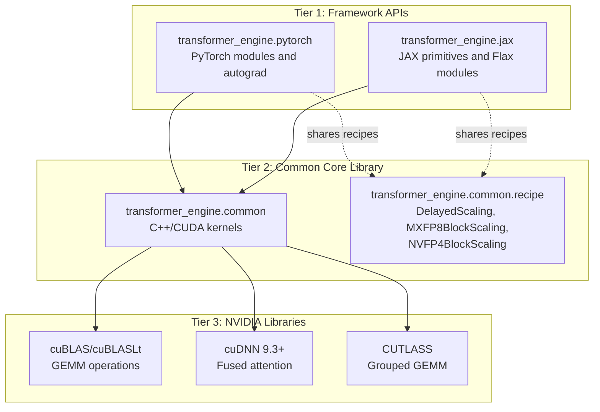
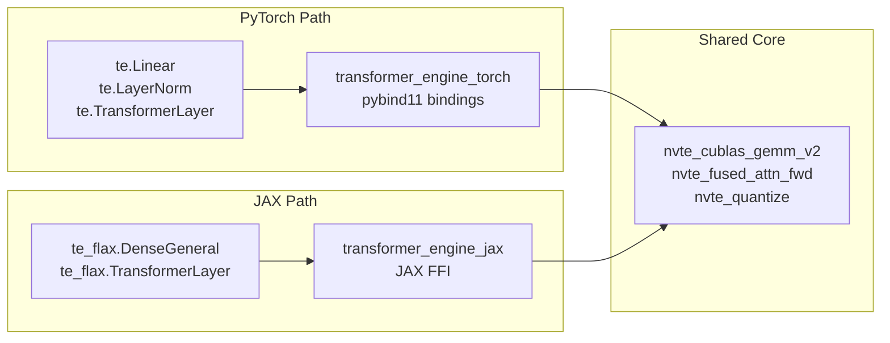
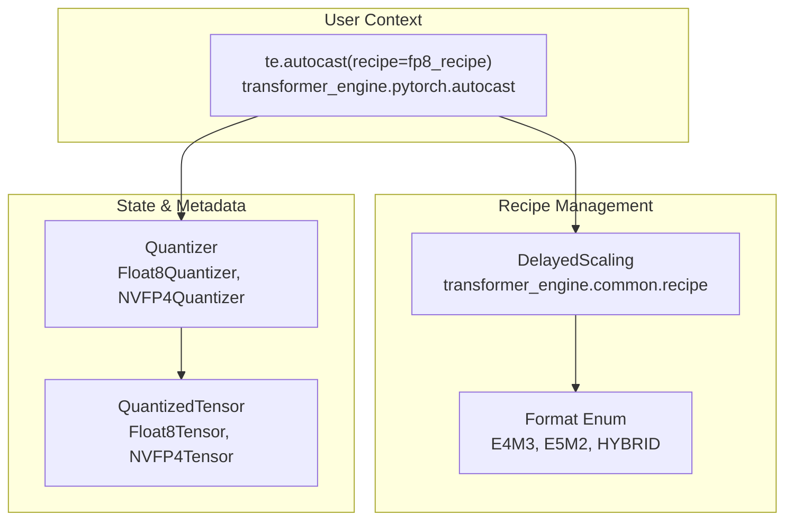

<!-- source: DeepWiki mcp.deepwiki.com · repo NVIDIA/TransformerEngine · page 1 Overview · fetched 2026-10-26 -->

# Overview

Relevant source files

The following files were used as context for generating this wiki page:

- [.github/workflows/build.yml](.github/workflows/build.yml)
- [.github/workflows/lint.yml](.github/workflows/lint.yml)
- [README.rst](README.rst)
- [build_tools/build_ext.py](build_tools/build_ext.py)
- [docs/api/jax.rst](docs/api/jax.rst)
- [docs/api/pytorch.rst](docs/api/pytorch.rst)
- [docs/installation.rst](docs/installation.rst)
- [examples/README.md](examples/README.md)
- [transformer_engine/jax/__init__.py](transformer_engine/jax/__init__.py)
- [transformer_engine/jax/setup.py](transformer_engine/jax/setup.py)
- [transformer_engine/pytorch/__init__.py](transformer_engine/pytorch/__init__.py)
- [transformer_engine/pytorch/export.py](transformer_engine/pytorch/export.py)
- [transformer_engine/pytorch/setup.py](transformer_engine/pytorch/setup.py)

TransformerEngine (TE) is a library for accelerating Transformer models on NVIDIA GPUs through optimized CUDA kernels and low-precision training with FP8, MXFP8, and NVFP4 quantization. It provides framework-specific APIs (PyTorch, JAX) built on a shared C++/CUDA core library, enabling efficient training and inference with minimal code changes. On Blackwell GPUs, TE supports MXFP8 (Microscaling FP8) and NVFP4 formats for even greater efficiency.

This page provides a high-level introduction to TransformerEngine's architecture, capabilities, and design principles.

## Purpose and Capabilities

TransformerEngine addresses key challenges in large-scale Transformer training:

1.  **Low-precision training**: Enables FP8, MXFP8, and NVFP4 training on Hopper, Ada, and Blackwell GPUs without accuracy degradation [README.rst:37-40]().
2.  **Kernel optimization**: Provides fused operations (LayerNorm+Linear, fused attention) and optimized GEMM implementations [README.rst:64]().
3.  **Distributed training**: Supports tensor parallelism, sequence parallelism, and communication-computation overlap via Userbuffers [README.rst:53-55]().
4.  **Ease of Use**: Modules internally maintain scaling factors and amax history, simplifying mixed-precision training [README.rst:57-58]().

The library supports CUDA 12.1+ (12.8+ for Blackwell) and cuDNN 9.3+ [docs/installation.rst:15-17]().

Sources: [README.rst:33-68](), [docs/installation.rst:9-21]()

## Three-Tier Architecture

TransformerEngine uses a layered architecture that separates framework-specific logic from optimized CUDA kernels:

Title: System Architecture Layers

**Tier 1 (Framework APIs)**: Each framework provides high-level modules like `Linear`, `LayerNorm`, and `TransformerLayer`. PyTorch modules are exported in `transformer_engine.pytorch` [transformer_engine/pytorch/__init__.py:21-35](), while JAX bindings are in `transformer_engine.jax` [transformer_engine/jax/__init__.py:4-21]().

**Tier 2 (Common Core)**: A framework-agnostic C++ API that provides the logic for FP8 support, GEMM dispatch, and fused kernels [README.rst:55-56](). It includes scaling recipes defined in `transformer_engine.common.recipe` [README.rst:91]().

**Tier 3 (NVIDIA Libraries)**: TE integrates with cuBLAS for GEMM, cuDNN for fused attention, and CUTLASS for advanced kernel logic [README.rst:37-44]().

Sources: [README.rst:33-58](), [transformer_engine/pytorch/__init__.py:18-72](), [transformer_engine/jax/__init__.py:30-54]()

## Supported Frameworks and Integration Pattern

TransformerEngine supports PyTorch and JAX through a consistent integration pattern that bridges high-level Python code to low-level C++ kernels.

Title: Framework to Core Mapping

Both frameworks follow a modular pattern:
1.  **User-facing modules**: `te.Linear` [transformer_engine/pytorch/__init__.py:22]() in PyTorch and `te_flax.DenseGeneral` [transformer_engine/jax/flax/__init__.py]() (referenced in [README.rst:130]()) in JAX.
2.  **Binding layer**: PyTorch uses the `transformer_engine_torch` extension [transformer_engine/pytorch/setup.py:28](), while JAX uses `transformer_engine_jax` [transformer_engine/jax/setup.py:131]().
3.  **Shared Kernels**: Both frameworks ultimately call the same optimized C++ API for performance-critical operations [README.rst:42-44]().

Sources: [README.rst:72-145](), [transformer_engine/pytorch/__init__.py:18-107](), [transformer_engine/pytorch/setup.py:155-185](), [transformer_engine/jax/setup.py:112-140]()

## Quantization System Overview

TransformerEngine provides multiple quantization strategies controlled by recipes. Users select a precision format and scaling method via `te.autocast` [transformer_engine/pytorch/__init__.py:46]().

| Feature | Precision Formats | Hardware Support |
| :--- | :--- | :--- |
| **FP8** | E4M3, E5M2, Hybrid | Hopper, Ada, Blackwell |
| **MXFP8** | Microscaling FP8 | Blackwell |
| **NVFP4** | 4-bit (E2M1) | Blackwell |

### Quantization Data Flow

Title: Quantization and Scaling Flow

**Scaling Strategies**:
*   **Delayed Scaling**: Uses `amax` history to compute scaling factors for the next iteration [README.rst:91]().
*   **Current Scaling**: Computes scaling factors based on the current tensor's values [transformer_engine/pytorch/__init__.py:84]().
*   **Block Scaling**: Applies scaling factors to sub-blocks of the tensor for higher precision [transformer_engine/pytorch/__init__.py:86]().

Sources: [README.rst:37-58](), [transformer_engine/pytorch/__init__.py:44-55](), [transformer_engine/pytorch/__init__.py:77-95]()

## Build System and Distribution

TransformerEngine uses a unified build system to handle multi-framework support and CUDA kernel compilation.

**Build Orchestration**: The library uses `setuptools` integrated with `CMake` to compile the core C++ library and framework-specific extensions [build_tools/build_ext.py:30-102]().
**Framework Detection**: The environment variable `NVTE_FRAMEWORK` controls which framework extensions are built (`pytorch`, `jax`, `all`, or `none`) [.github/workflows/build.yml:87, 110, 157]().
**Distribution**:
*   **NGC Containers**: Pre-installed in NVIDIA PyTorch/JAX containers [docs/installation.rst:26-27]().
*   **PyPI**: Available as `transformer_engine` with extras like `[pytorch]` or `[jax]` [docs/installation.rst:33-37]().
*   **Source**: Built using `pip install .` which triggers `CMakeBuildExtension` [transformer_engine/pytorch/setup.py:63, 135]().

Sources: [build_tools/build_ext.py:1-140](), [transformer_engine/pytorch/setup.py:1-185](), [docs/installation.rst:23-124]()

---

