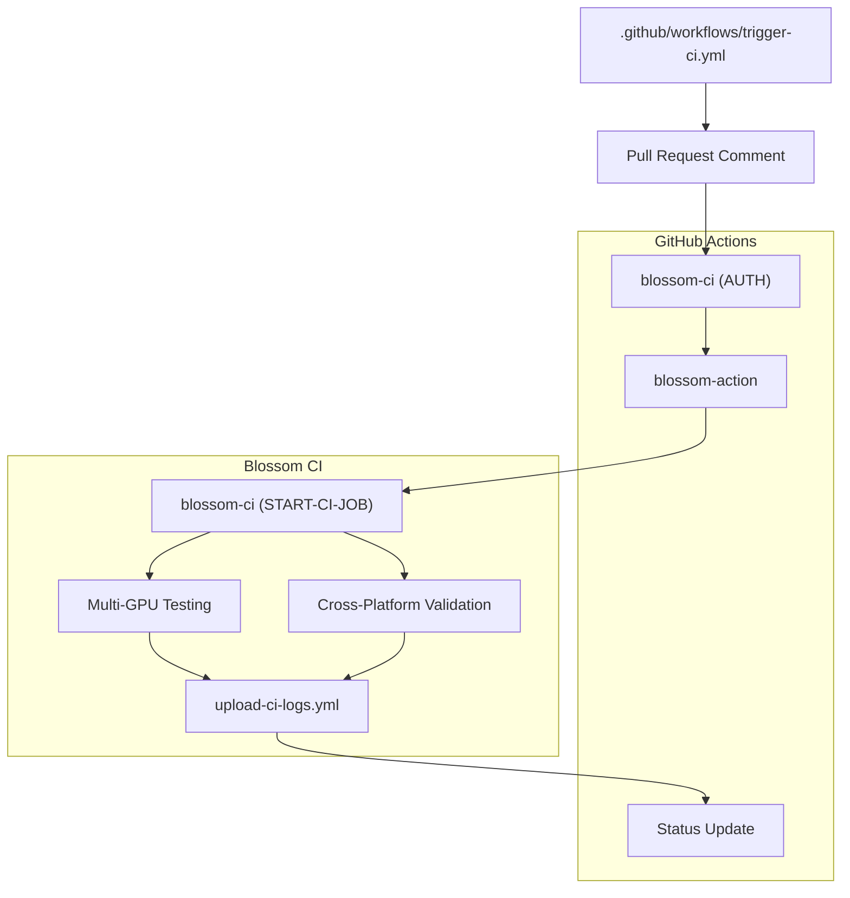
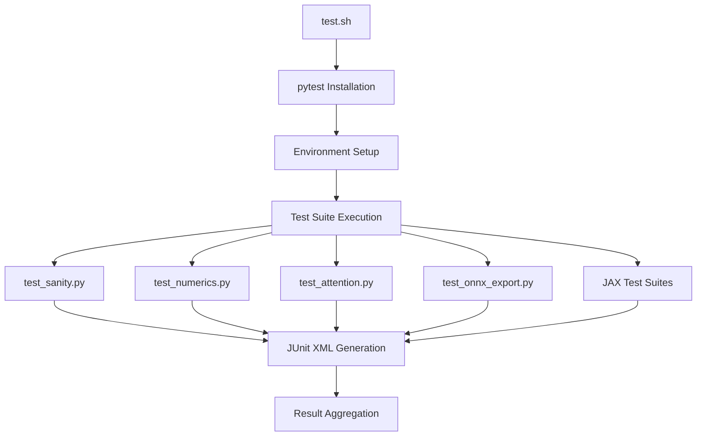

<!-- source: DeepWiki mcp.deepwiki.com · repo NVIDIA/TransformerEngine · page 10 Testing and Validation · fetched 2026-10-26 -->

# Testing and Validation

Relevant source files

The following files were used as context for generating this wiki page:

- [.github/workflows/blossom-ci.yml](.github/workflows/blossom-ci.yml)
- [.github/workflows/trigger-ci.yml](.github/workflows/trigger-ci.yml)
- [.github/workflows/upload-ci-logs.yml](.github/workflows/upload-ci-logs.yml)
- [CONTRIBUTING.rst](CONTRIBUTING.rst)
- [docs/api/c/activation.rst](docs/api/c/activation.rst)
- [docs/api/c/cast.rst](docs/api/c/cast.rst)
- [docs/api/c/gemm.rst](docs/api/c/gemm.rst)
- [examples/jax/encoder/run_test_multiprocessing_encoder.sh](examples/jax/encoder/run_test_multiprocessing_encoder.sh)
- [examples/pytorch/ep/bench/ep_bench.py](examples/pytorch/ep/bench/ep_bench.py)
- [examples/pytorch/ep/bench/run_ep_bench.sh](examples/pytorch/ep/bench/run_ep_bench.sh)
- [examples/pytorch/ep/bench/run_nccl_ep_bench.sh](examples/pytorch/ep/bench/run_nccl_ep_bench.sh)
- [examples/pytorch/ep/ep_moe.py](examples/pytorch/ep/ep_moe.py)
- [examples/pytorch/ep/run_test_ep.sh](examples/pytorch/ep/run_test_ep.sh)
- [qa/L0_cppunittest/test.sh](qa/L0_cppunittest/test.sh)
- [qa/L0_jax_distributed_unittest/test.sh](qa/L0_jax_distributed_unittest/test.sh)
- [qa/L0_jax_unittest/test.sh](qa/L0_jax_unittest/test.sh)
- [qa/L1_jax_distributed_unittest/test.sh](qa/L1_jax_distributed_unittest/test.sh)
- [qa/L1_pytorch_distributed_unittest/test.sh](qa/L1_pytorch_distributed_unittest/test.sh)
- [qa/L2_jax_distributed_unittest/test.sh](qa/L2_jax_distributed_unittest/test.sh)
- [qa/L2_jax_unittest/test.sh](qa/L2_jax_unittest/test.sh)
- [tests/cpp/CMakeLists.txt](tests/cpp/CMakeLists.txt)
- [tests/cpp/operator/test_dequantize_mxfp8.cu](tests/cpp/operator/test_dequantize_mxfp8.cu)
- [tests/cpp/operator/test_dequantize_nvfp4.cu](tests/cpp/operator/test_dequantize_nvfp4.cu)
- [tests/jax/multi_process_launch.sh](tests/jax/multi_process_launch.sh)
- [tests/jax/test_multi_process_distributed_grouped_gemm.py](tests/jax/test_multi_process_distributed_grouped_gemm.py)
- [tests/pytorch/distributed/test_ep.py](tests/pytorch/distributed/test_ep.py)
- [tests/pytorch/test_numerics.py](tests/pytorch/test_numerics.py)
- [tests/pytorch/test_onnx_export.py](tests/pytorch/test_onnx_export.py)
- [tests/pytorch/test_sanity.py](tests/pytorch/test_sanity.py)
- [transformer_engine/common/cast/dispatch/gated.cuh](transformer_engine/common/cast/dispatch/gated.cuh)
- [transformer_engine/common/cast/mxfp8/dequantize_mxfp8.cuh](transformer_engine/common/cast/mxfp8/dequantize_mxfp8.cuh)
- [transformer_engine/common/cast/nvfp4/dequantize_nvfp4.cuh](transformer_engine/common/cast/nvfp4/dequantize_nvfp4.cuh)
- [transformer_engine/pytorch/fp8.py](transformer_engine/pytorch/fp8.py)
- [transformer_engine/pytorch/transformer.py](transformer_engine/pytorch/transformer.py)

This document covers the testing infrastructure, validation methods, and quality assurance processes used in Transformer Engine. The testing system ensures correctness, performance, and hardware compatibility across PyTorch and JAX frameworks through comprehensive unit tests, integration tests, numerical validation, and CI/CD pipelines.

## CI/CD Pipeline Architecture

Transformer Engine uses a hybrid CI/CD infrastructure combining GitHub Actions with self-hosted runners through the Blossom CI system. The pipeline provides automated testing, vulnerability scanning, and multi-platform validation.

### Pipeline Flow

**CI/CD Pipeline Flow**

The pipeline supports authorized trigger comments (e.g., `/te-ci`) from approved contributors and runs comprehensive validation across different hardware configurations and framework combinations.

Sources: [.github/workflows/trigger-ci.yml:5-105](), [.github/workflows/upload-ci-logs.yml:1-10]()

### Authorization and Security

The system maintains strict access control with a predefined list of authorized contributors who can trigger CI jobs. All operations use encrypted tokens and keys for secure communication between GitHub and self-hosted infrastructure.

Sources: [.github/workflows/trigger-ci.yml:18-63]()

## Test Framework Architecture

The testing framework is built on `pytest` and organized into multiple test suites covering different functional areas and validation requirements across PyTorch and JAX.

### Test Execution Framework

**Test Framework Architecture**

The framework uses environment variables like `NVTE_ALLOW_NONDETERMINISTIC_ALGO` to control test behavior and generates JUnit XML logs for result tracking.

Sources: [qa/L1_pytorch_distributed_unittest/test.sh:23-72](), [qa/L0_jax_unittest/test.sh:25-55]()

### Test Categories and Coverage

| Test Category | Key Files | Purpose |
|---------------|-----------|---------|
| **Sanity Tests** | `tests/pytorch/test_sanity.py` | Basic E2E validation of `Linear`, `LayerNormMLP`, and `TransformerLayer` [tests/pytorch/test_sanity.py:22-26](). |
| **Numerical Validation** | `tests/pytorch/test_numerics.py` | Accuracy testing for FP8, MXFP8, and NVFP4 scaling recipes [tests/pytorch/test_numerics.py:181-192](). |
| **ONNX Export** | `tests/pytorch/test_onnx_export.py` | Validation of TE modules in ONNX Runtime using custom FP8/MXFP8 ops [tests/pytorch/test_onnx_export.py:76-147](). |
| **Distributed (PyTorch)** | `qa/L1_pytorch_distributed_unittest/test.sh` | Parallel execution of CP tests and distributed numerics [qa/L1_pytorch_distributed_unittest/test.sh:31-53](). |
| **Distributed (JAX)** | `qa/L0_jax_distributed_unittest/test.sh` | Validation of multi-process encoder and collective GEMM [qa/L0_jax_distributed_unittest/test.sh:30-41](). |

Sources: [tests/pytorch/test_sanity.py:22-34](), [tests/pytorch/test_numerics.py:14-47](), [tests/pytorch/test_onnx_export.py:33-40](), [qa/L1_pytorch_distributed_unittest/test.sh:31-53]()

## Validation Methods

### Numerical Validation Pipeline

The validation process compares Transformer Engine implementations against reference baselines using multiple precision formats and error metrics.

- **Tolerance Management**: The `dtype_tols` function provides estimated numerical error bounds for `float32`, `float16`, and `bfloat16` [tests/pytorch/test_numerics.py:199-211]().
- **FP8/FP4 Recipes**: Tests iterate through `DelayedScaling`, `Float8CurrentScaling`, `MXFP8BlockScaling`, and `NVFP4BlockScaling` [tests/pytorch/test_numerics.py:181-192]().
- **RNG State Control**: `reset_rng_states()` is used extensively to ensure reproducibility across test runs [tests/pytorch/test_numerics.py:61-61]().

Sources: [tests/pytorch/test_numerics.py:199-211](), [tests/pytorch/test_sanity.py:49-51]()

### Distributed and Multi-GPU Validation

Distributed testing employs sophisticated process management to validate multi-GPU features:
- **Parallel Test Execution**: On systems with $\ge 8$ GPUs, Context Parallelism (CP) tests are run concurrently on disjoint GPU sets [qa/L1_pytorch_distributed_unittest/test.sh:29-36]().
- **Multi-Process JAX Launchers**: Shell scripts like `run_test_multiprocessing_encoder.sh` manage multiple Python processes, each assigned to a specific GPU, to simulate distributed environments [examples/jax/encoder/run_test_multiprocessing_encoder.sh:52-73]().
- **Determinism**: JAX tests often enforce `XLA_FLAGS="--xla_gpu_deterministic_ops"` to ensure stable CI results [qa/L0_jax_unittest/test.sh:40-41]().

Sources: [qa/L1_pytorch_distributed_unittest/test.sh:29-41](), [examples/jax/encoder/run_test_multiprocessing_encoder.sh:52-73](), [qa/L0_jax_unittest/test.sh:40-41]()

## Debug and Inspection Tools Integration

The testing infrastructure integrates with `nvdlfw_inspect` for precision debugging.

- **Initialization**: If `NVTE_TEST_NVINSPECT_ENABLED` is set, the `debug_api` is initialized with a YAML configuration [tests/pytorch/test_numerics.py:103-115]().
- **Dummy Features**: Tests use dummy features to prevent the debug system from switching off when no specific feature is active [tests/pytorch/test_sanity.py:53-66]().

Sources: [tests/pytorch/test_numerics.py:103-115](), [qa/L1_pytorch_distributed_unittest/test.sh:59-66]()

## Hardware Compatibility Testing

The infrastructure validates compatibility across specific NVIDIA GPU architectures:
- **Feature Availability**: Tests use helper functions like `is_fp8_available()`, `is_mxfp8_available()`, and `is_nvfp4_available()` to skip unsupported tests on older hardware [tests/pytorch/test_numerics.py:52-55]().
- **Compute Capability**: Checks like `get_device_compute_capability() >= (8, 0)` are used to gate tests for features like BF16 [tests/pytorch/test_numerics.py:57-57]().
- **Recipe Support**: The system validates specific recipes like `NVFP4BlockScaling` which may involve Random Hadamard Transforms (RHT) or 2D quantization [tests/pytorch/test_numerics.py:118-129]().

Sources: [tests/pytorch/test_numerics.py:52-57](), [tests/pytorch/test_numerics.py:118-129]()

---

