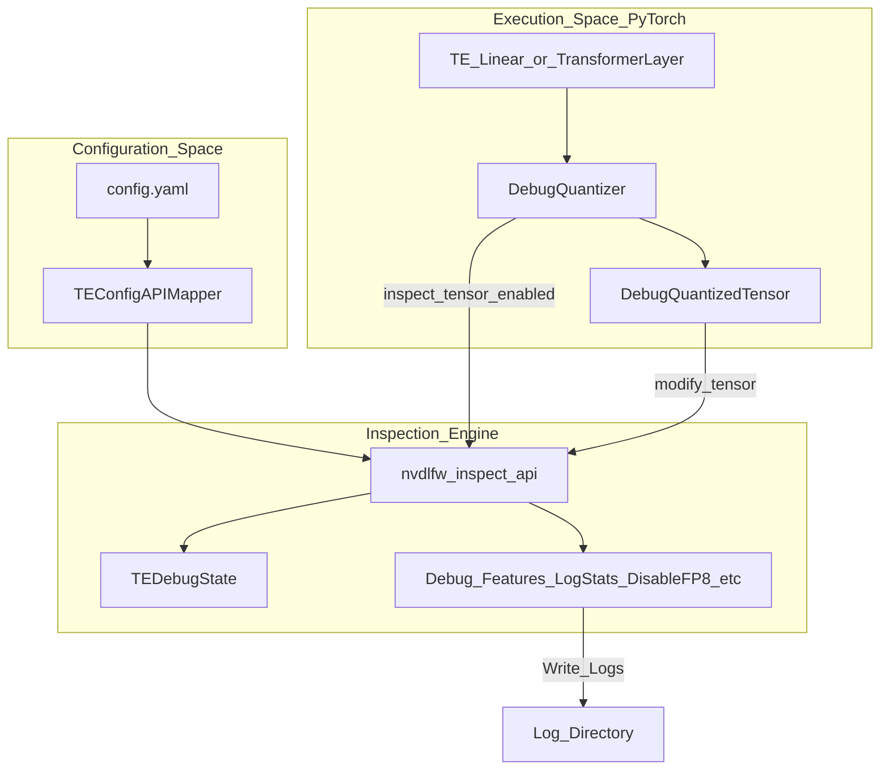
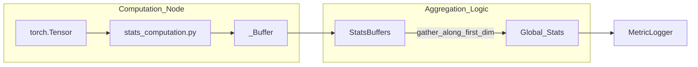

<!-- source: DeepWiki mcp.deepwiki.com · repo NVIDIA/TransformerEngine · page 11 Debug and Inspection Tools · fetched 2026-10-26 -->

# Debug and Inspection Tools

<details>
<summary>Relevant source files</summary>

The following files were used as context for generating this wiki page:

- [docs/debug/1_getting_started.rst](docs/debug/1_getting_started.rst)
- [docs/debug/3_api_features.rst](docs/debug/3_api_features.rst)
- [tests/pytorch/debug/test_api_features.py](tests/pytorch/debug/test_api_features.py)
- [tests/pytorch/debug/test_log.py](tests/pytorch/debug/test_log.py)
- [transformer_engine/debug/features/api.py](transformer_engine/debug/features/api.py)
- [transformer_engine/debug/features/disable_fp8_gemm.py](transformer_engine/debug/features/disable_fp8_gemm.py)
- [transformer_engine/debug/features/disable_fp8_layer.py](transformer_engine/debug/features/disable_fp8_layer.py)
- [transformer_engine/debug/features/disable_quantization_gemm.py](transformer_engine/debug/features/disable_quantization_gemm.py)
- [transformer_engine/debug/features/disable_quantization_layer.py](transformer_engine/debug/features/disable_quantization_layer.py)
- [transformer_engine/debug/features/dump_tensors.py](transformer_engine/debug/features/dump_tensors.py)
- [transformer_engine/debug/features/log_fp8_tensor_stats.py](transformer_engine/debug/features/log_fp8_tensor_stats.py)
- [transformer_engine/debug/features/log_nvfp4_tensor_stats.py](transformer_engine/debug/features/log_nvfp4_tensor_stats.py)
- [transformer_engine/debug/features/log_tensor_stats.py](transformer_engine/debug/features/log_tensor_stats.py)
- [transformer_engine/debug/features/utils/__init__.py](transformer_engine/debug/features/utils/__init__.py)
- [transformer_engine/debug/features/utils/stats_buffer.py](transformer_engine/debug/features/utils/stats_buffer.py)
- [transformer_engine/debug/features/utils/stats_computation.py](transformer_engine/debug/features/utils/stats_computation.py)
- [transformer_engine/debug/pytorch/debug_quantization.py](transformer_engine/debug/pytorch/debug_quantization.py)

</details>


Transformer Engine (TE) provides a comprehensive precision debug and inspection framework, primarily integrated with [nvidia-dlfw-inspect](https://github.com/NVIDIA/nvidia-dlfw-inspect). This framework allows developers to monitor tensor statistics, control quantization precision at a granular level (per-layer or per-GEMM), and troubleshoot numerical stability issues in large-scale transformer models [docs/debug/1_getting_started.rst:13-19]().

Currently, these inspection tools are supported for the **PyTorch** framework [docs/debug/1_getting_started.rst:11-12]().

### Core Capabilities
*   **Tensor Statistics Logging**: Track `min`, `max`, `mean`, `std`, and `amax` for activations, weights, and gradients [transformer_engine/debug/features/log_tensor_stats.py:41-54]().
*   **Precision Control**: Dynamically disable FP8 for specific GEMMs or entire layers to isolate numerical divergence [transformer_engine/debug/features/disable_fp8_gemm.py:11-15]().
*   **Quantization Inspection**: Specialized logging for FP8, MXFP8, and NVFP4, including underflow/overflow rates and Mean Squared Error (MSE) compared to high-precision references [transformer_engine/debug/features/log_fp8_tensor_stats.py:117-123]().
*   **YAML Configuration**: Non-intrusive setup using YAML files to target specific layers via regex patterns without modifying model source code [docs/debug/1_getting_started.rst:88-112]().

---

### System Architecture Overview

The debug system operates by wrapping standard TE components with "Debug" variants that hook into the `nvdlfw-inspect` API.

#### High-Level Inspection Flow
The following diagram illustrates how the `TEDebugState` and `TEConfigAPIMapper` coordinate with the PyTorch modules to intercept tensor data.

**Inspection Framework Interactivity**

**Sources:** [transformer_engine/debug/features/api.py:21-24](), [transformer_engine/debug/pytorch/debug_quantization.py:43-66](), [docs/debug/1_getting_started.rst:33-39]()

#### Statistics Computation and Buffering
TE uses specialized buffers to handle distributed training and micro-batching. Statistics are accumulated locally and reduced across the relevant process groups during the `step()` call.

**Data Flow for Statistics Collection**

**Sources:** [transformer_engine/debug/features/utils/stats_computation.py:54-71](), [transformer_engine/debug/features/utils/stats_buffer.py:27-54](), [transformer_engine/debug/features/utils/stats_buffer.py:154-170]()

---

### Key Components

| Component | Role | Code Reference |
| :--- | :--- | :--- |
| `TEDebugState` | Manages global debug session state, including current iteration tracking. | [transformer_engine/debug/pytorch/debug_state.py:1-20]() |
| `TEConfigAPIMapper` | Parses YAML configs to determine which features apply to specific GEMMs (`fprop`, `dgrad`, `wgrad`). | [transformer_engine/debug/features/api.py:21-44]() |
| `DebugQuantizer` | A wrapper for `Quantizer` that inserts `inspect_tensor` and `modify_tensor` calls into the quantization pipeline. | [transformer_engine/debug/pytorch/debug_quantization.py:43-109]() |
| `StatsBuffers` | Aggregates tensor statistics across distributed ranks and micro-batches before logging. | [transformer_engine/debug/features/utils/stats_buffer.py:154-170]() |
| `stats_computation` | Contains mathematical kernels (e.g., Welford algorithm for variance) for stable metric calculation. | [transformer_engine/debug/features/utils/stats_computation.py:123-135]() |

---

### Usage Workflow

To enable debugging, the user must initialize the API and call `step()` at the end of every training iteration.

1.  **Initialization**: Load the configuration and point to the TE feature definitions.
2.  **Naming**: (Optional) Provide a `name` to TE modules for easier identification in the YAML config.
3.  **Stepping**: Invoke `debug_api.step()` to flush logs and synchronize distributed statistics.

```python
import nvdlfw_inspect.api as debug_api
from transformer_engine.pytorch import TransformerLayer

# 1. Initialize
debug_api.initialize(
    config_file="./config.yaml",
    feature_dirs=["/path/to/transformer_engine/debug/features"],
    log_dir="./debug_logs"
)

# 2. Name modules for targeting
model = TransformerLayer(..., name="encoder_l1")

# 3. Step every iteration
for data in dataloader:
    output = model(data)
    loss = output.sum()
    loss.backward()
    debug_api.step() # Flushes stats and applies config updates
```
**Sources:** [docs/debug/1_getting_started.rst:124-140](), [transformer_engine/debug/features/utils/stats_buffer.py:127-151]()

---

### Detailed Documentation

The following child pages provide in-depth technical details on the framework and its features:

#### [Debug Framework Architecture](#11.1)
Detailed explanation of the `TEConfigAPIMapper` logic, how `TEDebugState` maintains iteration consistency, and the mechanics of the `DebugQuantizer` interception points. Covers the internal dispatching of `fprop`, `dgrad`, and `wgrad` GEMM types [transformer_engine/debug/pytorch/debug_quantization.py:29-36]().

#### [Built-in Debug Features](#11.2)
A catalog of available features including:
*   **LogTensorStats**: Basic numerical health (min/max/std, dynamic range) [transformer_engine/debug/features/log_tensor_stats.py:41-54]().
*   **LogFp8TensorStats**: Quantization-specific metrics like MSE and underflows for Delayed, Current, and Block scaling [transformer_engine/debug/features/log_fp8_tensor_stats.py:117-123]().
*   **LogNvfp4TensorStats**: Specialized statistics for NVFP4 precision [transformer_engine/debug/features/log_nvfp4_tensor_stats.py:44-48]().
*   **DisableFP8GEMM / DisableFP8Layer**: Forcing high-precision for specific operations or layers [transformer_engine/debug/features/disable_fp8_gemm.py:11-15]().
*   **DumpTensors**: Saving raw tensor data to disk for offline analysis [docs/debug/3_api_features.rst:18]().
*   **FakeQuant**: Simulating quantization effects without using FP8 hardware [transformer_engine/debug/features/fake_quant.py:1-20]().

**Sources:** [transformer_engine/debug/features/log_fp8_tensor_stats.py:70-142](), [transformer_engine/debug/features/disable_fp8_gemm.py:11-30](), [transformer_engine/debug/features/log_tensor_stats.py:29-100](), [transformer_engine/debug/features/log_nvfp4_tensor_stats.py:24-84]()

---

