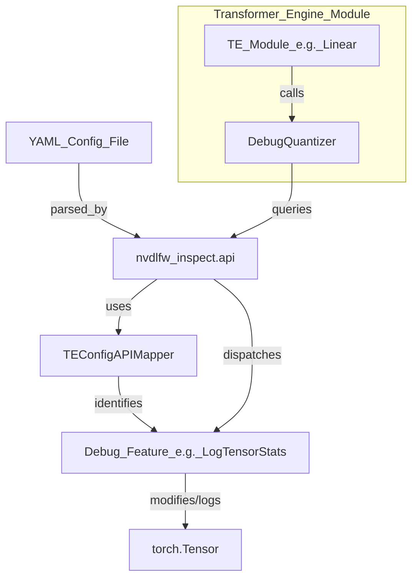
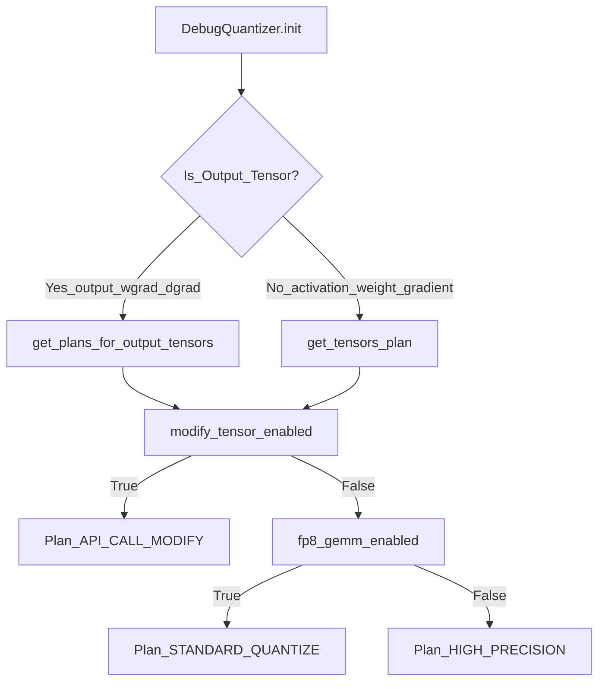

<!-- source: DeepWiki mcp.deepwiki.com · repo NVIDIA/TransformerEngine · page 11.1 Debug Framework Architecture · fetched 2026-10-26 -->

# Debug Framework Architecture

<details>
<summary>Relevant source files</summary>

The following files were used as context for generating this wiki page:

- [docs/debug/1_getting_started.rst](docs/debug/1_getting_started.rst)
- [docs/debug/3_api_features.rst](docs/debug/3_api_features.rst)
- [tests/pytorch/debug/run_distributed.py](tests/pytorch/debug/run_distributed.py)
- [tests/pytorch/debug/test_api_features.py](tests/pytorch/debug/test_api_features.py)
- [tests/pytorch/debug/test_configs/perf_config.yaml](tests/pytorch/debug/test_configs/perf_config.yaml)
- [tests/pytorch/debug/test_configs/test_switch_to_nondebug_mode.yaml](tests/pytorch/debug/test_configs/test_switch_to_nondebug_mode.yaml)
- [tests/pytorch/debug/test_distributed.py](tests/pytorch/debug/test_distributed.py)
- [tests/pytorch/debug/test_log.py](tests/pytorch/debug/test_log.py)
- [tests/pytorch/debug/test_numerics.py](tests/pytorch/debug/test_numerics.py)
- [tests/pytorch/debug/test_perf.py](tests/pytorch/debug/test_perf.py)
- [tests/pytorch/debug/test_sanity.py](tests/pytorch/debug/test_sanity.py)
- [transformer_engine/debug/features/_test_dummy_feature.py](transformer_engine/debug/features/_test_dummy_feature.py)
- [transformer_engine/debug/features/api.py](transformer_engine/debug/features/api.py)
- [transformer_engine/debug/features/disable_fp8_gemm.py](transformer_engine/debug/features/disable_fp8_gemm.py)
- [transformer_engine/debug/features/disable_fp8_layer.py](transformer_engine/debug/features/disable_fp8_layer.py)
- [transformer_engine/debug/features/disable_quantization_gemm.py](transformer_engine/debug/features/disable_quantization_gemm.py)
- [transformer_engine/debug/features/disable_quantization_layer.py](transformer_engine/debug/features/disable_quantization_layer.py)
- [transformer_engine/debug/features/dump_tensors.py](transformer_engine/debug/features/dump_tensors.py)
- [transformer_engine/debug/features/log_fp8_tensor_stats.py](transformer_engine/debug/features/log_fp8_tensor_stats.py)
- [transformer_engine/debug/features/log_nvfp4_tensor_stats.py](transformer_engine/debug/features/log_nvfp4_tensor_stats.py)
- [transformer_engine/debug/features/log_tensor_stats.py](transformer_engine/debug/features/log_tensor_stats.py)
- [transformer_engine/debug/features/utils/__init__.py](transformer_engine/debug/features/utils/__init__.py)
- [transformer_engine/debug/features/utils/stats_buffer.py](transformer_engine/debug/features/utils/stats_buffer.py)
- [transformer_engine/debug/features/utils/stats_computation.py](transformer_engine/debug/features/utils/stats_computation.py)
- [transformer_engine/debug/pytorch/debug_quantization.py](transformer_engine/debug/pytorch/debug_quantization.py)

</details>


The Transformer Engine (TE) debug framework provides a flexible, YAML-configurable system for inspecting and modifying the behavior of TE modules during training. It integrates with the `nvidia-dlframework-inspect` (nvdlfw-inspect) library to allow per-GEMM precision control, tensor statistics logging, and custom feature dispatch without requiring intrusive code changes to the model definition.

## System Overview

The debug framework operates as an interceptor layer within the TE PyTorch modules. When a TE layer (e.g., `Linear`, `TransformerLayer`) is initialized and the debug system is active, standard quantization paths are replaced with debug-aware components.

### Key Components

*   **`TEDebugState`**: A singleton class that manages the global state of the debug system, including current iteration tracking and configuration resets. [transformer_engine/debug/pytorch/debug_state.py:17-17]().
*   **`TEConfigAPIMapper`**: Maps YAML configuration entries to specific TE debug API calls. It handles the logic for filtering configurations by `layer_name`, `gemm` type (`fprop`, `dgrad`, `wgrad`), and `tensor_name`. [transformer_engine/debug/features/api.py:21-21]().
*   **`DebugQuantizer`**: A wrapper around the standard `Quantizer` that injects calls to `nvdlfw-inspect` during the quantization process. [transformer_engine/debug/pytorch/debug_quantization.py:43-43]().
*   **`nvdlfw-inspect`**: An external dependency that provides the registry for debug features and handles the orchestration of API calls based on the provided YAML configuration. [docs/debug/1_getting_started.rst:11-11]().

### Debug System Data Flow

The following diagram illustrates how a YAML configuration is parsed and dispatched to modify the execution of a TE module.

**Figure 1: Debug Configuration and Feature Dispatch**

Sources: [transformer_engine/debug/features/api.py:21-25](), [transformer_engine/debug/pytorch/debug_quantization.py:43-66](), [docs/debug/1_getting_started.rst:28-40]()

## Implementation Details

### Configuration Mapping

The `TEConfigAPIMapper` is responsible for interpreting the `transformer_engine` namespace in the YAML config. It specifically validates GEMM types and filters configurations based on whether the system is performing "GEMM parsing" (deciding if a GEMM should be FP8) or "Tensor parsing" (deciding how to handle a specific input/output tensor). [transformer_engine/debug/features/api.py:24-50]().

The mapper supports two primary structures in YAML:
1.  `gemms`: A simple list of GEMM names (e.g., `[fprop, dgrad]`). [transformer_engine/debug/features/api.py:71-71]().
2.  `gemms_struct`: A detailed list of dictionaries allowing per-GEMM settings. [transformer_engine/debug/features/api.py:55-55]().

### Debug Quantization Logic

The `DebugQuantizer` replaces standard quantizers when debugging is enabled. It determines a "plan" for each tensor (activation, weight, gradient) based on the debug API's response. [transformer_engine/debug/pytorch/debug_quantization.py:87-94]().

Possible plans include:
*   `API_CALL_MODIFY`: The tensor will be passed through a `modify_tensor` API call (e.g., for `FakeQuant` or `PerTensorScaling`). [transformer_engine/debug/pytorch/debug_quantization.py:38-38]().
*   `STANDARD_QUANTIZE`: Standard TE quantization proceeds. [transformer_engine/debug/pytorch/debug_quantization.py:39-39]().
*   `HIGH_PRECISION`: Quantization is bypassed, and the tensor remains in its original precision (e.g., BF16/FP32). [transformer_engine/debug/pytorch/debug_quantization.py:40-40]().

**Figure 2: DebugQuantizer Decision Logic**

Sources: [transformer_engine/debug/pytorch/debug_quantization.py:95-107](), [transformer_engine/debug/pytorch/debug_quantization.py:110-135](), [transformer_engine/debug/pytorch/debug_quantization.py:172-185]()

### Statistics Computation and Buffering

For features like `LogTensorStats`, `LogFp8TensorStats`, and `LogNvfp4TensorStats`, TE uses a buffered approach to handle micro-batching and distributed training.

*   **`_Buffer`**: Stores temporary statistics for a specific (layer, tensor) pair. It accumulates values across micro-batches using "combinator" functions defined in `STATS` (e.g., for `min`, `max`, `variance`). [transformer_engine/debug/features/utils/stats_buffer.py:27-54]().
*   **`StatsBuffers`**: A registry of all active buffers. It tracks which layers have been "fed" tensors during a step. [transformer_engine/debug/features/utils/stats_buffer.py:154-170]().
*   **Synchronization**: Statistics are local to each rank until `debug_api.step()` is called. At that point, `StatsBuffers` performs a global reduction (e.g., `gather_along_first_dim`) to compute final statistics across the entire model. [transformer_engine/debug/features/utils/stats_buffer.py:59-71](), [transformer_engine/debug/features/utils/stats_buffer.py:127-151]().

| Stat Category | Description | Implementation Function |
| :--- | :--- | :--- |
| **Basic** | min, max, mean, std, l1_norm, l2_norm | `stats_computation.py` [transformer_engine/debug/features/utils/stats_computation.py:167-186]() |
| **FP8 Specific** | underflows%, overflows%, scale_inv_min, MSE | `LogFp8TensorStats` [transformer_engine/debug/features/log_fp8_tensor_stats.py:117-123]() |
| **NVFP4 Specific** | underflows%, MSE | `LogNvfp4TensorStats` [transformer_engine/debug/features/log_nvfp4_tensor_stats.py:88-91]() |
| **Blockwise** | max_blockwise_dynamic_range | `compute_max_blockwise_dynamic_range` [transformer_engine/debug/features/utils/stats_computation.py:54-54]() |

Sources: [transformer_engine/debug/features/utils/stats_buffer.py:12-25](), [transformer_engine/debug/features/utils/stats_computation.py:167-186](), [transformer_engine/debug/features/log_nvfp4_tensor_stats.py:86-96]()

## Configuration Format

The YAML configuration allows for fine-grained control. Features are grouped under a top-level user-defined name, which specifies the layers to target, and a `transformer_engine` block that specifies the TE-specific debug feature.

### YAML Structure Example
```yaml
# Example Configuration
disable_fc1_fp8:
  enabled: True
  layers:
    layer_types: [fc1]  # Target all layers with 'fc1' in their name
  transformer_engine:
    DisableFP8GEMM:
      enabled: True
      gemms: [fprop]    # Disable FP8 only for the forward pass
```
Sources: [docs/debug/1_getting_started.rst:92-113](), [transformer_engine/debug/features/api.py:51-86]()

### Target Identification
TE layers can be identified in the YAML via:
*   `layer_name_regex_pattern`: A regex matching the full hierarchical name. [tests/pytorch/debug/test_log.py:39-39]().
*   `layer_types`: A list of strings matching parts of the layer name (e.g., `layernorm_linear`). [docs/debug/1_getting_started.rst:104-104]().

## Distributed Considerations

The debug framework is designed to work with Tensor Parallelism (TP). 
*   **Weight Reduction**: Weight statistics are typically reduced within the TP group because weights are often partitioned. [transformer_engine/debug/features/utils/__init__.py:22-32]().
*   **Activation/Gradient Reduction**: These are generally reduced across the global reduction group (usually the entire world) to provide an aggregate view of the training dynamics. [transformer_engine/debug/features/utils/__init__.py:20-21]().

The `get_reduction_params` function determines the appropriate process group for statistics synchronization based on the tensor type and the `TEDebugState`. [transformer_engine/debug/features/utils/__init__.py:15-33]().

Sources: [transformer_engine/debug/features/utils/__init__.py:15-33](), [transformer_engine/debug/features/utils/stats_buffer.py:59-71]()

---

