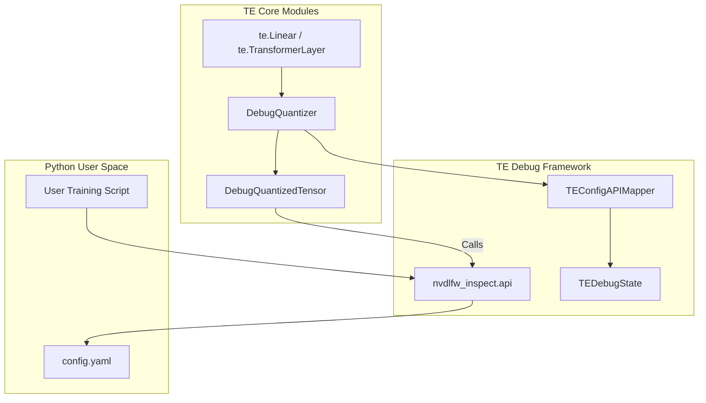
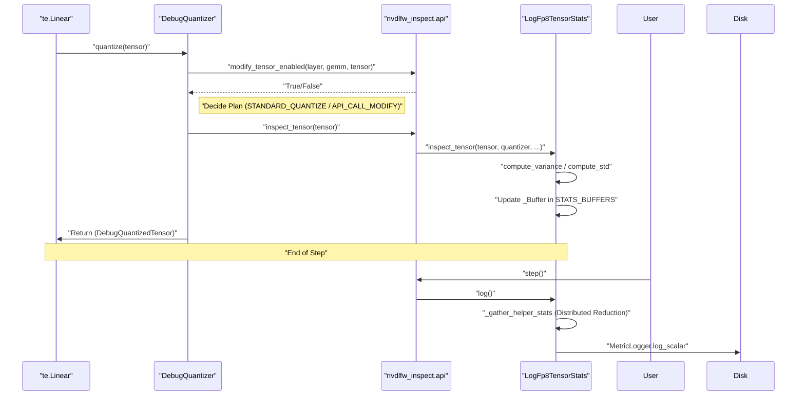

<!-- source: DeepWiki mcp.deepwiki.com · repo NVIDIA/TransformerEngine · page 11.2 Built-in Debug Features · fetched 2026-10-26 -->

# Built-in Debug Features

<details>
<summary>Relevant source files</summary>

The following files were used as context for generating this wiki page:

- [docs/debug/1_getting_started.rst](docs/debug/1_getting_started.rst)
- [docs/debug/3_api_features.rst](docs/debug/3_api_features.rst)
- [docs/examples/onnx/onnx_export.ipynb](docs/examples/onnx/onnx_export.ipynb)
- [docs/examples/onnx/utils.py](docs/examples/onnx/utils.py)
- [qa/L0_pytorch_debug_unittest/test.sh](qa/L0_pytorch_debug_unittest/test.sh)
- [qa/L1_pytorch_onnx_unittest/test.sh](qa/L1_pytorch_onnx_unittest/test.sh)
- [tests/pytorch/debug/test_api_features.py](tests/pytorch/debug/test_api_features.py)
- [tests/pytorch/debug/test_log.py](tests/pytorch/debug/test_log.py)
- [transformer_engine/debug/features/api.py](transformer_engine/debug/features/api.py)
- [transformer_engine/debug/features/disable_fp8_gemm.py](transformer_engine/debug/features/disable_fp8_gemm.py)
- [transformer_engine/debug/features/disable_fp8_layer.py](transformer_engine/debug/features/disable_fp8_layer.py)
- [transformer_engine/debug/features/disable_quantization_gemm.py](transformer_engine/debug/features/disable_quantization_gemm.py)
- [transformer_engine/debug/features/disable_quantization_layer.py](transformer_engine/debug/features/disable_quantization_layer.py)
- [transformer_engine/debug/features/dump_tensors.py](transformer_engine/debug/features/dump_tensors.py)
- [transformer_engine/debug/features/log_fp8_tensor_stats.py](transformer_engine/debug/features/log_fp8_tensor_stats.py)
- [transformer_engine/debug/features/log_nvfp4_tensor_stats.py](transformer_engine/debug/features/log_nvfp4_tensor_stats.py)
- [transformer_engine/debug/features/log_tensor_stats.py](transformer_engine/debug/features/log_tensor_stats.py)
- [transformer_engine/debug/features/utils/__init__.py](transformer_engine/debug/features/utils/__init__.py)
- [transformer_engine/debug/features/utils/stats_buffer.py](transformer_engine/debug/features/utils/stats_buffer.py)
- [transformer_engine/debug/features/utils/stats_computation.py](transformer_engine/debug/features/utils/stats_computation.py)
- [transformer_engine/debug/pytorch/debug_quantization.py](transformer_engine/debug/pytorch/debug_quantization.py)
- [transformer_engine/pytorch/onnx_extensions.py](transformer_engine/pytorch/onnx_extensions.py)

</details>


Transformer Engine (TE) provides a suite of precision debug tools integrated with `nvidia-dlfw-inspect`. These features allow developers to inspect tensor statistics, manipulate quantization behavior, and identify precision bottlenecks in Transformer models without modifying the core model architecture.

## Overview and Configuration

The debug system is activated by initializing the `nvdlfw_inspect` API and providing a YAML configuration file. This configuration maps specific debug features to model layers using regex patterns or layer types.

### Configuration via YAML
The YAML file structure defines features under the `transformer_engine` namespace. Features can be applied globally or to specific layers [docs/debug/1_getting_started.rst:88-113]().

```yaml
# Example config.yaml
log_stats:
  enabled: True
  layers:
    layer_types: [layernorm_linear]
  transformer_engine:
    LogTensorStats:
      enabled: True
      stats: [max, min, mean]
      tensors: [activation, gradient]
      freq: 10
```

### Data Flow and Architecture
The debug features hook into the TE lifecycle via the `DebugQuantizer` and `DebugQuantizedTensor` wrappers [transformer_engine/debug/pytorch/debug_quantization.py:43-49](). These wrappers intercept the standard quantization flow to inject inspection or modification logic.

**Debug System Interaction Diagram**

*Sources: [transformer_engine/debug/features/api.py:21-44](), [transformer_engine/debug/pytorch/debug_quantization.py:43-109](), [docs/debug/1_getting_started.rst:120-140]()*

---

## Logging Features

### LogTensorStats
This feature logs basic high-precision statistics for tensors (Activation, Weight, Gradient, etc.) before or after they are processed by TE kernels [transformer_engine/debug/features/log_tensor_stats.py:29-38]().

*   **Supported Stats:** `min`, `max`, `mean`, `std`, `l1_norm`, `l2_norm`, `cur_amax`, and `dynamic_range` [transformer_engine/debug/features/log_tensor_stats.py:44-51]().
*   **Blockwise Stats:** Supports `max_blockwise_dynamic_range` which computes the worst-case dynamic range across sub-blocks of a tensor using `BlockwiseDynamicRangeStat` [transformer_engine/debug/features/log_tensor_stats.py:52-58]().
*   **Implementation:** Uses `STATS_BUFFERS` to accumulate statistics across micro-batches and `_Buffer._gather_helper_stats` to synchronize results across distributed ranks during `debug_api.step()` [transformer_engine/debug/features/utils/stats_buffer.py:27-70]().

### LogFP8TensorStats / LogNvfp4TensorStats
Specialized features for inspecting quantized formats. They can compute "what-if" statistics, showing how a high-precision tensor would behave under different quantization recipes (e.g., `mxfp8`, `fp8_delayed_scaling`, `fp8_block_scaling`) [transformer_engine/debug/features/log_fp8_tensor_stats.py:70-85]().

*   **Key Metrics:**
    *   `underflows%`: Percentage of non-zero elements clipped to zero [transformer_engine/debug/features/log_fp8_tensor_stats.py:118]().
    *   `overflows%`: Percentage of elements clipped to the maximum representable value (Delayed Scaling only) [transformer_engine/debug/features/log_fp8_tensor_stats.py:119]().
    *   `mse`: Mean Squared Error between the original and quantized tensor [transformer_engine/debug/features/log_fp8_tensor_stats.py:122]().
    *   `scale_inv_min`/`max`: Range of the inverse scaling factors [transformer_engine/debug/features/log_fp8_tensor_stats.py:120-121]().

*Sources: [transformer_engine/debug/features/log_tensor_stats.py:41-76](), [transformer_engine/debug/features/log_fp8_tensor_stats.py:104-123](), [transformer_engine/debug/features/log_nvfp4_tensor_stats.py:44-48](), [transformer_engine/debug/features/utils/stats_buffer.py:127-151]()*

---

## Control and Modification Features

### DisableFP8GEMM and DisableFP8Layer
These features allow granular control over which parts of the model use FP8 acceleration.

*   **DisableFP8GEMM:** Disables FP8 for specific GEMM types (`fprop`, `dgrad`, `wgrad`) within a layer by returning `False` in `fp8_gemm_enabled` [transformer_engine/debug/features/api.py:105-138]().
*   **DisableFP8Layer:** Completely forces a layer to run in high precision (e.g., BF16/FP16) regardless of the global autocast setting [transformer_engine/debug/features/disable_fp8_layer.py]().

### FakeQuant
Simulates the effects of quantization while keeping the tensor in high precision. It uses `API_CALL_MODIFY` to intercept the tensor and apply quantization followed by immediate dequantization [transformer_engine/debug/pytorch/debug_quantization.py:38-40]().

### PerTensorScaling
Allows overriding the default TE scaling recipes (like Delayed Scaling) with a simple per-tensor scale factor for specific GEMMs to test custom scaling logic [docs/debug/1_getting_started.rst:13-19]().

### DumpTensors
Dumps raw tensor data to disk for offline analysis. It utilizes the `inspect_tensor` API hook to save tensors at specific iterations [transformer_engine/debug/features/dump_tensors.py]().

---

## Internal Implementation Details

The debug features are registered via the `Registry` and dispatched by the `TEConfigAPIMapper`.

**Quantization Debug Logic Flow**

*Sources: [transformer_engine/debug/pytorch/debug_quantization.py:172-205](), [transformer_engine/debug/features/api.py:21-44](), [transformer_engine/debug/features/utils/stats_buffer.py:72-126](), [transformer_engine/debug/features/utils/stats_computation.py:123-135]()*

### Key Classes and Functions
| Code Entity | Role |
| :--- | :--- |
| `TEConfigAPIMapper` | Parses YAML config and matches it to API calls like `inspect_tensor_enabled` [transformer_engine/debug/features/api.py:21-44](). |
| `DebugQuantizer` | A wrapper for `Quantizer` that checks `nvdlfw_inspect` for active debug features [transformer_engine/debug/pytorch/debug_quantization.py:43-66](). |
| `STATS_BUFFERS` | Singleton instance of `StatsBuffers` managing global state for statistics [transformer_engine/debug/features/utils/stats_buffer.py:154-170](). |
| `_Buffer` | Handles the mathematical accumulation (e.g., Welford's algorithm) and distributed reduction of stats [transformer_engine/debug/features/utils/stats_buffer.py:27-54](). |
| `compute_max_blockwise_dynamic_range` | Core logic for analyzing tensor dynamic range in tiled or consecutive blocks [transformer_engine/debug/features/utils/stats_computation.py:54-71](). |

*Sources: [transformer_engine/debug/features/api.py:21-87](), [transformer_engine/debug/pytorch/debug_quantization.py:43-109](), [transformer_engine/debug/features/utils/stats_buffer.py:27-151](), [transformer_engine/debug/features/utils/stats_computation.py:54-135]()*

---

