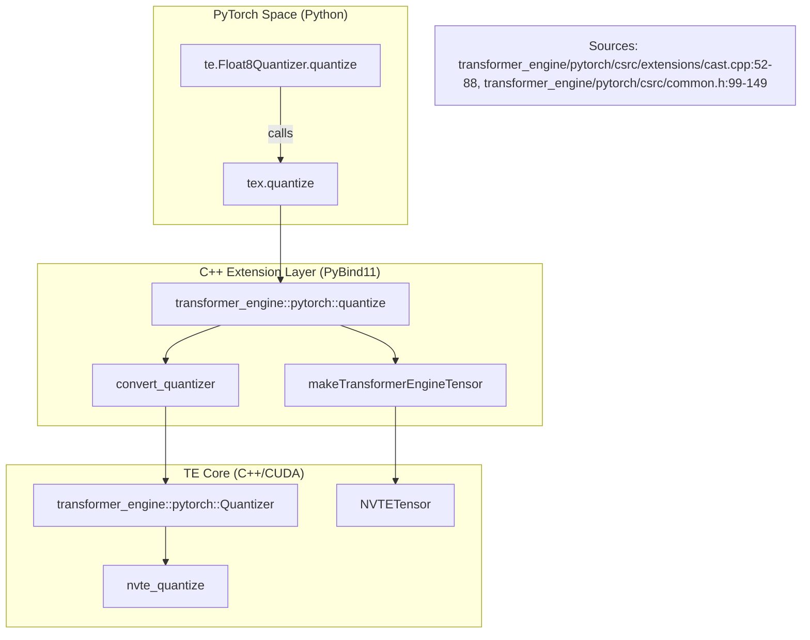
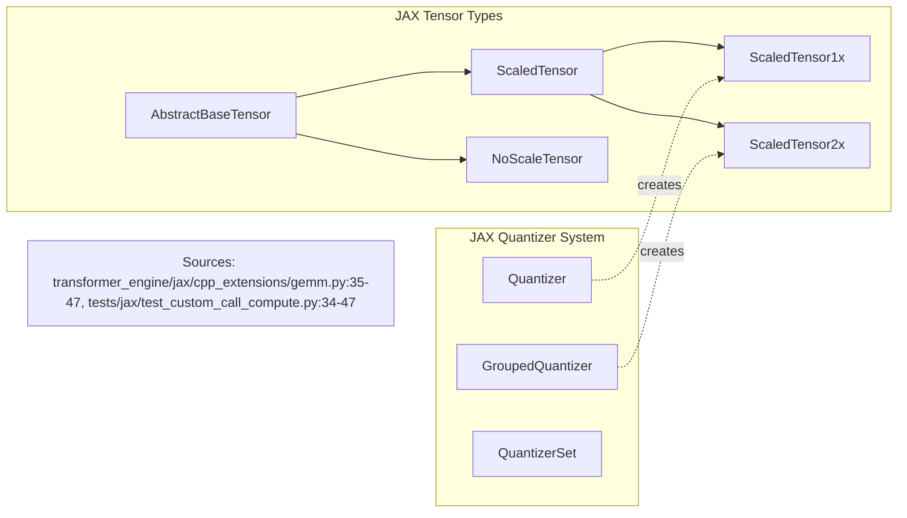

<!-- source: DeepWiki mcp.deepwiki.com · repo NVIDIA/TransformerEngine · page 12 Glossary · fetched 2026-10-26 -->

# Glossary

Relevant source files

The following files were used as context for generating this wiki page:

- [.github/workflows/build.yml](.github/workflows/build.yml)
- [.github/workflows/lint.yml](.github/workflows/lint.yml)
- [.gitignore](.gitignore)
- [README.rst](README.rst)
- [build_tools/build_ext.py](build_tools/build_ext.py)
- [docs/api/c/index.rst](docs/api/c/index.rst)
- [docs/api/common.rst](docs/api/common.rst)
- [docs/examples/quickstart_utils.py](docs/examples/quickstart_utils.py)
- [docs/installation.rst](docs/installation.rst)
- [examples/README.md](examples/README.md)
- [examples/pytorch/comm_gemm_overlap/te_layer_with_overlap.py](examples/pytorch/comm_gemm_overlap/te_layer_with_overlap.py)
- [qa/L3_pytorch_FA_versions_test/test.sh](qa/L3_pytorch_FA_versions_test/test.sh)
- [tests/jax/test_custom_call_compute.py](tests/jax/test_custom_call_compute.py)
- [tests/pytorch/attention/run_attention_with_cp.py](tests/pytorch/attention/run_attention_with_cp.py)
- [tests/pytorch/attention/run_attention_with_cp_pool.py](tests/pytorch/attention/run_attention_with_cp_pool.py)
- [tests/pytorch/attention/test_attention.py](tests/pytorch/attention/test_attention.py)
- [tests/pytorch/attention/test_attention_with_cp.py](tests/pytorch/attention/test_attention_with_cp.py)
- [tests/pytorch/distributed/run_gemm_with_overlap.py](tests/pytorch/distributed/run_gemm_with_overlap.py)
- [tests/pytorch/distributed/run_layer_with_overlap.py](tests/pytorch/distributed/run_layer_with_overlap.py)
- [tests/pytorch/distributed/test_comm_gemm_overlap.py](tests/pytorch/distributed/test_comm_gemm_overlap.py)
- [tests/pytorch/test_checkpoint.py](tests/pytorch/test_checkpoint.py)
- [tests/pytorch/test_grouped_tensor.py](tests/pytorch/test_grouped_tensor.py)
- [tests/pytorch/test_recipe.py](tests/pytorch/test_recipe.py)
- [tests/pytorch/utils.py](tests/pytorch/utils.py)
- [transformer_engine/common/cast/dispatch/quantize.cuh](transformer_engine/common/cast/dispatch/quantize.cuh)
- [transformer_engine/common/comm_gemm_overlap/comm_gemm_overlap.cpp](transformer_engine/common/comm_gemm_overlap/comm_gemm_overlap.cpp)
- [transformer_engine/common/comm_gemm_overlap/userbuffers/userbuffers-host.cpp](transformer_engine/common/comm_gemm_overlap/userbuffers/userbuffers-host.cpp)
- [transformer_engine/common/comm_gemm_overlap/userbuffers/userbuffers.cu](transformer_engine/common/comm_gemm_overlap/userbuffers/userbuffers.cu)
- [transformer_engine/common/comm_gemm_overlap/userbuffers/userbuffers.h](transformer_engine/common/comm_gemm_overlap/userbuffers/userbuffers.h)
- [transformer_engine/common/fused_attn/fused_attn.cpp](transformer_engine/common/fused_attn/fused_attn.cpp)
- [transformer_engine/common/fused_attn/fused_attn_f16_arbitrary_seqlen.cu](transformer_engine/common/fused_attn/fused_attn_f16_arbitrary_seqlen.cu)
- [transformer_engine/common/fused_attn/fused_attn_f16_arbitrary_seqlen.h](transformer_engine/common/fused_attn/fused_attn_f16_arbitrary_seqlen.h)
- [transformer_engine/common/fused_attn/fused_attn_fp8.cu](transformer_engine/common/fused_attn/fused_attn_fp8.cu)
- [transformer_engine/common/fused_attn/fused_attn_fp8.h](transformer_engine/common/fused_attn/fused_attn_fp8.h)
- [transformer_engine/common/fused_attn/utils.cu](transformer_engine/common/fused_attn/utils.cu)
- [transformer_engine/common/fused_attn/utils.h](transformer_engine/common/fused_attn/utils.h)
- [transformer_engine/common/include/transformer_engine/comm_gemm_overlap.h](transformer_engine/common/include/transformer_engine/comm_gemm_overlap.h)
- [transformer_engine/common/include/transformer_engine/fused_attn.h](transformer_engine/common/include/transformer_engine/fused_attn.h)
- [transformer_engine/common/recipe/__init__.py](transformer_engine/common/recipe/__init__.py)
- [transformer_engine/jax/cpp_extensions/gemm.py](transformer_engine/jax/cpp_extensions/gemm.py)
- [transformer_engine/jax/cpp_extensions/quantization.py](transformer_engine/jax/cpp_extensions/quantization.py)
- [transformer_engine/jax/csrc/extensions/gemm.cpp](transformer_engine/jax/csrc/extensions/gemm.cpp)
- [transformer_engine/jax/dense.py](transformer_engine/jax/dense.py)
- [transformer_engine/jax/quantize/dequantizer.py](transformer_engine/jax/quantize/dequantizer.py)
- [transformer_engine/jax/quantize/helper.py](transformer_engine/jax/quantize/helper.py)
- [transformer_engine/jax/quantize/quantizer.py](transformer_engine/jax/quantize/quantizer.py)
- [transformer_engine/jax/quantize/scaling_modes.py](transformer_engine/jax/quantize/scaling_modes.py)
- [transformer_engine/jax/quantize/tensor.py](transformer_engine/jax/quantize/tensor.py)
- [transformer_engine/jax/setup.py](transformer_engine/jax/setup.py)
- [transformer_engine/pytorch/_extra_state.py](transformer_engine/pytorch/_extra_state.py)
- [transformer_engine/pytorch/attention/dot_product_attention/backends.py](transformer_engine/pytorch/attention/dot_product_attention/backends.py)
- [transformer_engine/pytorch/attention/dot_product_attention/context_parallel.py](transformer_engine/pytorch/attention/dot_product_attention/context_parallel.py)
- [transformer_engine/pytorch/attention/dot_product_attention/dot_product_attention.py](transformer_engine/pytorch/attention/dot_product_attention/dot_product_attention.py)
- [transformer_engine/pytorch/attention/dot_product_attention/utils.py](transformer_engine/pytorch/attention/dot_product_attention/utils.py)
- [transformer_engine/pytorch/cpp_extensions/fused_attn.py](transformer_engine/pytorch/cpp_extensions/fused_attn.py)
- [transformer_engine/pytorch/csrc/common.h](transformer_engine/pytorch/csrc/common.h)
- [transformer_engine/pytorch/csrc/extensions.h](transformer_engine/pytorch/csrc/extensions.h)
- [transformer_engine/pytorch/csrc/extensions/attention.cpp](transformer_engine/pytorch/csrc/extensions/attention.cpp)
- [transformer_engine/pytorch/csrc/extensions/cast.cpp](transformer_engine/pytorch/csrc/extensions/cast.cpp)
- [transformer_engine/pytorch/csrc/extensions/comm_gemm_overlap.cpp](transformer_engine/pytorch/csrc/extensions/comm_gemm_overlap.cpp)
- [transformer_engine/pytorch/csrc/extensions/pybind.cpp](transformer_engine/pytorch/csrc/extensions/pybind.cpp)
- [transformer_engine/pytorch/csrc/quantizer.cpp](transformer_engine/pytorch/csrc/quantizer.cpp)
- [transformer_engine/pytorch/quantization.py](transformer_engine/pytorch/quantization.py)
- [transformer_engine/pytorch/setup.py](transformer_engine/pytorch/setup.py)

This glossary defines technical terms, domain-specific jargon, and architectural concepts used within the TransformerEngine (TE) codebase. It serves as a reference for engineers to navigate the multi-framework (PyTorch/JAX) and multi-layered (Python/C++/CUDA) nature of the library.

## Core Domain Concepts

### FP8 (8-bit Floating Point)
A data format used to accelerate Deep Learning workloads. TE supports two primary variants: `E4M3` (4-bit exponent, 3-bit mantissa) typically used for forward passes, and `E5M2` (5-bit exponent, 2-bit mantissa) typically used for gradients.
*   **Implementation**: Managed via recipes and the global state manager [transformer_engine/pytorch/quantization.py:22-22]().
*   **Code Pointers**: `jnp.float8_e4m3fn` and `jnp.float8_e5m2` are used in JAX [transformer_engine/jax/cpp_extensions/gemm.py:122-131]().

### Delayed Scaling
A quantization strategy where the scaling factors for FP8 tensors are not calculated immediately from the current tensor's `amax` (absolute maximum). Instead, they are derived from a history of `amax` values from previous iterations to minimize synchronization overhead.
*   **Class**: `DelayedScaling` [transformer_engine/common/recipe/__init__.py:91-91]().
*   **Logic**: Handled in the C++ core via `NVTE_DELAYED_TENSOR_SCALING` scaling mode [transformer_engine/pytorch/csrc/common.h:155-155]().

### MXFP8 (Microscaling FP8)
A block-based scaling format (part of the OCP Microscaling Formats) where a group of elements shares a single scale factor, providing higher precision than per-tensor scaling.
*   **Implementation**: `MXFP8Quantizer` [transformer_engine/pytorch/csrc/extensions/pybind.cpp:61-61]() and `MXFP8TensorStorage` [transformer_engine/pytorch/csrc/extensions/pybind.cpp:66-67]().
*   **Constants**: Block size defined by `MXFP8_BLOCK_SCALING_SIZE` [transformer_engine/pytorch/attention/dot_product_attention/utils.py:49-49]().

### NVFP4 (NVIDIA 4-bit Floating Point)
A high-performance 4-bit quantization format supported on Blackwell architectures, often utilizing Restricted Hadamard Transform (RHT) for precision.
*   **Implementation**: `NVFP4Quantizer` [transformer_engine/pytorch/csrc/extensions/pybind.cpp:94-95]() and `NVFP4TensorStorage` [transformer_engine/pytorch/csrc/extensions/pybind.cpp:100-101]().
*   **Kernel Integration**: `nvfp4_quantize_with_amax` handles precomputed amax values [transformer_engine/pytorch/csrc/extensions/cast.cpp:90-92]().

---

## Codebase Entities and Jargon

### Userbuffers (UB)
A specialized communication library within TE designed to overlap Tensor Parallel (TP) communication (All-Gather, Reduce-Scatter) with GEMM computation using persistent memory buffers.
*   **Implementation**: `userbuffers-host.cpp` and `userbuffers.cu`.
*   **C++ Classes**: `CommOverlap`, `CommOverlapP2P` [transformer_engine/pytorch/csrc/extensions.h:25-26]().

### WeightGradStore
A mechanism used to manage and accumulate weight gradients, especially useful for overlapping weight gradient computation with backpropagation through layers.
*   **Integration**: Used in PyTorch modules to defer and accumulate gradients.

### Recipe
A high-level configuration object that defines the quantization strategy (FP8, MXFP8, NVFP4), scaling factors, and optimization overrides for a model.
*   **Base Class**: `Recipe` [transformer_engine/common/recipe/__init__.py:91-91]().
*   **Autocast Integration**: Enabled via `te.autocast(recipe=fp8_recipe)` [README.rst:91-94]().

### Amax (Absolute Maximum)
The maximum absolute value of a tensor, used to calculate scaling factors for quantization. In delayed scaling, TE tracks a history of amax values.
*   **Code Reference**: Tracked in `FP8TensorMeta` [transformer_engine/pytorch/csrc/common.h:67-72]().

---

## Architectural Mapping

The following diagram bridges the gap between high-level framework modules and the underlying C++ extensions.

### Diagram 1: PyTorch Quantization Call Stack
This diagram shows how a Python-level quantization request flows through the PyBind11 layer into the TE Core kernels.

### Diagram 2: JAX Scaled Tensor Abstractions
This diagram illustrates the JAX-specific hierarchy for handling quantized and scaled data.

---

## Technical Terminology Table

| Term | Definition | Code Pointer |
| :--- | :--- | :--- |
| **QKV Layout** | Memory format for Query, Key, Value tensors (e.g., `SB3HD`, `BS3HD`). | [transformer_engine/common/fused_attn/fused_attn.cpp:19-74]() |
| **THD** | Ragged tensor format where `T` is total sequence length, `H` is heads, `D` is head dim. | [transformer_engine/common/fused_attn/fused_attn.cpp:82-82]() |
| **SBHD / BSHD** | Standard sequence formats: `S` (SeqLen), `B` (Batch), `H` (Heads), `D` (Dim). | [transformer_engine/common/fused_attn/fused_attn.cpp:78-81]() |
| **RHT** | Restricted Hadamard Transform, used in NVFP4 to improve quantization accuracy. | [transformer_engine/pytorch/csrc/extensions/cast.cpp:157-160]() |
| **Stochastic Rounding** | Probabilistic rounding technique used in low-precision quantization. | [transformer_engine/pytorch/csrc/extensions/cast.cpp:165-166]() |
| **FusedAttnBackend** | Enum selecting the specific attention implementation (e.g., FlashAttention, cuDNN). | [transformer_engine/pytorch/csrc/extensions.h:89-94]() |
| **Meta Tensors** | Tensors containing metadata like `scale`, `scale_inv`, and `amax_history`. | [transformer_engine/pytorch/csrc/common.h:67-72]() |

## Distributed Training Abbreviations

*   **TP**: Tensor Parallelism - splitting model weights across GPUs.
*   **SP**: Sequence Parallelism - splitting the sequence dimension across GPUs.
*   **CP**: Context Parallelism - specialized parallelism for extremely long sequences.
    *   Implementation: `flash_attn_p2p_communicate` handles KV exchange in CP [transformer_engine/pytorch/attention/dot_product_attention/context_parallel.py:96-100]().
*   **P2P**: Point-to-Point communication, often used in Ring-style CP.

## Build and Infrastructure
*   **NVTE**: Prefix for framework-agnostic C++ API and Core library.
*   **TEX**: The `transformer_engine_torch` compiled Python extension [transformer_engine/pytorch/attention/dot_product_attention/utils.py:22-22]().
*   **PyBind**: The bridge layer between Python and C++ [transformer_engine/pytorch/csrc/extensions/pybind.cpp:135-150]().

Sources:
- [transformer_engine/pytorch/csrc/common.h:1-180]()
- [transformer_engine/pytorch/csrc/extensions/pybind.cpp:1-130]()
- [transformer_engine/pytorch/csrc/extensions/cast.cpp:1-170]()
- [transformer_engine/jax/cpp_extensions/gemm.py:1-150]()
- [transformer_engine/common/fused_attn/fused_attn.cpp:1-182]()
- [transformer_engine/pytorch/attention/dot_product_attention/context_parallel.py:1-140]()