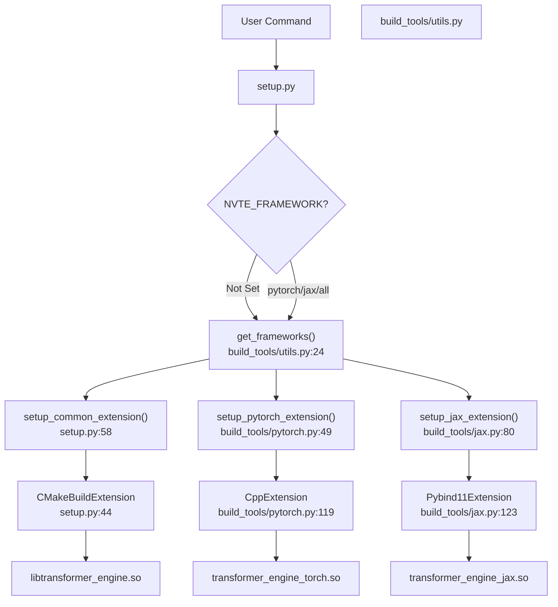
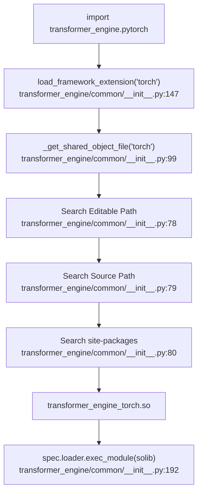

<!-- source: DeepWiki mcp.deepwiki.com · repo NVIDIA/TransformerEngine · page 2 Getting Started · fetched 2026-10-26 -->

# Getting Started

<details>
<summary>Relevant source files</summary>

The following files were used as context for generating this wiki page:

- [.github/workflows/build.yml](.github/workflows/build.yml)
- [.github/workflows/deploy_nightly_docs.yml](.github/workflows/deploy_nightly_docs.yml)
- [.github/workflows/docs.yml](.github/workflows/docs.yml)
- [.github/workflows/lint.yml](.github/workflows/lint.yml)
- [.gitmodules](.gitmodules)
- [MANIFEST.in](MANIFEST.in)
- [README.rst](README.rst)
- [build_tools/build_ext.py](build_tools/build_ext.py)
- [build_tools/jax.py](build_tools/jax.py)
- [build_tools/pytorch.py](build_tools/pytorch.py)
- [build_tools/utils.py](build_tools/utils.py)
- [build_tools/wheel_utils/Dockerfile.aarch](build_tools/wheel_utils/Dockerfile.aarch)
- [build_tools/wheel_utils/Dockerfile.x86](build_tools/wheel_utils/Dockerfile.x86)
- [build_tools/wheel_utils/build_wheels.sh](build_tools/wheel_utils/build_wheels.sh)
- [build_tools/wheel_utils/launch_aarch.sh](build_tools/wheel_utils/launch_aarch.sh)
- [build_tools/wheel_utils/launch_x86.sh](build_tools/wheel_utils/launch_x86.sh)
- [docs/_static/css/nvidia_font.css](docs/_static/css/nvidia_font.css)
- [docs/_templates/layout.html](docs/_templates/layout.html)
- [docs/api/c/softmax.rst](docs/api/c/softmax.rst)
- [docs/conf.py](docs/conf.py)
- [docs/examples/advanced_optimizations.ipynb](docs/examples/advanced_optimizations.ipynb)
- [docs/index.rst](docs/index.rst)
- [docs/installation.rst](docs/installation.rst)
- [examples/README.md](examples/README.md)
- [pyproject.toml](pyproject.toml)
- [qa/L1_cpp_distributed/test.sh](qa/L1_cpp_distributed/test.sh)
- [setup.py](setup.py)
- [tests/cpp_distributed/CMakeLists.txt](tests/cpp_distributed/CMakeLists.txt)
- [tests/cpp_distributed/run_test_ep.sh](tests/cpp_distributed/run_test_ep.sh)
- [transformer_engine/__init__.py](transformer_engine/__init__.py)
- [transformer_engine/common/CMakeLists.txt](transformer_engine/common/CMakeLists.txt)
- [transformer_engine/common/__init__.py](transformer_engine/common/__init__.py)
- [transformer_engine/jax/cpp_extensions/flex_attention.py](transformer_engine/jax/cpp_extensions/flex_attention.py)
- [transformer_engine/jax/pyproject.toml](transformer_engine/jax/pyproject.toml)
- [transformer_engine/jax/setup.py](transformer_engine/jax/setup.py)
- [transformer_engine/pytorch/setup.py](transformer_engine/pytorch/setup.py)

</details>


## Purpose and Scope

This page provides step-by-step instructions for installing Transformer Engine and running your first accelerated model. It covers system requirements, multiple installation methods (pip, source, NGC containers), configuration options, and basic usage examples for both PyTorch and JAX frameworks.

Transformer Engine (TE) is designed to accelerate Transformer models on NVIDIA GPUs, specifically utilizing 8-bit floating point (FP8) precision on Hopper, Ada, and Blackwell architectures, as well as MXFP8 and NVFP4 on Blackwell [README.rst:37-44]().

**Sources:** [README.rst:33-59]()

---

## System Requirements

### Hardware Requirements

| Component | Requirement |
|-----------|-------------|
| **GPU Architecture** | Blackwell, Hopper, Ada, or Ampere [README.rst:65-67]() |
| **FP8 Support** | Hopper (CC 9.0), Ada (CC 8.9), Blackwell (CC 10.0+) [README.rst:37-40]() |
| **Advanced Formats** | MXFP8 and NVFP4 support requires Blackwell GPUs [README.rst:66]() |

### Software Requirements

| Component | Version |
|-----------|---------|
| **Operating System** | Linux x86_64 [docs/installation.rst:14]() |
| **CUDA** | 12.1+ (12.8+ for Blackwell support) [docs/installation.rst:15](), [transformer_engine/common/CMakeLists.txt:24-26]() |
| **cuDNN** | 9.3+ [docs/installation.rst:17]() |
| **Python** | 3.10+ [build_tools/utils.py:23-37]() |
| **CMake** | 3.18+ (3.21+ recommended for core build) [build_tools/utils.py:105](), [transformer_engine/common/CMakeLists.txt:5]() |
| **PyTorch** | 2.1+ (for PyTorch integration) [build_tools/pytorch.py:26]() |
| **JAX** | 0.4.7+ (for JAX integration) [docs/installation.rst:56]() |

**Sources:** [docs/installation.rst:9-21](), [build_tools/utils.py:23-37](), [transformer_engine/common/CMakeLists.txt:5-26](), [build_tools/pytorch.py:23-34]()

---

## Installation Methods

### Installation Flow Overview

The following diagram illustrates how the build system dispatches to framework-specific extensions based on environment variables and detected dependencies.



**Sources:** [setup.py:38-44](), [setup.py:58-111](), [build_tools/pytorch.py:49-126](), [build_tools/jax.py:80-129]()

---

### Docker Installation (Recommended)

Transformer Engine is preinstalled in the NVIDIA PyTorch container (NGC) version 22.09 and later [docs/installation.rst:26-27]().

#### PyTorch Container
```bash
docker run --gpus all -it --rm nvcr.io/nvidia/pytorch:24.12-py3
```

#### JAX Container
```bash
docker run --gpus all -it --rm ghcr.io/nvidia/jax:jax
```

**Sources:** [docs/installation.rst:23-27](), [.github/workflows/build.yml:73](), [.github/workflows/build.yml:95]()

---

### pip Installation

#### Install from PyPI
Transformer Engine provides wheels for the core library and source distributions for framework extensions [docs/installation.rst:39]().

```bash
# Install with PyTorch support
pip3 install --no-build-isolation transformer_engine[pytorch]

# Install with JAX support
pip3 install --no-build-isolation transformer_engine[jax]

# Install core library only (CUDA 12 default)
pip3 install transformer_engine[core]
```

#### Install from GitHub
```bash
# Latest stable version
pip3 install --no-build-isolation git+https://github.com/NVIDIA/TransformerEngine.git@stable

# Development build
pip3 install --no-build-isolation git+https://github.com/NVIDIA/TransformerEngine.git@main
```

**Sources:** [docs/installation.rst:30-48](), [docs/installation.rst:58-84]()

---

### Source Installation

For custom builds or development, install directly from a local clone.

```bash
git clone --branch stable --recursive https://github.com/NVIDIA/TransformerEngine.git
cd TransformerEngine
export NVTE_FRAMEWORK=pytorch         # Specify framework
pip3 install --no-build-isolation .   # Build and install
```

To enable debug symbols during source build, set `NVTE_BUILD_DEBUG=1` [docs/installation.rst:123]().

**Sources:** [docs/installation.rst:93-124](), [setup.py:38-42]()

---

## Build Configuration

### Environment Variables

| Variable | Purpose | Default |
|----------|---------|---------|
| `NVTE_FRAMEWORK` | Target frameworks: `pytorch`, `jax`, `all`, `none` [docs/installation.rst:84]() | Auto-detect |
| `NVTE_BUILD_DEBUG` | Build with `-g` and disable optimizations [build_tools/utils.py:41-43]() | `0` |
| `MAX_JOBS` | Parallel build threads for Ninja [build_tools/utils.py:56-58]() | System CPU count |
| `NVTE_UB_WITH_MPI` | Enable MPI for Userbuffers [setup.py:64-68]() | `0` |
| `NVTE_WITH_CUBLASMP` | Enable cuBLASMp support [setup.py:79-84]() | `0` |
| `NVTE_ENABLE_NVSHMEM` | Enable NVSHMEM support [setup.py:70-75]() | `0` |

**Sources:** [setup.py:58-102](), [build_tools/utils.py:41-65](), [docs/installation.rst:80-85]()

---

## Quick Start Examples

### PyTorch Usage

This example uses `te.Linear` and `te.autocast` to enable FP8 precision [README.rst:75-99]().

```python
import torch
import transformer_engine.pytorch as te
from transformer_engine.common import recipe

# Define dimensions
in_features, out_features = 768, 3072

# Initialize model and input
model = te.Linear(in_features, out_features, bias=True).cuda()
inp = torch.randn(2048, in_features, device="cuda")

# Configure FP8 recipe
fp8_recipe = recipe.DelayedScaling(margin=0, fp8_format=recipe.Format.E4M3)

# Forward pass with autocast
with te.autocast(enabled=True, recipe=fp8_recipe):
    out = model(inp)

out.sum().backward()
```

**Sources:** [README.rst:72-99]()

---

### JAX/Flax Usage

Using the `te_flax.DenseGeneral` module for FP8 execution in JAX [README.rst:107-141]().

```python
import jax
import transformer_engine.jax as te
import transformer_engine.jax.flax as te_flax
from transformer_engine.common import recipe

# Setup recipe
fp8_recipe = recipe.DelayedScaling(margin=0, fp8_format=recipe.Format.HYBRID)

# Use TE Flax module within autocast context
with te.autocast(enabled=True, recipe=fp8_recipe):
    model = te_flax.DenseGeneral(features=1024)
    # ... standard Flax initialization and application ...
```

**Sources:** [README.rst:101-141]()

---

## Troubleshooting

### Runtime Library Resolution

Transformer Engine uses a dynamic loading mechanism to find its framework-specific shared objects (`.so` files). If you encounter `FileNotFoundError` during import, ensure the libraries were built and are located in the expected search paths [transformer_engine/common/__init__.py:59-95]().



**Sources:** [transformer_engine/common/__init__.py:59-132](), [transformer_engine/common/__init__.py:147-194]()

### Common Issues

1.  **CUDA Version Mismatch:** Blackwell GPUs require CUDA 12.8+; Hopper/Ada require 12.1+ [docs/installation.rst:15]().
2.  **Missing Headers:** If CUDA headers are not found, set `NVTE_CUDA_INCLUDE_PATH` or `CUDA_HOME` [docs/installation.rst:21](), [build_tools/utils.py:185]().
3.  **NCCL Version:** The NCCL EP backend requires a minimum runtime version of 2.30.4 [transformer_engine/__init__.py:17-18]().
4.  **PyPI Version Mismatch:** If installing via PyPI, the `transformer-engine` (metapackage), `transformer-engine-cu*` (core), and framework extensions must have matching versions [transformer_engine/common/__init__.py:180-186]().

**Sources:** [docs/installation.rst:19-22](), [transformer_engine/__init__.py:17-55](), [transformer_engine/common/__init__.py:164-187]()

---

