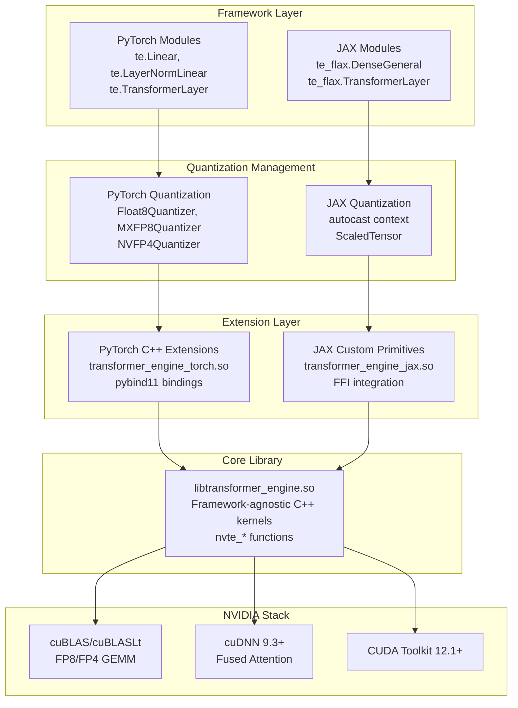
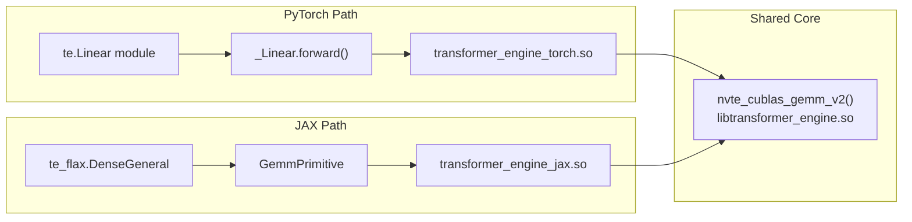
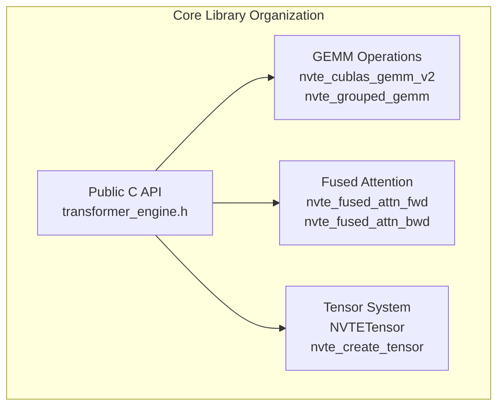
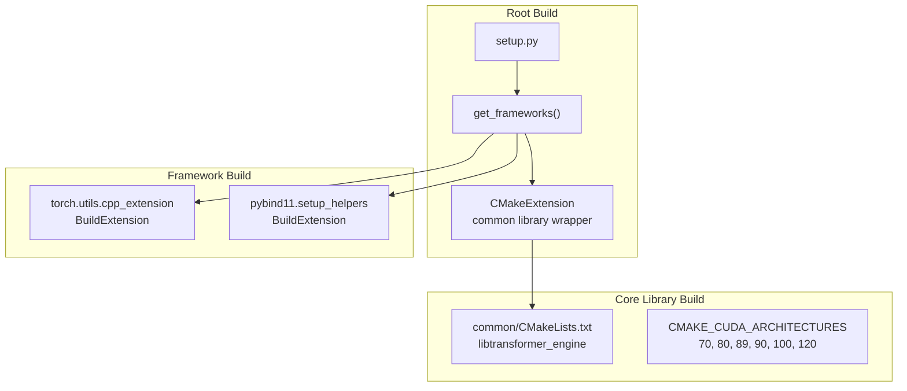

<!-- source: DeepWiki mcp.deepwiki.com · repo NVIDIA/TransformerEngine · page 3 Architecture · fetched 2026-10-26 -->

# Architecture

Relevant source files

The following files were used as context for generating this wiki page:

- [.github/workflows/build.yml](.github/workflows/build.yml)
- [.github/workflows/lint.yml](.github/workflows/lint.yml)
- [.gitmodules](.gitmodules)
- [README.rst](README.rst)
- [build_tools/build_ext.py](build_tools/build_ext.py)
- [docs/installation.rst](docs/installation.rst)
- [examples/README.md](examples/README.md)
- [qa/L1_cpp_distributed/test.sh](qa/L1_cpp_distributed/test.sh)
- [setup.py](setup.py)
- [tests/cpp/test_common.cu](tests/cpp/test_common.cu)
- [tests/cpp/test_common.h](tests/cpp/test_common.h)
- [tests/cpp_distributed/CMakeLists.txt](tests/cpp_distributed/CMakeLists.txt)
- [tests/cpp_distributed/run_test_ep.sh](tests/cpp_distributed/run_test_ep.sh)
- [transformer_engine/__init__.py](transformer_engine/__init__.py)
- [transformer_engine/common/CMakeLists.txt](transformer_engine/common/CMakeLists.txt)
- [transformer_engine/common/__init__.py](transformer_engine/common/__init__.py)
- [transformer_engine/common/common.h](transformer_engine/common/common.h)
- [transformer_engine/common/include/transformer_engine/transformer_engine.h](transformer_engine/common/include/transformer_engine/transformer_engine.h)
- [transformer_engine/common/transformer_engine.cpp](transformer_engine/common/transformer_engine.cpp)
- [transformer_engine/jax/setup.py](transformer_engine/jax/setup.py)
- [transformer_engine/pytorch/setup.py](transformer_engine/pytorch/setup.py)

## Purpose and Scope

This page provides a high-level overview of Transformer Engine's architecture, including the multi-layered design that enables framework-agnostic FP8 optimizations. For detailed information on specific aspects:
- For in-depth layer-by-layer architecture details, see [System Architecture](#3.1)
- For FP8, MXFP8, and NVFP4 quantization design and scaling recipes, see [Quantization System](#3.2)
- For build system mechanics and installation, see [Build System and Installation](#3.3)
- For PyTorch-specific implementation, see [PyTorch Integration](#4)
- For JAX-specific implementation, see [JAX Integration](#5)

## Architectural Overview

Transformer Engine is designed as a multi-layered library that provides low-precision accelerated Transformer building blocks for multiple deep learning frameworks. The architecture separates framework-specific concerns from core computational kernels, enabling code reuse and consistent behavior across PyTorch and JAX. While it originally focused on FP8 for Hopper GPUs, it now extends support to MXFP8 (Microscaling FP8) and NVFP4 formats on Blackwell GPUs [README.rst:37-44]().

### High-Level Component Diagram

Sources: [setup.py:58-111](), [transformer_engine/common/CMakeLists.txt:173-200](), [README.rst:37-58]()

## Multi-Framework Support

Transformer Engine supports multiple deep learning frameworks through a unified core library. Each framework has its own Python API and extension mechanism, but all converge on the same C++ computational kernels defined in the core library [transformer_engine/common/CMakeLists.txt:173-200]().

### Framework-Specific Paths to Core GEMM

Sources: [transformer_engine/common/__init__.py:109-115](), [transformer_engine/common/CMakeLists.txt:173-200](), [README.rst:72-141]()

## Layered Architecture

The architecture follows a clear separation of concerns across four distinct layers:

### Layer 1: Python API
Framework-specific Python modules that users interact with directly. These handle integration with framework-specific autograd systems and distributed training coordination.
- **PyTorch**: Modules like `te.Linear` and `te.TransformerLayer` [README.rst:75-99]().
- **JAX**: Flax modules like `te_flax.DenseGeneral` [README.rst:107-141]().

### Layer 2: Quantization Management
Framework-specific systems for managing quantization state and scaling factors. Modules internally maintain scaling factors and amax values needed for training [README.rst:55-58](). Scaling modes include `NVTE_DELAYED_TENSOR_SCALING`, `NVTE_MXFP8_1D_SCALING`, and `NVTE_NVFP4_1D_SCALING` [transformer_engine/common/include/transformer_engine/transformer_engine.h:99-119]().

### Layer 3: C++ Extensions
Framework-specific C++ extensions bridge Python to the core library. These are compiled as shared objects such as `transformer_engine_torch.so` and `transformer_engine_jax.so` [transformer_engine/common/__init__.py:110-115]().

### Layer 4: Core C++ Library
The framework-agnostic computational core in `libtransformer_engine.so` [transformer_engine/common/__init__.py:111-112](). This layer contains the CUDA/C++ implementations for GEMM, attention, and normalization [transformer_engine/common/CMakeLists.txt:173-200]().

Sources: [transformer_engine/common/include/transformer_engine/transformer_engine.h:130-162](), [transformer_engine/common/CMakeLists.txt:173-200]()

## Build System Architecture

The build system orchestrates compilation of the core library and framework-specific extensions using CMake and Python's `setuptools` [setup.py:5-44]().

Sources: [setup.py:30-44](), [setup.py:107-111](), [transformer_engine/common/CMakeLists.txt:28-88]()

## Data Flow Through the Stack

For a typical forward pass (e.g., `te.Linear` in PyTorch):
1. **Python Entry**: User calls `model(inp)` within a `te.autocast` context [README.rst:93-95]().
2. **Quantization**: Input tensors are prepared with metadata like `scale_inv` and `amax` [transformer_engine/common/transformer_engine.cpp:143-165]().
3. **C++ Dispatch**: The framework extension calls the core library's GEMM interface, such as `nvte_cublas_gemm_v2` [transformer_engine/common/include/transformer_engine/transformer_engine.h:234]().
4. **CUDA Execution**: Optimized CUDA kernels (cuBLASLt or cuDNN) execute the operation on the GPU [transformer_engine/common/CMakeLists.txt:90-96]().

Sources: [README.rst:93-95](), [transformer_engine/common/transformer_engine.cpp:143-165](), [transformer_engine/common/include/transformer_engine/transformer_engine.h:234]()

## Distributed Training Features

Transformer Engine is designed for large-scale training, providing features to optimize communication and memory:
- **Userbuffers**: System for overlapping communication with computation (e.g., via `NVTE_UB_WITH_MPI`) [setup.py:64-69]().
- **Parallelism**: Support for tensor, sequence, and context parallelism [README.rst:53-56]().
- **Memory Management**: Support for activation checkpointing and memory optimizations across all precisions (FP16, BF16, FP8, FP4) [README.rst:60-67]().

Sources: [setup.py:64-69](), [README.rst:53-67]()

---

