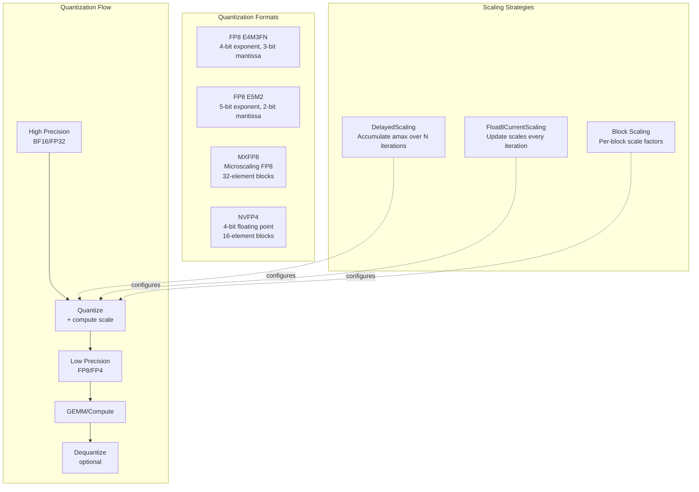
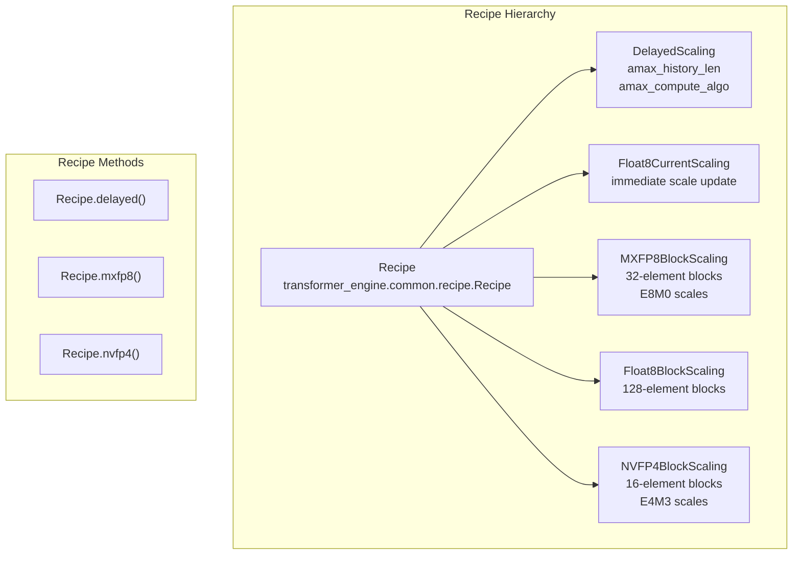
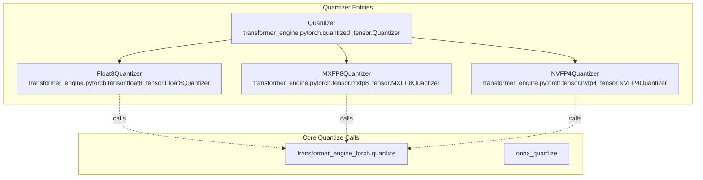
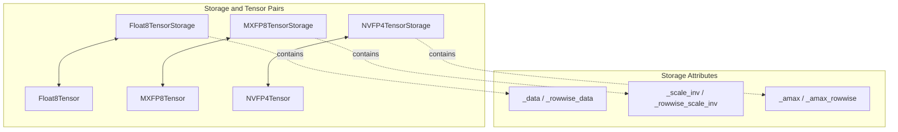
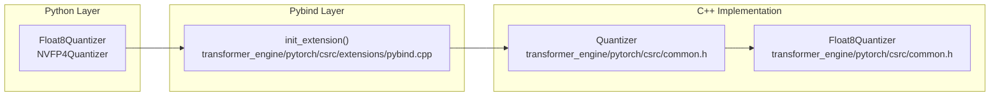

<!-- source: DeepWiki mcp.deepwiki.com · repo NVIDIA/TransformerEngine · page 3.2 Quantization System · fetched 2026-10-26 -->

# Quantization System

Relevant source files

The following files were used as context for generating this wiki page:

- [.gitignore](.gitignore)
- [benchmarks/attention/benchmark_attention.py](benchmarks/attention/benchmark_attention.py)
- [docs/api/c/index.rst](docs/api/c/index.rst)
- [docs/api/common.rst](docs/api/common.rst)
- [docs/envvars.rst](docs/envvars.rst)
- [docs/examples/attention/arbitrary_mask_to_post_scale_bias.py](docs/examples/attention/arbitrary_mask_to_post_scale_bias.py)
- [docs/examples/attention/attention.ipynb](docs/examples/attention/attention.ipynb)
- [docs/examples/attention/example_attention.py](docs/examples/attention/example_attention.py)
- [docs/examples/quickstart_utils.py](docs/examples/quickstart_utils.py)
- [tests/pytorch/nvfp4/test_nvfp4_quantize_exact.py](tests/pytorch/nvfp4/test_nvfp4_quantize_exact.py)
- [tests/pytorch/test_checkpoint.py](tests/pytorch/test_checkpoint.py)
- [tests/pytorch/test_grouped_tensor.py](tests/pytorch/test_grouped_tensor.py)
- [tests/pytorch/test_quantized_tensor.py](tests/pytorch/test_quantized_tensor.py)
- [tests/pytorch/test_recipe.py](tests/pytorch/test_recipe.py)
- [transformer_engine/common/cast/dispatch/quantize.cuh](transformer_engine/common/cast/dispatch/quantize.cuh)
- [transformer_engine/common/cast/nvfp4/quantize_4over6_nvfp4.cuh](transformer_engine/common/cast/nvfp4/quantize_4over6_nvfp4.cuh)
- [transformer_engine/common/recipe/__init__.py](transformer_engine/common/recipe/__init__.py)
- [transformer_engine/common/recipe/delayed_scaling.cu](transformer_engine/common/recipe/delayed_scaling.cu)
- [transformer_engine/pytorch/_extra_state.py](transformer_engine/pytorch/_extra_state.py)
- [transformer_engine/pytorch/csrc/common.h](transformer_engine/pytorch/csrc/common.h)
- [transformer_engine/pytorch/csrc/extensions.h](transformer_engine/pytorch/csrc/extensions.h)
- [transformer_engine/pytorch/csrc/extensions/cast.cpp](transformer_engine/pytorch/csrc/extensions/cast.cpp)
- [transformer_engine/pytorch/csrc/extensions/pybind.cpp](transformer_engine/pytorch/csrc/extensions/pybind.cpp)
- [transformer_engine/pytorch/csrc/quantizer.cpp](transformer_engine/pytorch/csrc/quantizer.cpp)
- [transformer_engine/pytorch/custom_recipes/quantization_ref_nvfp4.py](transformer_engine/pytorch/custom_recipes/quantization_ref_nvfp4.py)
- [transformer_engine/pytorch/quantization.py](transformer_engine/pytorch/quantization.py)
- [transformer_engine/pytorch/quantized_tensor.py](transformer_engine/pytorch/quantized_tensor.py)
- [transformer_engine/pytorch/tensor/_quantization_helpers.py](transformer_engine/pytorch/tensor/_quantization_helpers.py)
- [transformer_engine/pytorch/tensor/float8_blockwise_tensor.py](transformer_engine/pytorch/tensor/float8_blockwise_tensor.py)
- [transformer_engine/pytorch/tensor/float8_tensor.py](transformer_engine/pytorch/tensor/float8_tensor.py)
- [transformer_engine/pytorch/tensor/mxfp8_tensor.py](transformer_engine/pytorch/tensor/mxfp8_tensor.py)
- [transformer_engine/pytorch/tensor/nvfp4_tensor.py](transformer_engine/pytorch/tensor/nvfp4_tensor.py)
- [transformer_engine/pytorch/tensor/storage/float8_blockwise_tensor_storage.py](transformer_engine/pytorch/tensor/storage/float8_blockwise_tensor_storage.py)
- [transformer_engine/pytorch/tensor/storage/float8_tensor_storage.py](transformer_engine/pytorch/tensor/storage/float8_tensor_storage.py)
- [transformer_engine/pytorch/tensor/storage/mxfp8_tensor_storage.py](transformer_engine/pytorch/tensor/storage/mxfp8_tensor_storage.py)
- [transformer_engine/pytorch/tensor/storage/nvfp4_tensor_storage.py](transformer_engine/pytorch/tensor/storage/nvfp4_tensor_storage.py)

## Purpose and Scope

This document describes the quantization system in TransformerEngine, which enables reduced-precision computation (FP8, MXFP8, NVFP4) for training and inference. The system provides framework-agnostic quantization strategies and framework-specific implementations for PyTorch and JAX.

For details on how quantization integrates with specific module types, see:
- PyTorch modules: [4.5 Quantization and FP8 State]()
- JAX implementation: [5.4 GEMM and Quantization Primitives]()
- Core C++ kernels: [6.1 GEMM Operations]()

---

## Quantization Overview

TransformerEngine supports multiple quantization formats and strategies to reduce memory bandwidth and accelerate computation:

**Diagram: Quantization Formats and Flow**

The quantization system operates on tensors at three key points:
1. **Forward GEMM input**: Activations and weights quantized before matrix multiplication.
2. **Forward GEMM output**: Optional quantization of GEMM results.
3. **Backward GEMM**: Gradients quantized for dgrad and wgrad computations.

Sources: [transformer_engine/pytorch/tensor/float8_tensor.py:41-50](), [transformer_engine/pytorch/tensor/mxfp8_tensor.py:27-34](), [transformer_engine/common/recipe/__init__.py:107-171]()

---

## Quantization Recipes

Recipes define the quantization strategy and are shared across frameworks. Each recipe specifies how to compute and update scaling factors.

**Diagram: Recipe Class Hierarchy**

### Recipe Types

| Recipe | Scaling Granularity | Scale Update Frequency | Scaling Method |
|--------|-------------------|----------------------|----------------|
| `DelayedScaling` | Per-tensor | Every N iterations | Uses amax history window [transformer_engine/common/recipe/__init__.py:173-210]() |
| `Float8CurrentScaling` | Per-tensor | Every iteration | Scans input high-precision tensor [transformer_engine/pytorch/tensor/float8_tensor.py:185-196]() |
| `MXFP8BlockScaling` | 32-element blocks | Per-block | Microscaling with E8M0 scales [transformer_engine/pytorch/tensor/mxfp8_tensor.py:27-34]() |
| `Float8BlockScaling` | 128-element blocks | Per-block | Current scaling with NxN tiles [transformer_engine/pytorch/tensor/float8_blockwise_tensor.py:24-31]() |
| `NVFP4BlockScaling` | 16-element blocks | Per-block | 4-bit quantization with E4M3 scales [transformer_engine/pytorch/tensor/nvfp4_tensor.py:114-116]() |

Sources: [transformer_engine/common/recipe/__init__.py:173-250](), [transformer_engine/pytorch/tensor/float8_tensor.py:41-50]()

---

## Scaling Modes

Scaling modes determine how quantization scale factors are computed and stored. TransformerEngine supports per-tensor and block-wise scaling.

### Scaling Format Mapping

The `Format` enum defines the bit-width and range for various formats:
- `E2M1`: FP4 tensors (max 6.0) [transformer_engine/common/recipe/__init__.py:47]()
- `E4M3`: FP8 tensors (max 448.0) [transformer_engine/common/recipe/__init__.py:48]()
- `E5M2`: FP8 tensors (max 57344.0) [transformer_engine/common/recipe/__init__.py:49]()
- `HYBRID`: E4M3 for forward, E5M2 for backward [transformer_engine/common/recipe/__init__.py:50]()

Sources: [transformer_engine/common/recipe/__init__.py:29-50]()

---

## PyTorch Quantization Architecture

### Quantizer Classes

PyTorch quantizers encapsulate the logic for converting high-precision tensors to quantized representations.

**Diagram: PyTorch Quantizer Code Entities**

### Quantizer Usage Pattern

Quantizers maintain state for rowwise and columnwise usage. This is critical for GEMM operations where the weight matrix may need a transposed layout for weight gradient (wgrad) computation.

- **Rowwise Usage**: Standard layout for forward pass activations and weights [transformer_engine/pytorch/tensor/float8_tensor.py:65]().
- **Columnwise Usage**: Transposed layout often required for optimal GEMM performance in backward pass [transformer_engine/pytorch/tensor/float8_tensor.py:66]().

Sources: [transformer_engine/pytorch/tensor/float8_tensor.py:59-85](), [transformer_engine/pytorch/tensor/mxfp8_tensor.py:38-55]()

### Quantized Tensor Storage

Quantized tensors are split into a storage class and a tensor subclass to minimize autograd overhead.

**Diagram: Storage and Tensor Relationships**

- `Float8TensorStorage`: Holds `data`, `fp8_scale_inv`, and `fp8_dtype` [transformer_engine/pytorch/tensor/storage/float8_tensor_storage.py]().
- `MXFP8TensorStorage`: Manages block scaling data with `rowwise_data` and `rowwise_scale_inv` [transformer_engine/pytorch/tensor/storage/mxfp8_tensor_storage.py]().
- `NVFP4TensorStorage`: Supports complex metadata like `_nvfp4_use_4over6` and `_amax_rowwise` [transformer_engine/pytorch/tensor/storage/nvfp4_tensor_storage.py:84-110]().

Sources: [transformer_engine/pytorch/quantized_tensor.py:32-46](), [transformer_engine/pytorch/tensor/storage/nvfp4_tensor_storage.py:73-149]()

---

## Quantization Data Flow

### Quantization and Dequantization

The system flows from high-precision `torch.Tensor` to `QuantizedTensor` via the `quantize` kernel and back via `dequantize`.

| Direction | Code Entity | Implementation Detail |
|-----------|-------------|-----------------------|
| Quantize | `tex.quantize` | Calls into C++/CUDA core kernels [transformer_engine/pytorch/tensor/float8_tensor.py:104]() |
| Dequantize | `_FromFloat8Func` / `_FromMXFP8Func` | Autograd-compatible dequantization [transformer_engine/pytorch/tensor/storage/float8_tensor_storage.py](), [transformer_engine/pytorch/tensor/storage/mxfp8_tensor_storage.py]() |
| ONNX Export | `onnx_quantize` | Uses `torch.ops.tex.fp8_quantize` for ONNX Runtime compatibility [transformer_engine/pytorch/tensor/float8_tensor.py:160-167]() |

### Block Scaling Layouts

For MXFP8 and NVFP4, scaling factors must be swizzled to match the layout expected by cuBLAS.

- **MXFP8 Swizzling**: The `get_scale_shape` method calculates padded shapes (multiples of 128 for inner dims) to satisfy alignment [transformer_engine/pytorch/tensor/mxfp8_tensor.py:103-140]().
- **NVFP4 Swizzling**: Similar padding to multiples of 128/64 for GEMM compatibility [transformer_engine/pytorch/tensor/nvfp4_tensor.py:228-265]().

Sources: [transformer_engine/pytorch/tensor/mxfp8_tensor.py:103-140](), [transformer_engine/pytorch/tensor/nvfp4_tensor.py:228-265]()

---

## C++ Core Quantization Kernels

The underlying C++ implementation handles the heavy lifting of quantization across different formats.

### NVFP4 and Hadamard Transform

NVFP4 quantization often employs a Random Hadamard Transform (RHT) to improve numerical stability in 4-bit precision.

- **RHT Matrix**: Constructed as a 16x16 Hadamard matrix [transformer_engine/pytorch/tensor/nvfp4_tensor.py:62-90]().
- **Sign Masking**: Optional random signs are applied to the transform to prevent systematic bias [transformer_engine/pytorch/tensor/nvfp4_tensor.py:94-111]().
- **Grouped Quantization**: The `group_quantize_nvfp4_impl` function handles CUDA-graph safe quantization of multiple tensors in a single kernel launch [transformer_engine/pytorch/csrc/extensions/cast.cpp:146-174]().

### C++ Extensions and Bindings

The PyTorch C++ extensions bridge the Python `Quantizer` classes to the C++ core via `pybind11`.

**Diagram: Quantization System Bindings**

The `init_extension` function in `pybind.cpp` registers the Python classes for use within the C++ extension [transformer_engine/pytorch/csrc/extensions/pybind.cpp:122-130]().

Sources: [transformer_engine/pytorch/csrc/common.h:99-200](), [transformer_engine/pytorch/csrc/extensions/pybind.cpp:122-130](), [transformer_engine/pytorch/tensor/nvfp4_tensor.py:62-111]()

---

