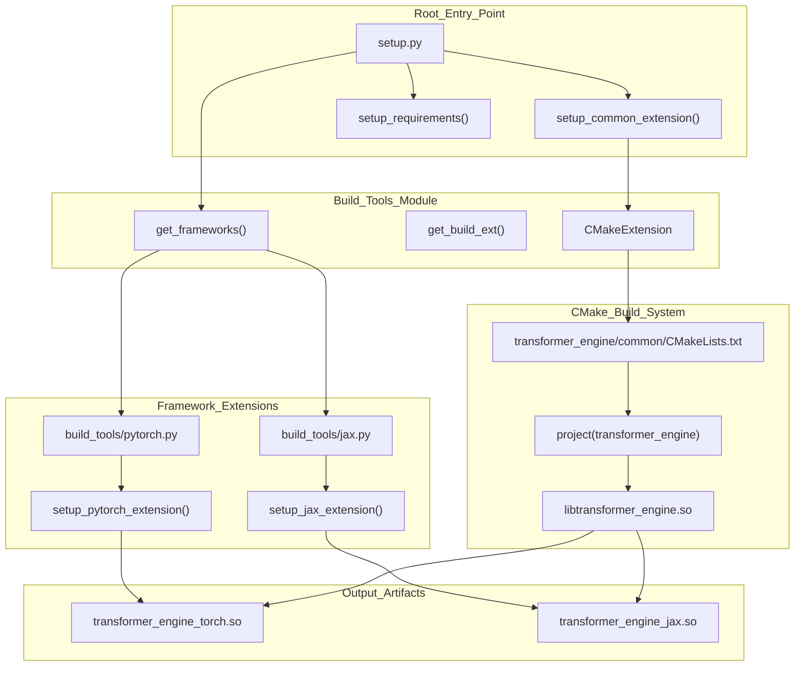
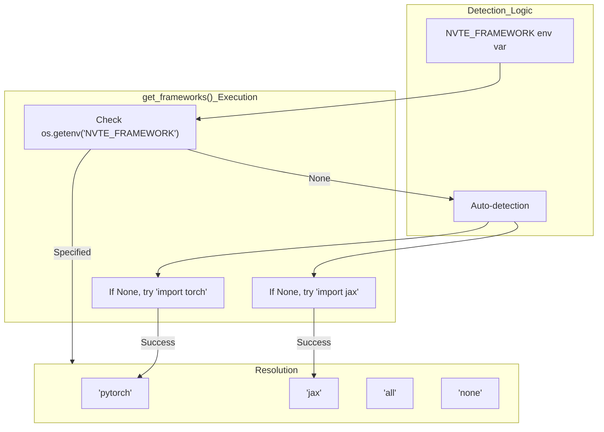

<!-- source: DeepWiki mcp.deepwiki.com · repo NVIDIA/TransformerEngine · page 3.3 Build System and Installation · fetched 2026-10-26 -->

# Build System and Installation

<details>
<summary>Relevant source files</summary>

The following files were used as context for generating this wiki page:

- [.github/workflows/build.yml](.github/workflows/build.yml)
- [.github/workflows/lint.yml](.github/workflows/lint.yml)
- [.gitmodules](.gitmodules)
- [MANIFEST.in](MANIFEST.in)
- [README.rst](README.rst)
- [build_tools/VERSION.txt](build_tools/VERSION.txt)
- [build_tools/__init__.py](build_tools/__init__.py)
- [build_tools/build_ext.py](build_tools/build_ext.py)
- [build_tools/jax.py](build_tools/jax.py)
- [build_tools/pytorch.py](build_tools/pytorch.py)
- [build_tools/te_version.py](build_tools/te_version.py)
- [build_tools/utils.py](build_tools/utils.py)
- [build_tools/wheel_utils/Dockerfile.aarch](build_tools/wheel_utils/Dockerfile.aarch)
- [build_tools/wheel_utils/Dockerfile.x86](build_tools/wheel_utils/Dockerfile.x86)
- [build_tools/wheel_utils/build_wheels.sh](build_tools/wheel_utils/build_wheels.sh)
- [build_tools/wheel_utils/launch_aarch.sh](build_tools/wheel_utils/launch_aarch.sh)
- [build_tools/wheel_utils/launch_x86.sh](build_tools/wheel_utils/launch_x86.sh)
- [docs/installation.rst](docs/installation.rst)
- [examples/README.md](examples/README.md)
- [pyproject.toml](pyproject.toml)
- [qa/L1_cpp_distributed/test.sh](qa/L1_cpp_distributed/test.sh)
- [setup.py](setup.py)
- [tests/cpp_distributed/CMakeLists.txt](tests/cpp_distributed/CMakeLists.txt)
- [tests/cpp_distributed/run_test_ep.sh](tests/cpp_distributed/run_test_ep.sh)
- [transformer_engine/__init__.py](transformer_engine/__init__.py)
- [transformer_engine/common/CMakeLists.txt](transformer_engine/common/CMakeLists.txt)
- [transformer_engine/common/__init__.py](transformer_engine/common/__init__.py)
- [transformer_engine/jax/cpp_extensions/flex_attention.py](transformer_engine/jax/cpp_extensions/flex_attention.py)
- [transformer_engine/jax/pyproject.toml](transformer_engine/jax/pyproject.toml)
- [transformer_engine/jax/setup.py](transformer_engine/jax/setup.py)
- [transformer_engine/pytorch/setup.py](transformer_engine/pytorch/setup.py)

</details>


This document covers installation methods and the build system for Transformer Engine. It includes system requirements, installation procedures (Docker, pip, source), CMake configuration, framework-specific extensions, and the CI/CD pipeline. The build system handles compilation of C++/CUDA code, Python extensions for PyTorch and JAX, and package distribution across multiple platforms.

For information about the core FP8 concepts and hardware support, see [Quantization System](3.2). For details about framework-specific implementations, see [PyTorch Integration](4) and [JAX Integration](5).

## Installation

### System Requirements

Transformer Engine requires specific hardware, software, and compiler configurations:

| Component | Requirement | Notes |
|-----------|-------------|-------|
| **Hardware** | Blackwell, Hopper, Grace Hopper, Ada, Ampere GPUs | FP8 requires Compute Capability 8.9+ |
| **OS** | Linux x86_64 | Standard support for major distributions |
| **CUDA** | 12.1+ (12.8+ for Blackwell) | Required for kernel compilation and execution |
| **cuDNN** | 9.3+ | Required for fused attention operations |
| **Compiler** | GCC/Clang with C++17 support | Required for C++ core and framework extensions |
| **Python** | 3.10+ | Minimum version check enforced in `build_tools/utils.py` |
| **CMake** | 3.18+ | Required for source builds |

The CUDA version determines which GPU architectures are supported. Transformer Engine automatically selects appropriate architectures based on the detected CUDA version [transformer_engine/common/CMakeLists.txt:28-37]().

Sources: [docs/installation.rst:9-18](), [transformer_engine/common/CMakeLists.txt:5-10](), [build_tools/utils.py:23-37]()

### Docker Installation (Recommended)

NVIDIA provides pre-built containers on the NVIDIA GPU Cloud (NGC) that include Transformer Engine and all necessary dependencies.

```bash
# PyTorch container
docker run --gpus all -it --rm nvcr.io/nvidia/pytorch:25.02-py3

# JAX container  
docker run --gpus all -it --rm nvcr.io/nvidia/jax:25.02-py3
```

Sources: [docs/installation.rst:23-27]()

### pip Installation

#### Installation from PyPI

Transformer Engine is distributed as wheels for the core library and source distributions for framework extensions.

```bash
# For PyTorch integration
pip install --no-build-isolation transformer_engine[pytorch]

# For JAX integration
pip install --no-build-isolation transformer_engine[jax]

# Core library only (framework agnostic)
pip install transformer_engine[core]
```

The `--no-build-isolation` flag is recommended when installing with framework support to ensure the build process uses the existing framework installation in your environment [docs/installation.rst:33-48]().

Sources: [docs/installation.rst:33-48]()

### Source Installation

#### Cloning the Repository

```bash
# Clone with submodules
git clone --branch stable --recursive https://github.com/NVIDIA/TransformerEngine.git
cd TransformerEngine

# If already cloned, initialize submodules
git submodule update --init --recursive
```

Sources: [docs/installation.rst:96-111]()

#### Building from Source

```bash
# Set target framework (optional, auto-detects if not set)
export NVTE_FRAMEWORK=pytorch

# Build and install
pip install --no-build-isolation .
```

The build process uses `setup.py` to orchestrate the compilation of the common C++/CUDA library and the generation of Python bindings [setup.py:5-30]().

Sources: [docs/installation.rst:96-105](), [setup.py:5-30]()

## Build Architecture Overview

The build system leverages `setuptools` integrated with `CMake` to handle the complex requirements of multi-framework CUDA extensions.

### Build System Components



**Build System Component Graph**

The root `setup.py` calls `setup_common_extension` [setup.py:58-111]() to configure the core library build via CMake. It uses `get_frameworks()` [setup.py:30]() to decide which framework-specific extensions to build. Framework-specific logic is encapsulated in `build_tools/pytorch.py` [build_tools/pytorch.py:49-126]() and `build_tools/jax.py` [build_tools/jax.py:80-129]().

Sources: [setup.py:30-111](), [build_tools/pytorch.py:49-126](), [build_tools/jax.py:80-129]()

### Framework Detection Logic



**Framework Detection in get_frameworks()**

The build system identifies which extensions to compile by checking the `NVTE_FRAMEWORK` environment variable. If not set, it attempts to detect installed frameworks by trying to import them [setup.py:38-42]().

Sources: [setup.py:38-42](), [docs/installation.rst:61-67]()

## CMake Build Configuration

The core library `libtransformer_engine.so` is built using CMake [transformer_engine/common/CMakeLists.txt:20](). It handles CUDA toolkit discovery and architecture-specific optimizations.

### CUDA Architecture Selection

The CMake configuration processes `CMAKE_CUDA_ARCHITECTURES` to handle standard and Blackwell-specific (SM100+) targets [transformer_engine/common/CMakeLists.txt:39-85]().

*   **Standard Archs**: Pre-Blackwell (e.g., 70, 80, 89, 90) [transformer_engine/common/CMakeLists.txt:86-88]().
*   **Blackwell (SM100/SM120)**: Automatically maps to specific targets like `100a`, `103a`, or `120f` based on the CUDA Toolkit version [transformer_engine/common/CMakeLists.txt:47-84]().

Sources: [transformer_engine/common/CMakeLists.txt:39-88]()

### Feature Gates and External Libraries

CMake manages several optional features based on environment variables:
*   **Userbuffers (MPI)**: Enabled via `NVTE_UB_WITH_MPI` [setup.py:64-68]().
*   **NVSHMEM**: Enabled via `NVTE_ENABLE_NVSHMEM` [setup.py:70-74]().
*   **cuBLASMp/cuSolverMp**: Multi-process BLAS/Solver support [setup.py:79-89]().
*   **NCCL EP**: Communication backend for distributed operations, automatically enabled for Hopper+ (arch >= 90) [setup.py:91-97]().

Sources: [setup.py:64-97](), [transformer_engine/common/CMakeLists.txt:106-171]()

## Package Loading and Runtime Checks

At runtime, Transformer Engine uses dynamic loading to resolve shared objects.

### Extension Loading Mechanism

The `transformer_engine.common` module provides utilities to locate and load the compiled `.so` files.

```python
# From transformer_engine/common/__init__.py
def load_framework_extension(framework: str) -> None:
    # ... checks version matching ...
    spec = importlib.util.spec_from_file_location(module_name, _get_shared_object_file(framework))
    solib = importlib.util.module_from_spec(spec)
    sys.modules[module_name] = solib
    spec.loader.exec_module(solib)
```

This mechanism ensures that the Python package can find its corresponding C++ extension regardless of whether it was installed via a wheel, source build, or editable install [transformer_engine/common/__init__.py:147-194]().

Sources: [transformer_engine/common/__init__.py:147-194](), [transformer_engine/common/__init__.py:98-131]()

### Version Consistency Checks

For PyPI installations, the system enforces strict version matching between the `transformer-engine` metapackage, the core library (e.g., `transformer-engine-cu12`), and the framework extensions [transformer_engine/common/__init__.py:176-186]().

Sources: [transformer_engine/common/__init__.py:176-186]()

## Environment Variables for Customization

| Variable | Description |
|----------|-------------|
| `NVTE_FRAMEWORK` | Comma-separated list of frameworks to build (`pytorch`, `jax`, `all`, `none`). |
| `NVTE_BUILD_DEBUG` | If `1`, compiles extensions with debug symbols (`-g`) and disables optimizations [build_tools/utils.py:41-43](). |
| `NVTE_CUDA_INCLUDE_PATH` | Manual path to CUDA headers if not found in standard paths [docs/installation.rst:19-21](). |
| `NVTE_UB_WITH_MPI` | Enable MPI support for Userbuffers [setup.py:64-68](). |
| `MAX_JOBS` / `NVTE_BUILD_MAX_JOBS` | Controls parallelism during the build process [build_tools/utils.py:47-65](). |
| `NVTE_WITH_NCCL_EP` | Enable/disable the NCCL Execution Provider [setup.py:91-97](). |

Sources: [build_tools/utils.py:41-65](), [setup.py:64-97](), [docs/installation.rst:19-21]()

## CI/CD and Testing

The repository uses GitHub Actions for automated build validation across different configurations.

*   **Core Build**: Tests framework-agnostic compilation [.github/workflows/build.yml:15-41]().
*   **PyTorch Build**: Validates PyTorch extension build [.github/workflows/build.yml:42-90]().
*   **JAX Build**: Validates JAX extension build [.github/workflows/build.yml:91-114]().
*   **Multi-Framework Build**: Ensures `NVTE_FRAMEWORK=all` works correctly [.github/workflows/build.yml:115-160]().

Sources: [.github/workflows/build.yml:1-160]()

---

