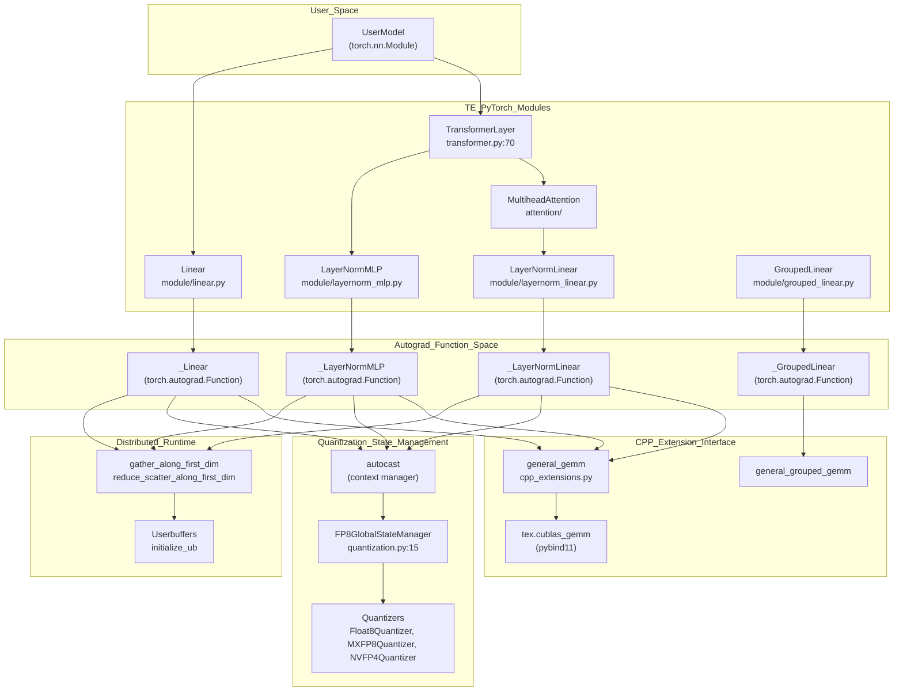
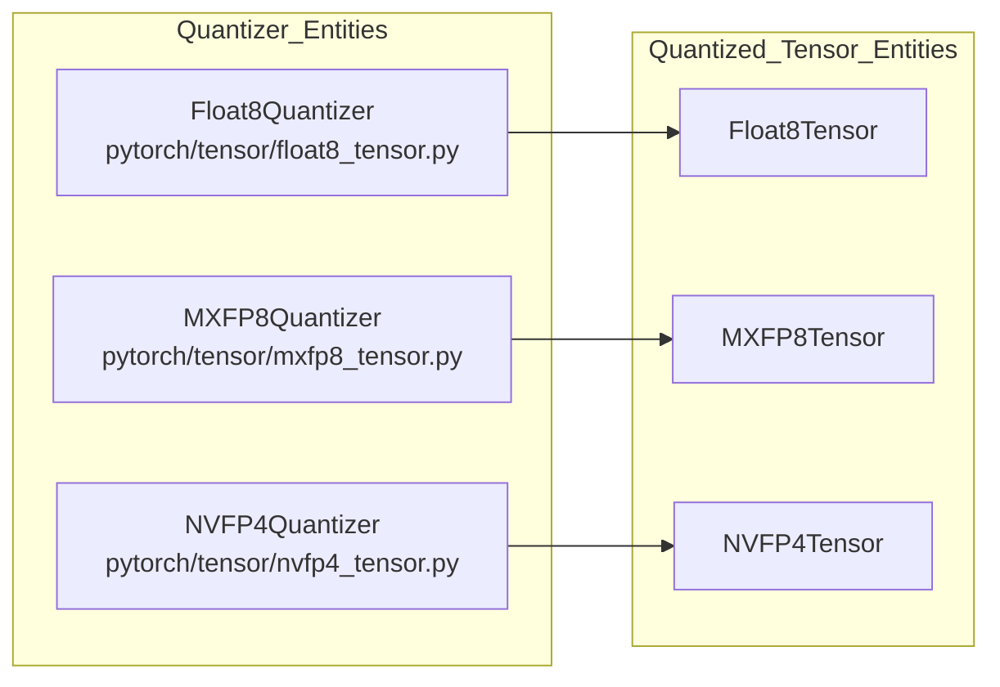

<!-- source: DeepWiki mcp.deepwiki.com · repo NVIDIA/TransformerEngine · page 4 PyTorch Integration · fetched 2026-10-26 -->

# PyTorch Integration

Relevant source files

The following files were used as context for generating this wiki page:

- [docs/api/pytorch.rst](docs/api/pytorch.rst)
- [tests/pytorch/test_numerics.py](tests/pytorch/test_numerics.py)
- [tests/pytorch/test_onnx_export.py](tests/pytorch/test_onnx_export.py)
- [tests/pytorch/test_sanity.py](tests/pytorch/test_sanity.py)
- [transformer_engine/pytorch/__init__.py](transformer_engine/pytorch/__init__.py)
- [transformer_engine/pytorch/fp8.py](transformer_engine/pytorch/fp8.py)
- [transformer_engine/pytorch/transformer.py](transformer_engine/pytorch/transformer.py)

## Purpose and Scope

This document describes Transformer Engine's PyTorch integration, which provides optimized Transformer building blocks (`Linear`, `LayerNormLinear`, `LayerNormMLP`, `TransformerLayer`) with FP8/FP4 quantization and distributed training support. The PyTorch API wraps C++ CUDA kernels while integrating seamlessly with PyTorch's autograd system, native AMP, and distributed training frameworks.

For JAX integration, see [JAX Integration](#5). For FP8 quantization concepts, see [Quantization System](#3.2). For distributed training strategies, see [Distributed Training](#7).

## Architecture Overview

The PyTorch integration follows a layered architecture where Python modules wrap custom `torch.autograd.Function` classes that dispatch to C++ extensions:

**Sources:**
- [transformer_engine/pytorch/transformer.py:70-71]()
- [transformer_engine/pytorch/__init__.py:21-35]()
- [transformer_engine/pytorch/quantization.py:14-16]()
- [transformer_engine/pytorch/module/layernorm_linear.py:1-20]()

## Module Hierarchy

### TransformerEngineBaseModule

All TE PyTorch modules inherit from `TransformerEngineBaseModule`, which provides common functionality for quantization state management, weight quantization, and distributed group handling. It serves as the foundation for handling FP8 meta-tensors and synchronization across distributed ranks.

**Sources:**
- [transformer_engine/pytorch/module/base.py:36-36]()
- [transformer_engine/pytorch/transformer.py:36-36]()

### Linear Module

`Linear` implements a basic linear layer with FP8 support. It integrates with TE's custom GEMM kernels and manages quantized weight states.

**Key Features:**
- Automatic quantization when `te.autocast` is enabled [transformer_engine/pytorch/__init__.py:44-46]().
- Support for `GroupedLinear` for MoE (Mixture of Experts) workloads, exposing grouped weight parameters [tests/pytorch/test_sanity.py:24-24](), [tests/pytorch/test_sanity.py:170-185]().
- Seamless integration with PyTorch's `autocast` for mixed precision [tests/pytorch/test_sanity.py:218-220]().

**Sources:**
- [transformer_engine/pytorch/__init__.py:22-26]()
- [tests/pytorch/test_sanity.py:170-185]()

### LayerNormLinear Module

`LayerNormLinear` fuses normalization (LayerNorm or RMSNorm) with a Linear layer. This fusion allows for single-kernel execution of normalization and quantization when FP8 is active, reducing memory bandwidth requirements.

**Fusion Benefits:**
- Supports both `LayerNorm` and `RMSNorm` variants [transformer_engine/pytorch/__init__.py:21-25]().
- Integrated quantization logic for the output of the normalization step before the GEMM [tests/pytorch/test_numerics.py:27-29]().

**Sources:**
- [transformer_engine/pytorch/__init__.py:21-21]()
- [tests/pytorch/test_numerics.py:27-29]()

### LayerNormMLP Module

`LayerNormMLP` implements a fused 2-layer MLP with normalization. It supports a wide variety of activation functions, including Gated Linear Units (GLU).

**Supported Activations:**
- Includes `gelu`, `geglu`, `glu`, `relu`, `reglu`, `silu`, `swiglu`, and `clamped_swiglu` [tests/pytorch/test_sanity.py:142-155]().
- Optimized for FP8 execution with fused bias and dropout [transformer_engine/pytorch/transformer.py:17-23]().

**Sources:**
- [transformer_engine/pytorch/__init__.py:23-23]()
- [tests/pytorch/test_sanity.py:142-155]()

### TransformerLayer Module

`TransformerLayer` is the high-level module composing attention and MLP blocks. It is the primary entry point for building Transformer models and supports encoder/decoder modes and parallel attention/MLP execution (Falcon-style).

**Sources:**
- [transformer_engine/pytorch/transformer.py:70-141]()
- [transformer_engine/pytorch/__init__.py:35-35]()

## Autograd and FP8 Integration

TE modules wrap custom `torch.autograd.Function` instances that handle the complex logic of FP8 scaling, communication overlap, and custom backward passes.

### FP8 Quantization Flow

Quantization is managed via specialized Quantizer classes and Tensor types that store the underlying data along with scaling factors.

**Sources:**
- [transformer_engine/pytorch/__init__.py:83-95]()
- [transformer_engine/pytorch/quantized_tensor.py:78-79]()

### Distributed Training Features

TE provides specialized utilities for overlapping communication and computation:
- **Userbuffers (UB)**: Overlaps tensor-parallel collectives with GEMM kernels using `initialize_ub` and `destroy_ub` [transformer_engine/pytorch/__init__.py:28-30]().
- **CPU Offload**: Enables moving activations to CPU memory to reduce GPU memory pressure via `get_cpu_offload_context` [transformer_engine/pytorch/__init__.py:64-68]().
- **Communication Collectives**: Specialized operations like `parallel_cross_entropy` and MoE permutation functions [transformer_engine/pytorch/__init__.py:36-43](), [transformer_engine/pytorch/__init__.py:72-72]().

**Sources:**
- [transformer_engine/pytorch/__init__.py:28-30]()
- [transformer_engine/pytorch/__init__.py:64-68]()
- [transformer_engine/pytorch/__init__.py:36-43]()

---

## Child Pages
- [Module System and Base Classes](#4.1) — Explain `TransformerEngineBaseModule`, the autograd function pattern, and FP8 meta-tensor management.
- [Linear and Fused Operations](#4.2) — Document `Linear`, `GroupedLinear`, `LayerNormLinear`, and `LayerNormMLP` modules.
- [TransformerLayer](#4.3) — Detail the complete `TransformerLayer` implementation and configuration.
- [Attention Mechanisms](#4.4) — Explain `DotProductAttention` and `MultiheadAttention` modules.
- [Quantization and FP8 State](#4.5) — Document the `autocast` context and `FP8GlobalStateManager`.
- [Distributed Training Features](#4.6) — Explain Userbuffers, CPU offload, and communication overlap.
- [C++ Extensions and CUDA Integration](#4.7) — Document the PyTorch C++ extension layer and pybind11 bindings.

---

