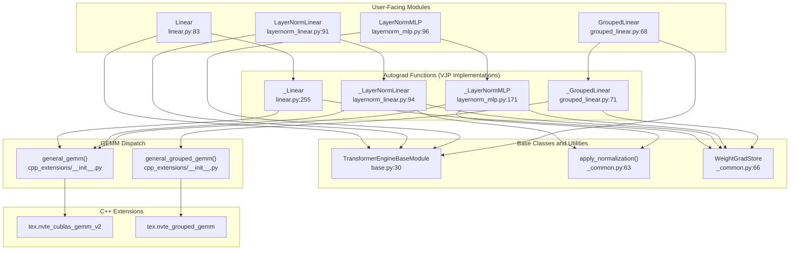
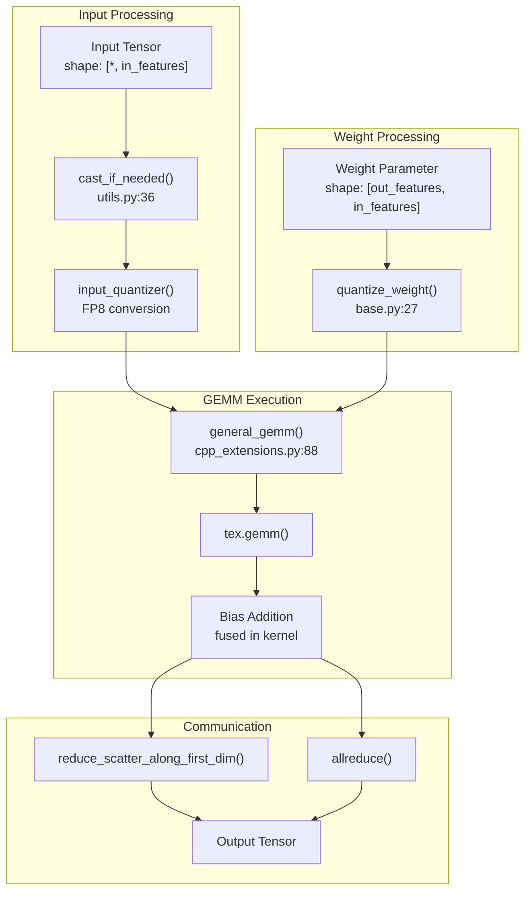

<!-- source: DeepWiki mcp.deepwiki.com · repo NVIDIA/TransformerEngine · page 4.2 Linear and Fused Operations · fetched 2026-10-26 -->

# Linear and Fused Operations

Relevant source files

The following files were used as context for generating this wiki page:

- [qa/L0_pytorch_unittest/test.sh](qa/L0_pytorch_unittest/test.sh)
- [tests/cpp/operator/test_grouped_gemm.cu](tests/cpp/operator/test_grouped_gemm.cu)
- [tests/pytorch/test_fusible_ops.py](tests/pytorch/test_fusible_ops.py)
- [tests/pytorch/test_grouped_linear.py](tests/pytorch/test_grouped_linear.py)
- [tests/pytorch/test_grouped_mlp.py](tests/pytorch/test_grouped_mlp.py)
- [transformer_engine/common/gemm/cublaslt_grouped_gemm.cu](transformer_engine/common/gemm/cublaslt_grouped_gemm.cu)
- [transformer_engine/pytorch/csrc/extensions/activation.cpp](transformer_engine/pytorch/csrc/extensions/activation.cpp)
- [transformer_engine/pytorch/distributed.py](transformer_engine/pytorch/distributed.py)
- [transformer_engine/pytorch/module/_common.py](transformer_engine/pytorch/module/_common.py)
- [transformer_engine/pytorch/module/base.py](transformer_engine/pytorch/module/base.py)
- [transformer_engine/pytorch/module/grouped_linear.py](transformer_engine/pytorch/module/grouped_linear.py)
- [transformer_engine/pytorch/module/layernorm_linear.py](transformer_engine/pytorch/module/layernorm_linear.py)
- [transformer_engine/pytorch/module/layernorm_mlp.py](transformer_engine/pytorch/module/layernorm_mlp.py)
- [transformer_engine/pytorch/module/linear.py](transformer_engine/pytorch/module/linear.py)
- [transformer_engine/pytorch/ops/_common.py](transformer_engine/pytorch/ops/_common.py)
- [transformer_engine/pytorch/ops/basic/__init__.py](transformer_engine/pytorch/ops/basic/__init__.py)
- [transformer_engine/pytorch/ops/basic/basic_linear.py](transformer_engine/pytorch/ops/basic/basic_linear.py)
- [transformer_engine/pytorch/ops/basic/grouped_linear.py](transformer_engine/pytorch/ops/basic/grouped_linear.py)
- [transformer_engine/pytorch/ops/fused/__init__.py](transformer_engine/pytorch/ops/fused/__init__.py)
- [transformer_engine/pytorch/ops/fused/grouped_mlp.py](transformer_engine/pytorch/ops/fused/grouped_mlp.py)
- [transformer_engine/pytorch/ops/fuser.py](transformer_engine/pytorch/ops/fuser.py)
- [transformer_engine/pytorch/ops/op.py](transformer_engine/pytorch/ops/op.py)
- [transformer_engine/pytorch/ops/sequential.py](transformer_engine/pytorch/ops/sequential.py)
- [transformer_engine/pytorch/utils.py](transformer_engine/pytorch/utils.py)

This page documents the linear transformation and MLP (Multi-Layer Perceptron) modules in TransformerEngine's PyTorch API. These modules provide optimized implementations of fundamental operations like matrix multiplication (GEMM), with support for FP8 quantization, operator fusion, and distributed training.

**Scope**: This page covers `Linear`, `GroupedLinear`, `LayerNormLinear`, and `LayerNormMLP` modules. It explains implementation details, bias handling, fused kernels, and custom VJP (Vector-Jacobian Product) implementations.

---

## Module Overview

TransformerEngine provides four primary linear operation modules:

| Module | Purpose | Key Features | File |
|--------|---------|--------------|------|
| `Linear` | Basic linear transformation $y = xW^T + b$ | FP8 support, tensor parallelism, Userbuffers overlap | [transformer_engine/pytorch/module/linear.py:83-160]() |
| `LayerNormLinear` | Fused LayerNorm + Linear | Quantized normalization, all-gather overlap | [transformer_engine/pytorch/module/layernorm_linear.py:91-154]() |
| `LayerNormMLP` | Fused LayerNorm + FC1 + Activation + FC2 | Activation fusion, reduce-scatter overlap, checkpointing | [transformer_engine/pytorch/module/layernorm_mlp.py:96-188]() |
| `GroupedLinear` | Grouped GEMM for MoE | Multi-stream execution, per-expert quantization | [transformer_engine/pytorch/module/grouped_linear.py:68-156]() |

All modules inherit from `TransformerEngineBaseModule` [transformer_engine/pytorch/module/base.py:28-30]() and implement custom `torch.autograd.Function` classes for precise control over forward and backward passes.

**Sources**: [transformer_engine/pytorch/module/linear.py:83-83](), [transformer_engine/pytorch/module/layernorm_linear.py:91-91](), [transformer_engine/pytorch/module/layernorm_mlp.py:96-96](), [transformer_engine/pytorch/module/grouped_linear.py:68-68]()

---

## Module Hierarchy and Composition

The following diagram bridges the high-level PyTorch modules to their underlying autograd implementations and C++ dispatch logic.

**Sources**: [transformer_engine/pytorch/module/linear.py:255-255](), [transformer_engine/pytorch/module/layernorm_linear.py:94-94](), [transformer_engine/pytorch/module/layernorm_mlp.py:171-171](), [transformer_engine/pytorch/module/grouped_linear.py:71-71](), [transformer_engine/pytorch/module/_common.py:63-63](), [transformer_engine/pytorch/module/_common.py:66-66]()

---

## Linear Module and Bias Handling

The `Linear` module implements basic matrix multiplication with optimizations for FP8 training and distributed execution.

### Bias Handling and Fusion
In the forward pass, bias addition is typically fused into the GEMM kernel when possible. The `_Linear` autograd function manages bias as a differentiable tensor. If bias is provided, it is passed to `general_gemm` [transformer_engine/pytorch/module/linear.py:96]().

During the backward pass, bias gradients are computed alongside weight gradients. If `fuse_wgrad_accumulation` is enabled, bias gradients can also be managed via the `WeightGradStore` [transformer_engine/pytorch/module/linear.py:155]().

### Tensor Parallel Modes
The module supports sharding patterns defined in `GemmParallelModes` [transformer_engine/pytorch/module/linear.py:61]():
- **Column Parallel**: Weight is sharded along the output dimension.
- **Row Parallel**: Weight is sharded along the input dimension.

**Sources**: [transformer_engine/pytorch/module/linear.py:83-160](), [transformer_engine/pytorch/module/linear.py:255-255]()

---

## Forward Pass Data Flow

### Forward Pass Steps
1. **Casting**: Inputs are cast to the activation dtype if necessary [transformer_engine/pytorch/module/linear.py:115]().
2. **Quantization**: If FP8 is enabled, inputs and weights are quantized using their respective quantizers [transformer_engine/pytorch/module/linear.py:107-108]().
3. **Dispatch**: The operation is dispatched to `general_gemm` which interfaces with the core C++ library [transformer_engine/pytorch/module/linear.py:59]().

**Sources**: [transformer_engine/pytorch/module/linear.py:90-160](), [transformer_engine/pytorch/module/linear.py:115-115]()

---

## LayerNormLinear and LayerNormMLP Fused Kernels

These modules leverage kernel fusion to reduce memory bandwidth and improve performance.

### LayerNormLinear
`LayerNormLinear` fuses the normalization step with the linear projection. The normalization (LayerNorm or RMSNorm) is applied via `apply_normalization` [transformer_engine/pytorch/module/layernorm_linear.py:63]().
- **Quantized Normalization**: The kernel can directly output FP8 tensors, bypassing the need for a separate quantization step [transformer_engine/pytorch/module/layernorm_linear.py:214-225]().

### LayerNormMLP
`LayerNormMLP` fuses `LayerNorm → FC1 → Activation → FC2`. It supports multiple activation functions including GELU, SwiGLU, and ReLU [transformer_engine/pytorch/module/layernorm_mlp.py:99-156]().
- **Activation Fusion**: For specific activations like GELU, the bias addition and activation are fused using `bias_gelu_fused` [transformer_engine/pytorch/module/layernorm_mlp.py:37]().
- **Backward Fusion**: The backward pass uses fused kernels like `bgrad_dgelu_fused` to compute bias gradients and activation derivatives in one pass [transformer_engine/pytorch/module/layernorm_mlp.py:38]().

**Sources**: [transformer_engine/pytorch/module/layernorm_linear.py:94-154](), [transformer_engine/pytorch/module/layernorm_mlp.py:171-188](), [transformer_engine/pytorch/module/layernorm_mlp.py:37-38]()

---

## GroupedLinear for MoE

`GroupedLinear` is designed for Mixture-of-Experts (MoE) workloads where different experts process different numbers of tokens.

### Implementation and Data Flow
- **M-Splits**: The module accepts `split_sizes`, representing the number of tokens assigned to each expert [transformer_engine/pytorch/module/grouped_linear.py:163]().
- **Grouped GEMM**: The computation is dispatched to `general_grouped_gemm` or `general_grouped_gemm_for_grouped_tensor` [transformer_engine/pytorch/module/grouped_linear.py:50-52]().
- **Fusing Options**: It can use cuBLASLt grouped GEMM through `GroupedTensor` metadata if the environment variable `NVTE_GROUPED_LINEAR_USE_FUSED_GROUPED_GEMM` is enabled [transformer_engine/pytorch/module/grouped_linear.py:120]().

### Precision Support
On Hopper (CC 9.0) and Blackwell (CC 10.x/11.0), `GroupedLinear` supports BF16/FP16 and FP8 per-tensor current scaling [transformer_engine/pytorch/module/grouped_linear.py:106-108]().

**Sources**: [transformer_engine/pytorch/module/grouped_linear.py:71-156](), [transformer_engine/pytorch/module/grouped_linear.py:50-52]()

---

## Custom VJP Implementations

Each fused module implements a custom `torch.autograd.Function` to provide optimized Vector-Jacobian Products (VJP).

### Weight Gradient Accumulation
TransformerEngine supports "Main Grad" fusion, where weight gradients are accumulated directly into a provided buffer (e.g., for Megatron-LM).
- **WeightGradStore**: This utility manages delayed weight gradient computation to allow for communication-computation overlap [transformer_engine/pytorch/module/_common.py:66]().
- **Fused Accumulation**: The `fuse_wgrad_accumulation` flag in modules like `Linear` [transformer_engine/pytorch/module/linear.py:154]() controls whether gradients are added to `main_grad` during the backward pass.

### Implementation Details
The backward passes (e.g., `_Linear.backward`) explicitly manage:
1. **DGRAD**: Gradient with respect to input.
2. **WGRAD**: Gradient with respect to weight.
3. **BGRAD**: Gradient with respect to bias.

These are computed using optimized GEMM layouts, often utilizing split accumulators for improved precision in FP8 training (`_2X_ACC_DGRAD`, `_2X_ACC_WGRAD`) [transformer_engine/pytorch/module/base.py:80-81]().

**Sources**: [transformer_engine/pytorch/module/linear.py:83-160](), [transformer_engine/pytorch/module/_common.py:66-66](), [transformer_engine/pytorch/module/base.py:79-81]()

---

