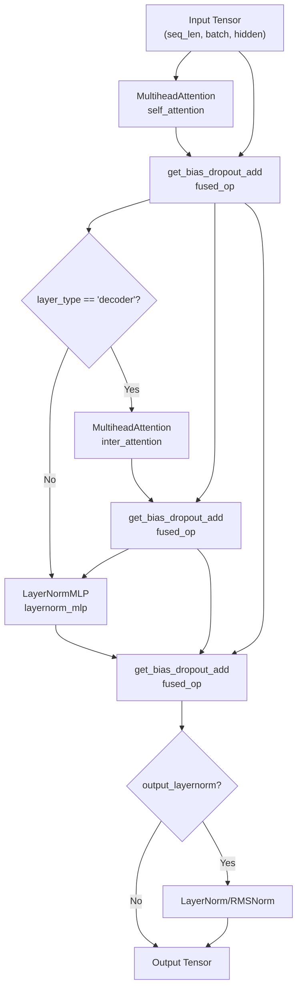
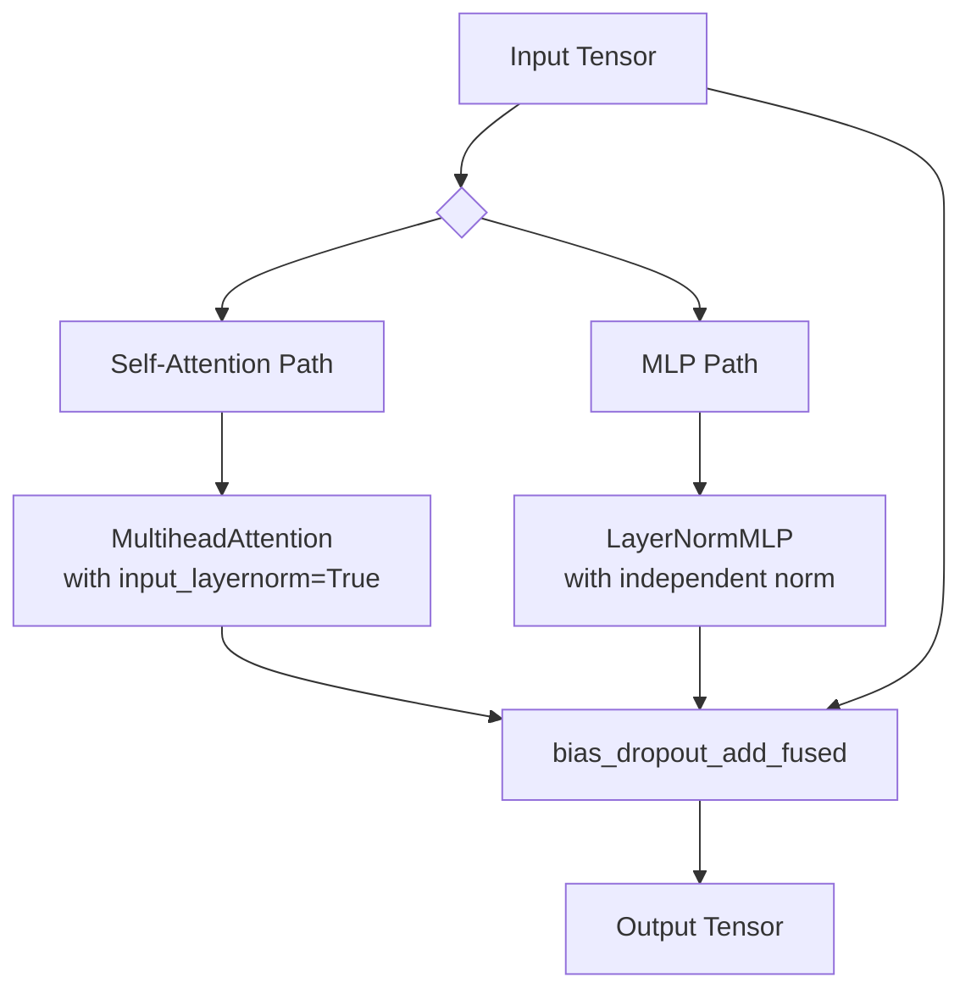
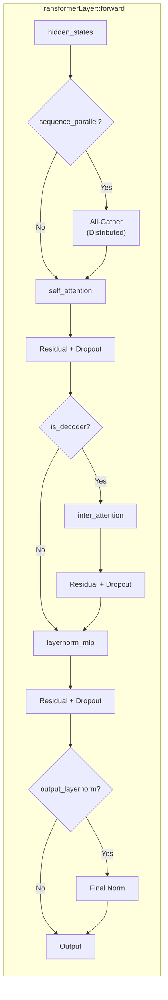

<!-- source: DeepWiki mcp.deepwiki.com · repo NVIDIA/TransformerEngine · page 4.3 TransformerLayer · fetched 2026-10-26 -->

# TransformerLayer

Relevant source files

The following files were used as context for generating this wiki page:

- [tests/pytorch/test_numerics.py](tests/pytorch/test_numerics.py)
- [tests/pytorch/test_onnx_export.py](tests/pytorch/test_onnx_export.py)
- [tests/pytorch/test_sanity.py](tests/pytorch/test_sanity.py)
- [transformer_engine/pytorch/fp8.py](transformer_engine/pytorch/fp8.py)
- [transformer_engine/pytorch/transformer.py](transformer_engine/pytorch/transformer.py)

`TransformerLayer` is the primary high-level building block for constructing transformer models in PyTorch using Transformer Engine. It implements a standard transformer layer consisting of a self-attention block followed by a feedforward network (MLP), based on the "Attention Is All You Need" paper. The module provides comprehensive support for FP8/FP4 quantization, distributed training, and various architectural variants including encoder-only, decoder, and parallel attention configurations.

**Key Features:**
- Complete transformer layer with attention and MLP blocks [transformer_engine/pytorch/transformer.py:71-73]()
- Extensive quantization support including FP8 (Delayed, Current, Block Scaling), MXFP8, and NVFP4 [transformer_engine/pytorch/transformer.py:578](), [transformer_engine/pytorch/fp8.py:25-34]()
- Multiple architectural variants (GPT, BERT, T5) [transformer_engine/pytorch/transformer.py:127-130]()
- Tensor, Sequence, and Context parallelism [transformer_engine/pytorch/transformer.py:206-221](), [transformer_engine/pytorch/transformer.py:538-578]()
- Fused operations for improved performance [transformer_engine/pytorch/transformer.py:17-23]()
- Grouped Query Attention (GQA) and Multi-Query Attention (MQA) [transformer_engine/pytorch/transformer.py:88-95]()
- Flexible normalization (LayerNorm, RMSNorm) and wide activation function support [transformer_engine/pytorch/transformer.py:157-179]()

## Architecture Overview

The `TransformerLayer` module composes two major components: a `MultiheadAttention` block and a `LayerNormMLP` block. The standard architecture follows a pre-normalization pattern where layer normalization is applied before each sub-block.

**TransformerLayer Structure Diagram**

**Sources:** [transformer_engine/pytorch/transformer.py:71-872](), [transformer_engine/pytorch/transformer.py:416-481](), [transformer_engine/pytorch/jit.py:20-22]()

### Parallel Attention MLP Variant

When `parallel_attention_mlp=True`, the attention and MLP blocks operate in parallel on the same input, a configuration used in architectures like Falcon:

**Parallel Path Diagram**

**Sources:** [transformer_engine/pytorch/transformer.py:123-126](), [transformer_engine/pytorch/transformer.py:341-351](), [transformer_engine/pytorch/transformer.py:829-835]()

## Key Components

### Self-Attention Block

The self-attention mechanism is implemented via the `MultiheadAttention` module:

| Component | Class | Purpose |
|-----------|-------|---------|
| QKV Projection | `LayerNormLinear` | Fused layer norm + linear for Q, K, V computation [transformer_engine/pytorch/transformer.py:421]() |
| Core Attention | `DotProductAttention` | Scaled dot-product attention with fused backends [transformer_engine/pytorch/transformer.py:15]() |
| Output Projection | `Linear` | Projects attention output back to hidden dimension [transformer_engine/pytorch/transformer.py:429]() |

The block supports:
- Query, Key, Value projections with support for GQA/MQA [transformer_engine/pytorch/transformer.py:88-95]()
- Rotary position embeddings (RoPE) [transformer_engine/pytorch/transformer.py:764]()
- Query-Key normalization (L2, RMS, or LayerNorm) [transformer_engine/pytorch/transformer.py:251-267]()

**Sources:** [transformer_engine/pytorch/transformer.py:416-429](), [transformer_engine/pytorch/attention/multi_head_attention.py:46-130]()

### Cross-Attention Block (Decoder Mode)

When `layer_type="decoder"`, an additional `inter_attention` block is instantiated to attend to encoder outputs, enabling T5-style architectures [transformer_engine/pytorch/transformer.py:128-130]().

**Sources:** [transformer_engine/pytorch/transformer.py:353-354](), [transformer_engine/pytorch/transformer.py:431-446]()

### MLP Block

The feedforward network is implemented via `LayerNormMLP`:

| Layer | Function |
|-------|----------|
| Layer Norm | Normalizes input (LayerNorm or RMSNorm) [transformer_engine/pytorch/transformer.py:448-450]() |
| FC1 | First linear transformation (hidden → ffn_hidden_size) [transformer_engine/pytorch/transformer.py:461]() |
| Activation | GELU, SiLU, ReLU, or gated variants (GEGLU, SwiGLU, etc.) [transformer_engine/pytorch/transformer.py:176-179]() |
| FC2 | Second linear transformation (ffn_hidden_size → hidden) [transformer_engine/pytorch/transformer.py:471]() |

For gated activations, FC1 outputs `2 * ffn_hidden_size` dimensions, which are split and gated before FC2 [transformer_engine/pytorch/transformer.py:461-465]().

**Sources:** [transformer_engine/pytorch/transformer.py:448-481]()

## Configuration Parameters

### Basic Configuration

| Parameter | Type | Default | Description |
|-----------|------|---------|-------------|
| `hidden_size` | int | Required | Size of each input sample [transformer_engine/pytorch/transformer.py:82]() |
| `ffn_hidden_size` | int | Required | Intermediate size for MLP projection [transformer_engine/pytorch/transformer.py:84]() |
| `num_attention_heads` | int | Required | Number of attention heads [transformer_engine/pytorch/transformer.py:86]() |
| `num_gqa_groups` | int | `None` | Number of GQA groups (GQA-1 = MQA) [transformer_engine/pytorch/transformer.py:88-95]() |

### Normalization and Dropout

| Parameter | Type | Default | Description |
|-----------|------|---------|-------------|
| `normalization` | str | `'LayerNorm'` | Type: `'LayerNorm'` or `'RMSNorm'` [transformer_engine/pytorch/transformer.py:157]() |
| `hidden_dropout` | float | `0.1` | Dropout after FC2 layer [transformer_engine/pytorch/transformer.py:99]() |
| `drop_path_rate` | float | `0.0` | Stochastic depth rate [transformer_engine/pytorch/transformer.py:243]() |

**Sources:** [transformer_engine/pytorch/transformer.py:82-245]()

## Forward Pass and Data Flow

The forward method accepts inputs in `'sbhd'`, `'bshd'`, or `'thd'` formats [transformer_engine/pytorch/transformer.py:184-192]().

**Data Flow Diagram**

**Sources:** [transformer_engine/pytorch/transformer.py:580-842](), [transformer_engine/pytorch/transformer.py:730-733]()

## Quantization and FP8/FP4

`TransformerLayer` is a primary entry point for low-precision training. It utilizes the quantization recipes defined in `transformer_engine.common.recipe`.

| Recipe Type | Purpose | File Pointer |
|-------------|---------|--------------|
| `DelayedScaling` | History-based FP8 scaling | [transformer_engine/pytorch/fp8.py:27]() |
| `Float8CurrentScaling` | Per-tensor FP8 scaling | [transformer_engine/pytorch/fp8.py:30]() |
| `MXFP8BlockScaling` | Microscaling for Blackwell | [transformer_engine/pytorch/fp8.py:29]() |
| `NVFP4BlockScaling` | 4-bit block scaling | [transformer_engine/pytorch/fp8.py:32]() |

The `is_first_microbatch` argument [transformer_engine/pytorch/transformer.py:589]() allows the layer to cache quantized weights, optimizing performance in pipeline-parallel training [transformer_engine/pytorch/transformer.py:650-662]().

**Sources:** [transformer_engine/pytorch/transformer.py:578-662](), [transformer_engine/pytorch/fp8.py:25-68]()

## Distributed Training Features

- **Tensor Parallelism**: Supports sharding across GPUs using `tp_group` [transformer_engine/pytorch/transformer.py:211]().
- **Sequence Parallelism**: If enabled, performs `ReduceScatter` and `AllGather` to shard activations across the sequence dimension [transformer_engine/pytorch/transformer.py:730-733]().
- **Context Parallelism**: Configures sequence-splitting for long-context training using `set_context_parallel_group` [transformer_engine/pytorch/transformer.py:538]().
- **Communication Overlap**: Utilizes `Userbuffers` to overlap GEMM operations with collective communications [transformer_engine/pytorch/transformer.py:305-310]().

**Sources:** [transformer_engine/pytorch/transformer.py:206-221](), [transformer_engine/pytorch/transformer.py:538-578]()

## Performance Optimizations

- **Fused Kernels**: Bias, dropout, and residual additions are fused via `get_bias_dropout_add` [transformer_engine/pytorch/jit.py:20]().
- **JIT Fusion**: Uses `torch.jit` for fusing activation functions and custom epilogues [transformer_engine/pytorch/jit.py:102-115]().
- **ONNX Export**: Optimized for export to ONNX with custom FP8 operators [transformer_engine/pytorch/transformer.py:35](), [tests/pytorch/test_onnx_export.py:195-204]().

**Sources:** [transformer_engine/pytorch/transformer.py:17-23](), [transformer_engine/pytorch/jit.py:5-150]()

---

