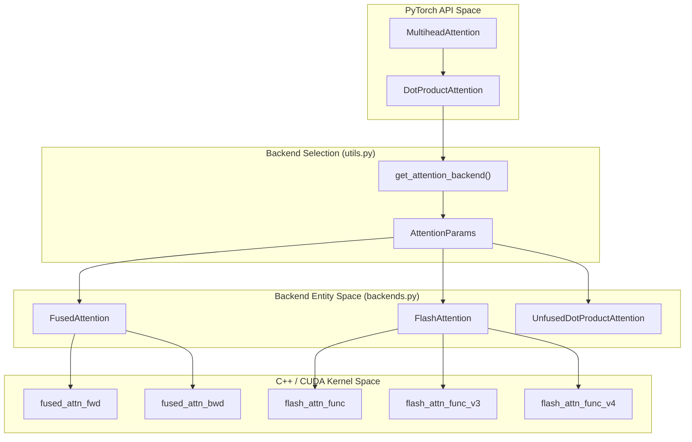
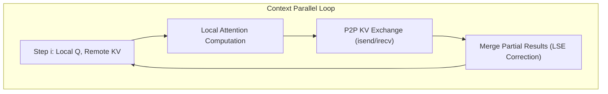

<!-- source: DeepWiki mcp.deepwiki.com · repo NVIDIA/TransformerEngine · page 4.4 Attention Mechanisms · fetched 2026-10-26 -->

# Attention Mechanisms

Relevant source files

The following files were used as context for generating this wiki page:

- [qa/L3_pytorch_FA_versions_test/test.sh](qa/L3_pytorch_FA_versions_test/test.sh)
- [tests/pytorch/attention/run_attention_with_cp.py](tests/pytorch/attention/run_attention_with_cp.py)
- [tests/pytorch/attention/run_attention_with_cp_pool.py](tests/pytorch/attention/run_attention_with_cp_pool.py)
- [tests/pytorch/attention/test_attention.py](tests/pytorch/attention/test_attention.py)
- [tests/pytorch/attention/test_attention_with_cp.py](tests/pytorch/attention/test_attention_with_cp.py)
- [tests/pytorch/attention/test_kv_cache.py](tests/pytorch/attention/test_kv_cache.py)
- [tests/pytorch/test_fused_rope.py](tests/pytorch/test_fused_rope.py)
- [tests/pytorch/test_jit.py](tests/pytorch/test_jit.py)
- [tests/pytorch/test_qk_norm.py](tests/pytorch/test_qk_norm.py)
- [tests/pytorch/utils.py](tests/pytorch/utils.py)
- [transformer_engine/common/fused_rope/fused_rope.cu](transformer_engine/common/fused_rope/fused_rope.cu)
- [transformer_engine/common/include/transformer_engine/fused_rope.h](transformer_engine/common/include/transformer_engine/fused_rope.h)
- [transformer_engine/pytorch/attention/dot_product_attention/backends.py](transformer_engine/pytorch/attention/dot_product_attention/backends.py)
- [transformer_engine/pytorch/attention/dot_product_attention/context_parallel.py](transformer_engine/pytorch/attention/dot_product_attention/context_parallel.py)
- [transformer_engine/pytorch/attention/dot_product_attention/dot_product_attention.py](transformer_engine/pytorch/attention/dot_product_attention/dot_product_attention.py)
- [transformer_engine/pytorch/attention/dot_product_attention/utils.py](transformer_engine/pytorch/attention/dot_product_attention/utils.py)
- [transformer_engine/pytorch/attention/multi_head_attention.py](transformer_engine/pytorch/attention/multi_head_attention.py)
- [transformer_engine/pytorch/attention/rope.py](transformer_engine/pytorch/attention/rope.py)
- [transformer_engine/pytorch/csrc/extensions/apply_rope.cpp](transformer_engine/pytorch/csrc/extensions/apply_rope.cpp)
- [transformer_engine/pytorch/csrc/extensions/attention.cpp](transformer_engine/pytorch/csrc/extensions/attention.cpp)
- [transformer_engine/pytorch/jit.py](transformer_engine/pytorch/jit.py)
- [transformer_engine/pytorch/module/layernorm.py](transformer_engine/pytorch/module/layernorm.py)
- [transformer_engine/pytorch/module/rmsnorm.py](transformer_engine/pytorch/module/rmsnorm.py)

## Purpose and Scope

This document describes the attention mechanisms implemented in TransformerEngine, covering both the high-level PyTorch API modules and the underlying fused attention backends. It explains the various attention configurations, QKV layouts, masking types, and backend selection logic.

For information about the broader TransformerLayer architecture, see [TransformerLayer](4.3). For FP8 quantization details, see [Quantization and FP8 State](4.5).

## Overview

TransformerEngine provides optimized attention implementations through a multi-layer architecture:

- **Python API Layer**: `MultiheadAttention` and `DotProductAttention` modules provide PyTorch-native interfaces.
- **Backend Layer**: Multiple optimized backends including FlashAttention (v2, v3, v4), cuDNN-based fused attention, and a fallback unfused implementation.
- **Configuration System**: Flexible support for various QKV layouts, mask types, bias types, and precision formats (FP16, BF16, FP8, MXFP8).

The system automatically selects the optimal backend based on hardware capabilities, sequence lengths, precision requirements, and other parameters via `get_attention_backend` [transformer_engine/pytorch/attention/dot_product_attention/utils.py:1026-1026]().

**Key Attention Modules and Entities**

Sources: [transformer_engine/pytorch/attention/dot_product_attention/dot_product_attention.py:67-75](), [transformer_engine/pytorch/attention/dot_product_attention/backends.py:59-60](), [transformer_engine/pytorch/attention/dot_product_attention/utils.py:191-231](), [transformer_engine/pytorch/attention/dot_product_attention/backends.py:169-173]()

## PyTorch Attention Modules

### MultiheadAttention
The `MultiheadAttention` module is the high-level interface that manages projections and the attention computation. It supports Tensor Parallelism (TP) by sharding heads across devices [transformer_engine/pytorch/attention/multi_head_attention.py:381-384]().

**Key Features**:
- **QKV Projections**: Can use a single fused linear layer for QKV or separate layers [transformer_engine/pytorch/attention/multi_head_attention.py:431-438]().
- **GQA/MQA Support**: Configurable `num_gqa_groups` to support Grouped Query Attention and Multi-Query Attention [transformer_engine/pytorch/attention/multi_head_attention.py:222-224]().
- **Rotary Embeddings**: Integrated support for `RotaryPositionEmbedding` [transformer_engine/pytorch/attention/multi_head_attention.py:654-660]().

### DotProductAttention
`DotProductAttention` implements the core scaled dot-product mechanism. It encapsulates the logic for choosing between backends like `FlashAttention`, `FusedAttention`, and `UnfusedDotProductAttention` [transformer_engine/pytorch/attention/dot_product_attention/dot_product_attention.py:56-60]().

Sources: [transformer_engine/pytorch/attention/multi_head_attention.py:183-183](), [transformer_engine/pytorch/attention/dot_product_attention/dot_product_attention.py:246-246]()

## QKV Layout and Format System

TransformerEngine uses a flexible layout system to optimize memory access. The `QKVLayout` enum defines how Query, Key, and Value tensors are packed in memory [transformer_engine/pytorch/cpp_extensions/fused_attn.py:25-36]().

| Layout | Code Symbol | Description |
| :--- | :--- | :--- |
| Interleaved | `SB3HD` / `BS3HD` | Q, K, and V are interleaved in a single tensor. |
| Grouped | `SBHD_SB2HD` | Q is separate; K and V are interleaved. |
| Separate | `SBHD_SBHD_SBHD` | Q, K, and V are three distinct tensors. |
| Ragged | `THD` | Packed format for variable sequence lengths (Total tokens, Heads, Dim). |

The layout is often determined by whether the model uses Self-Attention or Cross-Attention [transformer_engine/pytorch/attention/dot_product_attention/utils.py:191-231]().

Sources: [transformer_engine/pytorch/cpp_extensions/fused_attn.py:25-36](), [transformer_engine/pytorch/attention/dot_product_attention/utils.py:191-231]()

## Attention Backends

### Fused vs. Unfused
1. **FusedAttention**: Uses cuDNN's fused kernels for performance. It is the preferred path for FP8 and specific F16/BF16 configurations [transformer_engine/pytorch/attention/dot_product_attention/backends.py:1145-1145]().
2. **FlashAttention**: Leverages the FlashAttention library (v2, v3, or v4) when installed and compatible with the hardware/layout [transformer_engine/pytorch/attention/dot_product_attention/backends.py:95-176]().
3. **UnfusedDotProductAttention**: A fallback implementation using standard PyTorch operations (`matmul`, `softmax`) for cases where fused kernels are unsupported [transformer_engine/pytorch/attention/dot_product_attention/backends.py:1560-1560]().

### Backend Selection
The selection logic resides in `get_attention_backend` [transformer_engine/pytorch/attention/dot_product_attention/utils.py:1026-1026](). It evaluates an `AttentionParams` object against hardware constraints:
- **FP8 Support**: Requires SM90+ (Hopper) and cuDNN 8.9+ [transformer_engine/pytorch/attention/dot_product_attention/utils.py:1095-1098]().
- **FlashAttention**: Selected if `NVTE_FLASH_ATTN=1` and the sequence/head dimensions are supported [transformer_engine/pytorch/attention/dot_product_attention/backends.py:124-125]().
- **FlashAttention v4**: Support is detected and validated via `_fa4_validate_head_dims` [transformer_engine/pytorch/attention/dot_product_attention/backends.py:172-175]().

Sources: [transformer_engine/pytorch/attention/dot_product_attention/backends.py:1145-1145](), [transformer_engine/pytorch/attention/dot_product_attention/utils.py:1026-1026]()

## Context Parallelism (CP)

For very long sequences, TransformerEngine supports Context Parallelism, which shards the sequence dimension across multiple GPUs [transformer_engine/pytorch/attention/dot_product_attention/context_parallel.py:5-5]().

**Implementation Detail**:
- **KV Communication**: Uses P2P communication (`isend`/`irecv`) to circulate Key and Value chunks across the CP group [transformer_engine/pytorch/attention/dot_product_attention/context_parallel.py:96-135]().
- **Partial Results**: Each rank computes partial attention outputs and Softmax LSE (Log-Sum-Exp). These are merged using `flash_attn_fwd_out_correction` [transformer_engine/pytorch/attention/dot_product_attention/context_parallel.py:153-164]().
- **Recipe Support**: CP supports `DelayedScaling`, `Float8CurrentScaling`, and `MXFP8BlockScaling` recipes [transformer_engine/pytorch/attention/dot_product_parallel.py:78-80]().

Sources: [transformer_engine/pytorch/attention/dot_product_attention/context_parallel.py:96-135](), [transformer_engine/pytorch/attention/dot_product_attention/context_parallel.py:153-164]()

## Rotary Position Embeddings (RoPE)

The `RotaryPositionEmbedding` module applies position-dependent rotations to Q and K tensors [transformer_engine/pytorch/attention/rope.py:22-22]().

- **Fusion**: RoPE is often fused with other kernels to minimize memory bandwidth. The `apply_rope` C++ extension provides the optimized CUDA implementation [transformer_engine/pytorch/csrc/extensions/apply_rope.cpp:11-11]().
- **Interleaved vs. Non-interleaved**: Supports both `interleaved=True` (complex-like rotation) and standard RoPE [transformer_engine/pytorch/attention/rope.py:34-36]().

Sources: [transformer_engine/pytorch/attention/rope.py:22-22](), [transformer_engine/pytorch/csrc/extensions/apply_rope.cpp:11-11]()

## Masking and Bias Types

The attention system supports a variety of masks and biases via `AttnMaskType` and `AttnBiasType` [transformer_engine/pytorch/cpp_extensions/fused_attn.py:38-60]().

- **Masking**: Supports `CAUSAL`, `PADDING`, and `USER_MASK` [transformer_engine/pytorch/cpp_extensions/fused_attn.py:47-53]().
- **Bias**: Supports `NO_BIAS`, `PRE_SCALE_BIAS`, `POST_SCALE_BIAS`, and `ALIBI` [transformer_engine/pytorch/cpp_extensions/fused_attn.py:38-45]().
- **Sliding Window**: Integrated sliding window attention for long-context models [transformer_engine/pytorch/attention/dot_product_attention/utils.py:1174-1181]().

Sources: [transformer_engine/pytorch/cpp_extensions/fused_attn.py:38-60](), [transformer_engine/pytorch/attention/dot_product_attention/utils.py:1174-1181]()

---

