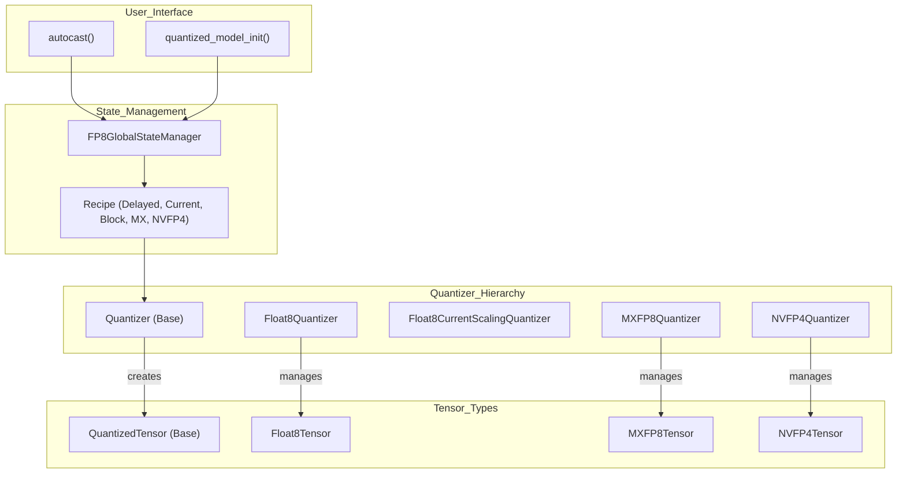
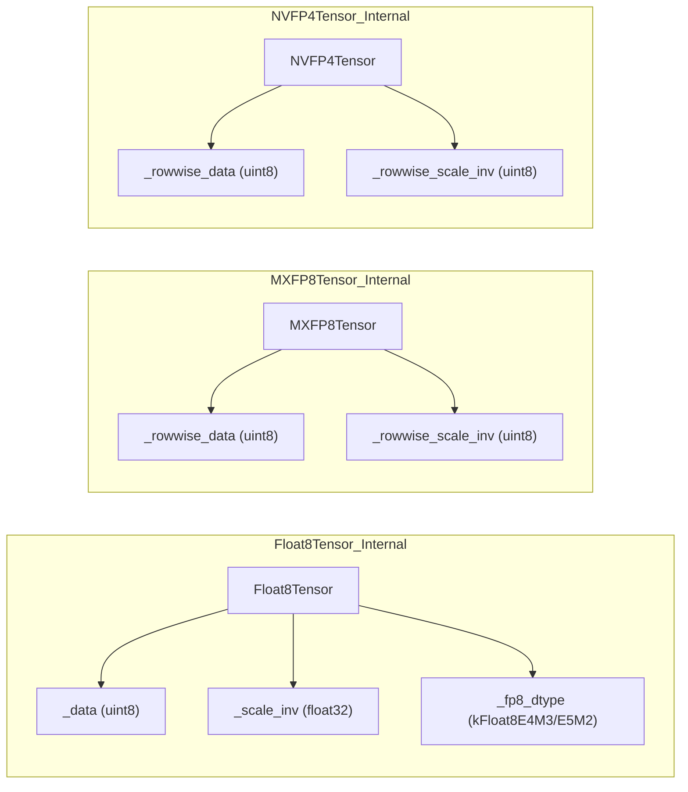

<!-- source: DeepWiki mcp.deepwiki.com · repo NVIDIA/TransformerEngine · page 4.5 Quantization and FP8 State · fetched 2026-10-26 -->

# Quantization and FP8 State

Relevant source files

The following files were used as context for generating this wiki page:

- [.gitignore](.gitignore)
- [docs/api/c/index.rst](docs/api/c/index.rst)
- [docs/api/common.rst](docs/api/common.rst)
- [docs/examples/quickstart_utils.py](docs/examples/quickstart_utils.py)
- [tests/pytorch/test_checkpoint.py](tests/pytorch/test_checkpoint.py)
- [tests/pytorch/test_numerics.py](tests/pytorch/test_numerics.py)
- [tests/pytorch/test_onnx_export.py](tests/pytorch/test_onnx_export.py)
- [tests/pytorch/test_quantized_tensor.py](tests/pytorch/test_quantized_tensor.py)
- [tests/pytorch/test_recipe.py](tests/pytorch/test_recipe.py)
- [tests/pytorch/test_sanity.py](tests/pytorch/test_sanity.py)
- [transformer_engine/common/recipe/__init__.py](transformer_engine/common/recipe/__init__.py)
- [transformer_engine/pytorch/_extra_state.py](transformer_engine/pytorch/_extra_state.py)
- [transformer_engine/pytorch/float8_tensor.py](transformer_engine/pytorch/float8_tensor.py)
- [transformer_engine/pytorch/fp8.py](transformer_engine/pytorch/fp8.py)
- [transformer_engine/pytorch/quantization.py](transformer_engine/pytorch/quantization.py)
- [transformer_engine/pytorch/quantized_tensor.py](transformer_engine/pytorch/quantized_tensor.py)
- [transformer_engine/pytorch/tensor/_quantization_helpers.py](transformer_engine/pytorch/tensor/_quantization_helpers.py)
- [transformer_engine/pytorch/tensor/float8_blockwise_tensor.py](transformer_engine/pytorch/tensor/float8_blockwise_tensor.py)
- [transformer_engine/pytorch/tensor/float8_tensor.py](transformer_engine/pytorch/tensor/float8_tensor.py)
- [transformer_engine/pytorch/tensor/mxfp8_tensor.py](transformer_engine/pytorch/tensor/mxfp8_tensor.py)
- [transformer_engine/pytorch/tensor/nvfp4_tensor.py](transformer_engine/pytorch/tensor/nvfp4_tensor.py)
- [transformer_engine/pytorch/tensor/storage/float8_blockwise_tensor_storage.py](transformer_engine/pytorch/tensor/storage/float8_blockwise_tensor_storage.py)
- [transformer_engine/pytorch/tensor/storage/float8_tensor_storage.py](transformer_engine/pytorch/tensor/storage/float8_tensor_storage.py)
- [transformer_engine/pytorch/tensor/storage/mxfp8_tensor_storage.py](transformer_engine/pytorch/tensor/storage/mxfp8_tensor_storage.py)
- [transformer_engine/pytorch/tensor/storage/nvfp4_tensor_storage.py](transformer_engine/pytorch/tensor/storage/nvfp4_tensor_storage.py)
- [transformer_engine/pytorch/transformer.py](transformer_engine/pytorch/transformer.py)

This page documents the technical implementation of quantization and FP8 state management in TransformerEngine (TE). It covers the global state manager, autocast contexts, the hierarchy of quantizer classes, and the specialized quantized tensor types.

## System Overview

TransformerEngine uses a centralized state management system to coordinate quantization across modules. The system provides high-level context managers for users while maintaining low-level global buffers for scaling factors and absolute maximum (amax) values.

**Quantization System Architecture**

Sources: [transformer_engine/pytorch/quantization.py:16-51](), [transformer_engine/pytorch/quantized_tensor.py:33-47](), [transformer_engine/pytorch/tensor/float8_tensor.py:41-110]()

## FP8GlobalStateManager

The `FP8GlobalStateManager` is the central singleton responsible for maintaining global FP8 state, including whether FP8 is enabled, the current recipe, and global buffers for amax history and scaling factors.

### Key Responsibilities
- **Global Buffers**: Manages `global_amax_buffer`, `global_scale_buffer`, and `global_amax_history_buffer` to coordinate scaling across distributed ranks [transformer_engine/pytorch/quantization.py:155-166]().
- **State Tracking**: Tracks `FP8_AUTOCAST_DEPTH` to ensure global reductions only occur at the end of the outermost autocast scope [transformer_engine/pytorch/quantization.py:465-513]().
- **Hardware Detection**: Provides methods like `is_fp8_available`, `is_mxfp8_available`, and `is_nvfp4_available` to check device compute capability [transformer_engine/pytorch/quantization.py:36-73]().

Sources: [transformer_engine/pytorch/quantization.py:132-231](), [transformer_engine/pytorch/quantization.py:408-461]()

## Autocast and Model Initialization

The system provides two primary context managers to control quantization behavior.

### `autocast` Context
The `autocast` context manager enables FP8 execution. It interacts with the `FP8GlobalStateManager` to set the active recipe and distributed group.

| Parameter | Description |
|-----------|-------------|
| `enabled` | Whether to enable quantization in the current scope. |
| `recipe` | The `Recipe` object (e.g., `DelayedScaling`, `MXFP8BlockScaling`) defining quantization parameters. |
| `fp8_group` | The process group for amax reduction. |

Sources: [transformer_engine/pytorch/quantization.py:645-704](), [transformer_engine/pytorch/quantization.py:41-53]()

### `quantized_model_init` Context
Formerly `fp8_model_init`, this context allows initializing models with quantized parameters (e.g., weights stored directly in FP8/FP4) to save memory [transformer_engine/pytorch/quantization.py:583-642]().

Sources: [transformer_engine/pytorch/quantization.py:583-642](), [tests/pytorch/test_numerics.py:24-47]()

## Quantizer Hierarchy

TransformerEngine uses a quantizer factory pattern. Each quantization strategy is implemented as a subclass of the `Quantizer` base class.

### Quantizer Class Comparison

| Class | Strategy | Scaling Type | Block Size |
|-------|----------|--------------|------------|
| `Float8Quantizer` | Delayed Scaling | Per-tensor | N/A |
| `Float8CurrentScalingQuantizer` | Current Scaling | Per-tensor | N/A |
| `MXFP8Quantizer` | MX Block Scaling | Block-wise | 32 |
| `Float8BlockQuantizer` | Block Scaling | Block-wise (NxN) | 128 |
| `NVFP4Quantizer` | NV Block Scaling | Block-wise | 16 |

Sources: [transformer_engine/pytorch/tensor/float8_tensor.py:41-72](), [transformer_engine/pytorch/tensor/mxfp8_tensor.py:27-47](), [transformer_engine/pytorch/tensor/nvfp4_tensor.py:114-160](), [transformer_engine/pytorch/tensor/float8_blockwise_tensor.py:28-55]()

### Implementation Detail: `NVFP4Quantizer`
The `NVFP4Quantizer` supports advanced features like the Random Hadamard Transform (RHT) and 2D quantization for weights. It uses a 16x16 Hadamard matrix to spread outliers before quantization [transformer_engine/pytorch/tensor/nvfp4_tensor.py:62-90]().

Sources: [transformer_engine/pytorch/tensor/nvfp4_tensor.py:114-181](), [transformer_engine/pytorch/tensor/nvfp4_tensor.py:62-90]()

## Quantized Tensor Types

Quantized tensors are implemented as subclasses of `torch.Tensor` (via `__torch_dispatch__`) and `QuantizedTensor`. They wrap raw data and associated scaling metadata.

**Internal Structure of Quantized Tensors**

Sources: [transformer_engine/pytorch/tensor/float8_tensor.py:185-210](), [transformer_engine/pytorch/tensor/mxfp8_tensor.py:187-210](), [transformer_engine/pytorch/tensor/nvfp4_tensor.py:114-140]()

### `Float8Tensor`
Standard FP8 tensor used for delayed and current scaling. It stores a single `_scale_inv` for the entire tensor [transformer_engine/pytorch/tensor/float8_tensor.py:148-158]().

### `MXFP8Tensor` and `NVFP4Tensor`
These tensors implement block-wise scaling. Instead of a single scalar, they store scaling factors in a separate tensor (e.g., `_rowwise_scale_inv`) where each element scales a block of the data [transformer_engine/pytorch/tensor/mxfp8_tensor.py:154-165](), [transformer_engine/pytorch/tensor/nvfp4_tensor.py:114-140]().

Sources: [transformer_engine/pytorch/tensor/float8_tensor.py:148-158](), [transformer_engine/pytorch/tensor/mxfp8_tensor.py:154-165](), [transformer_engine/pytorch/tensor/nvfp4_tensor.py:114-140]()

## Data Flow: Quantization Process

The quantization process involves casting a high-precision tensor (BF16/FP16/FP32) to a `QuantizedTensor` using a `Quantizer`.

1. **Quantizer Selection**: The `RecipeState` determines which `Quantizer` class to instantiate [transformer_engine/pytorch/quantization.py:819-878]().
2. **Kernel Invocation**: The `quantize_impl` method calls the C++ extension `tex.quantize` [transformer_engine/pytorch/tensor/float8_tensor.py:111-113]().
3. **Amax Collection**: For delayed scaling, the `amax` of the input is calculated and stored in the quantizer's `amax` buffer to be reduced globally later [transformer_engine/pytorch/tensor/float8_tensor.py:115-117]().
4. **Storage Creation**: A `QuantizedTensor` (e.g., `Float8Tensor`) is returned, wrapping the resulting data [transformer_engine/pytorch/tensor/float8_tensor.py:123-158]().

Sources: [transformer_engine/pytorch/tensor/float8_tensor.py:87-113](), [transformer_engine/pytorch/quantization.py:819-878](), [transformer_engine/pytorch/quantized_tensor.py:115-121]()

---

