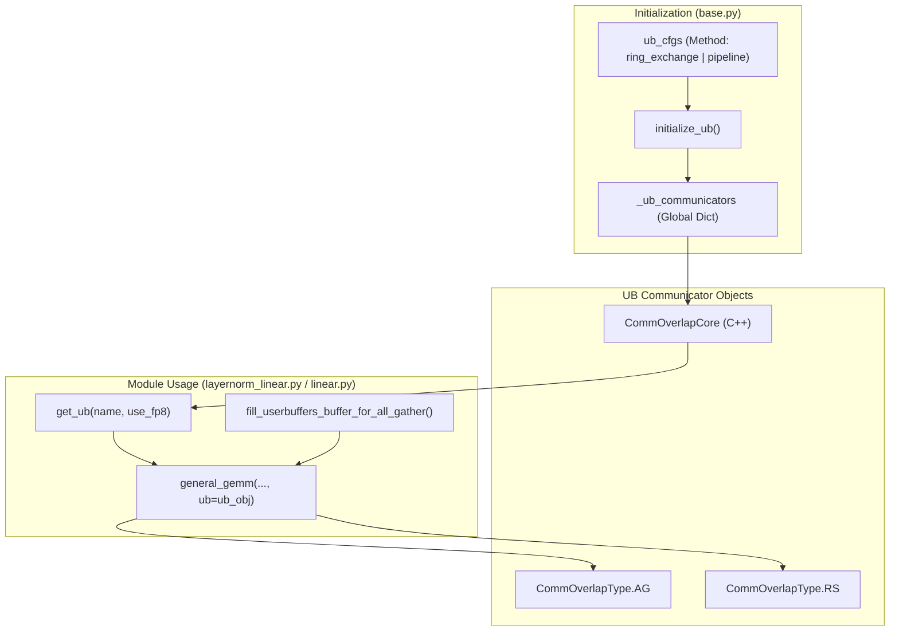
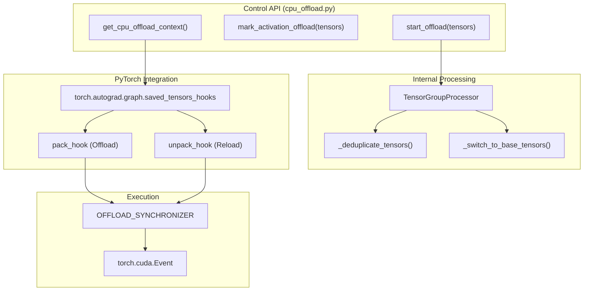
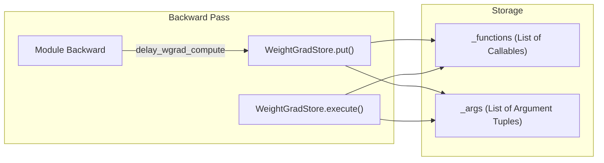

<!-- source: DeepWiki mcp.deepwiki.com · repo NVIDIA/TransformerEngine · page 4.6 Distributed Training Features · fetched 2026-10-26 -->

# Distributed Training Features

<details>
<summary>Relevant source files</summary>

The following files were used as context for generating this wiki page:

- [examples/pytorch/comm_gemm_overlap/te_layer_with_overlap.py](examples/pytorch/comm_gemm_overlap/te_layer_with_overlap.py)
- [examples/pytorch/quantized_model_init/fully_shard.py](examples/pytorch/quantized_model_init/fully_shard.py)
- [examples/pytorch/quantized_model_init/main.py](examples/pytorch/quantized_model_init/main.py)
- [qa/L0_pytorch_unittest/test.sh](qa/L0_pytorch_unittest/test.sh)
- [tests/pytorch/distributed/fsdp2_tests/run_fsdp2_fused_adam.py](tests/pytorch/distributed/fsdp2_tests/run_fsdp2_fused_adam.py)
- [tests/pytorch/distributed/fsdp2_tests/run_fsdp2_mem_leak.py](tests/pytorch/distributed/fsdp2_tests/run_fsdp2_mem_leak.py)
- [tests/pytorch/distributed/fsdp2_tests/run_fsdp2_model.py](tests/pytorch/distributed/fsdp2_tests/run_fsdp2_model.py)
- [tests/pytorch/distributed/run_gemm_with_overlap.py](tests/pytorch/distributed/run_gemm_with_overlap.py)
- [tests/pytorch/distributed/run_layer_with_overlap.py](tests/pytorch/distributed/run_layer_with_overlap.py)
- [tests/pytorch/distributed/test_comm_gemm_overlap.py](tests/pytorch/distributed/test_comm_gemm_overlap.py)
- [tests/pytorch/distributed/test_torch_fsdp2.py](tests/pytorch/distributed/test_torch_fsdp2.py)
- [tests/pytorch/test_cpu_offloading.py](tests/pytorch/test_cpu_offloading.py)
- [tests/pytorch/test_cuda_graphs.py](tests/pytorch/test_cuda_graphs.py)
- [tests/pytorch/test_fused_optimizer.py](tests/pytorch/test_fused_optimizer.py)
- [tests/pytorch/test_nvfp4_fsdp2_hooks.py](tests/pytorch/test_nvfp4_fsdp2_hooks.py)
- [transformer_engine/common/comm_gemm_overlap/comm_gemm_overlap.cpp](transformer_engine/common/comm_gemm_overlap/comm_gemm_overlap.cpp)
- [transformer_engine/common/comm_gemm_overlap/userbuffers/userbuffers-host.cpp](transformer_engine/common/comm_gemm_overlap/userbuffers/userbuffers-host.cpp)
- [transformer_engine/common/comm_gemm_overlap/userbuffers/userbuffers.cu](transformer_engine/common/comm_gemm_overlap/userbuffers/userbuffers.cu)
- [transformer_engine/common/comm_gemm_overlap/userbuffers/userbuffers.h](transformer_engine/common/comm_gemm_overlap/userbuffers/userbuffers.h)
- [transformer_engine/common/include/transformer_engine/comm_gemm_overlap.h](transformer_engine/common/include/transformer_engine/comm_gemm_overlap.h)
- [transformer_engine/pytorch/cpu_offload.py](transformer_engine/pytorch/cpu_offload.py)
- [transformer_engine/pytorch/csrc/extensions/comm_gemm_overlap.cpp](transformer_engine/pytorch/csrc/extensions/comm_gemm_overlap.cpp)
- [transformer_engine/pytorch/distributed.py](transformer_engine/pytorch/distributed.py)
- [transformer_engine/pytorch/graph.py](transformer_engine/pytorch/graph.py)
- [transformer_engine/pytorch/module/_common.py](transformer_engine/pytorch/module/_common.py)
- [transformer_engine/pytorch/module/base.py](transformer_engine/pytorch/module/base.py)
- [transformer_engine/pytorch/module/grouped_linear.py](transformer_engine/pytorch/module/grouped_linear.py)
- [transformer_engine/pytorch/module/layernorm_linear.py](transformer_engine/pytorch/module/layernorm_linear.py)
- [transformer_engine/pytorch/module/layernorm_mlp.py](transformer_engine/pytorch/module/layernorm_mlp.py)
- [transformer_engine/pytorch/module/linear.py](transformer_engine/pytorch/module/linear.py)
- [transformer_engine/pytorch/optimizers/fused_adam.py](transformer_engine/pytorch/optimizers/fused_adam.py)
- [transformer_engine/pytorch/optimizers/fused_sgd.py](transformer_engine/pytorch/optimizers/fused_sgd.py)
- [transformer_engine/pytorch/utils.py](transformer_engine/pytorch/utils.py)

</details>


This page documents distributed training optimizations in TransformerEngine's PyTorch integration. These features enable efficient training of large transformer models across multiple GPUs through communication-computation overlap, memory management, and gradient computation strategies.

For tensor/sequence parallelism concepts and communication primitives, see [Distributed Training](#7). For module-level API details, see [Module System and Base Classes](#4.1).

---

## Overview

TransformerEngine provides four main categories of distributed training optimizations:

| Feature | Purpose | Key Classes/Functions |
|---------|---------|----------------------|
| **Userbuffers** | Overlap tensor-parallel communication with GEMM computation | `initialize_ub()`, `get_ub()`, `UserBufferQuantizationMode` |
| **CPU Offload** | Reduce GPU memory by offloading activations to CPU | `get_cpu_offload_context()`, `start_offload()`, `TensorGroupProcessor` |
| **Activation Checkpointing** | Trade compute for memory via activation recomputation | `checkpoint()`, `CudaRNGStatesTracker` |
| **Delayed Weight Gradients** | Defer wgrad computation to reduce memory pressure | `WeightGradStore` |

Sources: [transformer_engine/pytorch/module/base.py:126-184](), [transformer_engine/pytorch/distributed.py:54-55](), [transformer_engine/pytorch/cpu_offload.py:26-37](), [transformer_engine/pytorch/module/_common.py:66-67]()

---

## Userbuffers: Communication-Computation Overlap

Userbuffers (UB) enable overlapping all-gather (AG) and reduce-scatter (RS) communications with GEMM operations in tensor-parallel training. This reduces the effective communication overhead by performing communication and computation concurrently.

### System Architecture



**Figure 1: Userbuffers Initialization and Usage Flow**

Sources: [transformer_engine/pytorch/module/base.py:126-184](), [transformer_engine/pytorch/module/layernorm_linear.py:203-212](), [transformer_engine/pytorch/module/linear.py:140-147](), [transformer_engine/common/comm_gemm_overlap/comm_gemm_overlap.cpp:58-63]()

### Initialization and Configuration

Userbuffers are initialized globally via `initialize_ub()` before training begins. It supports multiple quantization modes and specific configurations for different GEMM layers.

```python
# Example initialization
import transformer_engine.pytorch as te

te.initialize_ub(
    shape=[sequence_length * batch_size, hidden_size],
    tp_size=8,
    quantization_modes=[te.UserBufferQuantizationMode.FP8],
    ub_cfgs={
        "qkv_fprop": {
            "method": "ring_exchange", # Uses CUDA Multicast
            "num_sm": 1,
            "atomic_gemm": False
        },
        "proj_fprop": {
            "method": "pipeline",      # Split communication
            "num_splits": 4
        }
    }
)
```

The system manages different overlap methods:
- **ring_exchange**: Point-to-point communication using CUDA Multicast for peer-to-peer data exchange. Used for `qkv_fprop`, `fc1_fprop`, `proj_dgrad`, `fc2_dgrad`. [transformer_engine/pytorch/module/base.py:161-161]()
- **pipeline**: Splits communication into multiple pipeline stages. Used for `proj_fprop`, `fc2_fprop`. [transformer_engine/pytorch/module/base.py:161-161]()
- **bulk**: Overlaps input all-gather with dgrad GEMM or dgrad reduce-scatter with wgrad GEMM. [transformer_engine/pytorch/module/layernorm_linear.py:145-146]()

### Module Integration

Modules use Userbuffers through `general_gemm` and specialized buffer filling functions:
- `get_ub(name, use_fp8)`: Retrieves the UB communicator object from the global registry. [transformer_engine/pytorch/module/base.py:23-23]()
- `fill_userbuffers_buffer_for_all_gather()`: Prepares the communication buffer by copying local input data. [transformer_engine/pytorch/module/base.py:21-21]()
- `general_gemm()`: The C++ extension receives the `ub_obj` and `ub_type` (AG/RS) to trigger the overlapped kernel. [transformer_engine/pytorch/module/layernorm_linear.py:88-89]()

Sources: [transformer_engine/pytorch/module/layernorm_linear.py:203-212](), [transformer_engine/pytorch/module/linear.py:58-60]()

---

## CPU Offload for Memory Management

CPU offload transfers intermediate activations to CPU memory during the forward pass and reloads them just-in-time for the backward pass, utilizing asynchronous CUDA streams to hide transfer latency.

### Offload Architecture



**Figure 2: CPU Offload System Architecture**

Sources: [transformer_engine/pytorch/cpu_offload.py:61-87](), [transformer_engine/pytorch/cpu_offload.py:112-135](), [transformer_engine/pytorch/cpu_offload.py:15-23]()

### Offload Workflow

1. **Marking**: Tensors are marked for offload via `start_offload()`. This records a `start_reload_event` on the current stream to ensure the tensor is fully computed before transfer. [transformer_engine/pytorch/cpu_offload.py:76-77]()
2. **Processing**: `TensorGroupProcessor` optimizes memory by deduplicating tensors (`_deduplicate_tensors`) and switching views to base tensors (`_switch_to_base_tensors`). [transformer_engine/pytorch/cpu_offload.py:138-171](), [transformer_engine/pytorch/cpu_offload.py:174-200]()
3. **Asynchronous Transfer**: Transfers occur on a dedicated stream managed by `OFFLOAD_SYNCHRONIZER`. The system supports a "V1" legacy path controlled by `NVTE_CPU_OFFLOAD_V1`. [transformer_engine/pytorch/cpu_offload.py:28-30]()
4. **Reload**: During backward, the `unpack_hook` triggers a reload from CPU to GPU. The system uses `torch.cuda.Event` to synchronize the backward GEMM with the completion of the reload. [transformer_engine/pytorch/cpu_offload.py:76-77]()

Sources: [transformer_engine/pytorch/cpu_offload.py:138-171](), [transformer_engine/pytorch/cpu_offload.py:174-182]()

---

## Activation Checkpointing

Activation checkpointing trades compute for memory by discarding intermediate activations during forward and recomputing them during backward. TransformerEngine provides an implementation that is compatible with FP8 state management.

### Checkpoint Logic

TransformerEngine supports two checkpointing methods:
- **Reentrant**: Uses `CudaRNGStatesTracker` to fork and restore RNG states to ensure consistency during re-run. [transformer_engine/pytorch/distributed.py:204-205]()
- **FP8 Compatibility**: During recomputation, the system must track whether it is in a "recompute phase" to avoid updating FP8 statistics (like maximum values) twice. [transformer_engine/pytorch/distributed.py:65-66]()

### FP8 Recompute Phase

- `in_fp8_activation_recompute_phase()`: Returns `True` if the current execution is a recomputation for checkpointing. [transformer_engine/pytorch/distributed.py:66-66]()
- `is_fp8_activation_recompute_enabled()`: Checks if the feature is active. [transformer_engine/pytorch/distributed.py:65-65]()

Sources: [transformer_engine/pytorch/distributed.py:63-67](), [transformer_engine/pytorch/distributed.py:200-205]()

---

## Delayed Weight Gradient Computation

The `WeightGradStore` class enables deferring the computation of weight gradients (`wgrad`). This is particularly useful for overlapping the wgrad GEMM with other backward operations or reducing peak memory by deallocating activations earlier.

### WeightGradStore Workflow



**Figure 3: Delayed Weight Gradient Execution**

1. **Storage**: In the backward pass of `Linear` or `LayerNormLinear`, if a `wgrad_store` is provided, the GEMM call is wrapped in a closure and stored via `wgrad_store.put()`. [transformer_engine/pytorch/module/linear.py:154-155]()
2. **Execution**: The gradients are not computed until `wgrad_store.execute()` is called explicitly by the user or the framework at the end of the backward pass. [transformer_engine/pytorch/module/_common.py:66-67]()
3. **Fusion**: This mechanism supports `fuse_wgrad_accumulation`, which allows the deferred GEMM to accumulate directly into a main gradient buffer. [transformer_engine/pytorch/module/layernorm_linear.py:119-120]()

Sources: [transformer_engine/pytorch/module/linear.py:218-219](), [transformer_engine/pytorch/module/layernorm_linear.py:119-120](), [transformer_engine/pytorch/module/_common.py:66-67]()

---

