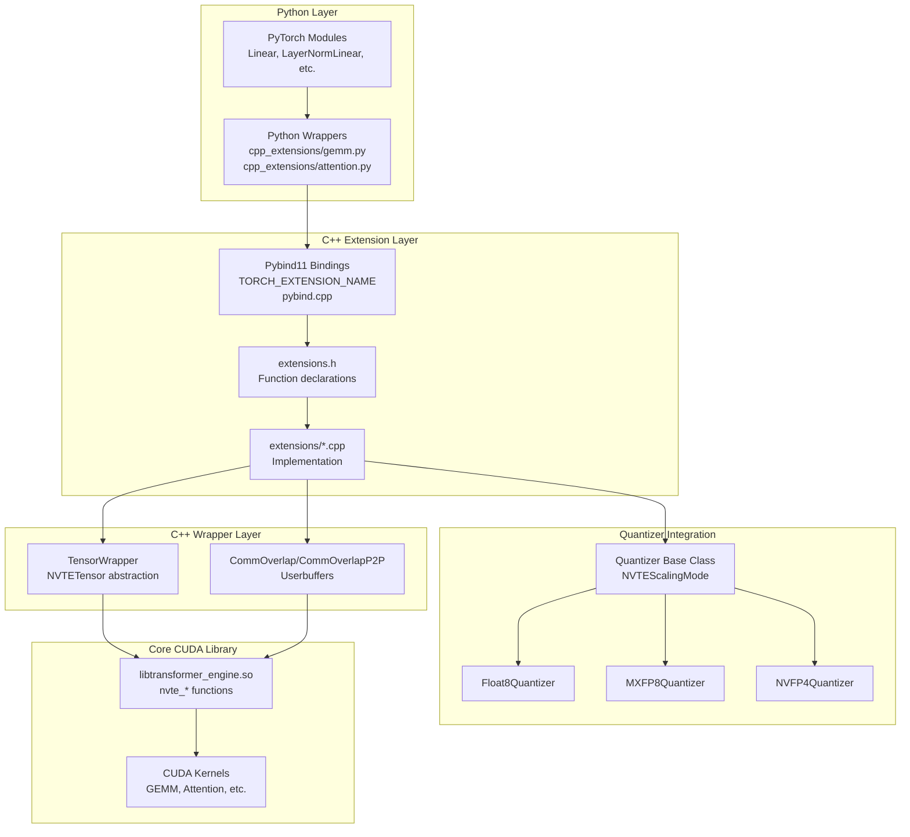
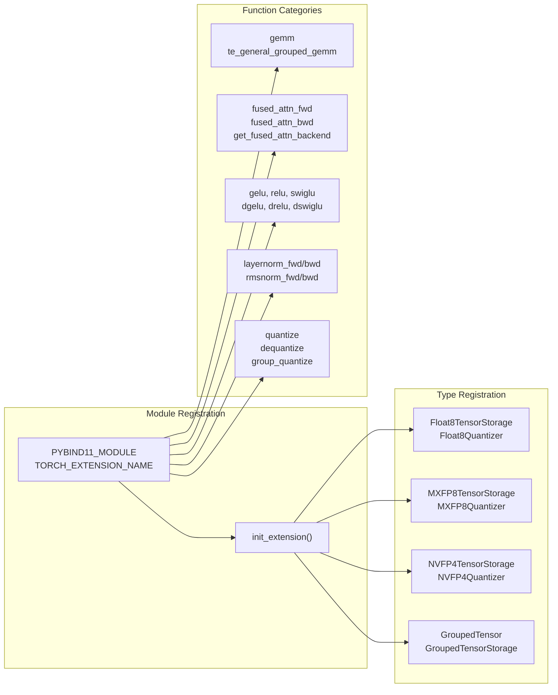
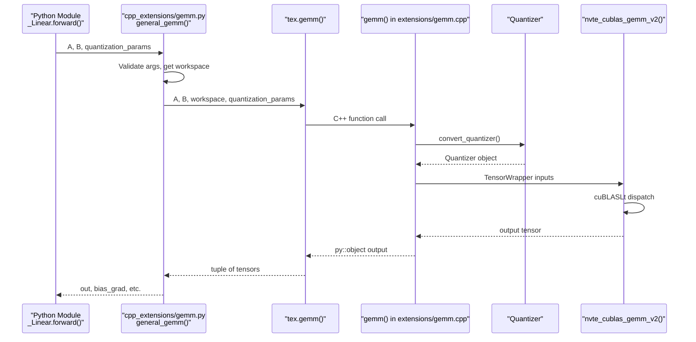
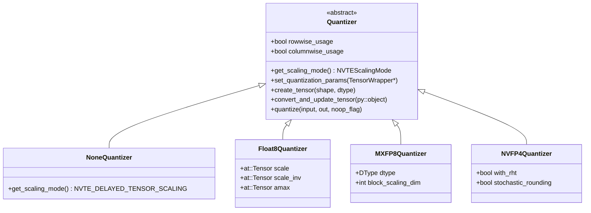

<!-- source: DeepWiki mcp.deepwiki.com · repo NVIDIA/TransformerEngine · page 4.7 C++ Extensions and CUDA Integration · fetched 2026-10-26 -->

# C++ Extensions and CUDA Integration

<details>
<summary>Relevant source files</summary>

The following files were used as context for generating this wiki page:

- [tests/cpp/operator/test_normalization.cu](tests/cpp/operator/test_normalization.cu)
- [tests/cpp/operator/test_normalization.h](tests/cpp/operator/test_normalization.h)
- [tests/pytorch/test_grouped_tensor.py](tests/pytorch/test_grouped_tensor.py)
- [transformer_engine/common/cast/dispatch/quantize.cuh](transformer_engine/common/cast/dispatch/quantize.cuh)
- [transformer_engine/common/gemm/cublaslt_gemm.cu](transformer_engine/common/gemm/cublaslt_gemm.cu)
- [transformer_engine/common/include/transformer_engine/gemm.h](transformer_engine/common/include/transformer_engine/gemm.h)
- [transformer_engine/common/include/transformer_engine/normalization.h](transformer_engine/common/include/transformer_engine/normalization.h)
- [transformer_engine/common/normalization/common.cpp](transformer_engine/common/normalization/common.cpp)
- [transformer_engine/common/normalization/common.h](transformer_engine/common/normalization/common.h)
- [transformer_engine/common/normalization/layernorm/ln_api.cpp](transformer_engine/common/normalization/layernorm/ln_api.cpp)
- [transformer_engine/common/normalization/layernorm/ln_fwd_kernels.cuh](transformer_engine/common/normalization/layernorm/ln_fwd_kernels.cuh)
- [transformer_engine/common/normalization/rmsnorm/rmsnorm_api.cpp](transformer_engine/common/normalization/rmsnorm/rmsnorm_api.cpp)
- [transformer_engine/common/normalization/rmsnorm/rmsnorm_fwd_kernels.cuh](transformer_engine/common/normalization/rmsnorm/rmsnorm_fwd_kernels.cuh)
- [transformer_engine/pytorch/cpp_extensions/gemm.py](transformer_engine/pytorch/cpp_extensions/gemm.py)
- [transformer_engine/pytorch/csrc/common.cpp](transformer_engine/pytorch/csrc/common.cpp)
- [transformer_engine/pytorch/csrc/common.h](transformer_engine/pytorch/csrc/common.h)
- [transformer_engine/pytorch/csrc/extensions.h](transformer_engine/pytorch/csrc/extensions.h)
- [transformer_engine/pytorch/csrc/extensions/cast.cpp](transformer_engine/pytorch/csrc/extensions/cast.cpp)
- [transformer_engine/pytorch/csrc/extensions/gemm.cpp](transformer_engine/pytorch/csrc/extensions/gemm.cpp)
- [transformer_engine/pytorch/csrc/extensions/normalization.cpp](transformer_engine/pytorch/csrc/extensions/normalization.cpp)
- [transformer_engine/pytorch/csrc/extensions/padding.cpp](transformer_engine/pytorch/csrc/extensions/padding.cpp)
- [transformer_engine/pytorch/csrc/extensions/pybind.cpp](transformer_engine/pytorch/csrc/extensions/pybind.cpp)
- [transformer_engine/pytorch/csrc/extensions/recipe.cpp](transformer_engine/pytorch/csrc/extensions/recipe.cpp)
- [transformer_engine/pytorch/csrc/extensions/transpose.cpp](transformer_engine/pytorch/csrc/extensions/transpose.cpp)
- [transformer_engine/pytorch/csrc/quantizer.cpp](transformer_engine/pytorch/csrc/quantizer.cpp)

</details>


## Purpose and Scope

This page documents the PyTorch C++ extensions that form the bridge between Python modules and CUDA kernels in Transformer Engine. These extensions use pybind11 to expose high-performance CUDA operations to Python, enabling efficient execution of quantized operations, fused kernels, and distributed communication patterns.

For information about the high-level PyTorch modules that use these extensions, see **4.2 Linear and Fused Operations** and **4.4 Attention Mechanisms**. For details on the underlying CUDA kernels in the common library, refer to **6. Core C++ Library**.

## Architecture Overview

The CUDA extensions provide a three-layer architecture connecting Python to CUDA:



Sources: [transformer_engine/pytorch/csrc/extensions.h:1-150](), [transformer_engine/pytorch/csrc/extensions/pybind.cpp:136-150](), [transformer_engine/pytorch/csrc/common.h:60-149]()

## Pybind11 Module Definition

The C++ extensions are exposed through a pybind11 module named `transformer_engine_torch` (defined by `TORCH_EXTENSION_NAME`). The module initialization sets up all extension functions and classes:



**Key Initialization Functions:**

| Function | Purpose | Source |
|----------|---------|--------|
| `init_float8_extension()` | Imports Float8 Python classes and caches PyTypeObject pointers | [transformer_engine/pytorch/csrc/extensions/pybind.cpp:42-56]() |
| `init_mxfp8_extension()` | Imports MXFP8 Python classes | [transformer_engine/pytorch/csrc/extensions/pybind.cpp:58-70]() |
| `init_nvfp4_extensions()` | Imports NVFP4 quantization classes | [transformer_engine/pytorch/csrc/extensions/pybind.cpp:92-104]() |
| `init_grouped_tensor_extension()` | Imports GroupedTensor classes | [transformer_engine/pytorch/csrc/extensions/pybind.cpp:106-120]() |

Sources: [transformer_engine/pytorch/csrc/extensions/pybind.cpp:122-150](), [transformer_engine/pytorch/csrc/common.h:99-149]()

## GEMM Operations

The GEMM (General Matrix Multiply) operations are the core computational primitives exposed by the extensions.

### GEMM Call Flow



**GEMM Function Signature:**

The C++ extension exposes a robust GEMM interface in `extensions/gemm.cpp`:
```cpp
std::vector<py::object> gemm(
    py::handle A, bool transa, py::handle B, bool transb, py::object D,
    py::handle quantizer, std::optional<DType> out_dtype, MaybeTensor bias,
    DType bias_type, bool gelu, MaybeTensor gelu_in, bool grad,
    at::Tensor workspace, size_t workspaceSize, bool accumulate,
    bool use_split_accumulator, CommOverlapCore* comm_overlap,
    std::optional<CommOverlapType> comm_type, MaybeTensor extra_output,
    bool bulk_overlap, float alpha, std::optional<float> beta
);
```
[transformer_engine/pytorch/csrc/extensions/gemm.cpp:144-150]()

Sources: [transformer_engine/pytorch/csrc/extensions/gemm.cpp:144-181](), [transformer_engine/pytorch/cpp_extensions/gemm.py:105-211]()

### Python Wrapper for GEMM

The Python-side wrapper in `cpp_extensions/gemm.py` provides workspace management and argument validation:

**Workspace Management:**

| Function | Purpose | Strategy |
|----------|---------|----------|
| `get_cublas_workspace_size_bytes()` | Returns 32 MiB for Hopper+ (NVFP4), 4 MiB otherwise | Architecture-based [transformer_engine/pytorch/cpp_extensions/gemm.py:34-39]() |
| `get_cublas_workspace()` | Allocates workspace tensor | `@functools.lru_cache` per device [transformer_engine/pytorch/cpp_extensions/gemm.py:42-61]() |

The workspace supports:
- Standard GEMM: Single workspace buffer [transformer_engine/pytorch/cpp_extensions/gemm.py:61]().
- Userbuffers (UB): `_NUM_MAX_UB_STREAMS` (3) workspaces [transformer_engine/pytorch/cpp_extensions/gemm.py:31-52]().
- Grouped GEMM: Multiple workspaces based on `get_num_cublas_streams()` [transformer_engine/pytorch/cpp_extensions/gemm.py:53-59]().

Sources: [transformer_engine/pytorch/cpp_extensions/gemm.py:31-61](), [transformer_engine/pytorch/cpp_extensions/gemm.py:105-211]()

## Quantizer Integration

The C++ extension layer implements a `Quantizer` base class hierarchy that abstracts different quantization schemes:



The `quantize` extension function in `extensions/cast.cpp` bridges the Python quantizer to C++ logic:
1. Calls `convert_quantizer(quantizer)` to get the C++ object [transformer_engine/pytorch/csrc/extensions/cast.cpp:55]().
2. Invokes `quantizer_cpp->quantize(...)` which dispatches to optimized CUDA kernels [transformer_engine/pytorch/csrc/extensions/cast.cpp:79]().

Sources: [transformer_engine/pytorch/csrc/common.h:99-265](), [transformer_engine/pytorch/csrc/extensions/cast.cpp:52-88]()

## Attention Operations

Fused attention operations integrate cuDNN and custom CUDA kernels through the C++ extension layer:

| Function | Purpose | Signature |
|----------|---------|-----------|
| `get_fused_attn_backend` | Determines optimal backend based on seqlen, dtype, and hardware | [transformer_engine/pytorch/csrc/extensions.h:89-94]() |
| `fused_attn_fwd` | Forward attention computation (Q, K, V → O) | [transformer_engine/pytorch/csrc/extensions.h:96-108]() |
| `fused_attn_bwd` | Backward attention computation (dO → dQ, dK, dV) | [transformer_engine/pytorch/csrc/extensions.h:110-122]() |

**Backend Selection Logic:**
The `get_fused_attn_backend` function checks hardware compatibility (e.g., FP8 requires SM90+) and tensor layouts to select between backends like `NVTE_F16_max512`, `NVTE_F16_arbitrary`, or `NVTE_FP8` [transformer_engine/pytorch/csrc/extensions.h:89-94]().

Sources: [transformer_engine/pytorch/csrc/extensions.h:89-122]()

## Normalization Operations

LayerNorm and RMSNorm operations are implemented with high-performance C++ wrappers that manage workspace allocation and kernel dispatch.

**Forward Pass Flow (`layernorm_fwd`):**
1. Resolves implementation (UNFUSED, FULLY_FUSED, or FUSED_NORM_AMAX) based on the provided quantizer [transformer_engine/pytorch/csrc/extensions/normalization.cpp:95-130]().
2. Allocates `mu` and `rsigma` tensors to save for the backward pass [transformer_engine/pytorch/csrc/extensions/normalization.cpp:86-89]().
3. Dispatches to `nvte_layernorm_fwd` or cuDNN equivalents [transformer_engine/pytorch/csrc/extensions/normalization.cpp:170-185]().

**Backward Pass Flow (`layernorm_bwd`):**
1. First call to `nvte_layernorm_bwd` populates the required workspace size [transformer_engine/pytorch/csrc/extensions/normalization.cpp:38-43]().
2. Allocates the workspace using `allocateSpace` [transformer_engine/pytorch/csrc/extensions/normalization.cpp:46-48]().
3. Second call executes the actual backward kernel [transformer_engine/pytorch/csrc/extensions/normalization.cpp:51-56]().

Sources: [transformer_engine/pytorch/csrc/extensions/normalization.cpp:13-59](), [transformer_engine/pytorch/csrc/extensions/normalization.cpp:61-190]()

## Scale Swizzling for GEMM

For certain formats like MXFP8 and NVFP4, scaling factors must be "swizzled" (reordered) to match the hardware's expected layout during GEMM.

**Swizzling Logic (`swizzle_scales_for_gemm`):**
- Checks `scaling_mode` (e.g., `NVTE_MXFP8_1D_SCALING`) [transformer_engine/pytorch/csrc/extensions/swizzle.cpp:52-61]().
- Launches the `nvte_swizzle_scaling_factors` kernel [transformer_engine/pytorch/csrc/extensions/swizzle.cpp:97-98]().
- Updates the `TensorWrapper` to point to the new swizzled buffer [transformer_engine/pytorch/csrc/extensions/swizzle.cpp:101]().

Sources: [transformer_engine/pytorch/csrc/extensions/swizzle.cpp:47-142]()

## Build System and Architecture Support

The extensions are built using CMake, which manages complex CUDA architecture requirements.

**Architecture Specialization:**
- `NVTE_STANDARD_ARCHS`: Applied to all sources (e.g., SM75, SM80, SM90).
- The build system detects capabilities like Hopper (SM90) to enable specific kernels such as FP8 block-scaling [tests/pytorch/test_grouped_tensor.py:40-41]().
- NVFP4 and MXFP8 require Blackwell (SM100+) or specific Hopper revisions [tests/pytorch/test_grouped_tensor.py:29-34]().

Sources: [tests/pytorch/test_grouped_tensor.py:29-49]()

---

