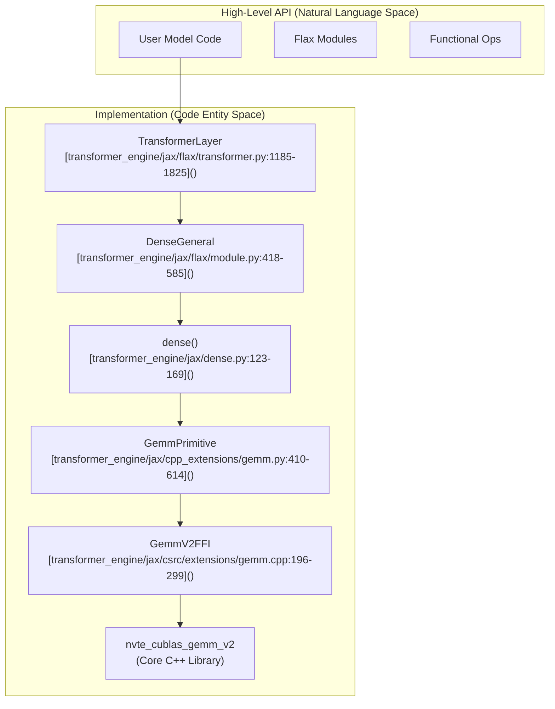
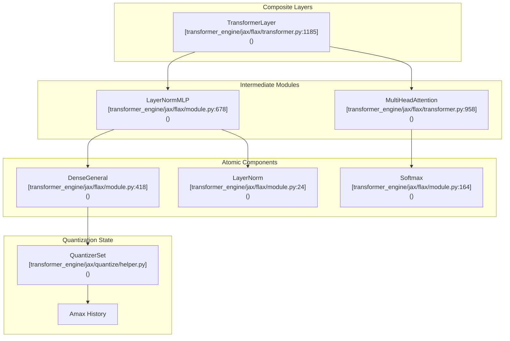

<!-- source: DeepWiki mcp.deepwiki.com · repo NVIDIA/TransformerEngine · page 5 JAX Integration · fetched 2026-10-26 -->

# JAX Integration

Relevant source files

The following files were used as context for generating this wiki page:

- [docs/api/jax.rst](docs/api/jax.rst)
- [tests/jax/test_distributed_fused_attn.py](tests/jax/test_distributed_fused_attn.py)
- [tests/jax/test_fused_attn.py](tests/jax/test_fused_attn.py)
- [tests/jax/test_fused_attn_score_mod.py](tests/jax/test_fused_attn_score_mod.py)
- [tests/jax/test_layer.py](tests/jax/test_layer.py)
- [tests/jax/utils.py](tests/jax/utils.py)
- [transformer_engine/jax/__init__.py](transformer_engine/jax/__init__.py)
- [transformer_engine/jax/attention.py](transformer_engine/jax/attention.py)
- [transformer_engine/jax/cpp_extensions/__init__.py](transformer_engine/jax/cpp_extensions/__init__.py)
- [transformer_engine/jax/cpp_extensions/attention.py](transformer_engine/jax/cpp_extensions/attention.py)
- [transformer_engine/jax/csrc/extensions/attention.cpp](transformer_engine/jax/csrc/extensions/attention.cpp)
- [transformer_engine/jax/flax/module.py](transformer_engine/jax/flax/module.py)
- [transformer_engine/jax/flax/transformer.py](transformer_engine/jax/flax/transformer.py)
- [transformer_engine/pytorch/export.py](transformer_engine/pytorch/export.py)

## Purpose and Scope

The JAX integration provides a functional programming interface to TransformerEngine's optimized transformer kernels. This integration enables JAX/Flax users to leverage FP8/FP4 quantization, fused attention, and optimized GEMM operations while maintaining full compatibility with JAX's transformation system (`jit`, `grad`, `vmap`, `pmap`).

For details on Flax modules and sharding, see [Flax Modules and Sharding](#5.1). For details on the underlying primitive system, see [Custom Primitives System](#5.2). Specific operations are covered in [Attention Primitives](#5.3) and [GEMM and Quantization Primitives](#5.4).

**Sources:** [transformer_engine/jax/__init__.py:4-21](), [transformer_engine/jax/flax/transformer.py:1-43]()

---

## System Architecture

The JAX integration follows a multi-layer architecture that maintains functional purity while interfacing with imperative C++ kernels. It leverages JAX's Foreign Function Interface (FFI) to call the same core C++ kernels used by the PyTorch integration.

### Natural Language to Code Entity Space: JAX Execution Flow

The following diagram maps high-level system components to their specific code entities and file locations.

**Sources:** [transformer_engine/jax/flax/transformer.py:1185-1825](), [transformer_engine/jax/flax/module.py:418-585](), [transformer_engine/jax/dense.py:123-169](), [transformer_engine/jax/cpp_extensions/gemm.py:410-614](), [transformer_engine/jax/csrc/extensions/gemm.cpp:196-299]()

---

## Flax Module Hierarchy

TransformerEngine provides Flax modules that wrap functional operations with parameter management, logical axis sharding, and initialization.

### Module Relationship Diagram

This diagram shows how complex modules are composed of atomic components and how they relate to the underlying quantization system.

### Key Modules

| Module | Description | Key Code Reference |
| :--- | :--- | :--- |
| `TransformerLayer` | Complete encoder/decoder block including attention and MLP. | [transformer_engine/jax/flax/transformer.py:1185-1825]() |
| `MultiHeadAttention` | Supports MHA, GQA, and MQA with fused/unfused backends. | [transformer_engine/jax/flax/transformer.py:958-1182]() |
| `LayerNormMLP` | Fused implementation of LayerNorm/RMSNorm and a 2-layer MLP. | [transformer_engine/jax/flax/module.py:678-956]() |
| `DenseGeneral` | Optimized linear layer with support for LoRA and FP8/FP4. | [transformer_engine/jax/flax/module.py:418-585]() |

For details on sharding rules and logical axes like `BATCH_AXES` and `HEAD_AXES`, see [Flax Modules and Sharding](#5.1).

**Sources:** [transformer_engine/jax/flax/transformer.py:958-1825](), [transformer_engine/jax/flax/module.py:164-956](), [docs/api/jax.rst:13-20]()

---

## Custom Primitives and FFI

JAX primitives are the bridge between functional Python code and high-performance C++ kernels. Every optimized operation in TransformerEngine JAX (GEMM, Attention, LayerNorm) is implemented as a JAX primitive.

### Primitive Lifecycle
1. **Abstract Evaluation**: Infers output shapes and dtypes [transformer_engine/jax/cpp_extensions/gemm.py:422-569]().
2. **Lowering**: Binds the operation to an XLA FFI handler [transformer_engine/jax/cpp_extensions/gemm.py:577-614]().
3. **Batching**: Defines rules for `jax.vmap` support.
4. **Partitioning**: Defines SPMD sharding rules for distributed execution via custom partitioning rules like `SdyShardingRule` [transformer_engine/jax/cpp_extensions/attention.py:16-17]().

For details on how custom VJPs enable automatic differentiation for these primitives, see [Custom Primitives System](#5.2).

**Sources:** [transformer_engine/jax/cpp_extensions/gemm.py:410-614](), [transformer_engine/jax/cpp_extensions/attention.py:12-156]()

---

## Quantization and Performance

The JAX integration supports multiple quantization recipes including `DelayedScaling` and `MXFP8BlockScaling` [transformer_engine/jax/flax/module.py:19-21]().

### Performance Features
* **Fused Attention**: The `FusedAttnHelper` automatically selects the best available backend (e.g., cuDNN) by calling `nvte_get_fused_attn_backend` [transformer_engine/jax/cpp_extensions/attention.py:130-150]().
* **Collective GEMM**: Integrates NCCL communication (All-Gather, Reduce-Scatter) directly into the GEMM primitive to overlap communication with computation [transformer_engine/jax/cpp_extensions/gemm.py:210-317]().
* **THD Format**: Support for `QKVFormat.THD` allows multiple segments packed in a sequence for efficient variable-length handling [transformer_engine/jax/attention.py:106-117]().
* **Softmax Fusion**: Specialized primitives like `jax_scaled_masked_softmax` provide optimized kernels for attention scoring [transformer_engine/jax/flax/module.py:33-38]().

For details on GEMM optimization and block scaling, see [GEMM and Quantization Primitives](#5.4). For ragged tensor handling in attention, see [Attention Primitives](#5.3).

**Sources:** [transformer_engine/jax/flax/module.py:19-21](), [transformer_engine/jax/cpp_extensions/attention.py:130-150](), [transformer_engine/jax/cpp_extensions/gemm.py:210-317](), [transformer_engine/jax/attention.py:106-117](), [transformer_engine/jax/flax/module.py:33-38]()

---

