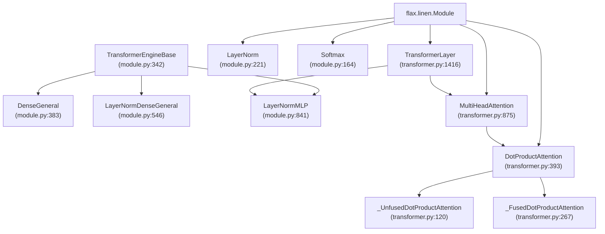
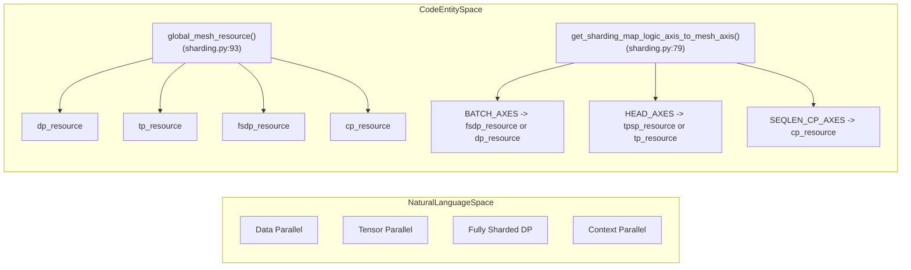
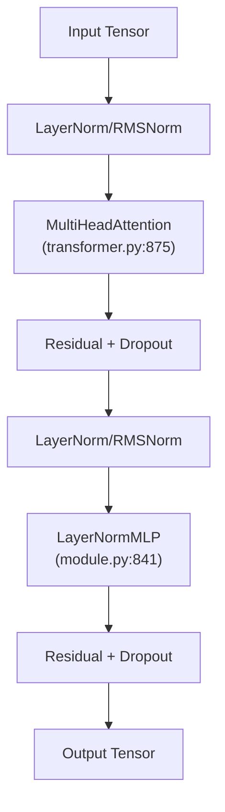

<!-- source: DeepWiki mcp.deepwiki.com · repo NVIDIA/TransformerEngine · page 5.1 Flax Modules and Sharding · fetched 2026-10-26 -->

# Flax Modules and Sharding

Relevant source files

The following files were used as context for generating this wiki page:

- [examples/jax/encoder/common.py](examples/jax/encoder/common.py)
- [examples/jax/encoder/test_model_parallel_encoder.py](examples/jax/encoder/test_model_parallel_encoder.py)
- [examples/jax/encoder/test_multigpu_encoder.py](examples/jax/encoder/test_multigpu_encoder.py)
- [examples/jax/encoder/test_multiprocessing_encoder.py](examples/jax/encoder/test_multiprocessing_encoder.py)
- [examples/jax/encoder/test_single_gpu_encoder.py](examples/jax/encoder/test_single_gpu_encoder.py)
- [examples/jax/mnist/test_single_gpu_mnist.py](examples/jax/mnist/test_single_gpu_mnist.py)
- [tests/jax/test_distributed_fused_attn.py](tests/jax/test_distributed_fused_attn.py)
- [tests/jax/test_distributed_layernorm_mlp.py](tests/jax/test_distributed_layernorm_mlp.py)
- [tests/jax/test_fused_attn.py](tests/jax/test_fused_attn.py)
- [tests/jax/test_fused_attn_score_mod.py](tests/jax/test_fused_attn_score_mod.py)
- [tests/jax/test_layer.py](tests/jax/test_layer.py)
- [tests/jax/utils.py](tests/jax/utils.py)
- [transformer_engine/jax/attention.py](transformer_engine/jax/attention.py)
- [transformer_engine/jax/cpp_extensions/__init__.py](transformer_engine/jax/cpp_extensions/__init__.py)
- [transformer_engine/jax/cpp_extensions/attention.py](transformer_engine/jax/cpp_extensions/attention.py)
- [transformer_engine/jax/csrc/extensions/attention.cpp](transformer_engine/jax/csrc/extensions/attention.cpp)
- [transformer_engine/jax/flax/module.py](transformer_engine/jax/flax/module.py)
- [transformer_engine/jax/flax/transformer.py](transformer_engine/jax/flax/transformer.py)
- [transformer_engine/jax/layernorm_dense.py](transformer_engine/jax/layernorm_dense.py)
- [transformer_engine/jax/layernorm_mlp.py](transformer_engine/jax/layernorm_mlp.py)
- [transformer_engine/jax/sharding.py](transformer_engine/jax/sharding.py)

This page documents the Flax modules and sharding infrastructure in Transformer Engine's JAX integration. It covers the Flax-compatible transformer modules (`TransformerLayer`, `MultiHeadAttention`) and supporting building blocks (`DenseGeneral`, `LayerNormMLP`), as well as the `MeshResource` system for distributed training.

## Flax Module Overview

TransformerEngine provides Flax-compatible modules that extend `flax.linen.Module` for building transformer models with FP8/MXFP8 quantization and distributed training support. These modules are designed to integrate seamlessly with JAX's transformation system while calling into high-performance C++ kernels.

**Diagram: Flax Module Hierarchy**

**Sources:** [transformer_engine/jax/flax/module.py:342-380](), [transformer_engine/jax/flax/transformer.py:120-1500]()

## MeshResource and Sharding

The sharding system maps logical axis names to physical mesh axes defined in a JAX `Mesh`. This allows developers to write code using abstract concepts like "batch" or "hidden" while the library handles the actual distribution across devices.

### Logical Axis Naming
The following constants are used throughout the codebase to define sharding constraints and partition specifications:
- `BATCH_AXES`: "nvte_batch" [transformer_engine/jax/sharding.py:26]()
- `SEQLEN_AXES`: "nvte_seqlen" [transformer_engine/jax/sharding.py:27]()
- `SEQLEN_TP_AXES`: "nvte_seqlen_tp" [transformer_engine/jax/sharding.py:28]()
- `SEQLEN_CP_AXES`: "nvte_seqlen_cp" [transformer_engine/jax/sharding.py:29]()
- `HEAD_AXES`: "nvte_head" [transformer_engine/jax/sharding.py:30]()
- `HIDDEN_AXES`: "nvte_hidden" [transformer_engine/jax/sharding.py:31]()
- `HIDDEN_TP_AXES`: "nvte_hidden_tp" [transformer_engine/jax/sharding.py:32]()
- `W_TP_AXES`: "nvte_w_tp" [transformer_engine/jax/sharding.py:36]()

### MeshResource Configuration
The `MeshResource` dataclass manages the mapping between these logical axes and the user's mesh axes. It supports Data Parallelism (DP), Tensor Parallelism (TP), Fully Sharded Data Parallelism (FSDP), and Context Parallelism (CP). The `get_sharding_map_logic_axis_to_mesh_axis` function generates the dictionary used for these mappings [transformer_engine/jax/sharding.py:79-112]().

**Diagram: Logical to Mesh Axis Mapping**

**Sources:** [transformer_engine/jax/sharding.py:12-112]()

## Core Flax Modules

### DenseGeneral
`DenseGeneral` implements a flexible linear layer with optional FP8/MXFP8 quantization and sharding constraints. It is the fundamental building block for MLP and Attention projections.

**Implementation Details:**
- Uses `with_sharding_constraint_by_logical_axes` to apply sharding to inputs, kernels, and biases [transformer_engine/jax/flax/module.py:469-478]().
- Calls the `dense()` or `grouped_dense()` primitives to execute the GEMM operations [transformer_engine/jax/flax/module.py:491-523]().
- Supports Low Rank Adaptation (LoRA) via `_apply_low_rank_adaptation` which performs an additional low-rank update to the weights [transformer_engine/jax/flax/module.py:137-161]().

### LayerNormMLP
`LayerNormMLP` fuses LayerNorm/RMSNorm with a two-layer MLP (Feed-Forward Network). This fusion reduces memory bandwidth by combining normalization and the first GEMM operation.

**Data Flow:**
1. Input normalization (LayerNorm or RMSNorm) using `layernorm_mlp` primitive [transformer_engine/jax/flax/module.py:1222]().
2. Expansion GEMM (`fc1`) with activation (e.g., GEGLU, SwiGLU) [transformer_engine/jax/flax/module.py:1230]().
3. Contraction GEMM (`fc2`) using `dense` primitive [transformer_engine/jax/flax/module.py:1255]().
4. Optional dropout and residual connection handling [transformer_engine/jax/flax/module.py:1270]().

**Sources:** [transformer_engine/jax/flax/module.py:841-1286](), [transformer_engine/jax/layernorm_mlp.py:35-146]()

### MultiHeadAttention
`MultiHeadAttention` manages QKV projections, attention computation (fused or unfused), and output projection.

**Key Features:**
- **Fused QKV**: Can pack Query, Key, and Value into a single GEMM for efficiency by setting `fuse_qkv_params=True` [transformer_engine/jax/flax/transformer.py:1095-1123]().
- **GQA/MQA Support**: Supports Grouped Query Attention and Multi-Query Attention by specifying `num_gqa_groups` [transformer_engine/jax/flax/transformer.py:922]().
- **Rotary Embeddings**: Integrates RoPE via `rotary_pos_emb` function applied to Q and K tensors [transformer_engine/jax/flax/transformer.py:740-816]().

**Sources:** [transformer_engine/jax/flax/transformer.py:875-1387]()

### TransformerLayer
The `TransformerLayer` module combines attention and MLP blocks into a standard transformer stage, handling residuals and layer normalization.

**Diagram: TransformerLayer Internal Structure**

**Implementation Details:**
- Supports both Encoder and Decoder configurations via `TransformerLayerType` [transformer_engine/jax/flax/transformer.py:1416]().
- Handles sequence parallelism by sharding along the sequence dimension when `enable_sequence_parallel` is True, ensuring that LayerNorm and Dropout are performed on sharded data [transformer_engine/jax/flax/transformer.py:1425]().
- Extends logical axis rules using `extend_logical_axis_rules` to ensure consistent sharding across the layer when using Flax's partitioning [transformer_engine/jax/flax/transformer.py:63-117]().

**Sources:** [transformer_engine/jax/flax/transformer.py:1416-1680]()

## Attention Mechanisms

The `DotProductAttention` module selects between fused and unfused backends based on availability and configuration.

### Fused Attention
`_FusedDotProductAttention` calls the `fused_attn` primitive, which interfaces with cuDNN/TE C++ kernels [transformer_engine/jax/flax/transformer.py:267-390](). It provides high-performance execution for:
- **THD Layout**: Support for ragged/packed sequences where multiple sequences are packed into a single tensor [transformer_engine/jax/attention.py:110-117]().
- **Context Parallelism**: Integration with `CPStrategy` (RING or ALL_GATHER) for handling extremely long sequences across multiple GPUs [transformer_engine/jax/attention.py:214-222]().
- **Backend Selection**: Uses `FusedAttnHelper` to determine if a specific configuration is supported by the C++ core [transformer_engine/jax/cpp_extensions/attention.py:105-151]().

### Unfused Attention
`_UnfusedDotProductAttention` provides a JAX-native implementation using `einsum` and the `Softmax` module [transformer_engine/jax/flax/transformer.py:120-264](). This is used as a fallback or for platforms where fused kernels are unavailable. It also handles specialized softmax types like `LEARNABLE_SOFTMAX` and `OFF_BY_ONE_SOFTMAX` [transformer_engine/jax/flax/transformer.py:161-169]().

**Sources:** [transformer_engine/jax/flax/transformer.py:120-390](), [transformer_engine/jax/attention.py:1-250](), [transformer_engine/jax/cpp_extensions/attention.py:105-151]()

---

