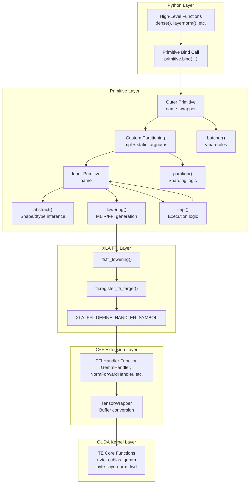
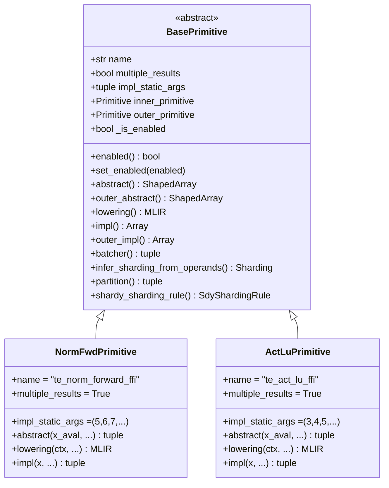
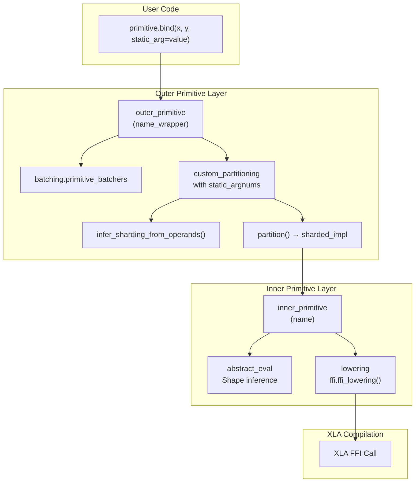
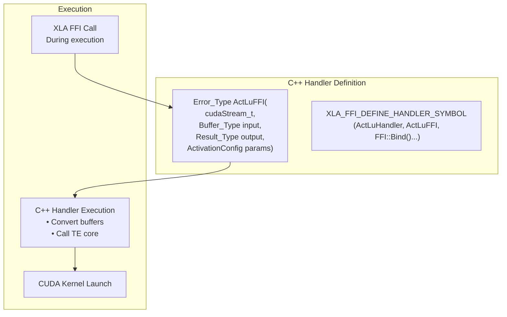

<!-- source: DeepWiki mcp.deepwiki.com · repo NVIDIA/TransformerEngine · page 5.2 Custom Primitives System · fetched 2026-10-26 -->

# Custom Primitives System

Relevant source files

The following files were used as context for generating this wiki page:

- [tests/jax/test_custom_call_compute.py](tests/jax/test_custom_call_compute.py)
- [tests/jax/test_softmax.py](tests/jax/test_softmax.py)
- [transformer_engine/jax/cpp_extensions/activation.py](transformer_engine/jax/cpp_extensions/activation.py)
- [transformer_engine/jax/cpp_extensions/base.py](transformer_engine/jax/cpp_extensions/base.py)
- [transformer_engine/jax/cpp_extensions/gemm.py](transformer_engine/jax/cpp_extensions/gemm.py)
- [transformer_engine/jax/cpp_extensions/normalization.py](transformer_engine/jax/cpp_extensions/normalization.py)
- [transformer_engine/jax/cpp_extensions/quantization.py](transformer_engine/jax/cpp_extensions/quantization.py)
- [transformer_engine/jax/cpp_extensions/softmax.py](transformer_engine/jax/cpp_extensions/softmax.py)
- [transformer_engine/jax/csrc/extensions.h](transformer_engine/jax/csrc/extensions.h)
- [transformer_engine/jax/csrc/extensions/activation.cpp](transformer_engine/jax/csrc/extensions/activation.cpp)
- [transformer_engine/jax/csrc/extensions/ffi.cpp](transformer_engine/jax/csrc/extensions/ffi.cpp)
- [transformer_engine/jax/csrc/extensions/ffi.h](transformer_engine/jax/csrc/extensions/ffi.h)
- [transformer_engine/jax/csrc/extensions/gemm.cpp](transformer_engine/jax/csrc/extensions/gemm.cpp)
- [transformer_engine/jax/csrc/extensions/normalization.cpp](transformer_engine/jax/csrc/extensions/normalization.cpp)
- [transformer_engine/jax/csrc/extensions/pybind.cpp](transformer_engine/jax/csrc/extensions/pybind.cpp)
- [transformer_engine/jax/csrc/extensions/quantization.cpp](transformer_engine/jax/csrc/extensions/quantization.cpp)
- [transformer_engine/jax/dense.py](transformer_engine/jax/dense.py)
- [transformer_engine/jax/layernorm.py](transformer_engine/jax/layernorm.py)
- [transformer_engine/jax/quantize/dequantizer.py](transformer_engine/jax/quantize/dequantizer.py)
- [transformer_engine/jax/quantize/helper.py](transformer_engine/jax/quantize/helper.py)
- [transformer_engine/jax/quantize/quantizer.py](transformer_engine/jax/quantize/quantizer.py)
- [transformer_engine/jax/quantize/scaling_modes.py](transformer_engine/jax/quantize/scaling_modes.py)
- [transformer_engine/jax/quantize/tensor.py](transformer_engine/jax/quantize/tensor.py)
- [transformer_engine/jax/softmax.py](transformer_engine/jax/softmax.py)

## Purpose and Scope

The Custom Primitives System provides the infrastructure for integrating high-performance CUDA kernels with JAX's operation system. This system defines how TransformerEngine's C++/CUDA operations are exposed as JAX primitives that can be traced, differentiated, batched, and sharded.

This document covers the primitive architecture, lifecycle methods, and registration system. For information about specific operation implementations (GEMM, attention, etc.), see [Attention Primitives](5.3) and [GEMM and Quantization Primitives](5.4).

---

## System Architecture

The custom primitives system bridges three layers: Python APIs, JAX's tracing system, and native CUDA kernels through XLA FFI (Foreign Function Interface).

**Architecture: Python API to CUDA Kernels via Primitives**

**Sources:**
- [transformer_engine/jax/cpp_extensions/base.py:29-181]()
- [transformer_engine/jax/csrc/extensions/pybind.cpp:22-108]()
- [transformer_engine/jax/csrc/extensions/activation.cpp:152-160]()

---

## BasePrimitive Class

The `BasePrimitive` abstract class defines the interface that all custom primitives must implement. It provides the structure for defining operations that integrate with JAX's tracing, differentiation, and compilation systems.

**Key Components of BasePrimitive**

### Primitive Attributes

| Attribute | Type | Description |
|-----------|------|-------------|
| `name` | `str` | Unique identifier for the FFI target (e.g., `"te_norm_forward_ffi"`) |
| `multiple_results` | `bool` | Whether primitive returns multiple outputs |
| `impl_static_args` | `tuple[int]` | Indices of static (compile-time) arguments |
| `inner_primitive` | `Primitive` | JAX primitive for direct lowering |
| `outer_primitive` | `Primitive` | Wrapper primitive with custom partitioning |
| `_is_enabled` | `bool` | Runtime enable/disable flag |

**Sources:**
- [transformer_engine/jax/cpp_extensions/base.py:29-181]()
- [transformer_engine/jax/cpp_extensions/normalization.py:91-101]()
- [transformer_engine/jax/cpp_extensions/activation.py:147-169]()

---

## Inner and Outer Primitive Pattern

TransformerEngine uses a two-level primitive pattern: an **inner primitive** for direct lowering to XLA FFI, and an **outer primitive** that adds custom partitioning for distributed execution.

**Dual Primitive Architecture**

### Why Two Primitives?

The dual-primitive pattern separates concerns:

- **Inner Primitive**: Handles shape inference (`abstract`) and lowering to FFI (`lowering`). Has a simple 1:1 mapping to the C++ FFI handler.
  
- **Outer Primitive**: Wraps the inner primitive with:
  - `custom_partitioning` for distributed sharding.
  - Batching rules for `vmap`.
  - Workspace tensor management (excluded from outer abstract).
  - Static argument handling via `impl_static_args`.

**Sources:**
- [transformer_engine/jax/cpp_extensions/base.py:117-170]()
- [transformer_engine/jax/cpp_extensions/base.py:202-214]()

---

## Primitive Lifecycle Methods

### 1. abstract() - Shape and Dtype Inference

The `abstract` method performs shape and dtype inference without executing the operation. It validates inputs and determines output shapes.

**Example from NormFwdPrimitive:**
[transformer_engine/jax/cpp_extensions/normalization.py:102-215]() implements the abstract evaluator:
- Validates that input dtypes are floating point (float32, float16, bfloat16).
- Computes output shapes for `mu` and `rsigma` (reduced over the hidden dimension).
- Determines `amax` and `scale_inv` shapes based on the `ScalingMode`.
- Queries the C++ extension for required workspace sizes using `transformer_engine_jax.get_norm_fwd_workspace_sizes`.

### 2. lowering() - MLIR/FFI Code Generation

The `lowering` method generates MLIR code that calls the XLA FFI handler. It passes static arguments as attributes.

**Example from SoftmaxPrimitive:**
[transformer_engine/jax/cpp_extensions/softmax.py:112-116]() shows:
- Uses `ffi.ffi_lowering(name)` to create the FFI call.
- Passes `scale_factor` as a static attribute.

### 3. impl() - Execution Implementation

The `impl` method defines the actual execution logic. For the inner/outer pattern, it typically calls `inner_primitive.bind()`.

**Implementation Flow for ActLu:**
[transformer_engine/jax/cpp_extensions/activation.py:270-344]() implements `impl`:
- Handles `transpose_batch_sequence` logic.
- Binds to the `inner_primitive` with all arguments.
- Unpacks the result (output, scale_inv, amax, workspace).

### 4. batcher() - Vectorized Map Rules

The `batcher` method defines how the primitive handles `jax.vmap`.

**Example from Softmax:**
[transformer_engine/jax/cpp_extensions/softmax.py:128-137]() shows the batcher binds the primitive while maintaining the batch dimension for the logits.

### 5. partition() - Distributed Execution Logic

The `partition` method implements the actual sharded computation, including any necessary collectives for amax or gradients.

**Example from Quantization:**
[transformer_engine/jax/cpp_extensions/quantization.py:566-611]() shows:
- Local quantization via `impl()`.
- Global amax reduction using `all_reduce_max_along_all_axes_except_PP()`.
- Global dbias sum using `all_reduce_sum_along_dp_fsdp()`.

**Sources:**
- [transformer_engine/jax/cpp_extensions/normalization.py:102-215]()
- [transformer_engine/jax/cpp_extensions/activation.py:270-344]()
- [transformer_engine/jax/cpp_extensions/quantization.py:566-611]()

---

## XLA FFI Integration

The XLA Foreign Function Interface (FFI) enables JAX primitives to call native C++/CUDA code. TransformerEngine uses FFI handlers to bridge Python primitives to CUDA kernels.

**FFI Handler Definition (C++)**

### Buffer Type Conversion

FFI handlers must convert XLA buffers to TE's `TensorWrapper` format.

**Example conversion from Activation:**
[transformer_engine/jax/csrc/extensions/activation.cpp:40-51]() shows:
- Extracting dimensions and raw pointers from `Buffer_Type`.
- Calculating `m` and `n` for 2D matrix operations.
- Initializing `TensorWrapper` with the appropriate `DType` and shape.

### FFI Registration

All FFI handlers are registered with JAX during module initialization.
[transformer_engine/jax/csrc/extensions/pybind.cpp:22-108]() defines the `Registrations()` function which creates a dictionary mapping string names (e.g., `"te_norm_forward_ffi"`) to encapsulated FFI handlers.

**Sources:**
- [transformer_engine/jax/csrc/extensions/activation.cpp:17-150]()
- [transformer_engine/jax/csrc/extensions/pybind.cpp:22-108]()
- [transformer_engine/jax/csrc/extensions/ffi.h:17-25]()

---

## Custom VJP and Automatic Differentiation

Automatic differentiation for custom primitives is achieved using JAX's `custom_vjp` mechanism.

**Layernorm VJP Implementation:**
[transformer_engine/jax/layernorm.py:73-145]() implements the VJP pattern:
1. `_layernorm` is decorated with `@jax.custom_vjp`.
2. `_layernorm_fwd_rule` executes the forward primitive (`tex.normalization_fwd`) and returns the result plus a context containing tensors needed for the backward pass (input, mu, rsigma, etc.).
3. `_layernorm_bwd_rule` receives the context and the upstream gradient (`dz`), then calls the backward primitive (`tex.normalization_bwd`).

**Sources:**
- [transformer_engine/jax/layernorm.py:73-145]()
- [transformer_engine/jax/cpp_extensions/normalization.py:44-51]()

---

## Runtime Control

Primitives can be dynamically enabled or disabled through environment variables.

| Method | Variable | Example |
|--------|-------|---------|
| Key=Value | `NVTE_JAX_CUSTOM_CALLS` | `NVTE_JAX_CUSTOM_CALLS=NormFwdPrimitive=false` |
| Global | `NVTE_JAX_CUSTOM_CALLS` | `NVTE_JAX_CUSTOM_CALLS=false` |
| Regex (Deprecated) | `NVTE_JAX_CUSTOM_CALLS_RE` | `NVTE_JAX_CUSTOM_CALLS_RE=.*Norm.*` |

**Sources:**
- [transformer_engine/jax/cpp_extensions/base.py:41-100]()

---

