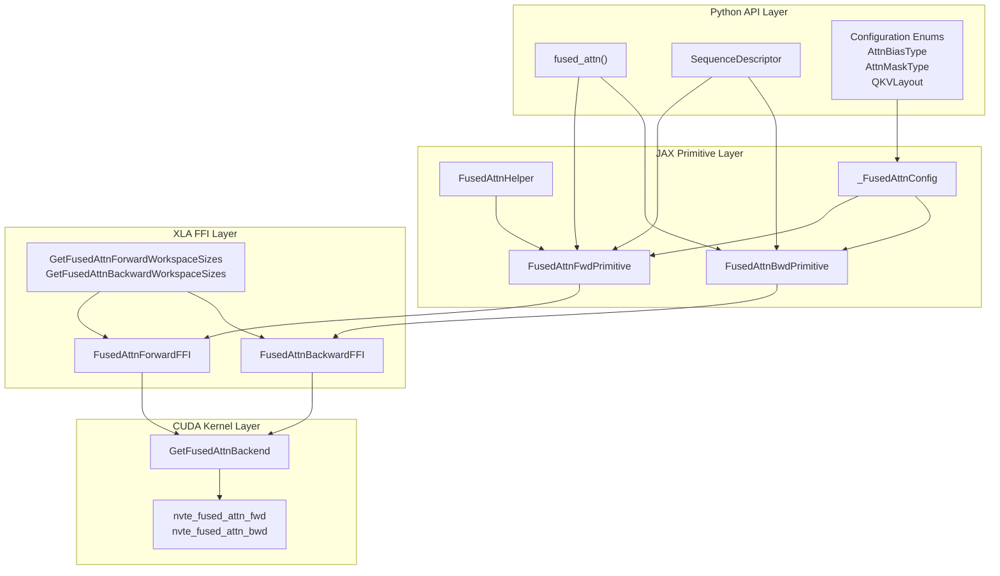
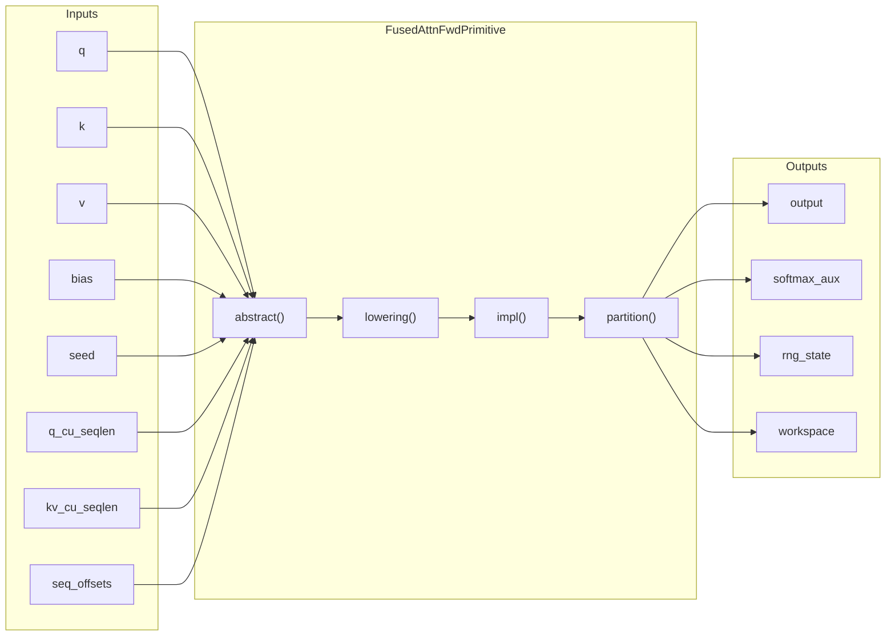
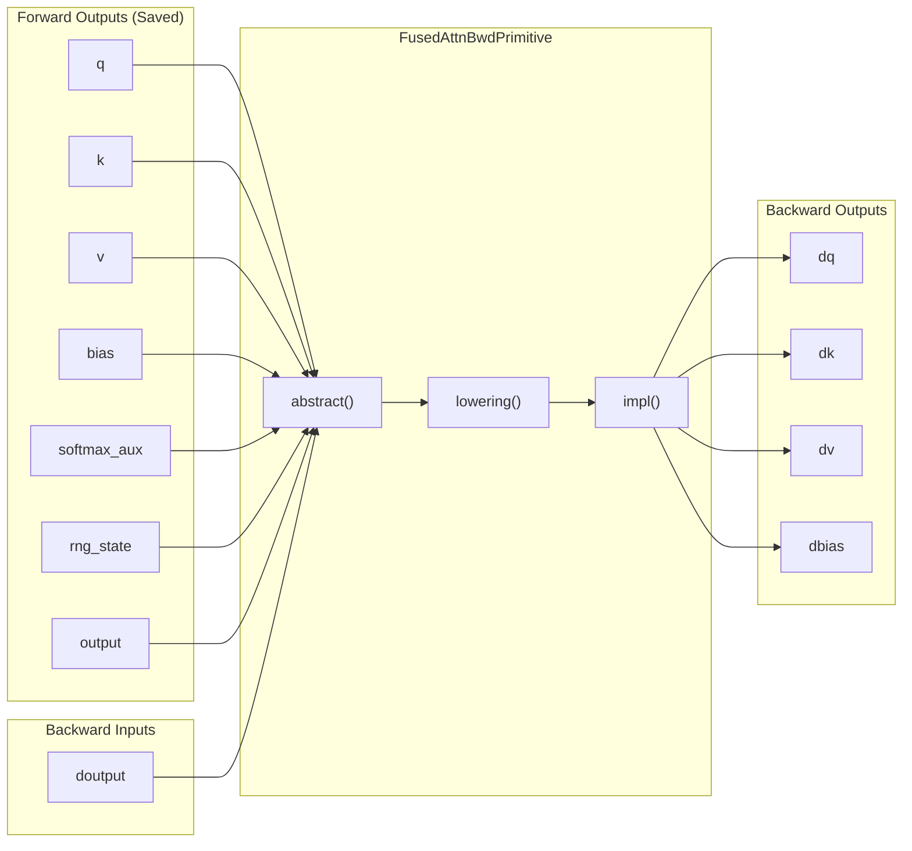
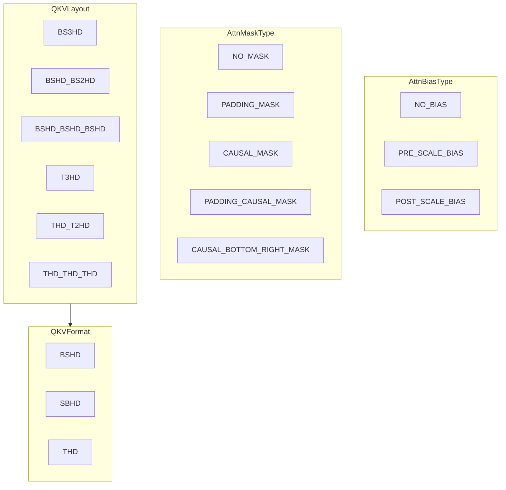
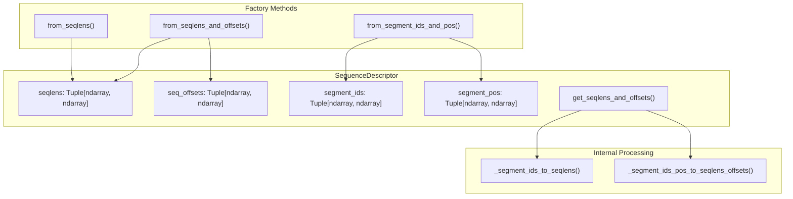
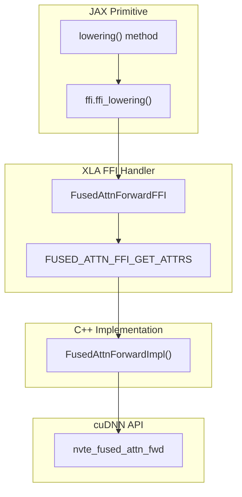

<!-- source: DeepWiki mcp.deepwiki.com · repo NVIDIA/TransformerEngine · page 5.3 Attention Primitives · fetched 2026-10-26 -->

# Attention Primitives

Relevant source files

The following files were used as context for generating this wiki page:

- [tests/jax/distributed_test_base.py](tests/jax/distributed_test_base.py)
- [tests/jax/test_distributed_fused_attn.py](tests/jax/test_distributed_fused_attn.py)
- [tests/jax/test_distributed_layernorm.py](tests/jax/test_distributed_layernorm.py)
- [tests/jax/test_distributed_softmax.py](tests/jax/test_distributed_softmax.py)
- [tests/jax/test_fused_attn.py](tests/jax/test_fused_attn.py)
- [tests/jax/test_fused_attn_score_mod.py](tests/jax/test_fused_attn_score_mod.py)
- [tests/jax/test_layer.py](tests/jax/test_layer.py)
- [tests/jax/utils.py](tests/jax/utils.py)
- [transformer_engine/jax/attention.py](transformer_engine/jax/attention.py)
- [transformer_engine/jax/cpp_extensions/__init__.py](transformer_engine/jax/cpp_extensions/__init__.py)
- [transformer_engine/jax/cpp_extensions/attention.py](transformer_engine/jax/cpp_extensions/attention.py)
- [transformer_engine/jax/csrc/extensions/attention.cpp](transformer_engine/jax/csrc/extensions/attention.cpp)
- [transformer_engine/jax/flax/module.py](transformer_engine/jax/flax/module.py)
- [transformer_engine/jax/flax/transformer.py](transformer_engine/jax/flax/transformer.py)

## Overview

The Attention Primitives system provides JAX custom primitives that wrap high-performance cuDNN fused attention kernels for TransformerEngine. These primitives serve as the bridge between JAX's automatic differentiation system and optimized CUDA implementations of multi-head attention, supporting various layouts including BSHD and THD (ragged tensors).

This page covers the JAX primitive layer for attention operations. For high-level Flax attention modules, see [5.1](). For details on the custom primitive system architecture, see [5.2]().

**Sources:** [transformer_engine/jax/cpp_extensions/attention.py:1-57](), [transformer_engine/jax/attention.py:1-23]()

---

## System Architecture

The attention primitive system consists of three main layers:

Title: Attention Primitive System Layers

The system follows JAX's custom primitive pattern:
1. **Python API Layer**: User-facing functions like `fused_attn` with Pythonic interfaces [transformer_engine/jax/attention.py:858-1001]().
2. **JAX Primitive Layer**: `FusedAttnFwdPrimitive` and `FusedAttnBwdPrimitive` with abstract/lowering/partition rules [transformer_engine/jax/cpp_extensions/attention.py:250-703]().
3. **XLA FFI Layer**: Foreign function interface handlers for XLA implemented in C++ [transformer_engine/jax/csrc/extensions/attention.cpp:336-405]().
4. **CUDA Kernel Layer**: Optimized cuDNN backend selection and kernel execution [transformer_engine/jax/csrc/extensions/attention.cpp:27-39]().

**Sources:** [transformer_engine/jax/cpp_extensions/attention.py:250-703](), [transformer_engine/jax/attention.py:858-1001](), [transformer_engine/jax/csrc/extensions/attention.cpp:336-405]()

---

## Core Primitives

### FusedAttnFwdPrimitive

The forward primitive implements scaled dot-product attention with optional bias, masking, and dropout:

Title: FusedAttnFwdPrimitive Data Flow

| Method | Purpose | Key Responsibilities |
|--------|---------|---------------------|
| `abstract()` | Define output shapes/dtypes | Compute `softmax_aux` shape based on backend (e.g., `{B,H,Qs,1}` for arbitrary seqlen), determine workspace size [transformer_engine/jax/cpp_extensions/attention.py:273-356](). |
| `lowering()` | Generate XLA computation | Call FFI with `_FusedAttnConfig` attributes, handle QKV layout variations [transformer_engine/jax/cpp_extensions/attention.py:402-484](). |
| `impl()` | Python implementation | Convert `SequenceDescriptor` to `cu_seqlen` and `seq_offsets` for THD format [transformer_engine/jax/cpp_extensions/attention.py:521-593](). |
| `partition()` | Define sharding rules | Specify output sharding based on input sharding using `HEAD_AXES` and `SEQLEN_AXES` [transformer_engine/jax/cpp_extensions/attention.py:613-703](). |

**Key Features:**
- **Backend Selection**: Uses `FusedAttnHelper` to detect available kernels (e.g., `NVTE_F16_arbitrary_seqlen` or `NVTE_FP8`) [transformer_engine/jax/cpp_extensions/attention.py:130-150]().
- **Variable Length Support**: Handles ragged sequences (THD) via `cu_seqlen` and `seq_offsets` provided by `SequenceDescriptor` [transformer_engine/jax/attention.py:382-414]().

**Sources:** [transformer_engine/jax/cpp_extensions/attention.py:250-703](), [transformer_engine/jax/csrc/extensions/attention.cpp:241-334](), [transformer_engine/jax/attention.py:382-414]()

### FusedAttnBwdPrimitive

The backward primitive computes gradients for query, key, value, and optionally bias:

Title: FusedAttnBwdPrimitive Gradient Flow

The backward pass utilizes auxiliary tensors saved from the forward pass:
- **softmax_aux**: Contains softmax statistics (shape and dtype depend on backend) [transformer_engine/jax/csrc/extensions/attention.cpp:43-51]().
- **rng_state**: RNG state for dropout recomputation [transformer_engine/jax/csrc/extensions/attention.cpp:56-61]().
- **output**: The forward pass result, required by some backends for gradient calculation [transformer_engine/jax/cpp_extensions/attention.py:734-750]().

**Sources:** [transformer_engine/jax/cpp_extensions/attention.py:706-1046](), [transformer_engine/jax/csrc/extensions/attention.cpp:113-128]()

---

## Configuration System

### Configuration Enums

Title: Attention Configuration Enums

| Configuration Class | Purpose | Key Values |
|-------------------|---------|------------|
| `AttnBiasType` | Controls bias application | `NO_BIAS`, `PRE_SCALE_BIAS`, `POST_SCALE_BIAS` [transformer_engine/jax/attention.py:25-35](). |
| `AttnMaskType` | Specifies masking pattern | `NO_MASK`, `PADDING_MASK`, `CAUSAL_MASK`, `PADDING_CAUSAL_MASK` [transformer_engine/jax/attention.py:37-51](). |
| `AttnSoftmaxType` | Specifies softmax variant | `VANILLA_SOFTMAX`, `OFF_BY_ONE_SOFTMAX`, `LEARNABLE_SOFTMAX` [transformer_engine/jax/attention.py:77-88](). |
| `QKVLayout` | Defines tensor packing | `BS3HD` (packed), `BSHD_BS2HD` (kv-packed), `BSHD_BSHD_BSHD` (separate) [transformer_engine/jax/attention.py:118-136](). |

**Sources:** [transformer_engine/jax/attention.py:25-205]()

### _FusedAttnConfig

The `_FusedAttnConfig` dataclass encapsulates static configuration for primitives [transformer_engine/jax/cpp_extensions/attention.py:81-102](). This configuration is passed as static arguments to primitives, allowing JAX to specialize compilation.

**Sources:** [transformer_engine/jax/cpp_extensions/attention.py:60-102]()

---

## SequenceDescriptor

The `SequenceDescriptor` class provides a flexible interface for describing sequence layouts, especially for ragged tensors (THD format) [transformer_engine/jax/attention.py:382-414]().

Title: SequenceDescriptor Structure

### Internal Conversion Logic

The `get_seqlens_and_offsets()` method converts high-level descriptors to low-level formats:

1. **For THD with segment_ids/segment_pos**: Calls `_segment_ids_pos_to_seqlens_offsets()` which computes segment lengths from segment IDs and finds segment start offsets [transformer_engine/jax/attention.py:628-677]().
2. **For BSHD with segment_ids**: Calls `_segment_ids_to_seqlens()` which sums non-zero segment IDs to get actual lengths [transformer_engine/jax/attention.py:594-626]().

**Sources:** [transformer_engine/jax/attention.py:494-677]()

---

## XLA FFI Integration

The primitives connect to CUDA kernels via XLA's Foreign Function Interface (FFI). Static configuration is passed as FFI attributes [transformer_engine/jax/csrc/extensions/attention.cpp:336-362]().

Title: XLA FFI Call Flow

**Sources:** [transformer_engine/jax/cpp_extensions/attention.py:402-484](), [transformer_engine/jax/csrc/extensions/attention.cpp:364-405]()

---

## Context Parallelism Support

The attention primitives support context parallelism strategies including `ALL_GATHER` and `RING` [transformer_engine/jax/attention.py:172-184]().

### Load Balancing for Causal Attention

When using causal masks with context parallelism, load imbalance occurs because earlier ranks process less data. TransformerEngine provides reordering strategies like `DualChunkSwap` and `Striped` [transformer_engine/jax/attention.py:186-205]().

The reordering functions are:
- `reorder_causal_load_balancing()`: Reorders sequences to balance workload [transformer_engine/jax/attention.py:338-356]().
- `inverse_reorder_causal_load_balancing()`: Restores original sequence order [transformer_engine/jax/attention.py:358-376]().

**Sources:** [transformer_engine/jax/attention.py:172-205](), [transformer_engine/jax/attention.py:338-376]()

---

## Workspace and Auxiliary Tensor Management

The system pre-computes workspace requirements during lowering by calling cuDNN planning APIs via `GetFusedAttnForwardWorkspaceSizes` [transformer_engine/jax/csrc/extensions/attention.cpp:130-212]().

| Tensor | Purpose |
|--------|---------|
| `softmax_aux` | Softmax statistics for backward (saved from forward) [transformer_engine/jax/csrc/extensions/attention.cpp:43-51](). |
| `rng_state` | RNG state for dropout (saved from forward) [transformer_engine/jax/csrc/extensions/attention.cpp:56-61](). |
| `workspace` | Temporary buffer for cuDNN kernels [transformer_engine/jax/csrc/extensions/attention.cpp:214-239](). |

**Sources:** [transformer_engine/jax/csrc/extensions/attention.cpp:29-117](), [transformer_engine/jax/csrc/extensions/attention.cpp:130-212]()

---

