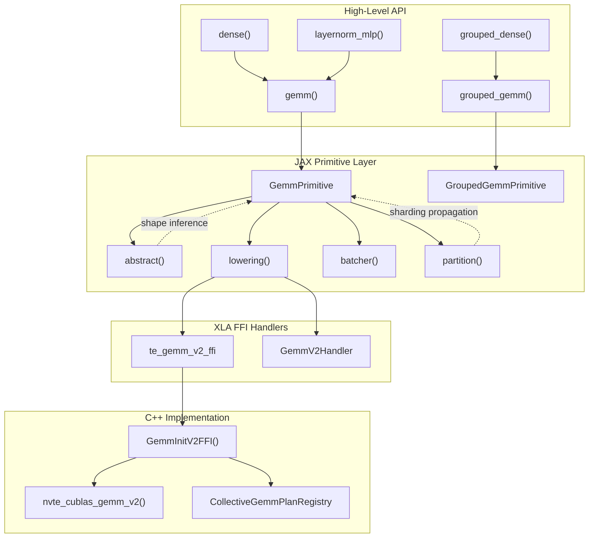
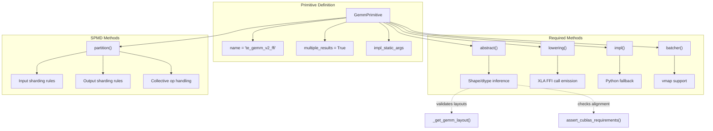
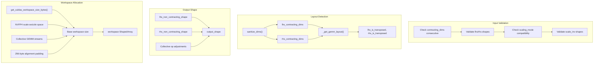
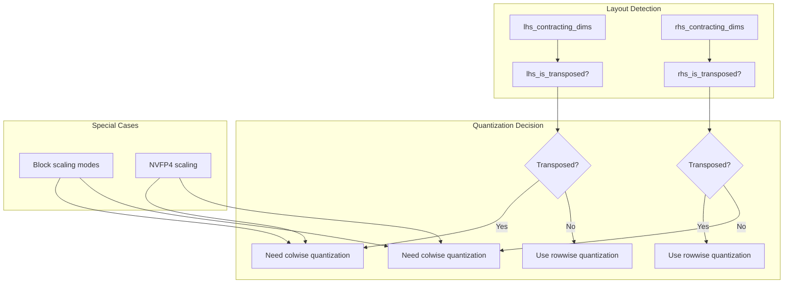
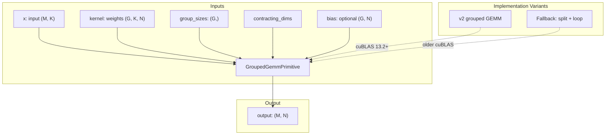

<!-- source: DeepWiki mcp.deepwiki.com · repo NVIDIA/TransformerEngine · page 5.4 GEMM and Quantization Primitives · fetched 2026-10-26 -->

# GEMM and Quantization Primitives

Relevant source files

The following files were used as context for generating this wiki page:

- [examples/jax/collective_gemm/common.py](examples/jax/collective_gemm/common.py)
- [examples/jax/collective_gemm/conftest.py](examples/jax/collective_gemm/conftest.py)
- [examples/jax/collective_gemm/run_test_cgemm.sh](examples/jax/collective_gemm/run_test_cgemm.sh)
- [examples/jax/collective_gemm/test_dense_grad.py](examples/jax/collective_gemm/test_dense_grad.py)
- [examples/jax/collective_gemm/test_gemm.py](examples/jax/collective_gemm/test_gemm.py)
- [examples/jax/collective_gemm/test_layernorm_mlp_grad.py](examples/jax/collective_gemm/test_layernorm_mlp_grad.py)
- [tests/jax/test_custom_call_compute.py](tests/jax/test_custom_call_compute.py)
- [transformer_engine/jax/cpp_extensions/gemm.py](transformer_engine/jax/cpp_extensions/gemm.py)
- [transformer_engine/jax/cpp_extensions/quantization.py](transformer_engine/jax/cpp_extensions/quantization.py)
- [transformer_engine/jax/csrc/extensions/gemm.cpp](transformer_engine/jax/csrc/extensions/gemm.cpp)
- [transformer_engine/jax/dense.py](transformer_engine/jax/dense.py)
- [transformer_engine/jax/layernorm_dense.py](transformer_engine/jax/layernorm_dense.py)
- [transformer_engine/jax/layernorm_mlp.py](transformer_engine/jax/layernorm_mlp.py)
- [transformer_engine/jax/quantize/dequantizer.py](transformer_engine/jax/quantize/dequantizer.py)
- [transformer_engine/jax/quantize/helper.py](transformer_engine/jax/quantize/helper.py)
- [transformer_engine/jax/quantize/quantizer.py](transformer_engine/jax/quantize/quantizer.py)
- [transformer_engine/jax/quantize/scaling_modes.py](transformer_engine/jax/quantize/scaling_modes.py)
- [transformer_engine/jax/quantize/tensor.py](transformer_engine/jax/quantize/tensor.py)
- [transformer_engine/jax/sharding.py](transformer_engine/jax/sharding.py)

This page documents the GEMM (General Matrix Multiply) and quantization primitives in TransformerEngine's JAX integration. These primitives provide the computational foundation for all dense layer operations, implementing optimized cuBLAS and cuDNN kernels with FP8/FP4 quantization support.

## Overview

JAX primitives are the building blocks for custom operations that extend JAX's automatic differentiation and compilation capabilities. TransformerEngine implements GEMM and quantization as custom JAX primitives that dispatch to optimized CUDA kernels via XLA's Foreign Function Interface (FFI).

**GEMM Primitive Architecture: High-Level API to CUDA Kernels**

The primitive system provides:
- **Shape inference** via `abstract()` methods that determine output shapes and dtypes.
- **Compilation** via `lowering()` that emits XLA FFI calls.
- **Batching** via `batcher()` for `vmap` support.
- **Sharding** via `partition()` for distributed execution with SPMD (Single Program Multiple Data).

Sources: [transformer_engine/jax/cpp_extensions/gemm.py:410-569](), [transformer_engine/jax/dense.py:61-121](), [transformer_engine/jax/csrc/extensions/gemm.cpp:117-153]()

## GemmPrimitive Architecture

The `GemmPrimitive` class implements matrix multiplication with support for quantized operands, bias fusion, and collective communication overlap.

### Core Methods

**GemmPrimitive Method Structure**

The primitive uses a two-primitive pattern with `inner_primitive` and `outer_primitive`:
- `inner_primitive`: Performs actual computation, returns `(output, workspace)`.
- `outer_primitive`: Wrapper for user-facing API, returns only `(output,)`.

This allows the implementation to manage workspace allocation internally while presenting a clean interface to users.

Sources: [transformer_engine/jax/cpp_extensions/gemm.py:410-418](), [transformer_engine/jax/cpp_extensions/gemm.py:571-574]()

### Abstract Method: Shape and Dtype Inference

The `abstract()` method validates inputs and determines output shapes:

**Abstract Method Validation and Shape Computation**

Key validations include:
- Contracting dimensions must be consecutive (e.g., `(1,)` or `(1, 2)`).
- For quantized GEMM: contracting size must be multiple of 16 (FP8) or 32 (NVFP4).
- Pre-Blackwell hardware (CC < 10.0) requires NT layout for FP8 GEMM [transformer_engine/jax/cpp_extensions/gemm.py:465-468]().
- Bias shape must match RHS non-contracting dimensions.

Sources: [transformer_engine/jax/cpp_extensions/gemm.py:421-569](), [transformer_engine/jax/cpp_extensions/gemm.py:397-408](), [transformer_engine/jax/cpp_extensions/gemm.py:92-97]()

### Lowering: FFI Call Emission

The `lowering()` method emits XLA FFI calls with configuration packed into attributes. The configuration includes `scaling_mode`, `collective_op`, and boundary information for collapsing N-D tensors into 2D matrices.

Sources: [transformer_engine/jax/cpp_extensions/gemm.py:576-614]()

## Quantization System and ScaledTensor

The quantization system is built around the `Quantizer` abstraction and the `ScaledTensor` data structures, which encapsulate data, scale factors, and metadata.

### ScaledTensor Abstractions

TransformerEngine JAX defines several tensor types to handle different quantization schemes:

| Class | Description | Key Attributes |
| :--- | :--- | :--- |
| `ScaledTensor1x` | Single-scale quantized tensor. | `data`, `scale_inv`, `amax`, `scaling_mode`, `flatten_axis` |
| `ScaledTensor2x` | Double-scale tensor (rowwise + colwise). | `rowwise_tensor`, `colwise_tensor` |
| `NoScaleTensor` | Higher-precision tensor (e.g., BF16) without scaling. | `data`, `amax` |
| `GroupedScaledTensor1x` | Quantized tensor with per-group scales for MoE. | `data`, `scale_inv`, `group_sizes` |

Sources: [transformer_engine/jax/quantize/tensor.py:116-211](), [transformer_engine/jax/quantize/tensor.py:185-212](), [transformer_engine/jax/quantize/tensor.py:382-414]()

### Quantizer Types

The `Quantizer` hierarchy implements the logic for converting standard arrays into `ScaledTensor` objects:

*   **`DelayedScaleQuantizer`**: Uses a history of `amax` values to compute scales, avoiding synchronization in the forward pass. [transformer_engine/jax/quantize/quantizer.py:257-260]()
*   **`CurrentScaleQuantizer`**: Computes scales based on the current tensor's `amax` immediately. [transformer_engine/jax/quantize/quantizer.py:218-220]()
*   **`BlockScaleQuantizer`**: Implements fine-grained scaling for MXFP8 and NVFP4 formats. [transformer_engine/jax/quantize/quantizer.py:302-304]()

Sources: [transformer_engine/jax/quantize/quantizer.py:218-350]()

### Operand Quantization Strategy for GEMM

The `_quantize_gemm_operands()` helper function determines the appropriate quantization layout based on GEMM operand transpose patterns.

**GEMM Quantization Layout Selection Logic**

The quantization layout selection follows these rules:
- For non-transposed operands: rowwise quantization.
- For transposed operands with block scaling: colwise quantization required.
- For NVFP4: always use colwise quantization for transposed operands.
- On CC < 10.0: enforce NT layout to avoid unsupported FP8 GEMM configurations [transformer_engine/jax/cpp_extensions/gemm.py:157-159]().

Sources: [transformer_engine/jax/cpp_extensions/gemm.py:150-202]()

## Collective GEMM for Distributed Training

The `GemmPrimitive` supports overlapping collective communications (AllGather, ReduceScatter) with GEMM computation for tensor-parallel training.

### CollectiveOp and CollectiveOpSet

The `CollectiveOpSet` dataclass ensures forward and backward collective operations are properly paired (e.g., AllGather in forward is paired with ReduceScatter in backward).

Sources: [transformer_engine/jax/cpp_extensions/gemm.py:342-363](), [transformer_engine/jax/dense.py:66-67]()

### Collective GEMM Bootstrap

Before using collective GEMM, the NCCL communicator must be initialized per-process via `collective_gemm_bootstrap`. This creates a `CommunicatorHandler` that manages NCCL communicators and CUDA streams for overlapping computation and communication.

Sources: [transformer_engine/jax/cpp_extensions/gemm.py:210-316](), [transformer_engine/jax/csrc/extensions/gemm.cpp:124-132]()

### Sharding Propagation with Collective Ops

The `partition()` method implements sharding rules that account for collective operations. For example, in an `ALL_GATHER` GEMM, the input LHS is sharded along the sequence dimension, but the GEMM gather logic ensures the full tensor is available for the multiplication.

Sources: [transformer_engine/jax/cpp_extensions/gemm.py:809-943]()

## Grouped GEMM Primitive

The `GroupedGemmPrimitive` performs batched GEMM operations where each group can have different dimensions, commonly used for mixture-of-experts (MoE) layers.

**GroupedGemmPrimitive Data Flow**

The grouped GEMM implementation automatically selects between:
- **V2 path** (CUDA-graphable): Uses `nvte_grouped_gemm_v2()` for cuBLAS >= 13.2. [transformer_engine/jax/cpp_extensions/gemm.py:77-83]()
- **Fallback path**: Splits input by groups and loops over `nvte_cublas_gemm_v2()`. [transformer_engine/jax/cpp_extensions/gemm.py:1225-1274]()

Sources: [transformer_engine/jax/cpp_extensions/gemm.py:1117-1274]()

## C++ FFI Implementation

The JAX primitives call into C++ FFI handlers that manage CUDA kernel invocation and workspace allocation.

### FFI Handler Structure

The FFI system uses two handlers:
- **`GemmInitV2FFI`**: Prepare stage, initializes cuBLAS handles and allocates communication buffers for collective GEMM [transformer_engine/jax/csrc/extensions/gemm.cpp:117-153]().
- **`GemmV2Handler`** (implied execute phase): Performs actual GEMM computation by converting XLA buffers to TE operands.

### Buffer to TensorWrapper Conversion

The `xla_buffer_to_nvte_gemm_operand()` function converts XLA FFI buffers to TE's `TensorWrapper` format. It handles N-D tensor collapsing to 2D matrices and performs scale factor swizzling for NVFP4 quantization via `nvte_swizzle_scaling_factors` [transformer_engine/jax/csrc/extensions/gemm.cpp:86-89]().

Sources: [transformer_engine/jax/csrc/extensions/gemm.cpp:36-99]()

---

