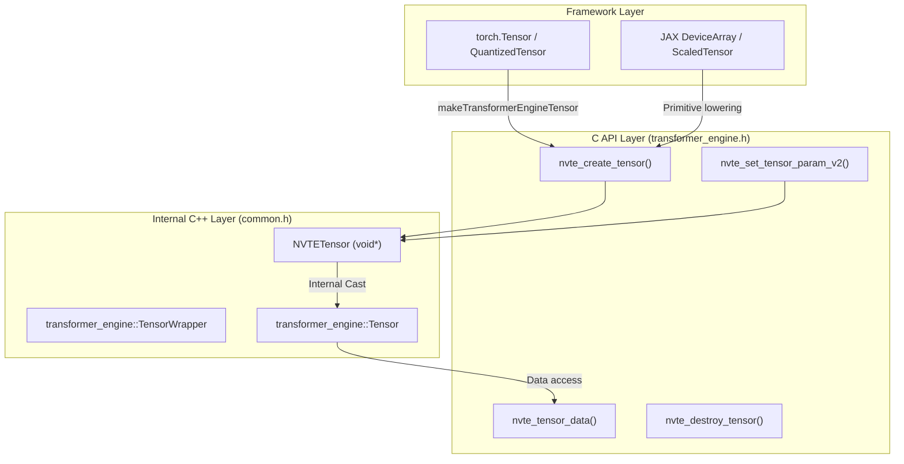
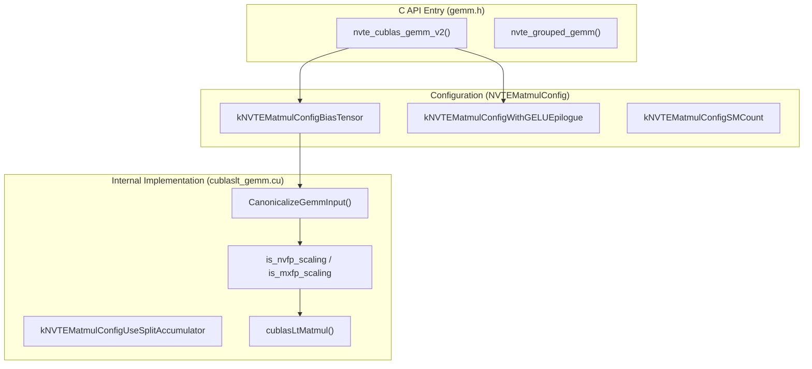
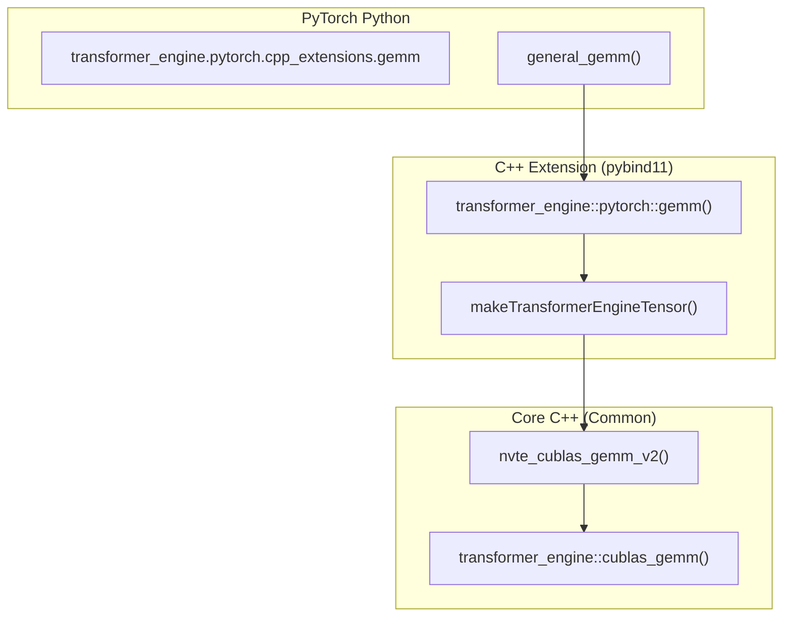

<!-- source: DeepWiki mcp.deepwiki.com · repo NVIDIA/TransformerEngine · page 6 Core C++ Library · fetched 2026-10-26 -->

# Core C++ Library

Relevant source files

The following files were used as context for generating this wiki page:

- [tests/cpp/test_common.cu](tests/cpp/test_common.cu)
- [tests/cpp/test_common.h](tests/cpp/test_common.h)
- [transformer_engine/common/common.h](transformer_engine/common/common.h)
- [transformer_engine/common/gemm/cublaslt_gemm.cu](transformer_engine/common/gemm/cublaslt_gemm.cu)
- [transformer_engine/common/include/transformer_engine/gemm.h](transformer_engine/common/include/transformer_engine/gemm.h)
- [transformer_engine/common/include/transformer_engine/transformer_engine.h](transformer_engine/common/include/transformer_engine/transformer_engine.h)
- [transformer_engine/common/transformer_engine.cpp](transformer_engine/common/transformer_engine.cpp)
- [transformer_engine/pytorch/cpp_extensions/gemm.py](transformer_engine/pytorch/cpp_extensions/gemm.py)
- [transformer_engine/pytorch/csrc/common.cpp](transformer_engine/pytorch/csrc/common.cpp)
- [transformer_engine/pytorch/csrc/extensions/gemm.cpp](transformer_engine/pytorch/csrc/extensions/gemm.cpp)
- [transformer_engine/pytorch/csrc/extensions/padding.cpp](transformer_engine/pytorch/csrc/extensions/padding.cpp)
- [transformer_engine/pytorch/csrc/extensions/recipe.cpp](transformer_engine/pytorch/csrc/extensions/recipe.cpp)
- [transformer_engine/pytorch/csrc/extensions/transpose.cpp](transformer_engine/pytorch/csrc/extensions/transpose.cpp)

The Core C++ Library provides framework-agnostic implementations of all computational kernels used by TransformerEngine. This layer contains CUDA/C++ code for GEMM operations, fused attention, normalization, and quantization that is shared across PyTorch, JAX, and Paddle integrations. Framework-specific bindings call into this common implementation through C API functions.

The core library is built first during compilation and produces `libtransformer_engine.so`, which framework extensions link against [transformer_engine/common/CMakeLists.txt:19-20](). This design ensures consistent behavior across frameworks while allowing each to provide idiomatic APIs.

---

## Tensor Abstraction System

The C++ library uses opaque pointer types and internal structures to represent tensors without depending on any framework's tensor implementation. This abstraction enables framework-agnostic operations while supporting advanced features like FP8/FP4 quantization and multi-format storage.

### NVTETensor Opaque Pointers

The primary external interface is `NVTETensor`, an opaque pointer type that framework code uses to pass tensors to C API functions [transformer_engine/common/include/transformer_engine/transformer_engine.h:136](). These pointers index into internal `Tensor` objects managed by the library.

**Tensor Lifecycle**
For details, see [Tensor Abstraction System](#6.3).

Sources: [transformer_engine/common/include/transformer_engine/transformer_engine.h:130-157](), [transformer_engine/common/transformer_engine.cpp:148-158](), [transformer_engine/pytorch/csrc/common.cpp:114-147]()

### Tensor Metadata and Scaling

The library supports multiple scaling modes to handle various quantization formats [transformer_engine/common/include/transformer_engine/transformer_engine.h:99-119]().

**Scaling Modes:**
- `NVTE_DELAYED_TENSOR_SCALING`: Single FP32 scale per tensor, typically used for FP8 [transformer_engine/common/include/transformer_engine/transformer_engine.h:105]().
- `NVTE_MXFP8_1D_SCALING`: 32-element blocks with E8M0 scales [transformer_engine/common/include/transformer_engine/transformer_engine.h:108]().
- `NVTE_BLOCK_SCALING_1D / 2D`: Tensor split into NxN or 1xN quantization tiles [transformer_engine/common/include/transformer_engine/transformer_engine.h:113-114]().
- `NVTE_NVFP4_1D_SCALING`: 16-element blocks with E4M3 scales [transformer_engine/common/include/transformer_engine/transformer_engine.h:117]().

Sources: [transformer_engine/common/include/transformer_engine/transformer_engine.h:99-119](), [transformer_engine/common/transformer_engine.cpp:37-53]()

---

## GEMM Operations

The GEMM subsystem provides high-performance matrix multiplication with support for FP8/FP4 quantization, epilogue fusion (Bias, GELU), and communication overlap.

### Main GEMM Interface

The primary entry point is `nvte_cublas_gemm_v2`, which performs matrix multiplication using `cublasLt`. It handles the canonicalization of inputs, including layout management for Hopper (TN only for FP8) and Blackwell (arbitrary layout support) [transformer_engine/common/gemm/cublaslt_gemm.cu:124-157]().

For details, see [GEMM Operations](#6.1).

Sources: [transformer_engine/common/include/transformer_engine/gemm.h:154-180](), [transformer_engine/common/gemm/cublaslt_gemm.cu:102-180](), [transformer_engine/pytorch/cpp_extensions/gemm.py:105-200]()

---

## Fused Attention Backend

The fused attention subsystem provides high-performance scaled dot-product attention with dynamic backend selection based on input parameters.

### Backend Selection Logic

The library analyzes sequence length, data type, and hardware capabilities to dispatch to the optimal cuDNN-based kernel.

**Backend Types:**
- `NVTE_F16_max512_seqlen`: Fast path for short sequences (≤ 512 tokens).
- `NVTE_F16_arbitrary_seqlen`: General-purpose for any sequence length.
- `NVTE_FP8`: Specialized path for FP8 attention on Hopper+ architectures.

For details, see [Fused Attention Backend](#6.2).

Sources: [transformer_engine/pytorch/csrc/extensions.h:78-111](), [transformer_engine/common/CMakeLists.txt:183-187]()

---

## API Entry Points

Framework bindings call into the C++ library through C API functions defined in `transformer_engine.h`. These functions perform validation and convert opaque pointers to internal structures.

### Tensor Parameter API

Framework code sets tensor parameters using the v2 API, which writes directly to tensor structure fields. This includes data pointers, shapes, and quantization metadata like `scale_inv` and `amax` [transformer_engine/common/include/transformer_engine/transformer_engine.h:66-94]().

**Tensor Parameters:**
- `kNVTERowwiseData`: Primary data buffer.
- `kNVTEColumnwiseData`: Transposed data buffer (used for TN GEMMs).
- `kNVTEScale`: Quantization scale.
- `kNVTEAmax`: Absolute max values used for dynamic scaling.
- `kNVTERowwiseScaleInv`: Inverse scale for dequantizing Rowwise Data.

Sources: [transformer_engine/common/include/transformer_engine/transformer_engine.h:66-94](), [transformer_engine/common/transformer_engine.cpp:143-165]()

### Framework Integration (PyTorch Example)

The library provides pybind11 bindings and utility wrappers like `TensorWrapper` to bridge the Python and C++ layers [transformer_engine/pytorch/csrc/common.cpp:114-147]().

Sources: [transformer_engine/pytorch/csrc/extensions/gemm.cpp:144-150](), [transformer_engine/pytorch/csrc/common.cpp:114-147](), [transformer_engine/pytorch/cpp_extensions/gemm.py:105-124]()

---

