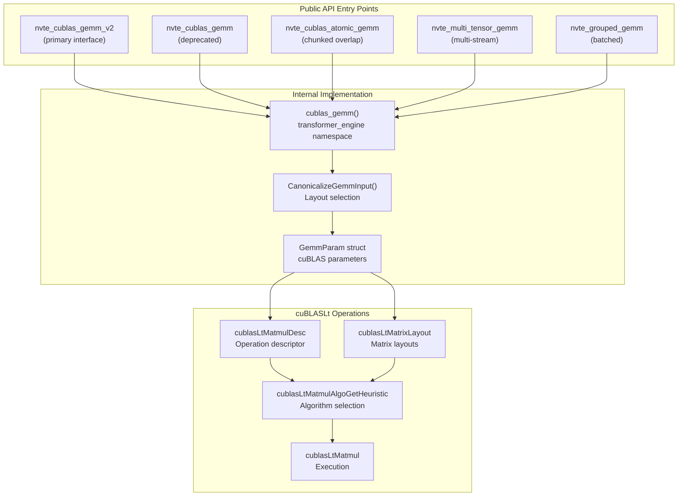
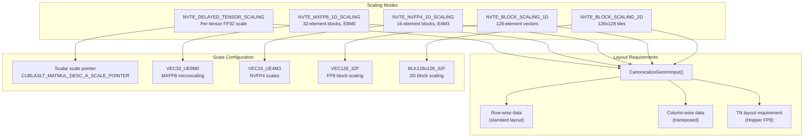
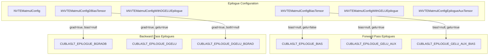
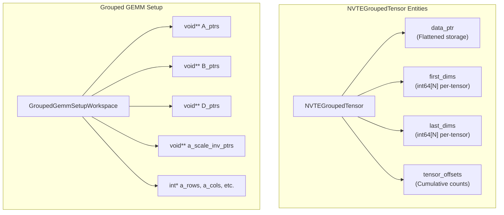

<!-- source: DeepWiki mcp.deepwiki.com · repo NVIDIA/TransformerEngine · page 6.1 GEMM Operations · fetched 2026-10-26 -->

# GEMM Operations

<details>
<summary>Relevant source files</summary>

The following files were used as context for generating this wiki page:

- [tests/cpp/operator/test_grouped_gemm.cu](tests/cpp/operator/test_grouped_gemm.cu)
- [tests/pytorch/distributed/run_newton_schulz.py](tests/pytorch/distributed/run_newton_schulz.py)
- [tests/pytorch/distributed/test_newton_schulz.py](tests/pytorch/distributed/test_newton_schulz.py)
- [tests/pytorch/test_grouped_linear.py](tests/pytorch/test_grouped_linear.py)
- [tests/pytorch/test_grouped_mlp.py](tests/pytorch/test_grouped_mlp.py)
- [transformer_engine/common/comm_gemm/comm_gemm.cpp](transformer_engine/common/comm_gemm/comm_gemm.cpp)
- [transformer_engine/common/gemm/cublaslt_gemm.cu](transformer_engine/common/gemm/cublaslt_gemm.cu)
- [transformer_engine/common/gemm/cublaslt_grouped_gemm.cu](transformer_engine/common/gemm/cublaslt_grouped_gemm.cu)
- [transformer_engine/common/include/transformer_engine/comm_gemm.h](transformer_engine/common/include/transformer_engine/comm_gemm.h)
- [transformer_engine/common/include/transformer_engine/gemm.h](transformer_engine/common/include/transformer_engine/gemm.h)
- [transformer_engine/common/include/transformer_engine/newton_schulz.h](transformer_engine/common/include/transformer_engine/newton_schulz.h)
- [transformer_engine/common/newton_schulz/newton_schulz.cpp](transformer_engine/common/newton_schulz/newton_schulz.cpp)
- [transformer_engine/common/util/logging.h](transformer_engine/common/util/logging.h)
- [transformer_engine/pytorch/cpp_extensions/gemm.py](transformer_engine/pytorch/cpp_extensions/gemm.py)
- [transformer_engine/pytorch/csrc/common.cpp](transformer_engine/pytorch/csrc/common.cpp)
- [transformer_engine/pytorch/csrc/extensions/gemm.cpp](transformer_engine/pytorch/csrc/extensions/gemm.cpp)
- [transformer_engine/pytorch/csrc/extensions/newton_schulz.cpp](transformer_engine/pytorch/csrc/extensions/newton_schulz.cpp)
- [transformer_engine/pytorch/csrc/extensions/padding.cpp](transformer_engine/pytorch/csrc/extensions/padding.cpp)
- [transformer_engine/pytorch/csrc/extensions/recipe.cpp](transformer_engine/pytorch/csrc/extensions/recipe.cpp)
- [transformer_engine/pytorch/csrc/extensions/transpose.cpp](transformer_engine/pytorch/csrc/extensions/transpose.cpp)
- [transformer_engine/pytorch/newton_schulz.py](transformer_engine/pytorch/newton_schulz.py)
- [transformer_engine/pytorch/ops/basic/grouped_linear.py](transformer_engine/pytorch/ops/basic/grouped_linear.py)
- [transformer_engine/pytorch/ops/fused/grouped_mlp.py](transformer_engine/pytorch/ops/fused/grouped_mlp.py)
- [transformer_engine/pytorch/ops/sequential.py](transformer_engine/pytorch/ops/sequential.py)

</details>


## Purpose and Scope

This page documents the core C++/CUDA implementation of general matrix multiplication (GEMM) operations in TransformerEngine. These operations form the computational backbone of transformer models, providing optimized matrix multiplication with support for FP8/FP4 quantization, multiple scaling modes, and epilogue fusion.

The GEMM subsystem provides framework-agnostic kernels that are called from PyTorch ([4.7]()), JAX ([5.4]()), and other framework integrations. For information about quantization concepts and recipes, see [Quantization System](3.2). For attention-specific operations, see [Fused Attention Backend](6.2).

**Sources:** [transformer_engine/common/include/transformer_engine/gemm.h:1-313]()

---

## GEMM Function Hierarchy

The GEMM subsystem provides multiple entry points for different use cases:

Title: GEMM Function Hierarchy


**Primary GEMM Function**

The recommended interface is `nvte_cublas_gemm_v2`, which computes `D = alpha * op(A) * op(B) + beta * C`. This function handles architecture-specific logic for FP8, MXFP8, and NVFP4 formats.

**Sources:** [transformer_engine/common/include/transformer_engine/gemm.h:183-202](), [transformer_engine/common/gemm/cublaslt_gemm.cu:315-777]()

---

## Scaling Mode Configuration

TransformerEngine supports five distinct scaling modes for quantized GEMM operations. Each mode requires different data layouts and scaling factor formats:

Title: Scaling Mode Mapping to cuBLASLt


### Layout Selection Logic

The `CanonicalizeGemmInput` function handles layout selection based on scaling mode and GPU architecture. This logic is critical for architectures like Hopper which have specific layout restrictions for FP8 Tensor Cores.

| Scaling Mode | Hopper (SM90) | Blackwell+ (SM100+) | Layout Used |
|--------------|------------------|---------------------|-------------|
| `NVTE_DELAYED_TENSOR_SCALING` (FP8) | TN only | Any layout | Column-wise for non-T |
| `NVTE_MXFP8_1D_SCALING` | TN preferred | Any layout | Row/column-wise based on transpose |
| `NVTE_NVFP4_1D_SCALING` | TN only | TN only | Column-wise (transposed) |
| `NVTE_BLOCK_SCALING_1D/2D` | TN only | TN only | Column-wise (transposed) |

**Code Implementation:**

The layout selection occurs in `CanonicalizeGemmInput` [transformer_engine/common/gemm/cublaslt_gemm.cu:102-307](). For example, when Hopper does not support non-TN layouts for FP8, the system checks for column-wise data:

```cpp
if (!is_nvte_non_tn_fp8_gemm_supported && !is_A_transposed) {
    if (A.has_columnwise_data() && is_fp8_dtype(A.columnwise_data.dtype)) {
        ret.A = A.columnwise_data.dptr;
        ret.transA = CUBLAS_OP_T;
        // ...
    }
}
```

**Alignment Requirements:**

Each scaling mode imposes specific alignment constraints:

- **FP8 tensor scaling**: Leading dimension must be multiple of 16 [transformer_engine/common/gemm/cublaslt_gemm.cu:161-163]().
- **MXFP8**: Requires specific alignment for 32-element blocks [transformer_engine/common/gemm/cublaslt_gemm.cu:184-187]().
- **NVFP4**: GEMM is only supported in TN layout with specific alignment [transformer_engine/common/gemm/cublaslt_gemm.cu:174-178]().
- **Block scaling 1D/2D**: 128-element vector/tile alignment [transformer_engine/common/gemm/cublaslt_gemm.cu:209-214]().

**Sources:** [transformer_engine/common/gemm/cublaslt_gemm.cu:102-307](), [transformer_engine/common/include/transformer_engine/transformer_engine.h:49-65]()

---

## cuBLASLt Descriptor Configuration

TransformerEngine configures cuBLASLt through a sequence of descriptor setup operations. The configuration varies significantly based on the `NVTEScalingMode`.

Title: cuBLASLt Initialization and Execution Flow

```mermaid
graph TB
    subgraph "Matrix Descriptors"
        ADESC["cublasLtMatrixLayoutCreate<br/>A matrix: (rows, cols, lda)"]
        BDESC["cublasLtMatrixLayoutCreate<br/>B matrix: (rows, cols, ldb)"]
        CDESC["cublasLtMatrixLayoutCreate<br/>C matrix: (m, n, ldc)"]
        DDESC["cublasLtMatrixLayoutCreate<br/>D matrix: (m, n, ldd)"]
    end
    
    subgraph "Operation Descriptor Attributes"
        OPDESC["cublasLtMatmulDescCreate"]
        TRANS["CUBLASLT_MATMUL_DESC_TRANSA/B<br/>Transpose flags"]
        SCALE_MODE["CUBLASLT_MATMUL_DESC_A/B_SCALE_MODE<br/>Scaling format"]
        SCALE_PTR["CUBLASLT_MATMUL_DESC_A/B_SCALE_POINTER<br/>Scale data"]
        FAST_ACCUM["CUBLASLT_MATMUL_DESC_FAST_ACCUM<br/>Split accumulator"]
        EPILOGUE["CUBLASLT_MATMUL_DESC_EPILOGUE<br/>Fused operations"]
        SM_COUNT["CUBLASLT_MATMUL_DESC_SM_COUNT_TARGET<br/>SM utilization"]
    end
    
    subgraph "Algorithm Selection"
        PREF["cublasLtMatmulPreferenceCreate"]
        HEURISTIC["cublasLtMatmulAlgoGetHeuristic<br/>Returns algorithm"]
        EXECUTE["cublasLtMatmul<br/>Execute GEMM"]
    end
    
    ADESC --> HEURISTIC
    BDESC --> HEURISTIC
    CDESC --> HEURISTIC
    DDESC --> HEURISTIC
    
    OPDESC --> TRANS
    OPDESC --> SCALE_MODE
    OPDESC --> SCALE_PTR
    OPDESC --> FAST_ACCUM
    OPDESC --> EPILOGUE
    OPDESC --> SM_COUNT
    
    OPDESC --> HEURISTIC
    PREF --> HEURISTIC
    HEURISTIC --> EXECUTE
```


### Scale Mode Configuration by Version

The configuration varies based on cuBLAS version and scaling mode [transformer_engine/common/gemm/cublaslt_gemm.cu:482-617]():

**MXFP8 and NVFP4 (cuBLAS 12.8+):**
- **MXFP8**: Uses `CUBLASLT_MATMUL_MATRIX_SCALE_VEC32_UE8M0` [transformer_engine/common/gemm/cublaslt_gemm.cu:545-555]().
- **NVFP4**: Uses `CUBLASLT_MATMUL_MATRIX_SCALE_VEC16_UE4M3` [transformer_engine/common/gemm/cublaslt_gemm.cu:516-526]().

**Block Scaling (cuBLAS 12.9+):**
- **1D**: `CUBLASLT_MATMUL_MATRIX_SCALE_VEC128_32F` [transformer_engine/common/gemm/cublaslt_gemm.cu:573-583]().
- **2D**: `CUBLASLT_MATMUL_MATRIX_SCALE_BLK128x128_32F` [transformer_engine/common/gemm/cublaslt_gemm.cu:602-612]().

**Workspace and Alignment:**
The workspace is aligned to 256 bytes in `nvte_cublas_gemm_v2` [transformer_engine/common/gemm/cublaslt_gemm.cu:738-763]().

**Sources:** [transformer_engine/common/gemm/cublaslt_gemm.cu:434-771](), [transformer_engine/common/gemm/cublaslt_gemm.cu:482-617]()

---

## Epilogue Fusion

TransformerEngine supports fused epilogue operations to reduce memory traffic. These are configured via `NVTEMatmulConfigAttribute` [transformer_engine/common/include/transformer_engine/gemm.h:31-58]().

| Epilogue Type | Forward | Backward | cuBLASLt Constant |
|---------------|---------|----------|-------------------|
| Bias | `CUBLASLT_EPILOGUE_BIAS` | `CUBLASLT_EPILOGUE_BGRADB` | Adds bias, computes bias gradient |
| GELU | `CUBLASLT_EPILOGUE_GELU_AUX` | `CUBLASLT_EPILOGUE_DGELU` | Saves pre-activation for backward |
| Bias + GELU | `CUBLASLT_EPILOGUE_GELU_AUX_BIAS` | `CUBLASLT_EPILOGUE_DGELU_BGRAD` | Combined operation |

Title: Epilogue Fusion Logic


The epilogue selection occurs in the main GEMM implementation [transformer_engine/common/gemm/cublaslt_gemm.cu:649-688](). Note that block scaling modes only support a subset of epilogues [transformer_engine/common/gemm/cublaslt_gemm.cu:690-696]().

**Sources:** [transformer_engine/common/gemm/cublaslt_gemm.cu:649-699](), [transformer_engine/common/include/transformer_engine/gemm.h:31-58]()

---

## Grouped GEMM Operations

Grouped GEMM performs batched matrix multiplication on tensors with potentially different shapes. This is implemented using cuBLASLt's grouped API (requires cuBLAS 13.3+ for MXFP8/BF16 and 13.4+ for SM90/NVFP4).

Title: Grouped Tensor and Workspace Structure


### Grouped GEMM Execution Flow

The implementation in `nvte_grouped_gemm` handles the task of preparing pointer arrays and matrix dimensions for the cuBLASLt grouped API [transformer_engine/common/gemm/cublaslt_grouped_gemm.cu:22-806]().

1. **Validation**: Checks compatibility of scaling modes and data types across the group [transformer_engine/common/gemm/cublaslt_grouped_gemm.cu:593-605]().
2. **Workspace Setup**: Populates `GroupedGemmSetupWorkspace` with device-side pointer arrays using the `setup_workspace_kernel` [transformer_engine/common/gemm/cublaslt_grouped_gemm.cu:199-266]().
3. **Algorithm Selection**: Uses hints like `AvgM`, `AvgN`, and `AvgK` to help cuBLASLt choose optimal kernels [transformer_engine/common/gemm/cublaslt_grouped_gemm.cu:735-743]().
4. **cuBLAS Call**: Invokes `cublasLtMatmulGroupedBatched` [transformer_engine/common/gemm/cublaslt_grouped_gemm.cu:792-802]().

**Sources:** [transformer_engine/common/gemm/cublaslt_grouped_gemm.cu:22-806](), [transformer_engine/common/include/transformer_engine/gemm.h:25-26](), [transformer_engine/pytorch/cpp_extensions/gemm.py:26-27]()

---

## Configuration and Workspace Management

### MatmulConfig Structure

The `NVTEMatmulConfig` encapsulates GEMM configuration options [transformer_engine/common/include/transformer_engine/gemm.h:23-58]().

| Attribute | Type | Description |
|-----------|------|-------------|
| `kNVTEMatmulConfigBiasTensor` | `NVTETensor` | Bias tensor for epilogue |
| `kNVTEMatmulConfigDBiasTensor` | `NVTETensor` | Bias gradient output |
| `kNVTEMatmulConfigWithGELUEpilogue` | `uint8_t` | Enable GELU fusion |
| `kNVTEMatmulConfigSMCount` | `int32_t` | Target SM count for kernel |
| `kNVTEMatmulConfigUseSplitAccumulator` | `uint8_t` | Enable split accumulation for FP8 |

### Workspace Sizing

TransformerEngine requires a workspace for cuBLASLt operations. The size depends on the architecture and precision mode.

- **Hopper (SM90)**: 32 MiB is standard to support NVFP4 and complex FP8 algorithms [transformer_engine/pytorch/cpp_extensions/gemm.py:36-39]().
- **Other Architectures**: 4 MiB is typically sufficient.

**Workspace Caching:**
PyTorch implementation uses `functools.lru_cache` to reuse workspace allocations across iterations to avoid overhead [transformer_engine/pytorch/cpp_extensions/gemm.py:42-61]().

**Sources:** [transformer_engine/common/include/transformer_engine/gemm.h:31-90](), [transformer_engine/pytorch/cpp_extensions/gemm.py:31-61](), [transformer_engine/common/gemm/cublaslt_grouped_gemm.cu:145-147]()

---

## API Summary

### Core GEMM Functions

| Function | Purpose | Key Features |
|----------|---------|--------------|
| `nvte_cublas_gemm_v2` | Primary GEMM interface | Full control over alpha/beta, config, and FP8/FP4 support |
| `nvte_cublas_gemm` | Legacy interface (deprecated) | Simplified parameter list |
| `nvte_grouped_gemm` | Batched GEMM | Variable-shape matrices, optimized for MoE experts |
| `nvte_multi_tensor_gemm` | Multi-stream GEMM | Parallel execution on multiple streams |

### Configuration Management

| Function | Purpose |
|----------|---------|
| `nvte_create_matmul_config` | Allocate config object |
| `nvte_set_matmul_config_attribute` | Set config parameter |
| `nvte_get_matmul_config_attribute` | Query config parameter |
| `nvte_destroy_matmul_config` | Deallocate config |
| `nvte_create_grouped_matmul_config` | Allocate grouped config |

**Sources:** [transformer_engine/common/include/transformer_engine/gemm.h:1-313]()

---

