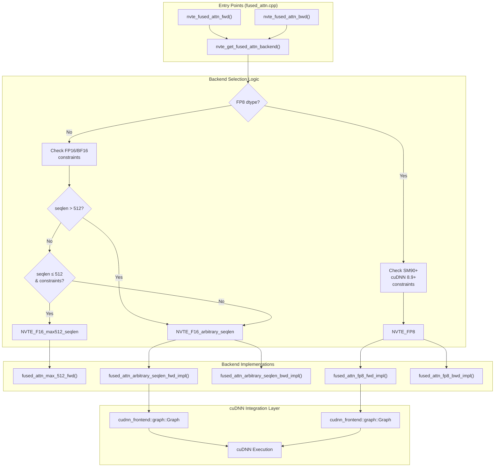
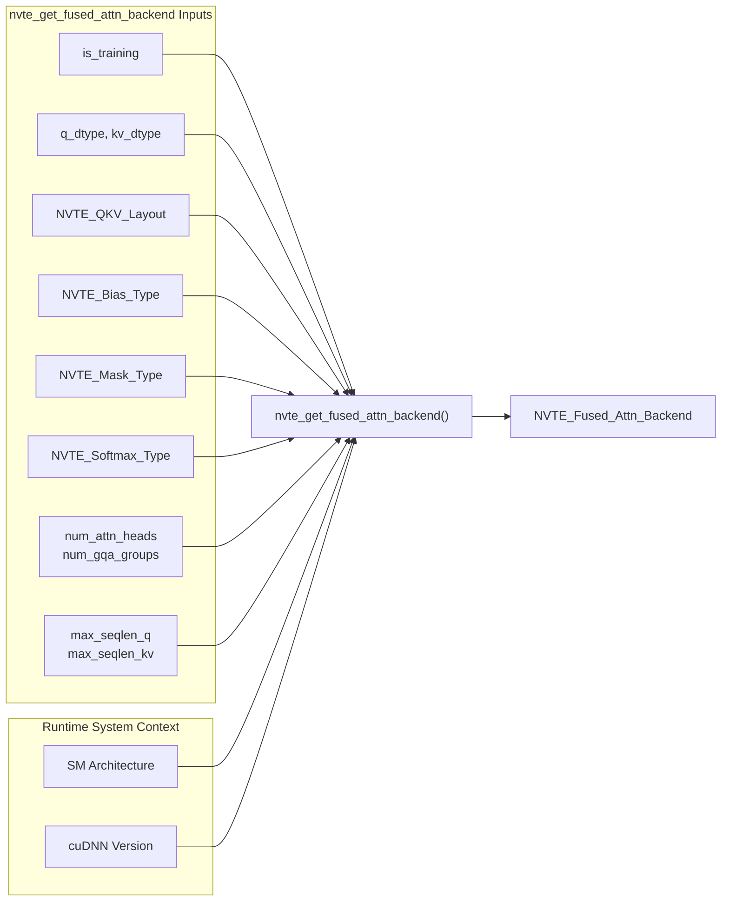

<!-- source: DeepWiki mcp.deepwiki.com · repo NVIDIA/TransformerEngine · page 6.2 Fused Attention Backend · fetched 2026-10-26 -->

# Fused Attention Backend

Relevant source files

The following files were used as context for generating this wiki page:

- [docs/examples/te_gemma/tutorial_generation_gemma_with_te.ipynb](docs/examples/te_gemma/tutorial_generation_gemma_with_te.ipynb)
- [tests/pytorch/attention/test_cp_utils.py](tests/pytorch/attention/test_cp_utils.py)
- [transformer_engine/common/fused_attn/context_parallel.cu](transformer_engine/common/fused_attn/context_parallel.cu)
- [transformer_engine/common/fused_attn/flash_attn.cu](transformer_engine/common/fused_attn/flash_attn.cu)
- [transformer_engine/common/fused_attn/fused_attn.cpp](transformer_engine/common/fused_attn/fused_attn.cpp)
- [transformer_engine/common/fused_attn/fused_attn_f16_arbitrary_seqlen.cu](transformer_engine/common/fused_attn/fused_attn_f16_arbitrary_seqlen.cu)
- [transformer_engine/common/fused_attn/fused_attn_f16_arbitrary_seqlen.h](transformer_engine/common/fused_attn/fused_attn_f16_arbitrary_seqlen.h)
- [transformer_engine/common/fused_attn/fused_attn_fp8.cu](transformer_engine/common/fused_attn/fused_attn_fp8.cu)
- [transformer_engine/common/fused_attn/fused_attn_fp8.h](transformer_engine/common/fused_attn/fused_attn_fp8.h)
- [transformer_engine/common/fused_attn/kv_cache.cu](transformer_engine/common/fused_attn/kv_cache.cu)
- [transformer_engine/common/fused_attn/utils.cu](transformer_engine/common/fused_attn/utils.cu)
- [transformer_engine/common/fused_attn/utils.h](transformer_engine/common/fused_attn/utils.h)
- [transformer_engine/common/include/transformer_engine/fused_attn.h](transformer_engine/common/include/transformer_engine/fused_attn.h)
- [transformer_engine/pytorch/attention/inference.py](transformer_engine/pytorch/attention/inference.py)
- [transformer_engine/pytorch/cpp_extensions/fused_attn.py](transformer_engine/pytorch/cpp_extensions/fused_attn.py)

## Purpose and Scope

The Fused Attention Backend is the core C++/CUDA implementation layer that executes scaled dot-product attention (SDPA) operations using optimized cuDNN kernels. This system dynamically selects one of three specialized backends based on input characteristics (data type, sequence length, hardware capabilities) and constructs cuDNN execution graphs that fuse attention operations for maximum performance.

This page covers backend selection logic, cuDNN graph construction, and kernel dispatch. For the Python interface to fused attention, see [4.4](). For JAX-specific attention primitives, see [5.3]().

**Sources:** [transformer_engine/common/fused_attn/fused_attn.cpp:1-659](), [transformer_engine/common/include/transformer_engine/fused_attn.h:1-442]()

---

## Backend Architecture Overview

The fused attention system consists of specialized backends optimized for different scenarios. The logic is primarily driven by cuDNN Frontend and C++ core functions.

**Backend Characteristics:**

| Backend | Data Types | Max Sequence Length | Target Hardware | cuDNN Version |
|---------|-----------|---------------------|-----------------|---------------|
| `NVTE_F16_max512_seqlen` | FP16/BF16 | ≤ 512 (aligned to 64) | SM80, SM90 | 8.9.1+ |
| `NVTE_F16_arbitrary_seqlen` | FP16/BF16 | Any length | SM80+ | 8.9.0+ |
| `NVTE_FP8` | FP8 E4M3/E5M2 | Any (version dependent) | SM90+ | 8.9.0+ |

**Sources:** [transformer_engine/common/fused_attn/fused_attn.cpp:222-535](), [transformer_engine/common/include/transformer_engine/fused_attn.h:153-164]()

---

## Backend Selection Logic

The `nvte_get_fused_attn_backend()` function implements the decision tree that evaluates input parameters and hardware capabilities.

### Selection Parameters

The system maps Python/JAX inputs to C++ enums for layout and type checking.

### FP8 Backend Selection Criteria

The FP8 backend is selected for Hopper (SM90) and newer architectures when inputs are FP8.

**Key constraints:**
- **Hardware:** SM90+ (Hopper) [transformer_engine/common/fused_attn/fused_attn.cpp:250]().
- **Bias:** No support for pre/post scale bias or ALiBi in early FP8 versions [transformer_engine/common/fused_attn/fused_attn_fp8.cu:46-47]().
- **Layouts:** Supports standard formats like `BSHD` and `SBHD` [transformer_engine/common/fused_attn/fused_attn.cpp:261]().
- **Sequence Length:** Modern cuDNN versions (9.2.1+) support any sequence length for FP8, often requiring 128-alignment for optimal performance [transformer_engine/common/fused_attn/fused_attn.cpp:265]().

### F16/BF16 Backend Selection Criteria

For high-precision types, the logic prioritizes `NVTE_F16_arbitrary_seqlen` for flexibility or `NVTE_F16_max512_seqlen` for specific optimizations on shorter sequences.

**F16 Max512 Backend (`flag_m512`):**
- **Sequence Length:** `max_seqlen_q <= 512` and `max_seqlen_kv <= 512` [transformer_engine/common/fused_attn/fused_attn.cpp:290-291]().
- **Head Dimension:** Specifically optimized for 64 [transformer_engine/common/fused_attn/fused_attn.cpp:292]().
- **GQA:** Generally requires `num_attn_heads == num_gqa_groups` [transformer_engine/common/fused_attn/fused_attn.cpp:293]().

**F16 Arbitrary Backend (`flag_arb`):**
- Supports Grouped Query Attention (GQA) [transformer_engine/common/fused_attn/fused_attn.cpp:321]().
- Supports ALiBi bias [transformer_engine/common/fused_attn/fused_attn.cpp:333]().
- Supports sliding window attention [transformer_engine/common/fused_attn/fused_attn.cpp:350]().
- Supports Paged KV cache for inference [transformer_engine/common/fused_attn/fused_attn.cpp:359]().

**Sources:** [transformer_engine/common/fused_attn/fused_attn.cpp:248-535]()

---

## Backend Implementations

### F16 Arbitrary Backend

The `fused_attn_arbitrary_seqlen_fwd_impl` function uses the `cudnn_frontend::graph::Graph` API to construct an SDPA node.

**Key Implementation Features:**
- **Ragged Support:** Handles `THD` format by using `set_ragged_offset` on cuDNN tensors to support variable sequence lengths in a batch [transformer_engine/common/fused_attn/fused_attn_f16_arbitrary_seqlen.cu:215-222]().
- **Paged KV Cache:** Integrates `page_table_k` and `page_table_v` into the graph for memory-efficient inference [transformer_engine/common/fused_attn/fused_attn_f16_arbitrary_seqlen.cu:297-313]().
- **Sliding Window:** Configures `diagonal_band_left_bound` and `diagonal_band_right_bound` [transformer_engine/common/fused_attn/fused_attn_f16_arbitrary_seqlen.cu:331-332]().

### FP8 Backend

The `fused_attn_fp8_fwd_impl` manages the quantization flow required for FP8 attention.

**Data Flow in FP8 FWD:**
1. **Descaling:** Q, K, and V are descaled using `devPtrDescaleQ`, `devPtrDescaleK`, and `devPtrDescaleV` [transformer_engine/common/fused_attn/fused_attn_fp8.cu:25-27]().
2. **Softmax Statistics:** The backend generates `M` (max logit) for the backward pass [transformer_engine/common/fused_attn/fused_attn_fp8.cu:25]().
3. **Scaling:** The output `O` and intermediate scores `S` are scaled using `devPtrScaleO` and `devPtrScaleS` before being quantized to FP8 [transformer_engine/common/fused_attn/fused_attn_fp8.cu:26-27]().

**Sources:** [transformer_engine/common/fused_attn/fused_attn_f16_arbitrary_seqlen.cu:50-179](), [transformer_engine/common/fused_attn/fused_attn_fp8.cu:19-128]()

---

## cuDNN Integration and Graph Caching

The backend relies on the `cudnn_frontend` to build and execute operation graphs. To avoid the overhead of graph construction on every call, a caching mechanism is used.

### Descriptor-based Caching

A `FADescriptor_v1` struct captures all parameters that define a unique graph structure.

**Descriptor Fields include:**
- Tensor dimensions (`b`, `h`, `s_q`, `d_qk`, etc.) [transformer_engine/common/fused_attn/utils.h:89-91]().
- Attention metadata (`attnScale`, `isTraining`, `dropoutProbability`) [transformer_engine/common/fused_attn/utils.h:97-99]().
- Masking and Bias types (`mask_type`, `bias_type`) [transformer_engine/common/fused_attn/utils.h:101-104]().
- Data types for I/O tensors [transformer_engine/common/fused_attn/utils.h:108-111]().

The implementation uses a `thread_local` cache (e.g., `sdpa_f16_fprop_cache`) to store pre-built cuDNN graphs, keyed by this descriptor [transformer_engine/common/fused_attn/fused_attn_f16_arbitrary_seqlen.cu:179]().

**Sources:** [transformer_engine/common/fused_attn/utils.h:88-139](), [transformer_engine/common/fused_attn/fused_attn_f16_arbitrary_seqlen.cu:131-155]()

---

## Tensor Layouts and Formats

The backend supports a wide variety of memory layouts defined in `NVTE_QKV_Layout`.

### Layout Mapping

| Layout Enum | Description | Group |
|-------------|-------------|-------|
| `NVTE_SB3HD` | Interleaved QKV, Sequence-Batch-3*Head-Dim | `NVTE_3HD` |
| `NVTE_BSH3D` | Interleaved heads, Batch-Sequence-Head-3*Dim | `NVTE_H3D` |
| `NVTE_THD_T2HD` | Ragged Q, interleaved KV, Tokens-Head-Dim | `NVTE_HD_2HD` |
| `NVTE_Paged_KV_BSHD_BSHD_BSHD` | Batch-Sequence, Paged KV cache | `NVTE_Paged_KV_HD_HD_HD` |

**Utility Functions:**
- `nvte_get_qkv_layout_group`: Maps a layout to its logical group (e.g., separate vs. interleaved) [transformer_engine/common/fused_attn/fused_attn.cpp:100-139]().
- `nvte_get_qkv_format`: Determines the base memory format (e.g., `SBHD` vs `BSHD`) [transformer_engine/common/fused_attn/fused_attn.cpp:142-182]().
- `generateMatrixStridesWithLayout`: Computes memory strides based on the specific layout enum [transformer_engine/common/fused_attn/utils.h:107-212]().

**Sources:** [transformer_engine/common/include/transformer_engine/fused_attn.h:29-101](), [transformer_engine/common/fused_attn/fused_attn.cpp:100-182]()

---

## API Entry Points

### nvte_fused_attn_fwd

The primary forward entry point dispatching to the selected backend.

**Implementation Logic:**
1. Extract batch and sequence dimensions from `input_cu_seqlens_q` and `input_Q` [transformer_engine/common/fused_attn/fused_attn.cpp:569-571]().
2. Determine backend via `nvte_get_fused_attn_backend` [transformer_engine/common/fused_attn/fused_attn.cpp:613]().
3. Dispatch to backend-specific implementation like `fused_attn_arbitrary_seqlen_fwd` [transformer_engine/common/fused_attn/fused_attn.cpp:635-649]().

### nvte_fused_attn_bwd

Computes gradients for Q, K, V, and Bias. It retrieves auxiliary tensors (like softmax statistics `M` or `LSE`) from the `Aux_CTX_Tensors` pack provided by the forward pass [transformer_engine/common/fused_attn/fused_attn.cpp:723-758]().

**Sources:** [transformer_engine/common/fused_attn/fused_attn.cpp:538-778](), [transformer_engine/common/include/transformer_engine/fused_attn.h:220-373]()

---

