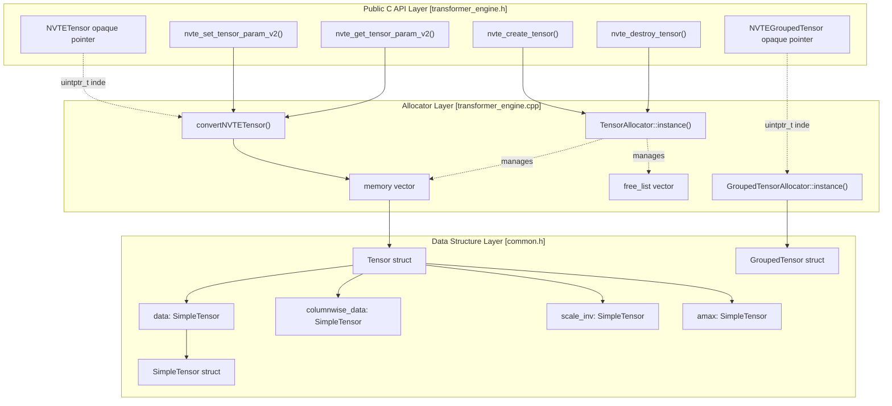
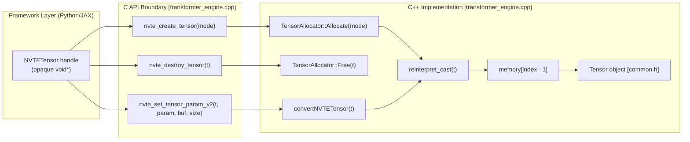
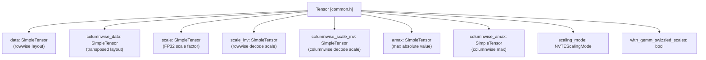
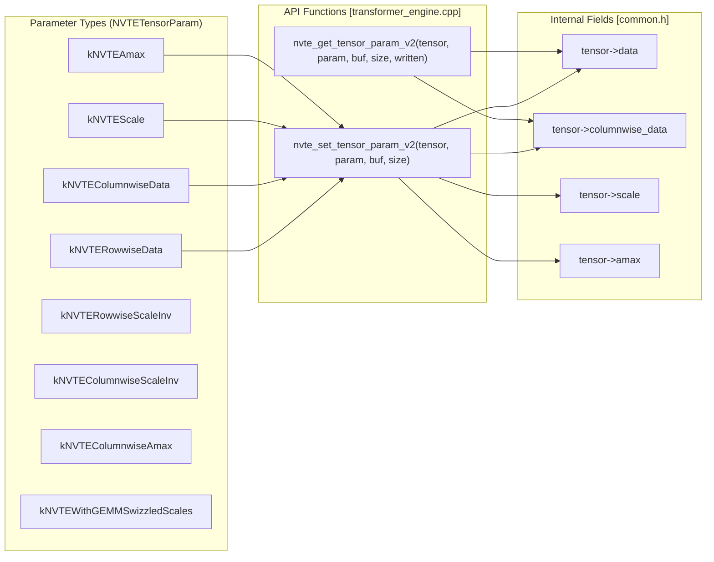

<!-- source: DeepWiki mcp.deepwiki.com · repo NVIDIA/TransformerEngine · page 6.3 Tensor Abstraction System · fetched 2026-10-26 -->

# Tensor Abstraction System

<details>
<summary>Relevant source files</summary>

The following files were used as context for generating this wiki page:

- [.clang-format](.clang-format)
- [tests/cpp/operator/test_softmax.cu](tests/cpp/operator/test_softmax.cu)
- [tests/cpp/test_common.cu](tests/cpp/test_common.cu)
- [tests/cpp/test_common.h](tests/cpp/test_common.h)
- [tests/cpp/util/CMakeLists.txt](tests/cpp/util/CMakeLists.txt)
- [tests/cpp/util/test_nvrtc.cpp](tests/cpp/util/test_nvrtc.cpp)
- [transformer_engine/common/common.h](transformer_engine/common/common.h)
- [transformer_engine/common/hadamard_transform/customized_pipeline.cuh](transformer_engine/common/hadamard_transform/customized_pipeline.cuh)
- [transformer_engine/common/include/transformer_engine/transformer_engine.h](transformer_engine/common/include/transformer_engine/transformer_engine.h)
- [transformer_engine/common/transformer_engine.cpp](transformer_engine/common/transformer_engine.cpp)
- [transformer_engine/common/util/cuda_runtime.cpp](transformer_engine/common/util/cuda_runtime.cpp)
- [transformer_engine/common/util/cuda_runtime.h](transformer_engine/common/util/cuda_runtime.h)
- [transformer_engine/common/util/rtc.cpp](transformer_engine/common/util/rtc.cpp)
- [transformer_engine/common/util/rtc.h](transformer_engine/common/util/rtc.h)
- [transformer_engine/common/util/system.h](transformer_engine/common/util/system.h)
- [transformer_engine/common/utils.cuh](transformer_engine/common/utils.cuh)
- [transformer_engine/pytorch/csrc/type_converters.cpp](transformer_engine/pytorch/csrc/type_converters.cpp)
- [transformer_engine/pytorch/tensor/grouped_tensor.py](transformer_engine/pytorch/tensor/grouped_tensor.py)
- [transformer_engine/pytorch/tensor/storage/grouped_tensor_storage.py](transformer_engine/pytorch/tensor/storage/grouped_tensor_storage.py)

</details>


## Purpose and Scope

The Tensor Abstraction System provides a framework-agnostic C/C++ layer for representing tensor metadata and memory references in TransformerEngine. This system enables PyTorch, JAX, and other frameworks to interface with the common C++ core library without exposing internal data structures across ABI boundaries.

The system manages:
- **Opaque tensor handles** (`NVTETensor`, `NVTEGroupedTensor`) that act as stable identifiers across language boundaries. [transformer_engine/common/include/transformer_engine/transformer_engine.h:136]()
- **Memory layout abstractions** supporting both rowwise and columnwise data for different GEMM configurations. [transformer_engine/common/include/transformer_engine/transformer_engine.h:66-68]()
- **Quantization metadata** including scaling factors, amaxes, and inverse scales for FP8/FP4 formats. [transformer_engine/common/include/transformer_engine/transformer_engine.h:69-73]()
- **Grouped tensor support** for batched operations with varying tensor shapes. [transformer_engine/common/common.h:291-300]()
- **Parameter setting API** for configuring tensor properties without direct structure access. [transformer_engine/common/include/transformer_engine/transformer_engine.h:290-312]()

Sources: [transformer_engine/common/include/transformer_engine/transformer_engine.h:66-136](), [transformer_engine/common/common.h:291-300](), [transformer_engine/common/include/transformer_engine/transformer_engine.h:290-312]()

---

## Architecture Overview

The tensor abstraction consists of three layers: a public C API with opaque handles, an internal C++ implementation with allocators, and underlying data structures that hold actual metadata.



**Figure 1: Tensor Abstraction System Architecture**

The opaque pointer design enables:
1. **ABI stability** - Internal structures can change without breaking framework bindings.
2. **Memory pooling** - Allocators reuse tensor metadata objects via free lists. [transformer_engine/common/transformer_engine.cpp:443-452]()
3. **1-based indexing** - `nullptr` (0) represents invalid tensors, actual indices start at 1. [transformer_engine/common/transformer_engine.cpp:456-464]()
4. **Type safety** - C API uses typed parameters (enums) instead of direct field access. [transformer_engine/common/include/transformer_engine/transformer_engine.h:66-94]()

Sources: [transformer_engine/common/transformer_engine.cpp:414-527](), [transformer_engine/common/common.h:132-289](), [transformer_engine/common/transformer_engine.cpp:443-464](), [transformer_engine/common/include/transformer_engine/transformer_engine.h:66-94]()

---

## Opaque Tensor Handles

### NVTETensor Implementation

`NVTETensor` is defined as `void*` in the C API but internally stores a 1-based index into the `TensorAllocator`'s memory pool. [transformer_engine/common/include/transformer_engine/transformer_engine.h:136](), [transformer_engine/common/transformer_engine.cpp:414-430]()



**Figure 2: NVTETensor Handle Resolution**

The allocator maintains a fixed-capacity vector and a free list for recycling. [transformer_engine/common/transformer_engine.cpp:443-454]()

| Component | Type | Purpose |
|-----------|------|---------|
| `memory` | `std::vector<Tensor>` | Pre-allocated pool of tensor metadata. [transformer_engine/common/transformer_engine.cpp:513]() |
| `free_list` | `std::vector<uintptr_t>` | Indices of available tensor slots. [transformer_engine/common/transformer_engine.cpp:512]() |
| `size` | `std::atomic<size_t>` | Thread-safe count of allocated tensors. [transformer_engine/common/transformer_engine.cpp:511]() |
| `MAX_TENSOR_NUM` | `const size_t` | Maximum capacity based on memory limits. [transformer_engine/common/transformer_engine.cpp:509-510]() |

Sources: [transformer_engine/common/transformer_engine.cpp:414-527](), [transformer_engine/common/include/transformer_engine/transformer_engine.h:136](), [transformer_engine/common/transformer_engine.cpp:509-513]()

---

## Tensor Data Structures

### SimpleTensor

The basic data structure representing a buffer with shape and datatype. [transformer_engine/common/common.h:120-161]()

| Field | Type | Description |
|-------|------|-------------|
| `dptr` | `void*` | Device pointer to data. [transformer_engine/common/common.h:121]() |
| `shape` | `std::vector<size_t>` | Tensor dimensions. [transformer_engine/common/common.h:122]() |
| `dtype` | `DType` | Element datatype (Float32, Float16, etc.). [transformer_engine/common/common.h:123]() |

Sources: [transformer_engine/common/common.h:120-161]()

### Tensor

A comprehensive structure supporting quantized formats with multiple data layouts and scaling metadata. [transformer_engine/common/common.h:163-225]()



**Figure 3: Tensor Structure Fields**

The `Tensor` struct supports dual data layouts because different GEMM configurations require different memory arrangements (e.g., column-major vs row-major). [transformer_engine/common/common.h:165-166]()

Sources: [transformer_engine/common/common.h:163-225]()

### Scaling Modes

| Mode | Description | Scale Layout |
|------|-------------|--------------|
| `NVTE_DELAYED_TENSOR_SCALING` | Per-tensor scaling. [transformer_engine/common/include/transformer_engine/transformer_engine.h:105]() | 1 element (FP32). [transformer_engine/common/transformer_engine.cpp:69-72]() |
| `NVTE_MXFP8_1D_SCALING` | Microscaling FP8, 32-element blocks. [transformer_engine/common/include/transformer_engine/transformer_engine.h:108]() | 2D array (E8M0 dtype). [transformer_engine/common/transformer_engine.cpp:154-158]() |
| `NVTE_NVFP4_1D_SCALING` | 4-bit FP, 16-element blocks. [transformer_engine/common/include/transformer_engine/transformer_engine.h:116]() | 2D array (E4M3 dtype). [transformer_engine/common/transformer_engine.cpp:191-192]() |
| `NVTE_BLOCK_SCALING_1D` | FP8 with 1D blocks. [transformer_engine/common/include/transformer_engine/transformer_engine.h:113]() | 2D array (FP32). [transformer_engine/common/transformer_engine.cpp:94-96]() |

Sources: [transformer_engine/common/include/transformer_engine/transformer_engine.h:105-117](), [transformer_engine/common/transformer_engine.cpp:69-192]()

---

## Parameter Setting API

The C API uses an enum-based parameter system to set tensor properties without exposing struct fields directly to framework bindings. [transformer_engine/common/include/transformer_engine/transformer_engine.h:290-312]()



**Figure 4: Parameter API Design**

The parameter sizes are validated via internal checks to ensure buffers provided by frameworks match expected metadata sizes. [transformer_engine/common/transformer_engine.cpp:91-141]()

Sources: [transformer_engine/common/include/transformer_engine/transformer_engine.h:290-312](), [transformer_engine/common/transformer_engine.cpp:91-141]()

---

## Grouped Tensors

`GroupedTensor` represents a collection of tensors with potentially different shapes but the same dtype and scaling mode, optimized for batched kernels. [transformer_engine/pytorch/tensor/storage/grouped_tensor_storage.py:23-49]()

### GroupedTensor Structure (C++)

Defined in `common.h`, this structure holds flattened buffers for multiple tensors. [transformer_engine/common/common.h:291-325]()

| Field | Type | Description |
|-------|------|-------------|
| `data` | `SimpleTensor` | 1D flattened data for all group members. [transformer_engine/common/common.h:292]() |
| `num_tensors` | `size_t` | Number of tensors in the group. [transformer_engine/common/common.h:303]() |
| `tensor_offsets` | `SimpleTensor` | Element offsets to the start of each member. [transformer_engine/common/common.h:308]() |
| `logical_shape` | `NVTEShape` | Conceptual 2D layout of the grouped data. [transformer_engine/common/common.h:311]() |

Sources: [transformer_engine/common/common.h:291-325]()

### Data Layout (Python Integration)

In the PyTorch integration, `GroupedTensorStorage` manages the physical buffers for grouped tensors and maps them to the C++ abstraction. [transformer_engine/pytorch/tensor/storage/grouped_tensor_storage.py:52-173]()

| Field | Description |
|-------|-------------|
| `logical_shape` | 2D shape representing the conceptual layout of stacked member tensors. [transformer_engine/pytorch/tensor/storage/grouped_tensor_storage.py:30-35]() |
| `tensor_offsets` | Device tensor (int64) used for CSR-style indexing into the contiguous 1D layout. [transformer_engine/pytorch/tensor/storage/grouped_tensor_storage.py:136-141]() |
| `row_scaled_nvfp4` | Flag indicating if NVFP4 tensors use per-row scaling instead of per-tensor scaling. [transformer_engine/pytorch/tensor/storage/grouped_tensor_storage.py:153-154]() |

Sources: [transformer_engine/pytorch/tensor/storage/grouped_tensor_storage.py:30-154]()

---

## Validation and Error Checking

### Input Tensor Validation

TransformerEngine performs strict validation on input tensors to ensure quantization metadata is present for low-precision types. [transformer_engine/common/transformer_engine.cpp:143-165]()

```cpp
void CheckInputTensor(const Tensor &t, std::string_view name, bool check_scale_inv_shapes) {
  const DType type = t.dtype();
  if (is_fp8_dtype(type)) {
    // FP8 input needs to have scale_inv
    if (t.has_data()) {
      NVTE_CHECK(t.scale_inv.has_data(), "FP8 scaling factor input ", name, "_scale_inverse must be allocated");
    }
  }
}
```

Sources: [transformer_engine/common/transformer_engine.cpp:143-165]()

### Scale Tensor Shape Validation

Validation logic ensures that scale buffers match the expected dimensions for the scaling mode (e.g., block alignment for MXFP8 or NVFP4). [transformer_engine/common/transformer_engine.cpp:91-141]()

Sources: [transformer_engine/common/transformer_engine.cpp:91-141]()

---

