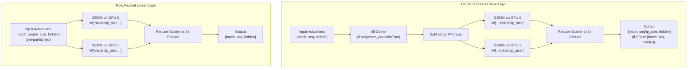
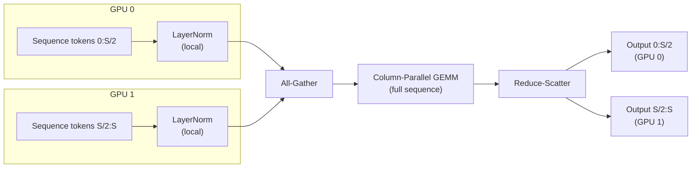
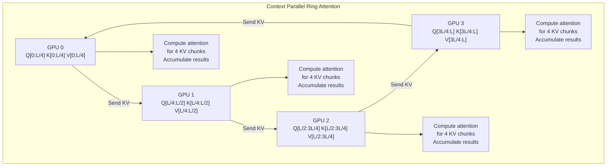
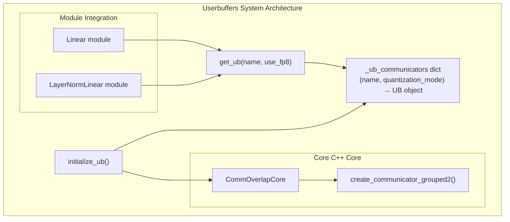

<!-- source: DeepWiki mcp.deepwiki.com · repo NVIDIA/TransformerEngine · page 7 Distributed Training · fetched 2026-10-26 -->

# Distributed Training

<details>
<summary>Relevant source files</summary>

The following files were used as context for generating this wiki page:

- [examples/pytorch/comm_gemm_overlap/te_layer_with_overlap.py](examples/pytorch/comm_gemm_overlap/te_layer_with_overlap.py)
- [qa/L0_pytorch_unittest/test.sh](qa/L0_pytorch_unittest/test.sh)
- [tests/pytorch/distributed/run_gemm_with_overlap.py](tests/pytorch/distributed/run_gemm_with_overlap.py)
- [tests/pytorch/distributed/run_layer_with_overlap.py](tests/pytorch/distributed/run_layer_with_overlap.py)
- [tests/pytorch/distributed/test_comm_gemm_overlap.py](tests/pytorch/distributed/test_comm_gemm_overlap.py)
- [transformer_engine/common/comm_gemm_overlap/comm_gemm_overlap.cpp](transformer_engine/common/comm_gemm_overlap/comm_gemm_overlap.cpp)
- [transformer_engine/common/comm_gemm_overlap/userbuffers/userbuffers-host.cpp](transformer_engine/common/comm_gemm_overlap/userbuffers/userbuffers-host.cpp)
- [transformer_engine/common/comm_gemm_overlap/userbuffers/userbuffers.cu](transformer_engine/common/comm_gemm_overlap/userbuffers/userbuffers.cu)
- [transformer_engine/common/comm_gemm_overlap/userbuffers/userbuffers.h](transformer_engine/common/comm_gemm_overlap/userbuffers/userbuffers.h)
- [transformer_engine/common/include/transformer_engine/comm_gemm_overlap.h](transformer_engine/common/include/transformer_engine/comm_gemm_overlap.h)
- [transformer_engine/pytorch/csrc/extensions/comm_gemm_overlap.cpp](transformer_engine/pytorch/csrc/extensions/comm_gemm_overlap.cpp)
- [transformer_engine/pytorch/distributed.py](transformer_engine/pytorch/distributed.py)
- [transformer_engine/pytorch/module/_common.py](transformer_engine/pytorch/module/_common.py)
- [transformer_engine/pytorch/module/base.py](transformer_engine/pytorch/module/base.py)
- [transformer_engine/pytorch/module/grouped_linear.py](transformer_engine/pytorch/module/grouped_linear.py)
- [transformer_engine/pytorch/module/layernorm_linear.py](transformer_engine/pytorch/module/layernorm_linear.py)
- [transformer_engine/pytorch/module/layernorm_mlp.py](transformer_engine/pytorch/module/layernorm_mlp.py)
- [transformer_engine/pytorch/module/linear.py](transformer_engine/pytorch/module/linear.py)
- [transformer_engine/pytorch/utils.py](transformer_engine/pytorch/utils.py)

</details>


## Purpose and Scope

This page documents TransformerEngine's distributed training capabilities, covering techniques for training large transformer models across multiple GPUs. TransformerEngine provides three primary parallelism strategies: **Tensor Parallelism (TP)**, **Sequence Parallelism (SP)**, and **Context Parallelism (CP)**, along with advanced communication-computation overlap mechanisms via **Userbuffers**.

For details on specific module implementations, see [PyTorch Integration](#4). For JAX-specific sharding and SPMD features, see [JAX Integration](#5). For basic architecture concepts, see [Architecture](#3).

---

## Distributed Training Strategies

TransformerEngine supports multiple parallelism dimensions that can be combined to scale transformer training efficiently.

### Tensor Parallelism

Tensor Parallelism partitions individual weight matrices and computations across multiple GPUs within a tensor-parallel group. TransformerEngine implements two modes:

**Column Parallelism**: The weight matrix is partitioned along the output dimension. Each GPU holds a subset of output features and performs a local GEMM. For sequence parallel mode, an **all-gather** of input activations precedes the GEMM; otherwise, input is replicated. Output requires a **reduce-scatter** (sequence parallel) or **all-reduce** (tensor parallel) across the TP group.

**Row Parallelism**: The weight matrix is partitioned along the input dimension. Each GPU holds a subset of input features. Input typically arrives pre-partitioned from the preceding column-parallel layer. Output from all GPUs must be combined via **reduce-scatter** (sequence parallel) or **all-reduce** (tensor parallel).



**Sources:**
- [transformer_engine/pytorch/module/linear.py:132-136]()
- [transformer_engine/pytorch/module/layernorm_linear.py:165-166]()
- [transformer_engine/pytorch/distributed.py:150-164]()

### Sequence Parallelism

Sequence Parallelism partitions the sequence dimension across GPUs in the tensor-parallel group, reducing activation memory by a factor of `tp_size`. This is particularly beneficial for long sequences.

**Key Mechanism**: 
- **Column-parallel layers**: Input activations are gathered from all GPUs before GEMM, then output is reduce-scattered back along the sequence dimension.
- [transformer_engine/pytorch/module/linear.py:51-53]() and [transformer_engine/pytorch/module/layernorm_linear.py:53-55]() define the `gather_along_first_dim` and `reduce_scatter_along_first_dim` primitives used.
- **Non-GEMM operations** (LayerNorm, Dropout): Operate on local sequence chunks independently.

**Memory Savings**: Activation memory scales as `O(batch * seq / tp_size * hidden)` instead of `O(batch * seq * hidden)`.



**Sources:**
- [transformer_engine/pytorch/module/linear.py:136-136]()
- [transformer_engine/pytorch/module/layernorm_linear.py:130-130]()
- [transformer_engine/pytorch/distributed.py:208-226]()

### Context Parallelism

Context Parallelism (CP) parallelizes attention computation across extremely long sequences. It partitions the query and key-value sequences across a context-parallel group. For details, see [Context Parallelism](#7.1).

**Strategies**:
1. **ALL_GATHER**: Each GPU computes attention for its local query chunk against the full key-value sequence.
2. **RING**: Implements Ring Attention where key-value pairs are rotated through GPUs in a ring topology.

**Load Balancing**: TransformerEngine provides reordering strategies to mitigate imbalance. The `layers_atomic_ring_exchange` list in [transformer_engine/pytorch/module/base.py:87-87]() tracks layers using this mechanism.



**Sources:**
- [transformer_engine/pytorch/module/base.py:87-87]()
- [tests/pytorch/distributed/run_layer_with_overlap.py:113-114]()

---

## Communication Overlap with Userbuffers

### Overview

**Userbuffers** is TransformerEngine's mechanism for overlapping communication (all-gather, reduce-scatter) with GEMM computation. For details, see [Communication Overlap with Userbuffers](#7.3).

**Overlap Methods**:

| Method | Description |
|--------|-------------|
| `ring_exchange` | Point-to-point communication in ring topology, atomic GEMM support. |
| `pipeline` | Pipelined communication with GEMM splits. |
| `bulk` | Bulk overlap for dgrad/wgrad phases. |

**Sources:**
- [transformer_engine/pytorch/module/base.py:157-176]()
- [transformer_engine/common/comm_gemm_overlap/comm_gemm_overlap.cpp:57-80]()

### Initialization and Configuration

Userbuffers must be initialized with `initialize_ub()`. This allocates communication buffers and sets up overlap configurations.

```python
import transformer_engine.pytorch as te

te.initialize_ub(
    shape=[batch_size * seq_len, hidden_size],
    tp_size=tp_size,
    quantization_modes=[te.UserBufferQuantizationMode.FP8],
    ub_cfgs={
        "qkv_fprop": {
            "method": "ring_exchange",
            "num_sm": 1,
            "atomic_gemm": True,
        }
    }
)
```

**Sources:**
- [transformer_engine/pytorch/module/base.py:126-184]()
- [transformer_engine/common/comm_gemm_overlap/userbuffers/userbuffers-host.cpp:144-170]()

### Userbuffers Architecture



**Sources:**
- [transformer_engine/pytorch/module/base.py:23-25]()
- [transformer_engine/common/comm_gemm_overlap/comm_gemm_overlap.cpp:57-63]()
- [transformer_engine/common/comm_gemm_overlap/userbuffers/userbuffers-host.cpp:144-148]()

---

## PyTorch Distributed Implementation

### Key Functions and Patterns

**Tensor Partitioning**:

| Function | Purpose |
|----------|---------|
| `split_tensor_into_1d_equal_chunks()` | Partition tensor into equal chunks across TP group. |
| `set_tensor_model_parallel_attributes()` | Mark tensors with TP attributes. |

**Communication Primitives**:

| Function | Operation |
|----------|-----------|
| `allreduce()` | Sum tensors across group. |
| `symmetric_all_reduce()` | Symmetric all-reduce with type selection. |
| `gather_along_first_dim()` | All-gather along first dimension. |
| `reduce_scatter_along_first_dim()` | Reduce-scatter along first dimension. |

**Sources:**
- [transformer_engine/pytorch/distributed.py:150-164]()
- [transformer_engine/pytorch/distributed.py:167-171]()
- [transformer_engine/pytorch/distributed.py:440-523]()

### Activation Checkpointing

TransformerEngine provides a `checkpoint()` function that integrates with distributed training, supporting activation recomputation to save memory.

**Key Features**:
- Compatible with tensor/sequence parallelism.
- Supports FP8 activation recompute phases via `in_fp8_activation_recompute_phase()`.
- Correctly handles RNG states across recomputation via `CudaRNGStatesTracker`.

**Sources:**
- [transformer_engine/pytorch/distributed.py:54-54]()
- [transformer_engine/pytorch/distributed.py:65-66]()
- [transformer_engine/pytorch/distributed.py:98-102]()

---

## Memory Optimization

### CPU Offloading

CPU offloading reduces GPU memory usage by moving saved activations to CPU memory during the forward pass and reloading them for backward.

**Workflow**:
1. **Forward**: Mark tensors with `start_offload()` or `mark_activation_offload()`.
2. **Backward**: Reload tensors asynchronously before they are needed for gradient calculation.

**Sources:**
- [transformer_engine/pytorch/cpu_offload.py:69-74]()
- [transformer_engine/pytorch/module/linear.py:158-158]()
- [transformer_engine/pytorch/module/layernorm_linear.py:127-127]()

---

